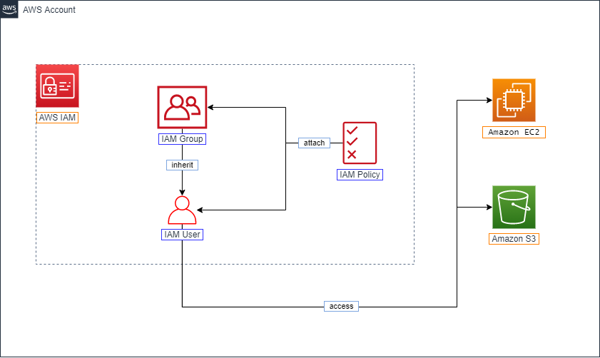
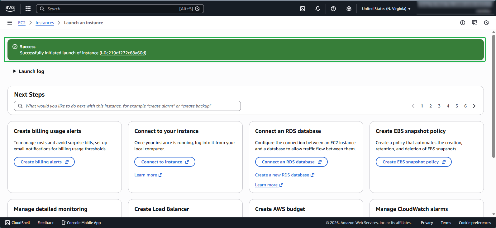

---
title: "Week 1"
date: 2026-09-14
weight: 1
chapter: false
pre: " <b> 1.1. </b> "
---


### Week 1 Objectives:

- Familiarize with cloud computing fundamentals and foundational infrastructure services following the **Explore AWS Services** curriculum on [The First Cloud Journey](https://cloudjourney.awsfcaj.com/).
- Master initial cost governance principles using **AWS Budgets** and implement robust identity governance according to the principle of least privilege with **AWS IAM**.
- Hands-on architecting and provisioning of isolated cloud networks (**Amazon VPC**), compute instance management (**Amazon EC2**), and object storage hosting (**Amazon S3**).
- Dedicate Friday to synthesizing weekly technical knowledge, finalizing comprehensive Worklog documentation, and formulating initial concepts for the internship **Capstone Project Proposal**.

---

### Tasks to be Carried Out This Week:

| Day | Task | Start Date | Completion Date | Reference Material |
| :--- | :--- | :---: | :---: | :--- |
| **Monday** | **Cost Governance & Identity Security:** <br>- Establishing account governance & budget alerts with [AWS Budgets (000007)](https://000007.awsfcaj.com). <br>- Identity management and access control with [AWS IAM (000002)](https://000002.awsfcaj.com). <br>- Enforcing Multi-Factor Authentication (MFA) across all administrative access paths. | 09/14/2026 | 09/14/2026 | [000007](https://000007.awsfcaj.com) & [000002](https://000002.awsfcaj.com) |
| **Tuesday** | **Core Networking Infrastructure (VPC Essentials):** <br>- Provisioning an isolated cloud network via [Amazon VPC (000003)](https://000003.awsfcaj.com) (Subnets, Route Tables, Internet Gateway). <br>- Implementing structural segregation between Public Subnets (Internet-facing) and Private Subnets (DB/Backend). | 09/15/2026 | 09/15/2026 | [Amazon VPC Workshop (000003)](https://000003.awsfcaj.com) |
| **Wednesday** | **Elastic Compute Services (EC2 Compute Basics):** <br>- Launching and configuring virtual servers with [Amazon EC2 (000004)](https://000004.awsfcaj.com). <br>- Configuring Security Groups, Key Pairs, SSH terminal connectivity, and web server installation. | 09/16/2026 | 09/16/2026 | [Amazon EC2 Workshop (000004)](https://000004.awsfcaj.com) |
| **Thursday** | **Object Storage & Static Website Hosting (S3 Storage):** <br>- Provisioning S3 Buckets, uploading objects, and managing Storage Classes with [Amazon S3 (000057)](https://000057.awsfcaj.com). <br>- Enabling Static Website Hosting and configuring public-read Bucket Policies. | 09/17/2026 | 09/17/2026 | [Amazon S3 Workshop (000057)](https://000057.awsfcaj.com) |
| **Friday** | **Week 1 Review, Worklog Completion & Project Work:** <br>- **Knowledge Review:** Consolidate foundational services mastered throughout the week (IAM, VPC, EC2, S3). <br>- **Worklog Completion:** Finalize bilingual Week 1 documentation and execute clean resource teardowns. <br>- **Project Work:** Analyze business constraints and technical requirements for the Capstone Project Proposal. | 09/18/2026 | 09/18/2026 | [FCAJ Roadmap](https://cloudjourney.awsfcaj.com/) |

---

### Daily In-Depth Learning Outcomes & Key Takeaways:

#### 📌 Monday (09/14/2026) - Cost Governance (AWS Budgets) & Identity Security (AWS IAM)

* **What did we learn today?**
  * **Proactive Cloud FinOps via AWS Budgets:**
    * Mitigated "bill shock" risks by establishing automated financial guardrails before deploying cloud infrastructure.
    * Configured a Monthly Cost Budget capped at $10.00.
    * Configured two automated notification thresholds: Actual spend reaching 80% ($8.00) and Forecasted spend reaching 100% ($10.00), triggering instant alert emails to prevent budget overruns.
  * **Zero-Trust Identity Hardening via AWS IAM:**
    * Locked down the Root Account, strictly adhering to the principle of never utilizing root credentials for day-to-day engineering activities.
    * Created a dedicated IAM User `admin-dev` for hands-on technical operations.
    * Enforced role-based access through IAM User Groups rather than attaching direct user policies, associating the `AdministratorAccess` AWS Managed Policy according to the principle of least privilege.
    * Enforced strict Password Policies: minimum 12 characters requiring uppercase, lowercase, numbers, and symbols.
    * Enforced Virtual Multi-Factor Authentication (MFA) via Google Authenticator across both Root and IAM User accounts.


*Figure 1.1.1: IAM identity governance topology enforcing least privilege resource access control.*

* **Encountered Challenges & Solutions:**
  * *Budget Notification Email Not Delivering:* Email address syntax typo during budget creation prevented delivery. Solution: Verified notification parameters within AWS Budgets, resubmitted the recipient address, and confirmed the SNS subscription confirmation link via Gmail.
  * *MFA Lockout Risk During Device Reset:* Acknowledged the critical best practice of securely archiving the MFA backup seed key offline to mitigate permanent account lockout.

---

#### 📌 Tuesday (09/15/2026) - Isolated Cloud Networking via Amazon VPC

* **What did we learn today?**
  * **Virtual Private Cloud (VPC) Subnet Topologies:**
    * Defined Classless Inter-Domain Routing (CIDR) blocks, creating VPC `fcaj-vpc` with `10.0.0.0/16` (allocating 65,536 private IP addresses).
    * Subdivided the network across two Availability Zones (`us-east-1a` and `us-east-1b`):
      * *Public Subnets:* `10.0.1.0/24` (AZ-a) and `10.0.2.0/24` (AZ-b) allocated for edge workloads (ALB, Web Servers). Enabled `Enable auto-assign public IPv4 address`.
      * *Private Subnets:* `10.0.10.0/24` (AZ-a) and `10.0.20.0/24` (AZ-b) reserved for databases and application tiers, completely isolated from direct internet access.
  * **Traffic Routing via Internet Gateway & Route Tables:**
    * Provisioned Internet Gateway `fcaj-igw` and attached it to VPC `fcaj-vpc`.
    * Created `Public-Route-Table`, added a default route `0.0.0.0/0` targeting `fcaj-igw`, and associated both Public Subnets.
    * Created `Private-Route-Table` containing solely local internal routing `10.0.0.0/16 local`, ensuring total internet isolation for backend workloads.


*Figure 1.1.2: Amazon VPC resource topology with multi-AZ subnets and active Internet Gateway routing.*

* **Encountered Challenges & Solutions:**
  * *Public Subnet Instances Lacking Public IPs:* Launched instances only acquired private addresses. Root cause: Newly provisioned custom subnets do not enable auto-assigning public IPv4 addresses by default. Solution: Selected Public Subnet ➔ `Actions` ➔ `Edit subnet settings` ➔ Enabled `Enable auto-assign public IPv4 address`.

---

#### 📌 Wednesday (09/16/2026) - Elastic Compute Operations with Amazon EC2

* **What did we learn today?**
  * **EC2 Virtual Machine Lifecycle & Configuration:**
    * Deployed the **Amazon Linux 2023 AMI** optimized for AWS Nitro system architectures.
    * Selected the `t2.micro` instance tier (1 vCPU, 1GB RAM) under AWS Free Tier eligibility.
    * Generated an RSA cryptographic key pair `fcaj-keypair.pem` for secure remote terminal access.
  * **Virtual Firewall Hardening via Security Groups:**
    * Provisioned `web-server-sg` bound to `fcaj-vpc`.
    * Inbound rule configuration:
      * Port `22` (SSH): Strictly restricted to `My IP` to prevent automated brute-force attempts from public internet scanners.
      * Port `80` (HTTP): Open to `0.0.0.0/0` to allow worldwide web traffic.
  * **SSH Terminal Execution & Web Daemon Provisioning:**
    ```bash
    chmod 400 fcaj-keypair.pem
    ssh -i "fcaj-keypair.pem" ec2-user@<EC2-PUBLIC-IP>
    sudo dnf update -y
    sudo dnf install -y httpd
    sudo systemctl start httpd
    sudo systemctl enable httpd
    echo "<h1>Welcome to AWS First Cloud Journey - EC2 Running!</h1>" | sudo tee /var/www/html/index.html
    ```


*Figure 1.1.3: Amazon EC2 compute instance operating in running state on AWS.*

* **Encountered Challenges & Solutions:**
  * *SSH Key Permission Error (`Permissions 0644 are too open`):* SSH rejected connection attempts. Root cause: Overly permissive key file access permissions. Solution: Executed `chmod 400 fcaj-keypair.pem` on Unix terminals (or stripped inherited permissions via Windows security settings).

---

#### 📌 Thursday (09/17/2026) - Object Storage & Static Website Hosting via Amazon S3

* **What did we learn today?**
  * **Cloud Object Storage Fundamentals with Amazon S3:**
    * Mastered the **Global Namespace** requirement: Bucket names must be globally unique across all AWS regions and adhere to DNS naming conventions. Created bucket `fcaj-static-web-887086382708`.
    * Analyzed cost-optimization storage classes: S3 Standard (frequent access), S3 Standard-IA (infrequent access with millisecond retrieval), and S3 Glacier Flexible Retrieval (long-term archival).
    * Enabled **Bucket Versioning** to safeguard assets against accidental overwrites and deletions.
  * **Static Website Hosting Deployment:**
    * Enabled `Static website hosting`, designating `index.html` as the index document and `error.html` as the error document.
    * Disabled `Block Public Access` (BPA) strictly for this public-facing web hosting bucket.
    * Applied a public-read Bucket Policy granting anonymous GET permissions:
      ```json
      {
        "Version": "2012-10-17",
        "Statement": [
          {
            "Sid": "PublicReadGetObject",
            "Effect": "Allow",
            "Principal": "*",
            "Action": "s3:GetObject",
            "Resource": "arn:aws:s3:::fcaj-static-web-887086382708/*"
          }
        ]
      }
      ```
    * Successfully verified website availability via the S3 website endpoint: `http://fcaj-static-web-887086382708.s3-website-us-east-1.amazonaws.com`.
* **Encountered Challenges & Solutions:**
  * *HTTP `403 Forbidden` on S3 Website Endpoint:* Browser returned access denied. Root cause: Missing public-read bucket policy or failure to uncheck all four Block Public Access toggles. Solution: Updated the bucket policy JSON and confirmed the public access toggle release.

---

#### 📌 Friday (09/18/2026) - Week 1 Review, Worklog Finalization & Proposal Research

* **What did we learn today?**
  * **Core Infrastructure Architecture Synthesis:**
    * **Identity (IAM):** Outer perimeter gatekeeper defining *Who* can do *What*.
    * **Network (VPC):** Isolation boundary and traffic routing backbone.
    * **Compute (EC2):** Workload processing engine hosting scalable application daemons.
    * **Storage (S3):** Durable object repository delivering 99.999999999% (11 9s) of data durability.
  * **FinOps Resource Hygiene:** Stopped EC2 instances when idle to conserve Free Tier runtime hours (750 hours/month), and released unattached Elastic IPs to avoid idle reservation fees.
  * **Capstone Project Proposal Formulation:** Synthesized architectural concepts toward building a resilient Two-Tier Web Application integrating Auto Scaling and managed relational databases on AWS.

