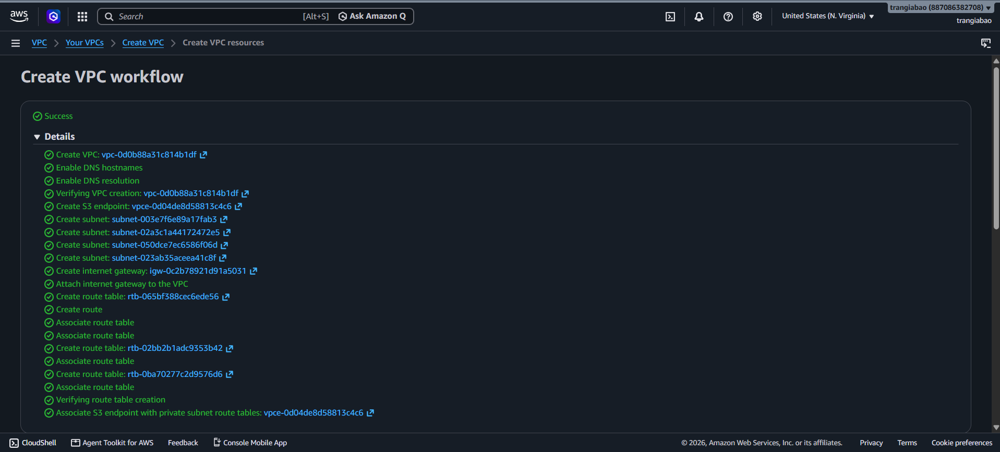

### Week 1 Objectives:

- Get familiar with the AWS cloud computing ecosystem and core infrastructure services (Explore Core AWS Services).
- Master early cost governance principles using AWS Budgets and enforce least-privilege identity access management via AWS IAM.
- Deploy an isolated network environment (Amazon VPC), launch virtual compute instances (Amazon EC2), and configure scalable object storage (Amazon S3).
- Review and synthesize foundational knowledge from the first week while dedicating focused time to research and outline the Project Proposal.

### Tasks to be Carried Out This Week:

| Day | Tasks | Start Date | Completion Date | Reference Sources |
| :--- | :--- | :---: | :---: | :--- |
| **Monday** | **Cost Governance & Identity Security:**  - Set up account guardrails with [AWS Budgets (000007)](https://000007.awsfcaj.com).  - Identity and Access Management with [AWS IAM (000002)](https://000002.awsfcaj.com). | 09/14/2026 | 09/14/2026 | [000007](https://000007.awsfcaj.com) & [000002](https://000002.awsfcaj.com) |
| **Tuesday** | **Core Networking Essentials:**  - Provision an isolated virtual cloud network with [Amazon VPC (000003)](https://000003.awsfcaj.com) (Subnets, Route Tables, Internet Gateway). | 09/15/2026 | 09/15/2026 | [Amazon VPC Workshop (000003)](https://000003.awsfcaj.com) |
| **Wednesday** | **Virtual Compute Basics:**  - Launch and configure virtual servers with [Amazon EC2 (000004)](https://000004.awsfcaj.com) (Security Groups, Key Pairs, SSH connectivity). | 09/16/2026 | 09/16/2026 | [Amazon EC2 Workshop (000004)](https://000004.awsfcaj.com) |
| **Thursday** | **Object Storage & Web Hosting:**  - Create S3 Bucket, manage object storage, and configure Static Website Hosting with [Amazon S3 (000057)](https://000057.awsfcaj.com). | 09/17/2026 | 09/17/2026 | [Amazon S3 Workshop (000057)](https://000057.awsfcaj.com) |
| **Friday** | **Week 1 Synthesis, Worklog Completion & Project Proposal:**  - **Knowledge Synthesis:** Systematically review and consolidate core cloud services learned throughout the week (IAM, VPC, EC2, S3).  - **Worklog Completion:** Document and standardize Week 1 Worklog report and audit active resources.  - **Project Proposal Work:** Research practical problems, analyze technical requirements, and draft the initial Project Proposal blueprint. | 09/18/2026 | 09/18/2026 | [FCAJ Roadmap](https://cloudjourney.awsfcaj.com/) |

---

### Week 1 Achievements:

#### 📌 Monday (09/14/2026) - Cost Governance & Identity Security:
* **Proactive Cost Control with AWS Budgets:** Configured monthly spending limits and established proactive notification thresholds (80%, 100%) alerting directly to email, mitigating the risk of accidental financial overdrafts.
* **Access Control with AWS IAM:**
  * Created dedicated daily IAM user credentials, strictly adhering to the best practice of securing the AWS Root account.
  * Organized users into IAM Groups and attached AWS Managed Policies adhering to the principle of least privilege (PoLP).
  * Enforced Multi-Factor Authentication (MFA) to safeguard administrative access.

*Figure 1.1.1: IAM identity access management model enforcing least-privilege security across cloud resources.*

---

#### 📌 Tuesday (09/15/2026) - Core Networking with Amazon VPC:
* **Isolated Cloud Networking:** Initialized an Amazon VPC with a `10.0.0.0/16` CIDR block, establishing segmented subnets across multiple Availability Zones to separate public-facing workloads from internal backend tiers.
* **Internet Routing Architecture:** Attached an Internet Gateway (IGW) and configured Route Table entries pointing default route `0.0.0.0/0` to the IGW, enabling secure two-way Internet communication for public subnets.

*Figure 1.1.2: Amazon VPC resource map displaying multi-AZ subnets, route tables, and attached Internet Gateway.*

---

#### 📌 Wednesday (09/16/2026) - Compute Workloads with Amazon EC2:
* **Compute Instance Provisioning:** Launched an Amazon Linux 2023 EC2 instance configured on the Free-Tier eligible `t2.micro` family, generating and safeguarding RSA Key Pairs for cryptographic SSH authentication.
* **Security Group Firewall:** Defined stateful instance-level firewall rules, restricting Inbound TCP Port 22 (SSH) strictly to the administrator's personal IP address while exposing TCP Port 80 (HTTP) for web traffic. Verified connectivity and runtime health over SSH.

*Figure 1.1.3: Amazon EC2 Linux virtual compute instance successfully launched in Running state.*

---

#### 📌 Thursday (09/17/2026) - Object Storage & Static Website Hosting with Amazon S3:
* **Scalable Object Storage:** Created a globally unique Amazon S3 Bucket, analyzed object key hierarchy organization, and evaluated storage classes (S3 Standard, Standard-IA, Glacier) to align with long-term cost optimization targets.
* **Static Website Distribution:** Enabled Static Website Hosting on the bucket, uploaded static web assets, configured public read Bucket Policies, and successfully accessed the rendered application via the S3 Website Endpoint.

---

#### 📌 Friday (09/18/2026) - Knowledge Synthesis, Worklog Completion & Project Proposal:
* **1. Week 1 Knowledge Synthesis:** Systematically connected and reinforced the four fundamental pillars of AWS cloud architecture: **Identity (IAM) ➔ Network (VPC) ➔ Compute (EC2) ➔ Storage (S3)**.
* **2. Worklog Documentation & Auditing:** Standardized and polished the Week 1 Worklog overview, verified screenshot assets, and performed a comprehensive resource audit to stop/terminate idle workloads, protecting Free Tier quotas.
* **3. Project Proposal Inception:** Dedicated uninterrupted focus to explore real-world use cases, align architecture scope with mentors, and author the foundational technical sections of the internship **Project Proposal**.

---

### Next Week's Objectives (Week 2):

* **Optimizing the System on AWS:**
  * **Operations:** Serverless automation with AWS Lambda, advanced telemetry monitoring with CloudWatch and Grafana, and Infrastructure as Code using CloudFormation & AWS CDK.
  * **Security:** Centralized identity federation with AWS SSO, cryptographic key management with AWS KMS, edge application firewalling with AWS WAF, intelligent threat detection with Amazon GuardDuty, and sensitive data discovery with Amazon Macie.
  * **Reliability & Performance:** Centralized data backup policies with AWS Backup, inter-VPC network peering, container packaging with Docker and Amazon ECS, and continuous delivery pipelines via AWS CodePipeline.
  * **Cost Optimization:** Cost analysis and governance utilizing Savings Plans, Reserved Instances, and serverless analytics dashboards with AWS Glue and Amazon Athena.
* **Application Modernization (Serverless):**
  * Decouple monolithic architectures into microservices (Monolith to Microservices Migration).
  * Design event-driven architectures and integrate managed AI/ML services on AWS.
