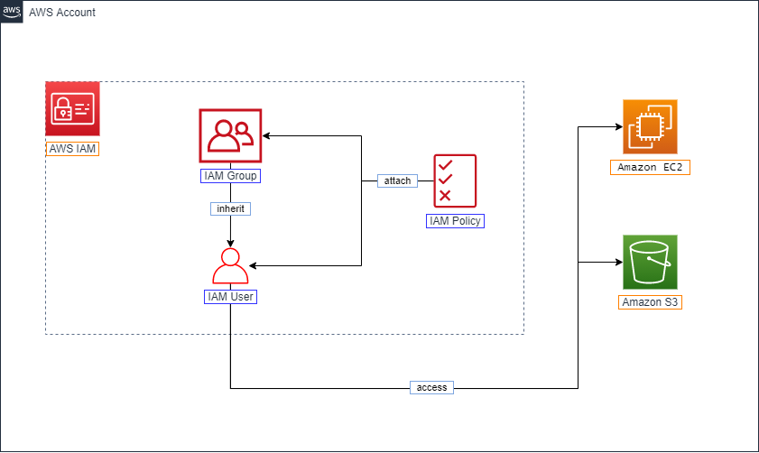
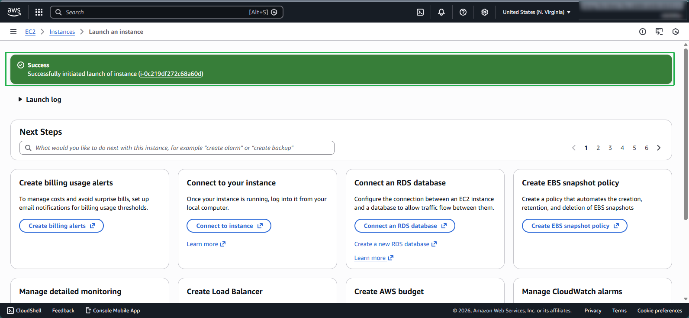

### Mục tiêu tuần 1:

- Làm quen với hệ sinh thái điện toán đám mây và các dịch vụ cơ sở hạ tầng cốt lõi của AWS (Explore Core AWS Services).
- Nắm vững nguyên tắc quản trị ngân sách chi phí ban đầu (AWS Budgets) và thiết lập bảo mật định danh theo đặc quyền tối thiểu (AWS IAM).
- Triển khai nền tảng mạng cô lập (Amazon VPC), vận hành máy chủ điện toán đám mây (Amazon EC2) và lưu trữ đối tượng (Amazon S3).
- Tổng kết, ôn tập kiến thức tuần đầu và dành thời gian nghiên cứu ý tưởng Đề xuất dự án thực tập (Project Proposal).

### Các công việc cần triển khai trong tuần này:

| Thứ | Công việc | Ngày bắt đầu | Ngày hoàn thành | Nguồn tài liệu |
| :--- | :--- | :---: | :---: | :--- |
| **Thứ 2** | **Quản trị chi phí & Bảo mật định danh:**  - Thiết lập tài khoản & cấu hình cảnh báo ngân sách với [AWS Budgets (000007)](https://000007.awsfcaj.com).  - Quản lý định danh và phân quyền truy cập với [AWS IAM (000002)](https://000002.awsfcaj.com). | 14/09/2026 | 14/09/2026 | [000007](https://000007.awsfcaj.com) & [000002](https://000002.awsfcaj.com) |
| **Thứ 3** | **Hạ tầng mạng cốt lõi (Networking Essentials):**  - Khởi tạo mạng đám mây cô lập với [Amazon VPC (000003)](https://000003.awsfcaj.com) (Subnets, Route Tables, Internet Gateway). | 15/09/2026 | 15/09/2026 | [Amazon VPC Workshop (000003)](https://000003.awsfcaj.com) |
| **Thứ 4** | **Điện toán đám mây (Compute Basics):**  - Khởi chạy và cấu hình máy chủ ảo với [Amazon EC2 (000004)](https://000004.awsfcaj.com) (Security Groups, Key Pair, kết nối SSH). | 16/09/2026 | 16/09/2026 | [Amazon EC2 Workshop (000004)](https://000004.awsfcaj.com) |
| **Thứ 5** | **Lưu trữ đối tượng & Web tĩnh (Object Storage):**  - Khởi tạo S3 Bucket, lưu trữ đối tượng và cấu hình Static Website Hosting với [Amazon S3 (000057)](https://000057.awsfcaj.com). | 17/09/2026 | 17/09/2026 | [Amazon S3 Workshop (000057)](https://000057.awsfcaj.com) |
| **Thứ 6** | **Tổng kết tuần 1, Viết Worklog & Làm Project:**  - **Tổng kết kiến thức:** Hệ thống hóa lại toàn bộ dịch vụ cốt lõi đã học trong tuần (IAM, VPC, EC2, S3).  - **Làm Worklog:** Soạn thảo, chuẩn hóa bài báo cáo Worklog Tuần 1 và kiểm toán dọn dẹp tài nguyên.  - **Làm Project:** Nghiên cứu ý tưởng, phân tích yêu cầu kỹ thuật cho Bản đề xuất dự án (Project Proposal). | 18/09/2026 | 18/09/2026 | [FCAJ Roadmap](https://cloudjourney.awsfcaj.com/) |

---

### Kết quả đạt được tuần 1:

#### 📌 Kết quả Thứ 2 (14/09/2026) - Quản trị chi phí ban đầu & Bảo mật định danh:
* **Kiểm soát chi phí với AWS Budgets:** Nắm vững cách thiết lập hạn ngạch ngân sách chi tiêu, cấu hình các ngưỡng kích hoạt cảnh báo tự động (80%, 100%) gửi thông báo trực tiếp về hộp thư điện tử nhằm ngăn chặn rủi ro chi phí phát sinh ngoài ý muốn.
* **Bảo mật truy cập với AWS IAM:** 
  * Khởi tạo IAM User riêng biệt cho công việc thực hành hàng ngày, tuân thủ nguyên tắc không sử dụng Root Account.
  * Phân quyền thông qua IAM Groups và đính kèm AWS Managed Policies theo nguyên tắc đặc quyền tối thiểu (Least Privilege).
  * Kích hoạt xác thực đa yếu tố (MFA - Multi-Factor Authentication) để bảo vệ tài khoản tối đa.

*Hình 1.1.1: Mô hình quản trị định danh IAM phân quyền kiểm soát truy cập tài nguyên an toàn theo đặc quyền tối thiểu.*

---

#### 📌 Kết quả Thứ 3 (15/09/2026) - Thiết lập hạ tầng mạng cô lập với Amazon VPC:
* **Xây dựng mạng ảo cô lập:** Khởi tạo mạng VPC với dải địa chỉ mạng CIDR `10.0.0.0/16`, thiết lập các khối mạng con phân tách rõ ràng giữa Public Subnet (dành cho các dịch vụ giao tiếp Internet) và Private Subnet (dành cho cơ sở dữ liệu và backend nội bộ).
* **Định tuyến lưu lượng mạng:** Khởi tạo và gắn kết Internet Gateway (IGW) vào VPC, cập nhật bảng định tuyến (Route Table) với route `0.0.0.0/0` trỏ ra IGW, cho phép máy chủ trong Public Subnet kết nối hai chiều với Internet.

*Hình 1.1.2: Bản đồ tài nguyên mạng Amazon VPC với hệ thống Subnets đa vùng sẵn sàng và Internet Gateway kết nối thành công.*

---

#### 📌 Kết quả Thứ 4 (16/09/2026) - Vận hành máy chủ ảo điện toán đám mây Amazon EC2:
* **Khởi tạo máy chủ ảo EC2:** Lựa chọn hệ điều hành Amazon Linux 2023 tối ưu hóa cho đám mây, cấu hình dòng máy ảo `t2.micro` thuộc gói miễn phí (Free Tier), tạo và tải về Key Pair để xác thực mã hóa khi đăng nhập từ xa.
* **Tường lửa Security Group:** Thiết lập nhóm bảo mật ảo hoạt động ở tầng instance, mở cổng Inbound TCP Port 22 (SSH) giới hạn từ IP cá nhân và mở TCP Port 80 (HTTP) để phục vụ ứng dụng web. Kết nối SSH vào máy chủ và chạy thử nghiệm lệnh hệ thống thành công.

*Hình 1.1.3: Máy chủ ảo Amazon EC2 khởi chạy thành công ở trạng thái Running trên nền tảng AWS.*

---

#### 📌 Kết quả Thứ 5 (17/09/2026) - Lưu trữ đối tượng & Lưu trữ web tĩnh với Amazon S3:
* **Lưu trữ đối tượng đám mây:** Khởi tạo S3 Bucket với tên định danh duy nhất trên toàn cầu (Global Namespace), phân loại cấu trúc thư mục lưu trữ đối tượng và tìm hiểu các lớp lưu trữ (S3 Standard, Standard-IA, Glacier) để tối ưu chi phí lưu trữ lâu dài.
* **Lưu trữ website tĩnh (Static Website Hosting):** Kích hoạt tính năng Static Website Hosting trên bucket, tải lên các tệp tin HTML/CSS, thiết lập chính sách Bucket Policy cho phép người dùng Internet đọc tệp công khai (GetPublicObject), kiểm tra truy cập website qua S3 Website Endpoint thành công.

---

#### 📌 Kết quả Thứ 6 (18/09/2026) - Tổng kết kiến thức, Hoàn thiện Worklog & Làm Project:
* **1. Tổng kết kiến thức Tuần 1:** Hệ thống hóa và liên kết chặt chẽ 4 khối nền móng quan trọng nhất của AWS: **Định danh (IAM) ➔ Mạng (VPC) ➔ Máy chủ tính toán (EC2) ➔ Lưu trữ đối tượng (S3)**.
* **2. Hoàn thiện tài liệu Worklog Tuần 1:** Soạn thảo, chuẩn hóa bài viết báo cáo tổng quan Tuần 1, kiểm tra liên kết hình ảnh minh chứng và thực hiện kiểm toán dọn dẹp/dừng các tài nguyên tạm thời để bảo vệ hạn mức Free Tier và tránh phát sinh chi phí.
* **3. Nghiên cứu & Thực hiện Project (Proposal):** Dành thời gian nghiên cứu các bài toán thực tế, thảo luận định hướng cùng mentor và bắt đầu phác thảo ý tưởng kiến trúc giải pháp cho bản Đề xuất dự án thực tập (Project Proposal).

---

### Mục tiêu cho tuần sau (Tuần 2):

* **Tối ưu hóa hệ thống trên AWS (Optimizing the system on AWS):**
  * **Vận hành (Operations):** Tự động hóa với AWS Lambda, giám sát nâng cao với CloudWatch và Grafana, quản lý hạ tầng dưới dạng mã với CloudFormation & AWS CDK.
  * **Bảo mật (Security):** Thiết lập quản lý định danh liên kết (AWS SSO), mã hóa khóa với AWS KMS, tường lửa ứng dụng AWS WAF, cùng giải pháp phát hiện mối đe dọa (GuardDuty) và bảo vệ dữ liệu nhạy cảm (Macie).
  * **Độ tin cậy & Hiệu năng (Reliability & Performance):** Sao lưu dữ liệu tập trung với AWS Backup, liên kết mạng VPC Peering, đóng gói container với Docker/ECS, và thiết lập luồng phát hành tự động qua CodePipeline.
  * **Tối ưu hóa chi phí (Cost Optimization):** Phân tích và lập kế hoạch tiết kiệm chi phí với Savings Plans, Reserved Instances, và công cụ trực quan hóa chi phí (AWS Glue, Athena).
* **Hiện đại hóa ứng dụng (Application Modernization - Serverless):**
  * Tiếp cận mô hình kiến trúc vi dịch vụ (Monolith to Microservices Migration).
  * Xây dựng kiến trúc xử lý hướng sự kiện (Event-Driven Architecture) và tích hợp các dịch vụ thông minh AI/ML trên AWS.
