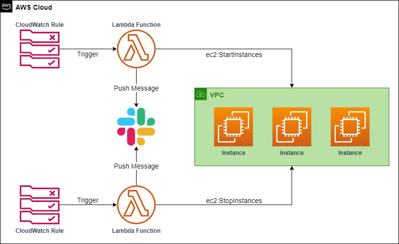
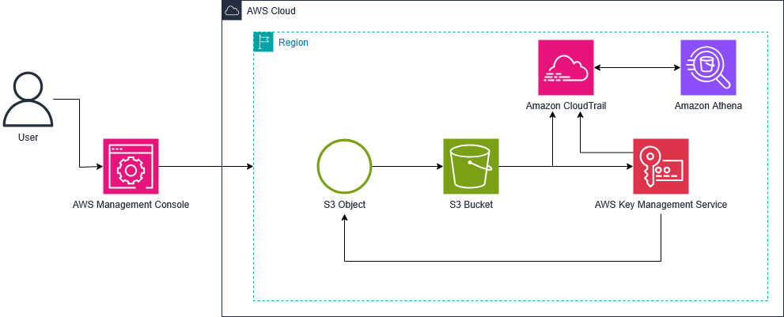
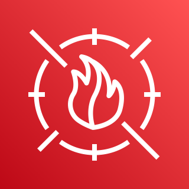
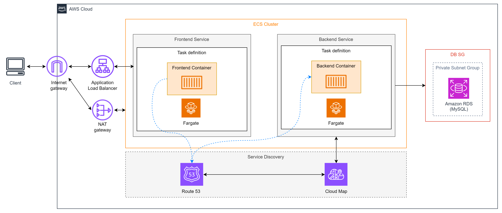
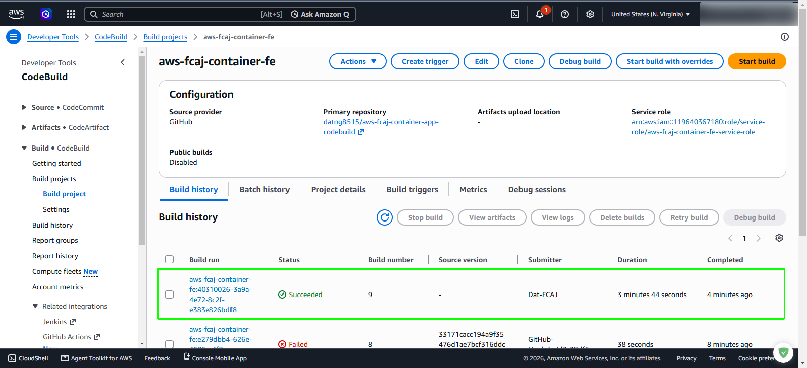
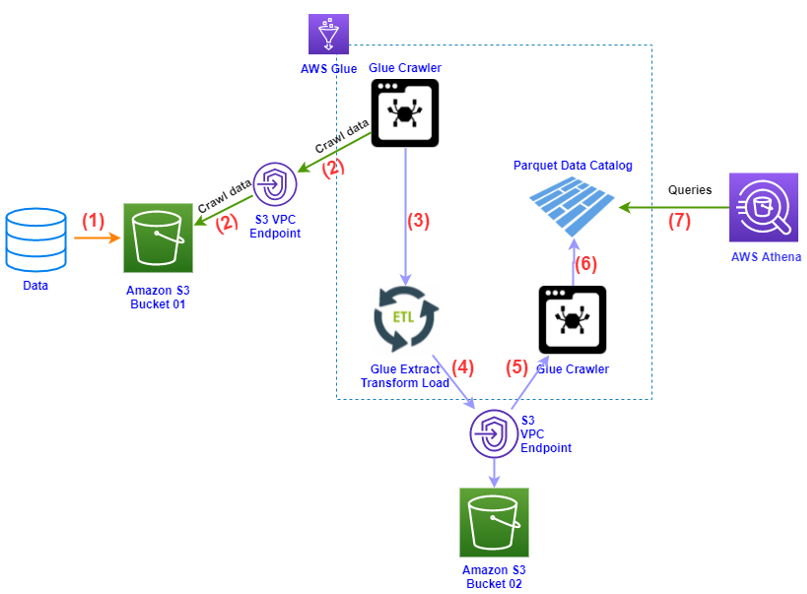

### Week 2 Objectives:

- Explore and master system optimization methodologies on AWS aligned with the **AWS Well-Architected Framework**.
- Understand serverless operational automation (AWS Lambda), cryptographic security, and edge application defense (AWS KMS, AWS WAF).
- Explore modern containerized workload orchestration (Amazon ECS Fargate), continuous delivery automation (CI/CD Pipelines), and cost analytics via AWS Glue & Athena.
- Review and synthesize Week 2 learnings while dedicating focused time to finalize the architecture design for the Project Proposal.

### Tasks to be Carried Out This Week:

| Day | Tasks | Start Date | Completion Date | Reference Sources |
| :--- | :--- | :---: | :---: | :--- |
| **Monday** | **Operational Excellence & Automation:**  - Serverless task automation with [AWS Lambda (000022)](https://000022.awsfcaj.com).  - Telemetry monitoring with [CloudWatch & Grafana (000029)](https://000029.awsfcaj.com).  - Infrastructure as Code foundation with [AWS CloudFormation (000037)](https://000037.awsfcaj.com). | 09/21/2026 | 09/21/2026 | [Cloud Journey - Operations](https://cloudjourney.awsfcaj.com/3-optimize/) |
| **Tuesday** | **Security & Cryptographic Governance:**  - Cryptographic key management with [AWS KMS (000033)](https://000033.awsfcaj.com).  - Web application firewall defense with [AWS WAF (000026)](https://000026.awsfcaj.com).  - Threat detection with [Amazon GuardDuty (000098)](https://000098.awsfcaj.com). | 09/22/2026 | 09/22/2026 | [Cloud Journey - Security](https://cloudjourney.awsfcaj.com/3-optimize/) |
| **Wednesday** | **Reliability & Container Orchestration:**  - Container packaging and management with [Docker & Amazon ECS Fargate (000016)](https://000016.awsfcaj.com).  - Automated software release pipelines with [AWS CodePipeline (000017)](https://000017.awsfcaj.com). | 09/23/2026 | 09/23/2026 | [Cloud Journey - Reliability](https://cloudjourney.awsfcaj.com/3-optimize/) |
| **Thursday** | **Cost Optimization & Analytics:**  - Long-term financial governance with [Savings Plans & Reserved Instances (000042)](https://000042.awsfcaj.com).  - Intelligent cost analytics using [AWS Glue & Athena (000040)](https://000040.awsfcaj.com). | 09/24/2026 | 09/24/2026 | [Cloud Journey - Cost](https://cloudjourney.awsfcaj.com/3-optimize/) |
| **Friday** | **Week 2 Synthesis, Worklog Completion & Project Proposal:**  - **Knowledge Synthesis:** Systematically review the four Well-Architected pillars mastered throughout the week (Operations, Security, Reliability, Cost).  - **Worklog Completion:** Document and synchronize the bilingual Week 2 Worklog and perform environment cleanup.  - **Project Proposal Work:** Finalize the detailed system architecture blueprint and cost estimation for the Project Proposal. | 09/25/2026 | 09/25/2026 | [FCAJ Roadmap](https://cloudjourney.awsfcaj.com/) |

---

### Week 2 Achievements:

#### 📌 Monday (09/21/2026) - Operational Excellence & Serverless Automation:
* **Serverless Operational Automation:** Explored event-driven programming with **AWS Lambda** to eliminate repetitive administrative overhead, automating instance lifecycle policies based on scheduled triggers or system health events.
* **Deep Observability & IaC:** Combined operational metrics in **Amazon CloudWatch** with Grafana dashboards, embracing the mindset of **Infrastructure as Code (IaC)** via CloudFormation templates and the AWS CDK.

*Figure 1.2.1: Event-driven EC2 operations automation architecture triggered by CloudWatch Events and AWS Lambda.*

---

#### 📌 Tuesday (09/22/2026) - Security Optimization & Key Management:
* **Data Encryption with AWS KMS:** Managed symmetric and asymmetric cryptographic key lifecycles using **AWS Key Management Service**, enforcing strict Key Policies to protect data at rest across Amazon S3 buckets and Amazon EBS volumes.
* **Application Layer Defense with AWS WAF:** Provisioned Web Access Control Lists (Web ACLs) to safeguard web endpoints against common exploits matching the OWASP Top 10 vulnerabilities (SQL Injection, Cross-Site Scripting, and IP rate limiting).

*Figure 1.2.2: Cryptographic architecture controlling S3 data-at-rest encryption with customer-managed AWS KMS keys.*

*Figure 1.2.3: Protective security shield defending application endpoints against web exploits using AWS WAF.*

---

#### 📌 Wednesday (09/23/2026) - Container Orchestration & CI/CD Pipelines:
* **Serverless Container Workloads:** Mastered container packaging with Docker, deploying and orchestrating microservice clusters through **Amazon Elastic Container Service (Amazon ECS)** powered by serverless compute engine **AWS Fargate** (eliminating underlying EC2 server management).
* **Continuous Delivery Automation:** Explored continuous integration and deployment pipelines using **AWS CodePipeline** and **AWS CodeBuild**, automatically pulling source code upon commit, building Docker container images, and executing target deployments.

*Figure 1.2.4: Multi-container service orchestration architecture running on Amazon ECS with AWS Fargate auto-scaling.*

*Figure 1.2.5: Successful execution report from continuous deployment release pipeline utilizing AWS CodeBuild.*

---

#### 📌 Thursday (09/24/2026) - Cloud Financial Governance & Cost Analytics:
* **Strategic Long-term Savings:** Analyzed commitment-based discount models using **Savings Plans** (Compute Savings Plans and EC2 Instance Savings Plans) combined with **Reserved Instances (RIs)**, achieving up to 60% – 72% cost reductions compared to On-Demand billing.
* **Serverless Financial Intelligence:** Examined billing telemetry workflows, automatically extracting AWS Cost and Usage Reports (CUR), discovering metadata schemas with **AWS Glue Crawlers**, and executing ad-hoc SQL financial queries via **Amazon Athena**.

*Figure 1.2.6: Cloud cost intelligence workflow extracting, cataloging, and analyzing billing telemetry with AWS Glue and Amazon Athena.*

---

#### 📌 Friday (09/25/2026) - Knowledge Synthesis, Worklog Completion & Project Proposal:
* **1. Well-Architected Framework Synthesis:** Systematically consolidated the interconnected operational patterns across the four pillars: Automated Operations (Lambda/IaC) ➔ Comprehensive Defense (KMS/WAF) ➔ Cloud-Native Reliability (ECS Fargate/CI/CD) ➔ Financial Governance (Savings Plans/Glue/Athena).
* **2. Worklog Standardization & Auditing:** Completed and synchronized the comprehensive bilingual Week 2 Worklog report, inspected and cleaned up experimental lab resources to maintain absolute environment security and zero billing leakage.
* **3. Project Proposal Refinement:** Dedicated focused project time to finalize multi-tier architecture diagrams and produce granular cost model calculations via the AWS Pricing Calculator for the internship **Project Proposal**.

---

### Next Week's Objectives (Week 3):

* **Serverless Application Modernization:**
  * Build serverless backends combining AWS Lambda, Amazon S3, DynamoDB, and Amazon API Gateway.
  * Establish user directory authentication and federated access using Amazon Cognito.
  * Automate serverless application packaging and deployment using AWS SAM (Serverless Application Model).
* **Managed Containers & Kubernetes:**
  * Explore enterprise container orchestration with Amazon EKS and Red Hat OpenShift on AWS (ROSA).
* **Data Analytics & Lakehouse Foundations:**
  * Design cloud Data Lake storage architectures on Amazon S3 and deliver business intelligence visualizations with Amazon QuickSight.
* **Deep Dive Amazon RDS Hands-on Lab (Thursday Highlight):**
  * Design a secure Two-Tier network architecture: Public EC2 Web Server interacting with a Private MySQL Amazon RDS instance.
  * Configure multi-AZ DB Subnet Groups, enable automated synchronous standby replication, and link chained Security Groups.
  * Execute manual DB Snapshot backups and simulate disaster recovery point-in-time restores.
* **Week 3 Synthesis:** Consolidate knowledge, verify live demo endpoints, and complete the Week 3 Worklog.
