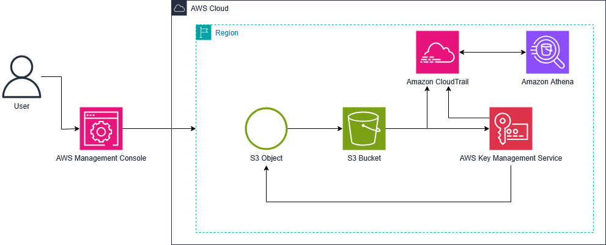

### Mục tiêu tuần 2:

- Tiếp cận và nắm vững các phương pháp Tối ưu hóa hệ thống trên AWS theo tiêu chuẩn **AWS Well-Architected Framework**.
- Tìm hiểu tự động hóa vận hành không máy chủ (AWS Lambda), bảo mật mã hóa và phòng thủ ứng dụng (AWS KMS, AWS WAF).
- Khám phá công nghệ đóng gói ứng dụng container hóa (Amazon ECS Fargate), quy trình phân phối liên tục (CI/CD Pipeline) và phân tích chi phí với AWS Glue & Athena.
- Tổng kết, hệ thống hóa kiến thức tuần 2 và dành thời gian hoàn thiện khung kiến trúc cho Bản đề xuất dự án (Project Proposal).

### Các công việc cần triển khai trong tuần này:

| Thứ | Công việc | Ngày bắt đầu | Ngày hoàn thành | Nguồn tài liệu |
| :--- | :--- | :---: | :---: | :--- |
| **Thứ 2** | **Tối ưu hóa Vận hành (Operations & Automation):**  - Tự động hóa tác vụ không máy chủ với [AWS Lambda (000022)](https://000022.awsfcaj.com).  - Giám sát nâng cao với [CloudWatch & Grafana (000029)](https://000029.awsfcaj.com).  - Tư duy hạ tầng dưới dạng mã với [AWS CloudFormation (000037)](https://000037.awsfcaj.com). | 21/09/2026 | 21/09/2026 | [Cloud Journey - Operations](https://cloudjourney.awsfcaj.com/3-optimize/) |
| **Thứ 3** | **Tối ưu hóa Bảo mật (Security & Cryptography):**  - Quản lý khóa mã hóa dữ liệu với [AWS KMS (000033)](https://000033.awsfcaj.com).  - Thiết lập tường lửa bảo vệ ứng dụng web với [AWS WAF (000026)](https://000026.awsfcaj.com).  - Nhận diện mối đe dọa với [Amazon GuardDuty (000098)](https://000098.awsfcaj.com). | 22/09/2026 | 22/09/2026 | [Cloud Journey - Security](https://cloudjourney.awsfcaj.com/3-optimize/) |
| **Thứ 4** | **Độ tin cậy & Containerization (Reliability & Containers):**  - Đóng gói và điều phối container với [Docker & Amazon ECS Fargate (000016)](https://000016.awsfcaj.com).  - Tự động hóa quy trình phát hành phần mềm với [AWS CodePipeline (000017)](https://000017.awsfcaj.com). | 23/09/2026 | 23/09/2026 | [Cloud Journey - Reliability](https://cloudjourney.awsfcaj.com/3-optimize/) |
| **Thứ 5** | **Tối ưu hóa Chi phí & Phân tích dữ liệu (Cost & Analytics):**  - Quản trị chi phí dài hạn với [Savings Plans & Reserved Instances (000042)](https://000042.awsfcaj.com).  - Phân tích dữ liệu chi phí thông minh với [AWS Glue & Athena (000040)](https://000040.awsfcaj.com). | 24/09/2026 | 24/09/2026 | [Cloud Journey - Cost](https://cloudjourney.awsfcaj.com/3-optimize/) |
| **Thứ 6** | **Tổng kết tuần 2, Viết Worklog & Làm Project:**  - **Tổng kết kiến thức:** Hệ thống hóa 4 trụ cột Well-Architected đã học trong tuần (Operations, Security, Reliability, Cost).  - **Làm Worklog:** Soạn thảo, đồng bộ hóa song ngữ bài viết báo cáo Worklog Tuần 2 và kiểm toán tài nguyên.  - **Làm Project:** Hoàn thiện khung kiến trúc chi tiết và ước tính ngân sách cho Bản đề xuất dự án (Project Proposal). | 25/09/2026 | 25/09/2026 | [FCAJ Roadmap](https://cloudjourney.awsfcaj.com/) |

---

### Kết quả đạt được tuần 2:

#### 📌 Kết quả Thứ 2 (21/09/2026) - Tối ưu hóa vận hành & Tự động hóa không máy chủ (Operations):
* **Tự động hóa không máy chủ:** Tiếp cận lập trình xử lý sự kiện với hàm **AWS Lambda** để giảm tải các tác vụ quản trị máy chủ thủ công, tự động hóa vòng đời tài nguyên theo lịch trình hoặc sự kiện hệ thống.
* **Quan sát chuyên sâu & Hạ tầng dưới dạng mã:** Kết hợp giám sát với **Amazon CloudWatch** và làm quen với tư duy định nghĩa hạ tầng bằng mã (**Infrastructure as Code - IaC**) thông qua CloudFormation và AWS CDK.

*Hình 1.2.1: Kiến trúc tự động hóa vận hành máy chủ EC2 kích hoạt theo sự kiện bằng CloudWatch Rules và AWS Lambda.*

---

#### 📌 Kết quả Thứ 3 (22/09/2026) - Tối ưu hóa bảo mật & Quản lý khóa mật mã (Security):
* **Mã hóa dữ liệu với AWS KMS:** Quản lý vòng đời khóa mật mã hóa đối xứng và bất đối xứng với **AWS Key Management Service**, kiểm soát chặt chẽ chính sách khóa (Key Policy) để mã hóa dữ liệu lưu trữ trên Amazon S3 và EBS volumes.
* **Phòng thủ lớp ứng dụng với AWS WAF:** Thiết lập tường lửa ứng dụng web, xây dựng các tập luật (Web ACL Rules) để ngăn chặn các kiểu tấn công mạng phổ biến theo chuẩn OWASP Top 10 (SQL Injection, Cross-Site Scripting - XSS, IP Rate Limiting).

*Hình 1.2.2: Sơ đồ kiểm soát mã hóa dữ liệu lưu trữ S3 với khóa quản trị AWS KMS và ghi vết kiểm toán CloudTrail.*

*Hình 1.2.3: Lá chắn phòng vệ bảo vệ ứng dụng trước các lỗ hổng bảo mật web với AWS WAF.*

---

#### 📌 Kết quả Thứ 4 (23/09/2026) - Điều phối Container & Luồng phát hành tự động CI/CD:
* **Đóng gói container không máy chủ (Serverless Containers):** Nắm vững quy trình đóng gói ứng dụng với Docker, triển khai và điều phối cụm container đa dịch vụ thông qua **Amazon Elastic Container Service (Amazon ECS)** kết hợp hạ tầng tính toán phi máy chủ **AWS Fargate** (không cần quản lý máy chủ EC2 cơ sở).
* **Tự động hóa phát hành phần mềm (CI/CD Pipeline):** Khám phá mô hình tích hợp và phát hành liên tục sử dụng **AWS CodePipeline** và **AWS CodeBuild**, tự động kéo mã nguồn khi có thay đổi, đóng gói Docker Image và kích hoạt triển khai phiên bản mới.

*Hình 1.2.4: Kiến trúc điều phối dịch vụ đa container trên Amazon ECS hỗ trợ tự động co giãn bằng AWS Fargate.*

*Hình 1.2.5: Báo cáo thực thi luồng phát hành liên tục CI/CD với AWS CodeBuild đạt kết quả thành công (Succeeded).*

---

#### 📌 Kết quả Thứ 5 (24/09/2026) - Quản trị và tối ưu chi phí đám mây (Cost Optimization):
* **Tiết kiệm chi phí dài hạn:** Phân tích mô hình cam kết sử dụng linh hoạt với **Savings Plans** (Compute Savings Plans và EC2 Instance Savings Plans) kết hợp **Reserved Instances (RIs)** để tiết kiệm lên tới 60% – 72% chi phí vận hành máy chủ so với giá On-Demand.
* **Phân tích dữ liệu chi phí thông minh:** Tìm hiểu quy trình tự động thu thập nhật ký chi phí (AWS Cost and Usage Reports), lập danh mục lược đồ dữ liệu với **AWS Glue Crawler** và thực thi các câu lệnh truy vấn phân tích SQL trực tiếp không máy chủ bằng **Amazon Athena**.

*Hình 1.2.6: Quy trình trích xuất, lập danh mục và phân tích dữ liệu chi phí đám mây với AWS Glue và Amazon Athena.*

---

#### 📌 Kết quả Thứ 6 (25/09/2026) - Tổng kết kiến thức, Hoàn thiện Worklog & Làm Project:
* **1. Tổng kết kiến thức Tuần 2:** Hệ thống hóa mối liên kết chặt chẽ giữa 4 trụ cột Well-Architected cốt lõi: Vận hành tự động (Lambda/IaC) ➔ Bảo mật toàn diện (KMS/WAF) ➔ Độ tin cậy cao (ECS Fargate/CI/CD) ➔ Tối ưu chi phí (Savings Plans/Glue/Athena).
* **2. Hoàn thiện tài liệu Worklog Tuần 2:** Soạn thảo, chuẩn hóa bài viết báo cáo tổng quan Tuần 2, đồng bộ song ngữ và kiểm toán dọn dẹp các tài nguyên thử nghiệm để đảm bảo an toàn tài khoản và không phát sinh chi phí.
* **3. Nghiên cứu & Thực hiện Project (Proposal):** Dành thời gian hoàn thiện bản thiết kế kiến trúc hệ thống chi tiết và lập bảng dự toán chi phí trên AWS Pricing Calculator cho Bản đề xuất dự án thực tập (Project Proposal).

---

### Mục tiêu cho tuần sau (Tuần 3):

* **Hiện đại hóa ứng dụng không máy chủ (App Modernization - Serverless):**
  * Xây dựng Serverless Backend với AWS Lambda, Amazon S3, DynamoDB và Amazon API Gateway.
  * Thiết lập quản lý và xác thực danh tính người dùng an toàn với Amazon Cognito.
  * Tự động hóa đóng gói và triển khai ứng dụng không máy chủ với AWS Serverless Application Model (AWS SAM).
* **Dịch vụ Container & Kubernetes:**
  * Tiếp cận kiến trúc điều phối container doanh nghiệp với Amazon EKS và Red Hat OpenShift on AWS (ROSA).
* **Phân tích dữ liệu thông minh (Data Analytics):**
  * Thiết kế kiến trúc Hồ dữ liệu (Data Lake) trên Amazon S3, trực quan hóa biểu đồ kinh doanh với Amazon QuickSight.
* **Thực hành Chuyên sâu Amazon RDS (Trọng tâm Thứ 5):**
  * Thiết kế mô hình mạng an toàn hai tầng (Two-Tier Architecture): Web Server EC2 (Public Subnet) kết nối cơ sở dữ liệu quan hệ Amazon RDS MySQL (Private Subnet).
  * Cấu hình DB Subnet Group đa vùng sẵn sàng, kích hoạt Multi-AZ và liên kết Security Groups chuỗi an toàn.
  * Thực hành quy trình tạo bản sao lưu thủ công (Manual Snapshot) và phục hồi cơ sở dữ liệu khi có sự cố.
* **Tổng kết tuần 3:** Ôn tập, hệ thống hóa kiến thức và hoàn thiện Worklog tuần 3.
