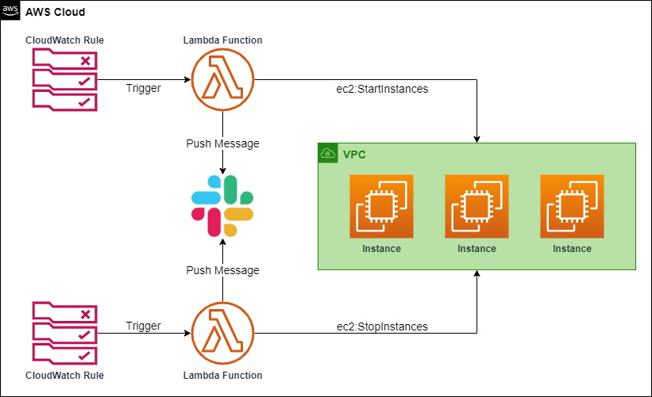
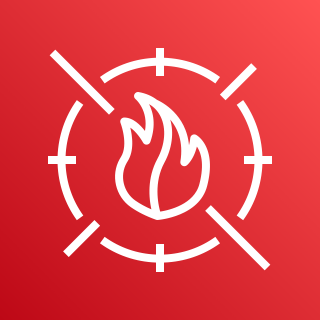
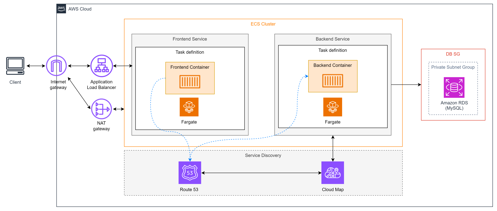
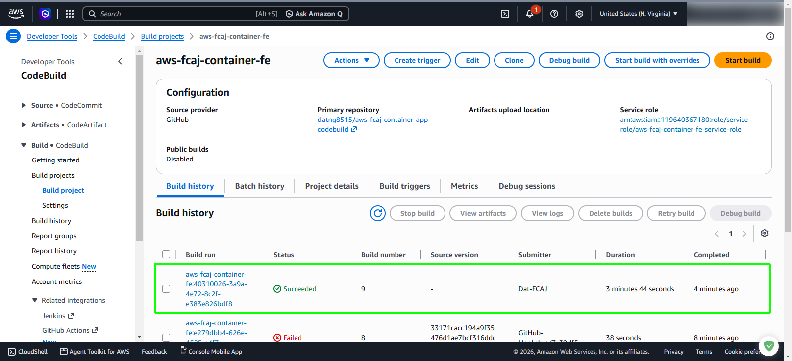
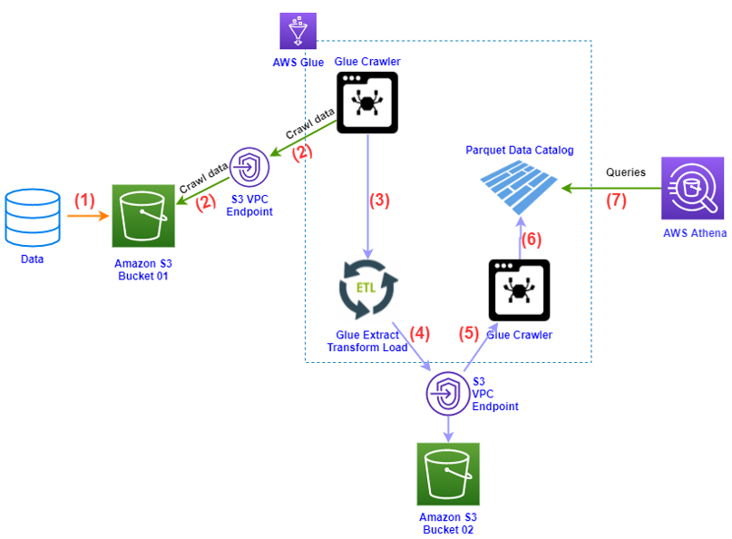

---
title: "Tuần 2"
date: 2026-09-21
weight: 2
chapter: false
pre: " <b> 1.2. </b> "
---

### Mục tiêu tuần 2:

- Tiếp cận và nắm vững các phương pháp Tối ưu hóa hệ thống trên AWS theo tiêu chuẩn **AWS Well-Architected Framework** thuộc phân hệ [Optimizing the System on AWS](https://cloudjourney.awsfcaj.com/3-optimize/).
- Khám phá tự động hóa vận hành không máy chủ (**AWS Lambda**), kết hợp giám sát nâng cao và tư duy hạ tầng dưới dạng mã (IaC).
- Làm chủ kỹ thuật mã hóa dữ liệu (**AWS KMS**), phòng thủ tầng ứng dụng web (**AWS WAF**) và giám sát phát hiện mối đe dọa an ninh (**Amazon GuardDuty**).
- Triển khai đóng gói ứng dụng container phi máy chủ (**Amazon ECS Fargate**) kết hợp quy trình phát hành phần mềm tự động liên tục (**CI/CD Pipeline**).
- Phân tích chiến lược tiết kiệm ngân sách dài hạn (**Savings Plans**) và khai phá dữ liệu chi phí với **AWS Glue & Amazon Athena**.
- Dành ngày Thứ 6 tổng kết kiến thức tuần 2, hoàn thiện hồ sơ Worklog và xây dựng khung kiến trúc kỹ thuật cho Bản đề xuất dự án (**Project Proposal**).

---

### Các công việc cần triển khai trong tuần này:

| Thứ | Công việc | Ngày bắt đầu | Ngày hoàn thành | Nguồn tài liệu |
| :--- | :--- | :---: | :---: | :--- |
| **Thứ 2** | **Tối ưu hóa Vận hành (Operations & Automation):**  - Tự động hóa tác vụ không máy chủ với [AWS Lambda (000022)](https://000022.awsfcaj.com).  - Giám sát nâng cao với [CloudWatch & Grafana (000029)](https://000029.awsfcaj.com).  - Tư duy hạ tầng dưới dạng mã với [AWS CloudFormation (000037)](https://000037.awsfcaj.com). | 21/09/2026 | 21/09/2026 | [Cloud Journey - Operations](https://cloudjourney.awsfcaj.com/3-optimize/) |
| **Thứ 3** | **Tối ưu hóa Bảo mật (Security & Cryptography):**  - Quản lý khóa mã hóa dữ liệu với [AWS KMS (000033)](https://000033.awsfcaj.com).  - Thiết lập tường lửa bảo vệ ứng dụng web với [AWS WAF (000026)](https://000026.awsfcaj.com).  - Nhận diện mối đe dọa với [Amazon GuardDuty (000098)](https://000098.awsfcaj.com). | 22/09/2026 | 22/09/2026 | [Cloud Journey - Security](https://cloudjourney.awsfcaj.com/3-optimize/) |
| **Thứ 4** | **Độ tin cậy & Containerization (Reliability & Containers):**  - Đóng gói và điều phối container với [Docker & Amazon ECS Fargate (000016)](https://000016.awsfcaj.com).  - Tự động hóa quy trình phát hành phần mềm với [AWS CodePipeline (000017)](https://000017.awsfcaj.com). | 23/09/2026 | 23/09/2026 | [Cloud Journey - Reliability](https://cloudjourney.awsfcaj.com/3-optimize/) |
| **Thứ 5** | **Tối ưu hóa Chi phí & Phân tích dữ liệu (Cost & Analytics):**  - Quản trị chi phí dài hạn với [Savings Plans & Reserved Instances (000042)](https://000042.awsfcaj.com).  - Phân tích dữ liệu chi phí thông minh với [AWS Glue & Athena (000040)](https://000040.awsfcaj.com). | 24/09/2026 | 24/09/2026 | [Cloud Journey - Cost](https://cloudjourney.awsfcaj.com/3-optimize/) |
| **Thứ 6** | **Tổng kết tuần 2, Viết Worklog & Làm Project:**  - **Tổng kết kiến thức:** Hệ thống hóa 4 trụ cột Well-Architected đã học trong tuần (Operations, Security, Reliability, Cost).  - **Làm Worklog:** Soạn thảo, đồng bộ hóa song ngữ bài viết báo cáo Worklog Tuần 2 và kiểm toán tài nguyên.  - **Làm Project:** Hoàn thiện khung kiến trúc chi tiết và ước tính ngân sách cho Bản đề xuất dự án (Project Proposal). | 25/09/2026 | 25/09/2026 | [FCAJ Roadmap](https://cloudjourney.awsfcaj.com/) |

---

### Chi tiết nội dung học tập và kết quả đạt được mỗi ngày:

#### 📌 Thứ 2 (21/09/2026) - Tối ưu hóa vận hành & Tự động hóa không máy chủ (Operations)

* **Ta học được những gì hôm nay?**
  * **Lập trình xử lý hướng sự kiện với AWS Lambda:**
    * Hiểu rõ mô hình điện toán phi máy chủ (Serverless Compute): Không cần quan tâm tới hệ điều hành hay quản lý cụm máy chủ, chỉ tải mã nguồn lên và AWS tự động cấp phát tài nguyên khi có sự kiện kích hoạt (Event-driven).
    * Viết một hàm Lambda bằng Python `ec2-nightly-stop` sử dụng thư viện Boto3 để tự động quét danh sách máy ảo EC2 có gắn thẻ `Environment = Development` và gửi tín hiệu tắt máy vào lúc 20:00 hàng ngày.
  * **Kết hợp điều phối tự động hóa với EventBridge & CloudWatch:**
    * Khởi tạo quy tắc lập lịch biểu **Amazon EventBridge Scheduler** theo biểu thức Cron `cron(0 20 ? * MON-FRI *)` kích hoạt hàm Lambda tự động.
    * Thu thập nhật ký thực thi (Execution Logs) vào CloudWatch Logs Group `/aws/lambda/ec2-nightly-stop`, đánh giá thời gian chạy thực tế chỉ tốn 1.2 giây và dung lượng RAM tiêu thụ 64MB.

*Hình 1.2.1: Kiến trúc tự động hóa vận hành máy chủ EC2 kích hoạt theo sự kiện bằng CloudWatch Rules và AWS Lambda.*

* **Khó khăn gặp phải & Cách xử lý:**
  * *Lỗi hàm Lambda văng lỗi `AccessDeniedException`:* Hàm thực thi báo không có quyền thực hiện `ec2:DescribeInstances` và `ec2:StopInstances`. Nguyên nhân: Mặc định Lambda Execution Role chỉ có quyền cơ bản ghi log CloudWatch. Cách xử lý: Vào IAM Console, tạo Customer Managed Policy cấp quyền EC2 cần thiết và đính kèm vào Execution Role của hàm.

---

#### 📌 Thứ 3 (22/09/2026) - Tối ưu hóa bảo mật & Quản lý khóa mật mã (Security)

* **Ta học được những gì hôm nay?**
  * **Quản trị khóa mã hóa dữ liệu với AWS KMS:**
    * Phân biệt giữa khóa do AWS quản lý (AWS Managed Keys) và khóa do khách hàng tự quản trị (Customer Managed Keys - CMK).
    * Khởi tạo một CMK khóa đối xứng (Symmetric Encryption Key) `fcaj-data-encryption-key`, thiết lập chính sách khóa (Key Policy) quy định rõ ràng danh tính IAM được phép sử dụng khóa để mã hóa/giải mã (`kms:Encrypt`, `kms:Decrypt`).
    * Kích hoạt tính năng xoay vòng khóa tự động hàng năm (Automatic Annual Key Rotation).
    * Áp dụng khóa CMK để mã hóa đĩa cứng Amazon EBS và các tệp tin nhạy cảm lưu trữ trên Amazon S3 (SSE-KMS).
  * **Phòng thủ ứng dụng web với AWS WAF (Web Application Firewall):**
    * Khởi tạo Web ACL và gắn kết bảo vệ phía trước Application Load Balancer.
    * Kích hoạt các bộ luật chuẩn dựng sẵn của AWS (AWS Managed Rules): `Core rule set (CRS)` chống các lỗ hổng OWASP Top 10, `Amazon IP reputation list` chặn các địa chỉ IP độc hại, và cấu hình luật giới hạn tần suất (Rate-based Rule: chặn IP gửi quá 100 requests trong 5 phút).
  * **Nhận diện nguy cơ an ninh với Amazon GuardDuty:**
    * Bật GuardDuty phân tích tự động dữ liệu VPC Flow Logs, DNS Logs và CloudTrail Events để phát hiện các hành vi bất thường (như quét cổng Port Scanning hoặc giao tiếp với máy chủ mã độc C&C).

*Hình 1.2.2: Sơ đồ kiểm soát mã hóa dữ liệu lưu trữ S3 với khóa quản trị AWS KMS và ghi vết kiểm toán CloudTrail.*

*Hình 1.2.3: Lá chắn phòng vệ bảo vệ ứng dụng trước các lỗ hổng bảo mật web với AWS WAF.*

* **Khó khăn gặp phải & Cách xử lý:**
  * *Ứng dụng hợp lệ bị WAF chặn nhầm (False Positive):* Một request chứa chuỗi truy vấn URL đặc thù bị luật `GenericRFI_BODY` chặn trả mã 403. Cách xử lý: Vào Web ACL Metrics, xác định chính xác Rule ID gây chặn nhầm và chuyển luật đó sang chế độ `Count` (chỉ ghi nhận, không chặn) để theo dõi và tinh chỉnh ngoại lệ.

---

#### 📌 Thứ 4 (23/09/2026) - Độ tin cậy & Containerization (Reliability & Containers)

* **Ta học được những gì hôm nay?**
  * **Đóng gói và điều phối container phi máy chủ với Amazon ECS Fargate:**
    * Tìm hiểu cách đóng gói ứng dụng web microservices thành Docker image và lưu trữ an toàn trên Amazon Elastic Container Registry (Amazon ECR).
    * Khởi tạo ECS Task Definition chỉ định CPU (`0.25 vCPU`) và RAM (`512MB`), loại bỏ hoàn toàn gánh nặng phải cài đặt hệ điều hành máy chủ chủ (Host OS).
    * Triển khai ECS Service trên nền tảng **AWS Fargate**, tự động gắn các container vào Application Load Balancer để phân phối lưu lượng truy cập cân bằng và có khả năng tự phục hồi (Self-healing).
  * **Tự động hóa phát hành phần mềm với CI/CD Pipeline:**
    * Thiết lập luồng triển khai liên tục tự động bằng **AWS CodePipeline**: Kéo mã nguồn từ GitHub ➔ Kích hoạt **AWS CodeBuild** đóng gói Docker image và chạy kiểm thử đơn vị ➔ Triển khai phiên bản container mới lên ECS Fargate mà không làm gián đoạn người dùng.

*Hình 1.2.4: Kiến trúc điều phối dịch vụ đa container trên Amazon ECS hỗ trợ tự động co giãn bằng AWS Fargate.*

*Hình 1.2.5: Báo cáo thực thi luồng phát hành liên tục CI/CD với AWS CodeBuild đạt kết quả thành công (Succeeded).*

* **Khó khăn gặp phải & Cách xử lý:**
  * *CodeBuild bị lỗi khi kết nối kéo image từ Docker Hub:* Bị lỗi hạn chế số lượt kéo (Docker Hub Rate Limit). Cách xử lý: Chuyển toàn bộ base image sang Amazon ECR Public Gallery (`public.ecr.aws/docker/library/`) để tận dụng băng thông nội bộ AWS tốc độ cao và không bị giới hạn quota.

---

#### 📌 Thứ 5 (24/09/2026) - Quản trị và Tối ưu chi phí đám mây (Cost Optimization)

* **Ta học được những gì hôm nay?**
  * **Chiến lược tiết kiệm ngân sách dài hạn:**
    * Phân tích sự khác biệt giữa giá trả theo giờ (On-Demand), máy chủ nhàn rỗi đấu thầu giá rẻ (Spot Instances - giảm tới 90%) và mô hình cam kết sử dụng 1 đến 3 năm (**Savings Plans** & **Reserved Instances - RIs**).
    * Đối với các máy chủ cơ sở dữ liệu và backend chạy ổn định 24/7, áp dụng Compute Savings Plans giúp tiết kiệm trung bình 45% đến 66% ngân sách so với giá thông thường.
  * **Phân tích dữ liệu chi phí thông minh với AWS Glue & Athena:**
    * Kích hoạt xuất báo cáo chi phí và sử dụng tài nguyên chi tiết (**AWS Cost and Usage Reports - CUR**) vào S3 Bucket.
    * Sử dụng **AWS Glue Crawler** quét cấu hình CUR, tự động định nghĩa bảng dữ liệu vào Glue Data Catalog.
    * Thực thi các truy vấn SQL phân tích trực tiếp trên **Amazon Athena** để tìm ra dịch vụ nào, khu vực nào đang tiêu tốn nhiều chi phí nhất theo từng giờ, phát hiện tài nguyên lãng phí (như các đĩa EBS unattached).

*Hình 1.2.6: Quy trình trích xuất, lập danh mục và phân tích dữ liệu chi phí đám mây với AWS Glue và Amazon Athena.*

* **Khó khăn gặp phải & Cách xử lý:**
  * *Lỗi Athena không đọc được file báo cáo chi phí CUR:* Báo lỗi cú pháp do CUR xuất dạng tệp nén GZIP chứa nhiều file nhỏ. Cách xử lý: Cấu hình tích hợp tự động qua mẫu CloudFormation template do AWS CUR cung cấp sẵn, tự động thiết lập phân vùng Athena theo từng tháng giúp truy vấn trơn tru.

---

#### 📌 Thứ 6 (25/09/2026) - Tổng kết tuần 2, Hoàn thiện Worklog & Làm Project Proposal

* **Ta học được những gì hôm nay?**
  * **Hệ thống hóa 4 trụ cột AWS Well-Architected:**
    * **Vận hành xuất sắc (Operations):** Tự động hóa qua Lambda và giám sát CloudWatch.
    * **Bảo mật (Security):** Mã hóa nhiều tầng với KMS và phòng vệ lớp ứng dụng với WAF.
    * **Độ tin cậy (Reliability):** Container hóa vi dịch vụ với ECS Fargate và tự động phát hành qua CI/CD.
    * **Tối ưu chi phí (Cost):** Quản trị ngân sách, cam kết Savings Plans và kiểm toán chi phí với Athena.
  * **Dọn dẹp tài nguyên:** Hủy các ECS Services thử nghiệm, tắt tác vụ Glue và xóa Web ACL tạm để giữ ngân sách an toàn.
  * **Phát triển Đề xuất Đồ án (Project Proposal):** Hoàn thiện bản thiết kế sơ đồ kiến trúc hệ thống tổng thể và lập bảng tính dự toán chi phí hàng tháng bằng công cụ chính thức **AWS Pricing Calculator**.

