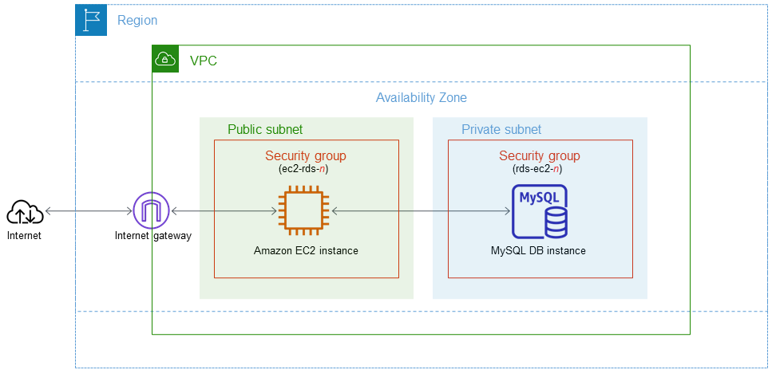
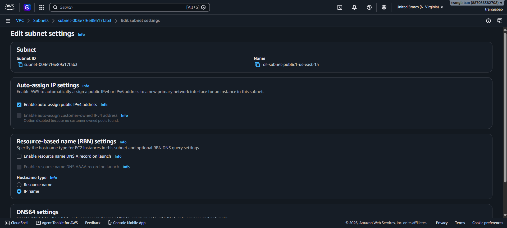
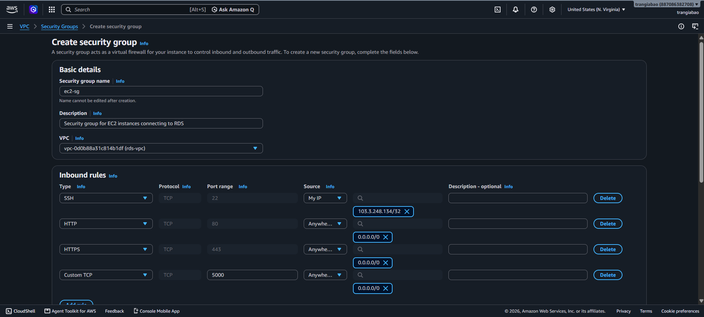
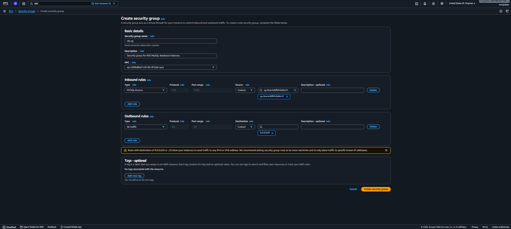
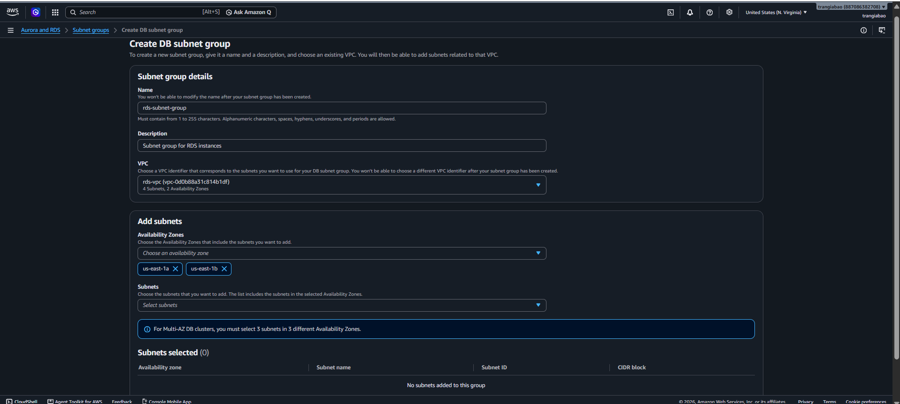
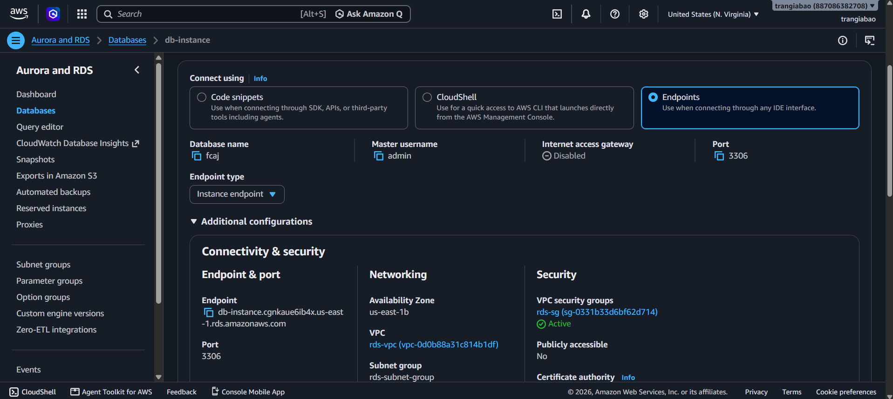
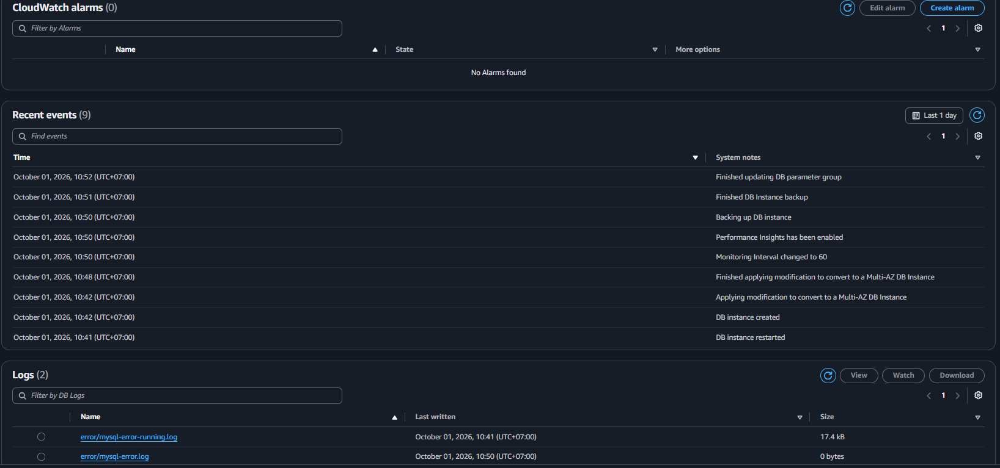
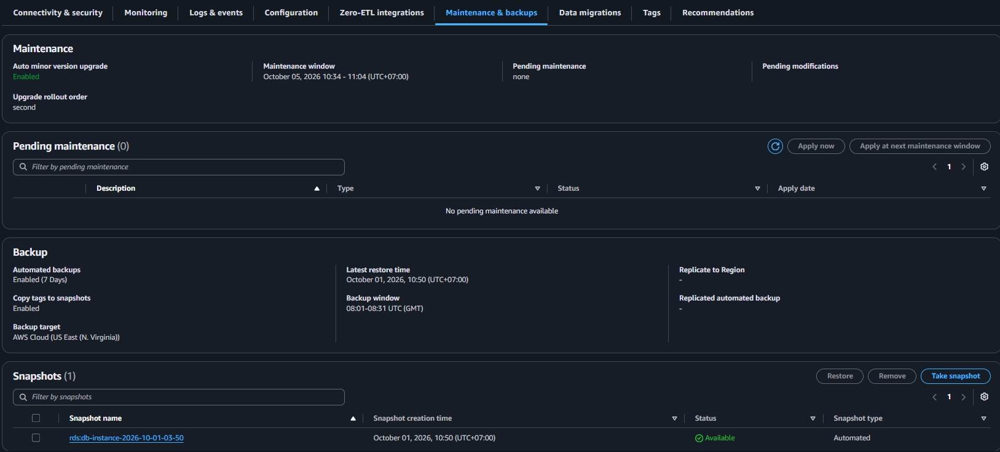
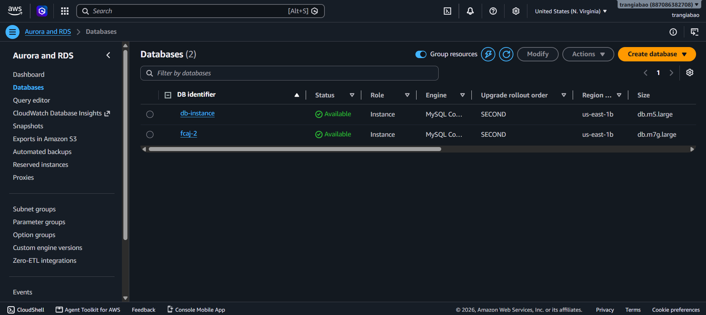

---
title: "Deploying Relational Databases with Amazon RDS"
date: 2026-10-01
weight: 1
chapter: false
pre: " <b> 1.3.1. </b> "
---

{}
The **Deploying Relational Databases with Amazon RDS** lab was executed on **Thursday (01/10/2026)** as part of **Week 3**. This page provides comprehensive technical documentation for designing a highly available, multi-Availability Zone (Multi-AZ) two-tier network architecture, configuring chained security group firewalls, provisioning an **Amazon RDS MySQL** instance, connecting an **Amazon EC2 Web Server**, and executing data protection workflows via **Manual DB Snapshots** and **Point-in-Time Restore**.
<br>🔗 **Lab Reference Source:** [Get Started with Amazon RDS Workshop](https://000005.awsfcaj.com/)
{}

### 🎯 Lab Objectives:
* Master the architecture, high availability mechanisms, and operational best practices of **Amazon RDS (Relational Database Service)**.
* Design and implement an isolated **Two-Tier Architecture**: placing the Web Server tier in a **Public Subnet** and the Database tier in isolated **Private Subnets** to enforce defense-in-depth security principles.
* Create a **DB Subnet Group** spanning across at least two distinct Availability Zones (**`us-east-1a` and `us-east-1b`**) to satisfy Multi-AZ high-availability requirements.
* Configure granular network isolation via **Security Groups**: restricting the MySQL inbound port TCP **3306** exclusively to traffic originating from the Web Server's Security Group (`ec2-sg`), prohibiting direct ingress from the public Internet.
* Provision an Amazon RDS database utilizing the **MySQL Community Edition** engine, configured on the `db.m5.large` instance class with automated synchronous **Multi-AZ Deployment** enabled.
* Deploy an **Amazon EC2** web workstation (Amazon Linux 2023), install Apache HTTP Server and the PHP runtime, configure connection strings to the private **RDS Endpoint**, and validate end-to-end CRUD operations.
* Execute database snapshot protection through **Manual DB Snapshots**, analyze automated daily backup windows, and understand disaster recovery workflows (**Point-in-Time Recovery - PITR**).

---

### 📊 Provisioned Resource Specifications:

| Parameter / Resource | Actual Value | Technical Significance & Role |
| :--- | :--- | :--- |
| **Virtual Private Cloud (VPC)** | `rds-vpc` (`vpc-0d0b88a31c814b1df`) | Isolated virtual network environment with CIDR block `10.0.0.0/16` |
| **Public Subnet** | `rds-subnet-public1-us-east-1a` | Public-facing subnet associated with an Internet Gateway, auto-assigns Public IPs |
| **Private Subnet 1** | `rds-subnet-private1-us-east-1a` | Isolated private subnet in `us-east-1a` hosting the Primary DB instance |
| **Private Subnet 2** | `rds-subnet-private2-us-east-1b` | Isolated private subnet in `us-east-1b` hosting the Standby DB replica |
| **DB Subnet Group** | `rds-subnet-group` | Multi-AZ subnet collection designated for RDS database failover |
| **Web Security Group** | `ec2-sg` (`sg-0cec4d0fbfc6d4c41`) | Inbound: Port 80 (HTTP from `0.0.0.0/0`) & Port 22 (SSH from My IP) |
| **RDS Security Group** | `rds-sg` (`sg-0331b33d6bf62d714`) | Inbound: Port 3306 (MySQL) restricted strictly to `ec2-sg` |
| **RDS Instance Identifier** | `db-instance` | MySQL Community 8.0, Instance Class: `db.m5.large` (2 vCPUs, 8 GiB RAM) |
| **Deployment Mode** | `Multi-AZ Deployment` | Synchronous secondary replica in another AZ for automatic seamless failover |
| **Database Name** | `fcaj` | Initial database created upon deployment |
| **Master Username** | `admin` | Root administrative credential for database management |
| **RDS Endpoint** | `db-instance.cgnkaue6ib4x.us-east-1.rds.amazonaws.com` | Private canonical DNS endpoint resolving to port 3306 |
| **Web Server Instance** | `web-server` | `t2.micro`, Amazon Linux 2023, Apache `httpd` & PHP |

---

### 🏛️ Architecture Overview:

The deployment adheres strictly to the AWS Well-Architected Framework:



---

### 📋 Detailed Step-by-Step Implementation Guide:

#### 🔹 Module 1: Architecture Design & Network Infrastructure Preparation

##### Step 1: Provision the Multi-AZ VPC (`rds-vpc`)
* **Action:** Sign in to the AWS Management Console ➔ Navigate to **VPC** ➔ Click **Create VPC**.
* **Configuration:**
  * Select **VPC and more** for automated network topology creation.
  * **Name tag:** `rds-vpc`
  * **IPv4 CIDR block:** `10.0.0.0/16`
  * **Number of Availability Zones (AZs):** `2` (`us-east-1a` and `us-east-1b`)
  * **Number of public subnets:** `2`
  * **Number of private subnets:** `2`
  * **NAT gateways:** None (to eliminate unnecessary operational cost during lab testing)
  * **VPC Endpoints:** None
* **Action:** Click **Create VPC** and verify completion across all network routing components.


##### Step 2: Enable Public IPv4 Addressing for the Public Subnet
* **Action:** Go to **Subnets** ➔ Select `rds-subnet-public1-us-east-1a` ➔ Select **Actions** ➔ **Edit subnet settings**.
* **Configuration:** Check **Enable auto-assign public IPv4 address** ➔ Click **Save**.
* **Objective:** Ensures any web tier EC2 instances launched in this subnet automatically receive routable public IP addresses for incoming user traffic.



---

#### 🔹 Module 2: Configuring Security Group Firewalls & DB Subnet Group

##### Step 3: Configure Web Server Security Group (`ec2-sg`)
* **Action:** Navigate to **Security Groups** ➔ Click **Create security group**.
* **Settings:**
  * **Security group name:** `ec2-sg`
  * **VPC:** Select `rds-vpc`
  * **Inbound rules:**
    * Rule 1: Type **HTTP**, Port **80**, Source **0.0.0.0/0** (allows general public access).
    * Rule 2: Type **SSH**, Port **22**, Source **My IP** (secures administrative shell access).



##### Step 4: Configure Database Security Group (`rds-sg`)
* **Action:** Click **Create security group** again.
* **Settings:**
  * **Security group name:** `rds-sg`
  * **VPC:** Select `rds-vpc`
  * **Inbound rules:**
    * Type **MySQL/Aurora**, Port **3306**, Source select **Custom** ➔ Enter the Security Group ID of **`ec2-sg`** (`sg-0cec4d0fbfc6d4c41`).
* **Security Significance:** Known as **Chained Security Groups**, this pattern ensures that no unauthorized machine from the Internet or within the VPC can connect to port 3306 unless it explicitly carries the `ec2-sg` tag.



##### Step 5: Create DB Subnet Group
* **Action:** Open the **Amazon RDS** console ➔ Click **Subnet groups** ➔ Click **Create DB subnet group**.
* **Settings:**
  * **Name:** `rds-subnet-group`
  * **Description:** `Subnet group for RDS MySQL Multi-AZ`
  * **VPC:** Select `rds-vpc`
  * **Availability Zones:** Select both `us-east-1a` and `us-east-1b`.
  * **Subnets:** Select the two Private Subnets associated with the selected AZs (`10.0.128.0/20` and `10.0.144.0/20`).
* **Action:** Click **Create**.



---

#### 🔹 Module 3: Provisioning & Configuring Amazon RDS MySQL Multi-AZ

##### Step 6: Launch the Amazon RDS Instance
* **Action:** In the Amazon RDS console, click **Databases** ➔ Click **Create database**.
* **Detailed Configuration Parameters:**
  * **Database creation method:** Standard create
  * **Engine options:** MySQL (Community Edition 8.0)
  * **Templates:** Production (enables the Multi-AZ configuration)
  * **Deployment options:** Multi-AZ DB instance (Creates primary instance and synchronous standby replica)
  * **DB instance identifier:** `db-instance`
  * **Master username:** `admin`
  * **Master password:** Set strong credentials
  * **DB instance class:** Standard classes `db.m5.large` (2 vCPUs, 8 GiB RAM)
  * **Storage:** General Purpose SSD (gp2/gp3), Allocated storage `20 GiB`
  * **Virtual Private Cloud (VPC):** `rds-vpc`
  * **DB subnet group:** `rds-subnet-group`
  * **Public access:** No (Enforces private internal network isolation)
  * **VPC security group:** Choose `rds-sg` (remove the default group)
  * **Initial database name:** `fcaj`
* **Action:** Click **Create database** and allow 10 to 15 minutes for complete automated provisioning.



##### Step 7: Inspect Operational Logs, Events, and Automated Maintenance
* **Observations:**
  * In the **Connectivity & security** tab, record the canonical **Endpoint** and **Port 3306**.
  * In the **Logs & events** tab, inspect provisioning audit trails, initial automated snapshots, and synchronous replica creation logs.



* In the **Maintenance & backups** tab, verify that automated backups are enabled with a **7-day retention period** and examine the scheduled maintenance window.



---

#### 🔹 Module 4: Deploying Web Server (EC2) & Establishing Database Connectivity

##### Step 8: Launch the EC2 Web Instance
* **Action:** Navigate to **EC2** ➔ Click **Launch instances**.
* **Parameters:**
  * **Name:** `web-server`
  * **AMI:** Amazon Linux 2023 AMI
  * **Instance type:** `t2.micro`
  * **Network settings:** VPC `rds-vpc`, Subnet `rds-subnet-public1-us-east-1a`, Auto-assign Public IP: Enable, Security group: `ec2-sg`.

##### Step 9: Install the Web Stack and Test Database Connectivity
* **Action:** Establish SSH connection into the EC2 instance via terminal:

```bash
# Update software packages
sudo dnf update -y

# Install Apache HTTP Server, MariaDB client, and PHP MySQL extensions
sudo dnf install -y httpd php php-mysqli php-pdo mariadb105

# Start and enable the Apache service
sudo systemctl start httpd
sudo systemctl enable httpd
```

* **Verify network line of sight from EC2 to RDS:**
```bash
# Test TCP handshake on port 3306
nc -zv db-instance.cgnkaue6ib4x.us-east-1.rds.amazonaws.com 3306
```

* **Deploy PHP database verification script (`/var/www/html/dbtest.php`):**
```php
<?php
$servername = "db-instance.cgnkaue6ib4x.us-east-1.rds.amazonaws.com";
$username = "admin";
$password = "YourMasterPassword123";
$dbname = "fcaj";

// Create connection
$conn = new mysqli($servername, $username, $password, $dbname);

// Check connection
if ($conn->connect_error) {
  die("Database connection failed: " . $conn->connect_error);
}
echo "<h1>Amazon RDS Database Connection Successful!</h1>";
echo "<p>Connected securely to database: <strong>" . $dbname . "</strong> via internal endpoint.</p>";
$conn->close();
?>
```

* **Validation:** Open a web browser and navigate to: `http://<EC2-Public-IP>/dbtest.php`. The success banner validates flawless end-to-end multi-tier connectivity.

---

#### 🔹 Module 5: Operational Resilience & Data Protection (Snapshot Backup & Restore)

##### Step 10: Create a Manual DB Snapshot
* **Action:** In the **Amazon RDS** console ➔ Select `db-instance` ➔ Click **Actions** ➔ **Take snapshot**.
* **Parameters:**
  * **Snapshot name:** `rds-manual-snapshot-fcaj`
* **Action:** Click **Take snapshot**.
* **Architectural Purpose:** Manual snapshots are stored durably in internal Amazon S3 storage across multiple AZs and persist until explicitly deleted by administrators, even if the source DB instance is terminated.



##### Step 11: Database Recovery Workflow (Restore from Snapshot)
* **Standard AWS Recovery Lifecycle:**
  1. To initiate a restore, select the snapshot `rds-manual-snapshot-fcaj` ➔ Click **Actions** ➔ **Restore snapshot**.
  2. AWS creates a **brand-new DB Instance** with a distinct DNS endpoint, ensuring the production database is not accidentally overwritten.
  3. Once data integrity verification is completed, web tier connection strings are updated to point to the new endpoint to complete the disaster recovery cutover.

---

### 💡 Troubleshooting & Real-World Lessons:

#### 1. Connection Timed Out Between Web Server and RDS
* **Root Cause:** Inbound security group rules on `rds-sg` did not permit port 3306 from the `ec2-sg` security group ID, or the RDS instance was placed in subnets lacking local route connectivity to the public subnet.
* **Troubleshooting:** Use `nc -zv <RDS-Endpoint> 3306` directly from the EC2 shell to confirm Transport Layer connectivity before inspecting application application code.

#### 2. Subnet Group Availability Zone Constraint Error
* **Root Cause:** When configuring Multi-AZ deployment, Amazon RDS enforces that the DB Subnet Group must cover at least two distinct Availability Zones.
* **Resolution:** Ensure that when creating `rds-subnet-group`, at least two subnets in separate AZs (e.g., `us-east-1a` and `us-east-1b`) are included.

#### 3. High Availability Failover vs. Read Scalability
* **Multi-AZ:** Designed for **High Availability (HA)**. The standby replica is an exact synchronous copy that does not accept read or write traffic. In a failure event, automated DNS failover redirects traffic to the standby within 60–120 seconds.
* **Read Replicas:** Designed for **Read Scalability**. They utilize asynchronous replication and expose individual endpoints to offload heavy analytical read traffic from the primary instance.

#### 4. Cost Optimization & Resource Teardown
* **Best Practice:** The `db.m5.large` Multi-AZ configuration incurs notable hourly operational expenses. Upon finishing lab testing, create a final snapshot if data preservation is needed, and terminate the instance to prevent unnecessary charges.

---

### 📌 Summary & Skills Acquired:
Through the **Deploying Relational Databases with Amazon RDS** lab, the intern has acquired:
1. End-to-end mastery in architecting secure, isolated multi-tier database topologies in the AWS Cloud.
2. Hands-on proficiency in chained security group configurations and DB Subnet Group provisioning.
3. Complete command over high-availability Multi-AZ failover and disaster recovery snapshot procedures.
