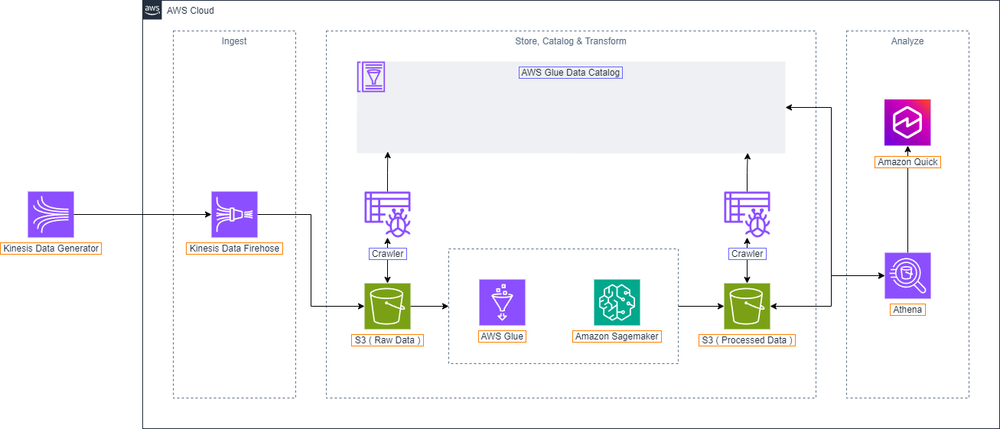

---
title: "Week 3"
date: 2026-09-28
weight: 3
chapter: false
pre: " <b> 1.3. </b> "
---

### Week 3 Objectives:

- Explore **Application Modernization** paradigms on AWS according to the [Application Modernization & Containers](https://cloudjourney.awsfcaj.com/4-modernize/) curriculum.
- Master serverless backend architectures using AWS Lambda, Amazon DynamoDB, Amazon API Gateway, and centralized user identity management with **Amazon Cognito**.
- Investigate enterprise container orchestration ecosystems spanning **Amazon ECS Fargate**, **Amazon EKS**, and **Red Hat OpenShift on AWS (ROSA)**.
- Formulate modern Data Lake principles on Amazon S3, serverless querying via **Amazon Athena**, and business intelligence reporting with **Amazon QuickSight**.
- Focus Thursday on a flagship hands-on implementation: **Two-Tier Architecture Design and Amazon RDS MySQL Multi-AZ Operations** (Workshop 000005).
- Dedicate Friday to synthesizing the foundational knowledge across the first three weeks, finalizing bilingual documentation, and submitting the formal **Capstone Project Proposal**.

---

### Tasks to be Carried Out This Week:

| Day | Task | Start Date | Completion Date | Reference Material |
| :--- | :--- | :---: | :---: | :--- |
| **Monday** | **App Modernization & Serverless Backend:**  - Architecting serverless backends with [Lambda, S3, DynamoDB (000078)](https://000078.awsfcaj.com).  - Secure identity management and authentication with [Amazon Cognito (000081)](https://000081.awsfcaj.com).  - Automated serverless packaging with [AWS SAM (000080)](https://000080.awsfcaj.com). | 09/28/2026 | 09/28/2026 | [Cloud Journey - Modernize](https://cloudjourney.awsfcaj.com/4-modernize/) |
| **Tuesday** | **Enterprise Container Services & Managed Kubernetes:**  - Microservices containerization via [Amazon ECS Fargate (000067)](https://000067.awsfcaj.com).  - Managed Kubernetes clusters with [Amazon EKS (000126)](https://000126.awsfcaj.com).  - Hybrid cloud operations via [Red Hat OpenShift on AWS - ROSA (000071)](https://000071.awsfcaj.com). | 09/29/2026 | 09/29/2026 | [Cloud Journey - Containers](https://cloudjourney.awsfcaj.com/5-container/) |
| **Wednesday** | **Data Analytics & Modern Cloud Data Lakes:**  - Establishing cloud data lake architectures with [Data Lake Fundamentals (000035)](https://000035.awsfcaj.com).  - Serverless interactive querying using [Amazon Athena (000106)](https://000106.awsfcaj.com).  - Business intelligence dashboards via [Amazon QuickSight (000073)](https://000073.awsfcaj.com). | 09/30/2026 | 09/30/2026 | [Cloud Journey - Data](https://cloudjourney.awsfcaj.com/6-dataandanalytic/) |
| **Thursday** | **Hands-On Amazon RDS Deployment (Primary Focus):**  - Provisioning a multi-AZ VPC segregating Public Web and Private Database subnets.  - Implementing chained Security Group rules authorizing MySQL port 3306.  - Deploying Amazon RDS MySQL Multi-AZ instances and validating EC2 client connectivity.  - Executing manual snapshots and practicing disaster recovery restoration drills. | 10/01/2026 | 10/01/2026 | [Amazon RDS Workshop (000005)](https://000005.awsfcaj.com/) |
| **Friday** | **Week 3 Review, Worklog Completion & Proposal Submission:**  - **Knowledge Review:** Consolidate serverless patterns, container ecosystems, analytics, and RDS Multi-AZ.  - **Worklog Completion:** Finalize comprehensive documentation for lab 1.3.1 and synthesize Week 3 logs.  - **Project Work:** Perform final review and officially submit the formal Capstone Project Proposal. | 10/02/2026 | 10/02/2026 | [The First Cloud Journey](https://cloudjourney.awsfcaj.com/) |

---

### Daily In-Depth Learning Outcomes & Key Takeaways:

#### 📌 Monday (09/28/2026) - Application Modernization & Serverless Backend

* **What did we learn today?**
  * **Three-Tier Serverless Web Architecture:** Mastered decoupled serverless patterns: Client-side single-page applications hosted on Amazon S3 ➔ Business logic execution via Amazon API Gateway and AWS Lambda ➔ Persistent low-latency data storage on Amazon DynamoDB.
  * **Identity Lifecycle Governance with Amazon Cognito:**
    * Configured **Cognito User Pools**: Managed user registration, login authentication, email OTP verification, password resets, and Multi-Factor Authentication (MFA).
    * Configured **Cognito Identity Pools**: Enabled federated identity mapping, vending short-lived temporary AWS STS credentials granting authenticated end-users direct access to scoped AWS resources (such as uploading user profile photos to dedicated S3 user prefixes).
  * **Infrastructure as Code via AWS SAM (Serverless Application Model):** Authored concise declarative `template.yaml` manifests defining Lambda handlers, DynamoDB tables, and API routes, automating compilation and deployment via `sam build` and `sam deploy`.

*Figure 1.3.1: Serverless event-driven architecture orchestrating AWS Lambda and downstream managed services.*

*Figure 1.3.2: Centralized user authentication and granular authorization model via Amazon Cognito and IAM Roles.*

* **Encountered Challenges & Solutions:**
  * *API Gateway Token Validation Rejections:* Client requests passing Cognito JWT tokens received HTTP `401 Unauthorized`. Root cause: The HTTP `Authorization` request header omitted the mandatory `Bearer ` prefix. Solution: Standardized the client request interceptor to transmit headers strictly formatted as `Bearer <id_token>`.

---

#### 📌 Tuesday (09/29/2026) - Enterprise Container Services & Kubernetes

* **What did we learn today?**
  * **Microservices Decomposition with Amazon ECS Fargate:** Explored decomposing legacy monolithic architectures into decoupled service tasks (Authentication, Product Catalog, Order Processing), containerizing workloads with Docker, and running on serverless AWS Fargate infrastructure with independent scaling policies.
  * **Managed Kubernetes on Amazon EKS:** Evaluated industrial Kubernetes primitives: Pods, Services, Deployments, ReplicaSets, and Ingress controllers. Analyzed how EKS manages a highly available multi-AZ control plane, ensuring open-standard container workload portability without proprietary vendor lock-in.
  * **Enterprise Hybrid Platforms with ROSA:** Evaluated Red Hat OpenShift on AWS (ROSA), delivering a unified, managed OpenShift experience that bridges on-premises enterprise data centers with public cloud infrastructure.

*Figure 1.3.3: Multi-tier microservices container architecture operating on Amazon ECS backed by AWS Fargate.*

* **Encountered Challenges & Solutions:**
  * *Container Orchestration Platform Selection:* Evaluated decision criteria between ECS and EKS. Takeaway: Adopt **Amazon ECS Fargate** when teams prioritize operational simplicity, tight AWS service integration, and lower administrative overhead; Adopt **Amazon EKS** when organizations maintain existing Kubernetes operational expertise, require complex Helm ecosystem tooling, or mandate multi-cloud deployment parity.

---

#### 📌 Wednesday (09/30/2026) - Cloud Data Lakes & Business Intelligence

* **What did we learn today?**
  * **Modern Data Lake Architectural Principles:** Analyzed the benefits of breaking data silos by consolidating structured, semi-structured, and unstructured data into an immutable Amazon S3 lake, decoupling storage capacity from analytical compute engines.
  * **Automated Data Cataloging with AWS Glue:** Configured Glue Crawlers to scan S3 raw log directories, automatically inferring record schemas and registering partition metadata within the AWS Glue Data Catalog.
  * **Distributed SQL Queries & Visual Analytics:** Executed serverless ANSI SQL queries against raw datasets via Amazon Athena without managing relational database servers, piping query results directly into Amazon QuickSight to render interactive operational charts.

*Figure 1.3.4: End-to-end data lake pipeline from ingestion and S3 storage to Glue cataloging and QuickSight visualization.*

* **Encountered Challenges & Solutions:**
  * *Escalating Query Costs on Raw CSV Datasets:* Running repeated `SELECT` queries across multi-gigabyte uncompressed CSV files resulted in full-table scans. Solution: Applied the best practice of transforming data into columnar Apache Parquet format with Snappy compression and chronological partitioning, reducing scanned data volumes by over 90%.

---

#### 📌 Thursday (10/01/2026) - Hands-On Amazon RDS Deployment

{}
👉 **Detailed Hands-on Report:** The complete step-by-step configuration, VPC topologies, chained security groups, EC2 web client scripts, manual snapshots, and 10 verifiable screenshots are documented in the dedicated sub-page: **[1.3.1. Hands-On Amazon RDS Deployment](1.3.1-amazon-rds/)**.
{}

* **What did we learn today?**
  * **Secure Two-Tier Network Architecture:**
    * Deployed VPC `rds-vpc` (`10.0.0.0/16`) spanning 4 subnets across 2 Availability Zones: 2 Public Subnets hosting EC2 Web Servers and 2 Private Subnets dedicated strictly to Amazon RDS.
    * Ensured database instances possess zero public IP addresses and zero default internet routes, eliminating external attack vectors.
  * **Security Group Chaining:**
    * Hardened network perimeters by configuring the database security group `rds-sg` to authorize inbound MySQL traffic (port 3306) exclusively from the security group ID of the web server `ec2-sg` (`sg-0cec4d0fbfc6d4c41`), eliminating static IP whitelisting.
  * **High Availability with Amazon RDS Multi-AZ:**
    * Provisioned a DB Subnet Group `rds-subnet-group` containing private subnets across `us-east-1a` and `us-east-1b`.
    * Launched a MySQL Community database (`db.m5.large`) with Multi-AZ replication. AWS maintains a primary instance while synchronously replicating storage blocks to an active standby instance in the secondary zone. In the event of an infrastructure outage, automated failover executes in under 60 seconds without client DNS reconfiguration.
  * **Disaster Recovery via Point-in-Time Recovery & Snapshots:**
    * Mastered continuous automated daily backups supporting Point-in-Time Recovery (PITR) to any second within the retention window.
    * Executed an explicit Manual Snapshot, stored durably in S3, and executed a complete restore drill to provision an independent replacement instance from the snapshot.

*Figure 1.3.5: Secure Two-Tier architecture separating EC2 Web Servers from private Amazon RDS database clusters.*

*Figure 1.3.6: Amazon RDS MySQL Multi-AZ database cluster in available status.*

* **Encountered Challenges & Solutions:**
  * *EC2 Client Connection Timeouts to Database Endpoint:* Executing `mysql -h <rds-endpoint> -u admin -p` timed out. Root cause: The EC2 instance was assigned a default security group instead of `ec2-sg`, failing the security group chaining rule. Solution: Attached `ec2-sg` to the web instance, immediately enabling successful client database handshakes.

---

#### 📌 Friday (10/02/2026) - Week 3 Review, Worklog Finalization & Proposal Submission

* **What did we learn today?**
  * **Foundational Milestone Synthesis:** Completed a holistic review of the 3-week foundation: Core infrastructure (IAM, VPC, EC2, S3) ➔ Well-Architected governance (Lambda, KMS, WAF, Fargate, Savings Plans) ➔ Application modernization, containers, analytics, and relational database engineering with Amazon RDS Multi-AZ.
  * **Bilingual Worklog Consolidation:** Finalized the standalone hands-on report [1.3.1. Hands-On Amazon RDS Deployment](1.3.1-amazon-rds/), validating 10 architectural diagrams, configuration tables, and terminal execution evidence.
  * **Official Submission of the Capstone Project Proposal:** Completed final architectural verifications, risk mitigation plans, and monthly budget estimates, formally submitting the graduation Capstone Project Proposal for mentor review.

