---
title: "Week 3"
date: 2026-09-28
weight: 3
chapter: false
pre: " <b> 1.3. </b> "
---


### Week 3 Objectives:

- Explore **Application Modernization** paradigms on AWS according to the [Application Modernization & Containers](https://cloudjourney.awsfcaj.com/4-modernize/) curriculum.
- Master serverless backend architectures using AWS Lambda, Amazon DynamoDB, Amazon API Gateway, and centralized user identity management with **Amazon Cognito**.
- Investigate enterprise container orchestration ecosystems spanning **Amazon ECS Fargate**, **Amazon EKS**, and **Red Hat OpenShift on AWS (ROSA)**.
- Formulate modern Data Lake principles on Amazon S3, serverless querying via **Amazon Athena**, and business intelligence reporting with **Amazon QuickSight**.
- Focus Thursday on a flagship hands-on implementation: **Two-Tier Architecture Design and Amazon RDS MySQL Multi-AZ Operations** (Workshop 000005).
- Dedicate Friday to synthesizing the foundational knowledge across the first three weeks, finalizing bilingual documentation, and submitting the formal **Capstone Project Proposal**.

---

### Tasks to be Carried Out This Week:

| Day | Task | Start Date | Completion Date | Reference Material |
| :--- | :--- | :---: | :---: | :--- |
| **Monday** | **App Modernization & Serverless Backend:** <br>- Architecting serverless backends with [Lambda, S3, DynamoDB (000078)](https://000078.awsfcaj.com). <br>- Secure identity management and authentication with [Amazon Cognito (000081)](https://000081.awsfcaj.com). <br>- Automated serverless packaging with [AWS SAM (000080)](https://000080.awsfcaj.com). | 09/28/2026 | 09/28/2026 | [Cloud Journey - Modernize](https://cloudjourney.awsfcaj.com/4-modernize/) |
| **Tuesday** | **Enterprise Container Services & Managed Kubernetes:** <br>- Microservices containerization via [Amazon ECS Fargate (000067)](https://000067.awsfcaj.com). <br>- Managed Kubernetes clusters with [Amazon EKS (000126)](https://000126.awsfcaj.com). <br>- Hybrid cloud operations via [Red Hat OpenShift on AWS - ROSA (000071)](https://000071.awsfcaj.com). | 09/29/2026 | 09/29/2026 | [Cloud Journey - Containers](https://cloudjourney.awsfcaj.com/5-container/) |
| **Wednesday** | **Data Analytics & Modern Cloud Data Lakes:** <br>- Establishing cloud data lake architectures with [Data Lake Fundamentals (000035)](https://000035.awsfcaj.com). <br>- Serverless interactive querying using [Amazon Athena (000106)](https://000106.awsfcaj.com). <br>- Business intelligence dashboards via [Amazon QuickSight (000073)](https://000073.awsfcaj.com). | 09/30/2026 | 09/30/2026 | [Cloud Journey - Data](https://cloudjourney.awsfcaj.com/6-dataandanalytic/) |
| **Thursday** | **Hands-On Amazon RDS Deployment (Primary Focus):** <br>- Provisioning a multi-AZ VPC segregating Public Web and Private Database subnets. <br>- Implementing chained Security Group rules authorizing MySQL port 3306. <br>- Deploying Amazon RDS MySQL Multi-AZ instances and validating EC2 client connectivity. <br>- Executing manual snapshots and practicing disaster recovery restoration drills. | 10/01/2026 | 10/01/2026 | [Amazon RDS Workshop (000005)](https://000005.awsfcaj.com/) |
| **Friday** | **Week 3 Review, Worklog Completion & Proposal Submission:** <br>- **Knowledge Review:** Consolidate serverless patterns, container ecosystems, analytics, and RDS Multi-AZ. <br>- **Worklog Completion:** Finalize comprehensive documentation for lab 1.3.1 and synthesize Week 3 logs. <br>- **Project Work:** Perform final review and officially submit the formal Capstone Project Proposal. | 10/02/2026 | 10/02/2026 | [The First Cloud Journey](https://cloudjourney.awsfcaj.com/) |

---

### Daily In-Depth Learning Outcomes & Key Takeaways:

#### 📌 Monday (09/28/2026) - Application Modernization & Serverless Backend

* **What did we learn today?**
  * **Three-Tier Serverless Web Architecture:** Mastered decoupled serverless patterns: Client-side single-page applications hosted on Amazon S3 ➔ Business logic execution via Amazon API Gateway and AWS Lambda ➔ Persistent low-latency data storage on Amazon DynamoDB.
  * **Identity Lifecycle Governance with Amazon Cognito:**
    * Configured **Cognito User Pools**: Managed user registration, login authentication, email OTP verification, password resets, and Multi-Factor Authentication (MFA).
    * Configured **Cognito Identity Pools**: Enabled federated identity mapping, vending short-lived temporary AWS STS credentials granting authenticated end-users direct access to scoped AWS resources (such as uploading user profile photos to dedicated S3 user prefixes).
  * **Infrastructure as Code via AWS SAM (Serverless Application Model):** Authored concise declarative `template.yaml` manifests defining Lambda handlers, DynamoDB tables, and API routes, automating compilation and deployment via `sam build` and `sam deploy`.

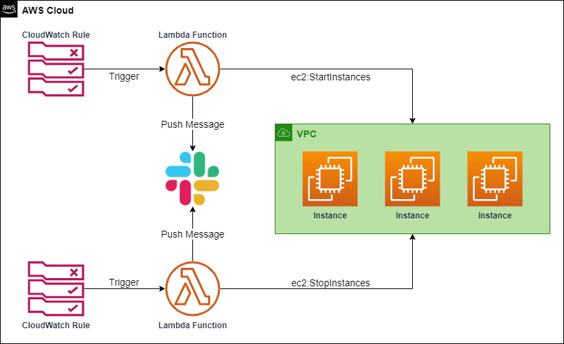
*Figure 1.3.1: Serverless event-driven architecture orchestrating AWS Lambda and downstream managed services.*

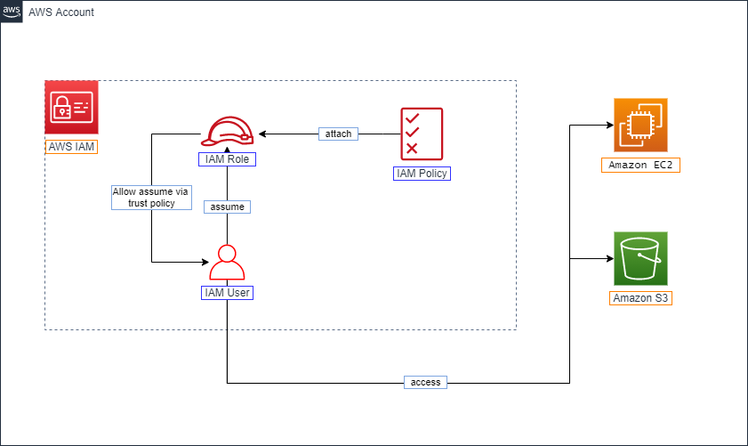
*Figure 1.3.2: Centralized user authentication and granular authorization model via Amazon Cognito and IAM Roles.*

* **Encountered Challenges & Solutions:**
  * *API Gateway Token Validation Rejections:* Client requests passing Cognito JWT tokens received HTTP `401 Unauthorized`. Root cause: The HTTP `Authorization` request header omitted the mandatory `Bearer ` prefix. Solution: Standardized the client request interceptor to transmit headers strictly formatted as `Bearer <id_token>`.

---

#### 📌 Tuesday (09/29/2026) - Enterprise Container Services & Kubernetes

* **What did we learn today?**
  * **Microservices Decomposition with Amazon ECS Fargate:** Explored decomposing legacy monolithic architectures into decoupled service tasks (Authentication, Product Catalog, Order Processing), containerizing workloads with Docker, and running on serverless AWS Fargate infrastructure with independent scaling policies.
  * **Managed Kubernetes on Amazon EKS:** Evaluated industrial Kubernetes primitives: Pods, Services, Deployments, ReplicaSets, and Ingress controllers. Analyzed how EKS manages a highly available multi-AZ control plane, ensuring open-standard container workload portability without proprietary vendor lock-in.
  * **Enterprise Hybrid Platforms with ROSA:** Evaluated Red Hat OpenShift on AWS (ROSA), delivering a unified, managed OpenShift experience that bridges on-premises enterprise data centers with public cloud infrastructure.

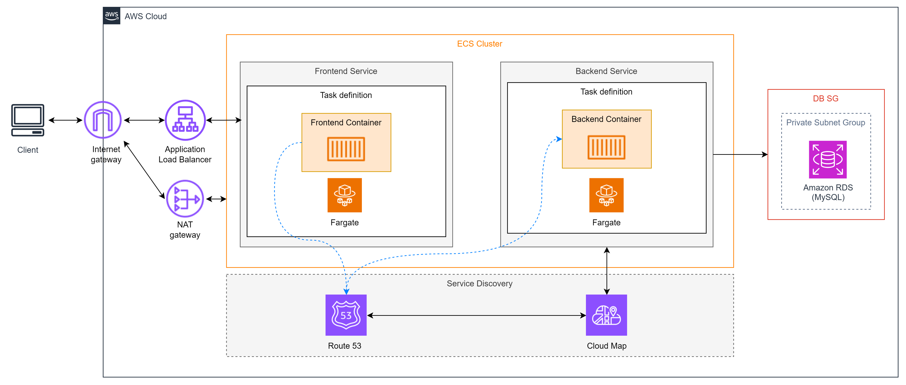
*Figure 1.3.3: Multi-tier microservices container architecture operating on Amazon ECS backed by AWS Fargate.*

* **Encountered Challenges & Solutions:**
  * *Container Orchestration Platform Selection:* Evaluated decision criteria between ECS and EKS. Takeaway: Adopt **Amazon ECS Fargate** when teams prioritize operational simplicity, tight AWS service integration, and lower administrative overhead; Adopt **Amazon EKS** when organizations maintain existing Kubernetes operational expertise, require complex Helm ecosystem tooling, or mandate multi-cloud deployment parity.

---

#### 📌 Wednesday (09/30/2026) - Cloud Data Lakes & Business Intelligence

* **What did we learn today?**
  * **Modern Data Lake Architectural Principles:** Analyzed the benefits of breaking data silos by consolidating structured, semi-structured, and unstructured data into an immutable Amazon S3 lake, decoupling storage capacity from analytical compute engines.
  * **Automated Data Cataloging with AWS Glue:** Configured Glue Crawlers to scan S3 raw log directories, automatically inferring record schemas and registering partition metadata within the AWS Glue Data Catalog.
  * **Distributed SQL Queries & Visual Analytics:** Executed serverless ANSI SQL queries against raw datasets via Amazon Athena without managing relational database servers, piping query results directly into Amazon QuickSight to render interactive operational charts.


*Figure 1.3.4: End-to-end data lake pipeline from ingestion and S3 storage to Glue cataloging and QuickSight visualization.*

* **Encountered Challenges & Solutions:**
  * *Escalating Query Costs on Raw CSV Datasets:* Running repeated `SELECT` queries across multi-gigabyte uncompressed CSV files resulted in full-table scans. Solution: Applied the best practice of transforming data into columnar Apache Parquet format with Snappy compression and chronological partitioning, reducing scanned data volumes by over 90%.

---

#### 📌 Thursday (10/01/2026) - Hands-On Amazon RDS Deployment

{}
The **Deploying Relational Databases with Amazon RDS** lab was executed on **Thursday (01/10/2026)** as part of **Week 3**. This page provides comprehensive technical documentation for designing a highly available, multi-Availability Zone (Multi-AZ) two-tier network architecture, configuring chained security group firewalls, provisioning an **Amazon RDS MySQL** instance, connecting an **Amazon EC2 Web Server**, and executing data protection workflows via **Manual DB Snapshots** and **Point-in-Time Restore**.
<br>🔗 **Lab Reference Source:** [Get Started with Amazon RDS Workshop](https://000005.awsfcaj.com/)
{}

### 🎯 Lab Objectives:
* Master the architecture, high availability mechanisms, and operational best practices of **Amazon RDS (Relational Database Service)**.
* Design and implement an isolated **Two-Tier Architecture**: placing the Web Server tier in a **Public Subnet** and the Database tier in isolated **Private Subnets** to enforce defense-in-depth security principles.
* Create a **DB Subnet Group** spanning across at least two distinct Availability Zones (**`us-east-1a` and `us-east-1b`**) to satisfy Multi-AZ high-availability requirements.
* Configure granular network isolation via **Security Groups**: restricting the MySQL inbound port TCP **3306** exclusively to traffic originating from the Web Server's Security Group (`ec2-sg`), prohibiting direct ingress from the public Internet.
* Provision an Amazon RDS database utilizing the **MySQL Community Edition** engine, configured on the `db.m5.large` instance class with automated synchronous **Multi-AZ Deployment** enabled.
* Deploy an **Amazon EC2** web workstation (Amazon Linux 2023), install Apache HTTP Server and the PHP runtime, configure connection strings to the private **RDS Endpoint**, and validate end-to-end CRUD operations.
* Execute database snapshot protection through **Manual DB Snapshots**, analyze automated daily backup windows, and understand disaster recovery workflows (**Point-in-Time Recovery - PITR**).

---

### 📊 Provisioned Resource Specifications:

| Parameter / Resource | Actual Value | Technical Significance & Role |
| :--- | :--- | :--- |
| **Virtual Private Cloud (VPC)** | `rds-vpc` (`vpc-0d0b88a31c814b1df`) | Isolated virtual network environment with CIDR block `10.0.0.0/16` |
| **Public Subnet** | `rds-subnet-public1-us-east-1a` | Public-facing subnet associated with an Internet Gateway, auto-assigns Public IPs |
| **Private Subnet 1** | `rds-subnet-private1-us-east-1a` | Isolated private subnet in `us-east-1a` hosting the Primary DB instance |
| **Private Subnet 2** | `rds-subnet-private2-us-east-1b` | Isolated private subnet in `us-east-1b` hosting the Standby DB replica |
| **DB Subnet Group** | `rds-subnet-group` | Multi-AZ subnet collection designated for RDS database failover |
| **Web Security Group** | `ec2-sg` (`sg-0cec4d0fbfc6d4c41`) | Inbound: Port 80 (HTTP from `0.0.0.0/0`) & Port 22 (SSH from My IP) |
| **RDS Security Group** | `rds-sg` (`sg-0331b33d6bf62d714`) | Inbound: Port 3306 (MySQL) restricted strictly to `ec2-sg` |
| **RDS Instance Identifier** | `db-instance` | MySQL Community 8.0, Instance Class: `db.m5.large` (2 vCPUs, 8 GiB RAM) |
| **Deployment Mode** | `Multi-AZ Deployment` | Synchronous secondary replica in another AZ for automatic seamless failover |
| **Database Name** | `fcaj` | Initial database created upon deployment |
| **Master Username** | `admin` | Root administrative credential for database management |
| **RDS Endpoint** | `db-instance.cgnkaue6ib4x.us-east-1.rds.amazonaws.com` | Private canonical DNS endpoint resolving to port 3306 |
| **Web Server Instance** | `web-server` | `t2.micro`, Amazon Linux 2023, Apache `httpd` & PHP |

---

### 🏛️ Architecture Overview:

The deployment adheres strictly to the AWS Well-Architected Framework:

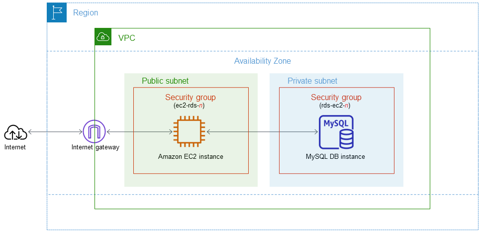

---

### 📋 Detailed Step-by-Step Implementation Guide:

#### 🔹 Module 1: Architecture Design & Network Infrastructure Preparation

##### Step 1: Provision the Multi-AZ VPC (`rds-vpc`)
* **Action:** Sign in to the AWS Management Console ➔ Navigate to **VPC** ➔ Click **Create VPC**.
* **Configuration:**
  * Select **VPC and more** for automated network topology creation.
  * **Name tag:** `rds-vpc`
  * **IPv4 CIDR block:** `10.0.0.0/16`
  * **Number of Availability Zones (AZs):** `2` (`us-east-1a` and `us-east-1b`)
  * **Number of public subnets:** `2`
  * **Number of private subnets:** `2`
  * **NAT gateways:** None (to eliminate unnecessary operational cost during lab testing)
  * **VPC Endpoints:** None
* **Action:** Click **Create VPC** and verify completion across all network routing components.


##### Step 2: Enable Public IPv4 Addressing for the Public Subnet
* **Action:** Go to **Subnets** ➔ Select `rds-subnet-public1-us-east-1a` ➔ Select **Actions** ➔ **Edit subnet settings**.
* **Configuration:** Check **Enable auto-assign public IPv4 address** ➔ Click **Save**.
* **Objective:** Ensures any web tier EC2 instances launched in this subnet automatically receive routable public IP addresses for incoming user traffic.

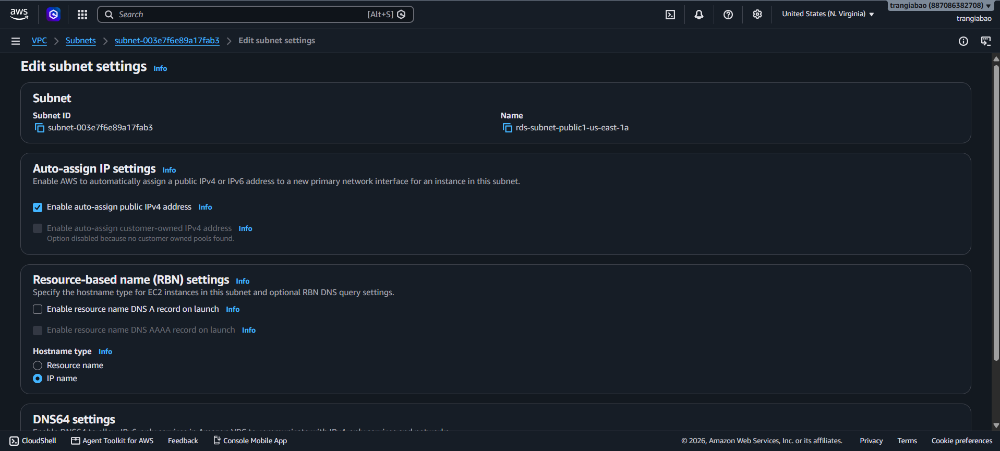

---

#### 🔹 Module 2: Configuring Security Group Firewalls & DB Subnet Group

##### Step 3: Configure Web Server Security Group (`ec2-sg`)
* **Action:** Navigate to **Security Groups** ➔ Click **Create security group**.
* **Settings:**
  * **Security group name:** `ec2-sg`
  * **VPC:** Select `rds-vpc`
  * **Inbound rules:**
    * Rule 1: Type **HTTP**, Port **80**, Source **0.0.0.0/0** (allows general public access).
    * Rule 2: Type **SSH**, Port **22**, Source **My IP** (secures administrative shell access).

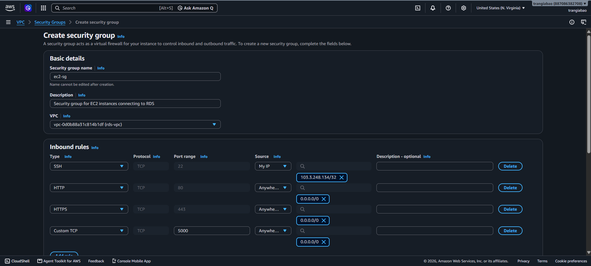

##### Step 4: Configure Database Security Group (`rds-sg`)
* **Action:** Click **Create security group** again.
* **Settings:**
  * **Security group name:** `rds-sg`
  * **VPC:** Select `rds-vpc`
  * **Inbound rules:**
    * Type **MySQL/Aurora**, Port **3306**, Source select **Custom** ➔ Enter the Security Group ID of **`ec2-sg`** (`sg-0cec4d0fbfc6d4c41`).
* **Security Significance:** Known as **Chained Security Groups**, this pattern ensures that no unauthorized machine from the Internet or within the VPC can connect to port 3306 unless it explicitly carries the `ec2-sg` tag.

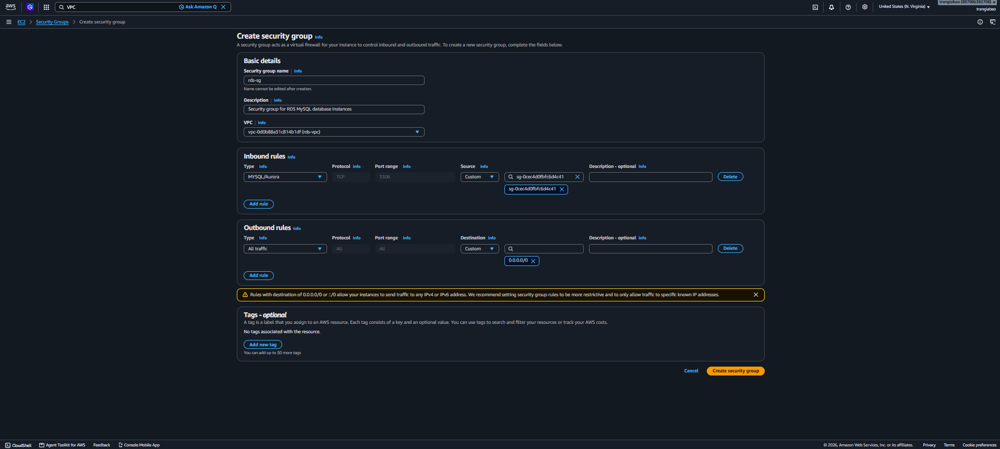

##### Step 5: Create DB Subnet Group
* **Action:** Open the **Amazon RDS** console ➔ Click **Subnet groups** ➔ Click **Create DB subnet group**.
* **Settings:**
  * **Name:** `rds-subnet-group`
  * **Description:** `Subnet group for RDS MySQL Multi-AZ`
  * **VPC:** Select `rds-vpc`
  * **Availability Zones:** Select both `us-east-1a` and `us-east-1b`.
  * **Subnets:** Select the two Private Subnets associated with the selected AZs (`10.0.128.0/20` and `10.0.144.0/20`).
* **Action:** Click **Create**.

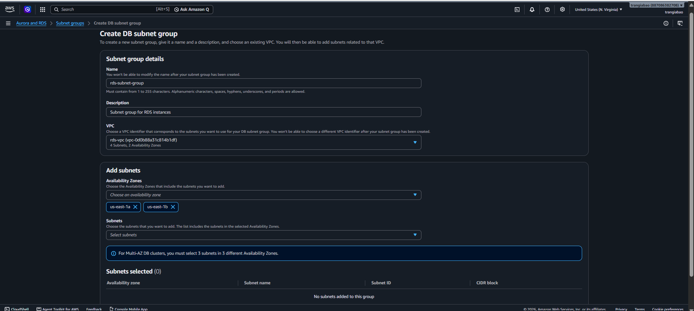

---

#### 🔹 Module 3: Provisioning & Configuring Amazon RDS MySQL Multi-AZ

##### Step 6: Launch the Amazon RDS Instance
* **Action:** In the Amazon RDS console, click **Databases** ➔ Click **Create database**.
* **Detailed Configuration Parameters:**
  * **Database creation method:** Standard create
  * **Engine options:** MySQL (Community Edition 8.0)
  * **Templates:** Production (enables the Multi-AZ configuration)
  * **Deployment options:** Multi-AZ DB instance (Creates primary instance and synchronous standby replica)
  * **DB instance identifier:** `db-instance`
  * **Master username:** `admin`
  * **Master password:** Set strong credentials
  * **DB instance class:** Standard classes `db.m5.large` (2 vCPUs, 8 GiB RAM)
  * **Storage:** General Purpose SSD (gp2/gp3), Allocated storage `20 GiB`
  * **Virtual Private Cloud (VPC):** `rds-vpc`
  * **DB subnet group:** `rds-subnet-group`
  * **Public access:** No (Enforces private internal network isolation)
  * **VPC security group:** Choose `rds-sg` (remove the default group)
  * **Initial database name:** `fcaj`
* **Action:** Click **Create database** and allow 10 to 15 minutes for complete automated provisioning.


##### Step 7: Inspect Operational Logs, Events, and Automated Maintenance
* **Observations:**
  * In the **Connectivity & security** tab, record the canonical **Endpoint** and **Port 3306**.
  * In the **Logs & events** tab, inspect provisioning audit trails, initial automated snapshots, and synchronous replica creation logs.

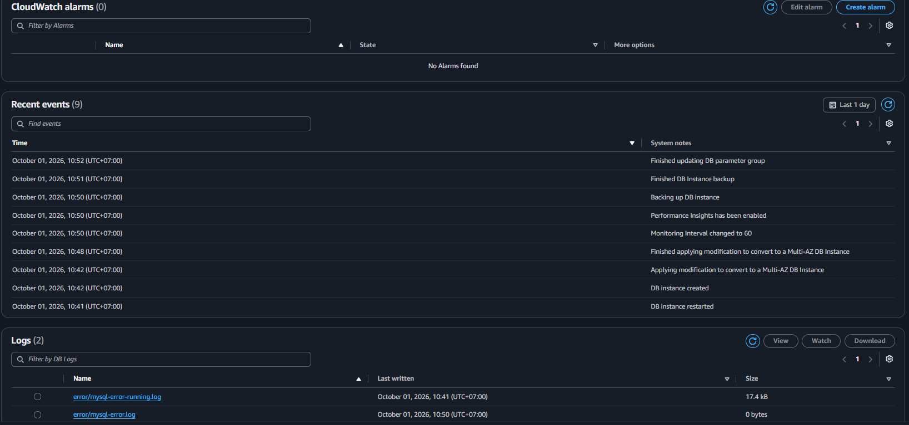

* In the **Maintenance & backups** tab, verify that automated backups are enabled with a **7-day retention period** and examine the scheduled maintenance window.

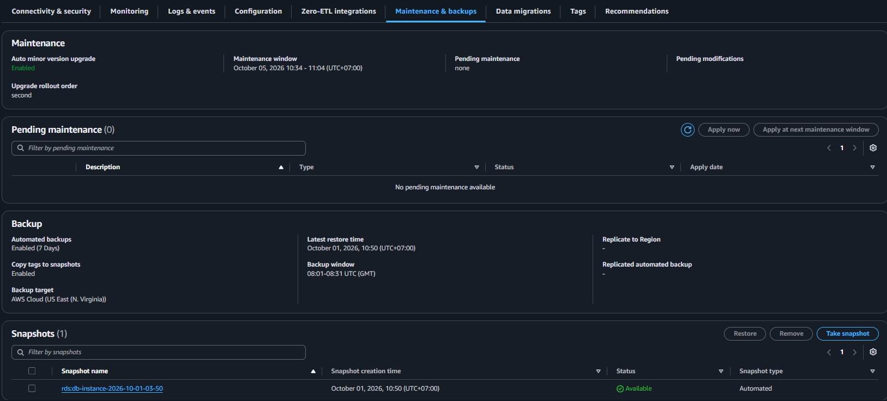

---

#### 🔹 Module 4: Deploying Web Server (EC2) & Establishing Database Connectivity

##### Step 8: Launch the EC2 Web Instance
* **Action:** Navigate to **EC2** ➔ Click **Launch instances**.
* **Parameters:**
  * **Name:** `web-server`
  * **AMI:** Amazon Linux 2023 AMI
  * **Instance type:** `t2.micro`
  * **Network settings:** VPC `rds-vpc`, Subnet `rds-subnet-public1-us-east-1a`, Auto-assign Public IP: Enable, Security group: `ec2-sg`.

##### Step 9: Install the Web Stack and Test Database Connectivity
* **Action:** Establish SSH connection into the EC2 instance via terminal:

```bash
# Update software packages
sudo dnf update -y

# Install Apache HTTP Server, MariaDB client, and PHP MySQL extensions
sudo dnf install -y httpd php php-mysqli php-pdo mariadb105

# Start and enable the Apache service
sudo systemctl start httpd
sudo systemctl enable httpd
```

* **Verify network line of sight from EC2 to RDS:**
```bash
# Test TCP handshake on port 3306
nc -zv db-instance.cgnkaue6ib4x.us-east-1.rds.amazonaws.com 3306
```

* **Deploy PHP database verification script (`/var/www/html/dbtest.php`):**
```php
<?php
$servername = "db-instance.cgnkaue6ib4x.us-east-1.rds.amazonaws.com";
$username = "admin";
$password = "YourMasterPassword123";
$dbname = "fcaj";

// Create connection
$conn = new mysqli($servername, $username, $password, $dbname);

// Check connection
if ($conn->connect_error) {
  die("Database connection failed: " . $conn->connect_error);
}
echo "<h1>Amazon RDS Database Connection Successful!</h1>";
echo "<p>Connected securely to database: <strong>" . $dbname . "</strong> via internal endpoint.</p>";
$conn->close();
?>
```

* **Validation:** Open a web browser and navigate to: `http://<EC2-Public-IP>/dbtest.php`. The success banner validates flawless end-to-end multi-tier connectivity.

---

#### 🔹 Module 5: Operational Resilience & Data Protection (Snapshot Backup & Restore)

##### Step 10: Create a Manual DB Snapshot
* **Action:** In the **Amazon RDS** console ➔ Select `db-instance` ➔ Click **Actions** ➔ **Take snapshot**.
* **Parameters:**
  * **Snapshot name:** `rds-manual-snapshot-fcaj`
* **Action:** Click **Take snapshot**.
* **Architectural Purpose:** Manual snapshots are stored durably in internal Amazon S3 storage across multiple AZs and persist until explicitly deleted by administrators, even if the source DB instance is terminated.

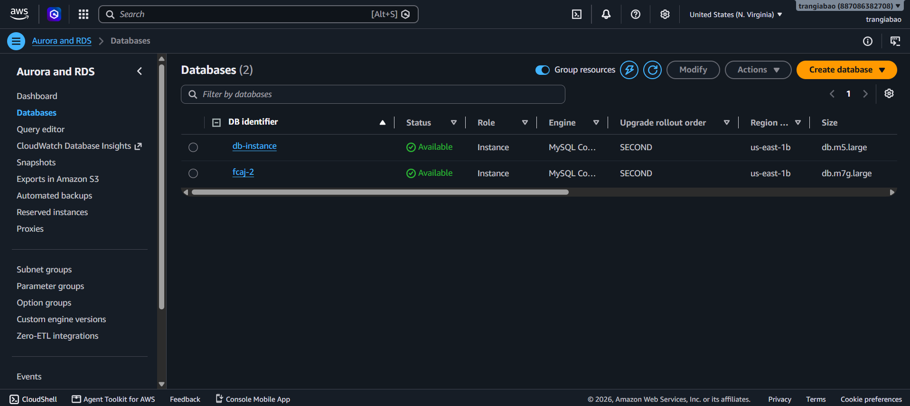

##### Step 11: Database Recovery Workflow (Restore from Snapshot)
* **Standard AWS Recovery Lifecycle:**
  1. To initiate a restore, select the snapshot `rds-manual-snapshot-fcaj` ➔ Click **Actions** ➔ **Restore snapshot**.
  2. AWS creates a **brand-new DB Instance** with a distinct DNS endpoint, ensuring the production database is not accidentally overwritten.
  3. Once data integrity verification is completed, web tier connection strings are updated to point to the new endpoint to complete the disaster recovery cutover.

---

### 💡 Troubleshooting & Real-World Lessons:

#### 1. Connection Timed Out Between Web Server and RDS
* **Root Cause:** Inbound security group rules on `rds-sg` did not permit port 3306 from the `ec2-sg` security group ID, or the RDS instance was placed in subnets lacking local route connectivity to the public subnet.
* **Troubleshooting:** Use `nc -zv <RDS-Endpoint> 3306` directly from the EC2 shell to confirm Transport Layer connectivity before inspecting application application code.

#### 2. Subnet Group Availability Zone Constraint Error
* **Root Cause:** When configuring Multi-AZ deployment, Amazon RDS enforces that the DB Subnet Group must cover at least two distinct Availability Zones.
* **Resolution:** Ensure that when creating `rds-subnet-group`, at least two subnets in separate AZs (e.g., `us-east-1a` and `us-east-1b`) are included.

#### 3. High Availability Failover vs. Read Scalability
* **Multi-AZ:** Designed for **High Availability (HA)**. The standby replica is an exact synchronous copy that does not accept read or write traffic. In a failure event, automated DNS failover redirects traffic to the standby within 60–120 seconds.
* **Read Replicas:** Designed for **Read Scalability**. They utilize asynchronous replication and expose individual endpoints to offload heavy analytical read traffic from the primary instance.

#### 4. Cost Optimization & Resource Teardown
* **Best Practice:** The `db.m5.large` Multi-AZ configuration incurs notable hourly operational expenses. Upon finishing lab testing, create a final snapshot if data preservation is needed, and terminate the instance to prevent unnecessary charges.

---

### 📌 Summary & Skills Acquired:
Through the **Deploying Relational Databases with Amazon RDS** lab, the intern has acquired:
1. End-to-end mastery in architecting secure, isolated multi-tier database topologies in the AWS Cloud.
2. Hands-on proficiency in chained security group configurations and DB Subnet Group provisioning.
3. Complete command over high-availability Multi-AZ failover and disaster recovery snapshot procedures.

* **What did we learn today?**
  * **Secure Two-Tier Network Architecture:**
    * Deployed VPC `rds-vpc` (`10.0.0.0/16`) spanning 4 subnets across 2 Availability Zones: 2 Public Subnets hosting EC2 Web Servers and 2 Private Subnets dedicated strictly to Amazon RDS.
    * Ensured database instances possess zero public IP addresses and zero default internet routes, eliminating external attack vectors.
  * **Security Group Chaining:**
    * Hardened network perimeters by configuring the database security group `rds-sg` to authorize inbound MySQL traffic (port 3306) exclusively from the security group ID of the web server `ec2-sg` (`sg-0cec4d0fbfc6d4c41`), eliminating static IP whitelisting.
  * **High Availability with Amazon RDS Multi-AZ:**
    * Provisioned a DB Subnet Group `rds-subnet-group` containing private subnets across `us-east-1a` and `us-east-1b`.
    * Launched a MySQL Community database (`db.m5.large`) with Multi-AZ replication. AWS maintains a primary instance while synchronously replicating storage blocks to an active standby instance in the secondary zone. In the event of an infrastructure outage, automated failover executes in under 60 seconds without client DNS reconfiguration.
  * **Disaster Recovery via Point-in-Time Recovery & Snapshots:**
    * Mastered continuous automated daily backups supporting Point-in-Time Recovery (PITR) to any second within the retention window.
    * Executed an explicit Manual Snapshot, stored durably in S3, and executed a complete restore drill to provision an independent replacement instance from the snapshot.


*Figure 1.3.5: Secure Two-Tier architecture separating EC2 Web Servers from private Amazon RDS database clusters.*


*Figure 1.3.6: Amazon RDS MySQL Multi-AZ database cluster in available status.*

* **Encountered Challenges & Solutions:**
  * *EC2 Client Connection Timeouts to Database Endpoint:* Executing `mysql -h <rds-endpoint> -u admin -p` timed out. Root cause: The EC2 instance was assigned a default security group instead of `ec2-sg`, failing the security group chaining rule. Solution: Attached `ec2-sg` to the web instance, immediately enabling successful client database handshakes.

---

#### 📌 Friday (10/02/2026) - Week 3 Review, Worklog Finalization & Proposal Submission

* **What did we learn today?**
  * **Foundational Milestone Synthesis:** Completed a holistic review of the 3-week foundation: Core infrastructure (IAM, VPC, EC2, S3) ➔ Well-Architected governance (Lambda, KMS, WAF, Fargate, Savings Plans) ➔ Application modernization, containers, analytics, and relational database engineering with Amazon RDS Multi-AZ.
  * **Bilingual Worklog Consolidation:** Finalized the standalone hands-on report **1.3.1. Hands-On Amazon RDS Deployment**, validating 10 architectural diagrams, configuration tables, and terminal execution evidence.
  * **Official Submission of the Capstone Project Proposal:** Completed final architectural verifications, risk mitigation plans, and monthly budget estimates, formally submitting the graduation Capstone Project Proposal for mentor review.


