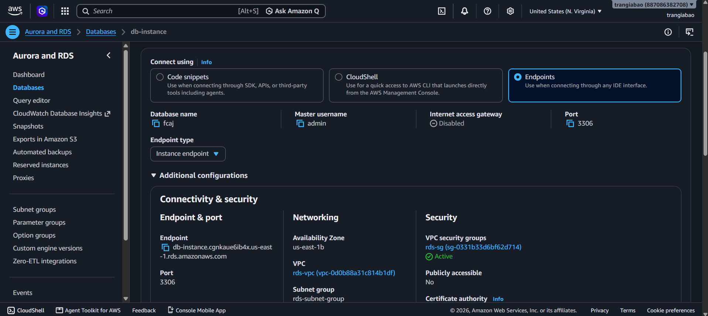

{}
⚠️ **Notice:** The following information is for reference purposes only. Please **do not copy verbatim** for your own report, including this warning.
{}

### Week 3 Objectives:

* Complete foundational knowledge in Application Modernization, Container Services, and Data Analytics.
* Conduct deep hands-on architectural implementation of Amazon RDS.
* Review accumulated knowledge and finalize the comprehensive Week 3 worklog.

### Tasks to be Carried Out This Week:

| Day | Tasks | Start Date | Completion Date | Reference Sources |
| :--- | :--- | :--- | :--- | :--- |
| **Monday** | **App Modernization:**  - Serverless Backend with [Lambda, S3, DynamoDB (000078)](https://000078.awsfcaj.com) & API Gateway.  - User Authentication with [Amazon Cognito (000081)](https://000081.awsfcaj.com).  - Deployment Automation with [AWS SAM (000080)](https://000080.awsfcaj.com). | 09/28/2026 | 09/28/2026 | [Cloud Journey - App Modernization](https://cloudjourney.awsfcaj.com/4-modernize/) |
| **Tuesday** | **Container Services:**  - Containerization with [ECS & AWS Fargate (000067)](https://000067.awsfcaj.com).  - Getting Started with [Amazon EKS (000126)](https://000126.awsfcaj.com).  - [Red Hat OpenShift on AWS - ROSA (000071)](https://000071.awsfcaj.com). | 09/29/2026 | 09/29/2026 | [Cloud Journey - Container Services](https://cloudjourney.awsfcaj.com/5-container/) |
| **Wednesday** | **Data Analytics:**  - [Data Lake Fundamentals (000035)](https://000035.awsfcaj.com).  - Business Intelligence with [Amazon QuickSight (000073)](https://000073.awsfcaj.com).  - Serverless Analytics with [Amazon Athena (000106)](https://000106.awsfcaj.com). | 09/30/2026 | 09/30/2026 | [Cloud Journey - Data & Analytics](https://cloudjourney.awsfcaj.com/6-dataandanalytic/) |
| **Thursday** | **Hands-on Amazon RDS Immersion:**  - Provision VPC, subnets, and security groups.  - Deploy an Amazon RDS (MySQL Multi-AZ) database.  - Launch an EC2 Web Server & deploy sample application.  - Perform database backup and point-in-time recovery via snapshots. | 10/01/2026 | 10/01/2026 | [Amazon RDS Workshop (000005)](https://000005.awsfcaj.com/) |
| **Friday** | **Week 3 Synthesis, Worklog Completion & Project Proposal:**  - **Knowledge Synthesis:** Systematically review serverless microservices, container orchestration, data analytics, and relational database best practices.  - **Worklog Completion:** Finalize the detailed hands-on lab report for Amazon RDS (1.3.1) and compile Week 3 documentation.  - **Project Proposal Work:** Review technical feasibility, address mentor feedback, and finalize the Project Proposal submission. | 10/02/2026 | 10/02/2026 | [The First Cloud Journey](https://cloudjourney.awsfcaj.com/) |

### Week 3 Achievements:

#### 📌 Monday (09/28/2026) - Serverless Application Modernization:
* **Serverless Architecture Principles:** Mastered distributed patterns linking Amazon API Gateway, AWS Lambda, and DynamoDB for low-overhead application logic.
* **Centralized User Authentication:** Integrated enterprise user identity pools with Amazon Cognito, securing backend resources with delegated IAM Roles.

*Figure 1.3.1: Serverless asynchronous operational workflow governed by event-driven AWS Lambda execution.*

*Figure 1.3.2: Centralized authentication and delegated access control utilizing Amazon Cognito and IAM Roles.*

---

#### 📌 Tuesday (09/29/2026) - Enterprise Container Orchestration:
* **Enterprise Container Workloads:** Understood container packaging and enterprise-scale deployment using Amazon ECS with serverless AWS Fargate.
* **Managed Kubernetes Ecosystem:** Explored cloud-native distributed container architectures via Amazon EKS and Red Hat OpenShift on AWS (ROSA).

*Figure 1.3.3: Multi-tier microservices container orchestration model hosted on Amazon ECS and AWS Fargate.*

---

#### 📌 Wednesday (09/30/2026) - Cloud Data Analytics:
* **Data Lake Foundation:** Mastered Data Lake architectural patterns on Amazon S3 paired with centralized schema governance via AWS Glue Data Catalog.
* **Serverless Ad-hoc Analysis & BI:** Leveraged serverless SQL querying with Amazon Athena and delivered business intelligence visualization using Amazon QuickSight.

*Figure 1.3.4: End-to-end Data Lake analytics pipeline spanning ingestion, S3 storage, Glue transformations, and QuickSight visualization.*

---

#### 📌 Thursday (10/01/2026) - Hands-on Amazon RDS Immersion:

{}
👉 **Detailed Lab Report:** Complete network topology, chained security group configurations, EC2 Web Server connectivity, snapshot backup procedures, and all 10 verified proof screenshots are detailed in: **[1.3.1. Deploying Amazon RDS](1.3.1-amazon-rds/)**.
{}

* **Secure Two-Tier Network Architecture:** Designed an isolated VPC separating public subnets (EC2 Web Server) from private subnets (RDS Database) to prevent direct internet exposure.
* **Chained Security Group Governance:** Applied defense-in-depth by restricting MySQL port 3306 exclusively to inbound traffic originating from the Web Server's security group identifier.
* **High Availability with Multi-AZ:** Deployed a synchronous standby replica of the MySQL instance in an alternate Availability Zone, ensuring automatic failover capability.
* **Data Protection & Disaster Recovery:** Successfully performed manual DB snapshot creation, examined automated continuous backup windows, and verified recovery procedures.

*Figure 1.3.5: Secure Two-Tier architecture isolating the EC2 Web Server from the private Amazon RDS database instance.*

*Figure 1.3.6: Production Amazon RDS MySQL Multi-AZ database instance in healthy Available status.*

---

#### 📌 Friday (10/02/2026) - Knowledge Synthesis, Worklog Completion & Project Proposal:
* **1. Week 3 Knowledge Synthesis:** Consolidated and synthesized architectural concepts mastered across the first three weeks: foundational networking, Well-Architected optimization, serverless workflows, container fleets, and resilient Amazon RDS Multi-AZ relational database architectures.
* **2. Worklog Documentation & Quality Review:** Published the comprehensive hands-on report [1.3.1. Deploying Amazon RDS](1.3.1-amazon-rds/), verifying all 10 two-tier topology screenshots, logs, and snapshot verifications; finalized the bilingual Week 3 Worklog summary.
* **3. Project Proposal Inception & Refinement:** Dedicated focused project time to validate technical feasibility, audit risk mitigation plans, and finalize all required sections of the capstone **Project Proposal** for mentor review.

---

### Next Week's Objectives (Week 4):

* **Deploying Amazon Lightsail (1.4.1):** Provision Managed MySQL Databases, launch WordPress and Prestashop e-commerce instances, assign static public IPs, create automated snapshot backups, and perform seamless instance plan migration.
* **Deploying Amazon Lightsail Containers (1.4.2):** Configure AWS CLI, enforce least-privilege IAM policies (`AmazonLightsailFullAccess`), provision Nano Container Services, install `lightsailctl`, and package and push custom Docker images.
* **Application Scaling with EC2 Auto Scaling (1.4.3):** Build custom AMIs, configure standardized Launch Templates, setup Target Groups and Application Load Balancers (ALB), apply Target Tracking Dynamic Scaling (50% CPU threshold), perform Stress Testing, and verify automated scale-out/scale-in workflows.
* **Comprehensive Monitoring with Amazon CloudWatch (1.4.4):** Install and configure the CloudWatch Agent, craft composite metrics dashboards using Search and Math Expressions, analyze log streams with CloudWatch Logs Insights, configure metric filters for HTTP 404 tracking, and establish automated SNS alerting.
* **Hybrid DNS Resolution with Route 53 Resolver (1.4.5):** Automate multi-VPC simulation with CloudFormation, configure Microsoft Active Directory as an on-premises DNS authority, provision Inbound and Outbound Resolver Endpoints, and configure forwarding rules for seamless two-way resolution.
