---
title: "Tuần 3"
date: 2026-09-28
weight: 3
chapter: false
pre: " <b> 1.3. </b> "
---


### Mục tiêu tuần 3:

- Tiếp cận các mô hình Hiện đại hóa ứng dụng (**Application Modernization**) trên AWS theo phân hệ [Application Modernization & Containers](https://cloudjourney.awsfcaj.com/4-modernize/).
- Nắm vững kiến trúc không máy chủ (**Serverless Backend**) với AWS Lambda, Amazon DynamoDB, Amazon API Gateway và quản lý định danh người dùng tập trung với **Amazon Cognito**.
- Khám phá hệ sinh thái điều phối container doanh nghiệp với **Amazon ECS Fargate**, **Amazon EKS** và **Red Hat OpenShift on AWS (ROSA)**.
- Xây dựng nền tảng tư duy Hồ dữ liệu (**Data Lake**) trên Amazon S3, phân tích dữ liệu với **Amazon Athena** và trực quan hóa báo cáo với **Amazon QuickSight**.
- Dành trọng tâm ngày Thứ 5 triển khai bài thực hành chuyên sâu: **Thiết kế kiến trúc mạng 2 tầng (Two-Tier) và vận hành cơ sở dữ liệu quan hệ Amazon RDS Multi-AZ** (Workshop 000005).
- Dành ngày Thứ 6 tổng kết toàn bộ 3 tuần đầu, hoàn thiện hồ sơ Worklog và hoàn tất nộp Bản đề xuất dự án (**Project Proposal**).

---

### Các công việc cần triển khai trong tuần này:

| Thứ | Công việc | Ngày bắt đầu | Ngày hoàn thành | Nguồn tài liệu |
| :--- | :--- | :---: | :---: | :--- |
| **Thứ 2** | **App Modernization & Serverless Backend:** <br>- Xây dựng Serverless Backend với [Lambda, S3, DynamoDB (000078)](https://000078.awsfcaj.com). <br>- Quản lý xác thực người dùng an toàn với [Amazon Cognito (000081)](https://000081.awsfcaj.com). <br>- Tự động hóa đóng gói hạ tầng không máy chủ với [AWS SAM (000080)](https://000080.awsfcaj.com). | 28/09/2026 | 28/09/2026 | [Cloud Journey - Modernize](https://cloudjourney.awsfcaj.com/4-modernize/) |
| **Thứ 3** | **Dịch vụ Container & Kubernetes Doanh nghiệp:** <br>- Đóng gói microservices với [Amazon ECS Fargate (000067)](https://000067.awsfcaj.com). <br>- Khởi tạo cụm Kubernetes quản lý với [Amazon EKS (000126)](https://000126.awsfcaj.com). <br>- Khám phá nền tảng lai [Red Hat OpenShift on AWS - ROSA (000071)](https://000071.awsfcaj.com). | 29/09/2026 | 29/09/2026 | [Cloud Journey - Containers](https://cloudjourney.awsfcaj.com/5-container/) |
| **Thứ 4** | **Phân tích dữ liệu & Hồ dữ liệu đám mây:** <br>- Xây dựng kiến trúc hồ dữ liệu với [Data Lake Fundamentals (000035)](https://000035.awsfcaj.com). <br>- Truy vấn dữ liệu phân tán phi máy chủ với [Amazon Athena (000106)](https://000106.awsfcaj.com). <br>- Báo cáo trực quan hóa dữ liệu kinh doanh với [Amazon QuickSight (000073)](https://000073.awsfcaj.com). | 30/09/2026 | 30/09/2026 | [Cloud Journey - Data](https://cloudjourney.awsfcaj.com/6-dataandanalytic/) |
| **Thứ 5** | **Thực hành triển khai Amazon RDS (Trọng tâm thực chiến):** <br>- Thiết lập mạng VPC 2 AZs, phân tách Public Subnet và Private Subnet. <br>- Cấu hình Security Group chuỗi liên kết (Chaining) mở port MySQL 3306. <br>- Khởi tạo cụm Amazon RDS MySQL Multi-AZ và kết nối từ Web Server EC2. <br>- Thực hành tạo bản sao lưu thủ công (Manual Snapshot) và phục hồi CSDL. | 01/10/2026 | 01/10/2026 | [Amazon RDS Workshop (000005)](https://000005.awsfcaj.com/) |
| **Thứ 6** | **Tổng kết tuần 3, Viết Worklog & Hoàn tất Project Proposal:** <br>- **Tổng kết kiến thức:** Hệ thống hóa toàn bộ kiến thức Serverless, Containers, Analytics và CSDL RDS. <br>- **Làm Worklog:** Hoàn thiện báo cáo chi tiết cho bài lab Amazon RDS (1.3.1) và tổng kết Worklog Tuần 3. <br>- **Làm Project:** Hoàn tất rà soát lần cuối và chính thức nộp Bản đề xuất dự án thực tập (Project Proposal). | 02/10/2026 | 02/10/2026 | [The First Cloud Journey](https://cloudjourney.awsfcaj.com/) |

---

### Chi tiết nội dung học tập và kết quả đạt được mỗi ngày:

#### 📌 Thứ 2 (28/09/2026) - Hiện đại hóa ứng dụng không máy chủ (App Modernization)

* **Ta học được những gì hôm nay?**
  * **Mô hình kiến trúc không máy chủ (Serverless Architecture):** Nắm vững cách xây dựng ứng dụng Web ba tầng (Three-tier Web App) không máy chủ: Tầng giao diện lưu trữ trên Amazon S3 ➔ Tầng xử lý logic nghiệp vụ qua Amazon API Gateway và AWS Lambda ➔ Tầng dữ liệu bền bỉ trên Amazon DynamoDB.
  * **Quản trị định danh người dùng với Amazon Cognito:**
    * Khởi tạo **Cognito User Pool**: Cung cấp tính năng đăng ký tài khoản (Sign-up), đăng nhập (Sign-in), gửi email xác thực mã OTP, đặt lại mật khẩu và hỗ trợ xác thực đa yếu tố (MFA).
    * Khởi tạo **Cognito Identity Pool**: Cung cấp cơ chế phân quyền ủy thác (Federated Identities), cấp phát thông tin xác thực AWS tạm thời (Temporary AWS Credentials) cho người dùng cuối truy cập trực tiếp vào các tài nguyên AWS được phép (như tải ảnh lên thư mục riêng trên S3).
  * **Tự động hóa triển khai với AWS SAM (Serverless Application Model):** Khám phá công cụ CLI mã nguồn mở giúp định nghĩa hàm Lambda, bảng DynamoDB và API Gateway chỉ với một tệp `template.yaml` ngắn gọn, thực thi lệnh `sam build` và `sam deploy` tự động.

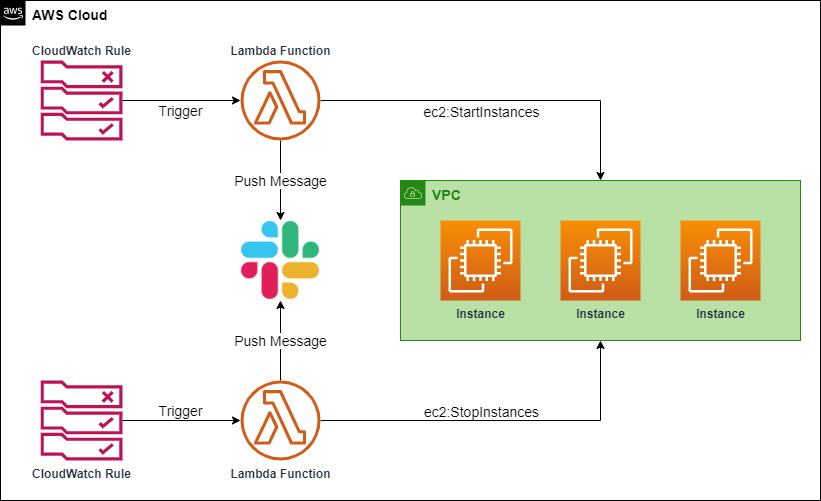
*Hình 1.3.1: Kiến trúc luồng xử lý phi máy chủ tích hợp AWS Lambda điều phối tài nguyên theo sự kiện.*


*Hình 1.3.2: Cơ chế xác thực người dùng tập trung và phân quyền truy cập thông qua Amazon Cognito và IAM Roles.*

* **Khó khăn gặp phải & Cách xử lý:**
  * *Lỗi xác thực Token trên API Gateway:* Người dùng gửi JWT Token nhận từ Cognito User Pool vào API Gateway nhưng bị trả về lỗi `401 Unauthorized`. Nguyên nhân: Header `Authorization` thiếu từ khóa tiền tố `Bearer `. Cách xử lý: Cấu hình chuẩn hóa chuỗi header gửi từ phía client theo đúng định dạng `Bearer <id_token>`.

---

#### 📌 Thứ 3 (29/09/2026) - Dịch vụ đóng gói và điều phối Container doanh nghiệp

* **Ta học được những gì hôm nay?**
  * **Điều phối container doanh nghiệp với Amazon ECS Fargate:** Tìm hiểu cách phân tách ứng dụng nguyên khối (Monolith) thành các vi dịch vụ độc lập (Auth service, Product service, Order service), đóng gói từng service vào container và triển khai trên hạ tầng phi máy chủ AWS Fargate với khả năng co giãn độc lập.
  * **Hệ sinh thái Kubernetes quản lý (Amazon EKS):** Tiếp cận kiến trúc chuẩn công nghiệp của Kubernetes: Pods, Services, Deployments, ReplicaSets và Ingress. Khám phá cách EKS quản lý Control Plane có độ sẵn sàng cao, giúp doanh nghiệp vận hành các ứng dụng mã nguồn mở tiêu chuẩn mà không bị trói buộc vào một nhà cung cấp đám mây duy nhất (Multi-cloud portability).
  * **Nền tảng lai Red Hat OpenShift on AWS (ROSA):** Khám phá giải pháp tích hợp giữa Red Hat và AWS, mang lại môi trường vận hành Kubernetes đồng nhất giữa trung tâm dữ liệu tại chỗ (On-Premises) và đám mây công cộng AWS.

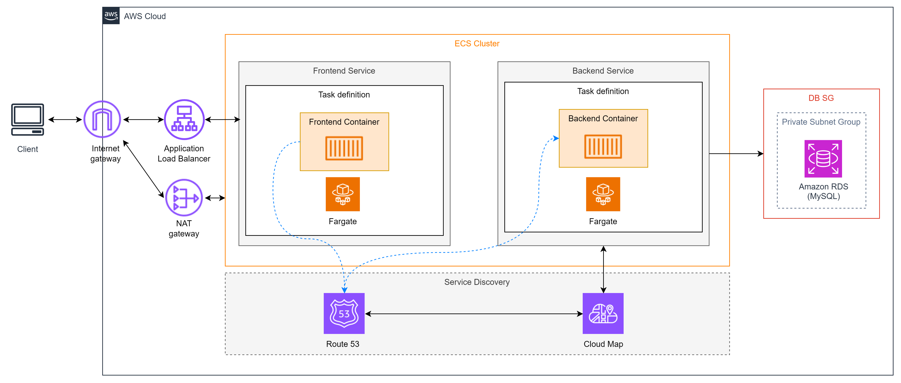
*Hình 1.3.3: Sơ đồ kiến trúc ứng dụng Microservices đa dịch vụ vận hành trên Amazon ECS và AWS Fargate.*

* **Khó khăn gặp phải & Cách xử lý:**
  * *Bài toán lựa chọn công nghệ:* Băn khoăn khi nào nên dùng ECS và khi nào nên dùng EKS. Bài học đúc kết: Chọn **ECS Fargate** khi đội ngũ muốn tập trung phát triển sản phẩm, cần sự đơn giản, tích hợp sâu vào AWS với chi phí vận hành thấp; Chọn **Amazon EKS** khi tổ chức đã có sẵn kinh nghiệm vận hành Kubernetes, có các hệ thống phức tạp hoặc yêu cầu chạy đồng nhất trên nhiều nền tảng đám mây khác nhau.

---

#### 📌 Thứ 4 (30/09/2026) - Hồ dữ liệu & Phân tích thông minh (Data Analytics)

* **Ta học được những gì hôm nay?**
  * **Kiến trúc Hồ dữ liệu hiện đại (Data Lake Fundamentals):** Hiểu rõ tư duy tập trung hóa toàn bộ dữ liệu có cấu trúc, bán cấu trúc và phi cấu trúc của doanh nghiệp về một "kho chứa" duy nhất trên Amazon S3, tách rời hoàn toàn giữa tầng lưu trữ (Storage) và tầng tính toán phân tích (Compute).
  * **Tự động hóa danh mục dữ liệu với AWS Glue:** Trải nghiệm khả năng của Glue Crawler tự động quét các tệp dữ liệu nhật ký trên S3, tự động suy diễn cấu trúc bảng và cập nhật vào AWS Glue Data Catalog.
  * **Truy vấn phân tán & Trực quan hóa dữ liệu:** Sử dụng Amazon Athena để truy vấn tức thì dữ liệu thô bằng các câu lệnh SQL ANSI quen thuộc mà không cần khởi chạy máy chủ CSDL, kết nối kết quả với Amazon QuickSight để vẽ các biểu đồ phân tích kinh doanh sinh động.

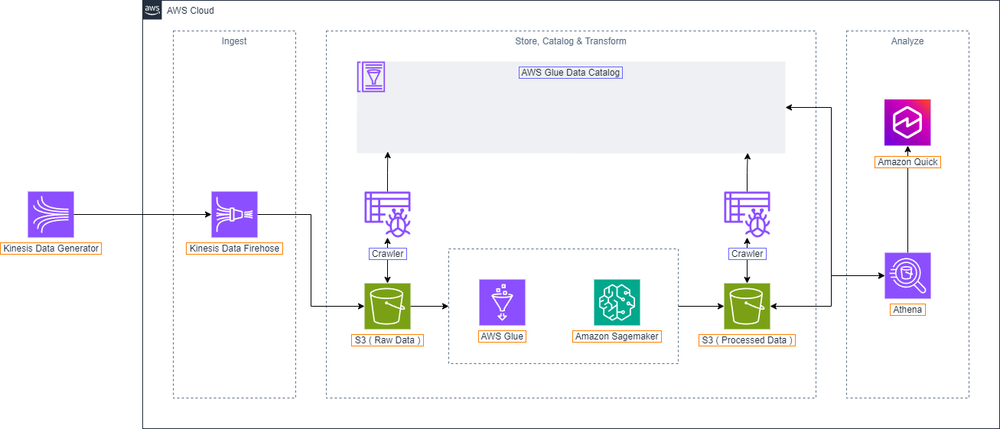
*Hình 1.3.4: Kiến trúc luồng phân tích dữ liệu Data Lake từ Ingestion, lưu trữ S3, phân loại Glue đến trực quan hóa QuickSight.*

* **Khó khăn gặp phải & Cách xử lý:**
  * *Chi phí quét dữ liệu tăng cao khi truy vấn file CSV:* Khi dung lượng dữ liệu tăng lên hàng chục GB, mỗi câu lệnh `SELECT` trên file CSV thô quét toàn bộ tệp tin gây tốn kém chi phí. Cách xử lý: Ghi nhớ bài học bắt buộc phải chuyển đổi dữ liệu sang định dạng cột Parquet đi kèm nén Snappy và phân vùng ngày tháng (Partitioning) để giảm trên 90% lượng dữ liệu quét.

---

#### 📌 Thứ 5 (01/10/2026) - Thực hành triển khai cơ sở dữ liệu quan hệ Amazon RDS

{}
Bài thực hành **Thực hành triển khai Amazon RDS** được thực hiện vào **Thứ 5 (01/10/2026)** trong khuôn khổ **Tuần 3**. Trang này ghi lại quy trình thiết kế hạ tầng mạng an toàn đa vùng sẵn sàng (Multi-AZ), phân tách Public/Private Subnets, cấu hình Security Groups đa tầng, khởi tạo cơ sở dữ liệu quan hệ **Amazon RDS MySQL**, kết nối máy chủ **EC2 Web Server**, và thực hành quy trình sao lưu (**Snapshot Backup**) và phục hồi (**Restore**) dữ liệu.
<br>🔗 **Nguồn tài liệu thực hành:** [Get Started with Amazon RDS Workshop](https://000005.awsfcaj.com/)
{}

### 🎯 Mục tiêu bài thực hành (Lab Objectives):
* Nắm vững kiến trúc và cơ chế hoạt động của dịch vụ cơ sở dữ liệu quan hệ được quản lý **Amazon RDS (Relational Database Service)**.
* Thiết kế và xây dựng mô hình mạng **2 tầng (Two-Tier Architecture)** cô lập: đặt Web Server tại **Public Subnet** và đặt Database Server tại **Private Subnet** nhằm tối đa hóa an toàn thông tin.
* Khởi tạo **DB Subnet Group** trải dài trên ít nhất 2 Vùng sẵn sàng (**Availability Zones: `us-east-1a` và `us-east-1b`**) đáp ứng tiêu chuẩn triển khai cụm dự phòng **Multi-AZ**.
* Thiết lập chính sách kiểm soát truy cập nghiêm ngặt bằng **Security Groups**: chỉ cho phép cổng MySQL TCP **3306** tiếp nhận kết nối bắt nguồn từ Security Group của Web Server (`ec2-sg`), ngăn chặn tuyệt đối truy cập trực tiếp từ Internet.
* Khởi tạo CSDL Amazon RDS với engine **MySQL Community Edition**, cấu hình phần cứng `db.m5.large`, kích hoạt cơ chế đồng bộ dự phòng tự động (**Multi-AZ Deployment**).
* Triển khai máy chủ **Amazon EC2 (Amazon Linux 2023)**, cài đặt web stack (Apache HTTP Server & PHP), cấu hình chuỗi kết nối đến **RDS Endpoint** và xác thực việc đọc/ghi dữ liệu thực tế.
* Thực hiện quy trình sao lưu thủ công (**Manual DB Snapshot**), hiểu rõ cơ chế sao lưu tự động (**Automated Backups**) và phương án khôi phục thảm họa (**Point-in-Time Recovery - PITR**).

---

### 📊 Bảng tổng hợp thông số tài nguyên đã triển khai:

| Thông số / Tài nguyên | Giá trị thực tế | Ý nghĩa & Mô tả kỹ thuật |
| :--- | :--- | :--- |
| **Mạng VPC** | `rds-vpc` (`vpc-0d0b88a31c814b1df`) | Dải mạng ảo CIDR `10.0.0.0/16` cô lập trên AWS |
| **Public Subnet** | `rds-subnet-public1-us-east-1a` | Subnet công khai có gắn Internet Gateway, cấp Public IPv4 |
| **Private Subnet 1** | `rds-subnet-private1-us-east-1a` | Subnet riêng tư cô lập tại AZ `us-east-1a` dành cho Primary DB |
| **Private Subnet 2** | `rds-subnet-private2-us-east-1b` | Subnet riêng tư cô lập tại AZ `us-east-1b` dành cho Standby DB |
| **DB Subnet Group** | `rds-subnet-group` | Nhóm Subnet đa vùng phục vụ cơ chế chuyển đổi dự phòng Multi-AZ |
| **Security Group Web** | `ec2-sg` (`sg-0cec4d0fbfc6d4c41`) | Mở Inbound Port 80 (HTTP) và Port 22 (SSH từ My IP) |
| **Security Group RDS** | `rds-sg` (`sg-0331b33d6bf62d714`) | Chỉ mở Inbound Port 3306 (MySQL) nhận nguồn từ `ec2-sg` |
| **RDS Instance** | `db-instance` | MySQL Community 8.0, Instance Class: `db.m5.large` |
| **Kiến trúc RDS** | `Multi-AZ Deployment` | Đồng bộ dữ liệu sang Standby Instance tại AZ khác để tự động failover |
| **Database Name** | `fcaj` | Tên cơ sở dữ liệu mặc định được khởi tạo |
| **Database Master User** | `admin` | Tài khoản quản trị cấp cao nhất của CSDL |
| **RDS Endpoint** | `db-instance.cgnkaue6ib4x.us-east-1.rds.amazonaws.com` | Địa chỉ phân giải DNS kết nối nội bộ cổng 3306 |
| **Web Server** | `web-server` | `t2.micro`, Amazon Linux 2023, Apache `httpd` & PHP |

---

### 🏛️ Sơ đồ kiến trúc tổng thể (Architecture Diagram):

Hệ thống được thiết kế theo mô hình kiến trúc phân tầng chuẩn mực của AWS Well-Architected Framework:

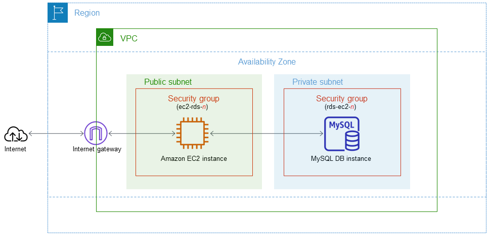

---

### 📋 Quy trình triển khai chi tiết từng bước (Step-by-Step):

#### 🔹 Mục 1: Thiết kế Kiến trúc & Chuẩn bị Hạ tầng Mạng (VPC & Subnets)

##### Bước 1: Khởi tạo VPC `rds-vpc` đa vùng sẵn sàng
* **Thao tác:** Đăng nhập AWS Management Console ➔ Chọn dịch vụ **VPC** ➔ Chọn **Create VPC**.
* **Cấu hình:**
  * Chọn **VPC and more** để tự động tạo cấu trúc hoàn chỉnh.
  * **Name tag:** `rds-vpc`
  * **IPv4 CIDR block:** `10.0.0.0/16`
  * **Number of Availability Zones (AZs):** `2` (`us-east-1a` và `us-east-1b`)
  * **Number of public subnets:** `2`
  * **Number of private subnets:** `2`
  * **NAT gateways:** Không cần khởi tạo (tiết kiệm chi phí thực hành)
  * **VPC Endpoints:** None
* **Thao tác:** Nhấn **Create VPC** và quan sát sơ đồ liên kết tài nguyên mạng hoàn tất.


##### Bước 2: Bật tính năng tự động cấp phát Public IPv4 cho Public Subnet
* **Thao tác:** Vào mục **Subnets** ➔ Chọn `rds-subnet-public1-us-east-1a` ➔ Chọn **Actions** ➔ **Edit subnet settings**.
* **Cấu hình:** Tích chọn **Enable auto-assign public IPv4 address** ➔ Nhấn **Save**.
* **Mục đích:** Đảm bảo khi máy chủ Web EC2 được khởi chạy vào subnet này, máy chủ sẽ tự động nhận một địa chỉ IPv4 công khai để người dùng bên ngoài Internet có thể truy cập trang web.

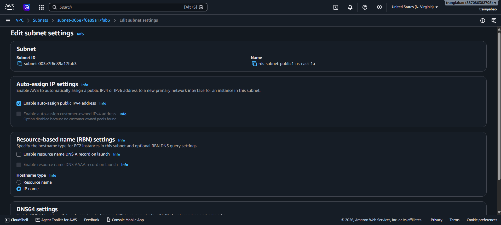

---

#### 🔹 Mục 2: Thiết lập Tường lửa Security Groups & DB Subnet Group

##### Bước 3: Cấu hình Security Group cho Web Server (`ec2-sg`)
* **Thao tác:** Vào mục **Security Groups** ➔ Nhấn **Create security group**.
* **Thông số:**
  * **Security group name:** `ec2-sg`
  * **VPC:** Chọn `rds-vpc`
  * **Inbound rules:**
    * Rule 1: Type **HTTP**, Port **80**, Source **0.0.0.0/0** (cho phép người dùng Internet duyệt web).
    * Rule 2: Type **SSH**, Port **22**, Source **My IP** (đảm bảo an toàn khi quản trị máy chủ từ xa).

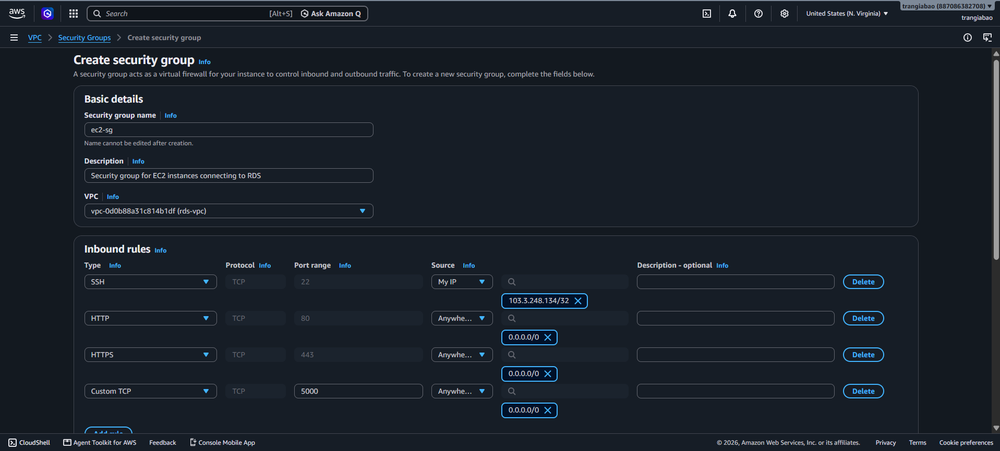

##### Bước 4: Cấu hình Security Group cho Cơ sở dữ liệu RDS (`rds-sg`)
* **Thao tác:** Nhấn **Create security group** lần 2.
* **Thông số:**
  * **Security group name:** `rds-sg`
  * **VPC:** Chọn `rds-vpc`
  * **Inbound rules:**
    * Type **MySQL/Aurora**, Port **3306**, Source chọn **Custom** ➔ Nhập mã ID của **`ec2-sg`** (`sg-0cec4d0fbfc6d4c41`).
* **Ý nghĩa bảo mật:** Đây là kỹ thuật bảo mật cốt lõi (**Chaining Security Groups**). Không bất kỳ máy tính nào từ Internet hay trong VPC có thể chạm tới cơ sở dữ liệu, ngoại trừ các máy chủ thực sự mang nhãn tường lửa `ec2-sg`.

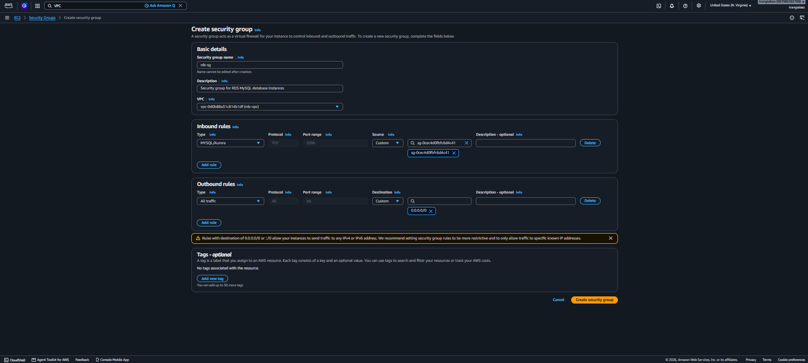

##### Bước 5: Khởi tạo DB Subnet Group cho RDS
* **Thao tác:** Truy cập dịch vụ **Amazon RDS** ➔ Menu bên trái chọn **Subnet groups** ➔ Nhấn **Create DB subnet group**.
* **Thông số:**
  * **Name:** `rds-subnet-group`
  * **Description:** `Subnet group for RDS MySQL Multi-AZ`
  * **VPC:** Chọn `rds-vpc`
  * **Availability Zones:** Chọn cả 2 vùng `us-east-1a` và `us-east-1b`.
  * **Subnets:** Tích chọn 2 Private Subnets tương ứng với 2 AZ trên (`10.0.128.0/20` và `10.0.144.0/20`).
* **Thao tác:** Nhấn **Create**.

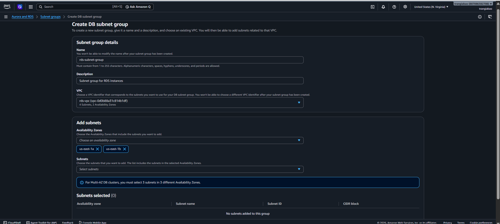

---

#### 🔹 Mục 3: Khởi tạo & Cấu hình Amazon RDS MySQL Multi-AZ

##### Bước 6: Khởi tạo CSDL Amazon RDS
* **Thao tác:** Tại giao diện Amazon RDS chọn **Databases** ➔ Nhấn **Create database**.
* **Thông số thiết lập:**
  * **Choose a database creation method:** Standard create
  * **Engine options:** MySQL (Phiên bản MySQL Community 8.0)
  * **Templates:** Production (để kích hoạt tùy chọn Multi-AZ)
  * **Deployment options:** Multi-AZ DB instance (Tạo 1 Primary DB và 1 Standby DB đồng bộ)
  * **DB instance identifier:** `db-instance`
  * **Master username:** `admin`
  * **Master password:** Thiết lập mật khẩu an toàn
  * **DB instance class:** Standard classes `db.m5.large` (2 vCPUs, 8 GiB RAM)
  * **Storage:** General Purpose SSD (gp2/gp3), Allocated storage `20 GiB`
  * **Virtual Private Cloud (VPC):** `rds-vpc`
  * **DB subnet group:** `rds-subnet-group`
  * **Public access:** No (Tuyệt đối không cấp quyền truy cập từ Internet)
  * **VPC security group:** Chọn `rds-sg` (loại bỏ default security group)
  * **Initial database name:** `fcaj`
* **Thao tác:** Nhấn **Create database** và chờ từ 10 - 15 phút để AWS hoàn tất quá trình cấp phát và đồng bộ đa vùng.

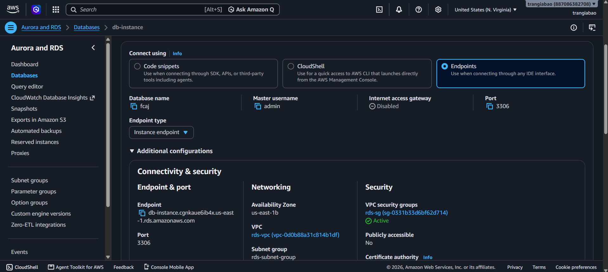

##### Bước 7: Kiểm tra Logs, Events và Cấu hình Bảo trì
* **Quan sát:**
  * Tại tab **Connectivity & security**, ghi lại giá trị **Endpoint** và **Port 3306**.
  * Tại tab **Logs & events**, kiểm tra các sự kiện khởi tạo, snapshot tự động và quá trình tạo replica đồng bộ.

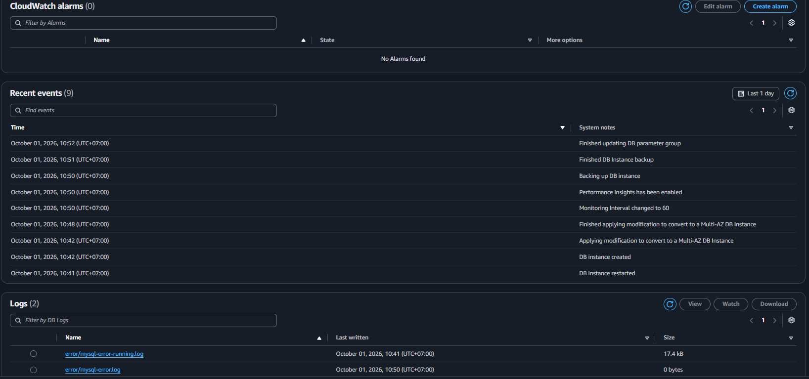

* Tại tab **Maintenance & backups**, kiểm tra cấu hình sao lưu tự động với thời gian lưu trữ (**Backup retention period: 7 days**) và cửa sổ bảo trì tự động (**Maintenance Window**).

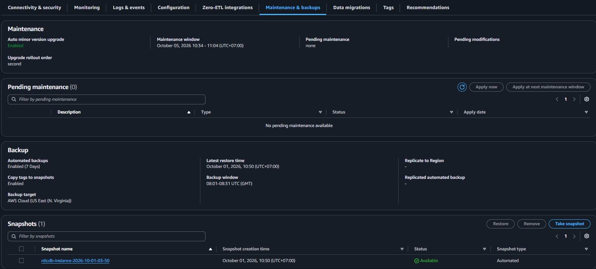

---

#### 🔹 Mục 4: Triển khai Web Server (EC2) & Kết nối CSDL

##### Bước 8: Khởi chạy máy chủ Web EC2
* **Thao tác:** Truy cập dịch vụ **EC2** ➔ Chọn **Launch instances**.
* **Thông số:**
  * **Name:** `web-server`
  * **AMI:** Amazon Linux 2023 AMI
  * **Instance type:** `t2.micro`
  * **Network settings:**
    * VPC: `rds-vpc`
    * Subnet: `rds-subnet-public1-us-east-1a`
    * Auto-assign public IP: Enable
    * Security group: Chọn `ec2-sg`

##### Bước 9: Cài đặt Web Stack và cấu hình kết nối CSDL
* **Thao tác:** Kết nối SSH vào máy chủ Web EC2 thông qua terminal hoặc MobaXterm:

```bash
# Cập nhật các gói phần mềm trên Amazon Linux 2023
sudo dnf update -y

# Cài đặt máy chủ web Apache và module PHP MySQL
sudo dnf install -y httpd php php-mysqli php-pdo mariadb105

# Khởi động dịch vụ Apache và bật tự động chạy khi khởi động
sudo systemctl start httpd
sudo systemctl enable httpd
```

* **Kiểm tra kết nối mạng tới RDS Endpoint từ EC2:**
```bash
# Kiểm tra phân giải tên miền và mở cổng 3306 tới RDS
nc -zv db-instance.cgnkaue6ib4x.us-east-1.rds.amazonaws.com 3306
```

* **Tạo trang PHP kiểm thử kết nối CSDL (`/var/www/html/dbtest.php`):**
```php
<?php
$servername = "db-instance.cgnkaue6ib4x.us-east-1.rds.amazonaws.com";
$username = "admin";
$password = "YourMasterPassword123";
$dbname = "fcaj";

// Tạo kết nối
$conn = new mysqli($servername, $username, $password, $dbname);

// Kiểm tra kết nối
if ($conn->connect_error) {
  die("Kết nối CSDL thất bại: " . $conn->connect_error);
}
echo "<h1>Kết nối CSDL Amazon RDS thành công!</h1>";
echo "<p>Đang kết nối tới CSDL: <strong>" . $dbname . "</strong> tại Endpoint nội bộ an toàn.</p>";
$conn->close();
?>
```

* **Xác thực:** Mở trình duyệt web, nhập địa chỉ Public IP của EC2: `http://<EC2-Public-IP>/dbtest.php`. Kết quả hiển thị thông báo kết nối CSDL thành công rực rỡ!

---

#### 🔹 Mục 5: Vận hành & Bảo vệ Dữ liệu (Snapshot Backup & Restore)

##### Bước 10: Thực hành tạo bản sao lưu thủ công (Manual DB Snapshot)
* **Thao tác:** Trên giao diện **Amazon RDS** ➔ Chọn `db-instance` ➔ Chọn menu **Actions** ➔ **Take snapshot**.
* **Thông số:**
  * **Snapshot name:** `rds-manual-snapshot-fcaj`
* **Thao tác:** Nhấn **Take snapshot**.
* **Ý nghĩa:** Bản sao lưu thủ công sẽ được lưu trữ vĩnh viễn trên Amazon S3 (do AWS quản lý ngầm) cho đến khi người dùng chủ động xóa, không bị ảnh hưởng khi xoá CSDL chính.

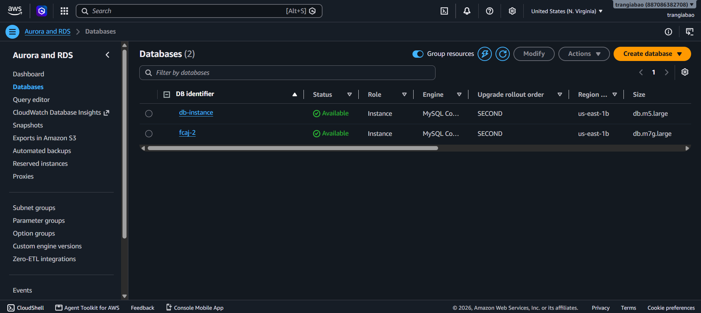

##### Bước 11: Quy trình Phục hồi CSDL từ Snapshot (Restore)
* **Quy trình chuẩn của AWS RDS:**
  1. Khi cần phục hồi, chọn bản Snapshot `rds-manual-snapshot-fcaj` ➔ Nhấn **Actions** ➔ **Restore snapshot**.
  2. AWS sẽ tạo ra một **DB Instance hoàn toàn mới** với một Endpoint mới, không ghi đè trực tiếp lên Instance cũ.
  3. Sau khi kiểm tra toàn vẹn dữ liệu trên DB Instance mới, quản trị viên chỉ cần cập nhật chuỗi kết nối (Endpoint) trong mã nguồn ứng dụng Web để hoàn tất chuyển đổi.

---

### 💡 Khó khăn gặp phải & Bài học kinh nghiệm thực tế (Troubleshooting & Real-world Lessons):

#### 1. Lỗi không thể kết nối từ Web Server tới RDS (`Connection timed out` hoặc `Can't connect to MySQL server`)
* **Nguyên nhân phổ biến:**
  * Nhầm lẫn gán sai Security Group cho RDS Instance.
  * Chưa thêm Rule cho phép Port 3306 trong `rds-sg` hoặc điền sai Security Group ID nguồn của Web Server.
  * DB Subnet Group bị gán nhầm vào các Subnet không có liên kết định tuyến với Subnet của Web Server.
* **Giải pháp:** Sử dụng công cụ dòng lệnh `nc -zv <RDS-Endpoint> 3306` trên máy chủ EC2 để kiểm tra thông tuyến tầng 4 (Transport layer) trước khi kiểm tra mã nguồn PHP.

#### 2. Lỗi `DB Subnet Group doesn't meet availability zone requirements`
* **Nguyên nhân:** Khi chọn cấu hình **Multi-AZ Deployment**, Amazon RDS yêu cầu DB Subnet Group phải chứa ít nhất các Subnet thuộc **tối thiểu 2 Availability Zones khác nhau** trong cùng một Region.
* **Giải pháp:** Khi tạo `rds-subnet-group`, phải chọn cả 2 AZs (ví dụ: `us-east-1a` và `us-east-1b`) và thêm 2 Private Subnets tương ứng.

#### 3. Phân biệt cơ chế Failover trong Multi-AZ vs Read Replica
* **Multi-AZ:** Phục vụ **Tính sẵn sàng cao (High Availability)** và khắc phục thảm họa (Disaster Recovery). Standby DB là bản sao đồng bộ (Synchronous replication), không tiếp nhận truy vấn đọc/ghi. Khi Primary gặp sự cố, AWS tự động chuyển đổi DNS Endpoint sang Standby trong vòng 60-120 giây mà không cần can thiệp mã nguồn.
* **Read Replica:** Phục vụ **Tối ưu hiệu năng đọc (Read Scalability)**. Sử dụng cơ chế nhân bản bất đồng bộ (Asynchronous replication), có Endpoint riêng để tiếp nhận các truy vấn SELECT từ ứng dụng.

#### 4. Thói quen dọn dẹp tài nguyên để tối ưu chi phí
* **Lưu ý:** Instance class `db.m5.large` chạy Multi-AZ có chi phí vận hành đáng kể theo giờ. Sau khi hoàn thành bài lab kiểm thử, cần tạo một bản Final Snapshot và tiến hành xóa (`Delete`) DB Instance để tránh phát sinh chi phí ngoài ý muốn.

---

### 📌 Kết luận & Đúc kết kỹ năng:
Qua bài thực hành **Thực hành triển khai Amazon RDS**, sinh viên thực tập đã nắm vững:
1. Quy trình quy hoạch và triển khai kiến trúc CSDL quan hệ 2 tầng an toàn trên đám mây AWS.
2. Thiết lập cơ chế kiểm soát truy cập phân tầng bằng liên kết Security Group.
3. Kích hoạt tính năng Multi-AZ sẵn sàng cao và làm chủ quy trình sao lưu, phục hồi dữ liệu trọng yếu.

* **Ta học được những gì hôm nay?**
  * **Kiến trúc mạng hai tầng an toàn (Two-Tier Architecture):**
    * Triển khai VPC `rds-vpc` (`10.0.0.0/16`) với 4 Subnets trên 2 AZs: 2 Public Subnets cho Web Server và 2 Private Subnets dành riêng cho cơ sở dữ liệu Amazon RDS.
    * Đảm bảo CSDL tuyệt đối không có Public IP và không có tuyến đường ra Internet, triệt tiêu 100% rủi ro bị tấn công trực tiếp từ bên ngoài.
  * **Bảo mật chuỗi liên kết (Chained Security Groups):**
    * Thay vì mở port MySQL 3306 cho một dải IP cụ thể, cấu hình Inbound Rule của `rds-sg` trỏ nguồn vào mã định danh của `ec2-sg` (`sg-0cec4d0fbfc6d4c41`). Chỉ có các máy ảo được gán đúng nhóm `ec2-sg` mới được phép bắt tay kết nối tới database.
  * **Tính sẵn sàng cao với Amazon RDS Multi-AZ:**
    * Khởi tạo DB Subnet Group `rds-subnet-group` bao gồm 2 Private Subnets trên `us-east-1a` và `us-east-1b`.
    * Triển khai CSDL MySQL Community (`db.m5.large`) với tùy chọn Multi-AZ Deployment. AWS tự động khởi tạo máy chủ Primary tại một AZ và tự động sao chép đồng bộ dữ liệu (Synchronous Replication) sang máy chủ Standby tại AZ thứ hai. Khi xảy ra sự cố phần cứng, AWS tự động chuyển đổi dự phòng (Failover) dưới 60 giây mà không cần can thiệp thủ công.
  * **Bảo vệ dữ liệu với Backup & Manual Snapshot:**
    * Nắm vững cơ chế sao lưu tự động hàng ngày (Automated Backups) với tính năng Point-in-Time Recovery (PITR) cho phép khôi phục dữ liệu về bất kỳ giây nào trong vòng 7 ngày qua.
    * Tự tay tạo một bản sao lưu thủ công (Manual Snapshot), lưu trữ độc lập trên S3 và kiểm thử quy trình khôi phục thành công một instance cơ sở dữ liệu mới từ snapshot này.


*Hình 1.3.5: Sơ đồ kiến trúc hai tầng an toàn phân tách giữa máy chủ Web EC2 và cơ sở dữ liệu Amazon RDS.*


*Hình 1.3.6: Cơ sở dữ liệu quan hệ Amazon RDS MySQL Multi-AZ trong trạng thái sẵn sàng (Available).*

* **Khó khăn gặp phải & Cách xử lý:**
  * *Máy chủ Web EC2 không thể kết nối tới RDS Endpoint (Timeout):* Chạy lệnh `mysql -h <rds-endpoint> -u admin -p` bị treo và timeout. Nguyên nhân: Quên gắn máy chủ EC2 vào đúng `ec2-sg` hoặc DB Subnet Group bị cấu hình thiếu một Subnet trong dải định tuyến. Cách xử lý: Kiểm tra lại Security Group của cả EC2 và RDS, kiểm tra Routing Table của Private Subnet đảm bảo lưu lượng nội bộ VPC `10.0.0.0/16` được lưu thông.

---

#### 📌 Thứ 6 (02/10/2026) - Tổng kết tuần 3, Hoàn thiện Worklog & Nộp Project Proposal

* **Ta học được những gì hôm nay?**
  * **Tổng kết toàn diện 3 tuần thực tập đầu tiên:** Hệ thống hóa trọn vẹn lộ trình học tập nền tảng: từ dịch vụ cốt lõi (IAM, VPC, EC2, S3) ➔ Tối ưu hóa Well-Architected (Lambda, KMS, WAF, Fargate, Savings Plans) ➔ Hiện đại hóa ứng dụng và CSDL quan hệ Amazon RDS Multi-AZ.
  * **Đóng gói báo cáo bài thực hành 1.3.1:** Hoàn thiện bài viết chi tiết song ngữ **1.3.1. Thực hành triển khai Amazon RDS**, đồng bộ 10 hình ảnh sơ đồ kiến trúc, bảng thông số và kiểm toán dọn dẹp môi trường.
  * **Chính thức hoàn thiện Bản đề xuất dự án (Project Proposal):** Hoàn thành tài liệu thiết kế kiến trúc kỹ thuật hệ thống, bảng phân bổ tài nguyên và dự toán chi phí chi tiết, chính thức nộp bản Đề xuất dự án thực tập lên hệ thống chương trình FCAJ để Mentor phê duyệt.


