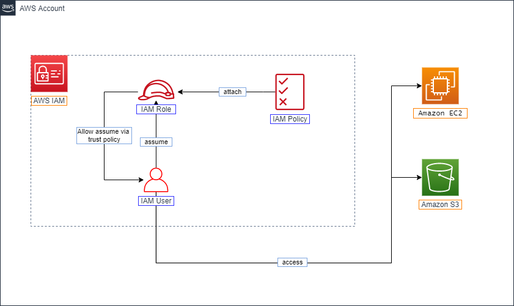

{}
⚠️ **Lưu ý:** Các thông tin dưới đây chỉ nhằm mục đích tham khảo, vui lòng **không sao chép nguyên văn** cho bài báo cáo của bạn kể cả warning này.
{}

### Mục tiêu tuần 3:

* Hoàn thiện kiến thức Hiện đại hóa ứng dụng, Container và Data Analytics.
* Thực hành chuyên sâu về Amazon RDS.
* Ôn tập kiến thức đã học và hoàn thiện Worklog tuần 3.

### Các công việc cần triển khai trong tuần này:

| Thứ | Công việc | Ngày bắt đầu | Ngày hoàn thành | Nguồn tài liệu |
| --- | --- | --- | --- | --- |
| Thứ 2 | **App Modernization:**  - Serverless Backend với [Lambda, S3, DynamoDB (000078)](https://000078.awsfcaj.com) & API Gateway.  - User Authentication với [Amazon Cognito (000081)](https://000081.awsfcaj.com).  - Deployment Automation với [AWS SAM (000080)](https://000080.awsfcaj.com). | 28/09/2026 | 28/09/2026 | [Cloud Journey - App Modernization](https://cloudjourney.awsfcaj.com/4-modernize/) |
| Thứ 3 | **Container Services:**  - Containerization với [ECS và AWS Fargate (000067)](https://000067.awsfcaj.com).  - Getting Started với [Amazon EKS (000126)](https://000126.awsfcaj.com).  - [Red Hat OpenShift on AWS - ROSA (000071)](https://000071.awsfcaj.com). | 29/09/2026 | 29/09/2026 | [Cloud Journey - Container Services](https://cloudjourney.awsfcaj.com/5-container/) |
| Thứ 4 | **Data Analytics:**  - [Data Lake Fundamentals (000035)](https://000035.awsfcaj.com).  - Business Intelligence với [Amazon QuickSight (000073)](https://000073.awsfcaj.com).  - Serverless Analytics với [Amazon Athena (000106)](https://000106.awsfcaj.com). | 30/09/2026 | 30/09/2026 | [Cloud Journey - Data & Analytics](https://cloudjourney.awsfcaj.com/6-dataandanalytic/) |
| Thứ 5 | **Thực hành Amazon RDS:**  - Khởi tạo VPC, Subnets, Security Groups.  - Triển khai CSDL Amazon RDS (MySQL Multi-AZ).  - Khởi tạo Web Server (EC2) & Triển khai ứng dụng.  - Thực hành Backup & Restore CSDL với Snapshot. | 01/10/2026 | 01/10/2026 | [Amazon RDS Workshop (000005)](https://000005.awsfcaj.com/) |
| Thứ 6 | **Tổng kết tuần 3, Viết Worklog & Làm Project:**  - **Tổng kết kiến thức:** Hệ thống hóa kiến thức Serverless, Containers, Data Analytics và bài thực hành Amazon RDS.  - **Làm Worklog:** Hoàn thiện bài viết báo cáo chi tiết cho bài lab Amazon RDS (1.3.1) và tổng kết Worklog Tuần 3.  - **Làm Project:** Dành thời gian rà soát, hoàn thiện và sẵn sàng nộp Bản đề xuất dự án (Project Proposal). | 02/10/2026 | 02/10/2026 | [The First Cloud Journey](https://cloudjourney.awsfcaj.com/) |

### Kết quả đạt được tuần 3:

#### 📌 Kết quả Thứ 2 (28/09/2026) - Hiện đại hóa ứng dụng không máy chủ (App Modernization):
* **Mô hình kiến trúc không máy chủ (Serverless):** Nắm vững cách xây dựng hệ thống phân tán kết hợp giữa API Gateway, AWS Lambda và cơ sở dữ liệu DynamoDB.
* **Xác thực danh tính người dùng:** Tích hợp quản lý định danh người dùng tập trung an toàn với Amazon Cognito User Pools và phân quyền ủy thác qua IAM Roles.

*Hình 1.3.1: Kiến trúc luồng xử lý phi máy chủ tích hợp AWS Lambda điều phối tài nguyên theo sự kiện.*

*Hình 1.3.2: Cơ chế xác thực người dùng tập trung và phân quyền truy cập thông qua Amazon Cognito và IAM Roles.*

---

#### 📌 Kết quả Thứ 3 (29/09/2026) - Dịch vụ đóng gói và điều phối Container:
* **Điều phối container doanh nghiệp:** Hiểu rõ cơ chế đóng gói và vận hành container trên quy mô lớn với Amazon ECS cùng hạ tầng phi máy chủ AWS Fargate.
* **Hệ sinh thái Kubernetes quản lý:** Tiếp cận kiến trúc cụm container phân tán với Amazon EKS và Red Hat OpenShift on AWS (ROSA).

*Hình 1.3.3: Sơ đồ kiến trúc ứng dụng Microservices đa dịch vụ vận hành trên Amazon ECS và AWS Fargate.*

---

#### 📌 Kết quả Thứ 4 (30/09/2026) - Phân tích dữ liệu đám mây (Data Analytics):
* **Kiến trúc Hồ dữ liệu (Data Lake):** Làm quen với tư duy thiết kế Data Lake trên nền tảng lưu trữ Amazon S3 kết hợp danh mục dữ liệu AWS Glue Data Catalog.
* **Truy vấn & Trực quan hóa dữ liệu thông minh:** Sử dụng công cụ truy vấn phi máy chủ Amazon Athena và thiết lập báo cáo biểu đồ trực quan hóa dữ liệu kinh doanh với Amazon QuickSight.

*Hình 1.3.4: Kiến trúc luồng phân tích dữ liệu Data Lake từ Ingestion, lưu trữ S3, phân loại Glue đến trực quan hóa QuickSight.*

---

#### 📌 Kết quả Thứ 5 (01/10/2026) - Thực hành triển khai Amazon RDS:

{}
👉 **Báo cáo thực hành chi tiết:** Toàn bộ thông số cấu hình mạng VPC, thiết lập Security Groups chuỗi liên kết, kết nối Web Server EC2, sao lưu Snapshot và trọn bộ 10 hình ảnh minh chứng được trình bày chi tiết tại: **[1.3.1. Thực hành triển khai Amazon RDS](1.3.1-amazon-rds/)**.
{}

* **Kiến trúc mạng hai tầng an toàn (Two-Tier Architecture):** Thiết kế mô hình phân tách rõ ràng giữa Web Server (Public Subnet) và Database Server (Private Subnets) nhằm ngăn chặn hoàn toàn nguy cơ tấn công trực tiếp từ Internet.
* **Bảo mật chuỗi liên kết (Chained Security Groups):** Áp dụng kỹ thuật liên kết Security Group chỉ cho phép cổng MySQL 3306 tiếp nhận truy cập từ nhãn tường lửa của Web Server.
* **Tính sẵn sàng cao với Multi-AZ:** Triển khai cụm cơ sở dữ liệu MySQL đồng bộ dự phòng sang Vùng sẵn sàng khác, sẵn sàng tự động chuyển đổi dự phòng khi xảy ra sự cố phần cứng.
* **An toàn dữ liệu và khôi phục sau sự cố:** Thực hành thành công quy trình tạo bản sao lưu thủ công (Manual Snapshot), nắm rõ cơ chế sao lưu tự động và quy trình phục hồi hệ thống khi có rủi ro.

*Hình 1.3.5: Sơ đồ kiến trúc hai tầng an toàn phân tách giữa máy chủ Web EC2 và cơ sở dữ liệu Amazon RDS.*

*Hình 1.3.6: Cơ sở dữ liệu quan hệ Amazon RDS MySQL Multi-AZ trong trạng thái sẵn sàng (Available).*

---

#### 📌 Kết quả Thứ 6 (02/10/2026) - Tổng kết kiến thức, Hoàn thiện Worklog & Làm Project:
* **1. Tổng kết kiến thức Tuần 3:** Hệ thống hóa, liên kết và củng cố toàn bộ các mảng kiến thức đã học trong 3 tuần đầu tiên: từ hạ tầng cơ bản, tối ưu Well-Architected đến kiến trúc phi máy chủ (Serverless), containerization, phân tích dữ liệu và thiết kế CSDL quan hệ Amazon RDS Multi-AZ.
* **2. Hoàn thiện tài liệu Worklog Tuần 3:** Tách và hoàn thiện bài viết chi tiết [1.3.1. Thực hành triển khai Amazon RDS](1.3.1-amazon-rds/), kiểm tra toàn bộ 10 hình ảnh sơ đồ mạng Two-tier, logs và snapshot; tổng hợp trang tổng quan Tuần 3 song ngữ hoàn chỉnh.
* **3. Nghiên cứu & Thực hiện Project (Proposal):** Dành trọn vẹn thời gian đối chiếu các tiêu chí kỹ thuật, rà soát ma trận rủi ro và hoàn tất các hạng mục cuối cùng của Bản đề xuất dự án (Project Proposal) để gửi mentor phê duyệt.

---

### Mục tiêu cho tuần sau (Tuần 4):

* **Triển khai Amazon Lightsail (1.4.1):** Khởi tạo Managed MySQL Database, triển khai máy chủ WordPress & Prestashop E-Commerce, cấu hình Static IP cố định, thiết lập sao lưu tự động bằng Snapshot và thực hiện nâng cấp chuyển đổi máy chủ (Migration) mà không gián đoạn dịch vụ.
* **Triển khai Amazon Lightsail Container (1.4.2):** Cấu hình công cụ AWS CLI, khắc phục phân quyền IAM với policy `AmazonLightsailFullAccess`, khởi tạo Container Service Nano, cài đặt plugin `lightsailctl` và đóng gói, đẩy Custom Docker Image lên Lightsail.
* **Tự động co giãn với EC2 Auto Scaling (1.4.3):** Đóng gói Custom AMI, tạo Launch Template chuẩn hóa, thiết lập Target Group và cân bằng tải Application Load Balancer (ALB), cấu hình Auto Scaling Group với chính sách Target Tracking (ngưỡng 50% CPU), thực hiện kiểm thử chịu tải Stress Test và quan sát cơ chế tự động Scale Out / Scale In.
* **Giám sát với Amazon CloudWatch (1.4.4):** Cài đặt và cấu hình CloudWatch Agent trên EC2, trực quan hóa chỉ số hiệu năng với Search Expressions & Math Expressions, khai thác log chuyên sâu với CloudWatch Logs Insights, tạo Metric Filter phát hiện lỗi HTTP 404 và thiết lập chuông cảnh báo CloudWatch Alarm kích hoạt thông báo qua SNS.
* **Thiết lập Hybrid DNS với Route 53 Resolver (1.4.5):** Tự động hóa triển khai môi trường mô phỏng đa VPC bằng CloudFormation, thiết lập Microsoft Active Directory đóng vai trò DNS On-premise, khởi tạo Outbound/Inbound Resolver Endpoints và Forwarding Rules để phân giải tên miền hai chiều thông suốt giữa On-premises và AWS Cloud.
