{}
The **Amazon Lightsail Deployment** hands-on lab was conducted on **Monday (05/10/2026)** during **Week 4**. This page provides a comprehensive step-by-step execution guide complete with precise parameter values, CLI commands, troubleshooting resolutions, and verification screenshots.
<br>🔗 **Lab Reference Material:** [Simplified Computing with Amazon Lightsail](https://000045.awsstudygroup.com/)
{}

### 🎯 Lab Objectives:
* Familiarize with the simplified management console and core capabilities of **Amazon Lightsail**.
* Provision and manage a standalone **Managed Relational Database (MySQL)** on Lightsail.
* Deploy two web applications: **WordPress** and **Prestashop (E-Commerce)** connecting to the shared database.
* Configure the underlying Linux/Ubuntu environment, assign **Static IPs**, and define firewall rules.
* Implement data backup procedures using **Snapshots** and scale up workloads by upgrading instance plans (**Migration**).

---

### 📊 Provisioned Resource Specifications:

| Resource | Name / Identifier | Configuration & Detailed Specs | Address / Ports | Notes |
| :--- | :--- | :--- | :--- | :--- |
| **Lightsail Database** | `Workshop-DB-Instance` | MySQL 8.0, Standard Plan ($15/mo, 1GB RAM, 2 vCPUs) | Port 3306, Master User: `LightsailAdmin` | Master DB: `dbWordPress` |
| **WordPress Instance** | `WordPress-1` | Blueprint: WordPress (Bitnami), Linux/Ubuntu | Static IP: Attached, Port 80, 443 | Connected to Lightsail DB |
| **Prestashop Instance**| `Prestashop-1` | Blueprint: Prestashop, Linux/Ubuntu | Static IP: Attached, Port 80, 443 | E-Commerce Platform |
| **Instance Snapshot** | `wordpress-backup-snapshot` | Full point-in-time snapshot before instance upgrade | Size: ~20 GB, Status: Available | Used for scale-up |
| **Migrated Instance** | `WordPress-Migrated` | Created from Snapshot, higher hardware bundle | Static IP: Re-attached | Seamless service continuity |

---

### 🚀 Step-by-Step Implementation & Screenshot Gallery:

#### Step 1: Provision a Managed Relational Database (MySQL)
* **Action / Navigation:** Log into the **Amazon Lightsail** console ➔ Navigate to the **Databases** tab ➔ Click **Create database**.
* **Configuration Parameters:**
  * *Deployment Region:* `ap-southeast-1` (Singapore)
  * *Database Engine:* `MySQL` (version `8.0`)
  * *Master Username:* `LightsailAdmin`
  * *Master Password:* Generate strong automated password or specify custom secure password
  * *Initial Database Name:* `dbWordPress`
  * *Database Plan:* `Standard Plan` ($15/month, 1 GB RAM, 2 vCPUs, 40 GB SSD, 100 GB Data Transfer)
  * *Database Identifier:* `Workshop-DB-Instance`
  * *Identification Tags:* Key = `dbname`, Value = `dbWordPress`
* **Next Action:** Scroll down and click **Create database**. Monitor the status transition from *Creating* to *Available*.

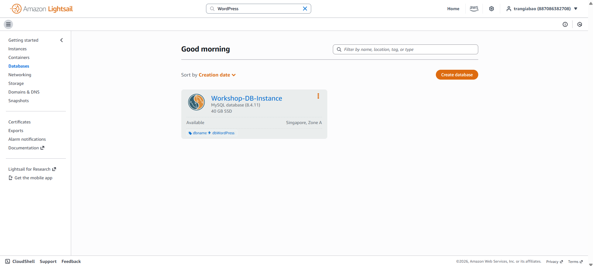

> **💡 Difficulties Encountered & Troubleshooting at Step 1:**  
> Initializing a Managed Database on Lightsail typically takes 5 to 10 minutes. Immediately save the Master User (`LightsailAdmin`), password, and Endpoint hostname shown on the screen. Forgetting these credentials requires resetting master credentials, adding delay to application setup.

---

#### Step 2: Deploy WordPress Application Instance (`WordPress-1`)
* **Action / Navigation:** Navigate to the **Instances** tab on Lightsail ➔ Click **Create instance**.
* **Configuration Parameters:**
  * *Instance Location:* `Singapore (Zone A)`
  * *Platform:* `Linux/Unix`
  * *Blueprint:* Select **WordPress** (pre-packaged Bitnami stack)
  * *Instance Plan:* $5/month bundle (1 GB RAM, 1 vCPU, 40 GB SSD, 2 TB Transfer)
  * *Instance Name:* `WordPress-1`
* **Next Action:** Click **Create instance**. The virtual server launches in 1 to 2 minutes.

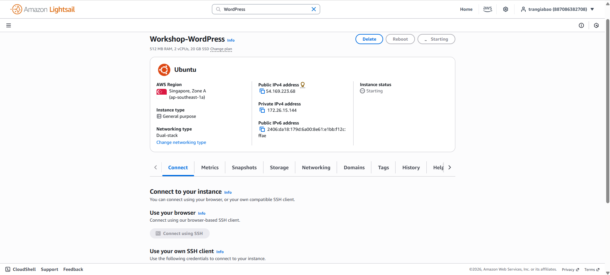

---

#### Step 3: Connect via SSH & Configure Ubuntu OS Environment
* **Action / Navigation:** On the `WordPress-1` instance card, click the orange terminal icon (**Connect using SSH**) to launch a browser-based shell session.
* **Commands Executed:**
  ```bash
  # Update Linux system package repositories
  sudo apt-get update -y

  # Inspect WordPress source application directory
  ls -la /opt/bitnami/wordpress
  ```
* **Purpose:** Verify OS integrity, permissions, and prepare configuration parameters needed to integrate with the remote database.

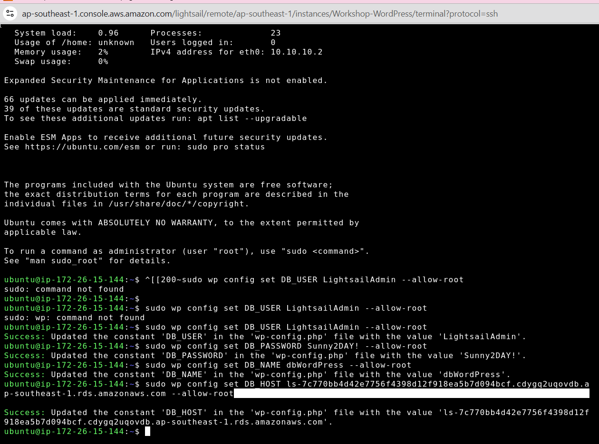

---

#### Step 4: Network Configuration, Static IP Assignment & Firewall Rules
* **Action / Navigation:** Open instance details for `WordPress-1` ➔ Select the **Networking** tab.
* **Configuration Parameters:**
  * *Attach Static IP:* Click **Attach static IP** ➔ Name it `StaticIP-WordPress-1` ➔ Attach to `WordPress-1` (ensures persistent public IP address across reboots).
  * *IPv4 Firewall Rules:*
    * **HTTP:** Port `80` (TCP), Source: `Custom / Anywhere`
    * **HTTPS:** Port `443` (TCP), Source: `Custom / Anywhere`
    * **SSH:** Port `22` (TCP) restricted or default Lightsail policy.

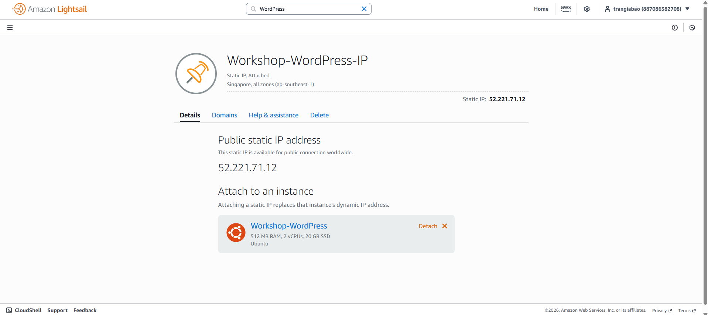

---

#### Step 5: Configure Database Connection & Initial WordPress Setup
* **Action / Navigation:** Open a new browser tab, navigate to `http://<Static-IP-WordPress-1>`. The WordPress Welcome setup wizard appears.
* **Configuration Parameters:**
  * *Database Name:* `dbWordPress`
  * *Username:* `LightsailAdmin`
  * *Password:* `[Master password saved in Step 1]`
  * *Database Host:* `[Workshop-DB-Instance Endpoint]:3306`
  * *Table Prefix:* `wp_`
* **Next Action:** Click **Submit** ➔ Click **Run the installation**.

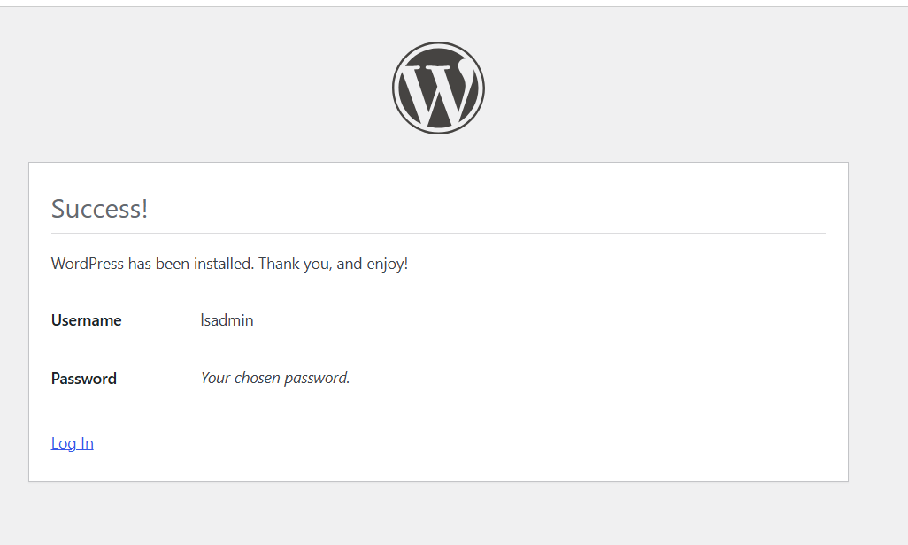

> **💡 Difficulties Encountered & Troubleshooting at Step 5:**  
> If an *"Error establishing a database connection"* appears, common causes include: (1) An incorrect Database Host string (must be the complete Lightsail DB Endpoint hostname, never `localhost`), (2) Case sensitivity mismatch on database name (`dbWordPress`), or (3) The Managed DB is still initializing. You can verify network reachability from SSH via `mysql -h <endpoint> -u LightsailAdmin -p`.

---

#### Step 6: Validate & Access WordPress Admin Dashboard
* **Action / Navigation:** Once installation finishes, browse to `http://<Static-IP-WordPress-1>/wp-admin`.
* **Configuration Parameters:**
  * *Site Title:* `Cloud Journey Blog`
  * *Username:* `admin`
  * *Password:* `[Admin password]`
  * *Email:* `trangiabao@example.com`
* **Result:** Successfully authenticate into the **WordPress Admin Dashboard**, confirming that blog posts and application settings are persisted to the external Lightsail DB.

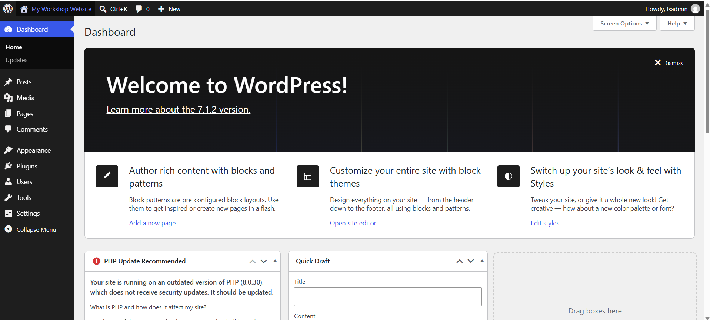

---

#### Step 7: Deploy Prestashop Instance & Configure Networking
* **Action / Navigation:** Return to Lightsail Console ➔ **Instances** tab ➔ Create a new instance using the **Prestashop** blueprint ➔ Name it `Prestashop-1`.
* **Configuration Parameters:**
  * *Platform:* `Linux/Unix`
  * *Blueprint:* `Prestashop`
  * *Instance Plan:* $5/month or $10/month bundle
  * *Instance Name:* `Prestashop-1`
  * *Networking:* Attach a dedicated Static IP `StaticIP-Prestashop-1`, ensure Firewall rules allow ports `80` (HTTP) and `443` (HTTPS).

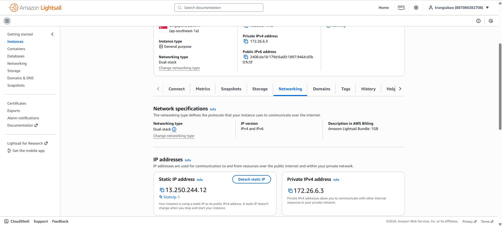

---

#### Step 8: Complete Prestashop E-Commerce Setup Wizard
* **Action / Navigation:** Open a new browser tab, navigate to `http://<Static-IP-Prestashop-1>` to launch the 6-step Prestashop Installation Assistant.
* **Configuration Parameters:**
  * *1. Welcome page:* Select `English` ➔ Click **Next**.
  * *2. License agreements:* Check *"I agree to the above terms and conditions"*.
  * *3. System compatibility:* Verify all server environment checks show green checkmarks.
  * *4. Store information:* Shop name `Cloud Store Demo`, Activity `Technology`, Country `Vietnam`.
  * *5. Database configuration:*
    * *Database server address:* `[Workshop-DB-Instance Endpoint]`
    * *Database name:* `dbPrestashop`
    * *Database login:* `LightsailAdmin`
    * *Database password:* `[Master DB password]`
* **Next Action:** Click **Test your database connection now!** to verify database privileges before completing setup.

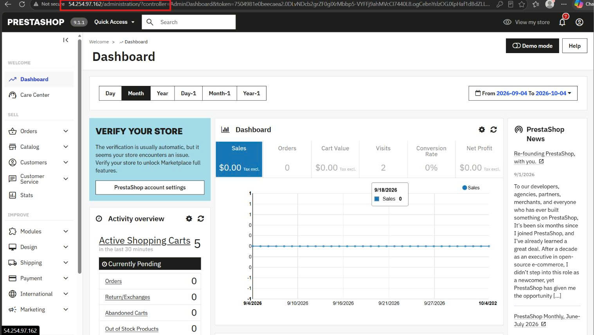

> **💡 Difficulties Encountered & Troubleshooting at Step 8:**  
> The Prestashop installer requires SQL permissions for `CREATE DATABASE`, `ALTER`, and `INDEX`. If reusing `LightsailAdmin`, ensure the target schema `dbPrestashop` is either pre-created or the user has permissions to create new databases.

---

#### Step 9: Access Prestashop Enterprise Admin Dashboard
* **Action / Navigation:** Connect via SSH to `Prestashop-1`, remove the temporary installation directory for security compliance, then access the Back Office URL.
* **Commands Executed:**
  ```bash
  # Remove installation directory per security guidelines
  sudo rm -rf /opt/bitnami/prestashop/install
  ```
* **Result:** Successfully log into the **Prestashop Back Office / Dashboard**, displaying catalog management, order metrics, and business intelligence panels.

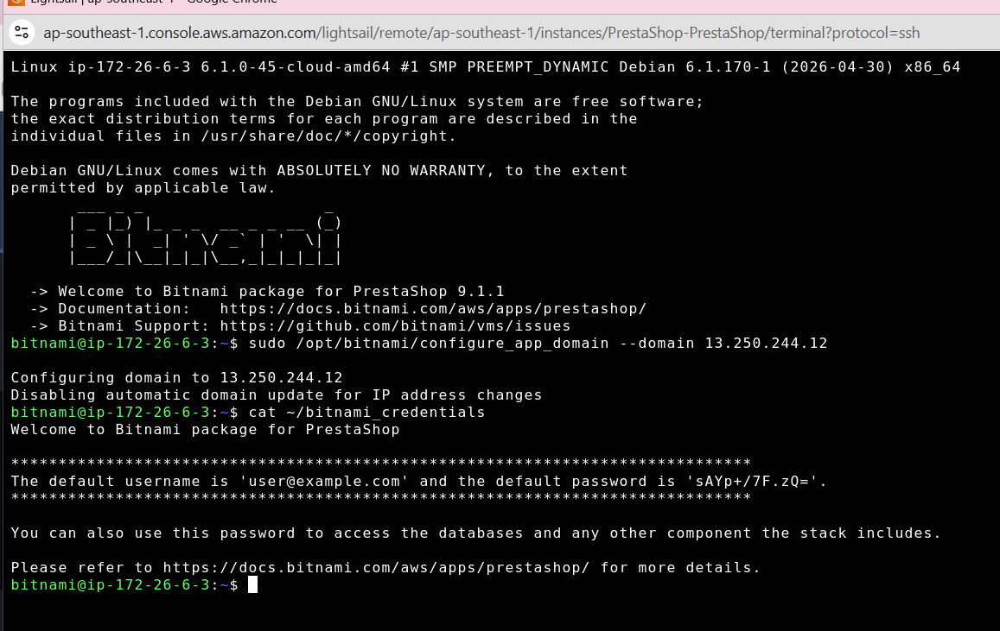

---

#### Step 10: Create Point-in-Time Instance Snapshot
* **Action / Navigation:** In the `WordPress-1` instance dashboard, navigate to the **Snapshots** tab ➔ Click **Create snapshot**.
* **Configuration Parameters:**
  * *Target Instance:* `WordPress-1`
  * *Snapshot Name:* `wordpress-backup-snapshot`
* **Purpose:** Capture the full disk state, operating system, web server configuration, and application code prior to executing hardware migration.

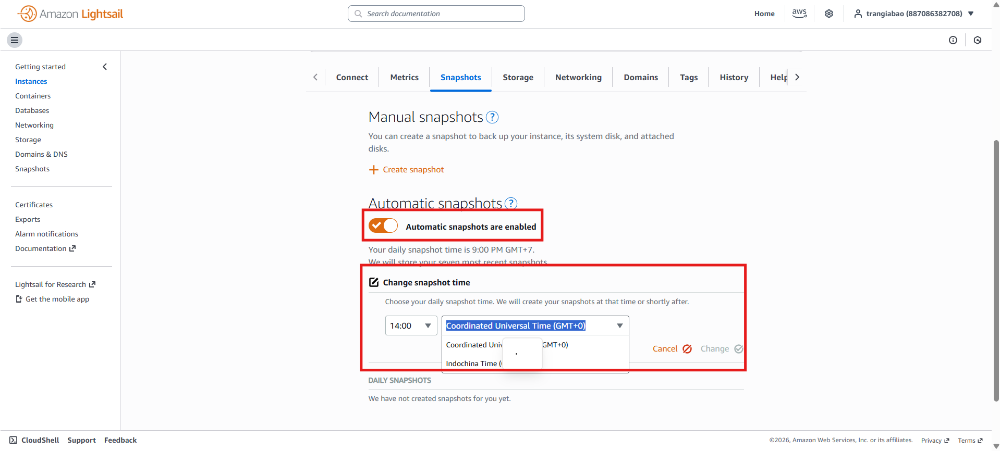

> **💡 Difficulties Encountered & Troubleshooting at Step 10:**  
> Snapshot creation reads and copies all disk blocks (~20 GB). During this window, avoid heavy database writes or software upgrades on the instance to guarantee point-in-time filesystem consistency.

---

#### Step 11: Monitor Snapshot Creation Progress
* **Action / Navigation:** Stay on the **Snapshots** tab to track real-time progress.
* **Observation:** The status displays **Snapshotting...** alongside a progress bar indicating data synchronization to underlying storage.

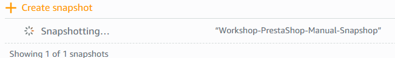

---

#### Step 12: Verify Snapshot Availability Status
* **Action / Navigation:** After 5 to 8 minutes, refresh the snapshot list.
* **Observation:** The snapshot `wordpress-backup-snapshot` transitions to **Available** status with timestamp and disk footprint recorded.

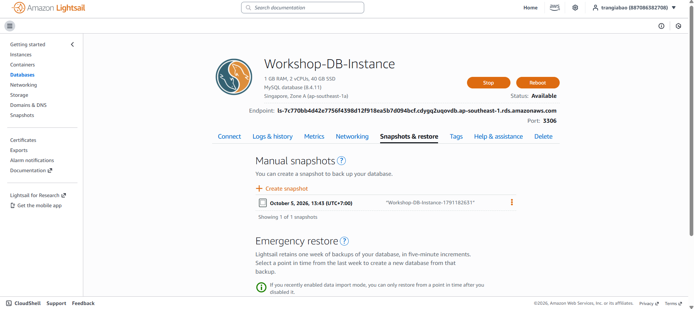

---

#### Step 13: Scale Hardware by Restoring Snapshot into a Larger Instance (Migration)
* **Action / Navigation:** Beside `wordpress-backup-snapshot`, click the three-dot action menu `...` ➔ Select **Create new instance from snapshot**.
* **Configuration Parameters:**
  * *Region:* `Singapore (ap-southeast-1)`
  * *Upgraded Instance Plan:* $10/month bundle (2 GB RAM, 1 vCPU, 60 GB SSD) or $20/month bundle (4 GB RAM, 2 vCPUs)
  * *New Instance Name:* `WordPress-Migrated`
* **Static IP Reassignment Procedure:**
  * Once `WordPress-Migrated` is running, return to the **Networking** tab.
  * Select `StaticIP-WordPress-1` ➔ Click **Detach** from old `WordPress-1`.
  * Click **Attach** and bind directly to `WordPress-Migrated`.
* **Result:** External visitors immediately access the upgraded, higher-capacity server without DNS downtime or configuration alterations.

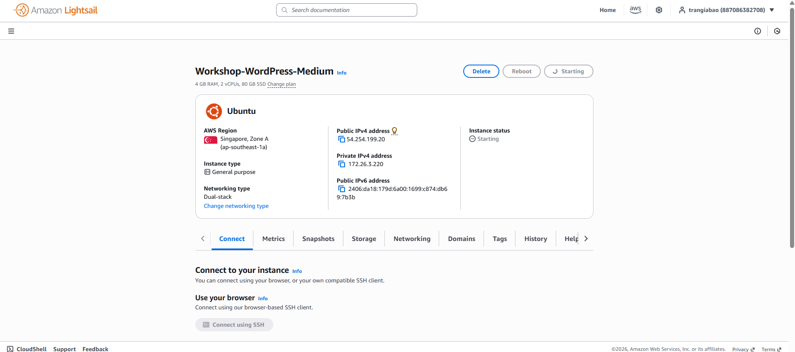

> **💡 Difficulties Encountered & Troubleshooting at Step 13:**  
> The most frequent pitfall during instance migration is forgetting to re-attach the Static IP address. If skipped, the new instance receives a random dynamic public IP, breaking existing domain names and bookmarks. Always verify static IP attachment after creating instances from snapshots.

---

### 📝 Summary & Key Takeaways:
1. **Simplicity of Lightsail:** Amazon Lightsail delivers a bundle-based, intuitive management experience with predictable monthly pricing, making it ideal for blogs, SMB applications, and rapid prototyping.
2. **Decoupled Architecture Best Practice:** Decoupling the database layer into a standalone Managed Database isolates mission-critical data from compute instances, simplifying maintenance and horizontal scaling.
3. **Seamless Vertical Scaling with Snapshots:** Point-in-time snapshots serve as an efficient disaster recovery mechanism and provide a safe bridge for upgrading compute resources when business traffic increases.
