---
title: "Triển khai Amazon Lightsail"
date: 2026-10-05
weight: 1
chapter: false
pre: " <b> 1.4.1. </b> "
---

{}
Bài thực hành **Triển khai Amazon Lightsail** được thực hiện vào **Thứ 2 (05/10/2026)** trong khuôn khổ **Tuần 4**. Trang này hướng dẫn toàn bộ quy trình thiết lập từng bước với các thông số chi tiết, lệnh thực thi, khó khăn gặp phải và bộ hình ảnh minh chứng thực tế.
<br>🔗 **Nguồn tài liệu thực hành (Workshop Reference):** [Simplified Computing with Amazon Lightsail](https://000045.awsfcaj.com/)
{}

### 🎯 Mục tiêu bài thực hành (Lab Objectives):
* Làm quen với giao diện và khả năng đóng gói tinh gọn của dịch vụ **Amazon Lightsail**.
* Khởi tạo và quản trị **Cơ sở dữ liệu Quan hệ độc lập (Managed MySQL Database)** trên Lightsail.
* Triển khai hai nền tảng web phổ biến: **WordPress** và **Prestashop (E-Commerce)** kết nối với cơ sở dữ liệu chung.
* Cấu hình môi trường máy chủ Linux/Ubuntu, thiết lập **Static IP** cố định và quy tắc tường lửa (Firewall).
* Thực hành quy trình sao lưu an toàn (**Snapshots**) và mở rộng phần cứng bằng cách nâng cấp gói máy chủ (**Migration**).

---

### 📊 Bảng tổng hợp thông số tài nguyên đã triển khai:

| Tài nguyên | Tên / Định danh | Cấu hình & Thông số chi tiết | Địa chỉ / Cổng truy cập | Ghi chú |
| :--- | :--- | :--- | :--- | :--- |
| **Lightsail Database** | `Workshop-DB-Instance` | MySQL 8.0, Standard Plan ($15/tháng, 1GB RAM, 2 vCPUs) | Port 3306, Master User: `LightsailAdmin` | Master DB: `dbWordPress` |
| **WordPress Instance** | `WordPress-1` | Blueprint: WordPress (Bitnami), Linux/Ubuntu | Static IP: Attached, Port 80, 443 | Kết nối tới Lightsail DB |
| **Prestashop Instance**| `Prestashop-1` | Blueprint: Prestashop, Linux/Ubuntu | Static IP: Attached, Port 80, 443 | Nền tảng bán hàng trực tuyến |
| **Instance Snapshot** | `wordpress-backup-snapshot` | Bản chụp đầy đủ máy chủ WordPress trước khi nâng cấp | Dung lượng: ~20 GB, Trạng thái: Available | Dùng để scale-up |
| **Migrated Instance** | `WordPress-Migrated` | Tạo từ Snapshot, gói cấu hình phần cứng lớn hơn | Static IP: Re-attached | Đảm bảo hệ thống vận hành liên tục |

---

### 🚀 Chi tiết các bước thực hiện & Hình ảnh minh chứng:

#### Bước 1: Khởi tạo Cơ sở Dữ liệu Quan hệ Quản lý (Managed MySQL Database)
* **Thao tác / Hướng dẫn:** Đăng nhập vào bảng điều khiển **Amazon Lightsail** ➔ Điều hướng tới thẻ **Databases** ➔ Nhấn nút **Create database**.
* **Thông số điền cụ thể:**
  * *Vùng triển khai (Region):* `ap-southeast-1` (Singapore)
  * *Hệ quản trị CSDL (Database engine):* `MySQL` (phiên bản `8.0`)
  * *Tài khoản quản trị (Master username):* `LightsailAdmin`
  * *Mật khẩu quản trị:* Lựa chọn tự sinh hoặc nhập mật khẩu quản trị bảo mật
  * *Tên cơ sở dữ liệu ban đầu (Database name):* `dbWordPress`
  * *Gói tài nguyên (Database plan):* `Standard Plan` ($15/tháng, 1 GB RAM, 2 vCPUs, 40 GB SSD, 100 GB Data Transfer)
  * *Định danh cơ sở dữ liệu (Database identifier):* `Workshop-DB-Instance`
  * *Gắn thẻ nhận diện (Tags):* Key = `dbname`, Value = `dbWordPress`
* **Thao tác tiếp theo:** Cuộn xuống dưới cùng và nhấn **Create database**. Chờ hệ thống chuyển từ trạng thái *Creating* sang *Available*.

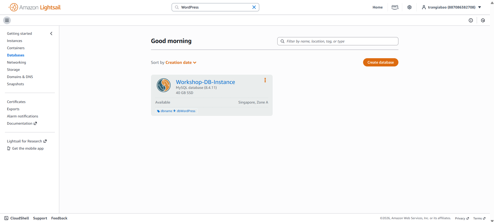

> **💡 Khó khăn gặp phải & Cách xử lý tại Bước 1:**  
> Thời gian khởi tạo một Managed Database trên Lightsail thường mất khoảng 5 - 10 phút. Ngay khi bấm khởi tạo, hãy lưu lại cẩn thận tên Master User (`LightsailAdmin`), mật khẩu tự sinh và chuỗi kết nối Endpoint. Nếu quên mật khẩu ở bước này, bạn sẽ phải reset lại mật khẩu và đợi database cập nhật trạng thái mất thêm thời gian.

---

#### Bước 2: Khởi tạo Máy chủ Ứng dụng WordPress (`WordPress-1`)
* **Thao tác / Hướng dẫn:** Điều hướng tới thẻ **Instances** trên Lightsail ➔ Nhấn nút **Create instance**.
* **Thông số điền cụ thể:**
  * *Vị trí máy chủ (Instance location):* `Singapore (Zone A)`
  * *Nền tảng (Platform):* `Linux/Unix`
  * *Blueprint:* Tích chọn ứng dụng **WordPress** (đóng gói sẵn bởi Bitnami)
  * *Gói cấu hình máy chủ (Instance plan):* Gói $5/tháng (1 GB RAM, 1 vCPU, 40 GB SSD, 2 TB Transfer)
  * *Định danh máy chủ (Instance name):* `WordPress-1`
* **Thao tác tiếp theo:** Nhấn **Create instance**. Máy chủ sẽ được khởi chạy trong vòng 1 - 2 phút.

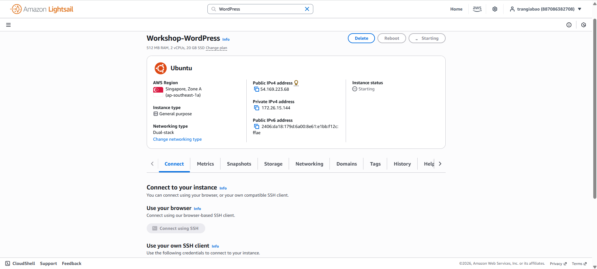

---

#### Bước 3: Kết nối SSH & Cấu hình Hệ điều hành Ubuntu
* **Thao tác / Hướng dẫn:** Tại card máy chủ `WordPress-1`, nhấn vào biểu tượng dòng lệnh màu cam (**Connect using SSH**) để mở terminal trực tiếp trên trình duyệt web.
* **Lệnh thực thi:**
  ```bash
  # Cập nhật danh mục gói phần mềm hệ thống
  sudo apt-get update -y

  # Kiểm tra vị trí mã nguồn ứng dụng WordPress
  ls -la /opt/bitnami/wordpress
  ```
* **Mục đích:** Xác thực phiên bản hệ điều hành Linux/Ubuntu, kiểm tra quyền hạn tệp tin và chuẩn bị thông số để liên kết với cơ sở dữ liệu bên ngoài.

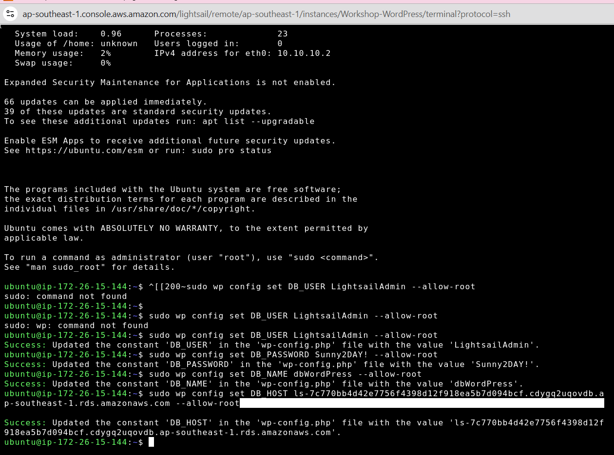

---

#### Bước 4: Thiết lập Mạng, Gán Static IP & Mở Firewall cho WordPress
* **Thao tác / Hướng dẫn:** Mở chi tiết máy chủ `WordPress-1` ➔ Chọn thẻ **Networking**.
* **Thông số điền cụ thể:**
  * *Tạo Static IP:* Nhấn **Attach static IP** ➔ Đặt tên `StaticIP-WordPress-1` ➔ Gắn trực tiếp vào `WordPress-1` (đảm bảo địa chỉ IP không bị thay đổi khi khởi động lại).
  * *Quy tắc tường lửa Inbound (IPv4 Firewall):*
    * **HTTP:** Cổng `80` (TCP), Nguồn: `Custom / Anywhere`
    * **HTTPS:** Cổng `443` (TCP), Nguồn: `Custom / Anywhere`
    * **SSH:** Cổng `22` (TCP) giới hạn IP quản trị hoặc mở theo mặc định Lightsail.

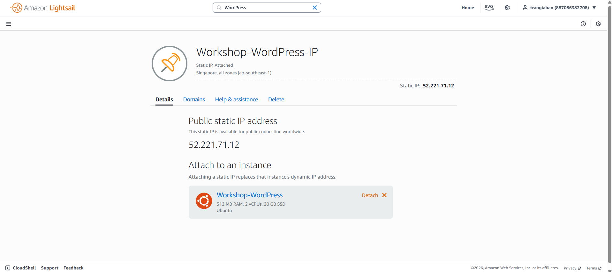

---

#### Bước 5: Cấu hình Kết nối CSDL & Cài đặt WordPress ban đầu
* **Thao tác / Hướng dẫn:** Mở trình duyệt web mới, truy cập vào địa chỉ IP tĩnh vừa gán: `http://<Static-IP-WordPress-1>`. Trình cài đặt WordPress Welcome Wizard sẽ hiển thị.
* **Thông số điền cụ thể:**
  * *Database Name:* `dbWordPress`
  * *Username:* `LightsailAdmin`
  * *Password:* `[Mật khẩu quản trị database đã lưu tại Bước 1]`
  * *Database Host:* `[Endpoint của Workshop-DB-Instance]:3306`
  * *Table Prefix:* `wp_`
* **Thao tác tiếp theo:** Nhấn nút **Submit** ➔ Nhấn **Run the installation**.

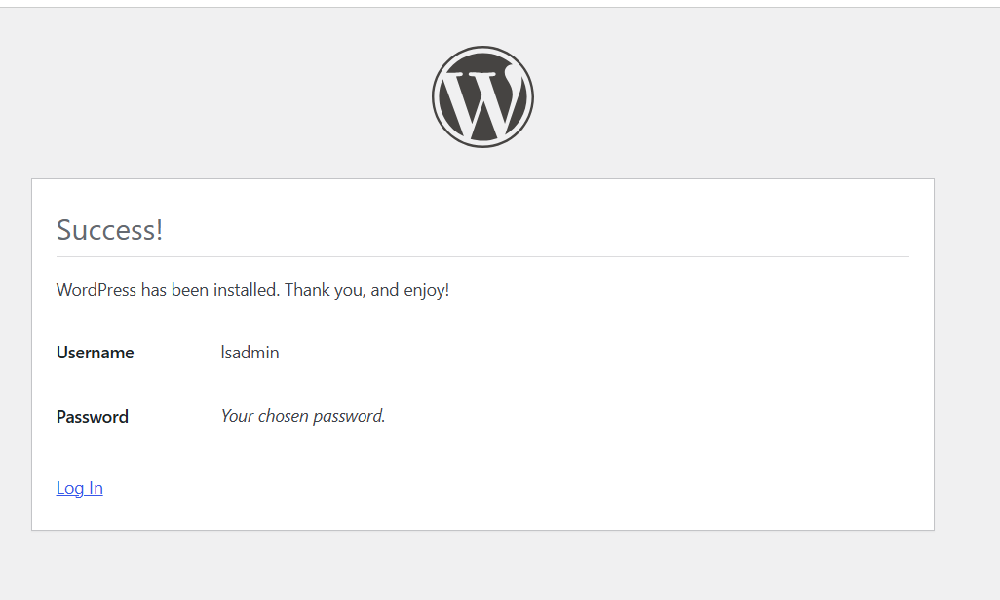

> **💡 Khó khăn gặp phải & Cách xử lý tại Bước 5:**  
> Nếu màn hình báo lỗi *"Error establishing a database connection"*, nguyên nhân thường do: (1) Nhập sai Database Host (phải bao gồm toàn bộ chuỗi Endpoint Lightsail, không dùng `localhost`), (2) Tên CSDL phải khớp chính xác là `dbWordPress` (chữ hoa chữ thường), hoặc (3) Managed Database chưa sẵn sàng kết nối. Kiểm tra kết nối từ SSH bằng lệnh `mysql -h <endpoint> -u LightsailAdmin -p` để xác thực cổng 3306.

---

#### Bước 6: Xác thực & Đăng nhập Trang Quản trị WordPress Dashboard
* **Thao tác / Hướng dẫn:** Sau khi cài đặt hoàn tất, truy cập đường dẫn `http://<Static-IP-WordPress-1>/wp-admin`.
* **Thông số điền cụ thể:**
  * *Site Title:* `Cloud Journey Blog`
  * *Username:* `admin`
  * *Password:* `[Mật khẩu quản trị website]`
  * *Email:* `trangiabao@example.com`
* **Kết quả:** Đăng nhập thành công vào bảng điều khiển quản trị **WordPress Admin Dashboard**, hệ thống hoạt động ổn định và lưu trữ toàn bộ dữ liệu bài viết vào Lightsail Managed DB.

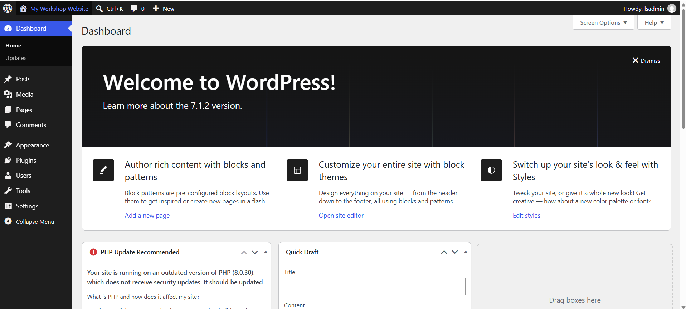

---

#### Bước 7: Khởi tạo Máy chủ Prestashop & Cấu hình Mạng (Prestashop Networking)
* **Thao tác / Hướng dẫn:** Quay lại Lightsail Console ➔ Thẻ **Instances** ➔ Tạo máy chủ mới với Blueprint ứng dụng **Prestashop** ➔ Đặt tên `Prestashop-1`.
* **Thông số điền cụ thể:**
  * *Platform:* `Linux/Unix`
  * *Blueprint:* `Prestashop`
  * *Instance Plan:* Gói $5/tháng hoặc $10/tháng
  * *Instance Name:* `Prestashop-1`
  * *Networking:* Gán địa chỉ Static IP mới `StaticIP-Prestashop-1`, kiểm tra mở cổng tường lửa `80` (HTTP) và `443` (HTTPS).

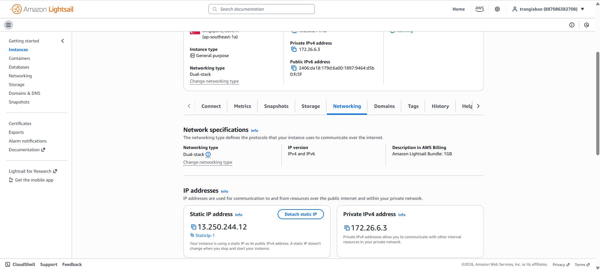

---

#### Bước 8: Cài đặt Cấu hình Cửa hàng Trực tuyến Prestashop Setup Wizard
* **Thao tác / Hướng dẫn:** Mở tab trình duyệt mới, truy cập `http://<Static-IP-Prestashop-1>` để khởi chạy trình hướng dẫn cài đặt trực tuyến Prestashop gồm 6 bước liên tiếp.
* **Thông số điền cụ thể:**
  * *1. Welcome page:* Chọn ngôn ngữ `English` hoặc `Vietnamese` ➔ Nhấn **Next**.
  * *2. License agreements:* Tích chọn *"I agree to the above terms and conditions"*.
  * *3. System compatibility:* Xác nhận tất cả các chỉ số máy chủ đều đạt màu xanh lá cây.
  * *4. Store information:* Nhập tên cửa hàng `Cloud Store Demo`, phân loại `Technology`, quốc gia `Vietnam`.
  * *5. Database configuration:*
    * *Database server address:* `[Endpoint của Workshop-DB-Instance]`
    * *Database name:* `dbPrestashop`
    * *Database login:* `LightsailAdmin`
    * *Database password:* `[Mật khẩu CSDL]`
* **Thao tác tiếp theo:** Nhấn nút **Test your database connection now!** để xác nhận kết nối thành công trước khi hoàn tất cài đặt.

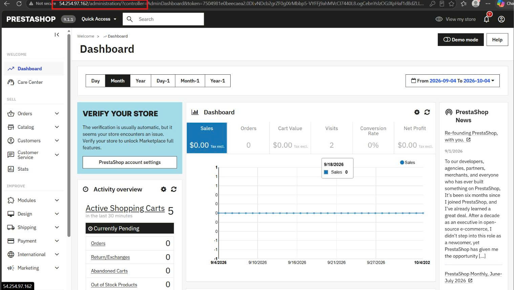

> **💡 Khó khăn gặp phải & Cách xử lý tại Bước 8:**  
> Trình cài đặt Prestashop yêu cầu tài khoản MySQL phải có quyền `CREATE DATABASE`, `ALTER`, `INDEX`. Nếu bạn dùng chung tài khoản `LightsailAdmin`, cần đảm bảo database `dbPrestashop` đã được khởi tạo trước hoặc tài khoản có quyền tự tạo schema mới trên máy chủ MySQL.

---

#### Bước 9: Đăng nhập Trang Quản trị Doanh nghiệp Prestashop Dashboard
* **Thao tác / Hướng dẫn:** Kết nối SSH vào máy chủ `Prestashop-1`, xóa thư mục cài đặt `/install` theo cảnh báo bảo mật, sau đó truy cập đường dẫn Back Office.
* **Lệnh thực thi:**
  ```bash
  # Xóa thư mục cài đặt tạm thời theo khuyến nghị bảo mật
  sudo rm -rf /opt/bitnami/prestashop/install
  ```
* **Kết quả:** Đăng nhập thành công vào giao diện **Prestashop Back Office / Dashboard**, hiển thị đầy đủ các biểu đồ thống kê đơn hàng, doanh số và danh mục quản lý sản phẩm.

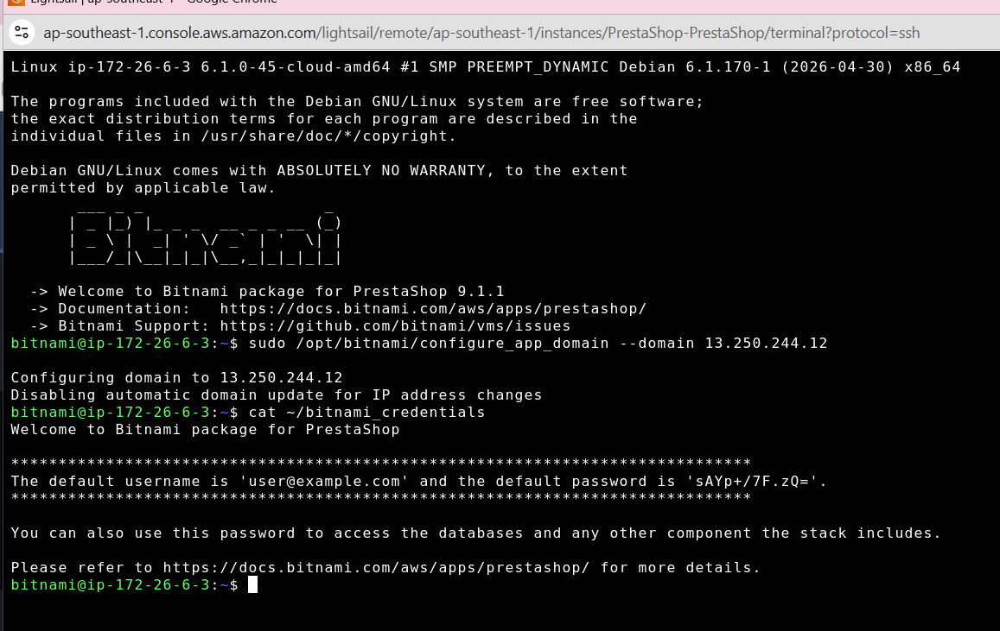

---

#### Bước 10: Khởi tạo Bản sao lưu Điểm thời gian (Create Snapshot)
* **Thao tác / Hướng dẫn:** Tại giao diện máy chủ `WordPress-1`, chọn tab **Snapshots** ➔ Nhấn nút **Create snapshot**.
* **Thông số điền cụ thể:**
  * *Instance cần sao lưu:* `WordPress-1`
  * *Snapshot name:* `wordpress-backup-snapshot`
* **Mục đích:** Đóng gói toàn bộ hệ điều hành, cấu hình web server, mã nguồn WordPress và các thư viện liên quan thành một bản chụp an toàn trước khi thực hiện nâng cấp cấu hình phần cứng.

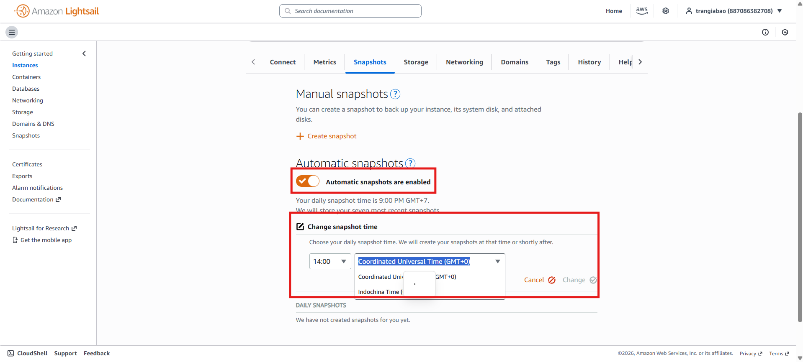

> **💡 Khó khăn gặp phải & Cách xử lý tại Bước 10:**  
> Thao tác tạo Snapshot cần đọc ghi toàn bộ block lưu trữ của ổ đĩa máy chủ (~20 GB). Trong quá trình này, tránh thực hiện các thao tác ghi dữ liệu lớn hoặc nâng cấp phiên bản ứng dụng để dữ liệu trong snapshot đạt trạng thái nhất quán hoàn hảo.

---

#### Bước 11: Theo dõi Trạng thái Tiến trình Chụp Snapshot
* **Thao tác / Hướng dẫn:** Giữ nguyên giao diện tab **Snapshots** và theo dõi trạng thái tiến trình tạo bản sao lưu.
* **Quan sát:** Trạng thái ban đầu hiển thị là **Snapshotting...** cùng thanh tiến trình biểu thị dữ liệu đang được đồng bộ lên hạ tầng lưu trữ Lightsail.

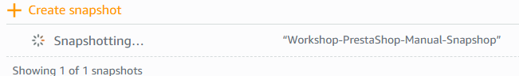

---

#### Bước 12: Xác nhận Snapshot Sẵn sàng Hoạt động (Available)
* **Thao tác / Hướng dẫn:** Sau khoảng 5 - 8 phút, làm mới danh sách snapshot.
* **Quan sát:** Bản chụp `wordpress-backup-snapshot` chuyển sang trạng thái **Available** kèm ngày giờ chụp chính xác và dung lượng lưu trữ đầy đủ.

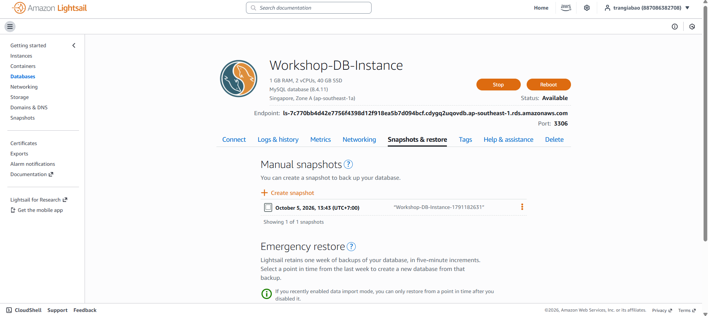

---

#### Bước 13: Mở rộng Phần cứng bằng cách Tạo Máy chủ mới từ Snapshot (Migration)
* **Thao tác / Hướng dẫn:** Tại bản snapshot `wordpress-backup-snapshot`, nhấn vào biểu tượng dấu 3 chấm `...` bên phải ➔ Chọn **Create new instance from snapshot**.
* **Thông số điền cụ thể:**
  * *Vùng triển khai:* `Singapore (ap-southeast-1)`
  * *Gói máy chủ nâng cấp (Larger instance plan):* Gói $10/tháng (2 GB RAM, 1 vCPU, 60 GB SSD) hoặc gói $20/tháng (4 GB RAM, 2 vCPUs) tùy nhu cầu mở rộng
  * *Định danh máy chủ mới (Instance name):* `WordPress-Migrated`
* **Thao tác chuyển đổi IP cố định:**
  * Sau khi máy chủ `WordPress-Migrated` khởi chạy thành công, vào thẻ **Networking**.
  * Chọn `StaticIP-WordPress-1` ➔ Nhấn **Detach** khỏi máy chủ cũ `WordPress-1`.
  * Nhấn **Attach** và gắn trực tiếp vào máy chủ mới `WordPress-Migrated`.
* **Kết quả:** Người dùng tiếp tục truy cập website bình thường qua địa chỉ IP cũ mà không bị gián đoạn hay phải cấu hình lại DNS.

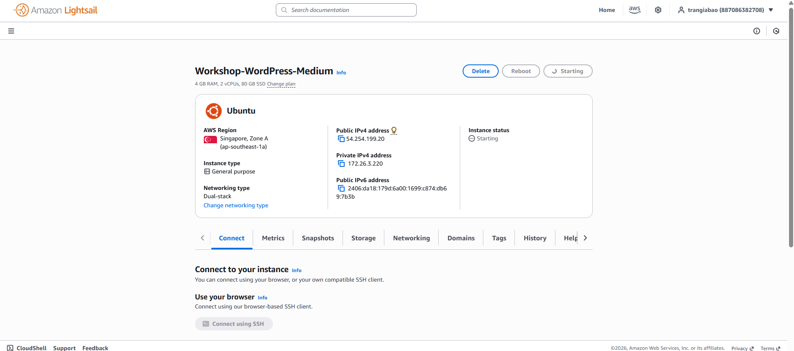

> **💡 Khó khăn gặp phải & Cách xử lý tại Bước 13:**  
> Thao tác thường bị quên nhất khi nâng cấp máy chủ là tái gắn (Re-attach) Static IP. Nếu quên gán lại IP tĩnh, máy chủ mới sẽ nhận một IP động ngẫu nhiên khiến người dùng và tên miền trỏ về IP cũ bị mất kết nối hoàn toàn. Luôn kiểm tra lại bảng Static IP sau khi hoàn thành migration.

---

### 📝 Tổng kết & Bài học kinh nghiệm:
1. **Ưu điểm của Amazon Lightsail:** Cung cấp trải nghiệm đơn giản hóa tuyệt vời, giao diện trực quan, chi phí dự đoán được theo tháng (predictable pricing), rất phù hợp cho doanh nghiệp vừa và nhỏ, blog cá nhân hoặc môi trường thử nghiệm nhanh.
2. **Kiến trúc Tách biệt CSDL (Decoupled Architecture):** Luôn tách cơ sở dữ liệu sang một Managed Database độc lập thay vì cài đặt MySQL trực tiếp trên máy chủ web. Điều này cho phép mở rộng, nâng cấp và sao lưu máy chủ web dễ dàng mà không làm ảnh hưởng tới tính toàn vẹn của dữ liệu nghiệp vụ.
3. **Chiến lược Sao lưu & Scale-up an toàn:** Sử dụng Snapshot làm cầu nối nâng cấp cấu hình phần cứng (Vertical Scaling) giúp hệ thống dễ dàng thích ứng khi lưu lượng truy cập gia tăng đột biến mà không cần cài đặt lại ứng dụng từ đầu.
