---
title: "Amazon Lightsail Container Deployment"
date: 2026-10-06
weight: 2
chapter: false
pre: " <b> 1.4.2. </b> "
---

{}
The **Amazon Lightsail Container Deployment** (Run Apps on Lightsail Container) hands-on lab was conducted on **Tuesday (06/10/2026)** during **Week 4**. This page provides a thorough step-by-step implementation guide featuring precise parameters, CLI execution commands, troubleshooting solutions, and all 11 verification screenshots.
<br>🔗 **Lab Reference Material:** [Amazon Lightsail Container - Run Apps on Lightsail Container](https://000046.awsfcaj.com/)
{}

### 🎯 Lab Objectives:
* Familiarize with the **Containers** feature on Amazon Lightsail — a streamlined solution for running containerized workloads without orchestrator complexity.
* Install and configure the **AWS CLI** and the **Lightsail Control (lightsailctl)** extension plugin to interact with container services from a local workstation.
* Provision a **Container Service** on Lightsail utilizing a cost-optimized hardware tier (Nano bundle).
* Deploy a **Public Container Image** (Nginx) sourced from Docker Hub onto the Lightsail Container Service.
* Launch a dedicated virtual machine **Build-Instance** (Ubuntu) to compile and push a **Custom Container Image** to the Lightsail private registry via `aws lightsail push-container-image`.
* Enable a Public Endpoint and verify live web application delivery over an auto-managed HTTPS SSL/TLS domain.

---

### 📊 Provisioned Resource Specifications:

| Resource | Name / Identifier | Configuration & Detailed Specs | Address / Ports | Notes |
| :--- | :--- | :--- | :--- | :--- |
| **AWS CLI** | Version 2.37.9 | Installed via PowerShell, configured Profile | IAM User: `Bao` (`ap-southeast-1`) | AWS command-line management tool |
| **Container Service** | `lightsail-container` | Nano (512 MB RAM, 0.25 vCPUs x 1 node) | Singapore (`ap-southeast-1a`) | Status: `Running` |
| **Public Deployment** | `test1` | Image: `nginx` (Docker Hub Public Registry) | Port 80 (HTTP), Health check: `/` | Rapid deployment from public registry |
| **Build Instance** | `Build-Instance` | Ubuntu 22.04 LTS, 512 MB RAM, 20 GB SSD | Public IP: `47.129.162.155` | Used to build & push Docker images |
| **Stored Container** | `:lightsail-container.nginx-container-hello.1` | Custom image uploaded from build instance | SHA256 digest validation | Lightsail private container repository |
| **Public Domain** | `lightsail-container...amazonlightsail.com` | HTTPS auto-issued with AWS SSL certificate | Port 443 / 80 | Publicly accessible application endpoint |

---

### 🚀 Step-by-Step Implementation & Screenshot Gallery:

#### Step 1: Install AWS CLI v2 on Windows Workstation
* **Action / Navigation:** Open **PowerShell** with administrative privileges (Run as Administrator) ➔ Execute the automated installation command for AWS CLI v2.
* **Command Executed:**
  ```powershell
  irm https://awscli.amazonaws.com/v2/install.ps1 | iex
  ```
* **Purpose:** Establish a standardized CLI environment to authenticate, manage resources, and push Docker images to Lightsail.

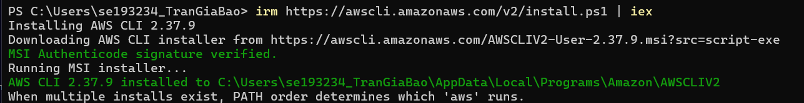

---

#### Step 2: Verify AWS CLI Installation Version
* **Action / Navigation:** Relaunch the terminal window and run the version inspection command.
* **Command Executed:**
  ```powershell
  aws --version
  ```
* **Output:** Displays `aws-cli/2.37.9 Python/3.14.0 Windows/10 exe/AMD64`, confirming operational readiness.

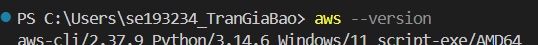

---

#### Step 3: Configure AWS Access Credentials (`aws configure`)
* **Action / Navigation:** Run `aws configure` and input IAM user authentication parameters.
* **Configuration Parameters:**
  * *AWS Access Key ID:* Supply Access Key for IAM User `Bao`
  * *AWS Secret Access Key:* Supply matching Secret Access Key
  * *Default region name:* `ap-southeast-1` (Singapore)
  * *Default output format:* `json`
* **Command Executed:**
  ```powershell
  aws configure
  ```

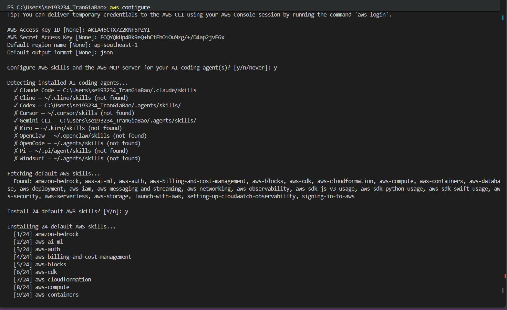

---

#### Step 4: Verify IAM User Privileges & Resolve `AccessDenied` Errors
* **Action / Navigation:** Test service connectivity using `aws s3 ls`.
* **Issue Observed:** Returns `An error occurred (AccessDenied) when calling the ListBuckets operation`.
* **Resolution:** Navigate to **IAM Management Console** ➔ Locate User **`Bao`** ➔ Select **Add permissions** ➔ Directly attach policy **`AmazonLightsailFullAccess`** and re-verify CLI execution.

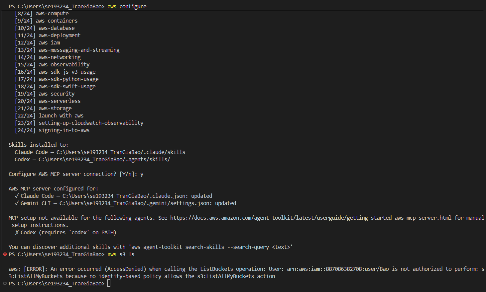

> **💡 Difficulties Encountered & Troubleshooting at Step 4:**  
> When operating Lightsail through the CLI, standard EC2/S3 permissions are insufficient. Commands like `aws lightsail push-container-image` will immediately fail unless `AmazonLightsailFullAccess` is granted to allow container service provisioning and private registry image uploads.

---

#### Step 5: Provision Container Service on Amazon Lightsail
* **Action / Navigation:** Log into the **Amazon Lightsail** console ➔ Navigate to the **Containers** tab ➔ Click **Create container service**.
* **Configuration Parameters:**
  * *Region:* `Singapore (ap-southeast-1)`
  * *Capacity Bundle:* **Nano** (512 MB RAM, 0.25 vCPUs x 1 node) at $7/month for cost optimization
  * *Container service name:* `lightsail-container`
* **Result:** The service initializes with status **Ready** and auto-generates a public domain name in the format `lightsail-container.<id>.ap-southeast-1.cs.amazonlightsail.com`.

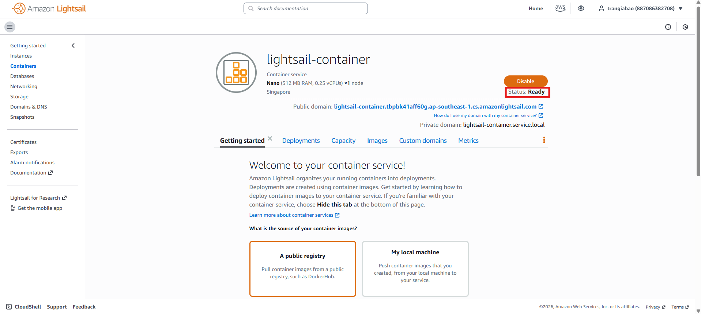

---

#### Step 6: Create First Deployment using Public Nginx Container Image
* **Action / Navigation:** In the `lightsail-container` details view, click **Create your first deployment**.
* **Configuration Parameters:**
  * *Container name:* `test1`
  * *Image:* `nginx` (pulled directly from Docker Hub Public Registry)
  * *Open ports:* Port `80`, Protocol `HTTP`

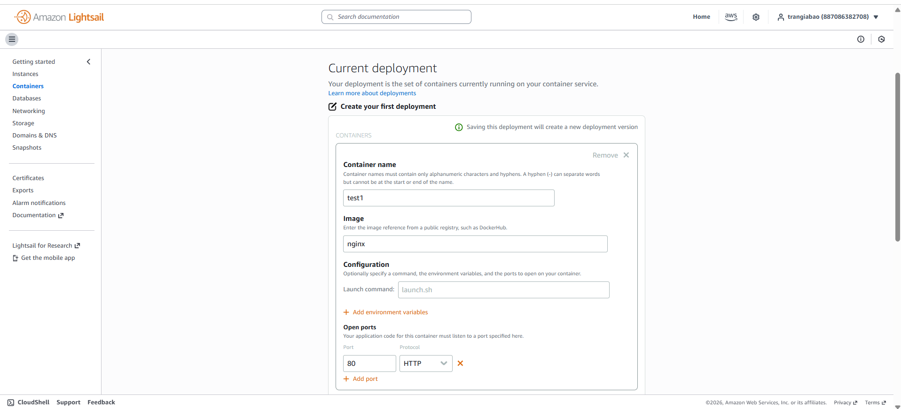

---

#### Step 7: Configure Public Endpoint & Health Check Parameters
* **Action / Navigation:** Scroll down to the **PUBLIC ENDPOINT** section on the deployment form.
* **Configuration Parameters:**
  * *Target container:* Select `test1`
  * *Port:* `80`
  * *Health check path:* `/`
* **Next Action:** Click **Save and deploy**.

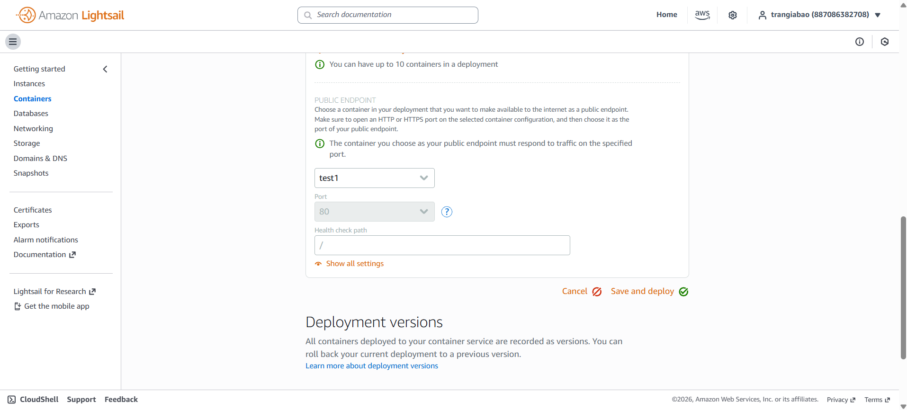

---

#### Step 8: Validate Active Deployment & Running Service Status
* **Action / Navigation:** Monitor the dashboard as Lightsail orchestrates the container lifecycle.
* **Observation:** The deployment switches to **Active**, and overall service status shifts from *Deploying* to **Running**.

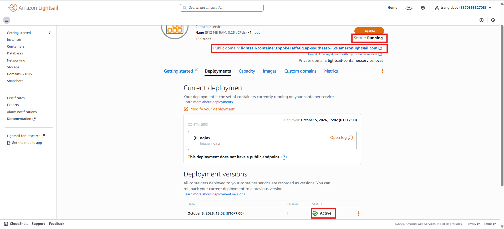

---

#### Step 9: Launch Dedicated Build Virtual Machine (`Build-Instance`)
* **Action / Navigation:** Navigate to the **Instances** tab on Lightsail ➔ Click **Create instance** to provision a Linux build workstation.
* **Configuration Parameters:**
  * *Platform:* `Linux/Unix`
  * *Blueprint:* `OS Only` ➔ Select `Ubuntu 22.04 LTS`
  * *Instance plan:* $3.50/month bundle (512 MB RAM, 1 vCPU, 20 GB SSD)
  * *Instance name:* `Build-Instance`
  * *Assigned Public IP:* `47.129.162.155`

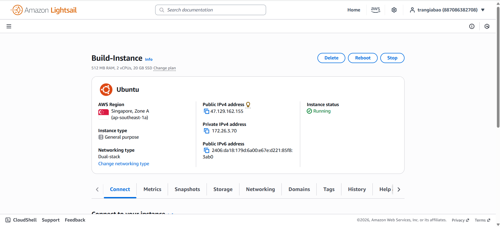

---

#### Step 10: Build Custom Container Image & Push to Lightsail Registry
* **Action / Navigation:** SSH into `Build-Instance`, install Docker engine, install the `lightsailctl` plugin, and execute the push command.
* **Commands Executed:**
  ```bash
  # 1. Install lightsailctl extension binary
  sudo curl "https://s3.us-west-2.amazonaws.com/lightsailctl/latest/linux-amd64/lightsailctl" -o "/usr/local/bin/lightsailctl"
  sudo chmod +x /usr/local/bin/lightsailctl

  # 2. Build local custom Docker image
  docker build -t nginx-container-hello:latest .

  # 3. Push container image directly to Lightsail service repository
  aws lightsail push-container-image \
    --region ap-southeast-1 \
    --service-name lightsail-container \
    --label nginx-container-hello \
    --image nginx-container-hello:latest
  ```
* **Result:** CLI outputs the stored image reference: `:lightsail-container.nginx-container-hello.1` with SHA256 digest.

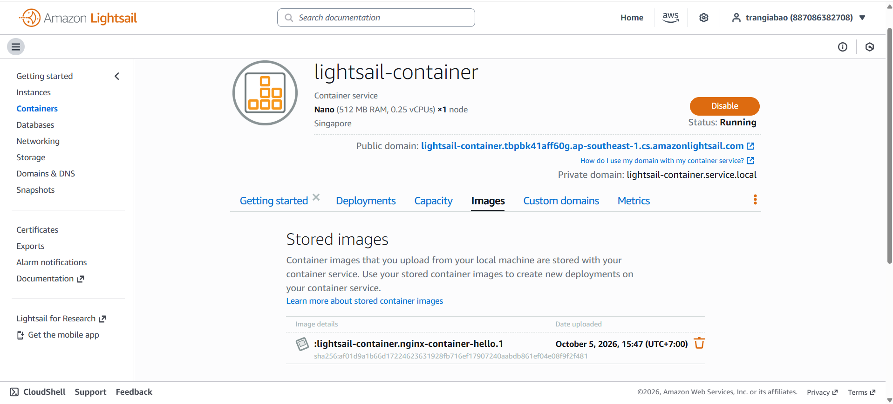

> **💡 Difficulties Encountered & Troubleshooting at Step 10:**  
> Missing the **lightsailctl** binary causes `aws lightsail push-container-image` to abort immediately because the standard AWS CLI relies on this extension to stream image layers into Lightsail. Ensure execution permissions (`chmod +x`) are applied and verify location at `/usr/local/bin/lightsailctl`. Furthermore, the `--label` flag strictly accepts lowercase letters and hyphens.

---

#### Step 11: Update Deployment & Validate Live HTTPS Application
* **Action / Navigation:** In the Lightsail Console, update the deployment image source to `:lightsail-container.nginx-container-hello.1` ➔ Click **Save and deploy** ➔ Access the public domain in a browser.
* **Access URL:** `https://lightsail-container.5vpta1mr2570.ap-southeast-1.cs.amazonlightsail.com`
* **Result:** Web page loads with the **"Welcome to nginx!"** landing page, showing a valid SSL/TLS lock icon issued by Amazon Trust Services.

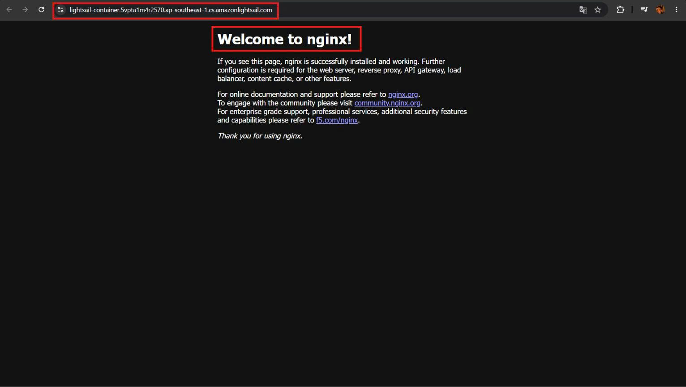

---

### 📝 Summary & Key Takeaways:
1. **Frictionless Container Deployment:** Lightsail Containers provides an effortless abstraction over containerized workloads, removing the overhead of managing Kubernetes control planes (EKS) or complex task definitions (ECS).
2. **Automated SSL/TLS Provisioning:** Amazon Lightsail automatically provisions free HTTPS endpoints with valid certificates for every service, streamlining production-like testing.
3. **Dedicated Build Workstation Pattern:** Utilizing a lightweight Lightsail instance (`Build-Instance`) as a dedicated Docker compiler isolates local development dependencies from cloud deployment pipelines.
