---
title: "Triển khai Amazon Lightsail Container"
date: 2026-10-06
weight: 2
chapter: false
pre: " <b> 1.4.2. </b> "
---

{}
Bài thực hành **Triển khai Amazon Lightsail Container** (Run Apps on Lightsail Container) được thực hiện vào **Thứ 3 (06/10/2026)** trong khuôn khổ **Tuần 4**. Trang này hướng dẫn chi tiết từng bước thực hiện kèm thông số cụ thể, câu lệnh CLI, giải pháp xử lý sự cố và bộ 11 hình ảnh minh chứng thực hành.
<br>🔗 **Nguồn tài liệu thực hành (Workshop Reference):** [Amazon Lightsail Container - Run Apps on Lightsail Container](https://000046.awsfcaj.com/)
{}

### 🎯 Mục tiêu bài thực hành (Lab Objectives):
* Làm quen với tính năng **Containers** trên Amazon Lightsail — giải pháp triển khai ứng dụng container hóa đơn giản và nhanh chóng.
* Cài đặt và cấu hình **AWS CLI** cùng công cụ mở rộng **Lightsail Control (lightsailctl)** để tương tác với container service từ máy trạm.
* Khởi tạo **Container Service** trên Lightsail với gói tài nguyên tối ưu chi phí (Nano bundle).
* Triển khai một **Public Container Image** (Nginx) từ Docker Hub lên Lightsail Container Service.
* Khởi tạo máy ảo **Build-Instance** (Ubuntu) để tự build và đẩy một **Custom Container Image** lên kho lưu trữ riêng của Lightsail bằng lệnh `aws lightsail push-container-image`.
* Kích hoạt Public Endpoint và kiểm tra website hoạt động ổn định trên tên miền công khai có chứng chỉ SSL/TLS tự động.

---

### 📊 Bảng tổng hợp thông số tài nguyên đã triển khai:

| Tài nguyên | Tên / Định danh | Cấu hình & Chi tiết kỹ thuật | Địa chỉ / Cổng truy cập | Ghi chú |
| :--- | :--- | :--- | :--- | :--- |
| **AWS CLI** | Version 2.37.9 | Cài đặt qua PowerShell, cấu hình Profile | User IAM: `Bao` (`ap-southeast-1`) | Công cụ dòng lệnh quản trị AWS |
| **Container Service** | `lightsail-container` | Nano (512 MB RAM, 0.25 vCPUs x 1 node) | Singapore (`ap-southeast-1a`) | Status: `Running` |
| **Public Deployment** | `test1` | Image: `nginx` (Docker Hub Public Registry) | Port 80 (HTTP), Health check: `/` | Triển khai nhanh từ image công khai |
| **Build Instance** | `Build-Instance` | Ubuntu 22.04 LTS, 512 MB RAM, 20 GB SSD | Public IP: `47.129.162.155` | Dùng để build & push Docker image |
| **Stored Container** | `:lightsail-container.nginx-container-hello.1` | Custom image đẩy từ máy chủ build lên kho lưu trữ | SHA256 digest xác thực | Kho ảnh container riêng của Lightsail |
| **Public Domain** | `lightsail-container...amazonlightsail.com` | HTTPS tự động cấp chứng chỉ SSL bởi AWS | Port 443 / 80 | Endpoint truy cập ứng dụng công khai |

---

### 🚀 Chi tiết các bước thực hiện & Hình ảnh minh chứng:

#### Bước 1: Cài đặt AWS CLI v2 trên Máy trạm Windows
* **Thao tác / Hướng dẫn:** Mở **PowerShell** với quyền Administrator (Run as Administrator) ➔ Thực thi lệnh tải về và cài đặt tự động phiên bản AWS CLI v2.
* **Lệnh thực thi:**
  ```powershell
  irm https://awscli.amazonaws.com/v2/install.ps1 | iex
  ```
* **Mục đích:** Thiết lập môi trường dòng lệnh chuẩn hóa nhằm phục vụ tương tác, cấu hình dịch vụ và đẩy container image lên nền tảng Lightsail.

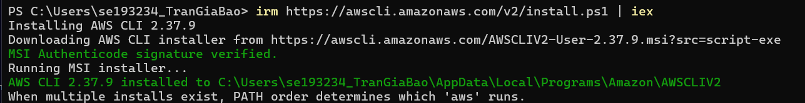

---

#### Bước 2: Kiểm tra Xác nhận Phiên bản AWS CLI Hoàn tất
* **Thao tác / Hướng dẫn:** Khởi động lại cửa sổ dòng lệnh và chạy lệnh kiểm tra phiên bản.
* **Lệnh thực thi:**
  ```powershell
  aws --version
  ```
* **Kết quả hiển thị:** Hệ thống trả về `aws-cli/2.37.9 Python/3.14.0 Windows/10 exe/AMD64`, xác nhận AWS CLI đã sẵn sàng.

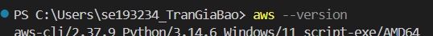

---

#### Bước 3: Cấu hình Thông tin Định danh Truy cập (`aws configure`)
* **Thao tác / Hướng dẫn:** Chạy lệnh `aws configure` và nhập lần lượt các thông số xác thực của IAM User.
* **Thông số điền cụ thể:**
  * *AWS Access Key ID:* Nhập Access Key của IAM User `Bao`
  * *AWS Secret Access Key:* Nhập Secret Access Key tương ứng
  * *Default region name:* `ap-southeast-1` (Singapore)
  * *Default output format:* `json`
* **Lệnh thực thi:**
  ```powershell
  aws configure
  ```

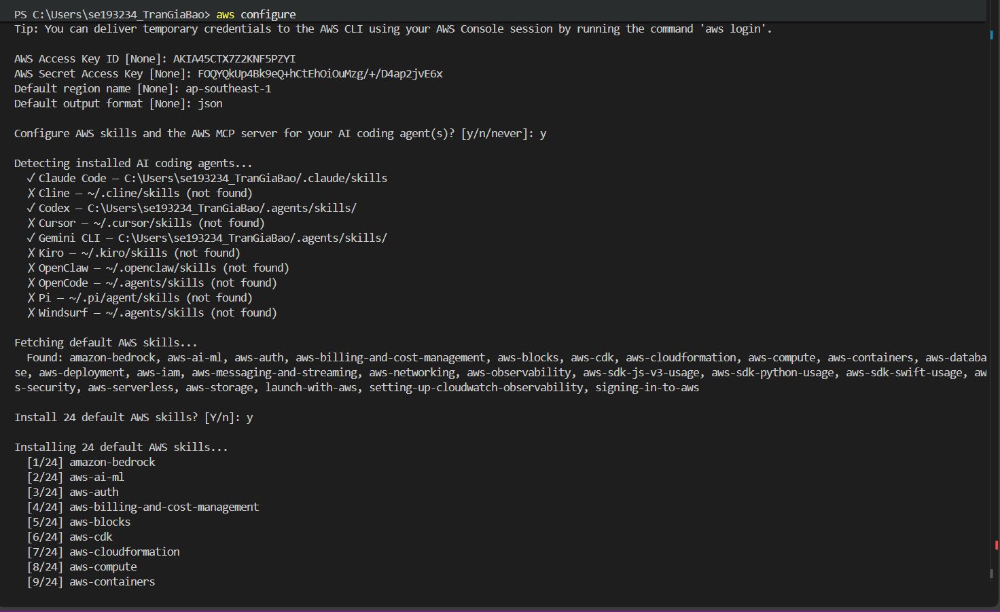

---

#### Bước 4: Kiểm tra Quyền Hạn IAM User & Khắc phục Lỗi `AccessDenied`
* **Thao tác / Hướng dẫn:** Kiểm tra kết nối dịch vụ bằng lệnh CLI `aws s3 ls`.
* **Hiện tượng lỗi:** Hệ thống trả về lỗi `An error occurred (AccessDenied) when calling the ListBuckets operation`.
* **Cách khắc phục:** Truy cập **IAM Management Console** ➔ Tìm User **`Bao`** ➔ Chọn **Add permissions** ➔ Gắn trực tiếp chính sách quản trị **`AmazonLightsailFullAccess`** và kiểm tra lại lệnh thành công.

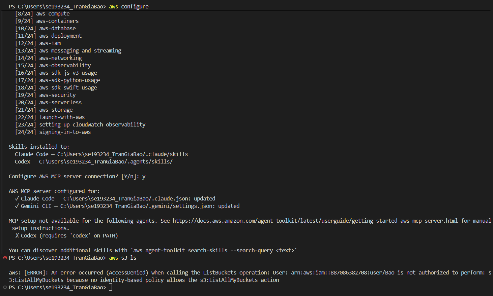

> **💡 Khó khăn gặp phải & Cách xử lý tại Bước 4:**  
> Khi thao tác với Lightsail qua CLI, nếu IAM User chỉ có quyền cơ bản trên EC2/S3 thì các lệnh `aws lightsail push-container-image` sẽ bị chặn ngay lập tức. Cần gán chính sách `AmazonLightsailFullAccess` để người dùng có đầy đủ quyền tạo Container Service và upload image lên ECR private repository ngầm của Lightsail.

---

#### Bước 5: Khởi tạo Dịch vụ Container Service trên Amazon Lightsail
* **Thao tác / Hướng dẫn:** Đăng nhập bảng điều khiển **Amazon Lightsail** ➔ Điều hướng tới thẻ **Containers** ➔ Nhấn nút **Create container service**.
* **Thông số điền cụ thể:**
  * *Region:* `Singapore (ap-southeast-1)`
  * *Cấu hình dung lượng (Capacity):* Gói **Nano** (512 MB RAM, 0.25 vCPUs x 1 node) với mức phí $7/tháng nhằm tiết kiệm chi phí thử nghiệm
  * *Container service name:* `lightsail-container`
* **Kết quả:** Hệ thống khởi tạo thành công dịch vụ với trạng thái **Ready**, đồng thời tự động sinh tên miền truy cập công khai dạng `lightsail-container.<id>.ap-southeast-1.cs.amazonlightsail.com`.

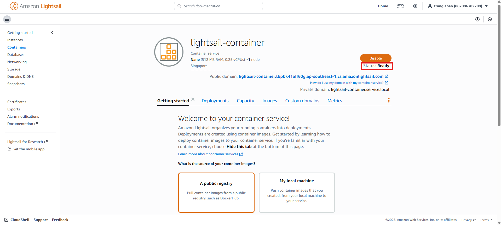

---

#### Bước 6: Khai báo Bản triển khai Đầu tiên với Public Image Nginx
* **Thao tác / Hướng dẫn:** Tại trang quản lý dịch vụ `lightsail-container`, bấm **Create your first deployment**.
* **Thông số điền cụ thể:**
  * *Container name:* `test1`
  * *Image:* `nginx` (kéo trực tiếp từ Docker Hub Public Registry)
  * *Open ports:* Cổng `80`, Giao thức `HTTP`

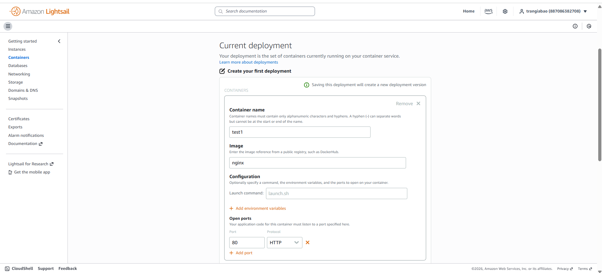

---

#### Bước 7: Thiết lập Public Endpoint & Đường dẫn Kiểm tra Sức khỏe (Health Check)
* **Thao tác / Hướng dẫn:** Cuộn xuống phần **PUBLIC ENDPOINT** tại cùng trang cấu hình deployment.
* **Thông số điền cụ thể:**
  * *Target container:* Chọn container `test1`
  * *Port:* `80`
  * *Health check path:* `/`
* **Thao tác tiếp theo:** Nhấn nút **Save and deploy**.

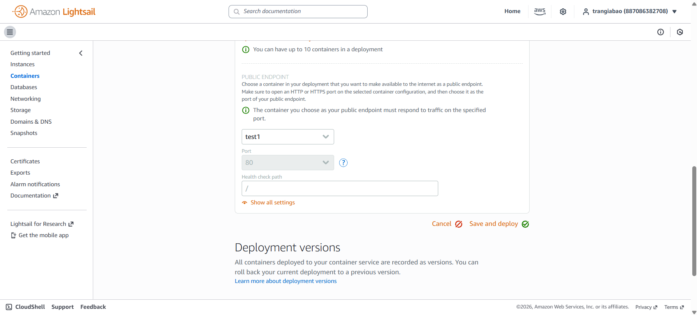

---

#### Bước 8: Xác nhận Trạng thái Active & Running của Container Service
* **Thao tác / Hướng dẫn:** Theo dõi bảng điều khiển trong khi Lightsail tự động tải image và phân bổ tài nguyên mạng.
* **Quan sát:** Bản triển khai chuyển sang trạng thái **Active**, và trạng thái dịch vụ tổng thể chuyển từ *Deploying* sang **Running**.

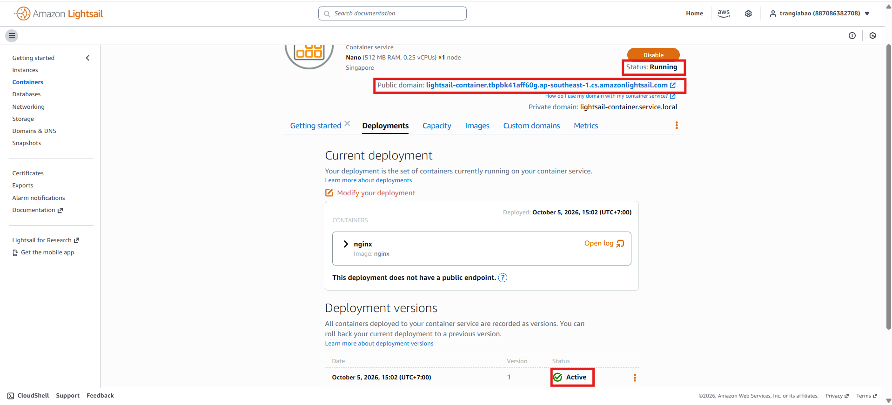

---

#### Bước 9: Khởi tạo Máy ảo Build-Instance trên Lightsail
* **Thao tác / Hướng dẫn:** Điều hướng tới thẻ **Instances** trên Lightsail ➔ Nhấn **Create instance** để tạo máy chủ chuyên dụng đóng gói container.
* **Thông số điền cụ thể:**
  * *Platform:* `Linux/Unix`
  * *Blueprint:* `OS Only` ➔ Tích chọn `Ubuntu 22.04 LTS`
  * *Instance plan:* Gói $3.50/tháng (512 MB RAM, 1 vCPU, 20 GB SSD)
  * *Instance name:* `Build-Instance`
  * *Public IP được cấp:* `47.129.162.155`

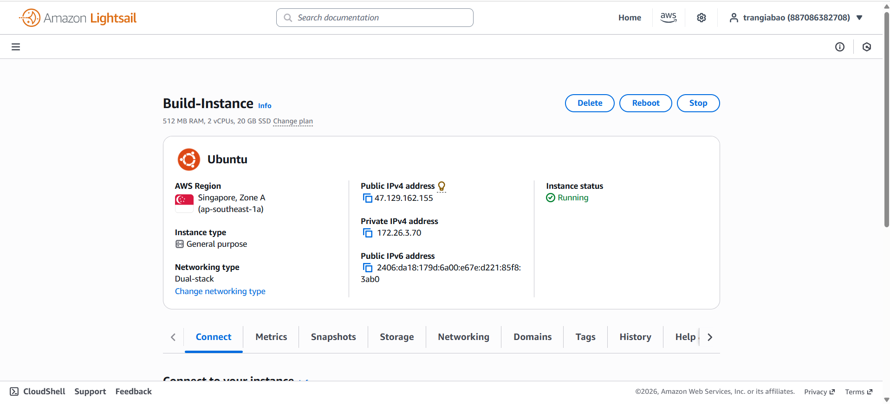

---

#### Bước 10: Đóng gói Custom Container Image & Đẩy lên Kho lưu trữ Lightsail
* **Thao tác / Hướng dẫn:** Kết nối SSH vào `Build-Instance`, cài đặt Docker, cài đặt tiện ích mở rộng `lightsailctl` và thực thi lệnh build & push image.
* **Lệnh thực thi:**
  ```bash
  # 1. Cài đặt plugin lightsailctl
  sudo curl "https://s3.us-west-2.amazonaws.com/lightsailctl/latest/linux-amd64/lightsailctl" -o "/usr/local/bin/lightsailctl"
  sudo chmod +x /usr/local/bin/lightsailctl

  # 2. Tạo Dockerfile tùy biến và build image
  docker build -t nginx-container-hello:latest .

  # 3. Đẩy image trực tiếp lên kho lưu trữ của Container Service
  aws lightsail push-container-image \
    --region ap-southeast-1 \
    --service-name lightsail-container \
    --label nginx-container-hello \
    --image nginx-container-hello:latest
  ```
* **Kết quả:** CLI trả về chuỗi định danh image lưu trữ: `:lightsail-container.nginx-container-hello.1` kèm mã băm SHA256.

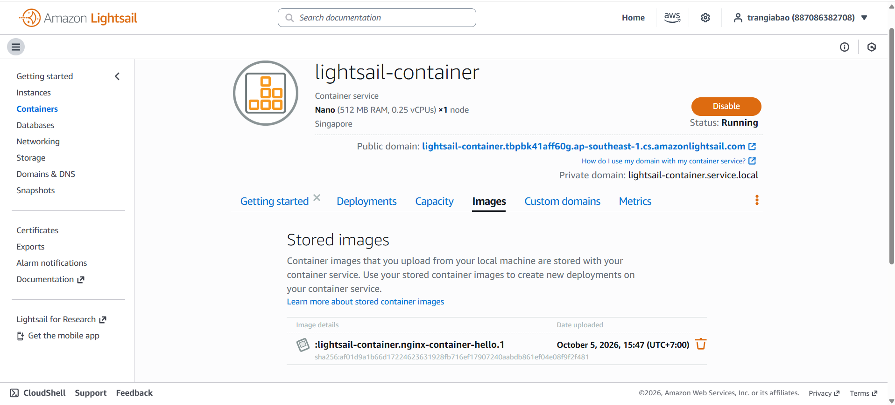

> **💡 Khó khăn gặp phải & Cách xử lý tại Bước 10:**  
> Nếu thiếu plugin **lightsailctl**, lệnh `aws lightsail push-container-image` sẽ báo lỗi ngay lập tức vì AWS CLI không thể tự đóng gói stream Docker image sang Lightsail backend. Cần đảm bảo plugin được cấp quyền thực thi (`chmod +x`) và đặt đúng tại `/usr/local/bin/lightsailctl`. Ngoài ra, tham số `--label` chỉ chấp nhận chữ thường và dấu gạch nối, không dùng ký tự đặc biệt.

---

#### Bước 11: Cập nhật Bản Triển khai & Xác thực Ứng dụng qua HTTPS
* **Thao tác / Hướng dẫn:** Trên Lightsail Console, chỉnh sửa deployment trỏ nguồn image tới `:lightsail-container.nginx-container-hello.1` ➔ Nhấn **Save and deploy** ➔ Mở trình duyệt truy cập tên miền công khai.
* **Địa chỉ truy cập:** `https://lightsail-container.5vpta1mr2570.ap-southeast-1.cs.amazonlightsail.com`
* **Kết quả:** Website tải nhanh chóng với trang chào mừng **"Welcome to nginx!"**, biểu tượng ổ khóa SSL/HTTPS hiển thị đầy đủ, xác nhận container hoạt động ổn định và sẵn sàng phục vụ lưu lượng truy cập.

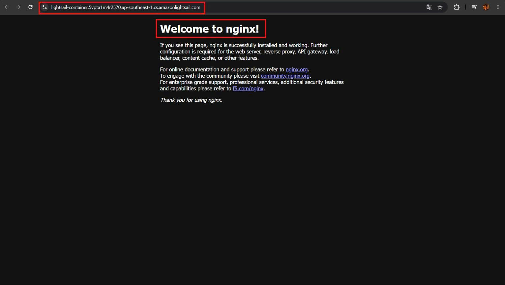

---

### 📝 Tổng kết & Bài học kinh nghiệm:
1. **Sự tiện lợi của Lightsail Container:** Cung cấp trải nghiệm triển khai container cực kỳ nhanh chóng mà không cần thiết lập cụm máy chủ Kubernetes phức tạp như EKS hay quản lý cluster tác vụ như ECS.
2. **Tự động hóa SSL/TLS:** Lightsail tự động cấp phát tên miền công khai kèm chứng chỉ HTTPS miễn phí bởi Amazon Trust Services cho mỗi Container Service, giảm bớt công đoạn đăng ký domain và tạo cert thủ công.
3. **Mô hình phối hợp Build & Deploy:** Sử dụng một máy ảo Lightsail nhỏ (`Build-Instance`) làm máy trạm build Docker và đẩy image lên kho lưu trữ riêng giúp quy trình CI/CD thử nghiệm diễn ra độc lập, tiết kiệm chi phí và an toàn bảo mật.
