---
title: "Auto Scaling with EC2 Auto Scaling"
date: 2026-10-07
weight: 3
chapter: false
pre: " <b> 1.4.3. </b> "
---

{}
The **Auto Scaling with EC2 Auto Scaling** (Scaling Applications with EC2 Auto Scaling) hands-on lab was conducted on **Wednesday (07/10/2026)** during **Week 4**. This page delivers a detailed step-by-step walkthrough covering explicit parameters, stress testing commands, troubleshooting resolutions, and all 44 verification screenshots.
<br>🔗 **Lab Reference Material:** [Triển khai ứng dụng FCAJ Management với Auto Scaling Group](https://000006.awsfcaj.com/)
{}

### 🎯 Lab Objectives:
* Understand the core design principles of **Scalable & Highly Available Architecture** on AWS.
* Package a functional application server into a reusable **Custom AMI**.
* Construct a standardized **Launch Template** defining automated compute specifications.
* Deploy an **Application Load Balancer (ALB)** paired with a **Target Group** for balanced traffic distribution.
* Configure an **Auto Scaling Group (ASG)** with **Dynamic Scaling Policies** driven by CloudWatch CPU metrics.
* Execute a synthetic **Stress Test** to validate automated **Scale Out** and **Scale In** lifecycle behaviors.
* Execute a complete teardown procedure to decommission all provisioned resources and prevent unintended costs.

---

### 📊 Provisioned Resource Specifications:

| Resource | Name / Identifier | Configuration & Detailed Specs | Address / Ports | Notes |
| :--- | :--- | :--- | :--- | :--- |
| **Custom AMI** | `fcaj-app-ami` | Packaged sample Node.js server + application code | AMI ID: `ami-0...` | Master golden image for fleet instances |
| **Launch Template** | `fcaj-launch-template` | `t2.micro`, Amazon Linux, SG: Ports 80/3000 | Version 1 | Automates instance provisioning |
| **Target Group** | `fcaj-tg` | Target Type: Instance, Protocol: HTTP (Port 80) | Health Check: `/` | Manages target registration and health checks |
| **Load Balancer** | `fcaj-alb` | Application Load Balancer, Multi-AZ Subnets | DNS Name of ALB | Central ingress traffic gateway |
| **Auto Scaling Group**| `fcaj-asg` | Min: 1, Desired: 1, Max: 3 instances | Distributed across 2 Availability Zones | Auto-manages fleet capacity |
| **Scaling Policy** | `TargetTracking-CPU` | Metric: Average CPU Utilization > 50% | Warmup: 300s | Automatically triggers Scale Out under load |

---

### 🚀 Step-by-Step Implementation & Screenshot Gallery:

#### Step 1: Create Custom AMI from Baseline EC2 Instance
* **Action / Navigation:** In the **Amazon EC2** console ➔ Navigate to **Instances** ➔ Select the running golden application instance ➔ Click **Actions** ➔ **Image and templates** ➔ Click **Create image**.
* **Purpose:** Package the operating system, code dependencies, and runtime environment into an immutable golden image for automated fleet scaling.

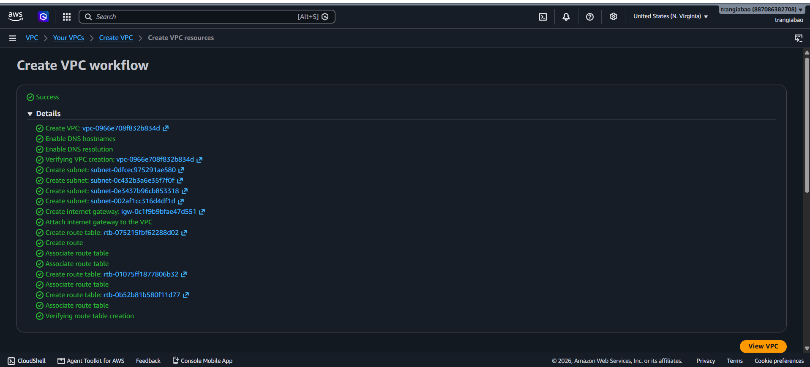

> **💡 Difficulties Encountered & Troubleshooting at Step 1:**  
> By default, creating an AMI causes AWS to temporarily reboot the instance to ensure filesystem synchronization. If uninterrupted uptime is strictly required, the *"No reboot"* option can be checked; however, allowing reboot is strongly advised to guarantee image data integrity.

---

#### Step 2: Configure Name and Storage Volumes for Custom AMI
* **Action / Navigation:** Fill in the image configuration parameters.
* **Configuration Parameters:**
  * *Image name:* `fcaj-app-ami`
  * *Image description:* `Custom AMI for FCAJ Management Application with Node.js`
  * *Instance volumes:* 1x Root EBS volume (8 GiB, General Purpose SSD gp2)
* **Next Action:** Click **Create image**.

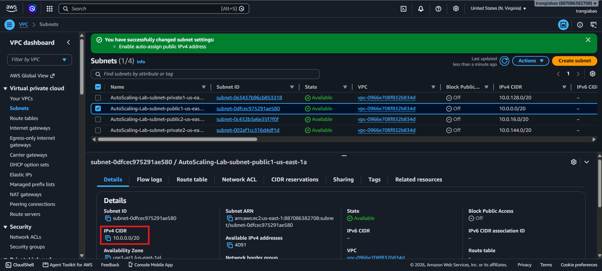

---

#### Step 3: Monitor AMI Generation Status
* **Action / Navigation:** In the EC2 navigation sidebar, navigate to **Images** ➔ **AMIs**.
* **Observation:** The AMI `fcaj-app-ami` begins block-level copying with initial status showing **pending**.

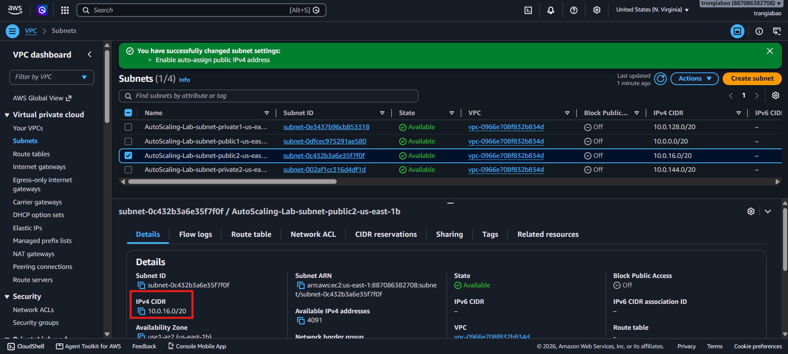

---

#### Step 4: Verify AMI Available Status
* **Action / Navigation:** Wait 3 to 5 minutes and refresh the AMIs console.
* **Observation:** Status transitions to **available**, confirming readiness for Launch Template integration.

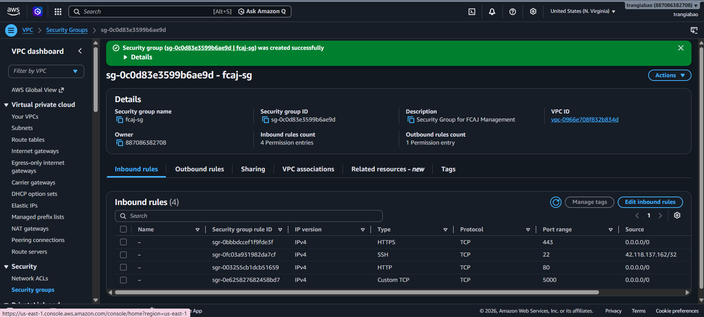

---

#### Step 5: Inspect AMI Configuration Details & Underlying Snapshot
* **Action / Navigation:** Select `fcaj-app-ami` and review the Details pane.
* **Details Observed:** An associated Snapshot ID is linked under Elastic Block Store, virtualization type `hvm`, architecture `x86_64`.

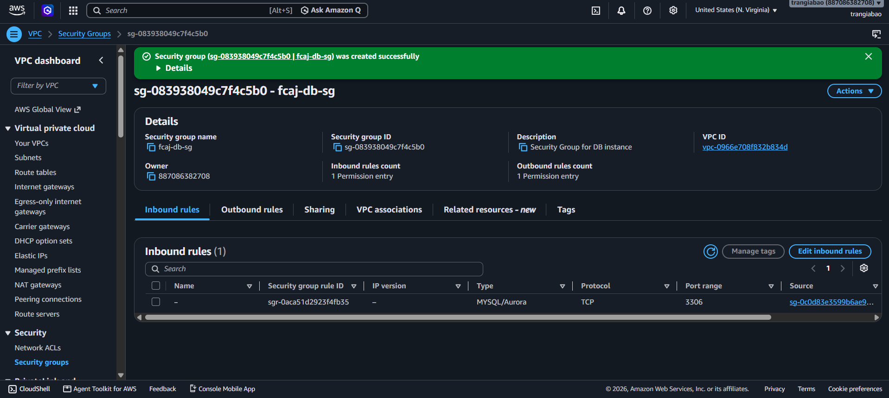

---

#### Step 6: Create Target Group for Application Load Balancer
* **Action / Navigation:** In the EC2 sidebar, select **Target Groups** ➔ Click **Create target group**.
* **Configuration Parameters:**
  * *Target type:* **Instances**
  * *Target group name:* `fcaj-tg`
  * *Protocol / Port:* `HTTP` : `80`
  * *VPC:* Select Default VPC or Workshop VPC
  * *Health checks:* Protocol `HTTP`, Path `/`
* **Next Action:** Click **Next** ➔ Click **Create target group** (manual target registration is bypassed because ASG handles this automatically).

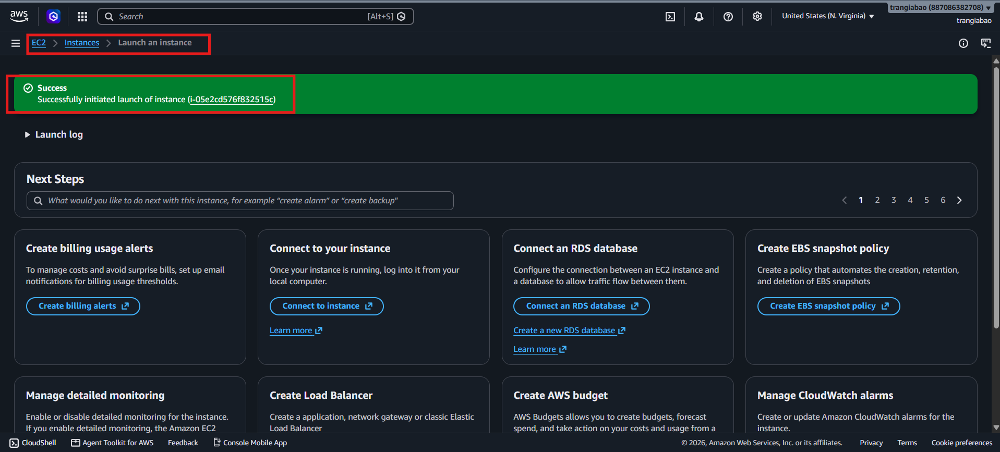

---

#### Step 7: Create Application Load Balancer (`fcaj-alb`)
* **Action / Navigation:** Select **Load Balancers** ➔ Click **Create load balancer** ➔ Select **Application Load Balancer**.
* **Configuration Parameters:**
  * *Load balancer name:* `fcaj-alb`
  * *Scheme:* **Internet-facing**
  * *IP address type:* `IPv4`
  * *Network mapping:* Select VPC and at least two public Availability Zones / Subnets
  * *Security groups:* Attach a Security Group permitting Inbound Port `80` (HTTP) from `0.0.0.0/0`
  * *Listeners and routing:* Port `80` (HTTP) ➔ Forward to `fcaj-tg`
* **Next Action:** Scroll down and click **Create load balancer**.

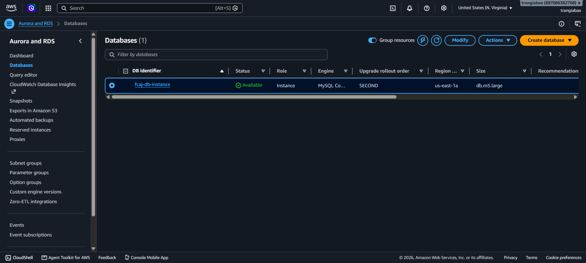

> **💡 Difficulties Encountered & Troubleshooting at Step 7:**  
> The ALB Security Group must allow open public HTTP traffic (`0.0.0.0/0`), but backend EC2 instances should strictly restrict incoming port 80 traffic to the ALB Security Group ID only. This ensures all traffic is properly filtered and inspected by the load balancer.

---

#### Step 8: Initiate Launch Template Creation
* **Action / Navigation:** In the EC2 sidebar, click **Launch Templates** ➔ Click **Create launch template**.
* **Purpose:** Define compute specifications, security boundaries, and bootstrap scripts for automated ASG provisioning.

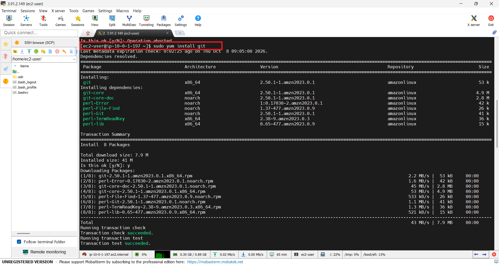

---

#### Step 9: Configure Launch Template Metadata and Version
* **Action / Navigation:** Populate identity fields for the template.
* **Configuration Parameters:**
  * *Launch template name:* `fcaj-launch-template`
  * *Template version description:* `Initial version for FCAJ ASG`
  * *Auto Scaling guidance:* Check *"Provide guidance to help me set up a template that I can use with EC2 Auto Scaling"*.

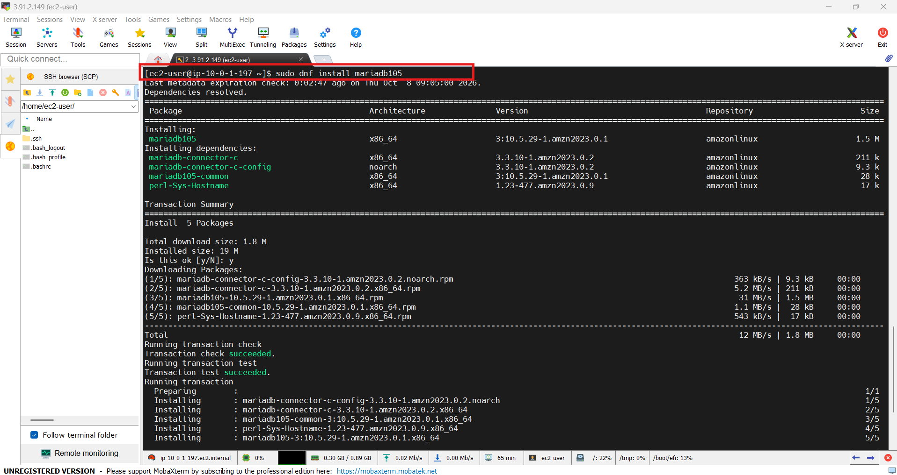

---

#### Step 10: Select Custom AMI Source (`fcaj-app-ami`)
* **Action / Navigation:** Under **Application and OS Images (Amazon Machine Image)** ➔ Click **My AMIs** ➔ Select **Owned by me**.
* **Selection:** Select `fcaj-app-ami` created in Step 4.

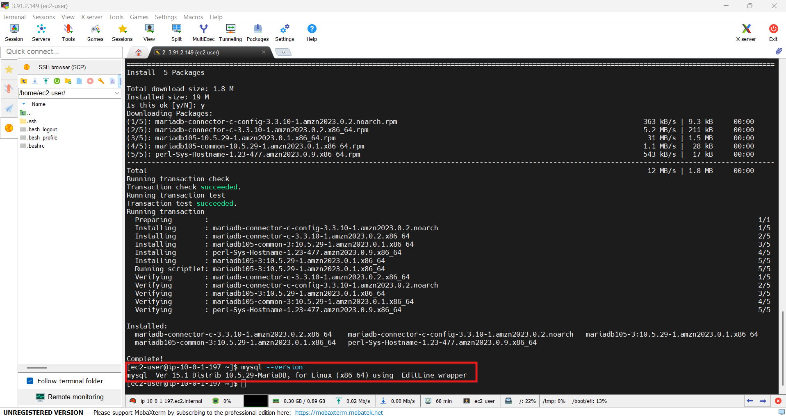

---

#### Step 11: Specify Instance Type
* **Action / Navigation:** Under **Instance type**, pick the Free-Tier eligible size.
* **Configuration:** `t2.micro` (1 vCPU, 1 GiB Memory).

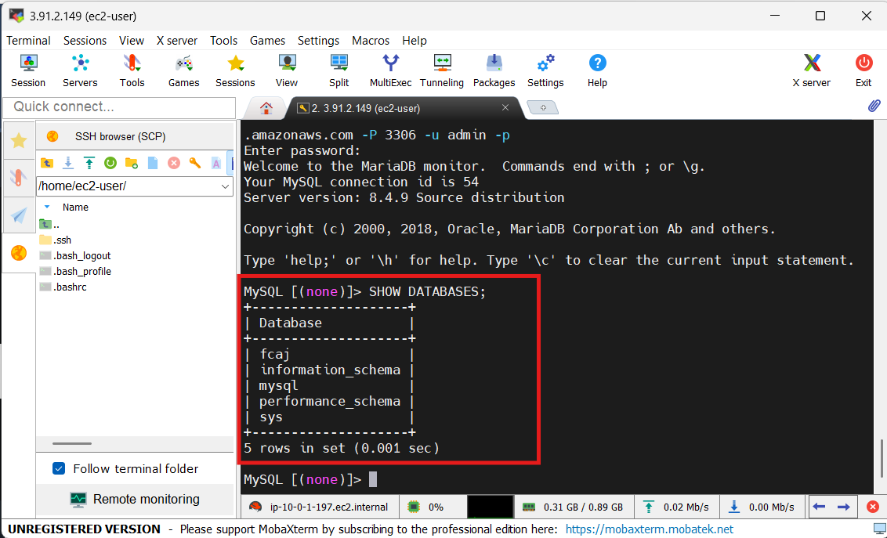

---

#### Step 12: Configure SSH Authentication Key Pair
* **Action / Navigation:** Under **Key pair (login)**, specify key settings.
* **Configuration:** Select your pre-existing Key Pair or select `Don't include in launch template` if SSH direct access is not required.

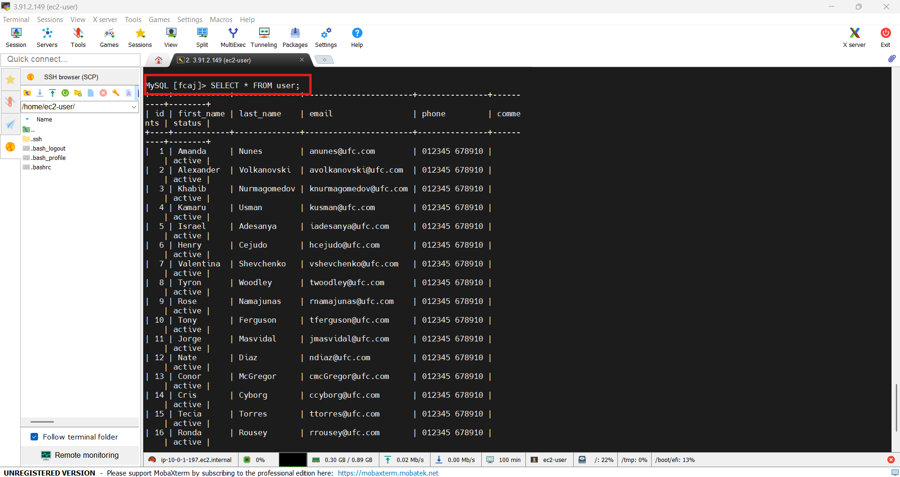

---

#### Step 13: Configure Network Settings & Security Group
* **Action / Navigation:** Under **Network settings**, configure firewall associations.
* **Configuration Parameters:**
  * *Subnet:* `Don't include in launch template` (allowing ASG to distribute instances dynamically across subnets)
  * *Firewall (Security groups):* Choose **Select existing security group** ➔ Select the SG permitting HTTP traffic from the ALB.

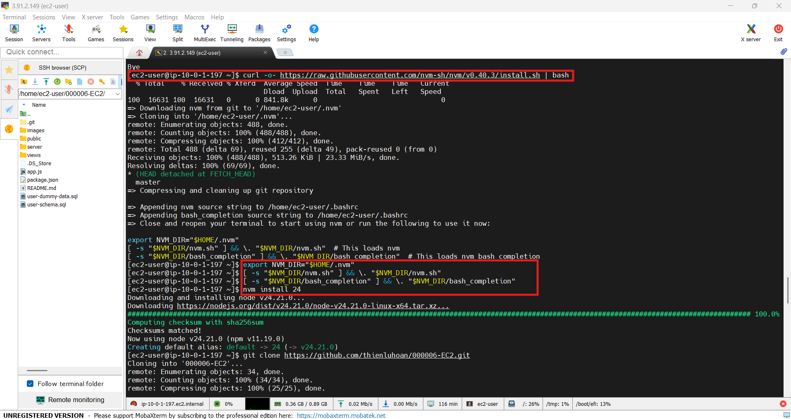

---

#### Step 14: Configure Storage Volumes (EBS)
* **Action / Navigation:** Under **Configure storage**, retain golden AMI disk defaults.
* **Configuration Parameters:** 1x 8 GiB General Purpose SSD (gp2), Delete on termination: `Yes`.

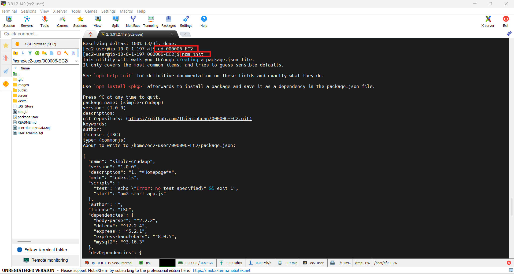

---

#### Step 15: Configure Advanced Details & User Data Bootstrap Script
* **Action / Navigation:** Expand **Advanced details**, scroll to **User data**.
* **Bootstrap Script:**
  ```bash
  #!/bin/bash
  # Ensure application server starts on boot
  cd /home/ec2-user/fcaj-app || cd /var/www/html
  npm start || systemctl restart httpd
  ```

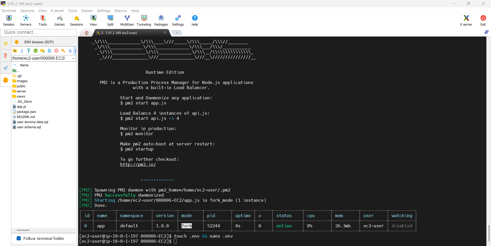

---

#### Step 16: Verify Successful Launch Template Creation
* **Action / Navigation:** Click **Create launch template**.
* **Observation:** A confirmation screen verifies `fcaj-launch-template` has been successfully created as Version 1.

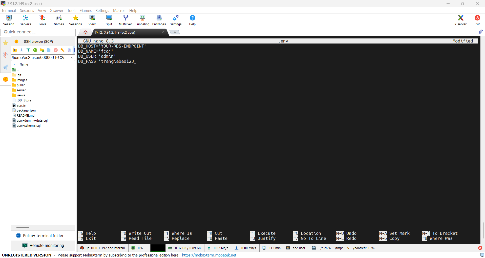

---

#### Step 17: Initiate Auto Scaling Group Creation (`fcaj-asg`)
* **Action / Navigation:** In the EC2 sidebar, select **Auto Scaling Groups** ➔ Click **Create Auto Scaling group**.
* **Configuration Parameters:**
  * *Auto Scaling group name:* `fcaj-asg`
  * *Launch template:* Select `fcaj-launch-template` (Version `Default (1)`)
* **Next Action:** Click **Next**.

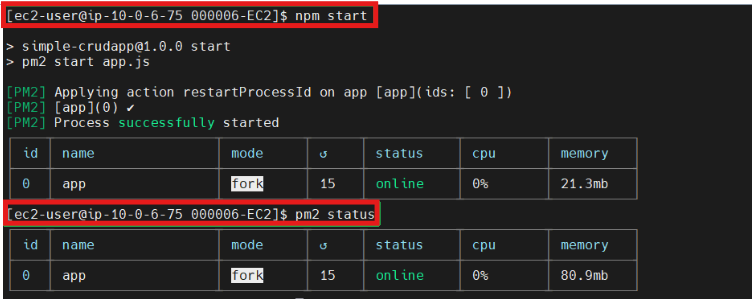

---

#### Step 18: Select Network VPC and Multi-AZ Subnets
* **Action / Navigation:** On the *Choose instance launch options* step.
* **Configuration Parameters:**
  * *VPC:* Select the workshop VPC
  * *Availability Zones and subnets:* Select at least **2 Subnets** across distinct AZs (e.g., `ap-southeast-1a` and `ap-southeast-1b`) for High Availability.
* **Next Action:** Click **Next**.

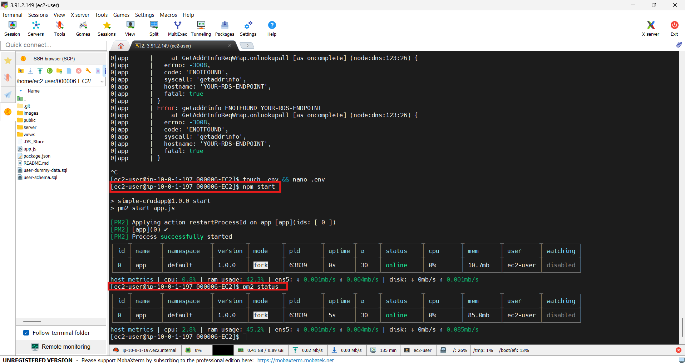

---

#### Step 19: Attach ALB Target Group & Enable ELB Health Checks
* **Action / Navigation:** On the *Configure advanced options* step.
* **Configuration Parameters:**
  * *Load balancing:* Choose **Attach to an existing load balancer** ➔ Select `fcaj-tg`.
  * *Health checks:* Check **Turn on Elastic Load Balancing health checks**.
  * *Health check grace period:* `300` seconds.
* **Next Action:** Click **Next**.

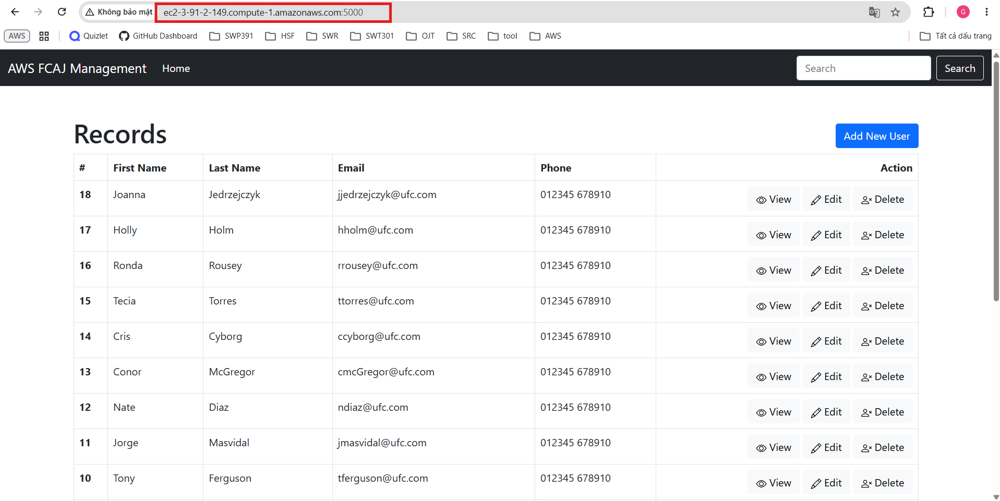

> **💡 Difficulties Encountered & Troubleshooting at Step 19:**  
> Without ELB health checks enabled, ASG only checks hypervisor status (EC2 status checks), missing cases where the web application crashes. Enabling ELB health checks ensures unresponsive instances are automatically terminated and replaced. Keep the grace period at 300 seconds so new instances have time to boot before health evaluation begins.

---

#### Step 20: Configure Group Size Capacities (Min, Desired, Max)
* **Action / Navigation:** On the *Configure group size and scaling policies* step.
* **Configuration Parameters:**
  * *Desired capacity:* `1`
  * *Minimum capacity:* `1`
  * *Maximum capacity:* `3`
  * *Scaling policies:* Select **None** temporarily (configured in Step 28).
* **Next Action:** Advance through Notifications and Tags by clicking **Next**.

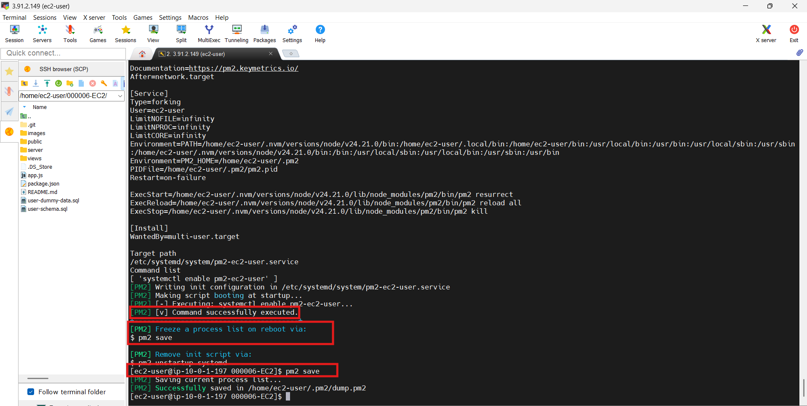

---

#### Step 21: Review ASG Configuration and Finalize Provisioning
* **Action / Navigation:** In the *Review* step, audit Launch Template, network mappings, and capacity constraints.
* **Next Action:** Click **Create Auto Scaling group**.

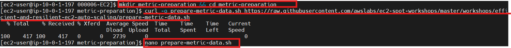

---

#### Step 22: ASG Auto-Spawns Initial EC2 Instance
* **Action / Navigation:** Select `fcaj-asg` ➔ Navigate to the **Activity** tab.
* **Observation:** The activity log records `Launching a new EC2 instance` to satisfy Desired capacity = 1.

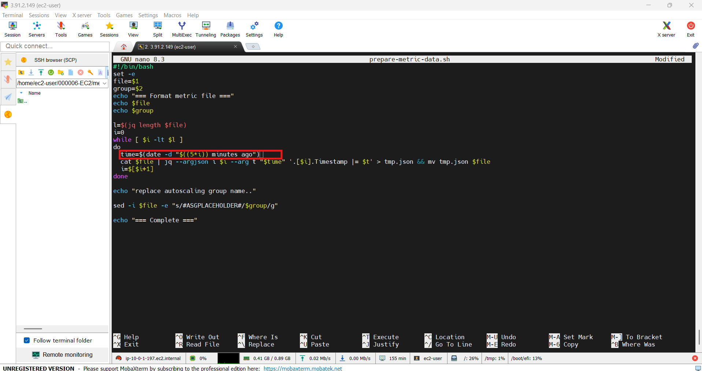

---

#### Step 23: Validate InService Lifecycle State
* **Action / Navigation:** Click the **Instance management** tab within `fcaj-asg`.
* **Observation:** The newly provisioned instance displays Health status **Healthy** and Lifecycle state **InService**.

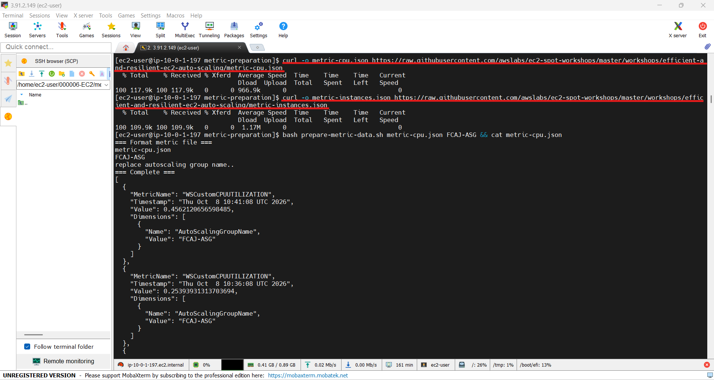

---

#### Step 24: Verify Target Group Healthy State
* **Action / Navigation:** Return to **Target Groups** ➔ Select `fcaj-tg` ➔ Inspect the **Targets** tab.
* **Observation:** The instance registered by ASG shows health check status as **healthy** on port 80.

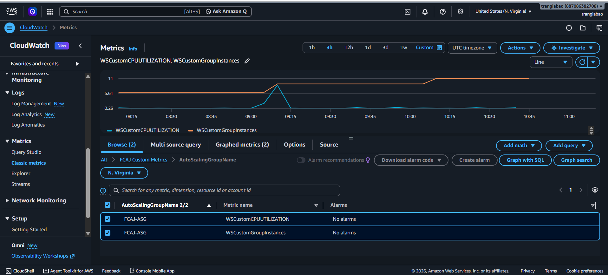

---

#### Step 25: Access Application via ALB Public DNS Name
* **Action / Navigation:** Navigate to **Load Balancers**, copy the **DNS name** of `fcaj-alb` ➔ Open a web browser and navigate to `http://<ALB-DNS-Name>`.
* **Result:** Traffic is successfully routed through the load balancer to the active backend instance.

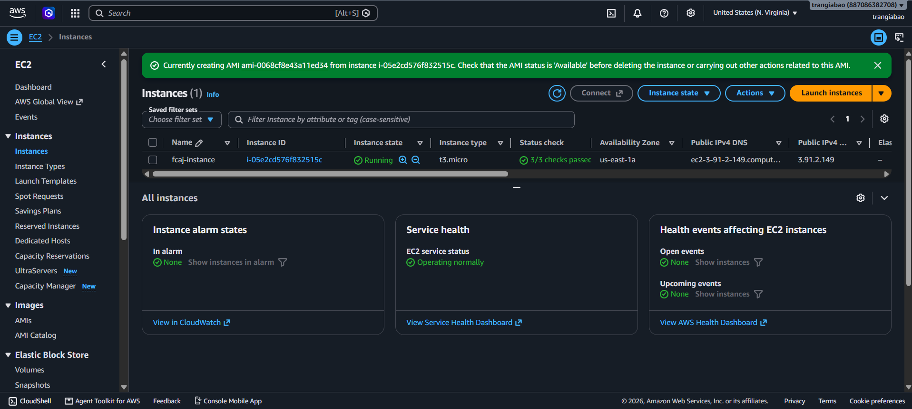

---

#### Step 26: Authenticate into FCAJ Management Application
* **Action / Navigation:** Enter credentials on the application login interface to verify end-to-end functionality.
* **Configuration Parameters:**
  * *Username:* `admin`
  * *Password:* `[Application default password]`
* **Next Action:** Click **Sign In**.

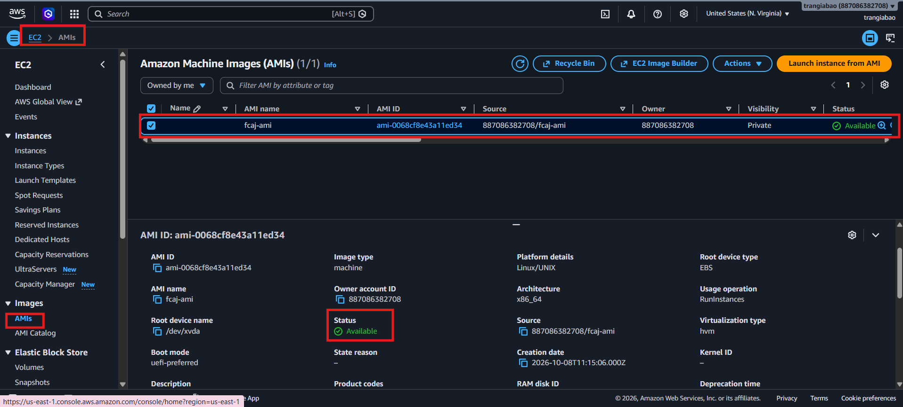

---

#### Step 27: Verify Operational Dashboard Status
* **Action / Navigation:** Inspect navigation elements upon successful authentication.
* **Result:** Application administrative dashboard loads reliably via ALB routing.

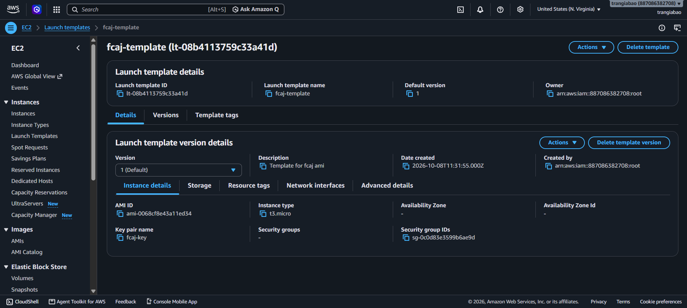

---

#### Step 28: Configure Dynamic Scaling Policy on CPU Threshold
* **Action / Navigation:** In `fcaj-asg` details ➔ Select **Automatic scaling** tab ➔ Under *Dynamic scaling policies*, click **Create dynamic scaling policy**.
* **Configuration Parameters:**
  * *Policy type:* **Target tracking scaling**
  * *Scaling policy name:* `TargetTracking-CPU`

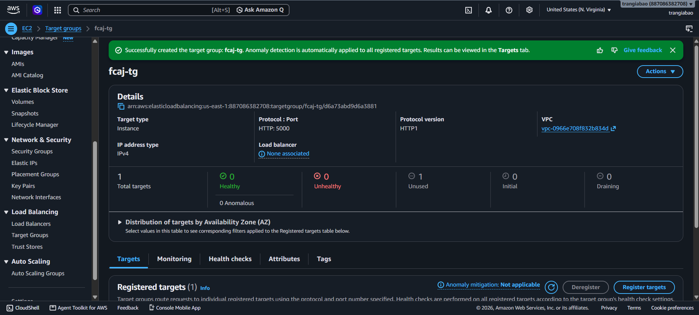

---

#### Step 29: Define 50% Average CPU Utilization Target
* **Action / Navigation:** Configure Target Tracking parameters.
* **Configuration Parameters:**
  * *Metric type:* **Average CPU utilization**
  * *Target value:* `50` (%)
  * *Instance warmup:* `300` seconds
* **Next Action:** Click **Create**.

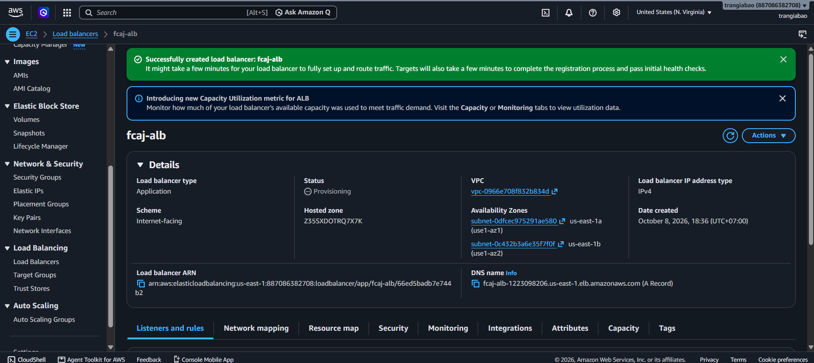

---

#### Step 30: Verify CloudWatch Alarms Triggered by Policy
* **Action / Navigation:** Open the **CloudWatch** console ➔ Select **Alarms**.
* **Observation:** Two alarms are generated automatically: One detecting CPU > 50% (triggers Scale Out) and one detecting CPU < 35% (triggers Scale In).

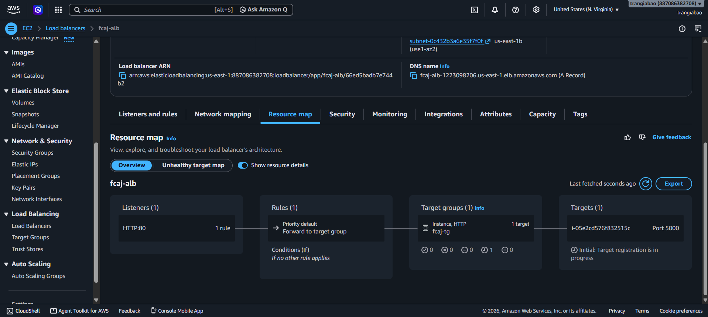

---

#### Step 31: Execute Synthetic CPU Stress Test via SSH
* **Action / Navigation:** SSH into the running EC2 instance and execute the `stress` utility.
* **Commands Executed:**
  ```bash
  # Install stress utility
  sudo amazon-linux-extras install epel -y || sudo dnf install -y epel-release
  sudo yum install -y stress

  # Generate 100% load on 2 CPU cores for 600 seconds
  stress --cpu 2 --timeout 600s
  ```

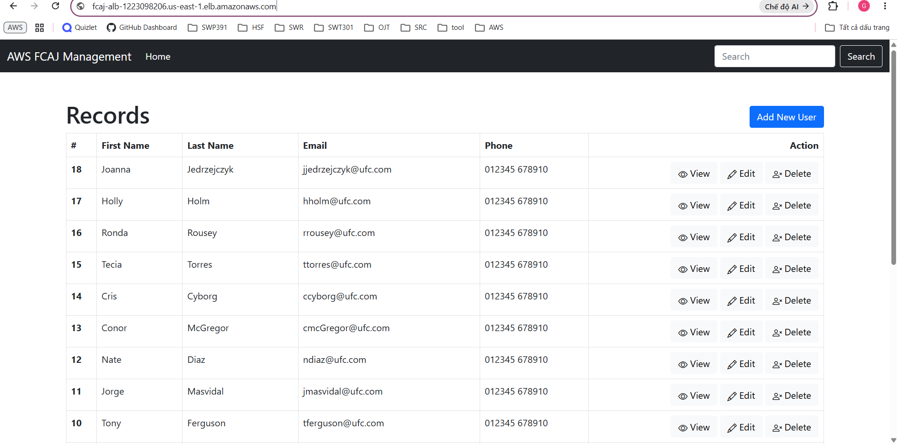

> **💡 Difficulties Encountered & Troubleshooting at Step 31:**  
> Standard CloudWatch metrics evaluate on 5-minute averages. Ensure the `stress` duration is maintained for at least 600 seconds (10 minutes), or enable Detailed Monitoring on the instance to guarantee swift alarm state changes.

---

#### Step 32: Observe CPU Utilization Spike on CloudWatch
* **Action / Navigation:** Open the CloudWatch metric graph for `CPUUtilization`.
* **Observation:** CPU load surges sharply from baseline (~1%) to nearly 100%, breaching the 50% target threshold.

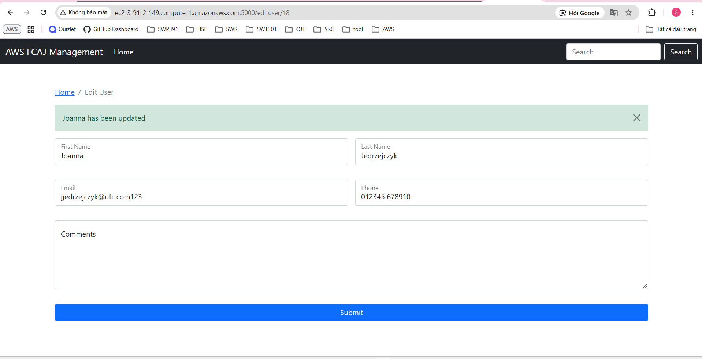

---

#### Step 33: CloudWatch Alarm Fires Scale Out Event
* **Action / Navigation:** Return to the **Activity** tab in `fcaj-asg`.
* **Observation:** The alarm changes state to **In alarm**, triggering `Launching a new EC2 instance to balance the target metric`.

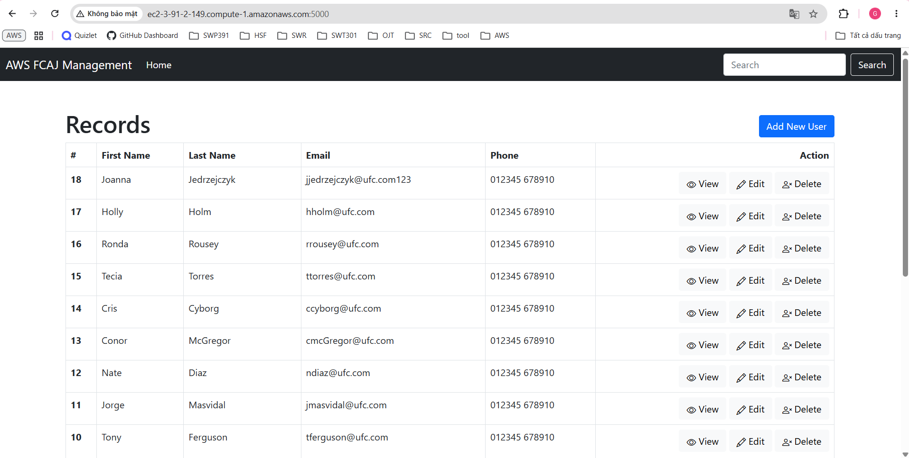

---

#### Step 34: Fleet Expands & Balances Workload Seamlessly
* **Action / Navigation:** Inspect the **Instance management** tab and **Target Groups**.
* **Result:** Capacity scales up from 1 to 2 (up to 3 per Max size configuration), both registering as `InService` and `Healthy`, dividing traffic and stabilizing the workload.

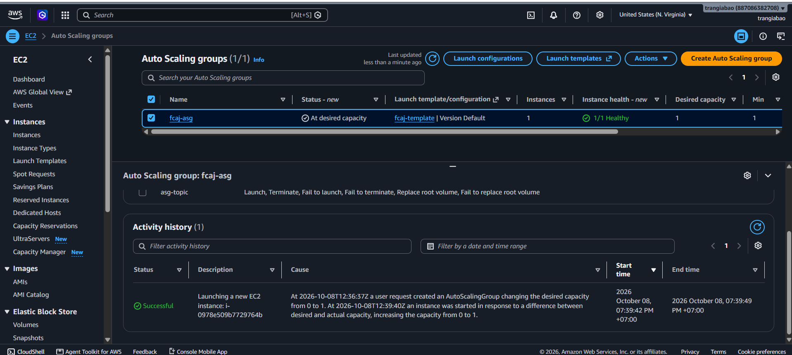

---

#### Step 35: Resource Cleanup Step 1 - Delete Auto Scaling Group
* **Action / Navigation:** After lab completion, navigate to **Auto Scaling Groups** ➔ Select `fcaj-asg` ➔ Click **Actions** ➔ Click **Delete**.

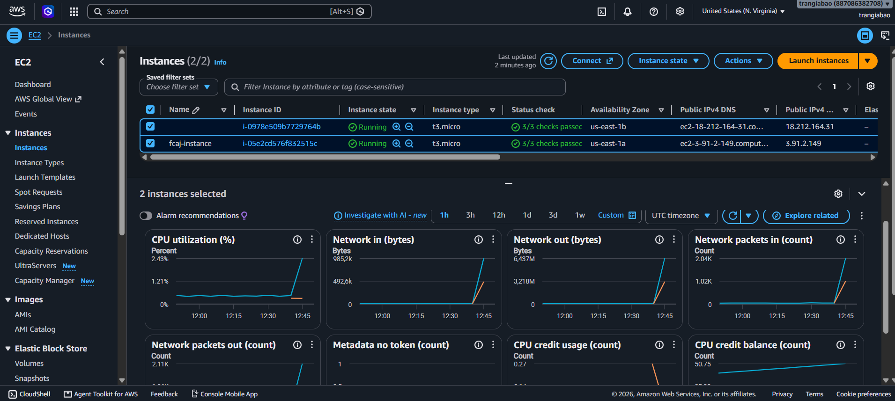

---

#### Step 36: Confirm Deletion and Await Instance Termination
* **Action / Navigation:** Type the confirmation keyword.
* **Parameter:** Enter `delete` ➔ Click **Delete**. All fleet instances managed by ASG terminate automatically.

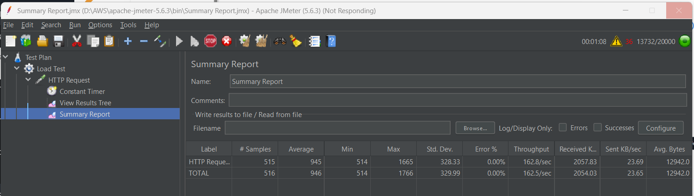

---

#### Step 37: Verify All EC2 Fleet Instances Terminated
* **Action / Navigation:** In the EC2 console, review **Instances**.
* **Observation:** Fleet instances transition to **Terminated**, shutting down compute billing.

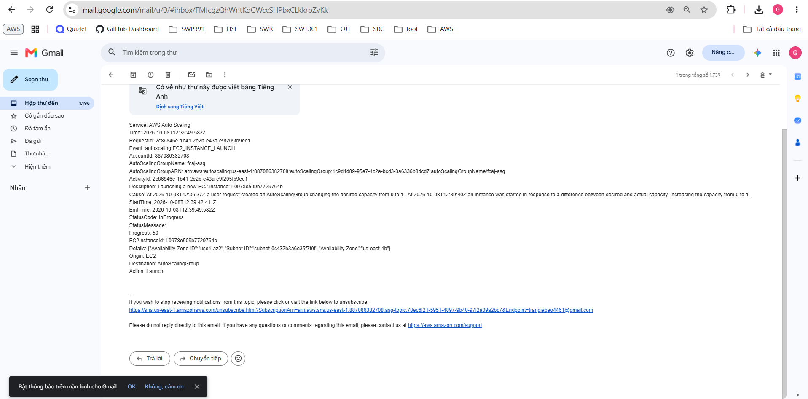

---

#### Step 38: Resource Cleanup Step 2 - Delete Application Load Balancer
* **Action / Navigation:** In the sidebar, select **Load Balancers** ➔ Select `fcaj-alb` ➔ Click **Actions** ➔ Click **Delete load balancer** ➔ Confirm **Delete**.

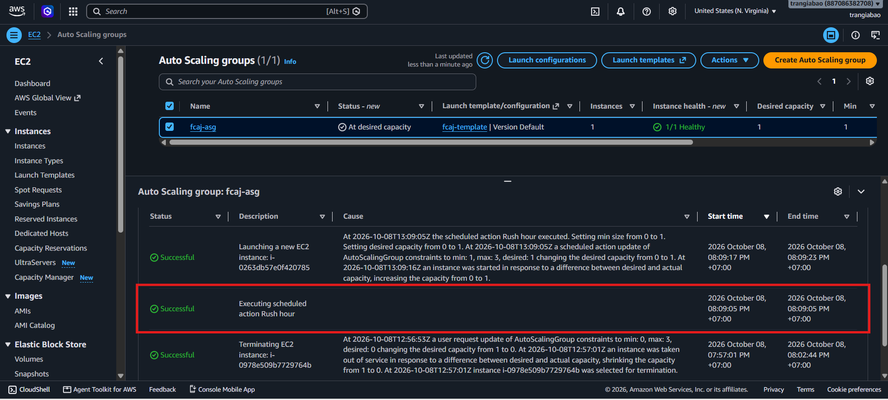

---

#### Step 39: Delete Target Group (`fcaj-tg`)
* **Action / Navigation:** Navigate to **Target Groups** ➔ Select `fcaj-tg` ➔ Click **Actions** ➔ Click **Delete**.

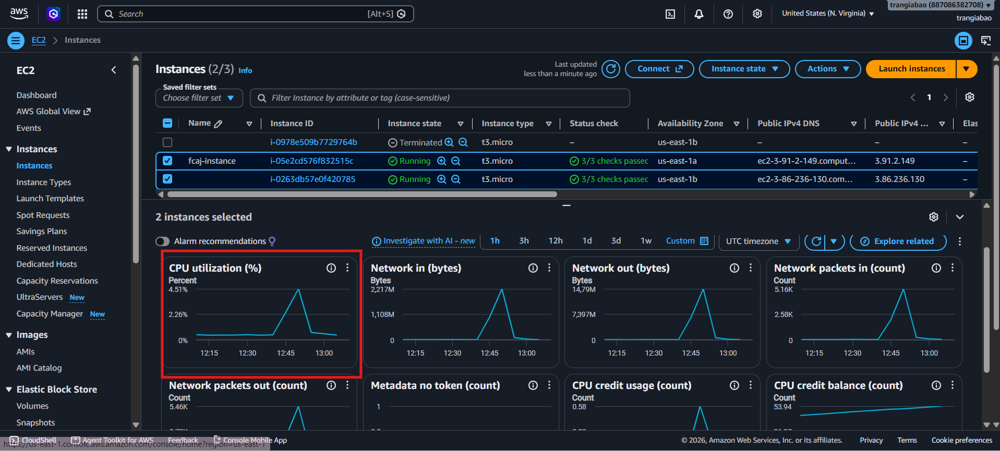

---

#### Step 40: Resource Cleanup Step 3 - Delete Launch Template
* **Action / Navigation:** Open **Launch Templates** ➔ Select `fcaj-launch-template` ➔ Click **Actions** ➔ Click **Delete template**.

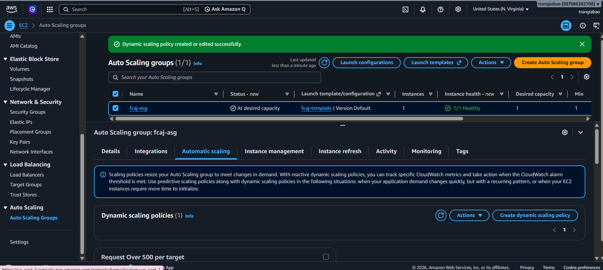

---

#### Step 41: Confirm Permanent Launch Template Deletion
* **Action / Navigation:** In the prompt, type `Delete` ➔ Click **Delete**.

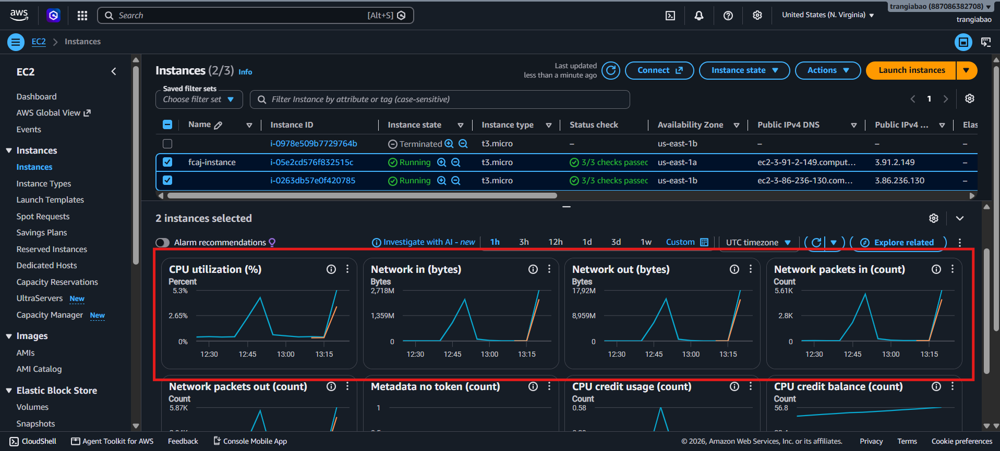

---

#### Step 42: Resource Cleanup Step 4 - Deregister Custom AMI
* **Action / Navigation:** Navigate to **AMIs** ➔ Select `fcaj-app-ami` ➔ Click **Actions** ➔ Click **Deregister AMI** ➔ Confirm deregistration.

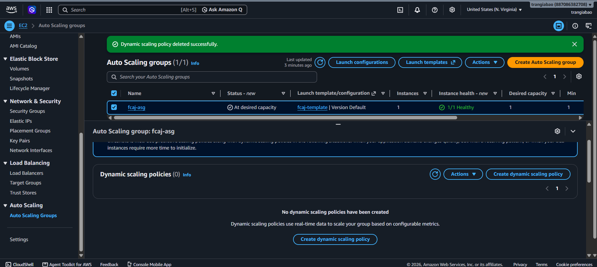

---

#### Step 43: Locate Associated EBS Snapshot of Deregistered AMI
* **Action / Navigation:** In the sidebar, open **Elastic Block Store** ➔ **Snapshots** ➔ Identify the snapshot referencing the deregistered AMI ID.

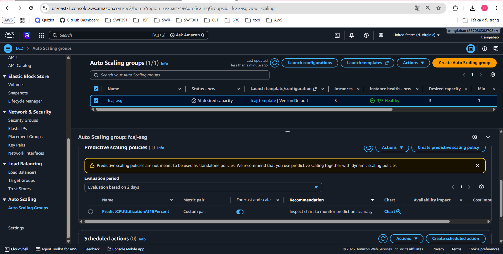

---

#### Step 44: Permanently Delete EBS Snapshot to Prevent Storage Charges
* **Action / Navigation:** Select the snapshot ➔ Click **Actions** ➔ Click **Delete snapshot** ➔ Confirm **Delete**.
* **Result:** All workshop resources are cleanly expunged, eliminating residual cloud storage costs.

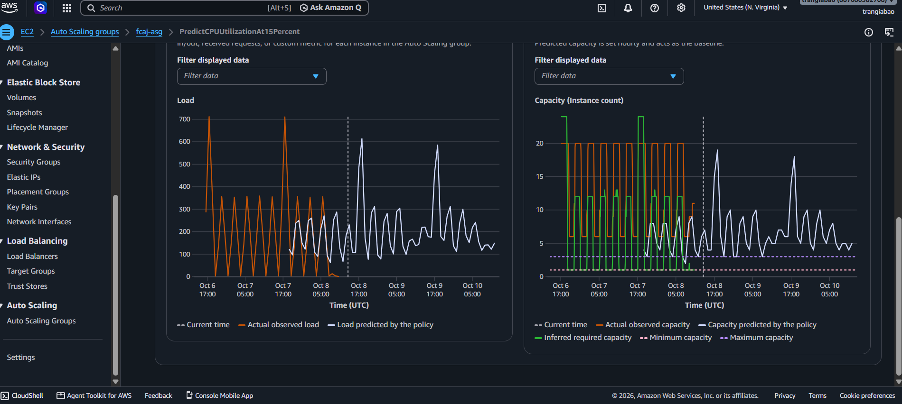

> **💡 Difficulties Encountered & Troubleshooting at Step 44:**  
> Deregistering an AMI does not delete its underlying EBS snapshot. The snapshot remains in AWS storage and incurs monthly charges unless explicitly deleted. Always inspect the Snapshots console after deregistering AMIs.

---

### 📝 Summary & Key Takeaways:
1. **Self-Healing Architecture:** EC2 Auto Scaling continuously evaluates ELB health checks, immediately terminating and replacing unresponsive instances without requiring operational intervention.
2. **Dynamic Cost Efficiency:** Elastic scaling dynamically aligns compute consumption with real-time demand, automatically shedding surplus instances during low-traffic periods.
3. **Stateless Tier Best Practice:** Applications deployed within Auto Scaling Groups should maintain a stateless architecture, offloading state to managed databases (RDS) and distributed caching tiers (ElastiCache).
