---
title: "Tự động co giãn với EC2 Auto Scaling"
date: 2026-10-07
weight: 3
chapter: false
pre: " <b> 1.4.3. </b> "
---

{}
Bài thực hành **Tự động co giãn với EC2 Auto Scaling** (Scaling Applications with EC2 Auto Scaling) được thực hiện vào **Thứ 4 (07/10/2026)** trong khuôn khổ **Tuần 4**. Trang này hướng dẫn chi tiết từng bước với đầy đủ thông số điền, câu lệnh kiểm thử tải, giải pháp xử lý sự cố thực tế và trọn bộ 44 hình ảnh minh chứng thực hành.
<br>🔗 **Nguồn tài liệu thực hành (Workshop Reference):** [Triển khai ứng dụng FCAJ Management với Auto Scaling Group](https://000006.awsfcaj.com/)
{}

### 🎯 Mục tiêu bài thực hành (Lab Objectives):
* Hiểu sâu về kiến trúc ứng dụng có khả năng co giãn linh hoạt (**Scalable & Highly Available Architecture**) trên AWS.
* Đóng gói máy chủ ứng dụng mẫu thành một bản ảnh tái sử dụng (**Custom AMI**).
* Xây dựng **Launch Template** chuẩn hóa nhằm định nghĩa cấu hình khởi chạy máy chủ tự động.
* Thiết lập **Application Load Balancer (ALB)** kết hợp với **Target Group** để phân phối lưu lượng truy cập cân bằng.
* Cấu hình **Auto Scaling Group (ASG)** với các chính sách co giãn động (**Dynamic Scaling Policies**) dựa trên chỉ số CPU CloudWatch.
* Thực hiện kiểm thử chịu tải (**Stress Test**) để quan sát cơ chế tự động tăng máy chủ (**Scale Out**) và giảm máy chủ (**Scale In**).
* Thực hiện quy trình dọn dẹp giải phóng toàn bộ tài nguyên nhằm tối ưu chi phí.

---

### 📊 Bảng tổng hợp thông số tài nguyên đã triển khai:

| Tài nguyên | Tên / Định danh | Cấu hình & Chi tiết kỹ thuật | Địa chỉ / Cổng truy cập | Ghi chú |
| :--- | :--- | :--- | :--- | :--- |
| **Custom AMI** | `fcaj-app-ami` | Đóng gói máy chủ mẫu Node.js + App Code | AMI ID: `ami-0...` | Bản mẫu tạo các instance mới |
| **Launch Template** | `fcaj-launch-template` | `t2.micro`, Amazon Linux, SG: Port 80/3000 | Version 1 | Tự động hóa cài đặt khi khởi động |
| **Target Group** | `fcaj-tg` | Target Type: Instance, Protocol: HTTP (Port 80) | Health Check: `/` | Quản lý tình trạng máy chủ |
| **Load Balancer** | `fcaj-alb` | Application Load Balancer, Multi-AZ Subnets | DNS Name của ALB | Cổng tiếp nhận lưu lượng tập trung |
| **Auto Scaling Group**| `fcaj-asg` | Min: 1, Desired: 1, Max: 3 instances | Phân bổ trên 2 Availability Zones | Tự động cân đối số lượng máy chủ |
| **Scaling Policy** | `TargetTracking-CPU` | Metric: Average CPU Utilization > 50% | Warmup: 300s | Tự động Scale Out khi tải tăng |

---

### 🚀 Chi tiết các bước thực hiện & Hình ảnh minh chứng:

#### Bước 1: Khởi tạo Bản ảnh Máy chủ Custom AMI từ EC2 Instance mẫu
* **Thao tác / Hướng dẫn:** Mở bảng điều khiển **Amazon EC2** ➔ Vào mục **Instances** ➔ Chọn máy chủ ứng dụng mẫu đang chạy ➔ Chọn menu **Actions** ➔ **Image and templates** ➔ Nhấn **Create image**.
* **Mục đích:** Đóng gói toàn bộ mã nguồn ứng dụng, môi trường runtime và các gói phụ thuộc thành một bản ảnh AMI để dùng cho việc scale tự động.

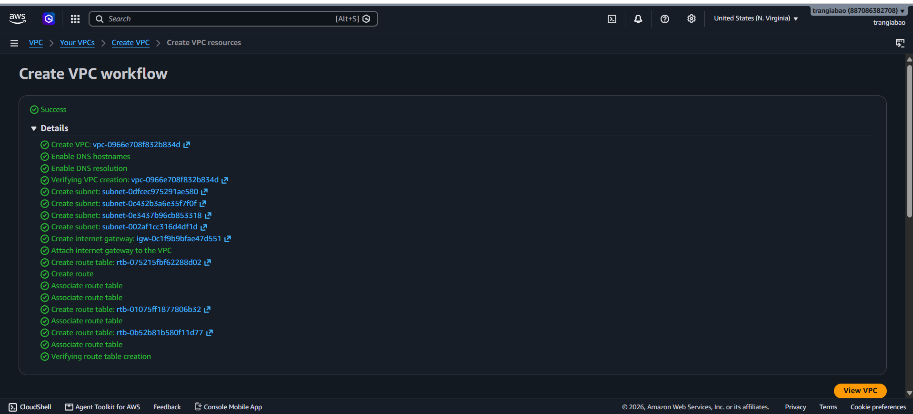

> **💡 Khó khăn gặp phải & Cách xử lý tại Bước 1:**  
> Mặc định khi tạo Image, AWS sẽ tạm thời reboot instance mẫu để đồng bộ filesystem. Nếu không muốn máy chủ bị gián đoạn, bạn có thể tích chọn ô *"No reboot"*, tuy nhiên khuyến nghị vẫn nên reboot để đảm bảo tính toàn vẹn của dữ liệu trong AMI.

---

#### Bước 2: Khai báo Tên và Cấu hình Lưu trữ cho Custom AMI
* **Thao tác / Hướng dẫn:** Điền các thông số khởi tạo AMI tại cửa sổ cấu hình.
* **Thông số điền cụ thể:**
  * *Image name:* `fcaj-app-ami`
  * *Image description:* `Custom AMI for FCAJ Management Application with Node.js`
  * *Instance volumes:* 1x Root volume EBS (8 GiB, General Purpose SSD gp2)
* **Thao tác tiếp theo:** Nhấn nút **Create image**.

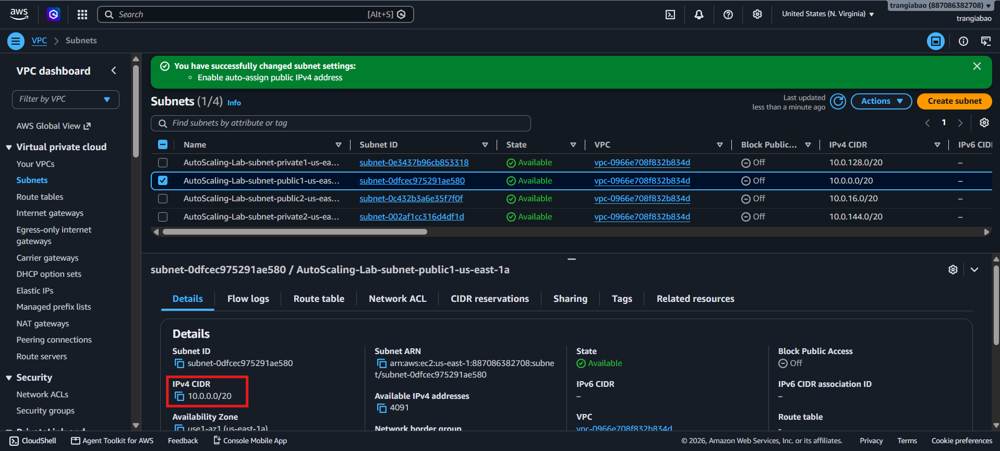

---

#### Bước 3: Theo dõi Trạng thái Tiến trình Tạo AMI
* **Thao tác / Hướng dẫn:** Điều hướng menu bên trái EC2 chọn **Images** ➔ **AMIs**.
* **Quan sát:** Bản ảnh `fcaj-app-ami` đang trong quá trình sao chép các block dữ liệu với trạng thái hiển thị là **pending**.

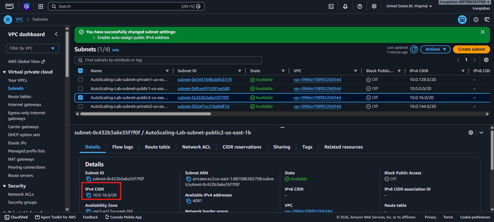

---

#### Bước 4: Xác nhận AMI Sẵn sàng Hoạt động (Available)
* **Thao tác / Hướng dẫn:** Đợi khoảng 3 - 5 phút và làm mới danh sách AMIs.
* **Quan sát:** Trạng thái chuyển sang **available**, xác nhận AMI đã sẵn sàng để tích hợp vào Launch Template.

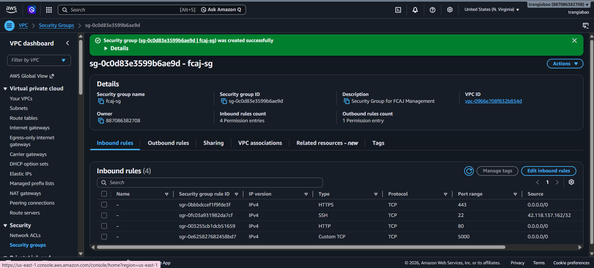

---

#### Bước 5: Kiểm tra Chi tiết Cấu hình và EBS Snapshot của AMI
* **Thao tác / Hướng dẫn:** Bấm chọn `fcaj-app-ami` và xem xét thẻ Details.
* **Thông số quan sát:** Snapshot ID tương ứng được tự động tạo trong mục Elastic Block Store, virtualization type `hvm`, architecture `x86_64`.

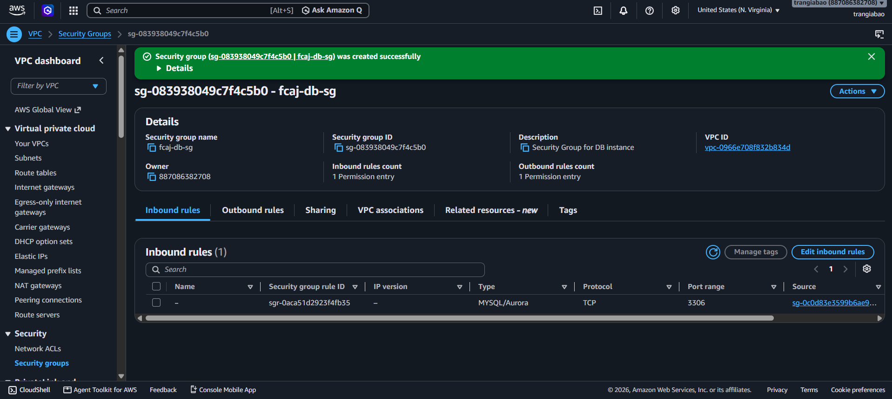

---

#### Bước 6: Khởi tạo Target Group cho Application Load Balancer
* **Thao tác / Hướng dẫn:** Menu bên trái EC2 chọn **Target Groups** ➔ Nhấn **Create target group**.
* **Thông số điền cụ thể:**
  * *Target type:* **Instances**
  * *Target group name:* `fcaj-tg`
  * *Protocol / Port:* `HTTP` : `80`
  * *VPC:* Chọn Default VPC hoặc Workshop VPC
  * *Health checks:* Protocol `HTTP`, Path `/`
* **Thao tác tiếp theo:** Nhấn **Next** ➔ Nhấn **Create target group** (chưa cần đăng ký thủ công target vì ASG sẽ tự động đăng ký).

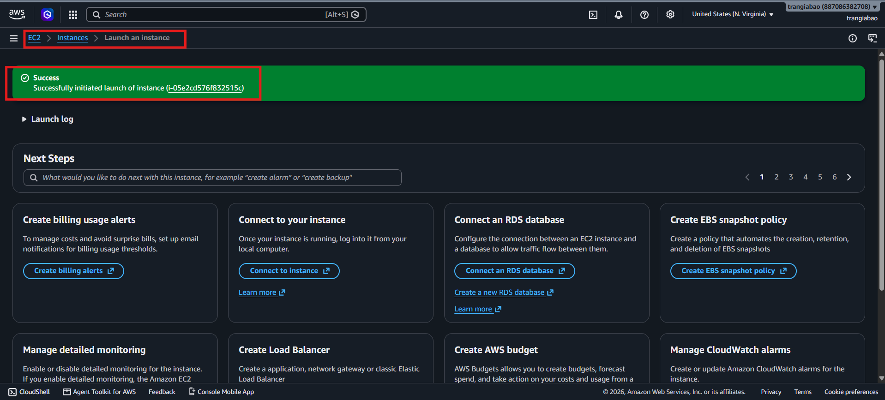

---

#### Bước 7: Khởi tạo Application Load Balancer (`fcaj-alb`)
* **Thao tác / Hướng dẫn:** Menu bên trái chọn **Load Balancers** ➔ Nhấn **Create load balancer** ➔ Chọn loại **Application Load Balancer**.
* **Thông số điền cụ thể:**
  * *Load balancer name:* `fcaj-alb`
  * *Scheme:* **Internet-facing**
  * *IP address type:* `IPv4`
  * *Network mapping:* Chọn VPC và tích chọn tối thiểu 2 Availability Zones / Subnets công khai
  * *Security groups:* Chọn Security Group mở Inbound Port `80` (HTTP) từ `0.0.0.0/0`
  * *Listeners and routing:* Port `80` (HTTP) ➔ Forward to `fcaj-tg`
* **Thao tác tiếp theo:** Cuộn xuống và nhấn **Create load balancer**.

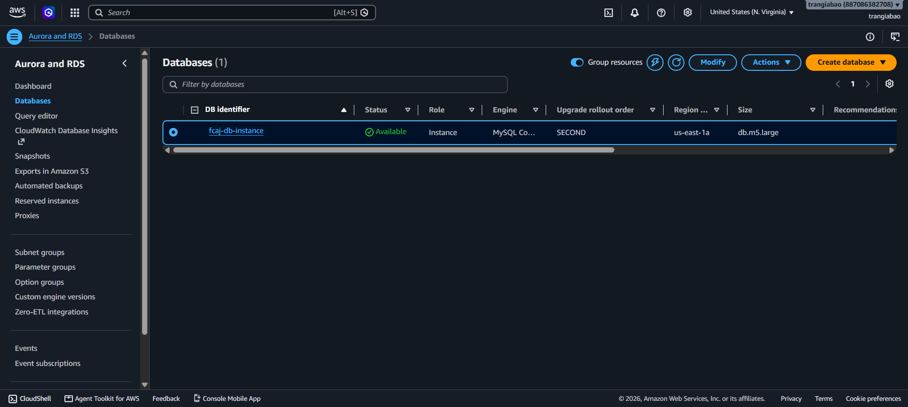

> **💡 Khó khăn gặp phải & Cách xử lý tại Bước 7:**  
> Security Group của ALB phải mở cổng 80 cho mọi IP (`0.0.0.0/0`), nhưng Security Group của các EC2 Instance bên trong chỉ nên chấp nhận lưu lượng đến từ chính Security Group của ALB (Source = Security Group ID của ALB). Cấu hình này giúp ngăn chặn người dùng bên ngoài vượt qua Load Balancer để truy cập trực tiếp vào máy chủ backend.

---

#### Bước 8: Bắt đầu Thiết lập Launch Template Chuẩn hóa
* **Thao tác / Hướng dẫn:** Menu bên trái EC2 chọn **Launch Templates** ➔ Nhấn nút **Create launch template**.
* **Mục đích:** Khởi tạo khuôn mẫu định nghĩa cấu hình phần cứng, mạng và phần mềm để ASG tự động tạo máy chủ đồng nhất.

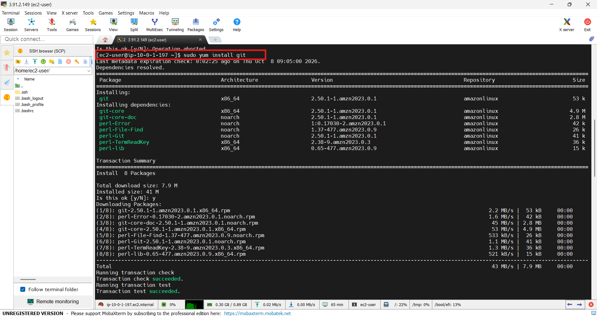

---

#### Bước 9: Đặt Tên & Khai báo Phiên bản Launch Template
* **Thao tác / Hướng dẫn:** Điền thông tin nhận diện ban đầu cho Template.
* **Thông số điền cụ thể:**
  * *Launch template name:* `fcaj-launch-template`
  * *Template version description:* `Initial version for FCAJ ASG`
  * *Auto Scaling guidance:* Tích chọn ô *"Provide guidance to help me set up a template that I can use with EC2 Auto Scaling"*.

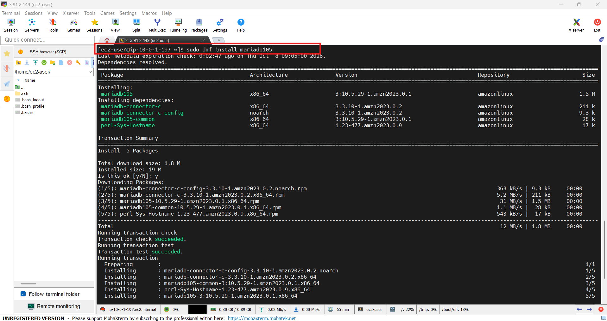

---

#### Bước 10: Chọn Nguồn Bản ảnh Custom AMI (`fcaj-app-ami`)
* **Thao tác / Hướng dẫn:** Tại mục **Application and OS Images (Amazon Machine Image)** ➔ Chọn tab **My AMIs** ➔ Chọn **Owned by me**.
* **Thông số chọn:** Tích chọn bản ảnh `fcaj-app-ami` đã tạo ở Bước 4.

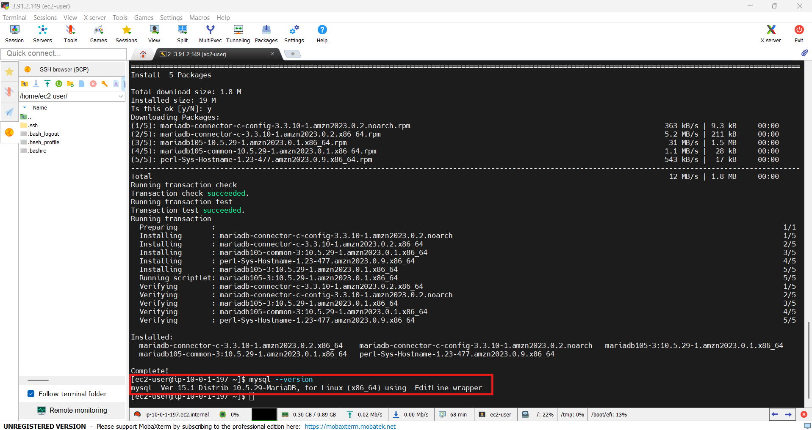

---

#### Bước 11: Lựa chọn Loại Máy chủ (Instance Type)
* **Thao tác / Hướng dẫn:** Tại mục **Instance type**, chọn kích thước máy chủ phù hợp với ngân sách Free Tier.
* **Thông số chọn:** `t2.micro` (1 vCPU, 1 GiB Memory).

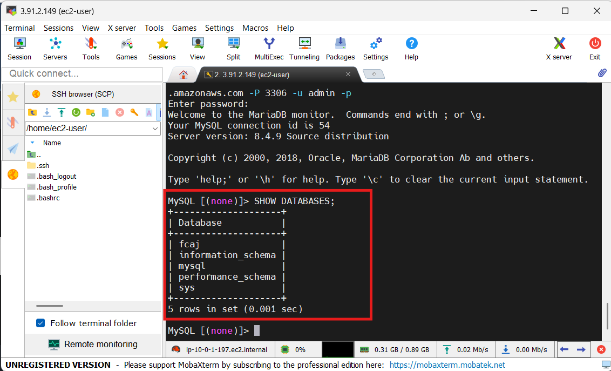

---

#### Bước 12: Thiết lập Key Pair Xác thực SSH
* **Thao tác / Hướng dẫn:** Tại mục **Key pair (login)**, chọn khóa bảo mật để kết nối từ xa.
* **Thông số chọn:** Lựa chọn Key Pair sẵn có của bạn hoặc chọn `Don't include in launch template` nếu không cần truy cập SSH trực tiếp.

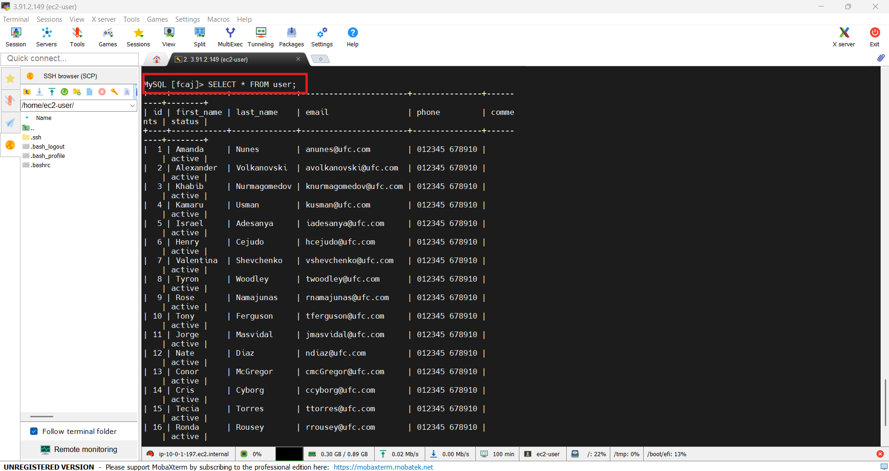

---

#### Bước 13: Cấu hình Mạng & Security Group cho Launch Template
* **Thao tác / Hướng dẫn:** Tại mục **Network settings**, chọn cấu hình tường lửa.
* **Thông số điền cụ thể:**
  * *Subnet:* `Don't include in launch template` (để ASG tự phân bổ subnet theo AZ)
  * *Firewall (Security groups):* Chọn **Select existing security group** ➔ Chọn Security Group cho phép traffic HTTP từ Load Balancer.

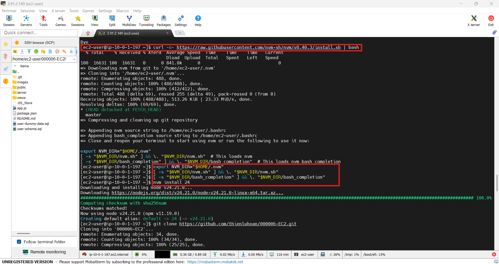

---

#### Bước 14: Cấu hình Phân vùng Lưu trữ Storage (EBS Volume)
* **Thao tác / Hướng dẫn:** Tại mục **Configure storage**, giữ thông số mặc định của AMI.
* **Thông số điền cụ thể:** 1x 8 GiB General Purpose SSD (gp2) hoặc (gp3), Delete on termination: `Yes`.

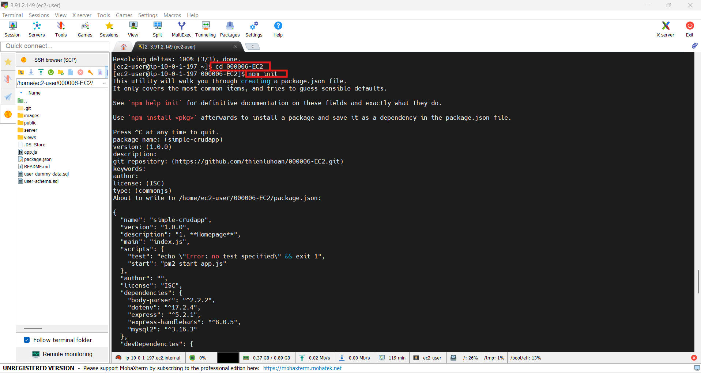

---

#### Bước 15: Cấu hình Nâng cao & Script User Data Tự động Khởi động
* **Thao tác / Hướng dẫn:** Mở rộng mục **Advanced details**, cuộn xuống dưới cùng tới ô **User data**.
* **Lệnh thực thi trong User Data:**
  ```bash
  #!/bin/bash
  # Khởi động dịch vụ ứng dụng khi máy chủ boot lên
  cd /home/ec2-user/fcaj-app || cd /var/www/html
  npm start || systemctl restart httpd
  ```

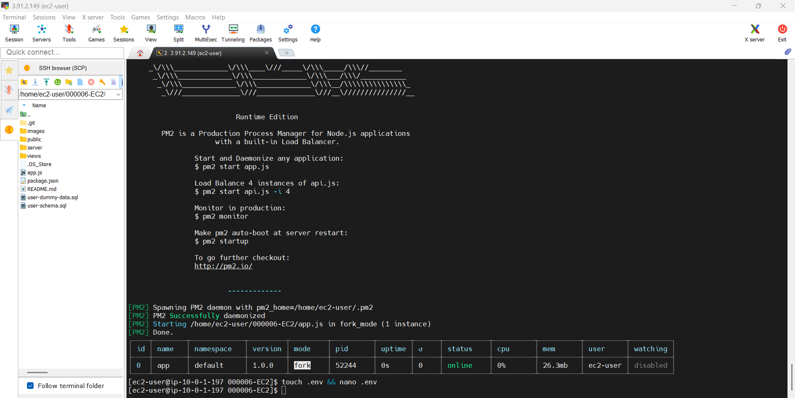

---

#### Bước 16: Xác nhận Tạo Thành công Launch Template
* **Thao tác / Hướng dẫn:** Nhấn **Create launch template**.
* **Quan sát:** Màn hình thông báo màu xanh lá xác nhận Launch Template `fcaj-launch-template` đã được tạo thành công với Version 1.

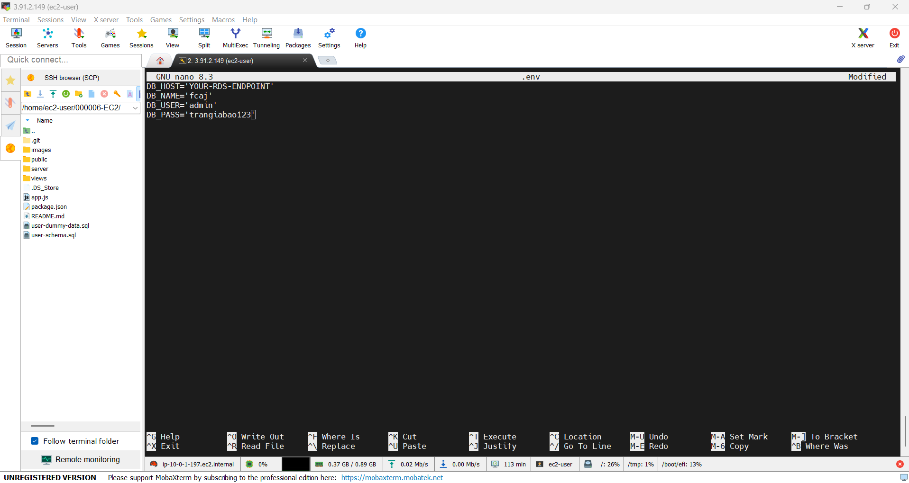

---

#### Bước 17: Bắt đầu Khởi tạo Auto Scaling Group (`fcaj-asg`)
* **Thao tác / Hướng dẫn:** Menu bên trái chọn **Auto Scaling Groups** ➔ Nhấn **Create Auto Scaling group**.
* **Thông số điền cụ thể:**
  * *Auto Scaling group name:* `fcaj-asg`
  * *Launch template:* Chọn `fcaj-launch-template` (Version `Default (1)`)
* **Thao tác tiếp theo:** Nhấn **Next**.

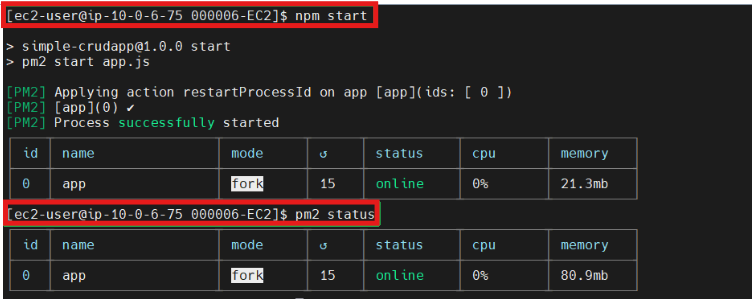

---

#### Bước 18: Chọn Mạng VPC và Các Subnets Dự phòng (Multi-AZ)
* **Thao tác / Hướng dẫn:** Tại bước *Choose instance launch options*.
* **Thông số điền cụ thể:**
  * *VPC:* Chọn VPC của bài thực hành
  * *Availability Zones and subnets:* Tích chọn tối thiểu **2 Subnets** ở 2 AZ khác nhau (ví dụ: `ap-southeast-1a` và `ap-southeast-1b`) để đảm bảo tính sẵn sàng cao (High Availability).
* **Thao tác tiếp theo:** Nhấn **Next**.

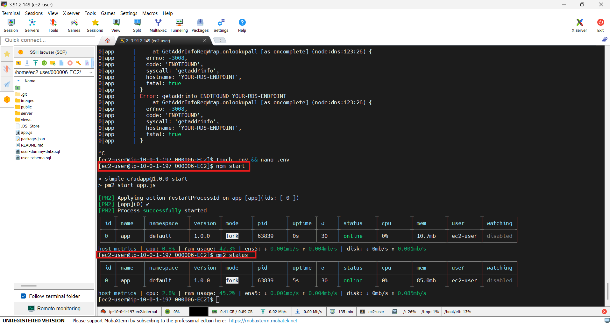

---

#### Bước 19: Đính kèm Target Group của ALB & Kích hoạt ELB Health Checks
* **Thao tác / Hướng dẫn:** Tại bước *Configure advanced options*.
* **Thông số điền cụ thể:**
  * *Load balancing:* Chọn **Attach to an existing load balancer** ➔ Chọn **Choose from your load balancer target groups** ➔ Tích chọn `fcaj-tg`.
  * *Health checks:* Bật thêm tùy chọn **Turn on Elastic Load Balancing health checks**.
  * *Health check grace period:* `300` giây (cho phép instance có đủ thời gian khởi động app trước khi bị kiểm tra).
* **Thao tác tiếp theo:** Nhấn **Next**.

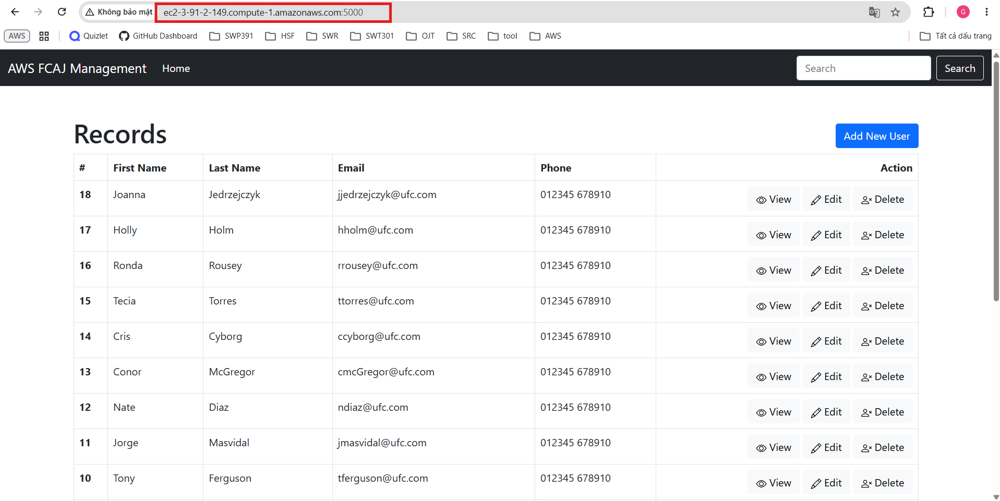

> **💡 Khó khăn gặp phải & Cách xử lý tại Bước 19:**  
> Nếu không bật ELB Health checks, ASG chỉ theo dõi tình trạng phần cứng máy chủ (EC2 Status Check) mà không biết ứng dụng web có bị treo hay không. Khi bật ELB Health checks, nếu ứng dụng trả về lỗi 5xx hoặc không phản hồi trên cổng 80, ASG sẽ tự động hủy instance lỗi và sinh máy chủ thay thế. Cần đặt Health check grace period đủ dài (tối thiểu 300s) để tránh instance bị terminate nhầm khi app chưa nạp xong.

---

#### Bước 20: Cấu hình Quy mô Máy chủ (Group Size: Min, Desired, Max)
* **Thao tác / Hướng dẫn:** Tại bước *Configure group size and scaling policies*.
* **Thông số điền cụ thể:**
  * *Desired capacity:* `1`
  * *Minimum capacity:* `1`
  * *Maximum capacity:* `3`
  * *Scaling policies:* Tạm thời chọn **None** (sẽ tạo chính sách Target Tracking chi tiết ở Bước 28).
* **Thao tác tiếp theo:** Nhấn **Next** qua các bước Notifications và Tags.

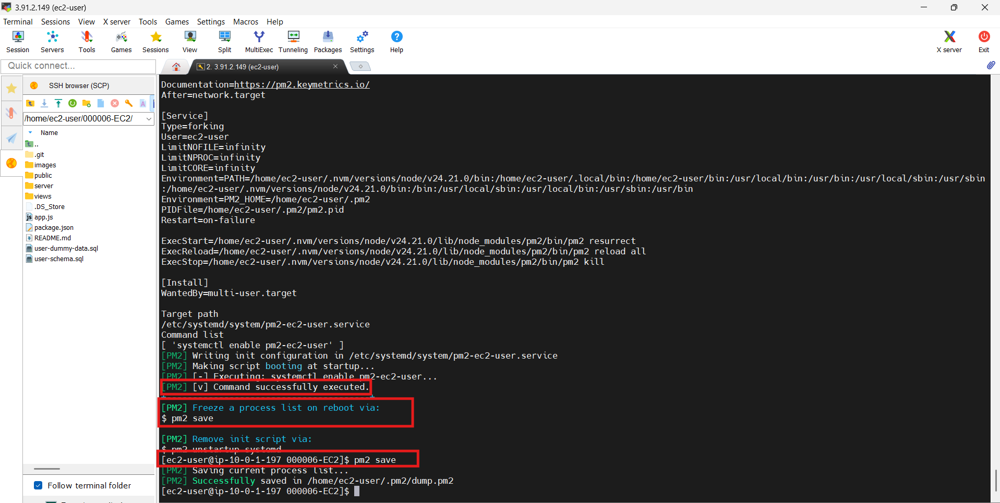

---

#### Bước 21: Xem lại Toàn bộ Thông số Cấu hình ASG trước khi Khởi tạo
* **Thao tác / Hướng dẫn:** Tại bước *Review*, kiểm tra cẩn thận Launch Template, VPC, Subnets, Target Group và Group Size.
* **Thao tác tiếp theo:** Nhấn **Create Auto Scaling group**.

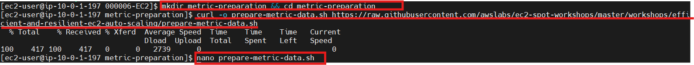

---

#### Bước 22: ASG Tự động Kích hoạt Tạo Instance Đầu tiên
* **Thao tác / Hướng dẫn:** Bấm vào `fcaj-asg` vừa tạo ➔ Chọn thẻ **Activity**.
* **Quan sát:** Lịch sử hoạt động ghi nhận sự kiện `Launching a new EC2 instance` nhằm thỏa mãn Desired capacity = 1.

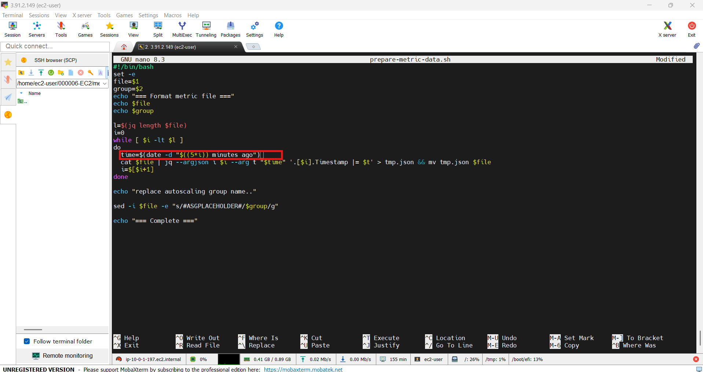

---

#### Bước 23: Xác nhận Instance Chuyển sang Trạng thái InService
* **Thao tác / Hướng dẫn:** Chuyển sang thẻ **Instance management** của `fcaj-asg`.
* **Quan sát:** Instance mới hiển thị Health status là **Healthy** và Lifecycle state là **InService**.

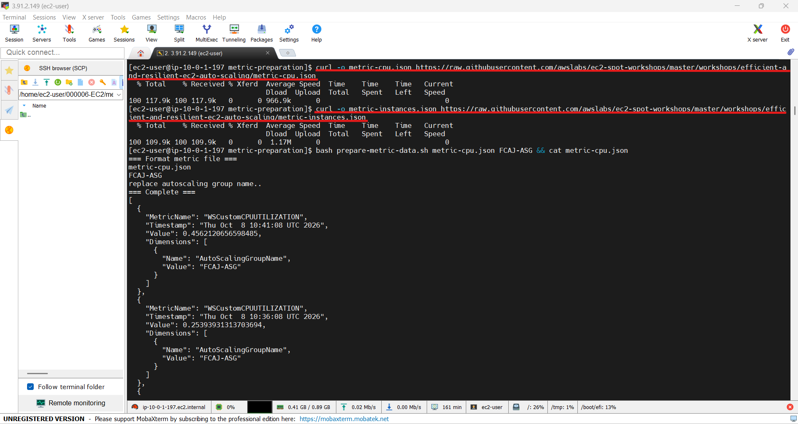

---

#### Bước 24: Kiểm tra Target Group Xác nhận Máy chủ Healthy
* **Thao tác / Hướng dẫn:** Quay lại mục **Target Groups** ➔ Chọn `fcaj-tg` ➔ Xem thẻ **Targets**.
* **Quan sát:** Máy chủ do ASG tự động đăng ký hiển thị trạng thái Health status là **healthy** trên cổng 80.

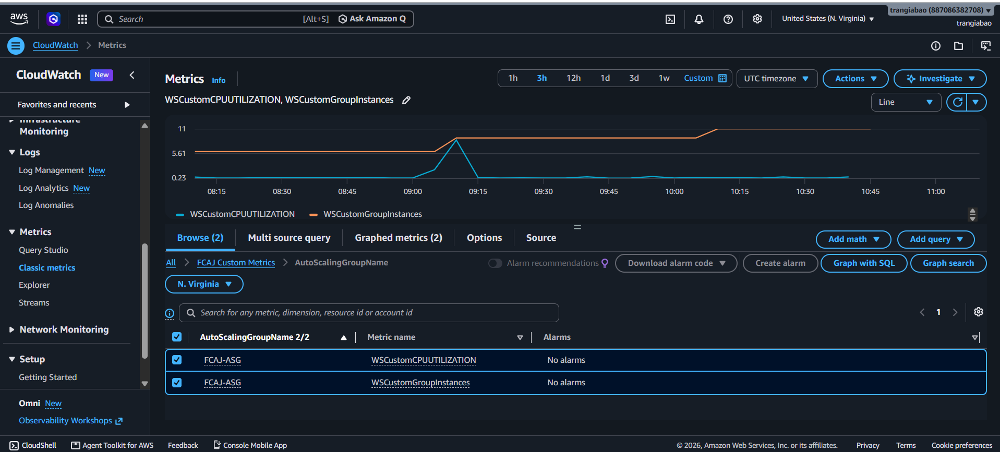

---

#### Bước 25: Truy cập Ứng dụng qua DNS Name của Application Load Balancer
* **Thao tác / Hướng dẫn:** Vào mục **Load Balancers**, sao chép trường **DNS name** của `fcaj-alb` ➔ Mở trình duyệt web và dán vào thanh địa chỉ (`http://fcaj-alb-...amazonaws.com`).
* **Kết quả:** Yêu cầu được cân bằng tải chuyển tiếp chính xác tới instance đang hoạt động.

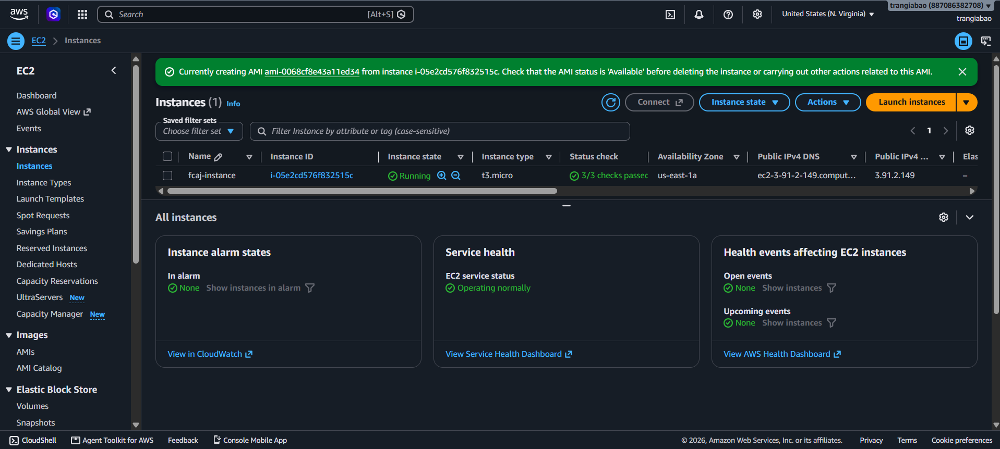

---

#### Bước 26: Đăng nhập vào Hệ thống Ứng dụng FCAJ Management
* **Thao tác / Hướng dẫn:** Trên màn hình ứng dụng web, điền thông tin xác thực để kiểm tra tính toàn vẹn của ứng dụng đã được đóng gói trong AMI.
* **Thông số điền cụ thể:**
  * *Username:* `admin`
  * *Password:* `[Mật khẩu mẫu của ứng dụng]`
* **Thao tác tiếp theo:** Nhấn **Sign In**.

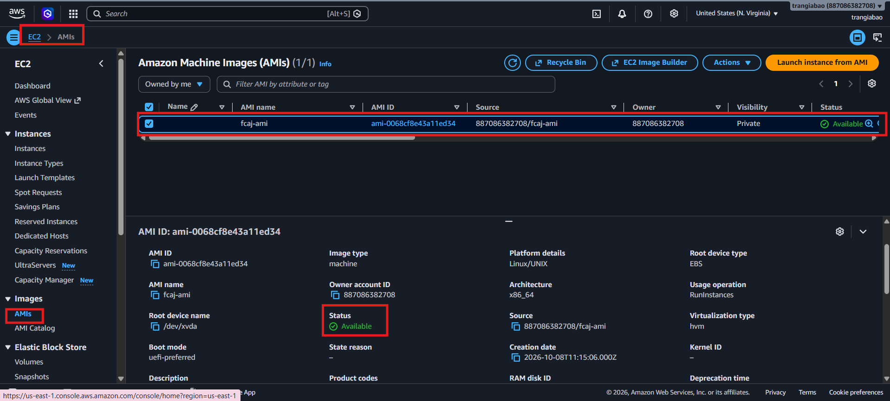

---

#### Bước 27: Xác nhận Dashboard Ứng dụng Hoạt động Ổn định
* **Thao tác / Hướng dẫn:** Kiểm tra các chức năng trên thanh điều hướng sau khi đăng nhập.
* **Kết quả:** Dashboard hiển thị danh mục quản trị đầy đủ, dữ liệu tải mượt mà thông qua Application Load Balancer.

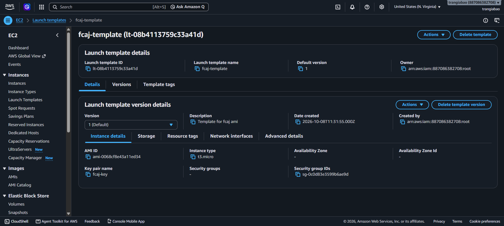

---

#### Bước 28: Thiết lập Dynamic Scaling Policy theo Ngưỡng CPU
* **Thao tác / Hướng dẫn:** Mở chi tiết `fcaj-asg` ➔ Chọn thẻ **Automatic scaling** ➔ Mục *Dynamic scaling policies* nhấn **Create dynamic scaling policy**.
* **Thông số chọn:**
  * *Policy type:* **Target tracking scaling**
  * *Scaling policy name:* `TargetTracking-CPU`

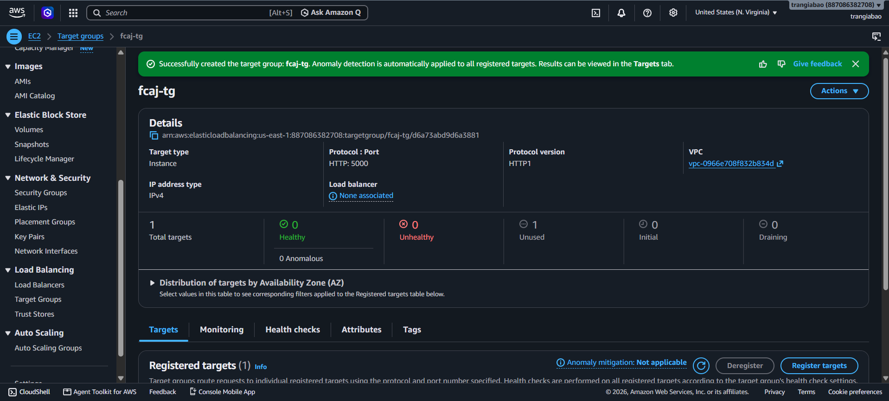

---

#### Bước 29: Khai báo Giá trị Ngưỡng Mục tiêu 50% Average CPU Utilization
* **Thao tác / Hướng dẫn:** Điền thông số chi tiết cho chính sách Target Tracking.
* **Thông số điền cụ thể:**
  * *Metric type:* **Average CPU utilization**
  * *Target value:* `50` (%)
  * *Instance warmup:* `300` giây
* **Thao tác tiếp theo:** Nhấn nút **Create**.

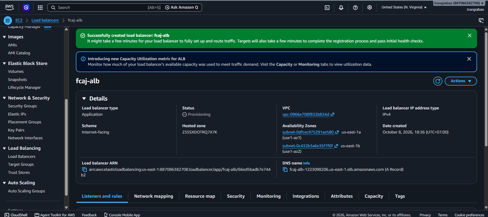

---

#### Bước 30: Kiểm tra CloudWatch Alarm Giám sát Chỉ số CPU
* **Thao tác / Hướng dẫn:** Vào dịch vụ **CloudWatch** ➔ Chọn mục **Alarms**.
* **Quan sát:** AWS tự động tạo 2 Alarm cho ASG: Một Alarm phát hiện CPU > 50% (kích hoạt Scale Out) và một Alarm phát hiện CPU < 35% (kích hoạt Scale In).

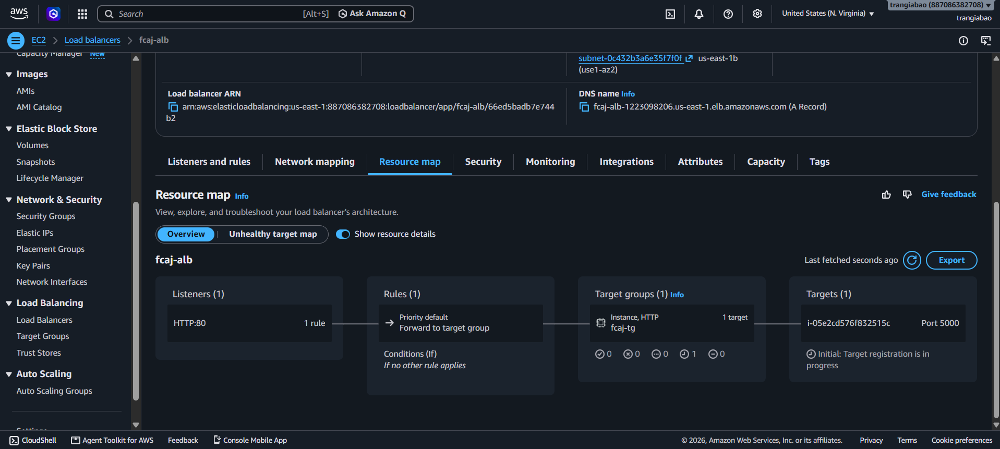

---

#### Bước 31: Thực thi Kịch bản Kiểm thử Chịu tải Stress Test trên Máy chủ
* **Thao tác / Hướng dẫn:** Kết nối SSH vào máy chủ EC2 đang chạy trong ASG và thực thi lệnh tạo tải giả lập CPU bằng công cụ `stress`.
* **Lệnh thực thi:**
  ```bash
  # Cài đặt công cụ stress nếu chưa có
  sudo amazon-linux-extras install epel -y || sudo dnf install -y epel-release
  sudo yum install -y stress

  # Chạy tải giả lập 2 luồng CPU tối đa trong 600 giây
  stress --cpu 2 --timeout 600s
  ```

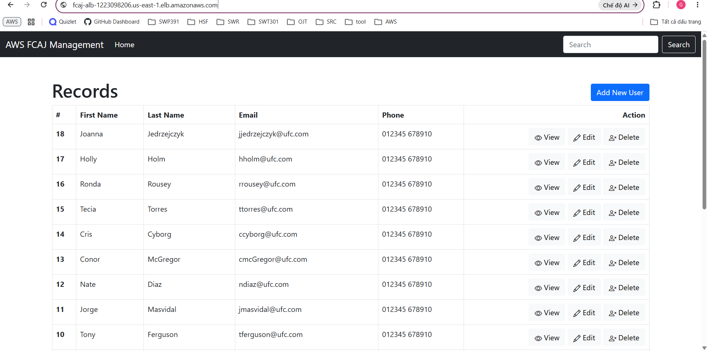

> **💡 Khó khăn gặp phải & Cách xử lý tại Bước 31:**  
> Chu kỳ thu thập số liệu mặc định của CloudWatch cơ bản là 5 phút. Để kiểm thử phản hồi nhanh, nên duy trì lệnh `stress` tối thiểu 600 giây (10 phút) hoặc kích hoạt Detailed Monitoring (chu kỳ 1 phút) để CloudWatch Alarm kịp thời chuyển trạng thái.

---

#### Bước 32: Theo dõi Đồ thị CPU Tăng vọt trên Amazon CloudWatch
* **Thao tác / Hướng dẫn:** Trên bảng điều khiển CloudWatch, mở biểu đồ metric `CPUUtilization` của máy chủ.
* **Quan sát:** Tải CPU tăng dốc đứng từ mức bình thường (~1%) vọt lên gần 100%, vượt xa ngưỡng mục tiêu 50%.

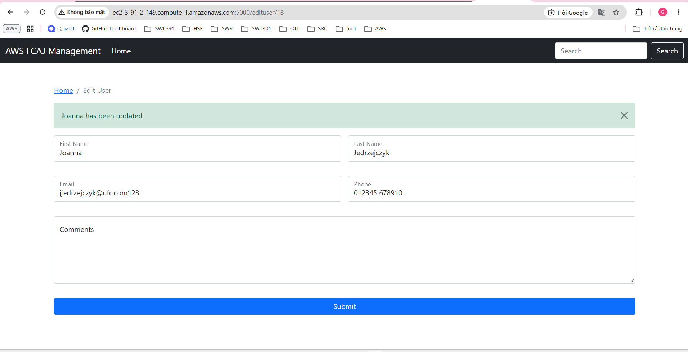

---

#### Bước 33: Báo động CloudWatch Kích hoạt Sự kiện Scale Out
* **Thao tác / Hướng dẫn:** Quay lại tab **Activity** của `fcaj-asg`.
* **Quan sát:** Alarm chuyển trạng thái sang **In alarm**, ASG tự động kích hoạt hành động mở rộng: `Launching a new EC2 instance to balance the target metric`.

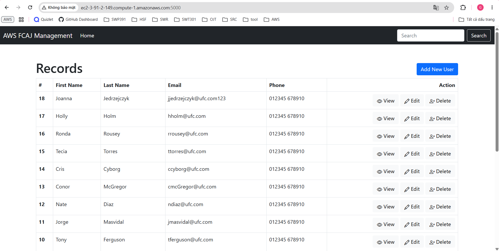

---

#### Bước 34: Máy chủ Mới Khởi chạy & Cân bằng Tải Ổn định
* **Thao tác / Hướng dẫn:** Kiểm tra tab **Instance management** và **Target Groups**.
* **Kết quả:** Số lượng máy chủ tự động tăng từ 1 lên 2 (và có thể lên tối đa 3 instance theo cấu hình Max size), tất cả đều chuyển sang trạng thái `InService` và `Healthy`, chia sẻ tải CPU hiệu quả.

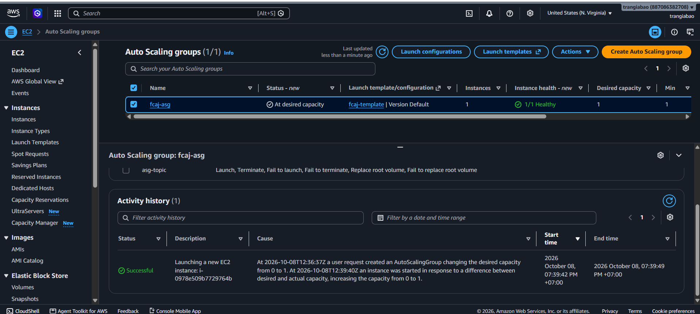

---

#### Bước 35: Dọn dẹp Tài nguyên Bước 1 - Xóa Auto Scaling Group
* **Thao tác / Hướng dẫn:** Sau khi hoàn thành kiểm thử, vào mục **Auto Scaling Groups** ➔ Chọn `fcaj-asg` ➔ Chọn menu **Actions** ➔ Nhấn **Delete**.

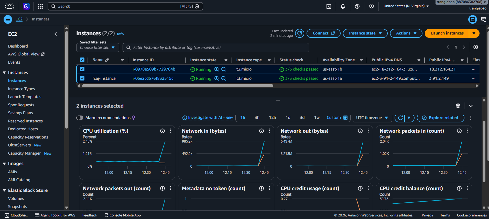

---

#### Bước 36: Xác nhận Lệnh Xóa và Chờ Toàn bộ Máy chủ Terminated
* **Thao tác / Hướng dẫn:** Điền từ khóa xác nhận vào hộp thoại cảnh báo.
* **Thông số điền cụ thể:** Nhập chữ `delete` ➔ Nhấn **Delete**. Toàn bộ các máy chủ EC2 do ASG quản lý sẽ được tự động chấm dứt.

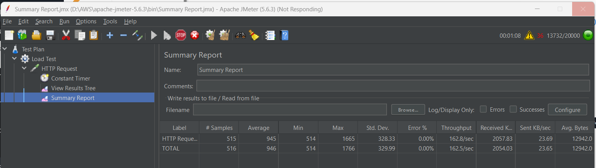

---

#### Bước 37: Kiểm tra Danh sách EC2 Instances đã Bị Hủy Hoàn toàn
* **Thao tác / Hướng dẫn:** Vào mục **Instances** trên EC2 Console.
* **Quan sát:** Toàn bộ các máy chủ thuộc `fcaj-asg` chuyển sang trạng thái **Terminated**, giải phóng chi phí tính toán.

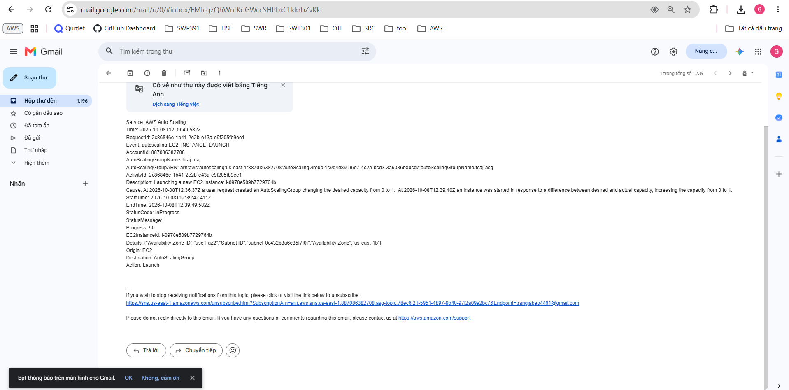

---

#### Bước 38: Dọn dẹp Tài nguyên Bước 2 - Xóa Application Load Balancer
* **Thao tác / Hướng dẫn:** Menu bên trái chọn **Load Balancers** ➔ Chọn `fcaj-alb` ➔ Chọn **Actions** ➔ Nhấn **Delete load balancer** ➔ Nhấn **Delete**.

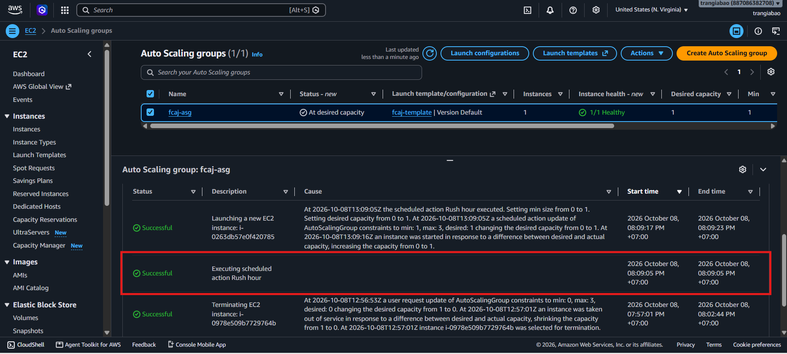

---

#### Bước 39: Xóa Target Group Liên kết (`fcaj-tg`)
* **Thao tác / Hướng dẫn:** Chuyển sang mục **Target Groups** ➔ Chọn `fcaj-tg` ➔ Chọn **Actions** ➔ Nhấn **Delete**.

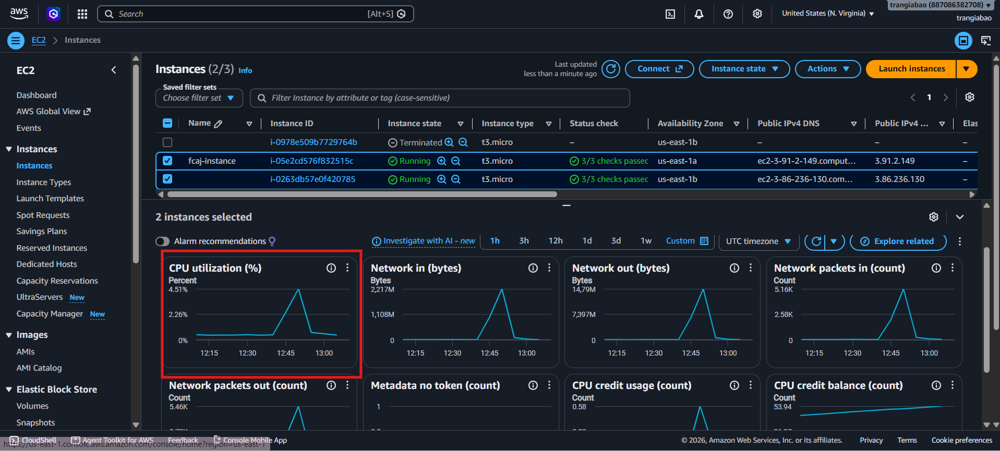

---

#### Bước 40: Dọn dẹp Tài nguyên Bước 3 - Chọn Xóa Launch Template
* **Thao tác / Hướng dẫn:** Vào mục **Launch Templates** ➔ Chọn `fcaj-launch-template` ➔ Chọn menu **Actions** ➔ Nhấn **Delete template**.

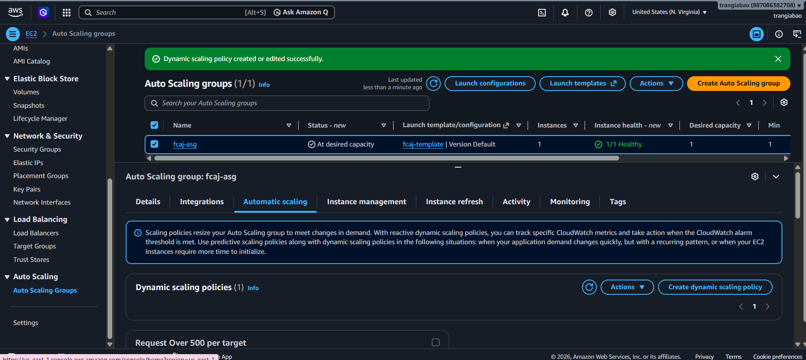

---

#### Bước 41: Xác nhận Xóa Vĩnh viễn Launch Template
* **Thao tác / Hướng dẫn:** Tại hộp thoại xác nhận, nhập chữ `Delete` ➔ Nhấn **Delete**.

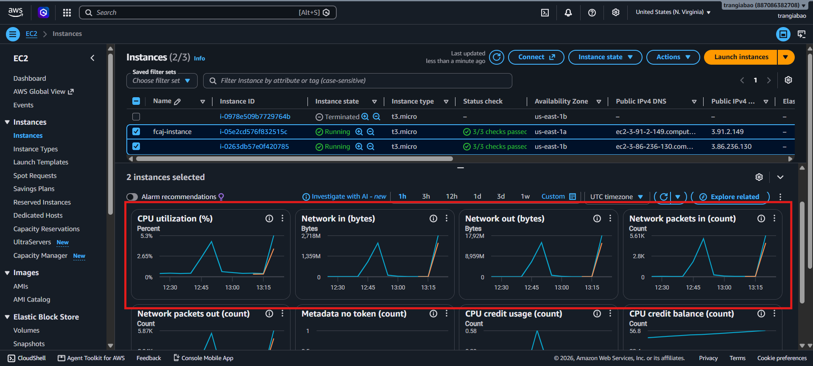

---

#### Bước 42: Dọn dẹp Tài nguyên Bước 4 - Hủy Đăng ký (Deregister) Custom AMI
* **Thao tác / Hướng dẫn:** Menu bên trái vào mục **AMIs** ➔ Chọn `fcaj-app-ami` ➔ Chọn **Actions** ➔ Nhấn **Deregister AMI** ➔ Xác nhận hủy đăng ký.

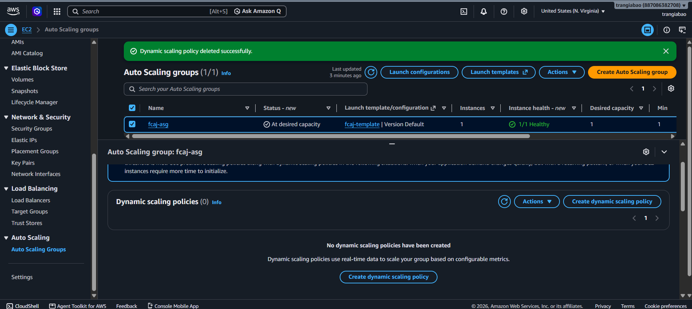

---

#### Bước 43: Tìm kiếm EBS Snapshot Liên kết của AMI
* **Thao tác / Hướng dẫn:** Điều hướng sang mục **Elastic Block Store** ➔ **Snapshots** ➔ Tìm bản chụp có phần Description trỏ tới AMI vừa hủy đăng ký.

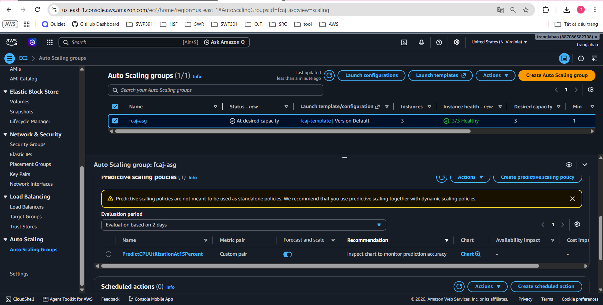

---

#### Bước 44: Xóa Vĩnh viễn EBS Snapshot để Tránh Phát sinh Chi phí Lưu trữ
* **Thao tác / Hướng dẫn:** Chọn bản snapshot tìm được ➔ Chọn **Actions** ➔ Nhấn **Delete snapshot** ➔ Nhấn **Delete**.
* **Kết quả:** Toàn bộ hạ tầng thực hành đã được giải phóng sạch sẽ, không còn bất kỳ chi phí phát sinh ngầm nào.

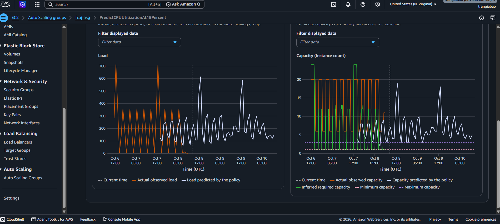

> **💡 Khó khăn gặp phải & Cách xử lý tại Bước 44:**  
> Rất nhiều người dùng chỉ Deregister AMI mà quên xóa EBS Snapshot liên kết. Snapshot vẫn sẽ tiếp tục bị tính phí lưu trữ hàng tháng nếu không được xóa thủ công. Luôn kiểm tra kỹ mục Snapshots sau khi deregister bất kỳ AMI nào.

---

### 📝 Tổng kết & Bài học kinh nghiệm:
1. **Khả năng Tự phục hồi (Self-healing Architecture):** Auto Scaling Group không chỉ tự động mở rộng theo tải mà còn liên tục kiểm tra ELB Health Check và tự động thay thế tức thì các instance bị treo hoặc hỏng hóc mà không cần sự can thiệp thủ công của kỹ sư vận hành.
2. **Tối ưu hóa Chi phí Thông minh (Cost Efficiency):** Hệ thống chỉ tiêu tốn tài nguyên đúng mức cần thiết; máy chủ tự động thu hẹp trong các khung giờ vắng khách và chỉ tăng quy mô khi lượng người dùng gia tăng đột biến, giúp tiết kiệm đáng kể chi phí so với việc thuê cố định máy chủ cấu hình lớn.
3. **Mô hình Kiến trúc Phi trạng thái (Stateless Tier):** Ứng dụng đặt trong ASG cần được thiết kế phi trạng thái, dữ liệu người dùng nên lưu trữ tập trung tại cơ sở dữ liệu (Amazon RDS) hoặc bộ nhớ cache dùng chung (Amazon ElastiCache) để các máy chủ có thể thêm/bớt linh hoạt mà không ảnh hưởng tới phiên làm việc của khách hàng.
