{}
The **Monitoring with Amazon CloudWatch** hands-on lab was conducted on **Thursday (08/10/2026)** during **Week 4**. This page provides a comprehensive step-by-step implementation guide featuring precise configuration parameters, Logs Insights query syntax, Math Expressions, troubleshooting resolutions, and all 33 verification screenshots.
<br>🔗 **Lab Reference Material:** [Monitoring with Amazon CloudWatch](https://000008.awsstudygroup.com/)
{}

### 🎯 Lab Objectives:
* Master the centralized monitoring and observability capabilities of **Amazon CloudWatch** on AWS.
* Visualize and analyze real-time performance metrics (**CloudWatch Metrics**) across cloud infrastructure.
* Utilize **Search Expressions** and **Math Expressions** to dynamically discover, aggregate, and normalize telemetry data.
* Configure **Dynamic Labels** for context-aware and automated chart legends.
* Ingest and analyze system logs (**CloudWatch Logs**) using the interactive query language **CloudWatch Logs Insights**.
* Establish **Metric Filters** to extract actionable quantitative metrics from unstructured application log streams.
* Configure **CloudWatch Alarms** integrated with **Amazon SNS** to automate proactive incident alerting.

---

### 📊 Provisioned Resource Specifications:

| Resource | Name / Identifier | Configuration & Detailed Specs | Region / Status | Notes |
| :--- | :--- | :--- | :--- | :--- |
| **EC2 Instance Monitored** | `Web-Server-Lab` | Amazon Linux 2023, CloudWatch Agent installed | `ap-southeast-1` | Telemetry & log collection |
| **Metric Monitored** | `CPUUtilization`, `DiskReadBytes` | Namespace: `AWS/EC2`, Period: 1 minute | Real-time monitoring | Graphical performance telemetry |
| **Search Expression** | `SEARCH(' {AWS/EC2,InstanceId} MetricName="CPUUtilization" ', 'Average', 300)` | Automated metric query across all fleet instances | Dynamic Dashboard | Self-updating on new instance launch |
| **Math Expression** | `m1 * 100 / MAX(m1)` | Normalizes CPU utilization proportionally | Math plot expression | Mathematical data modeling |
| **Log Group** | `/aws/ec2/system-logs` | Retention: 7 days | Ingestion: Active | OS and web server access logs |
| **Metric Filter** | `HTTP404ErrorCount` | Pattern: `[ip, user, username, timestamp, request, status_code = 404, size]` | Namespace: `Custom/Web` | Counts HTTP 404 errors from access logs |
| **CloudWatch Alarm** | `High-CPU-Utilization-Alarm` | Static threshold: CPU > 70% across 2 periods | Status: `OK` / `ALARM` | Dispatches automated SNS email alerts |

---

### 🚀 Step-by-Step Implementation & Screenshot Gallery:

#### Step 1: Environment Setup & CloudWatch Agent Installation on EC2
* **Action / Navigation:** Launch EC2 instance `Web-Server-Lab`, attach IAM Role with policy `CloudWatchAgentServerPolicy` ➔ Connect via SSH and install the agent package.
* **Commands Executed:**
  ```bash
  # Install CloudWatch Agent package
  sudo yum install -y amazon-cloudwatch-agent

  # Start CloudWatch Agent daemon with configuration file
  sudo /opt/aws/amazon-cloudwatch-agent/bin/amazon-cloudwatch-agent-ctl \
    -a fetch-config -m ec2 -s -c file:/opt/aws/amazon-cloudwatch-agent/etc/amazon-cloudwatch-agent.json
  ```

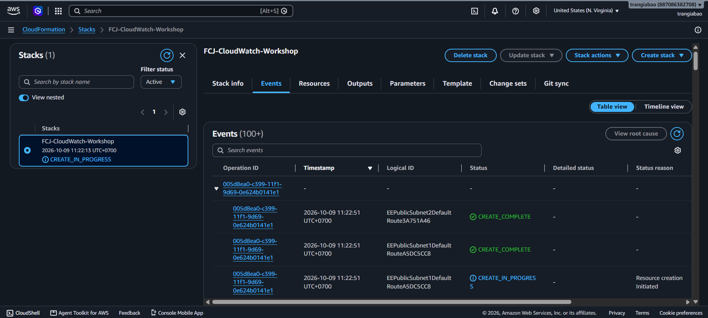

> **💡 Difficulties Encountered & Troubleshooting at Step 1:**  
> If the EC2 instance lacks the `CloudWatchAgentServerPolicy` IAM Role, log writes in `/var/log/amazon/amazon-cloudwatch-agent/amazon-cloudwatch-agent.log` will fail with an `AccessDeniedException`. Always ensure IAM Role assignment prior to starting the agent service.

---

#### Step 2: Explore CloudWatch All Metrics Dashboard
* **Action / Navigation:** In the **CloudWatch Console** ➔ Sidebar select **Metrics** ➔ **All metrics**.
* **Purpose:** Inspect default namespaces populated automatically by AWS (e.g., `AWS/EC2`, `AWS/EBS`, `AWS/ApplicationELB`).

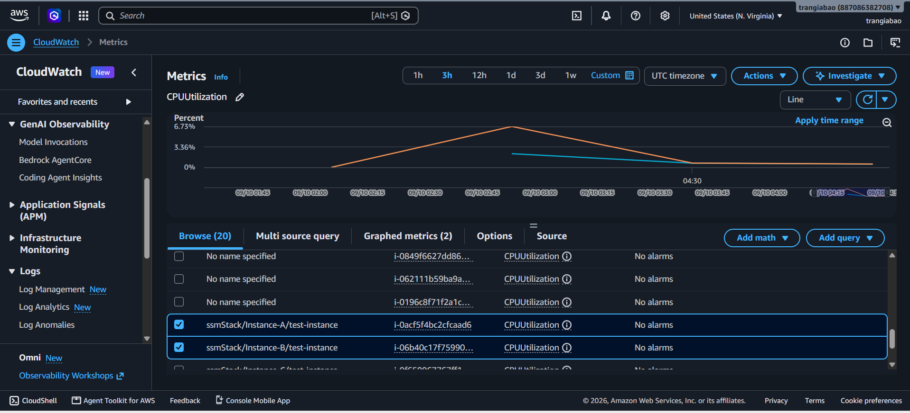

---

#### Step 3: Select Per-Instance EC2 Telemetry Metrics
* **Action / Navigation:** Under **All metrics**, navigate to **EC2** ➔ Click **Per-Instance Metrics**.
* **Configuration:** Locate the target Instance ID and check `CPUUtilization`, `NetworkIn`, and `DiskReadBytes`.

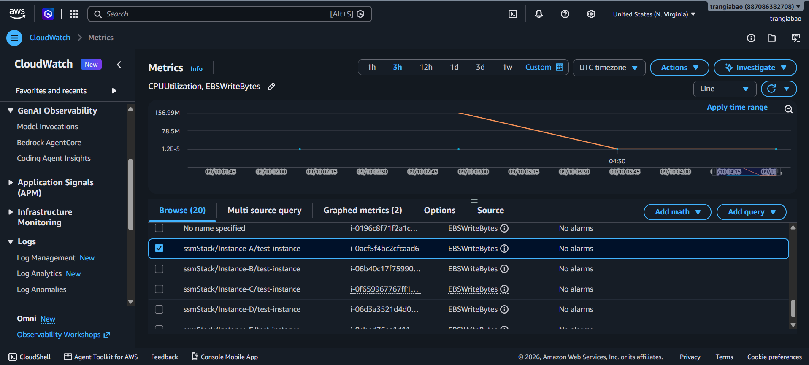

---

#### Step 4: Customize Metric Visualization (Graphed Metrics)
* **Action / Navigation:** Switch to the **Graphed metrics** tab.
* **Configuration:** Toggle line visibility, assign unique colors, and associate series with left or right Y-axes.

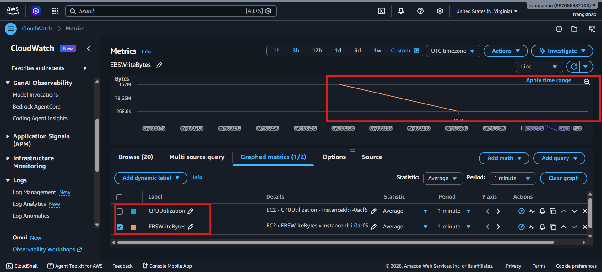

---

#### Step 5: Adjust Aggregation Period and Statistics
* **Action / Navigation:** Under the **Statistic** column, change to **Average**. Under **Period**, select **1 Minute** for high-resolution sampling.

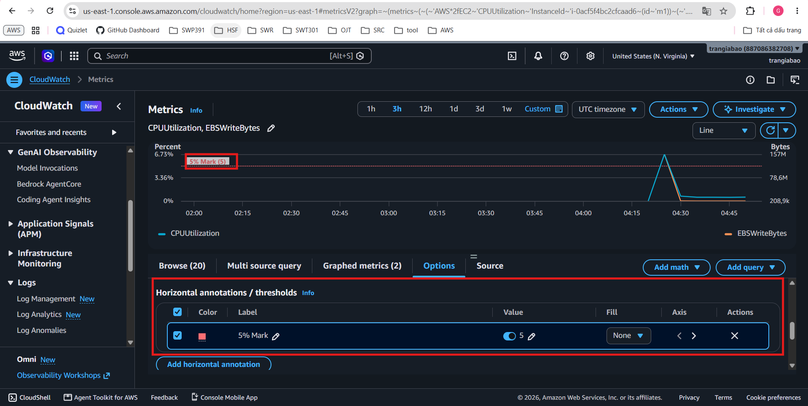

---

#### Step 6: Render High-Fidelity Real-Time CPU Graph
* **Action / Navigation:** Adjust the time-window selector to **1h** (last 1 hour).
* **Observation:** The plot details granular 1-minute CPU variations in real time.

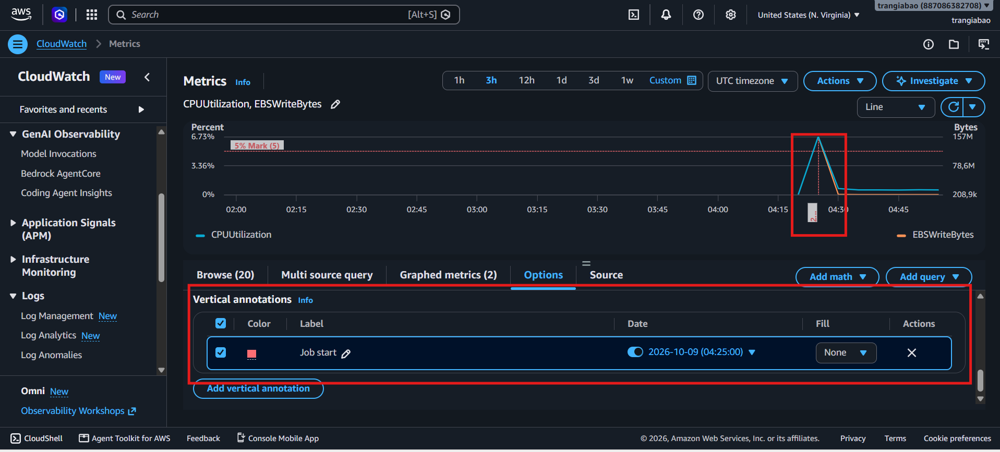

---

#### Step 7: Define Dynamic Search Expression Query
* **Action / Navigation:** In **Graphed metrics**, click **Add math** ➔ **Search expression**.
* **Search Expression Syntax:**
  ```text
  SEARCH(' {AWS/EC2,InstanceId} MetricName="CPUUtilization" ', 'Average', 300)
  ```
* **Purpose:** Dynamically discovers and plots CPU utilization across all current and future EC2 instances without manual selection.

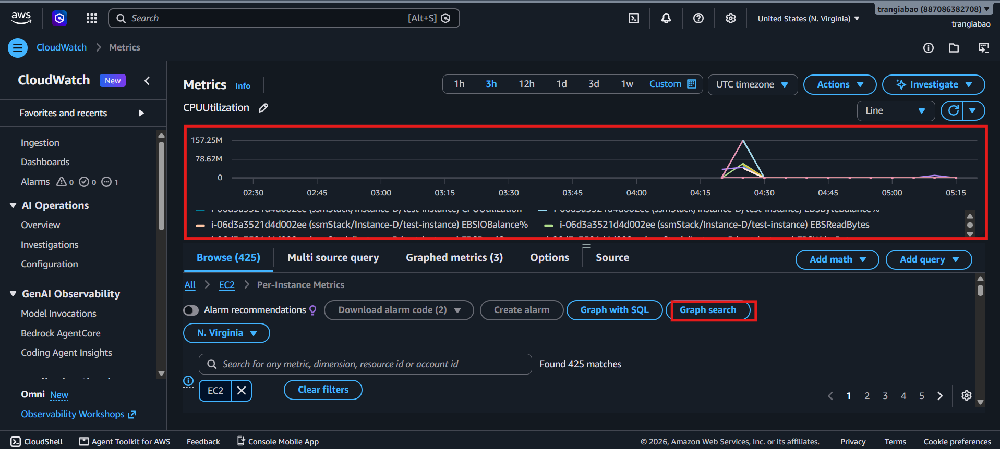

> **💡 Difficulties Encountered & Troubleshooting at Step 7:**  
> Search Expression syntax is sensitive to spacing and curly brace syntax `{}` for dimensions. Ensure metric and dimension names match exact casing (`MetricName="CPUUtilization"`).

---

#### Step 8: Multi-Instance Telemetry Visualization via Search Expression
* **Action / Navigation:** Click **Apply**.
* **Observation:** The graph renders discrete lines for all active instances in the region automatically.

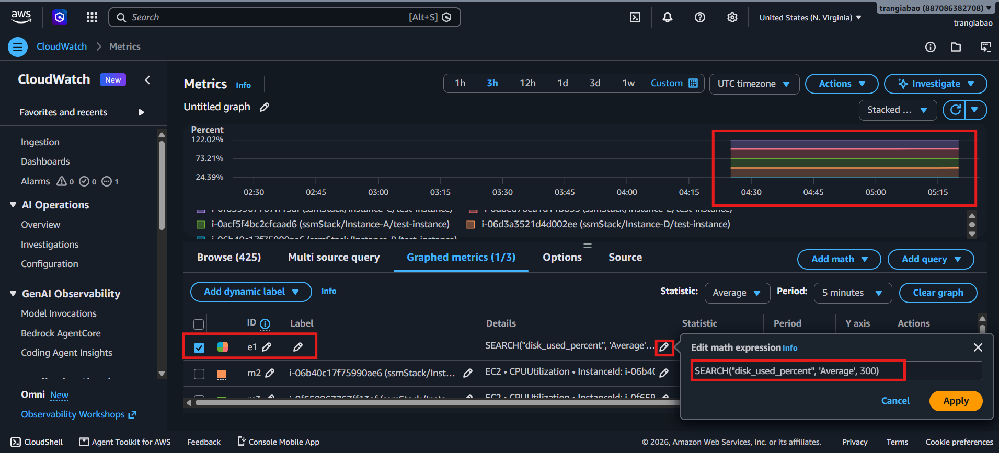

---

#### Step 9: Audit Matched Metric Streams
* **Action / Navigation:** Expand the query results below the chart.
* **Observation:** All matching instance telemetry streams are indexed with associated Instance IDs.

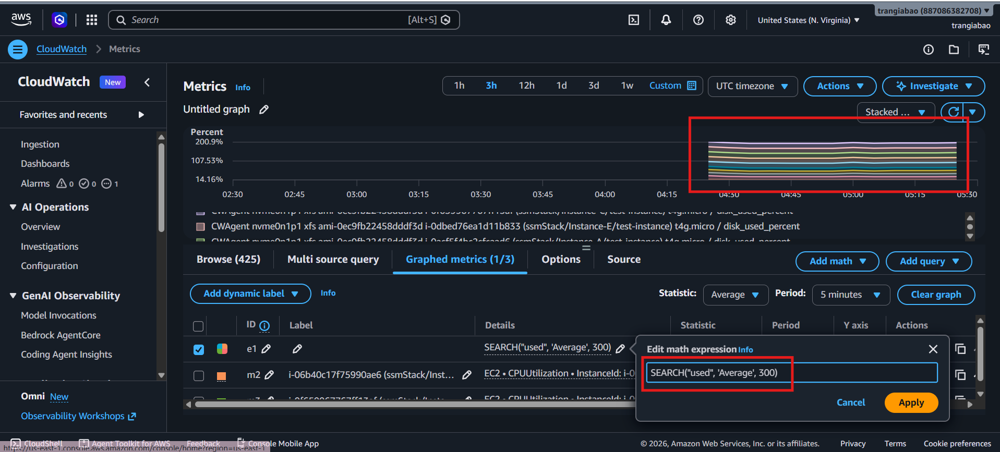

---

#### Step 10: Apply Mathematical Expressions to Metric Series
* **Action / Navigation:** Click **Add math** ➔ **Start with empty expression**.
* **Formula Applied:**
  ```text
  (m1 / 100) * 100
  ```
* **Purpose:** Normalizes data scales or computes ratios across distinct network interfaces.

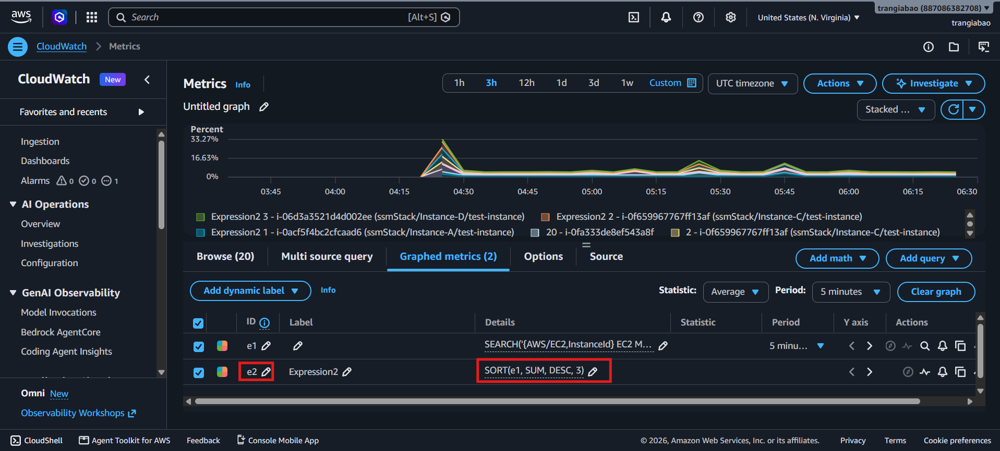

---

#### Step 11: Configure Dynamic Labels from Resource Properties
* **Action / Navigation:** In the Label column, enter the property interpolation variable.
* **Expression Syntax:**
  ```text
  ${PROP('Dim.InstanceId')} - CPU Load
  ```
* **Purpose:** Replaces cryptic metric identifiers with human-readable instance IDs in the chart legend.

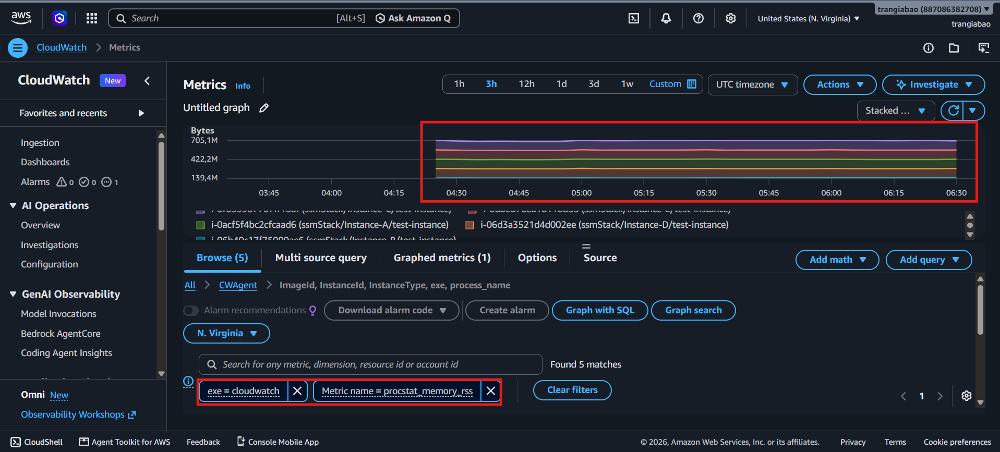

---

#### Step 12: Validate Formatted Dashboard Graph
* **Action / Navigation:** Review the finalized graph.
* **Observation:** The legend renders dynamic contextual labels, ready to pin to an executive dashboard.

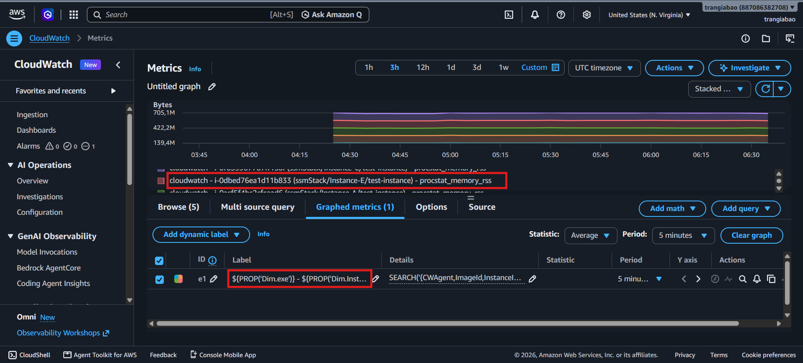

---

#### Step 13: Access CloudWatch Logs Groups Console
* **Action / Navigation:** In the sidebar, select **Logs** ➔ **Log groups**.
* **Selection:** Open the `/aws/ec2/system-logs` log group ingested by the CloudWatch Agent.

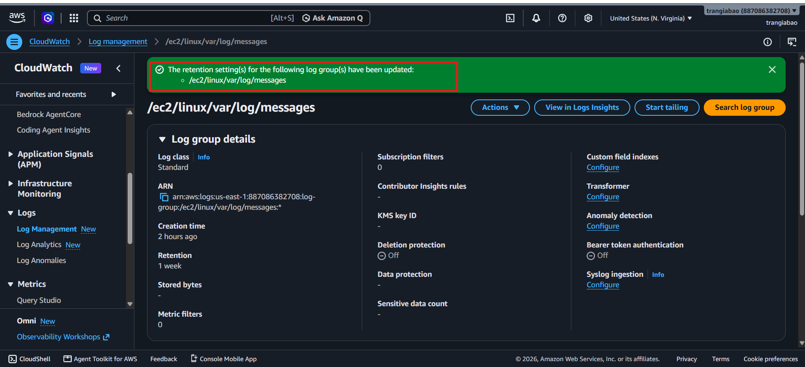

---

#### Step 14: Inspect Per-Instance Log Streams
* **Action / Navigation:** Inside `/aws/ec2/system-logs`, select the **Log streams** tab.
* **Observation:** Dedicated streams are partitioned per EC2 Instance ID.

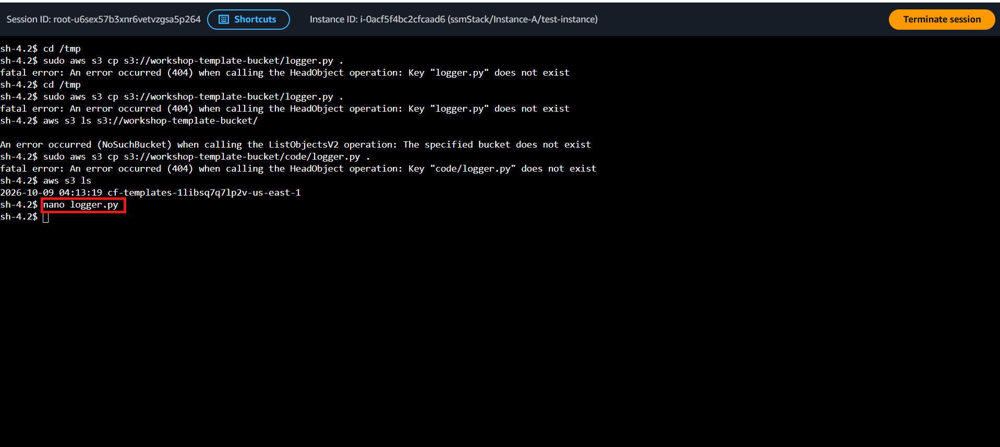

---

#### Step 15: Review Raw System Log Event Records
* **Action / Navigation:** Click a specific log stream to review raw event rows.
* **Observation:** Operating system events, boot logs, and application outputs are preserved with UTC/Local timestamps.

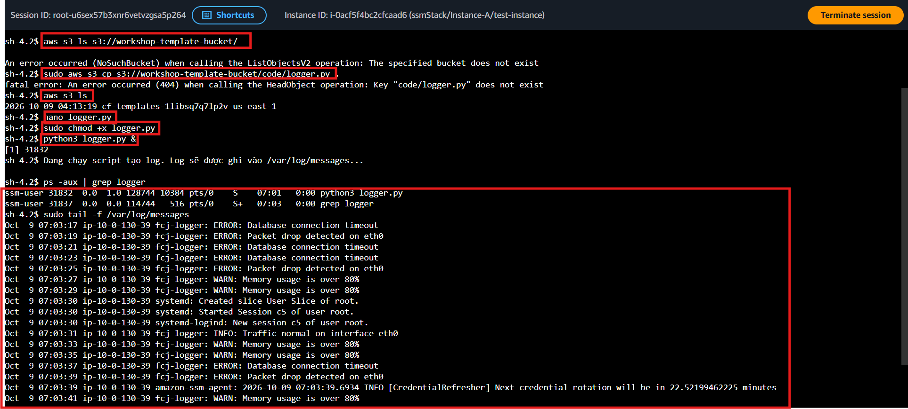

---

#### Step 16: Launch CloudWatch Logs Insights Query Editor
* **Action / Navigation:** Sidebar select **Logs** ➔ **Logs Insights**.
* **Configuration:** In *Select log group(s)*, choose `/aws/ec2/system-logs`.

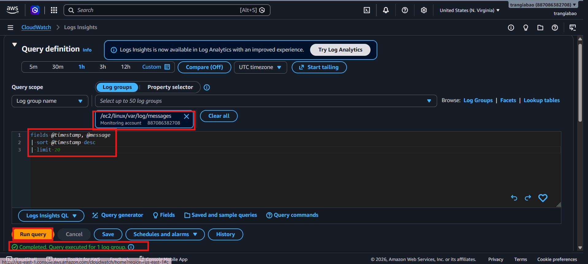

---

#### Step 17: Execute Query to Filter Error Messages
* **Action / Navigation:** Input the error extraction query.
* **Query Syntax:**
  ```text
  fields @timestamp, @message
  | filter @message like /(?i)(error|exception|fail)/
  | sort @timestamp desc
  | limit 20
  ```
* **Next Action:** Click **Run query**.

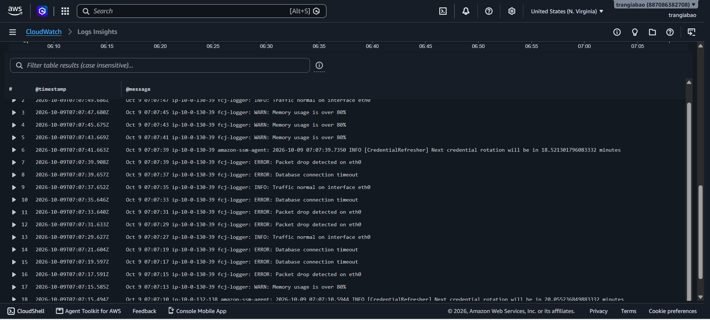

---

#### Step 18: Analyze Logs Insights Tabular Results
* **Action / Navigation:** Examine the tabular records returned by the query engine.
* **Observation:** Matching error events are isolated with timestamp and message payloads.

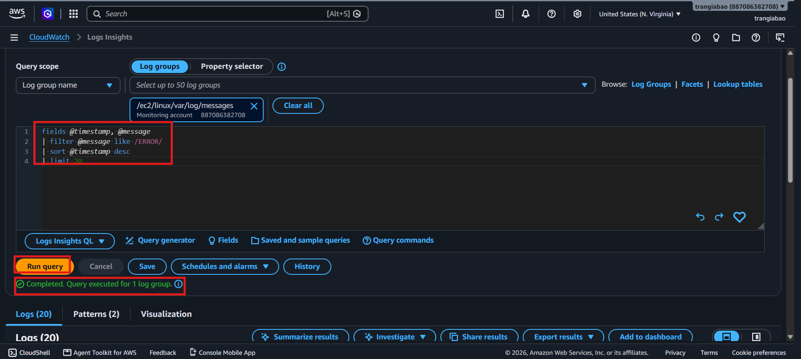

---

#### Step 19: Visualize Error Occurrence Frequency Over Time
* **Action / Navigation:** Switch to the **Visualization** tab ➔ Select **Line chart**.
* **Observation:** Error volume over time displays spike frequencies clearly.

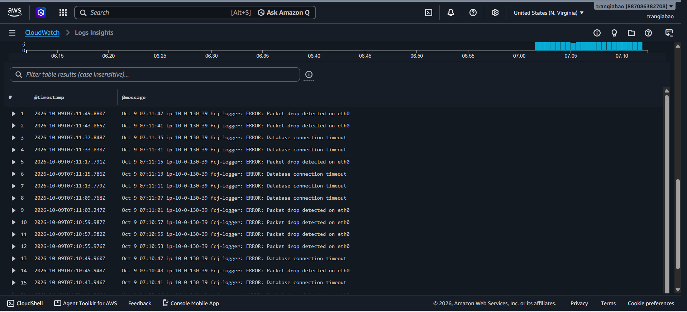

---

#### Step 20: Aggregate Distribution by HTTP Status Code
* **Action / Navigation:** Execute an aggregation query across HTTP response codes.
* **Query Syntax:**
  ```text
  stats count(*) by status_code
  ```
* **Result:** Breaks down requests into 200 (OK), 404 (Not Found), and 500 (Server Error) buckets.

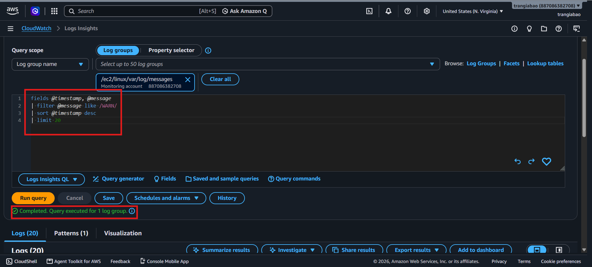

---

#### Step 21: Parse Custom Log Fields (Pattern Extraction)
* **Action / Navigation:** Use the `parse` command to extract IP, method, and URI from raw web logs.
* **Query Syntax:**
  ```text
  parse @message "* * [*] \"* * *\" * *" as client_ip, user, timestamp, method, uri, protocol, status, bytes
  | display client_ip, method, uri, status
  ```

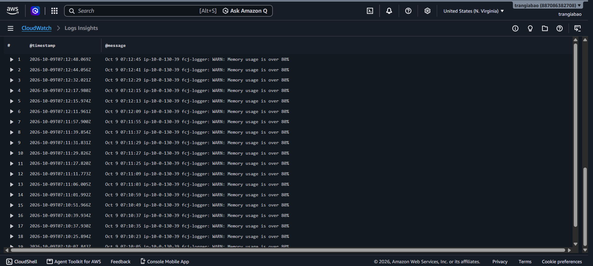

---

#### Step 22: Query Top Ingress Client IP Addresses
* **Action / Navigation:** Extract and sort the highest-frequency requester IP addresses.
* **Query Syntax:**
  ```text
  stats count(*) as request_count by client_ip
  | sort request_count desc
  | limit 10
  ```

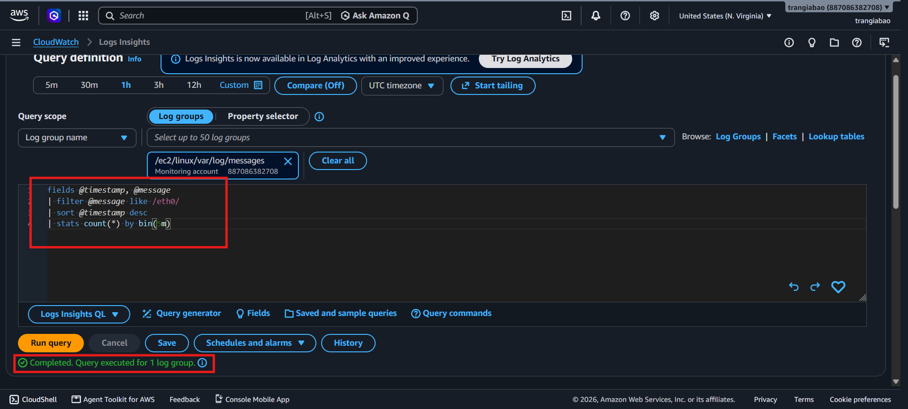

---

#### Step 23: Save Optimized Query to Library
* **Action / Navigation:** Click **Save** in the top right ➔ Name the query `Top-Error-Analysis`.

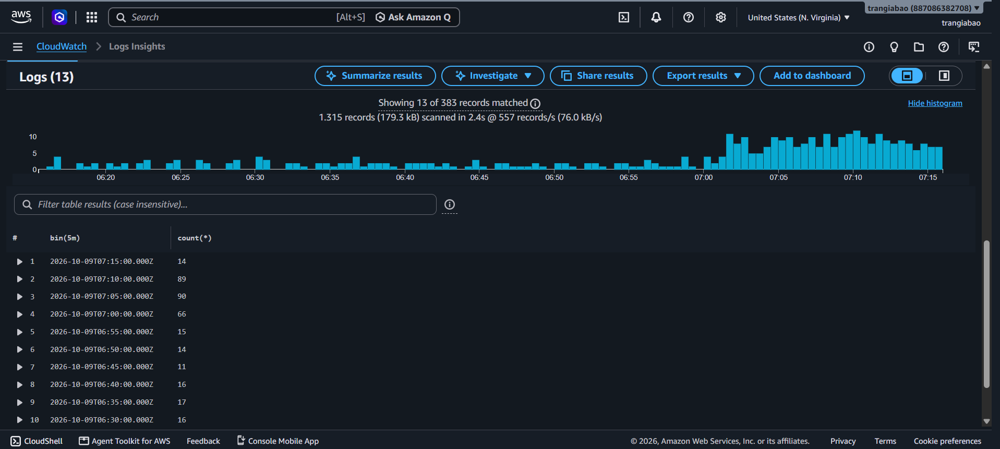

---

#### Step 24: Re-load Query from Saved Queries Pane
* **Action / Navigation:** Select the **Queries** tab to reload and execute previously curated queries.

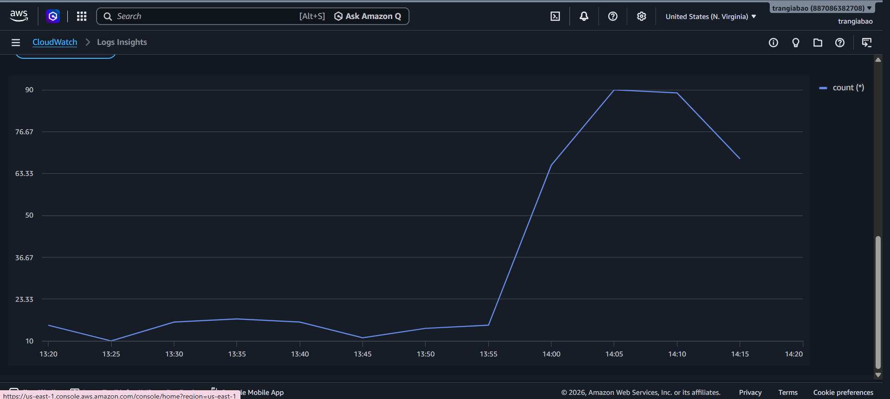

---

#### Step 25: Inspect Event Record Metadata and Details
* **Action / Navigation:** Expand an event record row using the dropdown arrow to inspect JSON fields.

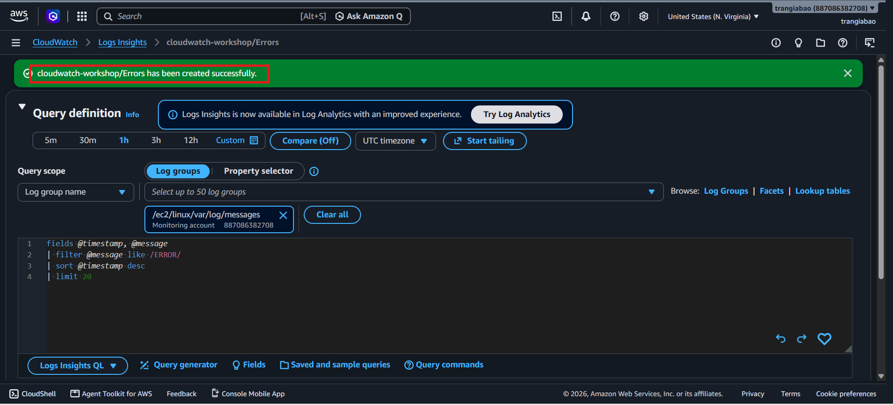

---

#### Step 26: Optimize Query Time-Range Scan Window
* **Action / Navigation:** Adjust the time-window selector (e.g., 15m, 1h) to reduce ingested bytes scanned and enhance execution speed.

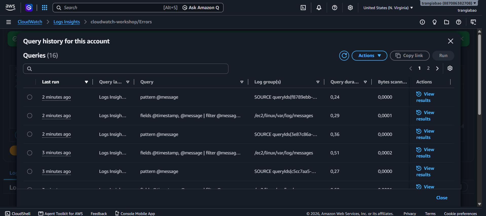

---

#### Step 27: Create Metric Filter from Log Group
* **Action / Navigation:** In **Log groups** ➔ Select `/aws/ec2/system-logs` ➔ Click **Metric filters** tab ➔ Click **Create metric filter**.

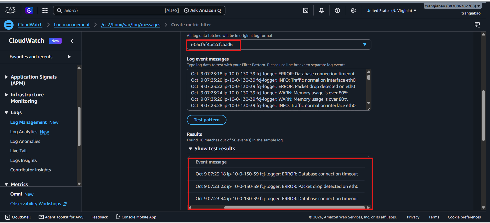

---

#### Step 28: Define HTTP 404 Filter Pattern
* **Action / Navigation:** Configure the pattern matching syntax.
* **Filter Pattern Syntax:**
  ```text
  [ip, user, username, timestamp, request, status_code = 404, size]
  ```

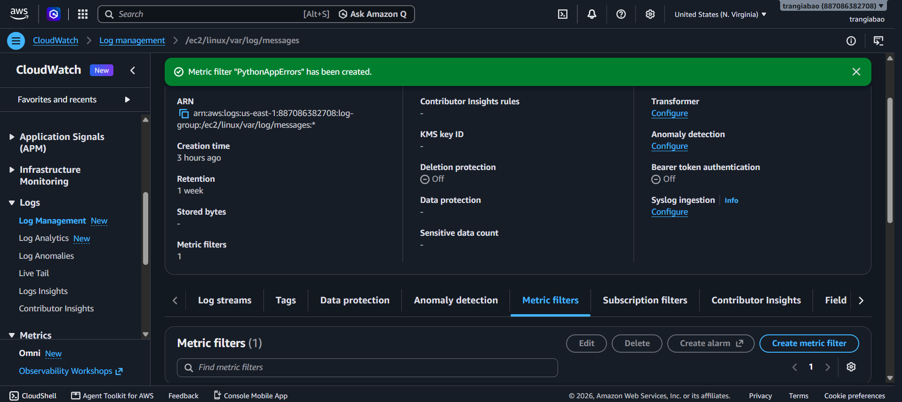

> **💡 Difficulties Encountered & Troubleshooting at Step 28:**  
> Space-delimited patterns `[field1, field2, ...]` require standard Apache/Nginx combined log formatting. For JSON logs, use JSON path filters `{ $.status_code = 404 }`. Always test patterns before saving.

---

#### Step 29: Test Filter Pattern Against Sample Logs
* **Action / Navigation:** Select sample log streams and click **Test pattern**.
* **Observation:** Test results verify matching lines and validate tokenized fields.

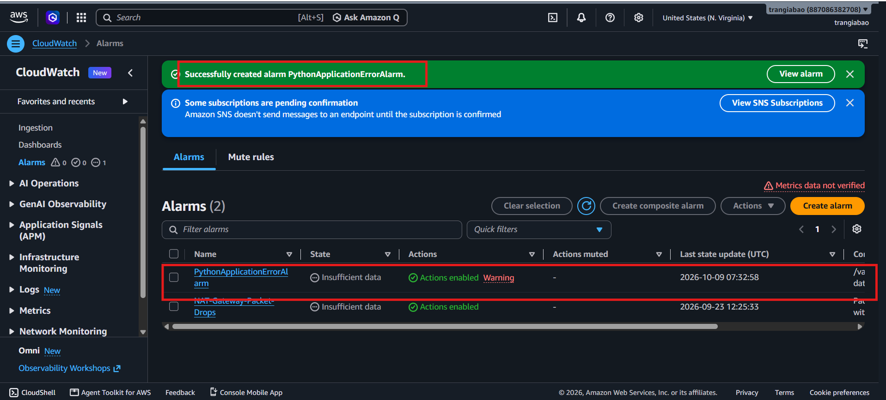

---

#### Step 30: Assign Metric Name, Value, and Custom Namespace
* **Action / Navigation:** Click **Next** to proceed to metric naming.
* **Configuration Parameters:**
  * *Metric namespace:* `Custom/Web`
  * *Metric name:* `HTTP404ErrorCount`
  * *Metric value:* `1`
  * *Default value:* `0`

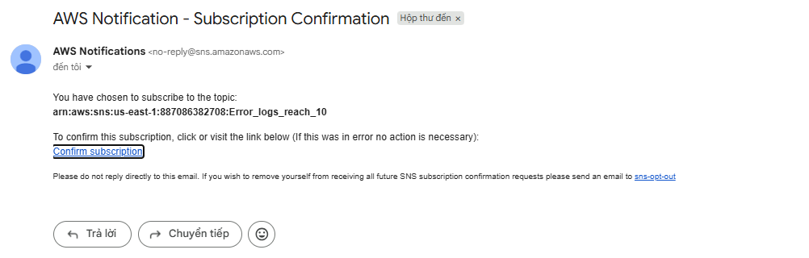

---

#### Step 31: Finalize Metric Filter Provisioning
* **Action / Navigation:** Click **Create metric filter**.
* **Observation:** The filter is active and immediately populates the metric series `HTTP404ErrorCount` under All Metrics.

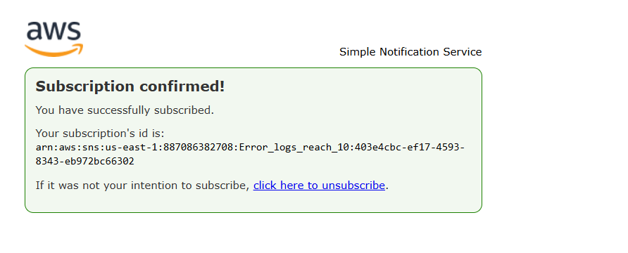

---

#### Step 32: Configure CloudWatch Alarm on CPU Threshold (> 70%)
* **Action / Navigation:** In the sidebar, select **Alarms** ➔ Click **Create alarm** ➔ Select `CPUUtilization` for `Web-Server-Lab`.
* **Configuration Parameters:**
  * *Statistic:* `Average`
  * *Period:* `1 minute`
  * *Threshold type:* `Static`
  * *Condition:* `Greater > 70`
  * *Datapoints to alarm:* `2 out of 2` (sustained across 2 consecutive minutes)

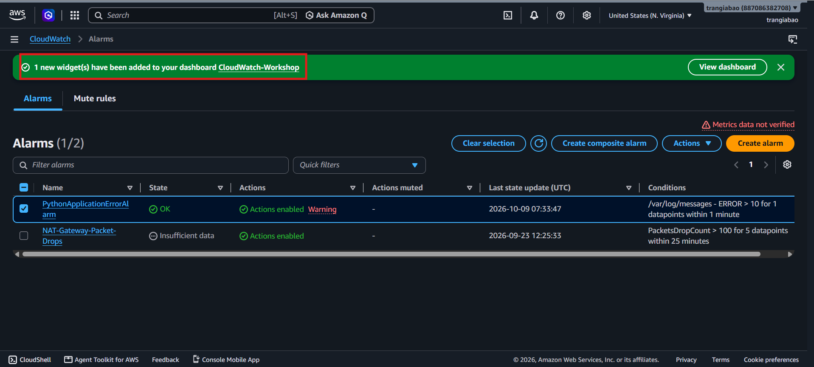

---

#### Step 33: Configure SNS Action & Verify Alarm OK State
* **Action / Navigation:** Attach notification action pointing to an Amazon SNS Topic ➔ Name the alarm `High-CPU-Utilization-Alarm` ➔ Click **Create alarm**.
* **Observation:** The alarm initializes in healthy **OK** state under standard operational load.

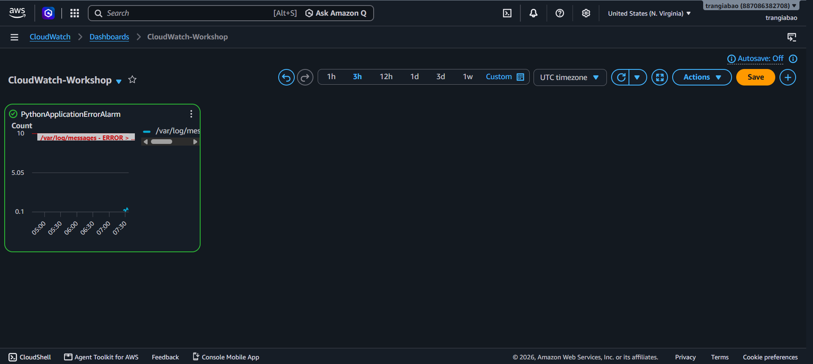

---

### 📝 Summary & Key Takeaways:
1. **Full-Stack Observability:** Amazon CloudWatch unifies the three pillars of telemetry: Metrics (telemetry timeseries), Logs (structured/unstructured events), and Alarms (automated notifications).
2. **Speed & Value of Logs Insights:** Eliminates the operational overhead and infrastructure costs of self-hosted ELK stacks by querying massive log volumes serverlessly within seconds.
3. **Log-to-Metric Bridge:** Metric Filters transform raw application events into numerical time series, unlocking proactive alerting and dashboard integration directly from system logs.
