---
title: "Giám sát với Amazon CloudWatch"
date: 2026-10-08
weight: 4
chapter: false
pre: " <b> 1.4.4. </b> "
---

{}
Bài thực hành **Giám sát với Amazon CloudWatch** (Monitoring with Amazon CloudWatch) được thực hiện vào **Thứ 5 (08/10/2026)** trong khuôn khổ **Tuần 4**. Trang này hướng dẫn chi tiết từng bước với đầy đủ thông số kỹ thuật, cú pháp truy vấn Logs Insights, công thức toán học Math Expressions, xử lý sự cố thực tế và trọn bộ 33 hình ảnh minh chứng thực hành.
<br>🔗 **Nguồn tài liệu thực hành (Workshop Reference):** [Monitoring with Amazon CloudWatch](https://000008.awsfcaj.com/)
{}

### 🎯 Mục tiêu bài thực hành (Lab Objectives):
* Hiểu sâu về dịch vụ giám sát và quan sát trung tâm **Amazon CloudWatch** trên AWS.
* Quan sát và trực quan hóa các số liệu hiệu năng (**CloudWatch Metrics**) của tài nguyên hệ thống theo thời gian thực.
* Sử dụng các biểu thức tìm kiếm (**Search Expressions**) và biểu thức toán học (**Math Expressions**) để phân tích, tổng hợp chỉ số tải.
* Cấu hình nhãn động (**Dynamic Labels**) giúp tự động đặt tên biểu đồ theo ngữ cảnh tài nguyên.
* Quản lý nhật ký hệ thống (**CloudWatch Logs**) và sử dụng ngôn ngữ truy vấn mạnh mẽ **CloudWatch Logs Insights** để trích xuất dữ liệu nhanh chóng.
* Tạo bộ lọc số liệu (**Metric Filters**) từ log để chuyển đổi thông tin nhật ký thành biểu đồ đo lường.
* Thiết lập chuông báo động (**CloudWatch Alarms**) kết hợp kênh thông báo **Amazon SNS** tự động cảnh báo khi tài nguyên chạm ngưỡng tới hạn.

---

### 📊 Bảng tổng hợp thông số tài nguyên đã triển khai:

| Tài nguyên | Tên / Định danh | Cấu hình & Chi tiết kỹ thuật | Vùng / Trạng thái | Ghi chú |
| :--- | :--- | :--- | :--- | :--- |
| **EC2 Instance Monitored** | `Web-Server-Lab` | Amazon Linux 2023, CloudWatch Agent cài đặt | `ap-southeast-1` | Thu thập metrics & logs |
| **Metric Monitored** | `CPUUtilization`, `DiskReadBytes` | Namespace: `AWS/EC2`, Chu kỳ thống kê: 1 phút | Real-time monitoring | Đồ thị hóa chỉ số hiệu năng |
| **Search Expression** | `SEARCH(' {AWS/EC2,InstanceId} MetricName="CPUUtilization" ', 'Average', 300)` | Tìm nạp tự động số liệu của mọi instance | Dynamic Metric Dashboard | Tự động cập nhật khi có máy mới |
| **Math Expression** | `m1 * 100 / MAX(m1)` | Chuẩn hóa phần trăm tải CPU theo tỷ lệ | Math expression plot | Biểu diễn dữ liệu toán học |
| **Log Group** | `/aws/ec2/system-logs` | Thời gian lưu trữ (Retention): 7 ngày | Ingestion: Active | Lưu trữ log truy cập & hệ điều hành |
| **Metric Filter** | `HTTP404ErrorCount` | Pattern: `[ip, user, username, timestamp, request, status_code = 404, size]` | Namespace: `Custom/Web` | Đếm số lỗi 404 từ access log |
| **CloudWatch Alarm** | `High-CPU-Utilization-Alarm` | Ngưỡng cảnh báo: CPU > 70% trong 2 kỳ liên tiếp | Trạng thái: `OK` / `ALARM` | Gửi cảnh báo email qua SNS |

---

### 🚀 Chi tiết các bước thực hiện & Hình ảnh minh chứng:

#### Bước 1: Chuẩn bị Môi trường & Cài đặt CloudWatch Agent trên EC2
* **Thao tác / Hướng dẫn:** Khởi chạy máy chủ EC2 `Web-Server-Lab`, gán IAM Role có quyền `CloudWatchAgentServerPolicy` ➔ Kết nối SSH và cài đặt gói agent.
* **Lệnh thực thi:**
  ```bash
  # Cài đặt Amazon CloudWatch Agent
  sudo yum install -y amazon-cloudwatch-agent

  # Khởi động dịch vụ Agent với file cấu hình
  sudo /opt/aws/amazon-cloudwatch-agent/bin/amazon-cloudwatch-agent-ctl \
    -a fetch-config -m ec2 -s -c file:/opt/aws/amazon-cloudwatch-agent/etc/amazon-cloudwatch-agent.json
  ```

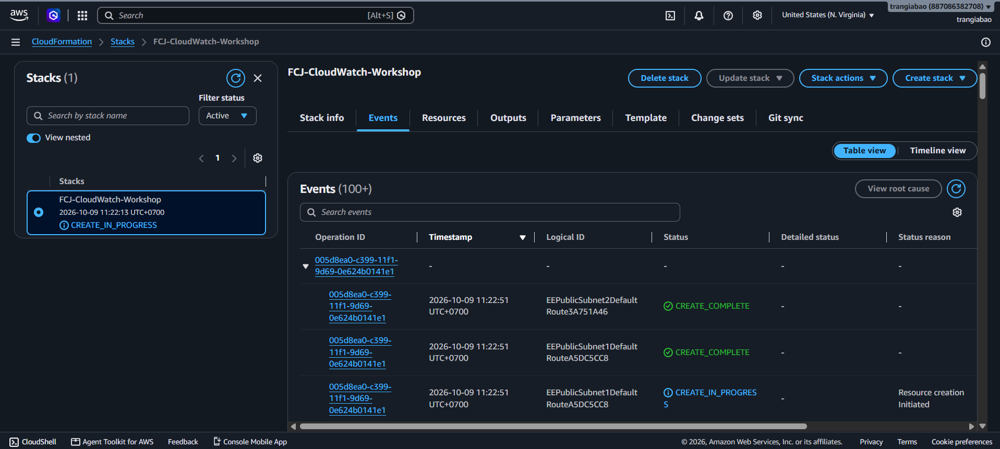

> **💡 Khó khăn gặp phải & Cách xử lý tại Bước 1:**  
> Nếu máy chủ EC2 không được gán IAM Role chứa quyền `CloudWatchAgentServerPolicy`, file nhật ký tại `/var/log/amazon/amazon-cloudwatch-agent/amazon-cloudwatch-agent.log` sẽ báo lỗi `AccessDeniedException` khi đẩy log. Luôn kiểm tra IAM Role trước khi khởi động agent.

---

#### Bước 2: Khám phá Bảng Điều khiển All Metrics của Amazon CloudWatch
* **Thao tác / Hướng dẫn:** Truy cập **CloudWatch Console** ➔ Menu bên trái chọn **Metrics** ➔ **All metrics**.
* **Mục đích:** Xem toàn cảnh các Namespace có sẵn do AWS tự động cung cấp (như `AWS/EC2`, `AWS/EBS`, `AWS/ApplicationELB`).

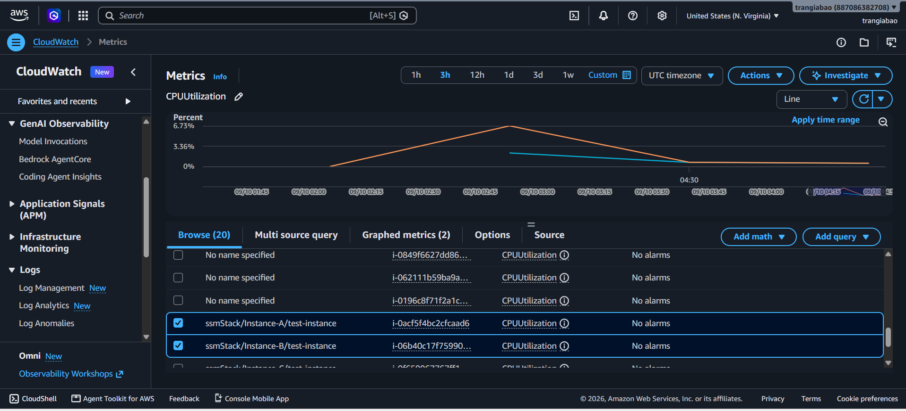

---

#### Bước 3: Lựa chọn Chỉ số Theo dõi EC2 Per-Instance Metrics
* **Thao tác / Hướng dẫn:** Tại thẻ **All metrics**, chọn namespace **EC2** ➔ Chọn **Per-Instance Metrics**.
* **Thông số chọn:** Tìm kiếm theo Instance ID của máy chủ và tích chọn các chỉ số `CPUUtilization`, `NetworkIn`, `DiskReadBytes`.

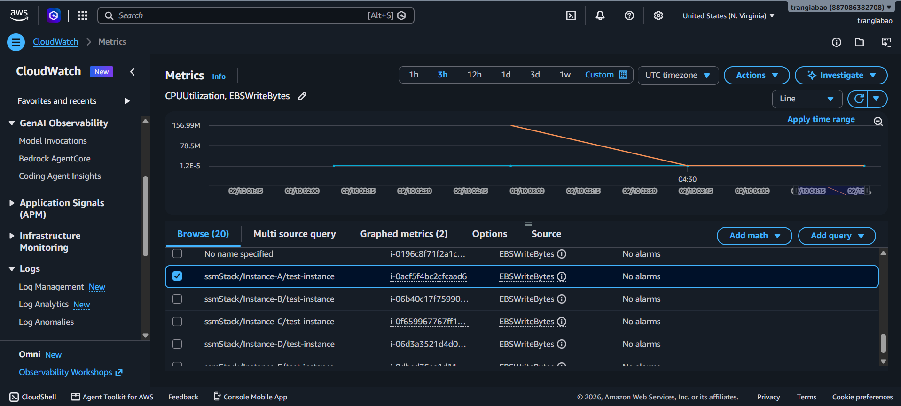

---

#### Bước 4: Tùy biến Đồ thị Hiển thị các Chỉ số (Graphed Metrics)
* **Thao tác / Hướng dẫn:** Chuyển sang thẻ **Graphed metrics** để quản lý các chỉ số đang được vẽ trên đồ thị.
* **Thông số cấu hình:** Bật/tắt hiển thị từng đường vẽ, tùy chỉnh màu sắc và gán trục Y bên trái hoặc bên phải.

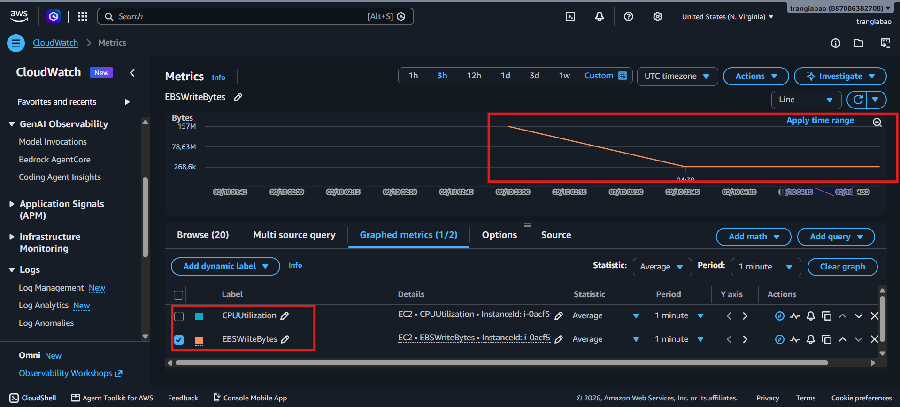

---

#### Bước 5: Chỉnh sửa Chu kỳ Thống kê (Period) và Hàm Thống kê (Statistic)
* **Thao tác / Hướng dẫn:** Tại cột **Statistic**, chuyển từ mặc định sang **Average**. Tại cột **Period**, chọn chu kỳ lấy mẫu **1 Minute** (1 phút) để có độ phân giải chi tiết.

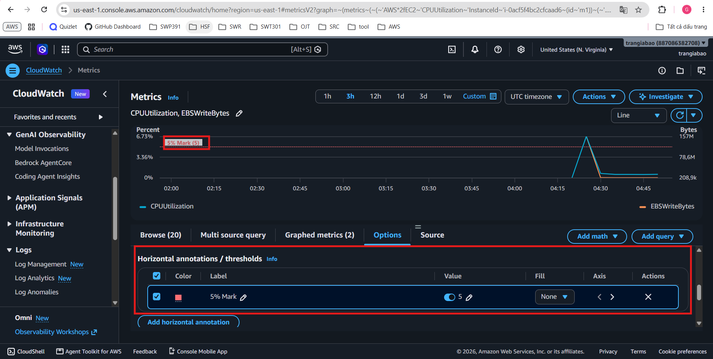

---

#### Bước 6: Trực quan hóa Số liệu CPUUtilization theo Thời gian Thực
* **Thao tác / Hướng dẫn:** Điều chỉnh khung thời gian hiển thị đồ thị về **1h** (1 giờ gần nhất).
* **Quan sát:** Biểu đồ hiển thị dao động tải CPU của máy chủ theo từng phút với độ sắc nét cao.

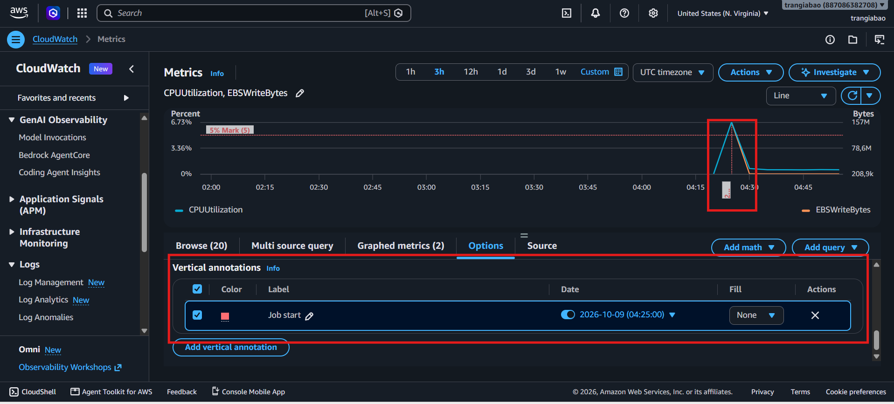

---

#### Bước 7: Nhập Cú pháp Search Expression Tự động Tìm kiếm Chỉ số
* **Thao tác / Hướng dẫn:** Tại thẻ **Graphed metrics**, chọn menu **Add math** ➔ **Search expression**.
* **Cú pháp nhập cụ thể:**
  ```text
  SEARCH(' {AWS/EC2,InstanceId} MetricName="CPUUtilization" ', 'Average', 300)
  ```
* **Mục đích:** Tự động truy vấn và hiển thị chỉ số CPU của tất cả máy chủ EC2 hiện có mà không cần chọn thủ công từng máy.

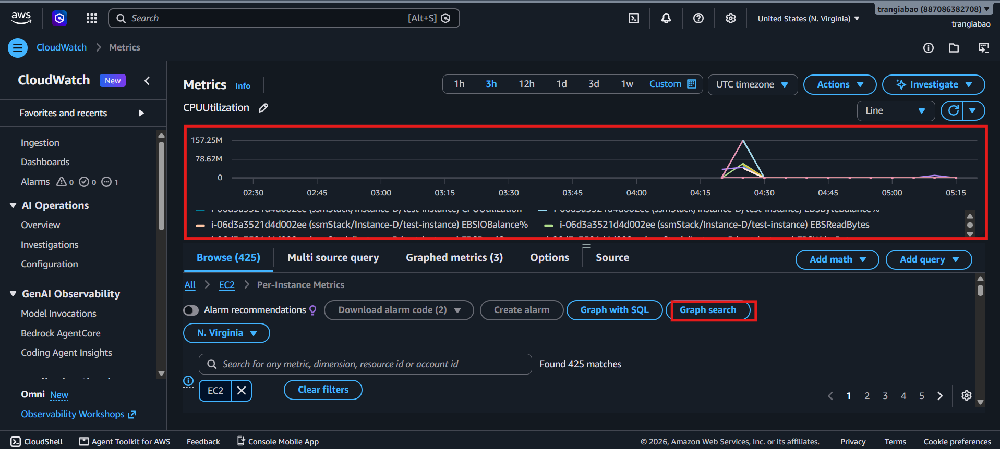

> **💡 Khó khăn gặp phải & Cách xử lý tại Bước 7:**  
> Cú pháp Search Expression rất nhạy cảm với khoảng trắng và dấu ngoặc nhọn `{}` định nghĩa dimension. Đảm bảo tên MetricName và Dimension khớp chính xác chữ hoa chữ thường.

---

#### Bước 8: Trực quan hóa Đồ thị Tổng hợp Đa Máy chủ bằng Search Expression
* **Thao tác / Hướng dẫn:** Nhấn **Apply**.
* **Quan sát:** Đồ thị tự động vẽ nhiều đường tương ứng với tất cả các instance đang hoạt động trong Region.

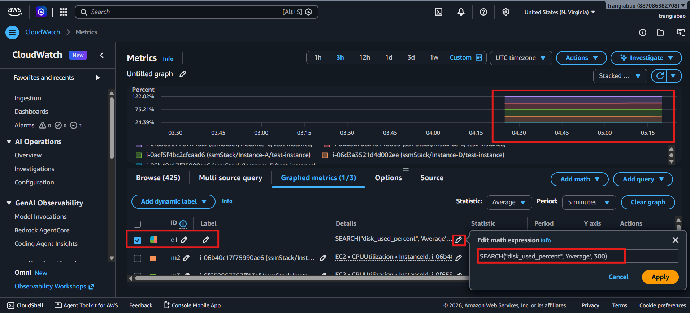

---

#### Bước 9: Kiểm tra Danh sách các Chuỗi Chỉ số Khớp với Biểu thức
* **Thao tác / Hướng dẫn:** Mở rộng danh sách kết quả bên dưới biểu đồ.
* **Quan sát:** Toàn bộ các chuỗi số liệu khớp với biểu thức tìm kiếm đều được liệt kê với InstanceId tương ứng.

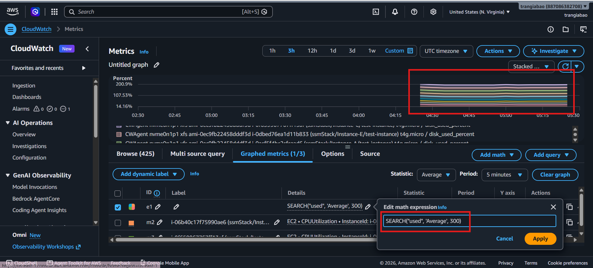

---

#### Bước 10: Áp dụng Biểu thức Toán học Math Expression trên Đồ thị
* **Thao tác / Hướng dẫn:** Chọn **Add math** ➔ **Start with empty expression**.
* **Công thức toán học nhập cụ thể:**
  ```text
  (m1 / 100) * 100
  ```
* **Mục đích:** Thực hiện chuẩn hóa dữ liệu, tính toán phần trăm sử dụng hoặc tổng hợp lưu lượng giữa nhiều card mạng.

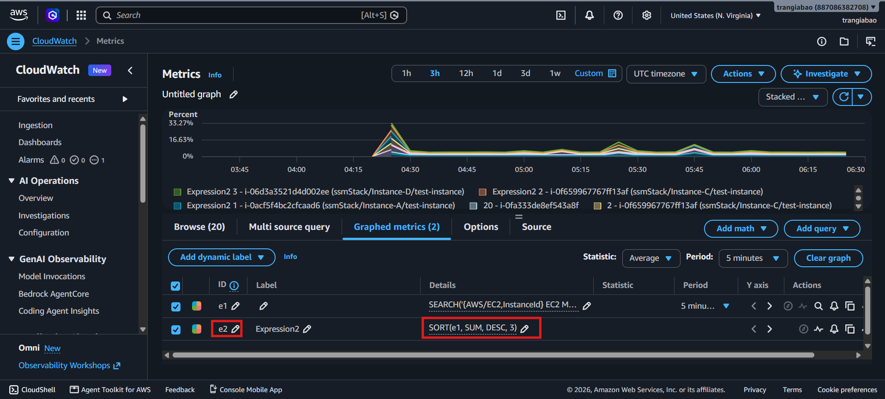

---

#### Bước 11: Cấu hình Nhãn Động Dynamic Labels theo Thuộc tính Tài nguyên
* **Thao tác / Hướng dẫn:** Tại cột Label của chỉ số, nhập cú pháp nội suy biến.
* **Cú pháp nhập cụ thể:**
  ```text
  ${PROP('Dim.InstanceId')} - CPU Load
  ```
* **Mục đích:** Tự động hiển thị ID hoặc tên của từng instance trên thanh chú giải thay vì các chuỗi định danh mặc định khó hiểu.

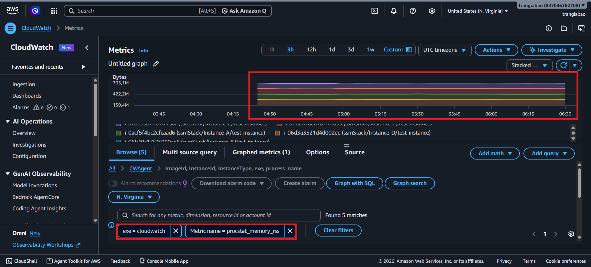

---

#### Bước 12: Hoàn thiện Biểu đồ Trực quan với Nhãn Chú thích Rõ ràng
* **Thao tác / Hướng dẫn:** Kiểm tra lại toàn bộ đồ thị sau khi áp dụng Dynamic Labels.
* **Quan sát:** Mỗi đường biểu diễn có màu sắc riêng và chú giải tên máy chủ rõ ràng, sẵn sàng để ghim vào CloudWatch Dashboard.

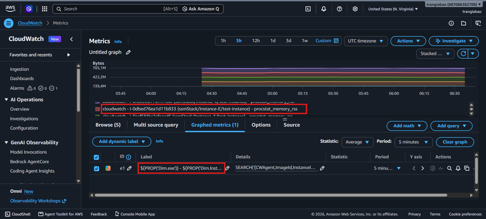

---

#### Bước 13: Truy cập & Quản lý Danh sách Log Groups trên CloudWatch Logs
* **Thao tác / Hướng dẫn:** Menu bên trái chọn **Logs** ➔ **Log groups**.
* **Thông số chọn:** Nhóm nhật ký `/aws/ec2/system-logs` do CloudWatch Agent đẩy về.

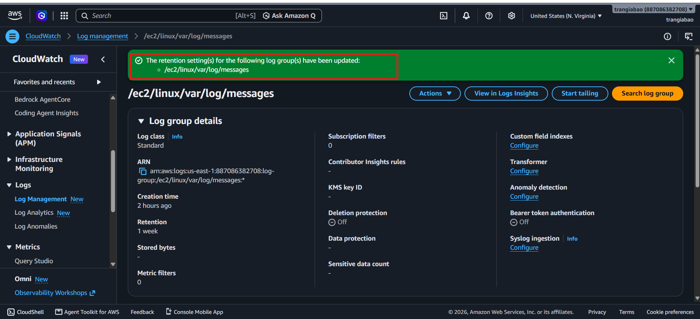

---

#### Bước 14: Duyệt các Log Streams Chi tiết của Từng Máy chủ
* **Thao tác / Hướng dẫn:** Bấm vào Log Group `/aws/ec2/system-logs` ➔ Xem thẻ **Log streams**.
* **Quan sát:** Mỗi instance có một luồng stream riêng biệt mang định danh Instance ID.

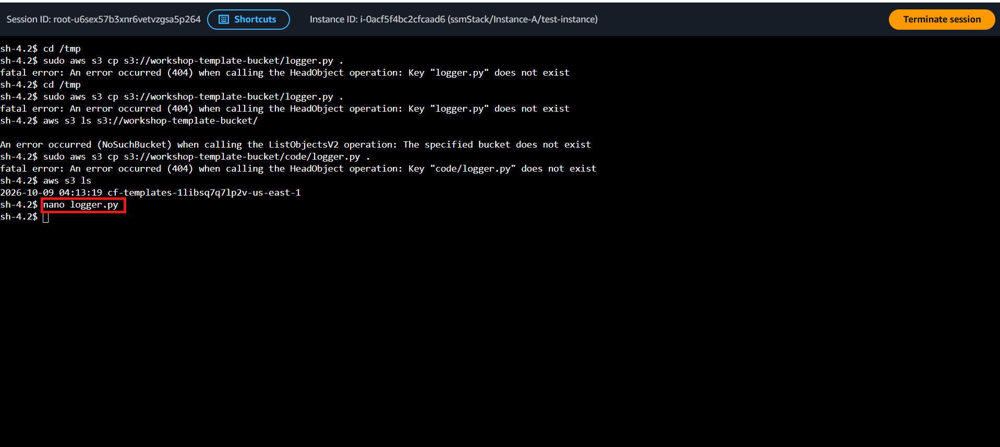

---

#### Bước 15: Xem Chi tiết Nội dung Sự kiện Nhật ký Hệ thống (Log Events)
* **Thao tác / Hướng dẫn:** Bấm vào một Log Stream cụ thể để kiểm tra luồng tin nhắn thô.
* **Quan sát:** Toàn bộ thông điệp hệ thống, tiến trình boot và lỗi ứng dụng được lưu trữ đầy đủ kèm mốc thời gian UTC/Local.

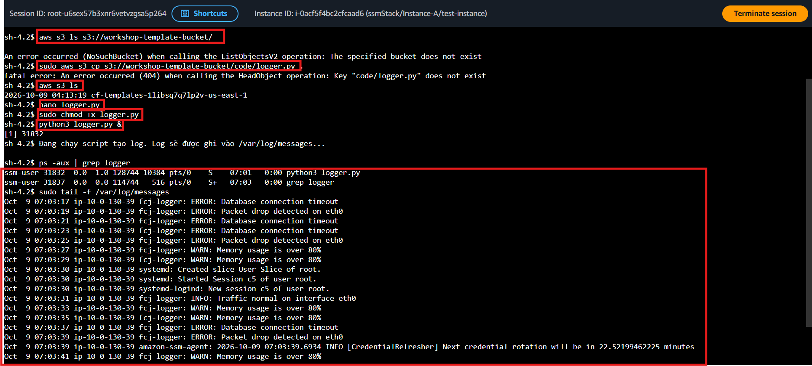

---

#### Bước 16: Mở Giao diện Trình soạn thảo Truy vấn CloudWatch Logs Insights
* **Thao tác / Hướng dẫn:** Menu bên trái chọn **Logs** ➔ **Logs Insights**.
* **Thông số chọn:** Tại ô *Select log group(s)*, chọn `/aws/ec2/system-logs`.

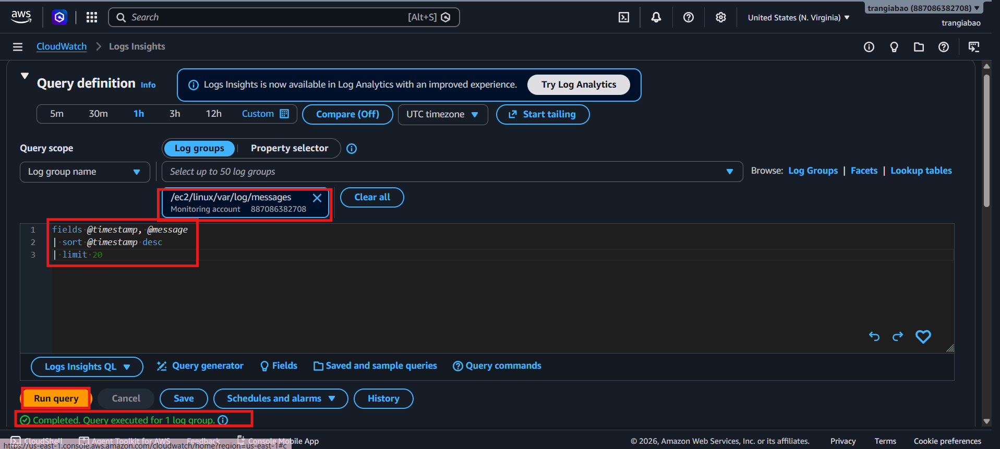

---

#### Bước 17: Soạn thảo Câu lệnh Truy vấn Lọc Thông điệp Lỗi
* **Thao tác / Hướng dẫn:** Nhập câu lệnh truy vấn lọc các dòng log chứa thông điệp lỗi.
* **Cú pháp truy vấn cụ thể:**
  ```text
  fields @timestamp, @message
  | filter @message like /(?i)(error|exception|fail)/
  | sort @timestamp desc
  | limit 20
  ```
* **Thao tác tiếp theo:** Nhấn nút **Run query**.

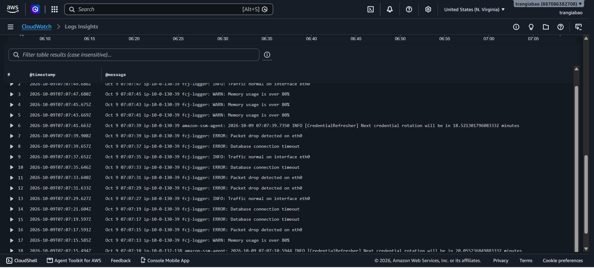

---

#### Bước 18: Xem Bảng Dữ liệu Kết quả Trả về từ Logs Insights
* **Thao tác / Hướng dẫn:** Kiểm tra bảng kết quả hiển thị bên dưới trình soạn thảo.
* **Quan sát:** Tất cả các bản ghi có chứa từ khóa lỗi được trích xuất tức thì với thời gian và nội dung chi tiết.

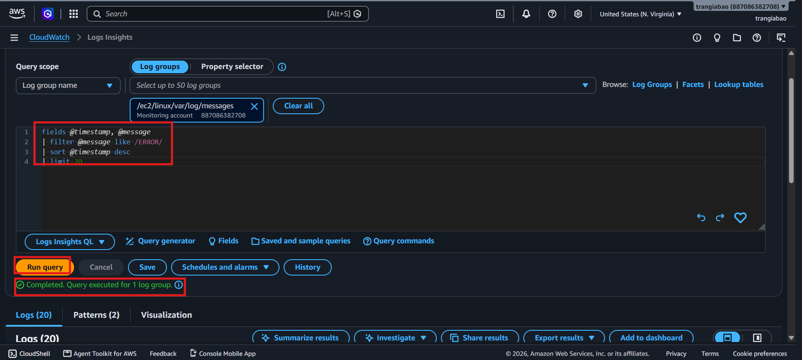

---

#### Bước 19: Trực quan hóa Số lượng Sự kiện Log Lỗi theo Mốc Thời gian
* **Thao tác / Hướng dẫn:** Chuyển sang thẻ **Visualization** trên bảng kết quả ➔ Chọn dạng **Line chart**.
* **Quan sát:** Biểu đồ hiển thị tần suất phát sinh lỗi theo từng khoảng thời gian (binning).

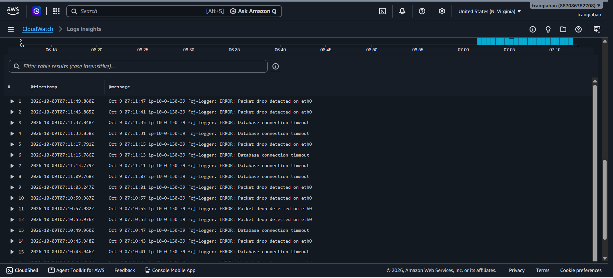

---

#### Bước 20: Thực thi Truy vấn Thống kê Phân bố Mã Trạng thái HTTP
* **Thao tác / Hướng dẫn:** Nhập câu lệnh tổng hợp số lượng truy cập theo mã trạng thái HTTP status code.
* **Cú pháp truy vấn cụ thể:**
  ```text
  stats count(*) by status_code
  ```
* **Kết quả:** Hiển thị số lượng request thành công (200), lỗi client (404) và lỗi server (500).

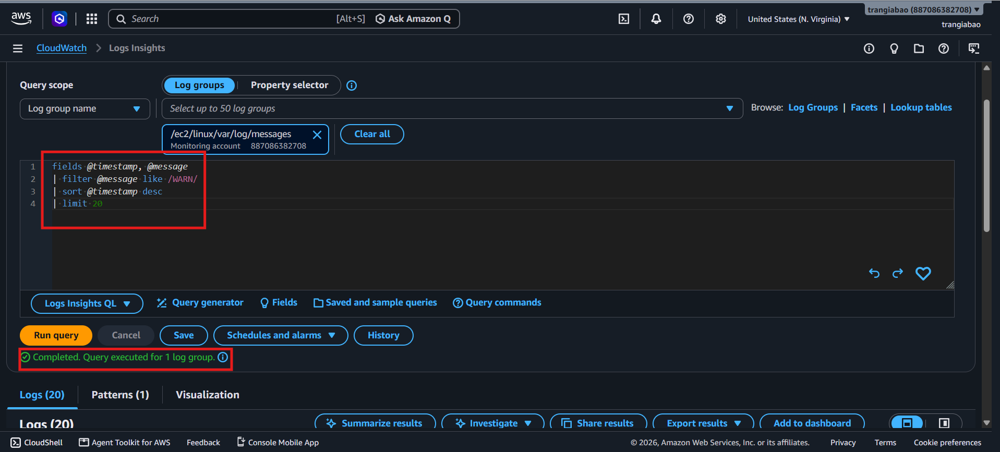

---

#### Bước 21: Phân tích Trích xuất Trường Dữ liệu Tùy chỉnh (Parse Field)
* **Thao tác / Hướng dẫn:** Dùng lệnh `parse` để tách các trường IP, Method và URI từ chuỗi log thô.
* **Cú pháp truy vấn cụ thể:**
  ```text
  parse @message "* * [*] \"* * *\" * *" as client_ip, user, timestamp, method, uri, protocol, status, bytes
  | display client_ip, method, uri, status
  ```

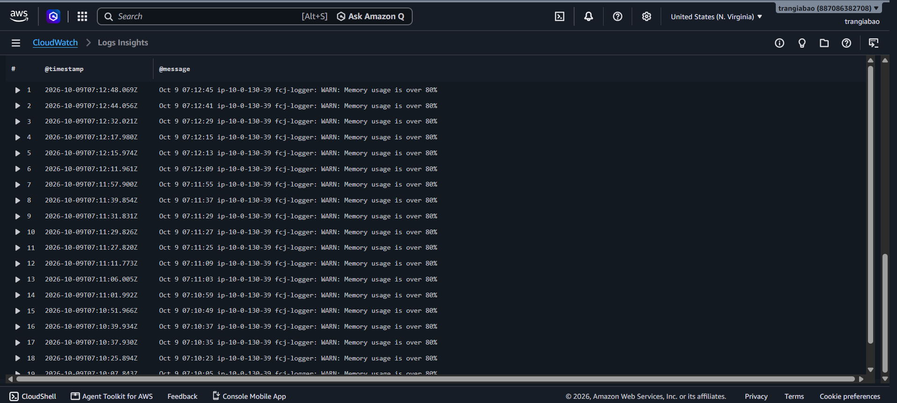

---

#### Bước 22: Thiết lập Bộ lọc Nâng cao Trích xuất Top IP Truy cập
* **Thao tác / Hướng dẫn:** Truy vấn đếm và xếp hạng các địa chỉ IP gửi yêu cầu nhiều nhất vào hệ thống.
* **Cú pháp truy vấn cụ thể:**
  ```text
  stats count(*) as request_count by client_ip
  | sort request_count desc
  | limit 10
  ```

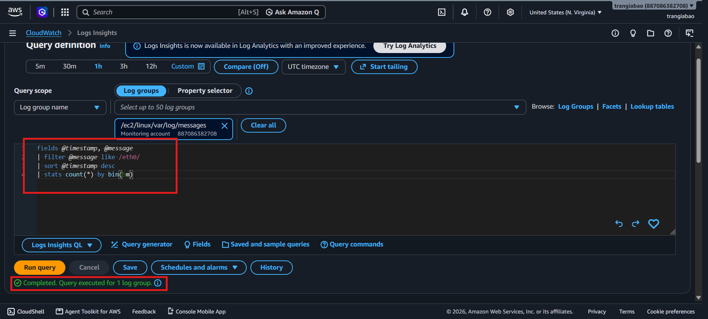

---

#### Bước 23: Lưu Câu Truy vấn Tối ưu vào Danh sách Saved Queries
* **Thao tác / Hướng dẫn:** Nhấn nút **Save** ở góc trên bên phải ➔ Đặt tên truy vấn `Top-Error-Analysis` ➔ Chọn thư mục lưu.

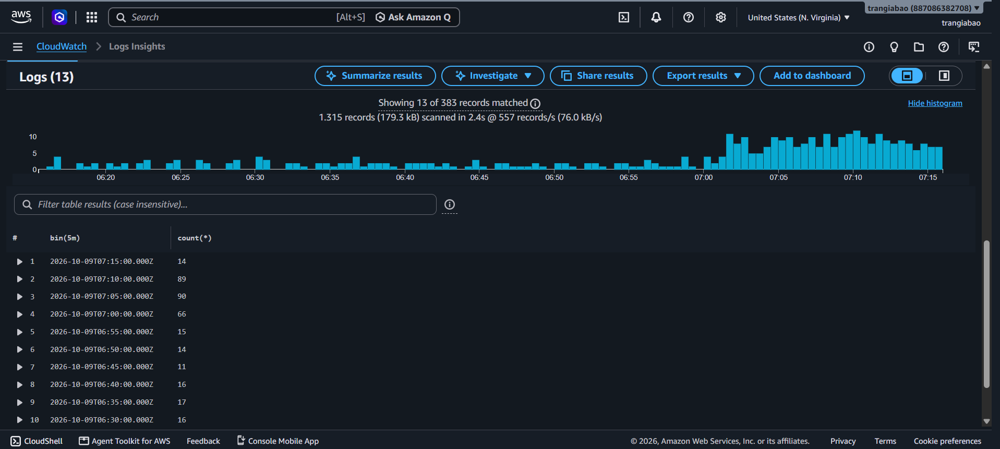

---

#### Bước 24: Kiểm tra và Tải lại Câu Truy vấn từ Saved Queries
* **Thao tác / Hướng dẫn:** Chọn tab **Queries** bên phải màn hình để xem lại danh sách câu truy vấn đã lưu và tái sử dụng nhanh chóng.

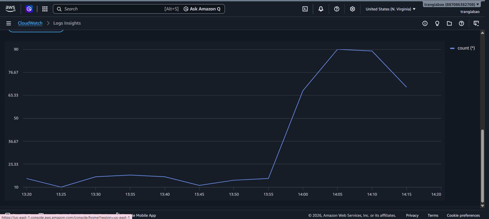

---

#### Bước 25: Trích xuất & Phân tích Chi tiết Từng Bản ghi Log Sự kiện
* **Thao tác / Hướng dẫn:** Bấm vào dấu mũi tên bên cạnh dòng kết quả để mở rộng toàn bộ các trường JSON và metadata liên quan.

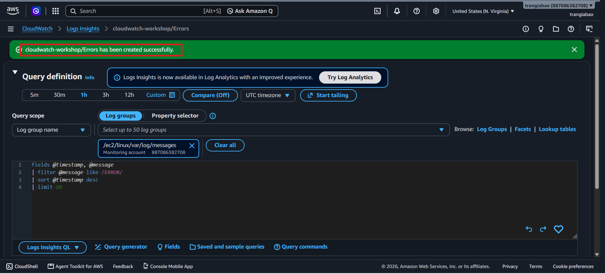

---

#### Bước 26: Tối ưu hóa Phạm vi Thời gian Truy vấn (Scan Window)
* **Thao tác / Hướng dẫn:** Điều chỉnh bộ chọn thời gian góc trên bên phải (chọn 15 phút, 1 giờ hoặc dải ngày cụ thể) để tối ưu lượng dữ liệu được quét và tăng tốc độ trả về kết quả.

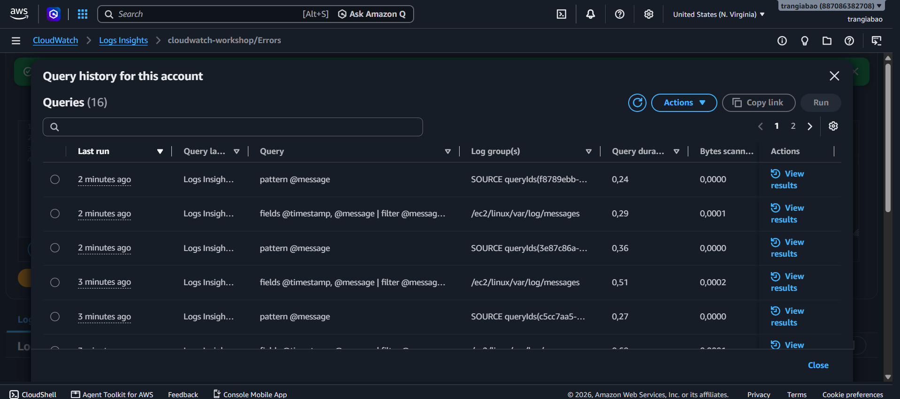

---

#### Bước 27: Khởi tạo Bộ lọc Chỉ số (Metric Filter) từ Log Group
* **Thao tác / Hướng dẫn:** Trở lại **Log groups** ➔ Chọn `/aws/ec2/system-logs` ➔ Chọn tab **Metric filters** ➔ Nhấn **Create metric filter**.

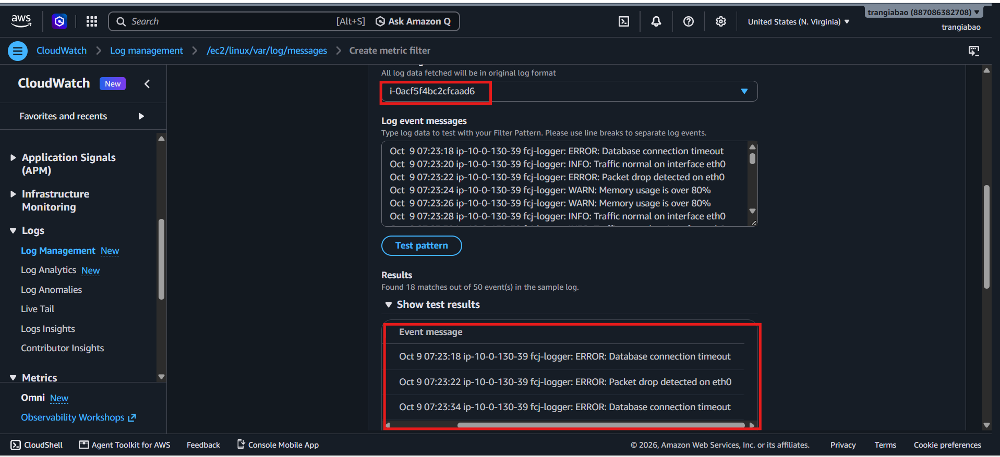

---

#### Bước 28: Khai báo Mẫu Biểu thức Bộ lọc (Filter Pattern)
* **Thao tác / Hướng dẫn:** Định nghĩa cú pháp phát hiện lỗi HTTP 404 trong nhật ký.
* **Cú pháp Filter Pattern:**
  ```text
  [ip, user, username, timestamp, request, status_code = 404, size]
  ```

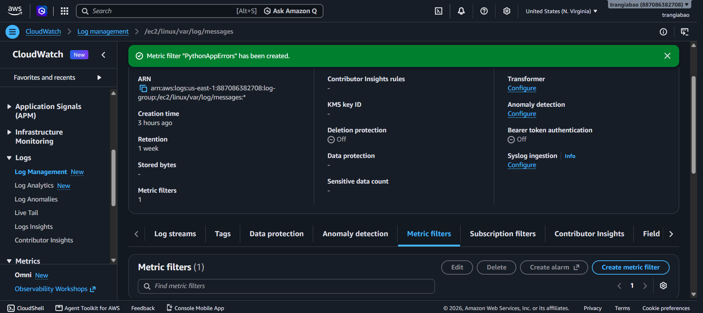

> **💡 Khó khăn gặp phải & Cách xử lý tại Bước 28:**  
> Cú pháp Filter Pattern dạng mảng `[field1, field2, ...]` chỉ hoạt động đúng khi định dạng log được phân tách bằng khoảng trắng chuẩn. Nếu log ở định dạng JSON, phải dùng cú pháp `{ $.status_code = 404 }`. Kiểm thử pattern trước khi lưu để đảm bảo khớp dữ liệu.

---

#### Bước 29: Kiểm thử Mẫu Bộ lọc Trực tiếp trên Nhật ký (Test Pattern)
* **Thao tác / Hướng dẫn:** Chọn luồng log mẫu và nhấn **Test pattern**.
* **Quan sát:** Bảng kiểm thử hiển thị các dòng log khớp mẫu kèm các giá trị trường được bóc tách chính xác.

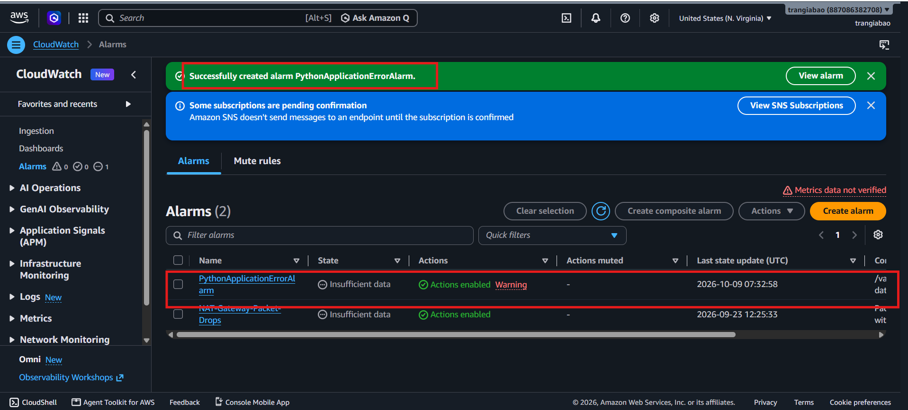

---

#### Bước 30: Gán Tên Metric, Metric Value & Namespace Tùy biến
* **Thao tác / Hướng dẫn:** Nhấn **Next** để chuyển sang bước đặt tên metric.
* **Thông số điền cụ thể:**
  * *Metric namespace:* `Custom/Web`
  * *Metric name:* `HTTP404ErrorCount`
  * *Metric value:* `1` (mỗi lần phát hiện khớp mẫu, giá trị đếm tăng 1 đơn vị)
  * *Default value:* `0`

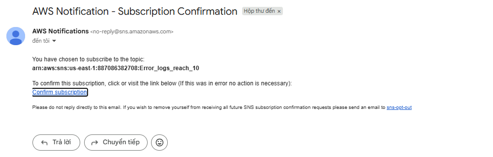

---

#### Bước 31: Kích hoạt Hoàn tất Metric Filter & Bắt đầu Thu thập Số liệu
* **Thao tác / Hướng dẫn:** Nhấn **Create metric filter**.
* **Quan sát:** Bộ lọc được kích hoạt thành công và chỉ số `HTTP404ErrorCount` lập tức xuất hiện trong mục All Metrics của CloudWatch.

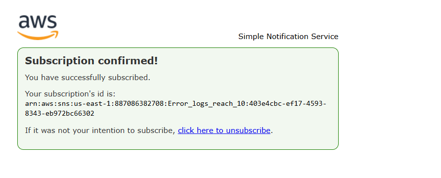

---

#### Bước 32: Cấu hình Điều kiện Ngưỡng Báo động Tự động (CloudWatch Alarm)
* **Thao tác / Hướng dẫn:** Menu bên trái chọn **Alarms** ➔ Nhấn **Create alarm** ➔ Chọn metric `CPUUtilization` của máy chủ EC2.
* **Thông số điền cụ thể:**
  * *Statistic:* `Average`
  * *Period:* `1 minute`
  * *Threshold type:* `Static`
  * *Whenever CPUUtilization is:* `Greater > 70`
  * *Datapoints to alarm:* `2 out of 2` (vượt ngưỡng liên tiếp trong 2 phút)

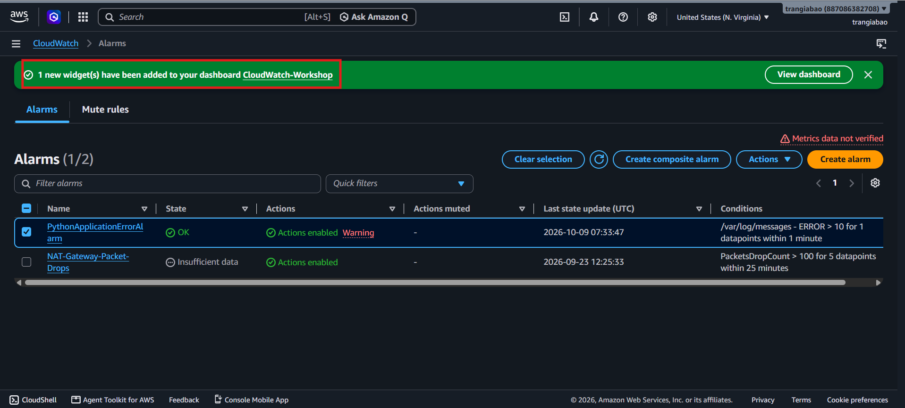

---

#### Bước 33: Thiết lập Thông báo SNS Topic & Xác nhận Trạng thái Theo dõi OK
* **Thao tác / Hướng dẫn:** Tại bước cấu hình Actions, chọn gửi thông báo tới Amazon SNS Topic ➔ Đặt tên Alarm là `High-CPU-Utilization-Alarm` ➔ Nhấn **Create alarm**.
* **Quan sát:** Chuông báo động được kích hoạt và duy trì trạng thái **OK** màu xanh lá cây khi máy chủ chạy tải bình thường.

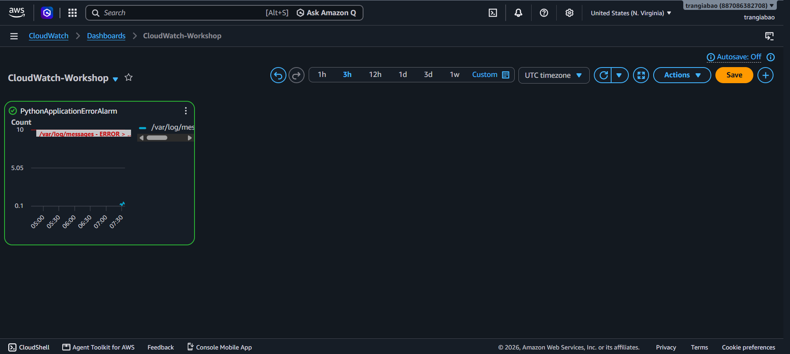

---

### 📝 Tổng kết & Bài học kinh nghiệm:
1. **Khả năng Quan sát Toàn diện (Full-stack Observability):** CloudWatch đóng vai trò trung tâm thu thập cả 3 trụ cột quan sát: Metrics (số liệu đo lường), Logs (nhật ký chi tiết) và Alarms (cảnh báo tức thời).
2. **Sức mạnh Vượt trội của Logs Insights:** Cho phép truy vấn, phân tích và trích xuất hàng gigabyte dữ liệu log chỉ trong vài giây mà không cần đầu tư dựng các cụm máy chủ ELK (Elasticsearch/Logstash/Kibana) phức tạp và tốn kém tài nguyên.
3. **Cơ chế Chuyển hóa Log thành Metric:** Metric Filters là cầu nối cực kỳ hiệu quả để giám sát các chỉ số kinh doanh hoặc lỗi ứng dụng phát sinh từ nhật ký thô, từ đó kích hoạt hệ thống chuông báo động bảo vệ hệ thống 24/7.
