---
title: "Week 4"
date: 2026-10-05
weight: 4
chapter: false
pre: " <b> 1.4. </b> "
---


### Objectives for Week 4:

* Familiarize and practice on **Amazon Lightsail** (Deploy Managed Database, WordPress, Prestashop, Snapshot, and Migration).
* Practice running containerized workloads rapidly using **Amazon Lightsail Container**.
* Design and implement elastic scaling and traffic balancing using **Amazon EC2 Auto Scaling** and **Application Load Balancer**.
* Establish comprehensive observability, deep log analytics, and automated threshold alerts with **Amazon CloudWatch**.
* Consolidate Week 4 knowledge, finalize all Worklog entries, and dedicate time to internship project research (**Project Proposal**).

### Tasks to be implemented this week:

| Day | Task | Start Date | Completion Date | Reference Material |
| :--- | :--- | :--- | :--- | :--- |
| **Monday** | **Amazon Lightsail Deployment:** <br>- Managed MySQL Database & WordPress Instance. <br>- Ubuntu Configuration, Static IP & Networking. <br>- Prestashop E-Commerce Platform. <br>- Snapshots Backup & Hardware Migration. | 05/10/2026 | 05/10/2026 | [Lightsail Workshop](https://000045.awsfcaj.com/) |
| **Tuesday** | **Run Applications on Amazon Lightsail Container:** <br>- Setup AWS CLI & Resolve IAM Policy Restrictions. <br>- Provision Lightsail Container Service. <br>- Deploy Public Nginx Container Image. <br>- Package & Push Custom Image via Build-Instance. | 06/10/2026 | 06/10/2026 | [Lightsail Container](https://000046.awsfcaj.com/) |
| **Wednesday** | **Scaling Applications with EC2 Auto Scaling:** <br>- Package Custom AMI & Build Launch Template. <br>- Establish Target Group & Application Load Balancer. <br>- Configure Auto Scaling Group & Scaling Policies. <br>- Execute Stress Testing & Validate Scale Out/In. | 07/10/2026 | 07/10/2026 | [Auto Scaling Workshop](https://000006.awsfcaj.com/) |
| **Thursday** | **Monitoring with Amazon CloudWatch:** <br>- Install CloudWatch Agent & Stream EC2 Metrics/Logs. <br>- Telemetry plotting with Search Expressions & Math Expressions. <br>- Query log data with CloudWatch Logs Insights. <br>- Configure Metric Filters and automated CloudWatch Alarms. | 08/10/2026 | 08/10/2026 | [CloudWatch Workshop](https://000008.awsfcaj.com/) |
| **Friday** | **Week 4 Review, Worklog & Project:** <br>- Synthesize concepts across Lightsail, Auto Scaling, and CloudWatch. <br>- Finalize technical details and screenshots for Worklogs 1.4.1 through 1.4.4. <br>- Research AWS architectural patterns and advance internship project proposal. | 09/10/2026 | 09/10/2026 | [Internal Review & Project Documentation](/2-proposal/) |

---

### Achievements for Week 4:

#### 📌 Results for Monday (05/10/2026) - Amazon Lightsail Deployment:

{}
The **Amazon Lightsail Deployment** hands-on lab was conducted on **Monday (05/10/2026)** during **Week 4**. This page provides a comprehensive step-by-step execution guide complete with precise parameter values, CLI commands, troubleshooting resolutions, and verification screenshots.
<br>🔗 **Lab Reference Material:** [Simplified Computing with Amazon Lightsail](https://000045.awsfcaj.com/)
{}

### 🎯 Lab Objectives:
* Familiarize with the simplified management console and core capabilities of **Amazon Lightsail**.
* Provision and manage a standalone **Managed Relational Database (MySQL)** on Lightsail.
* Deploy two web applications: **WordPress** and **Prestashop (E-Commerce)** connecting to the shared database.
* Configure the underlying Linux/Ubuntu environment, assign **Static IPs**, and define firewall rules.
* Implement data backup procedures using **Snapshots** and scale up workloads by upgrading instance plans (**Migration**).

---

### 📊 Provisioned Resource Specifications:

| Resource | Name / Identifier | Configuration & Detailed Specs | Address / Ports | Notes |
| :--- | :--- | :--- | :--- | :--- |
| **Lightsail Database** | `Workshop-DB-Instance` | MySQL 8.0, Standard Plan ($15/mo, 1GB RAM, 2 vCPUs) | Port 3306, Master User: `LightsailAdmin` | Master DB: `dbWordPress` |
| **WordPress Instance** | `WordPress-1` | Blueprint: WordPress (Bitnami), Linux/Ubuntu | Static IP: Attached, Port 80, 443 | Connected to Lightsail DB |
| **Prestashop Instance**| `Prestashop-1` | Blueprint: Prestashop, Linux/Ubuntu | Static IP: Attached, Port 80, 443 | E-Commerce Platform |
| **Instance Snapshot** | `wordpress-backup-snapshot` | Full point-in-time snapshot before instance upgrade | Size: ~20 GB, Status: Available | Used for scale-up |
| **Migrated Instance** | `WordPress-Migrated` | Created from Snapshot, higher hardware bundle | Static IP: Re-attached | Seamless service continuity |

---

### 🚀 Step-by-Step Implementation & Screenshot Gallery:

#### Step 1: Provision a Managed Relational Database (MySQL)
* **Action / Navigation:** Log into the **Amazon Lightsail** console ➔ Navigate to the **Databases** tab ➔ Click **Create database**.
* **Configuration Parameters:**
  * *Deployment Region:* `ap-southeast-1` (Singapore)
  * *Database Engine:* `MySQL` (version `8.0`)
  * *Master Username:* `LightsailAdmin`
  * *Master Password:* Generate strong automated password or specify custom secure password
  * *Initial Database Name:* `dbWordPress`
  * *Database Plan:* `Standard Plan` ($15/month, 1 GB RAM, 2 vCPUs, 40 GB SSD, 100 GB Data Transfer)
  * *Database Identifier:* `Workshop-DB-Instance`
  * *Identification Tags:* Key = `dbname`, Value = `dbWordPress`
* **Next Action:** Scroll down and click **Create database**. Monitor the status transition from *Creating* to *Available*.

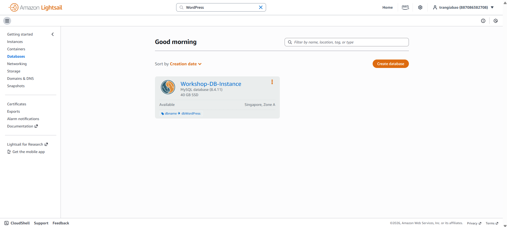

> **💡 Difficulties Encountered & Troubleshooting at Step 1:**  
> Initializing a Managed Database on Lightsail typically takes 5 to 10 minutes. Immediately save the Master User (`LightsailAdmin`), password, and Endpoint hostname shown on the screen. Forgetting these credentials requires resetting master credentials, adding delay to application setup.

---

#### Step 2: Deploy WordPress Application Instance (`WordPress-1`)
* **Action / Navigation:** Navigate to the **Instances** tab on Lightsail ➔ Click **Create instance**.
* **Configuration Parameters:**
  * *Instance Location:* `Singapore (Zone A)`
  * *Platform:* `Linux/Unix`
  * *Blueprint:* Select **WordPress** (pre-packaged Bitnami stack)
  * *Instance Plan:* $5/month bundle (1 GB RAM, 1 vCPU, 40 GB SSD, 2 TB Transfer)
  * *Instance Name:* `WordPress-1`
* **Next Action:** Click **Create instance**. The virtual server launches in 1 to 2 minutes.

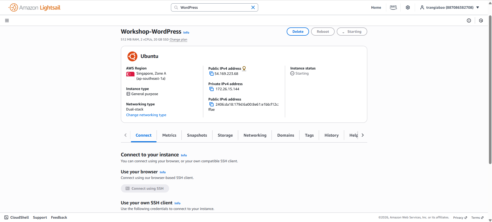

---

#### Step 3: Connect via SSH & Configure Ubuntu OS Environment
* **Action / Navigation:** On the `WordPress-1` instance card, click the orange terminal icon (**Connect using SSH**) to launch a browser-based shell session.
* **Commands Executed:**
  ```bash
  # Update Linux system package repositories
  sudo apt-get update -y

  # Inspect WordPress source application directory
  ls -la /opt/bitnami/wordpress
  ```
* **Purpose:** Verify OS integrity, permissions, and prepare configuration parameters needed to integrate with the remote database.

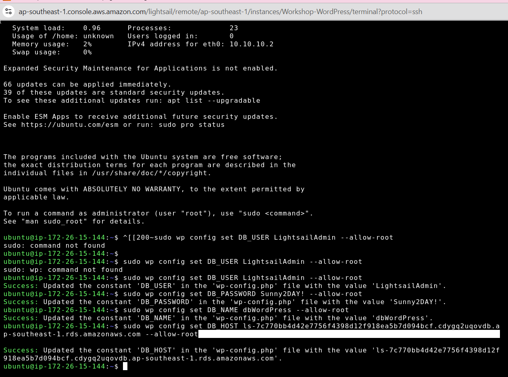

---

#### Step 4: Network Configuration, Static IP Assignment & Firewall Rules
* **Action / Navigation:** Open instance details for `WordPress-1` ➔ Select the **Networking** tab.
* **Configuration Parameters:**
  * *Attach Static IP:* Click **Attach static IP** ➔ Name it `StaticIP-WordPress-1` ➔ Attach to `WordPress-1` (ensures persistent public IP address across reboots).
  * *IPv4 Firewall Rules:*
    * **HTTP:** Port `80` (TCP), Source: `Custom / Anywhere`
    * **HTTPS:** Port `443` (TCP), Source: `Custom / Anywhere`
    * **SSH:** Port `22` (TCP) restricted or default Lightsail policy.

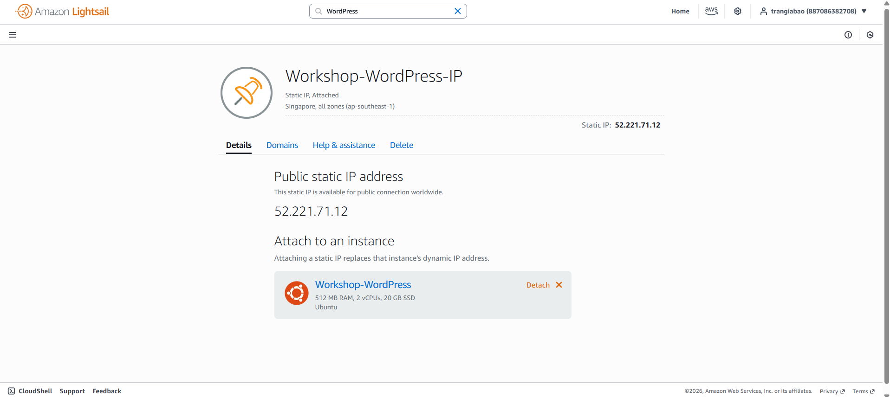

---

#### Step 5: Configure Database Connection & Initial WordPress Setup
* **Action / Navigation:** Open a new browser tab, navigate to `http://<Static-IP-WordPress-1>`. The WordPress Welcome setup wizard appears.
* **Configuration Parameters:**
  * *Database Name:* `dbWordPress`
  * *Username:* `LightsailAdmin`
  * *Password:* `[Master password saved in Step 1]`
  * *Database Host:* `[Workshop-DB-Instance Endpoint]:3306`
  * *Table Prefix:* `wp_`
* **Next Action:** Click **Submit** ➔ Click **Run the installation**.

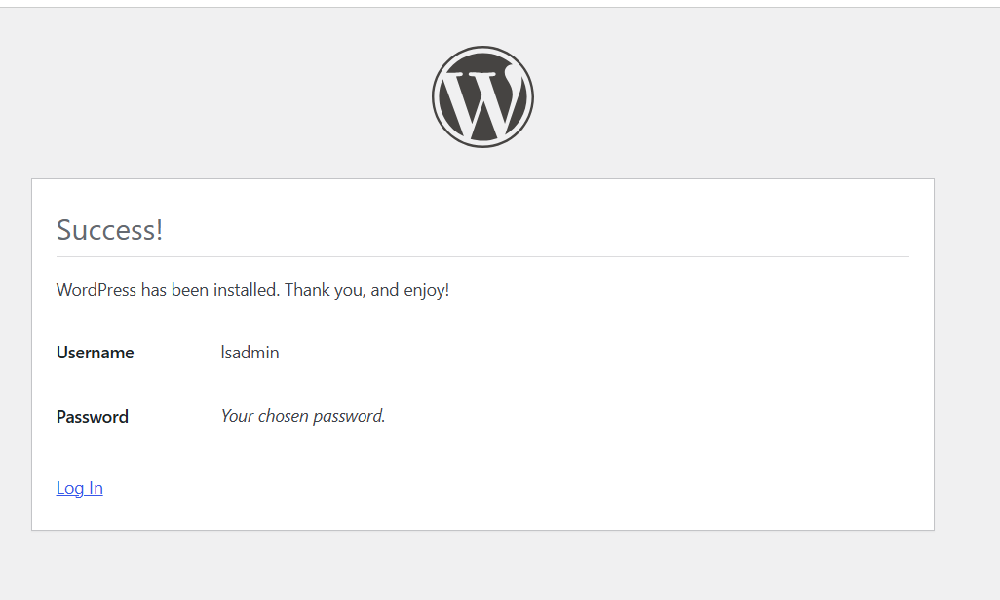

> **💡 Difficulties Encountered & Troubleshooting at Step 5:**  
> If an *"Error establishing a database connection"* appears, common causes include: (1) An incorrect Database Host string (must be the complete Lightsail DB Endpoint hostname, never `localhost`), (2) Case sensitivity mismatch on database name (`dbWordPress`), or (3) The Managed DB is still initializing. You can verify network reachability from SSH via `mysql -h <endpoint> -u LightsailAdmin -p`.

---

#### Step 6: Validate & Access WordPress Admin Dashboard
* **Action / Navigation:** Once installation finishes, browse to `http://<Static-IP-WordPress-1>/wp-admin`.
* **Configuration Parameters:**
  * *Site Title:* `Cloud Journey Blog`
  * *Username:* `admin`
  * *Password:* `[Admin password]`
  * *Email:* `trangiabao@example.com`
* **Result:** Successfully authenticate into the **WordPress Admin Dashboard**, confirming that blog posts and application settings are persisted to the external Lightsail DB.

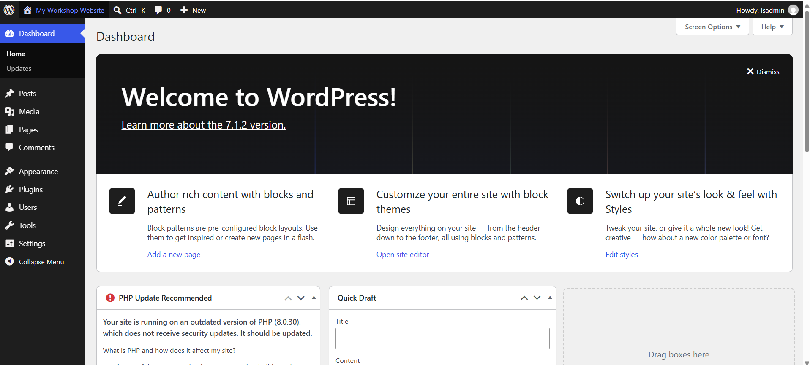

---

#### Step 7: Deploy Prestashop Instance & Configure Networking
* **Action / Navigation:** Return to Lightsail Console ➔ **Instances** tab ➔ Create a new instance using the **Prestashop** blueprint ➔ Name it `Prestashop-1`.
* **Configuration Parameters:**
  * *Platform:* `Linux/Unix`
  * *Blueprint:* `Prestashop`
  * *Instance Plan:* $5/month or $10/month bundle
  * *Instance Name:* `Prestashop-1`
  * *Networking:* Attach a dedicated Static IP `StaticIP-Prestashop-1`, ensure Firewall rules allow ports `80` (HTTP) and `443` (HTTPS).

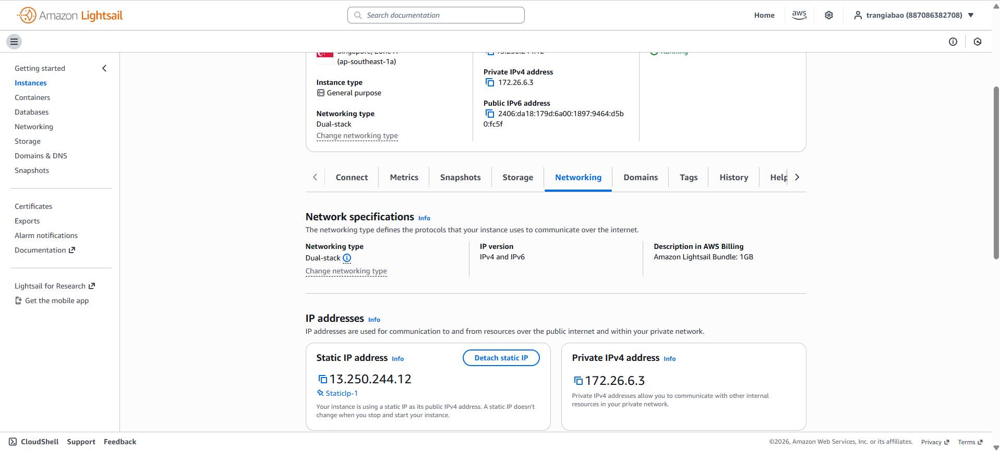

---

#### Step 8: Complete Prestashop E-Commerce Setup Wizard
* **Action / Navigation:** Open a new browser tab, navigate to `http://<Static-IP-Prestashop-1>` to launch the 6-step Prestashop Installation Assistant.
* **Configuration Parameters:**
  * *1. Welcome page:* Select `English` ➔ Click **Next**.
  * *2. License agreements:* Check *"I agree to the above terms and conditions"*.
  * *3. System compatibility:* Verify all server environment checks show green checkmarks.
  * *4. Store information:* Shop name `Cloud Store Demo`, Activity `Technology`, Country `Vietnam`.
  * *5. Database configuration:*
    * *Database server address:* `[Workshop-DB-Instance Endpoint]`
    * *Database name:* `dbPrestashop`
    * *Database login:* `LightsailAdmin`
    * *Database password:* `[Master DB password]`
* **Next Action:** Click **Test your database connection now!** to verify database privileges before completing setup.

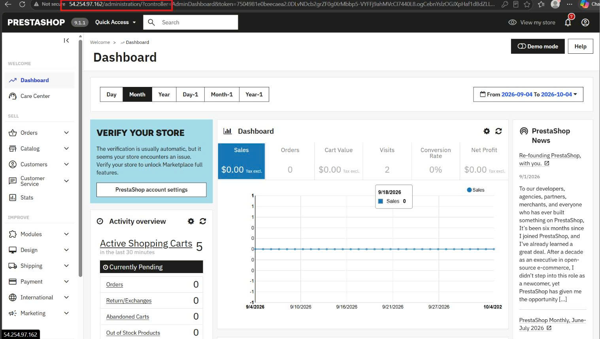

> **💡 Difficulties Encountered & Troubleshooting at Step 8:**  
> The Prestashop installer requires SQL permissions for `CREATE DATABASE`, `ALTER`, and `INDEX`. If reusing `LightsailAdmin`, ensure the target schema `dbPrestashop` is either pre-created or the user has permissions to create new databases.

---

#### Step 9: Access Prestashop Enterprise Admin Dashboard
* **Action / Navigation:** Connect via SSH to `Prestashop-1`, remove the temporary installation directory for security compliance, then access the Back Office URL.
* **Commands Executed:**
  ```bash
  # Remove installation directory per security guidelines
  sudo rm -rf /opt/bitnami/prestashop/install
  ```
* **Result:** Successfully log into the **Prestashop Back Office / Dashboard**, displaying catalog management, order metrics, and business intelligence panels.

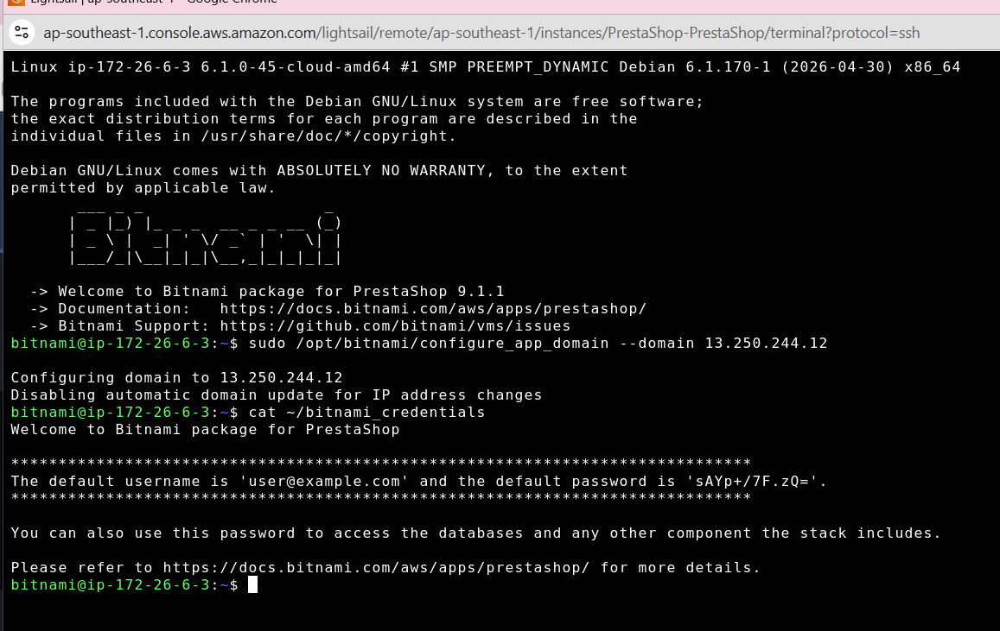

---

#### Step 10: Create Point-in-Time Instance Snapshot
* **Action / Navigation:** In the `WordPress-1` instance dashboard, navigate to the **Snapshots** tab ➔ Click **Create snapshot**.
* **Configuration Parameters:**
  * *Target Instance:* `WordPress-1`
  * *Snapshot Name:* `wordpress-backup-snapshot`
* **Purpose:** Capture the full disk state, operating system, web server configuration, and application code prior to executing hardware migration.

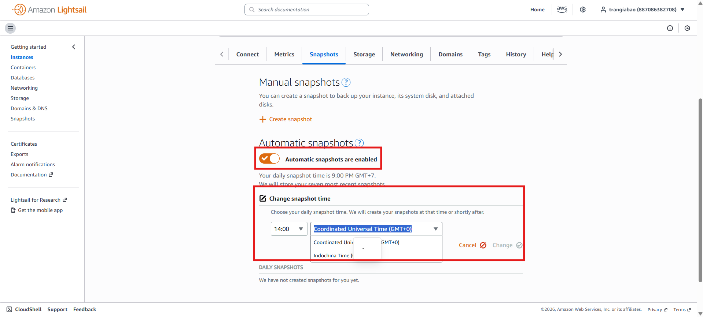

> **💡 Difficulties Encountered & Troubleshooting at Step 10:**  
> Snapshot creation reads and copies all disk blocks (~20 GB). During this window, avoid heavy database writes or software upgrades on the instance to guarantee point-in-time filesystem consistency.

---

#### Step 11: Monitor Snapshot Creation Progress
* **Action / Navigation:** Stay on the **Snapshots** tab to track real-time progress.
* **Observation:** The status displays **Snapshotting...** alongside a progress bar indicating data synchronization to underlying storage.

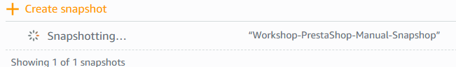

---

#### Step 12: Verify Snapshot Availability Status
* **Action / Navigation:** After 5 to 8 minutes, refresh the snapshot list.
* **Observation:** The snapshot `wordpress-backup-snapshot` transitions to **Available** status with timestamp and disk footprint recorded.

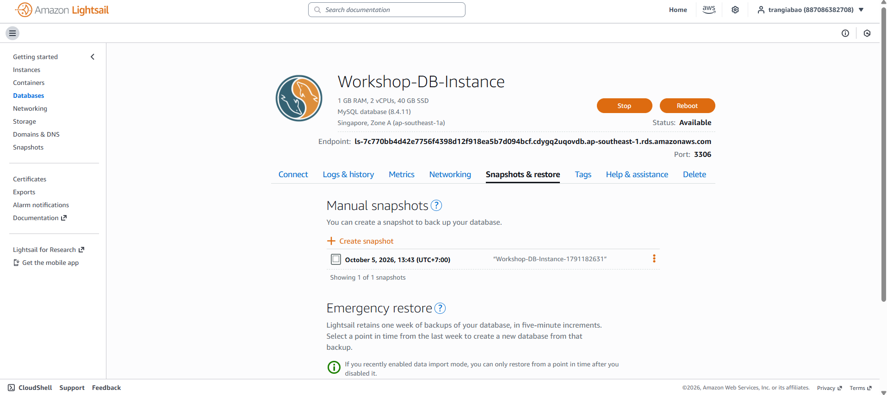

---

#### Step 13: Scale Hardware by Restoring Snapshot into a Larger Instance (Migration)
* **Action / Navigation:** Beside `wordpress-backup-snapshot`, click the three-dot action menu `...` ➔ Select **Create new instance from snapshot**.
* **Configuration Parameters:**
  * *Region:* `Singapore (ap-southeast-1)`
  * *Upgraded Instance Plan:* $10/month bundle (2 GB RAM, 1 vCPU, 60 GB SSD) or $20/month bundle (4 GB RAM, 2 vCPUs)
  * *New Instance Name:* `WordPress-Migrated`
* **Static IP Reassignment Procedure:**
  * Once `WordPress-Migrated` is running, return to the **Networking** tab.
  * Select `StaticIP-WordPress-1` ➔ Click **Detach** from old `WordPress-1`.
  * Click **Attach** and bind directly to `WordPress-Migrated`.
* **Result:** External visitors immediately access the upgraded, higher-capacity server without DNS downtime or configuration alterations.

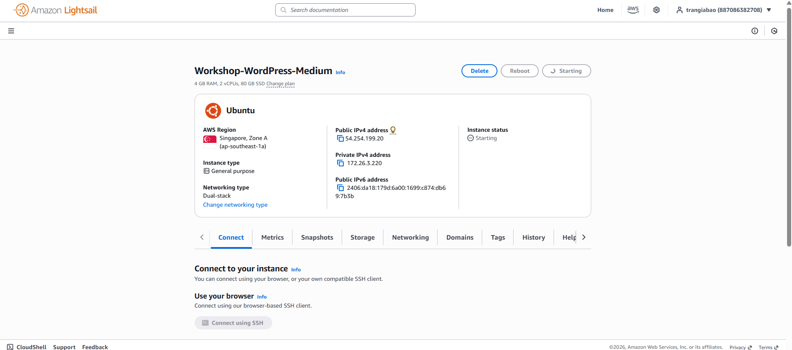

> **💡 Difficulties Encountered & Troubleshooting at Step 13:**  
> The most frequent pitfall during instance migration is forgetting to re-attach the Static IP address. If skipped, the new instance receives a random dynamic public IP, breaking existing domain names and bookmarks. Always verify static IP attachment after creating instances from snapshots.

---

### 📝 Summary & Key Takeaways:
1. **Simplicity of Lightsail:** Amazon Lightsail delivers a bundle-based, intuitive management experience with predictable monthly pricing, making it ideal for blogs, SMB applications, and rapid prototyping.
2. **Decoupled Architecture Best Practice:** Decoupling the database layer into a standalone Managed Database isolates mission-critical data from compute instances, simplifying maintenance and horizontal scaling.
3. **Seamless Vertical Scaling with Snapshots:** Point-in-time snapshots serve as an efficient disaster recovery mechanism and provide a safe bridge for upgrading compute resources when business traffic increases.

* **Introduction to Amazon Lightsail:** Understood AWS's simplified cloud platform designed for rapidly launching small-to-medium applications with predictable monthly costs.
* **Web Application & Database Setup:** Mastered deploying popular web platforms (WordPress and PrestaShop e-commerce) connected to an isolated managed database.
* **Networking & Data Protection:** Learned how to attach static IPs, manage basic firewall rules, create backup snapshots, and scale instances seamlessly as workloads grow.

---

#### 📌 Results for Tuesday (06/10/2026) - Run Applications on Amazon Lightsail Container:

{}
The **Amazon Lightsail Container Deployment** (Run Apps on Lightsail Container) hands-on lab was conducted on **Tuesday (06/10/2026)** during **Week 4**. This page provides a thorough step-by-step implementation guide featuring precise parameters, CLI execution commands, troubleshooting solutions, and all 11 verification screenshots.
<br>🔗 **Lab Reference Material:** [Amazon Lightsail Container - Run Apps on Lightsail Container](https://000046.awsfcaj.com/)
{}

### 🎯 Lab Objectives:
* Familiarize with the **Containers** feature on Amazon Lightsail — a streamlined solution for running containerized workloads without orchestrator complexity.
* Install and configure the **AWS CLI** and the **Lightsail Control (lightsailctl)** extension plugin to interact with container services from a local workstation.
* Provision a **Container Service** on Lightsail utilizing a cost-optimized hardware tier (Nano bundle).
* Deploy a **Public Container Image** (Nginx) sourced from Docker Hub onto the Lightsail Container Service.
* Launch a dedicated virtual machine **Build-Instance** (Ubuntu) to compile and push a **Custom Container Image** to the Lightsail private registry via `aws lightsail push-container-image`.
* Enable a Public Endpoint and verify live web application delivery over an auto-managed HTTPS SSL/TLS domain.

---

### 📊 Provisioned Resource Specifications:

| Resource | Name / Identifier | Configuration & Detailed Specs | Address / Ports | Notes |
| :--- | :--- | :--- | :--- | :--- |
| **AWS CLI** | Version 2.37.9 | Installed via PowerShell, configured Profile | IAM User: `Bao` (`ap-southeast-1`) | AWS command-line management tool |
| **Container Service** | `lightsail-container` | Nano (512 MB RAM, 0.25 vCPUs x 1 node) | Singapore (`ap-southeast-1a`) | Status: `Running` |
| **Public Deployment** | `test1` | Image: `nginx` (Docker Hub Public Registry) | Port 80 (HTTP), Health check: `/` | Rapid deployment from public registry |
| **Build Instance** | `Build-Instance` | Ubuntu 22.04 LTS, 512 MB RAM, 20 GB SSD | Public IP: `47.129.162.155` | Used to build & push Docker images |
| **Stored Container** | `:lightsail-container.nginx-container-hello.1` | Custom image uploaded from build instance | SHA256 digest validation | Lightsail private container repository |
| **Public Domain** | `lightsail-container...amazonlightsail.com` | HTTPS auto-issued with AWS SSL certificate | Port 443 / 80 | Publicly accessible application endpoint |

---

### 🚀 Step-by-Step Implementation & Screenshot Gallery:

#### Step 1: Install AWS CLI v2 on Windows Workstation
* **Action / Navigation:** Open **PowerShell** with administrative privileges (Run as Administrator) ➔ Execute the automated installation command for AWS CLI v2.
* **Command Executed:**
  ```powershell
  irm https://awscli.amazonaws.com/v2/install.ps1 | iex
  ```
* **Purpose:** Establish a standardized CLI environment to authenticate, manage resources, and push Docker images to Lightsail.

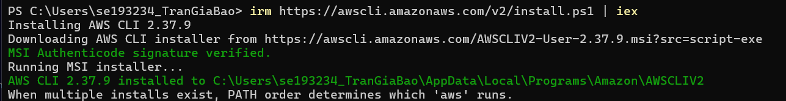

---

#### Step 2: Verify AWS CLI Installation Version
* **Action / Navigation:** Relaunch the terminal window and run the version inspection command.
* **Command Executed:**
  ```powershell
  aws --version
  ```
* **Output:** Displays `aws-cli/2.37.9 Python/3.14.0 Windows/10 exe/AMD64`, confirming operational readiness.

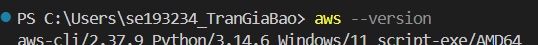

---

#### Step 3: Configure AWS Access Credentials (`aws configure`)
* **Action / Navigation:** Run `aws configure` and input IAM user authentication parameters.
* **Configuration Parameters:**
  * *AWS Access Key ID:* Supply Access Key for IAM User `Bao`
  * *AWS Secret Access Key:* Supply matching Secret Access Key
  * *Default region name:* `ap-southeast-1` (Singapore)
  * *Default output format:* `json`
* **Command Executed:**
  ```powershell
  aws configure
  ```

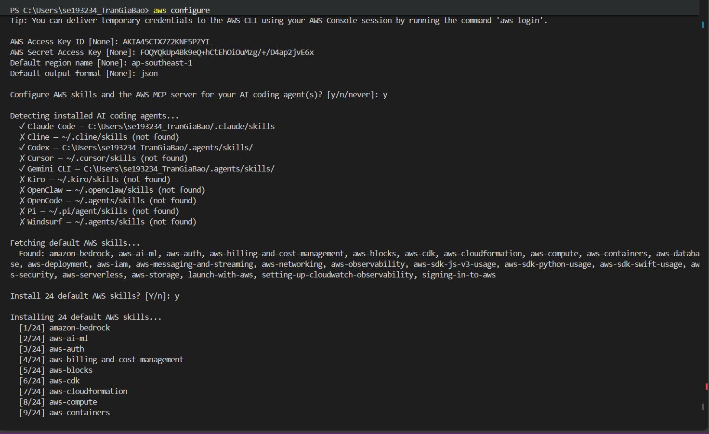

---

#### Step 4: Verify IAM User Privileges & Resolve `AccessDenied` Errors
* **Action / Navigation:** Test service connectivity using `aws s3 ls`.
* **Issue Observed:** Returns `An error occurred (AccessDenied) when calling the ListBuckets operation`.
* **Resolution:** Navigate to **IAM Management Console** ➔ Locate User **`Bao`** ➔ Select **Add permissions** ➔ Directly attach policy **`AmazonLightsailFullAccess`** and re-verify CLI execution.

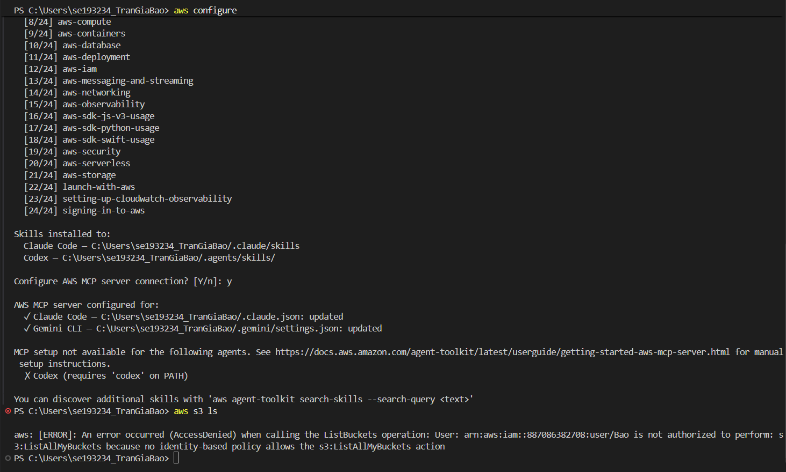

> **💡 Difficulties Encountered & Troubleshooting at Step 4:**  
> When operating Lightsail through the CLI, standard EC2/S3 permissions are insufficient. Commands like `aws lightsail push-container-image` will immediately fail unless `AmazonLightsailFullAccess` is granted to allow container service provisioning and private registry image uploads.

---

#### Step 5: Provision Container Service on Amazon Lightsail
* **Action / Navigation:** Log into the **Amazon Lightsail** console ➔ Navigate to the **Containers** tab ➔ Click **Create container service**.
* **Configuration Parameters:**
  * *Region:* `Singapore (ap-southeast-1)`
  * *Capacity Bundle:* **Nano** (512 MB RAM, 0.25 vCPUs x 1 node) at $7/month for cost optimization
  * *Container service name:* `lightsail-container`
* **Result:** The service initializes with status **Ready** and auto-generates a public domain name in the format `lightsail-container.<id>.ap-southeast-1.cs.amazonlightsail.com`.

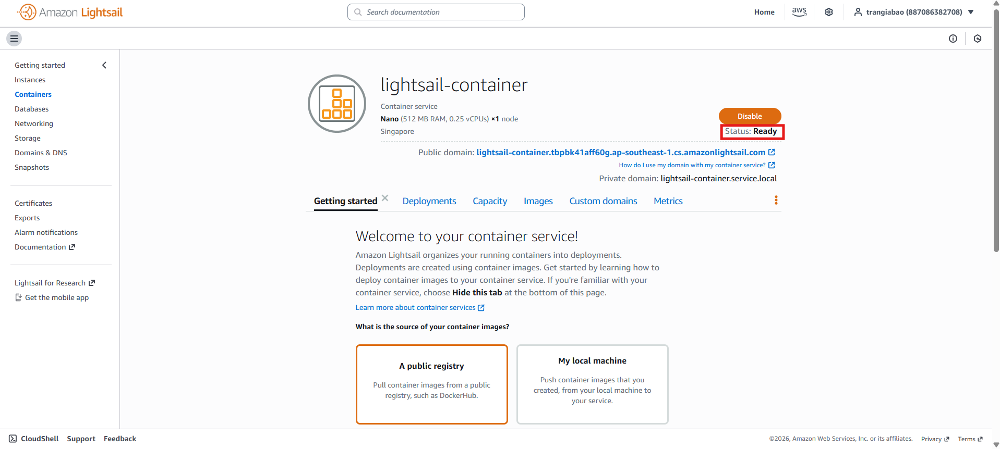

---

#### Step 6: Create First Deployment using Public Nginx Container Image
* **Action / Navigation:** In the `lightsail-container` details view, click **Create your first deployment**.
* **Configuration Parameters:**
  * *Container name:* `test1`
  * *Image:* `nginx` (pulled directly from Docker Hub Public Registry)
  * *Open ports:* Port `80`, Protocol `HTTP`

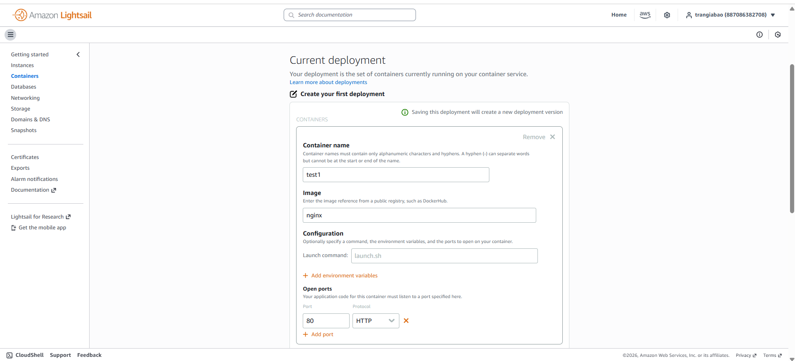

---

#### Step 7: Configure Public Endpoint & Health Check Parameters
* **Action / Navigation:** Scroll down to the **PUBLIC ENDPOINT** section on the deployment form.
* **Configuration Parameters:**
  * *Target container:* Select `test1`
  * *Port:* `80`
  * *Health check path:* `/`
* **Next Action:** Click **Save and deploy**.

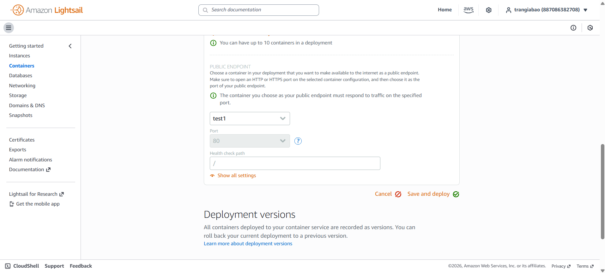

---

#### Step 8: Validate Active Deployment & Running Service Status
* **Action / Navigation:** Monitor the dashboard as Lightsail orchestrates the container lifecycle.
* **Observation:** The deployment switches to **Active**, and overall service status shifts from *Deploying* to **Running**.

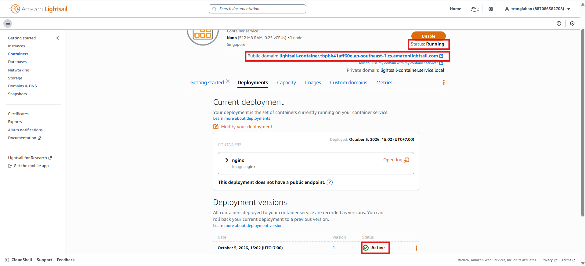

---

#### Step 9: Launch Dedicated Build Virtual Machine (`Build-Instance`)
* **Action / Navigation:** Navigate to the **Instances** tab on Lightsail ➔ Click **Create instance** to provision a Linux build workstation.
* **Configuration Parameters:**
  * *Platform:* `Linux/Unix`
  * *Blueprint:* `OS Only` ➔ Select `Ubuntu 22.04 LTS`
  * *Instance plan:* $3.50/month bundle (512 MB RAM, 1 vCPU, 20 GB SSD)
  * *Instance name:* `Build-Instance`
  * *Assigned Public IP:* `47.129.162.155`

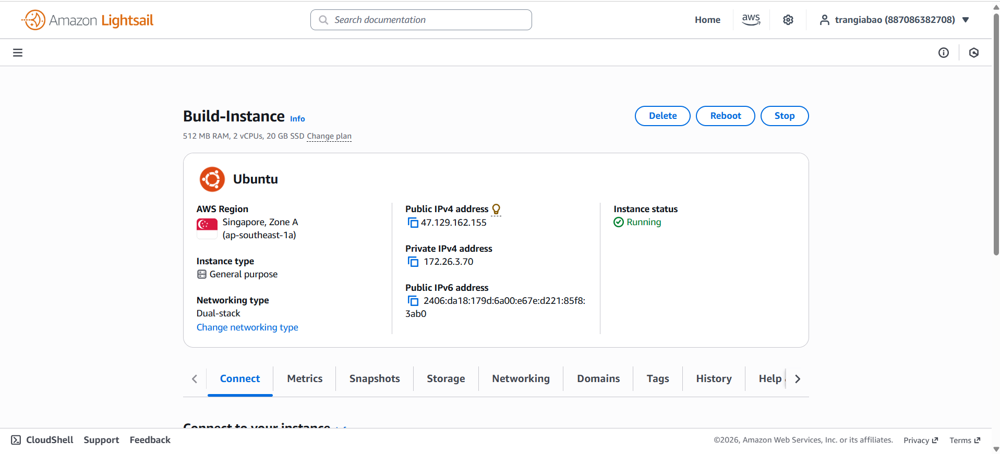

---

#### Step 10: Build Custom Container Image & Push to Lightsail Registry
* **Action / Navigation:** SSH into `Build-Instance`, install Docker engine, install the `lightsailctl` plugin, and execute the push command.
* **Commands Executed:**
  ```bash
  # 1. Install lightsailctl extension binary
  sudo curl "https://s3.us-west-2.amazonaws.com/lightsailctl/latest/linux-amd64/lightsailctl" -o "/usr/local/bin/lightsailctl"
  sudo chmod +x /usr/local/bin/lightsailctl

  # 2. Build local custom Docker image
  docker build -t nginx-container-hello:latest .

  # 3. Push container image directly to Lightsail service repository
  aws lightsail push-container-image \
    --region ap-southeast-1 \
    --service-name lightsail-container \
    --label nginx-container-hello \
    --image nginx-container-hello:latest
  ```
* **Result:** CLI outputs the stored image reference: `:lightsail-container.nginx-container-hello.1` with SHA256 digest.

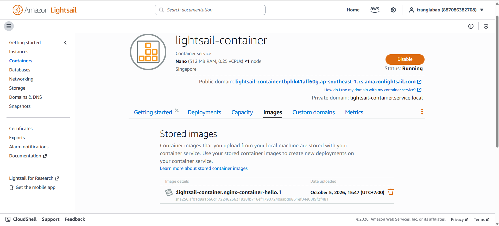

> **💡 Difficulties Encountered & Troubleshooting at Step 10:**  
> Missing the **lightsailctl** binary causes `aws lightsail push-container-image` to abort immediately because the standard AWS CLI relies on this extension to stream image layers into Lightsail. Ensure execution permissions (`chmod +x`) are applied and verify location at `/usr/local/bin/lightsailctl`. Furthermore, the `--label` flag strictly accepts lowercase letters and hyphens.

---

#### Step 11: Update Deployment & Validate Live HTTPS Application
* **Action / Navigation:** In the Lightsail Console, update the deployment image source to `:lightsail-container.nginx-container-hello.1` ➔ Click **Save and deploy** ➔ Access the public domain in a browser.
* **Access URL:** `https://lightsail-container.5vpta1mr2570.ap-southeast-1.cs.amazonlightsail.com`
* **Result:** Web page loads with the **"Welcome to nginx!"** landing page, showing a valid SSL/TLS lock icon issued by Amazon Trust Services.

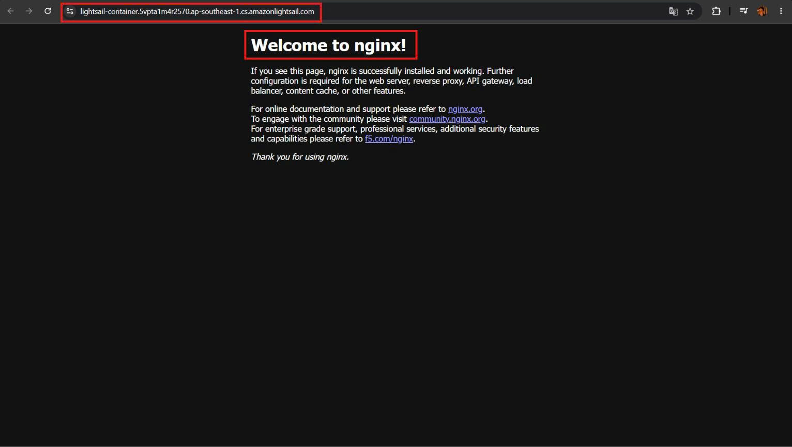

---

### 📝 Summary & Key Takeaways:
1. **Frictionless Container Deployment:** Lightsail Containers provides an effortless abstraction over containerized workloads, removing the overhead of managing Kubernetes control planes (EKS) or complex task definitions (ECS).
2. **Automated SSL/TLS Provisioning:** Amazon Lightsail automatically provisions free HTTPS endpoints with valid certificates for every service, streamlining production-like testing.
3. **Dedicated Build Workstation Pattern:** Utilizing a lightweight Lightsail instance (`Build-Instance`) as a dedicated Docker compiler isolates local development dependencies from cloud deployment pipelines.

* **Container Services on Lightsail:** Understood running containerized workloads in the cloud without the complexity of managing underlying server orchestration clusters.
* **Deploying Container Workloads:** Learned how to launch standard public container images from Docker Hub, as well as build and push custom application containers to private cloud repositories.
* **Secure Application Access:** Experienced automatic HTTPS/SSL certificate provisioning and verified public accessibility of running container services.

---

#### 📌 Results for Wednesday (07/10/2026) - Scaling Applications with EC2 Auto Scaling:

{}
The **Auto Scaling with EC2 Auto Scaling** (Scaling Applications with EC2 Auto Scaling) hands-on lab was conducted on **Wednesday (07/10/2026)** during **Week 4**. This page delivers a detailed step-by-step walkthrough covering explicit parameters, stress testing commands, troubleshooting resolutions, and all 44 verification screenshots.
<br>🔗 **Lab Reference Material:** [Triển khai ứng dụng FCAJ Management với Auto Scaling Group](https://000006.awsfcaj.com/)
{}

### 🎯 Lab Objectives:
* Understand the core design principles of **Scalable & Highly Available Architecture** on AWS.
* Package a functional application server into a reusable **Custom AMI**.
* Construct a standardized **Launch Template** defining automated compute specifications.
* Deploy an **Application Load Balancer (ALB)** paired with a **Target Group** for balanced traffic distribution.
* Configure an **Auto Scaling Group (ASG)** with **Dynamic Scaling Policies** driven by CloudWatch CPU metrics.
* Execute a synthetic **Stress Test** to validate automated **Scale Out** and **Scale In** lifecycle behaviors.
* Execute a complete teardown procedure to decommission all provisioned resources and prevent unintended costs.

---

### 📊 Provisioned Resource Specifications:

| Resource | Name / Identifier | Configuration & Detailed Specs | Address / Ports | Notes |
| :--- | :--- | :--- | :--- | :--- |
| **Custom AMI** | `fcaj-app-ami` | Packaged sample Node.js server + application code | AMI ID: `ami-0...` | Master golden image for fleet instances |
| **Launch Template** | `fcaj-launch-template` | `t2.micro`, Amazon Linux, SG: Ports 80/3000 | Version 1 | Automates instance provisioning |
| **Target Group** | `fcaj-tg` | Target Type: Instance, Protocol: HTTP (Port 80) | Health Check: `/` | Manages target registration and health checks |
| **Load Balancer** | `fcaj-alb` | Application Load Balancer, Multi-AZ Subnets | DNS Name of ALB | Central ingress traffic gateway |
| **Auto Scaling Group**| `fcaj-asg` | Min: 1, Desired: 1, Max: 3 instances | Distributed across 2 Availability Zones | Auto-manages fleet capacity |
| **Scaling Policy** | `TargetTracking-CPU` | Metric: Average CPU Utilization > 50% | Warmup: 300s | Automatically triggers Scale Out under load |

---

### 🚀 Step-by-Step Implementation & Screenshot Gallery:

#### Step 1: Create Custom AMI from Baseline EC2 Instance
* **Action / Navigation:** In the **Amazon EC2** console ➔ Navigate to **Instances** ➔ Select the running golden application instance ➔ Click **Actions** ➔ **Image and templates** ➔ Click **Create image**.
* **Purpose:** Package the operating system, code dependencies, and runtime environment into an immutable golden image for automated fleet scaling.

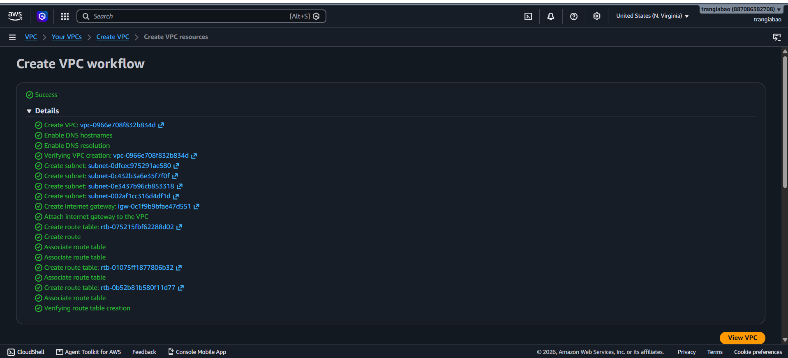

> **💡 Difficulties Encountered & Troubleshooting at Step 1:**  
> By default, creating an AMI causes AWS to temporarily reboot the instance to ensure filesystem synchronization. If uninterrupted uptime is strictly required, the *"No reboot"* option can be checked; however, allowing reboot is strongly advised to guarantee image data integrity.

---

#### Step 2: Configure Name and Storage Volumes for Custom AMI
* **Action / Navigation:** Fill in the image configuration parameters.
* **Configuration Parameters:**
  * *Image name:* `fcaj-app-ami`
  * *Image description:* `Custom AMI for FCAJ Management Application with Node.js`
  * *Instance volumes:* 1x Root EBS volume (8 GiB, General Purpose SSD gp2)
* **Next Action:** Click **Create image**.

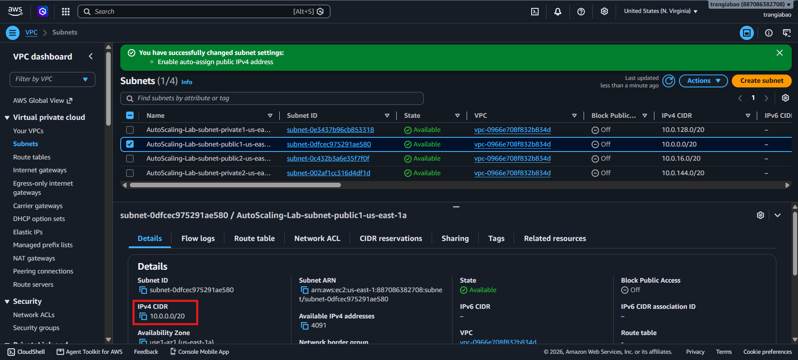

---

#### Step 3: Monitor AMI Generation Status
* **Action / Navigation:** In the EC2 navigation sidebar, navigate to **Images** ➔ **AMIs**.
* **Observation:** The AMI `fcaj-app-ami` begins block-level copying with initial status showing **pending**.

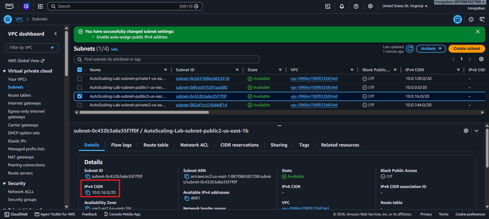

---

#### Step 4: Verify AMI Available Status
* **Action / Navigation:** Wait 3 to 5 minutes and refresh the AMIs console.
* **Observation:** Status transitions to **available**, confirming readiness for Launch Template integration.

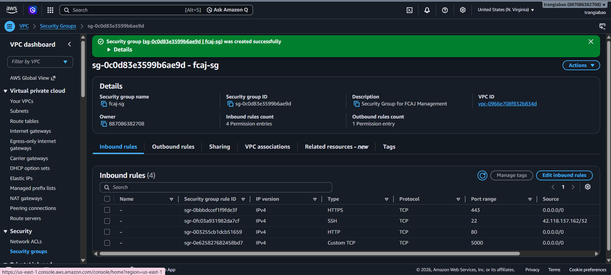

---

#### Step 5: Inspect AMI Configuration Details & Underlying Snapshot
* **Action / Navigation:** Select `fcaj-app-ami` and review the Details pane.
* **Details Observed:** An associated Snapshot ID is linked under Elastic Block Store, virtualization type `hvm`, architecture `x86_64`.

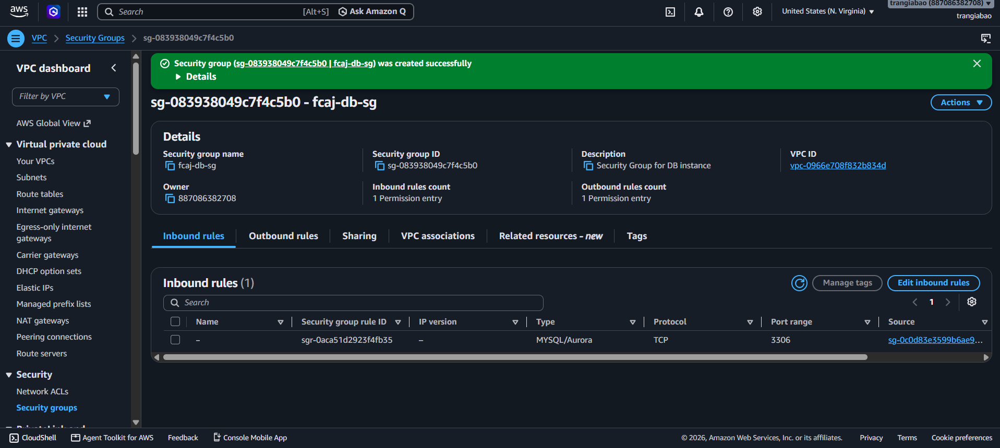

---

#### Step 6: Create Target Group for Application Load Balancer
* **Action / Navigation:** In the EC2 sidebar, select **Target Groups** ➔ Click **Create target group**.
* **Configuration Parameters:**
  * *Target type:* **Instances**
  * *Target group name:* `fcaj-tg`
  * *Protocol / Port:* `HTTP` : `80`
  * *VPC:* Select Default VPC or Workshop VPC
  * *Health checks:* Protocol `HTTP`, Path `/`
* **Next Action:** Click **Next** ➔ Click **Create target group** (manual target registration is bypassed because ASG handles this automatically).

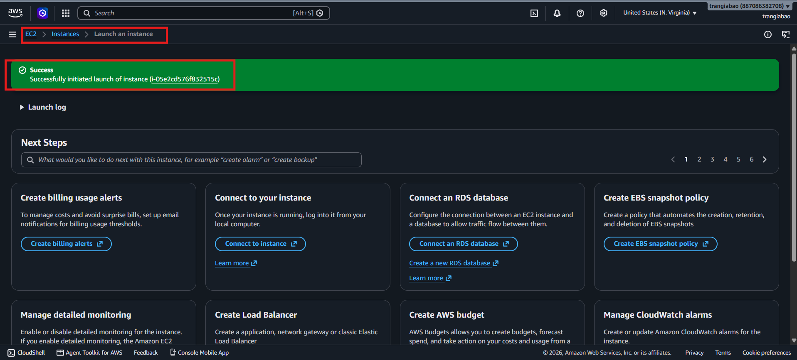

---

#### Step 7: Create Application Load Balancer (`fcaj-alb`)
* **Action / Navigation:** Select **Load Balancers** ➔ Click **Create load balancer** ➔ Select **Application Load Balancer**.
* **Configuration Parameters:**
  * *Load balancer name:* `fcaj-alb`
  * *Scheme:* **Internet-facing**
  * *IP address type:* `IPv4`
  * *Network mapping:* Select VPC and at least two public Availability Zones / Subnets
  * *Security groups:* Attach a Security Group permitting Inbound Port `80` (HTTP) from `0.0.0.0/0`
  * *Listeners and routing:* Port `80` (HTTP) ➔ Forward to `fcaj-tg`
* **Next Action:** Scroll down and click **Create load balancer**.

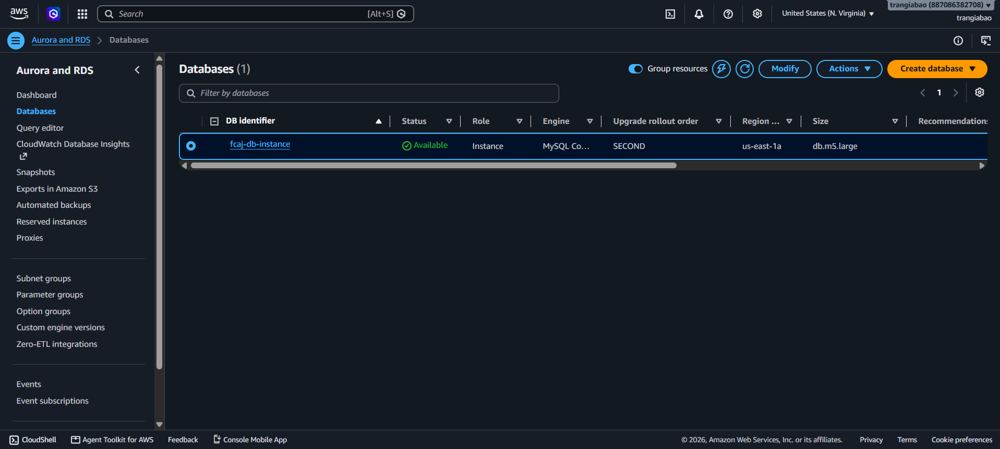

> **💡 Difficulties Encountered & Troubleshooting at Step 7:**  
> The ALB Security Group must allow open public HTTP traffic (`0.0.0.0/0`), but backend EC2 instances should strictly restrict incoming port 80 traffic to the ALB Security Group ID only. This ensures all traffic is properly filtered and inspected by the load balancer.

---

#### Step 8: Initiate Launch Template Creation
* **Action / Navigation:** In the EC2 sidebar, click **Launch Templates** ➔ Click **Create launch template**.
* **Purpose:** Define compute specifications, security boundaries, and bootstrap scripts for automated ASG provisioning.

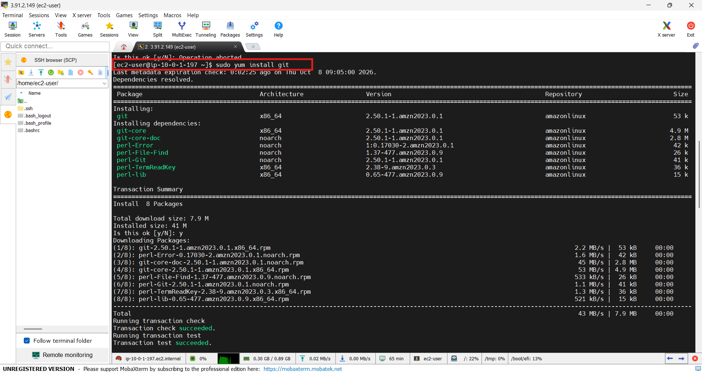

---

#### Step 9: Configure Launch Template Metadata and Version
* **Action / Navigation:** Populate identity fields for the template.
* **Configuration Parameters:**
  * *Launch template name:* `fcaj-launch-template`
  * *Template version description:* `Initial version for FCAJ ASG`
  * *Auto Scaling guidance:* Check *"Provide guidance to help me set up a template that I can use with EC2 Auto Scaling"*.

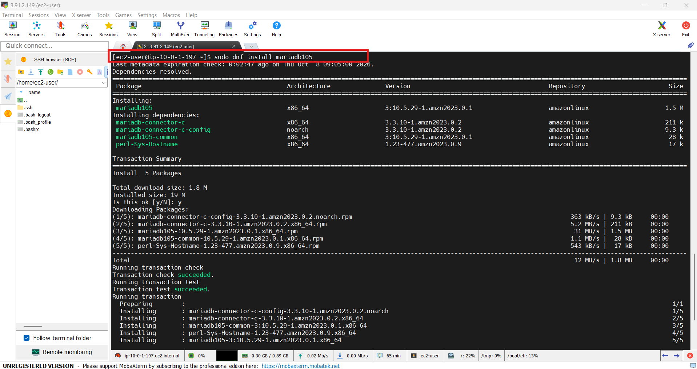

---

#### Step 10: Select Custom AMI Source (`fcaj-app-ami`)
* **Action / Navigation:** Under **Application and OS Images (Amazon Machine Image)** ➔ Click **My AMIs** ➔ Select **Owned by me**.
* **Selection:** Select `fcaj-app-ami` created in Step 4.

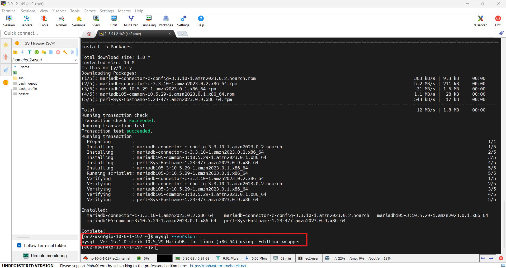

---

#### Step 11: Specify Instance Type
* **Action / Navigation:** Under **Instance type**, pick the Free-Tier eligible size.
* **Configuration:** `t2.micro` (1 vCPU, 1 GiB Memory).

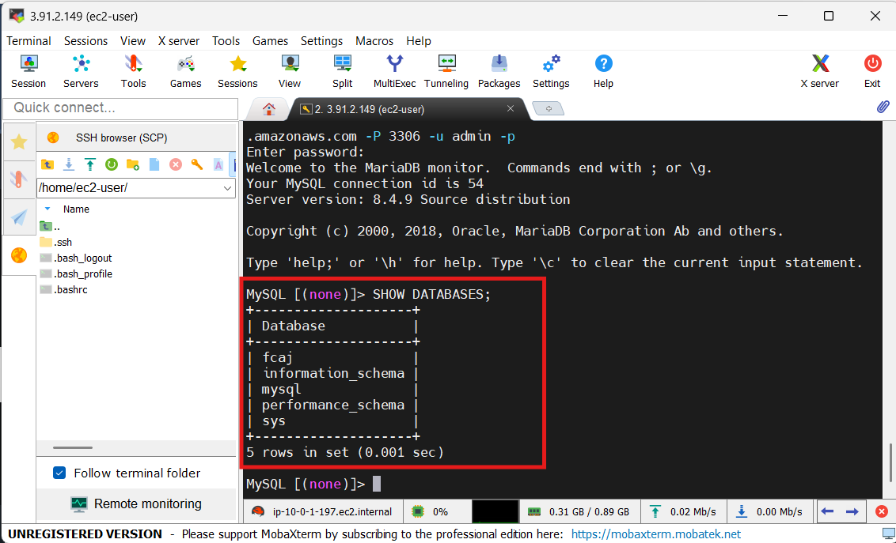

---

#### Step 12: Configure SSH Authentication Key Pair
* **Action / Navigation:** Under **Key pair (login)**, specify key settings.
* **Configuration:** Select your pre-existing Key Pair or select `Don't include in launch template` if SSH direct access is not required.

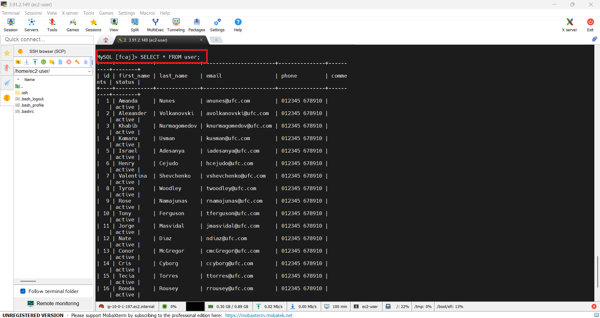

---

#### Step 13: Configure Network Settings & Security Group
* **Action / Navigation:** Under **Network settings**, configure firewall associations.
* **Configuration Parameters:**
  * *Subnet:* `Don't include in launch template` (allowing ASG to distribute instances dynamically across subnets)
  * *Firewall (Security groups):* Choose **Select existing security group** ➔ Select the SG permitting HTTP traffic from the ALB.

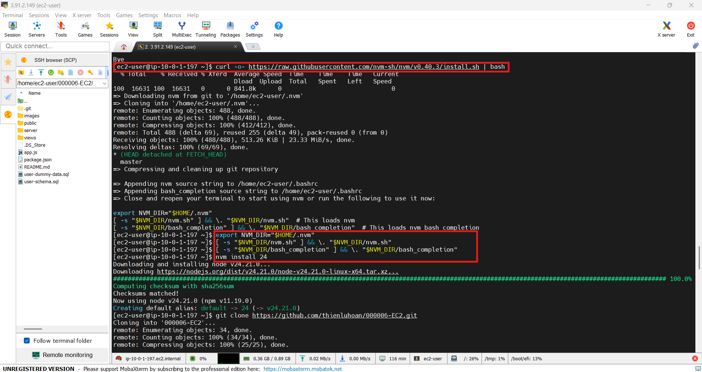

---

#### Step 14: Configure Storage Volumes (EBS)
* **Action / Navigation:** Under **Configure storage**, retain golden AMI disk defaults.
* **Configuration Parameters:** 1x 8 GiB General Purpose SSD (gp2), Delete on termination: `Yes`.

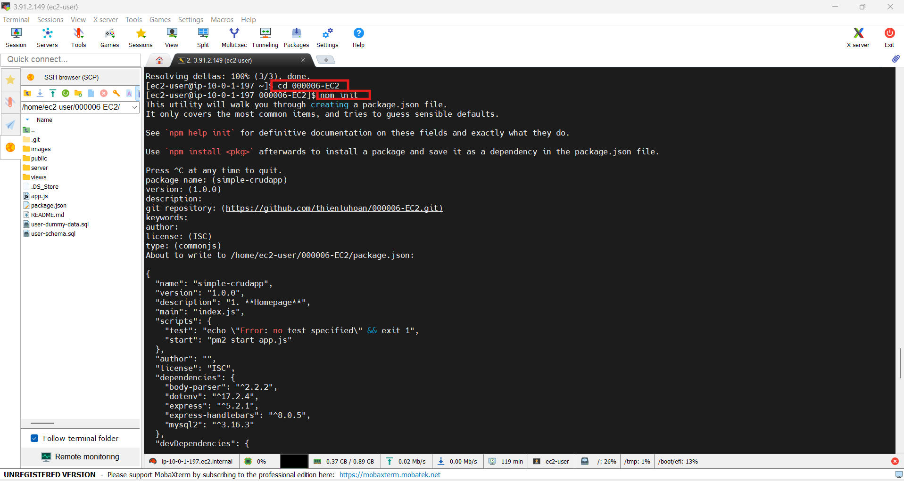

---

#### Step 15: Configure Advanced Details & User Data Bootstrap Script
* **Action / Navigation:** Expand **Advanced details**, scroll to **User data**.
* **Bootstrap Script:**
  ```bash
  #!/bin/bash
  # Ensure application server starts on boot
  cd /home/ec2-user/fcaj-app || cd /var/www/html
  npm start || systemctl restart httpd
  ```

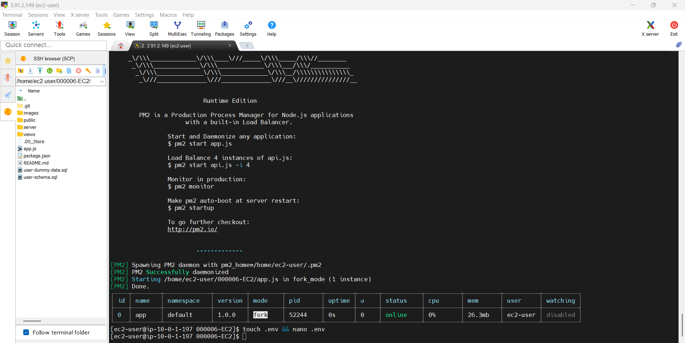

---

#### Step 16: Verify Successful Launch Template Creation
* **Action / Navigation:** Click **Create launch template**.
* **Observation:** A confirmation screen verifies `fcaj-launch-template` has been successfully created as Version 1.

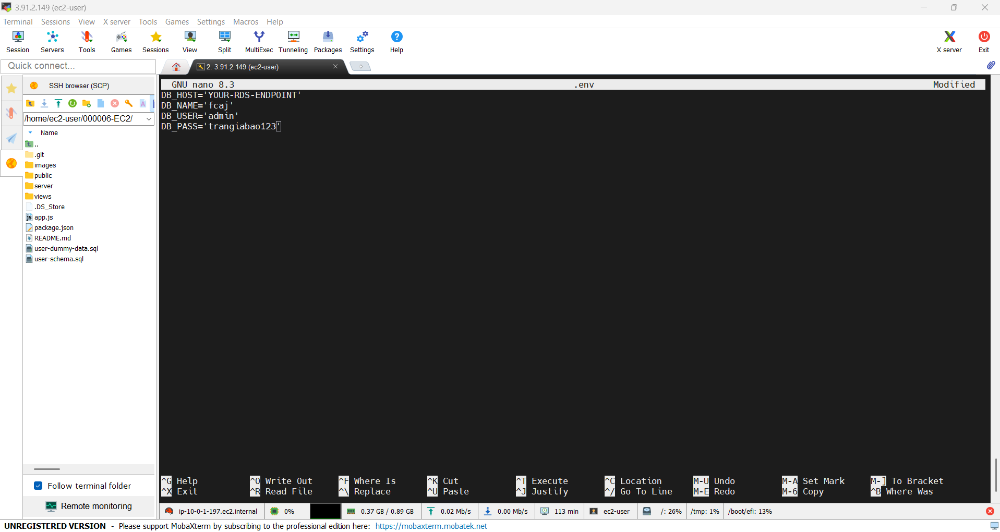

---

#### Step 17: Initiate Auto Scaling Group Creation (`fcaj-asg`)
* **Action / Navigation:** In the EC2 sidebar, select **Auto Scaling Groups** ➔ Click **Create Auto Scaling group**.
* **Configuration Parameters:**
  * *Auto Scaling group name:* `fcaj-asg`
  * *Launch template:* Select `fcaj-launch-template` (Version `Default (1)`)
* **Next Action:** Click **Next**.

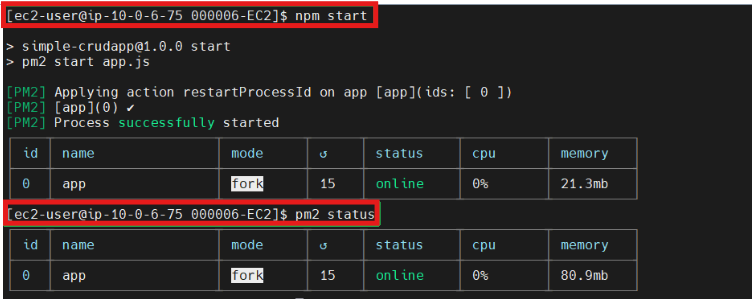

---

#### Step 18: Select Network VPC and Multi-AZ Subnets
* **Action / Navigation:** On the *Choose instance launch options* step.
* **Configuration Parameters:**
  * *VPC:* Select the workshop VPC
  * *Availability Zones and subnets:* Select at least **2 Subnets** across distinct AZs (e.g., `ap-southeast-1a` and `ap-southeast-1b`) for High Availability.
* **Next Action:** Click **Next**.

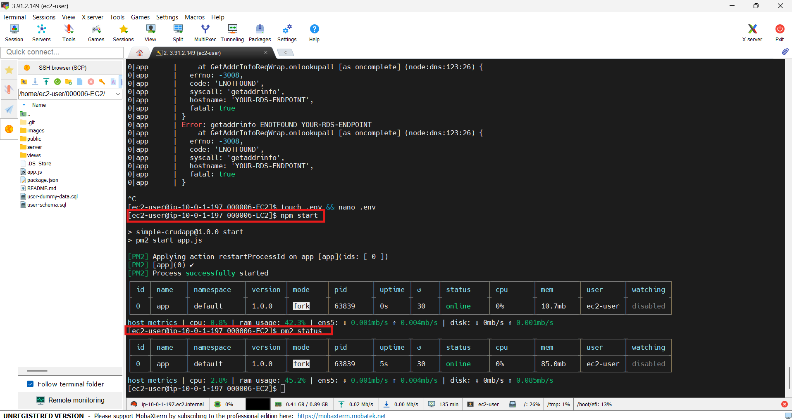

---

#### Step 19: Attach ALB Target Group & Enable ELB Health Checks
* **Action / Navigation:** On the *Configure advanced options* step.
* **Configuration Parameters:**
  * *Load balancing:* Choose **Attach to an existing load balancer** ➔ Select `fcaj-tg`.
  * *Health checks:* Check **Turn on Elastic Load Balancing health checks**.
  * *Health check grace period:* `300` seconds.
* **Next Action:** Click **Next**.

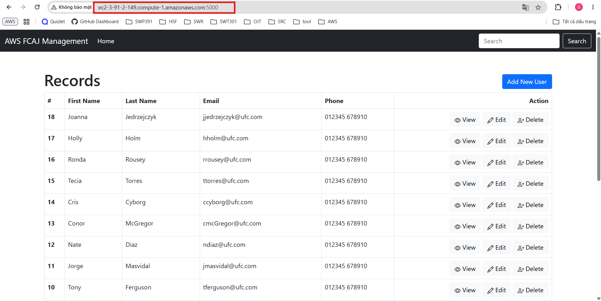

> **💡 Difficulties Encountered & Troubleshooting at Step 19:**  
> Without ELB health checks enabled, ASG only checks hypervisor status (EC2 status checks), missing cases where the web application crashes. Enabling ELB health checks ensures unresponsive instances are automatically terminated and replaced. Keep the grace period at 300 seconds so new instances have time to boot before health evaluation begins.

---

#### Step 20: Configure Group Size Capacities (Min, Desired, Max)
* **Action / Navigation:** On the *Configure group size and scaling policies* step.
* **Configuration Parameters:**
  * *Desired capacity:* `1`
  * *Minimum capacity:* `1`
  * *Maximum capacity:* `3`
  * *Scaling policies:* Select **None** temporarily (configured in Step 28).
* **Next Action:** Advance through Notifications and Tags by clicking **Next**.

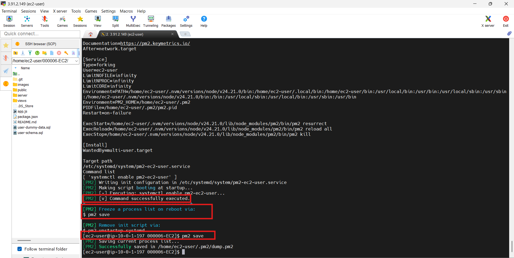

---

#### Step 21: Review ASG Configuration and Finalize Provisioning
* **Action / Navigation:** In the *Review* step, audit Launch Template, network mappings, and capacity constraints.
* **Next Action:** Click **Create Auto Scaling group**.

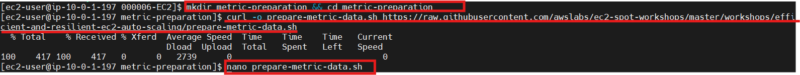

---

#### Step 22: ASG Auto-Spawns Initial EC2 Instance
* **Action / Navigation:** Select `fcaj-asg` ➔ Navigate to the **Activity** tab.
* **Observation:** The activity log records `Launching a new EC2 instance` to satisfy Desired capacity = 1.

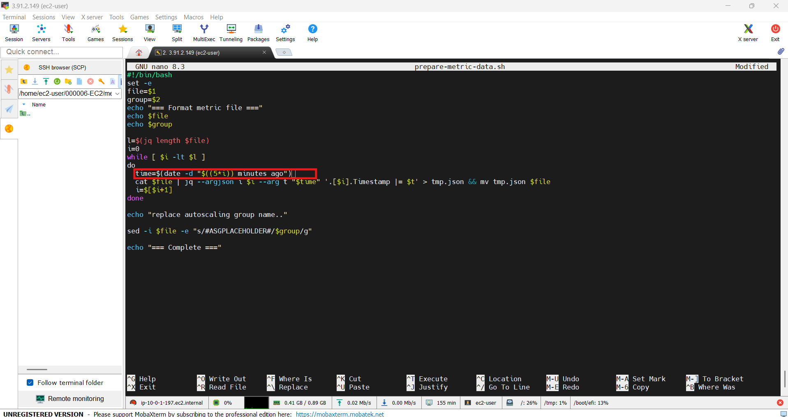

---

#### Step 23: Validate InService Lifecycle State
* **Action / Navigation:** Click the **Instance management** tab within `fcaj-asg`.
* **Observation:** The newly provisioned instance displays Health status **Healthy** and Lifecycle state **InService**.

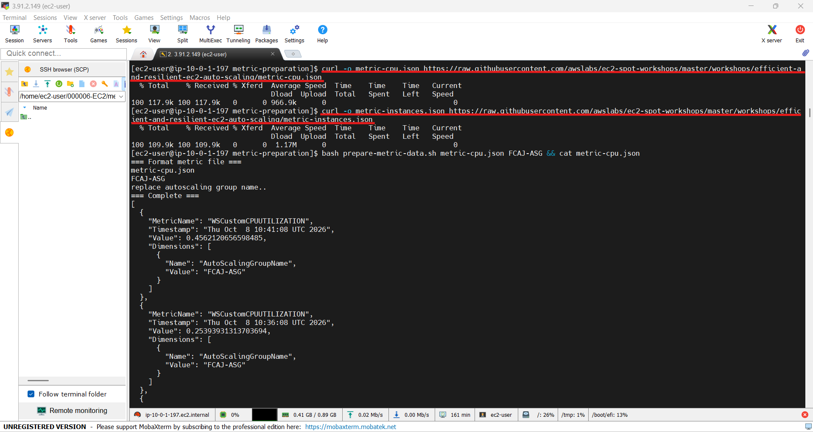

---

#### Step 24: Verify Target Group Healthy State
* **Action / Navigation:** Return to **Target Groups** ➔ Select `fcaj-tg` ➔ Inspect the **Targets** tab.
* **Observation:** The instance registered by ASG shows health check status as **healthy** on port 80.

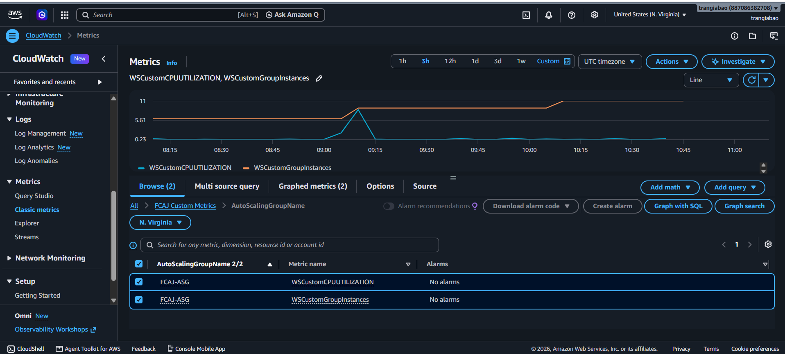

---

#### Step 25: Access Application via ALB Public DNS Name
* **Action / Navigation:** Navigate to **Load Balancers**, copy the **DNS name** of `fcaj-alb` ➔ Open a web browser and navigate to `http://<ALB-DNS-Name>`.
* **Result:** Traffic is successfully routed through the load balancer to the active backend instance.

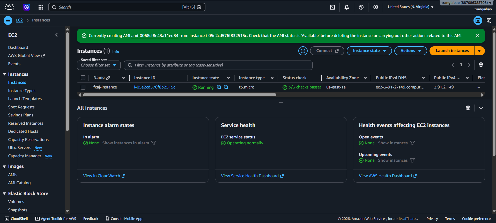

---

#### Step 26: Authenticate into FCAJ Management Application
* **Action / Navigation:** Enter credentials on the application login interface to verify end-to-end functionality.
* **Configuration Parameters:**
  * *Username:* `admin`
  * *Password:* `[Application default password]`
* **Next Action:** Click **Sign In**.

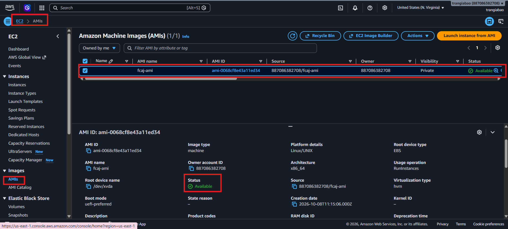

---

#### Step 27: Verify Operational Dashboard Status
* **Action / Navigation:** Inspect navigation elements upon successful authentication.
* **Result:** Application administrative dashboard loads reliably via ALB routing.


---

#### Step 28: Configure Dynamic Scaling Policy on CPU Threshold
* **Action / Navigation:** In `fcaj-asg` details ➔ Select **Automatic scaling** tab ➔ Under *Dynamic scaling policies*, click **Create dynamic scaling policy**.
* **Configuration Parameters:**
  * *Policy type:* **Target tracking scaling**
  * *Scaling policy name:* `TargetTracking-CPU`


---

#### Step 29: Define 50% Average CPU Utilization Target
* **Action / Navigation:** Configure Target Tracking parameters.
* **Configuration Parameters:**
  * *Metric type:* **Average CPU utilization**
  * *Target value:* `50` (%)
  * *Instance warmup:* `300` seconds
* **Next Action:** Click **Create**.


---

#### Step 30: Verify CloudWatch Alarms Triggered by Policy
* **Action / Navigation:** Open the **CloudWatch** console ➔ Select **Alarms**.
* **Observation:** Two alarms are generated automatically: One detecting CPU > 50% (triggers Scale Out) and one detecting CPU < 35% (triggers Scale In).


---

#### Step 31: Execute Synthetic CPU Stress Test via SSH
* **Action / Navigation:** SSH into the running EC2 instance and execute the `stress` utility.
* **Commands Executed:**
  ```bash
  # Install stress utility
  sudo amazon-linux-extras install epel -y || sudo dnf install -y epel-release
  sudo yum install -y stress

  # Generate 100% load on 2 CPU cores for 600 seconds
  stress --cpu 2 --timeout 600s
  ```


> **💡 Difficulties Encountered & Troubleshooting at Step 31:**  
> Standard CloudWatch metrics evaluate on 5-minute averages. Ensure the `stress` duration is maintained for at least 600 seconds (10 minutes), or enable Detailed Monitoring on the instance to guarantee swift alarm state changes.

---

#### Step 32: Observe CPU Utilization Spike on CloudWatch
* **Action / Navigation:** Open the CloudWatch metric graph for `CPUUtilization`.
* **Observation:** CPU load surges sharply from baseline (~1%) to nearly 100%, breaching the 50% target threshold.


---

#### Step 33: CloudWatch Alarm Fires Scale Out Event
* **Action / Navigation:** Return to the **Activity** tab in `fcaj-asg`.
* **Observation:** The alarm changes state to **In alarm**, triggering `Launching a new EC2 instance to balance the target metric`.


---

#### Step 34: Fleet Expands & Balances Workload Seamlessly
* **Action / Navigation:** Inspect the **Instance management** tab and **Target Groups**.
* **Result:** Capacity scales up from 1 to 2 (up to 3 per Max size configuration), both registering as `InService` and `Healthy`, dividing traffic and stabilizing the workload.


---

#### Step 35: Resource Cleanup Step 1 - Delete Auto Scaling Group
* **Action / Navigation:** After lab completion, navigate to **Auto Scaling Groups** ➔ Select `fcaj-asg` ➔ Click **Actions** ➔ Click **Delete**.


---

#### Step 36: Confirm Deletion and Await Instance Termination
* **Action / Navigation:** Type the confirmation keyword.
* **Parameter:** Enter `delete` ➔ Click **Delete**. All fleet instances managed by ASG terminate automatically.


---

#### Step 37: Verify All EC2 Fleet Instances Terminated
* **Action / Navigation:** In the EC2 console, review **Instances**.
* **Observation:** Fleet instances transition to **Terminated**, shutting down compute billing.


---

#### Step 38: Resource Cleanup Step 2 - Delete Application Load Balancer
* **Action / Navigation:** In the sidebar, select **Load Balancers** ➔ Select `fcaj-alb` ➔ Click **Actions** ➔ Click **Delete load balancer** ➔ Confirm **Delete**.


---

#### Step 39: Delete Target Group (`fcaj-tg`)
* **Action / Navigation:** Navigate to **Target Groups** ➔ Select `fcaj-tg` ➔ Click **Actions** ➔ Click **Delete**.


---

#### Step 40: Resource Cleanup Step 3 - Delete Launch Template
* **Action / Navigation:** Open **Launch Templates** ➔ Select `fcaj-launch-template` ➔ Click **Actions** ➔ Click **Delete template**.


---

#### Step 41: Confirm Permanent Launch Template Deletion
* **Action / Navigation:** In the prompt, type `Delete` ➔ Click **Delete**.


---

#### Step 42: Resource Cleanup Step 4 - Deregister Custom AMI
* **Action / Navigation:** Navigate to **AMIs** ➔ Select `fcaj-app-ami` ➔ Click **Actions** ➔ Click **Deregister AMI** ➔ Confirm deregistration.


---

#### Step 43: Locate Associated EBS Snapshot of Deregistered AMI
* **Action / Navigation:** In the sidebar, open **Elastic Block Store** ➔ **Snapshots** ➔ Identify the snapshot referencing the deregistered AMI ID.


---

#### Step 44: Permanently Delete EBS Snapshot to Prevent Storage Charges
* **Action / Navigation:** Select the snapshot ➔ Click **Actions** ➔ Click **Delete snapshot** ➔ Confirm **Delete**.
* **Result:** All workshop resources are cleanly expunged, eliminating residual cloud storage costs.


> **💡 Difficulties Encountered & Troubleshooting at Step 44:**  
> Deregistering an AMI does not delete its underlying EBS snapshot. The snapshot remains in AWS storage and incurs monthly charges unless explicitly deleted. Always inspect the Snapshots console after deregistering AMIs.

---

### 📝 Summary & Key Takeaways:
1. **Self-Healing Architecture:** EC2 Auto Scaling continuously evaluates ELB health checks, immediately terminating and replacing unresponsive instances without requiring operational intervention.
2. **Dynamic Cost Efficiency:** Elastic scaling dynamically aligns compute consumption with real-time demand, automatically shedding surplus instances during low-traffic periods.
3. **Stateless Tier Best Practice:** Applications deployed within Auto Scaling Groups should maintain a stateless architecture, offloading state to managed databases (RDS) and distributed caching tiers (ElastiCache).

* **Standardizing Server Templates:** Understood how to capture golden server images (AMIs) and standardize deployment configurations via Launch Templates.
* **Traffic Distribution via Load Balancers:** Mastered load balancing principles by distributing incoming user traffic across multiple availability zones to ensure high availability.
* **Elastic Auto Scaling:** Experienced dynamic scaling firsthand—observing automatic scale-out during high demand and scale-in when demand subsides to optimize infrastructure costs.

---

#### 📌 Results for Thursday (08/10/2026) - Monitoring with Amazon CloudWatch:

{}
The **Monitoring with Amazon CloudWatch** hands-on lab was conducted on **Thursday (08/10/2026)** during **Week 4**. This page provides a comprehensive step-by-step implementation guide featuring precise configuration parameters, Logs Insights query syntax, Math Expressions, troubleshooting resolutions, and all 33 verification screenshots.
<br>🔗 **Lab Reference Material:** [Monitoring with Amazon CloudWatch](https://000008.awsfcaj.com/)
{}

### 🎯 Lab Objectives:
* Master the centralized monitoring and observability capabilities of **Amazon CloudWatch** on AWS.
* Visualize and analyze real-time performance metrics (**CloudWatch Metrics**) across cloud infrastructure.
* Utilize **Search Expressions** and **Math Expressions** to dynamically discover, aggregate, and normalize telemetry data.
* Configure **Dynamic Labels** for context-aware and automated chart legends.
* Ingest and analyze system logs (**CloudWatch Logs**) using the interactive query language **CloudWatch Logs Insights**.
* Establish **Metric Filters** to extract actionable quantitative metrics from unstructured application log streams.
* Configure **CloudWatch Alarms** integrated with **Amazon SNS** to automate proactive incident alerting.

---

### 📊 Provisioned Resource Specifications:

| Resource | Name / Identifier | Configuration & Detailed Specs | Region / Status | Notes |
| :--- | :--- | :--- | :--- | :--- |
| **EC2 Instance Monitored** | `Web-Server-Lab` | Amazon Linux 2023, CloudWatch Agent installed | `ap-southeast-1` | Telemetry & log collection |
| **Metric Monitored** | `CPUUtilization`, `DiskReadBytes` | Namespace: `AWS/EC2`, Period: 1 minute | Real-time monitoring | Graphical performance telemetry |
| **Search Expression** | `SEARCH(' {AWS/EC2,InstanceId} MetricName="CPUUtilization" ', 'Average', 300)` | Automated metric query across all fleet instances | Dynamic Dashboard | Self-updating on new instance launch |
| **Math Expression** | `m1 * 100 / MAX(m1)` | Normalizes CPU utilization proportionally | Math plot expression | Mathematical data modeling |
| **Log Group** | `/aws/ec2/system-logs` | Retention: 7 days | Ingestion: Active | OS and web server access logs |
| **Metric Filter** | `HTTP404ErrorCount` | Pattern: `[ip, user, username, timestamp, request, status_code = 404, size]` | Namespace: `Custom/Web` | Counts HTTP 404 errors from access logs |
| **CloudWatch Alarm** | `High-CPU-Utilization-Alarm` | Static threshold: CPU > 70% across 2 periods | Status: `OK` / `ALARM` | Dispatches automated SNS email alerts |

---

### 🚀 Step-by-Step Implementation & Screenshot Gallery:

#### Step 1: Environment Setup & CloudWatch Agent Installation on EC2
* **Action / Navigation:** Launch EC2 instance `Web-Server-Lab`, attach IAM Role with policy `CloudWatchAgentServerPolicy` ➔ Connect via SSH and install the agent package.
* **Commands Executed:**
  ```bash
  # Install CloudWatch Agent package
  sudo yum install -y amazon-cloudwatch-agent

  # Start CloudWatch Agent daemon with configuration file
  sudo /opt/aws/amazon-cloudwatch-agent/bin/amazon-cloudwatch-agent-ctl \
    -a fetch-config -m ec2 -s -c file:/opt/aws/amazon-cloudwatch-agent/etc/amazon-cloudwatch-agent.json
  ```


> **💡 Difficulties Encountered & Troubleshooting at Step 1:**  
> If the EC2 instance lacks the `CloudWatchAgentServerPolicy` IAM Role, log writes in `/var/log/amazon/amazon-cloudwatch-agent/amazon-cloudwatch-agent.log` will fail with an `AccessDeniedException`. Always ensure IAM Role assignment prior to starting the agent service.

---

#### Step 2: Explore CloudWatch All Metrics Dashboard
* **Action / Navigation:** In the **CloudWatch Console** ➔ Sidebar select **Metrics** ➔ **All metrics**.
* **Purpose:** Inspect default namespaces populated automatically by AWS (e.g., `AWS/EC2`, `AWS/EBS`, `AWS/ApplicationELB`).


---

#### Step 3: Select Per-Instance EC2 Telemetry Metrics
* **Action / Navigation:** Under **All metrics**, navigate to **EC2** ➔ Click **Per-Instance Metrics**.
* **Configuration:** Locate the target Instance ID and check `CPUUtilization`, `NetworkIn`, and `DiskReadBytes`.


---

#### Step 4: Customize Metric Visualization (Graphed Metrics)
* **Action / Navigation:** Switch to the **Graphed metrics** tab.
* **Configuration:** Toggle line visibility, assign unique colors, and associate series with left or right Y-axes.


---

#### Step 5: Adjust Aggregation Period and Statistics
* **Action / Navigation:** Under the **Statistic** column, change to **Average**. Under **Period**, select **1 Minute** for high-resolution sampling.


---

#### Step 6: Render High-Fidelity Real-Time CPU Graph
* **Action / Navigation:** Adjust the time-window selector to **1h** (last 1 hour).
* **Observation:** The plot details granular 1-minute CPU variations in real time.


---

#### Step 7: Define Dynamic Search Expression Query
* **Action / Navigation:** In **Graphed metrics**, click **Add math** ➔ **Search expression**.
* **Search Expression Syntax:**
  ```text
  SEARCH(' {AWS/EC2,InstanceId} MetricName="CPUUtilization" ', 'Average', 300)
  ```
* **Purpose:** Dynamically discovers and plots CPU utilization across all current and future EC2 instances without manual selection.


> **💡 Difficulties Encountered & Troubleshooting at Step 7:**  
> Search Expression syntax is sensitive to spacing and curly brace syntax `{}` for dimensions. Ensure metric and dimension names match exact casing (`MetricName="CPUUtilization"`).

---

#### Step 8: Multi-Instance Telemetry Visualization via Search Expression
* **Action / Navigation:** Click **Apply**.
* **Observation:** The graph renders discrete lines for all active instances in the region automatically.


---

#### Step 9: Audit Matched Metric Streams
* **Action / Navigation:** Expand the query results below the chart.
* **Observation:** All matching instance telemetry streams are indexed with associated Instance IDs.


---

#### Step 10: Apply Mathematical Expressions to Metric Series
* **Action / Navigation:** Click **Add math** ➔ **Start with empty expression**.
* **Formula Applied:**
  ```text
  (m1 / 100) * 100
  ```
* **Purpose:** Normalizes data scales or computes ratios across distinct network interfaces.


---

#### Step 11: Configure Dynamic Labels from Resource Properties
* **Action / Navigation:** In the Label column, enter the property interpolation variable.
* **Expression Syntax:**
  ```text
  ${PROP('Dim.InstanceId')} - CPU Load
  ```
* **Purpose:** Replaces cryptic metric identifiers with human-readable instance IDs in the chart legend.


---

#### Step 12: Validate Formatted Dashboard Graph
* **Action / Navigation:** Review the finalized graph.
* **Observation:** The legend renders dynamic contextual labels, ready to pin to an executive dashboard.


---

#### Step 13: Access CloudWatch Logs Groups Console
* **Action / Navigation:** In the sidebar, select **Logs** ➔ **Log groups**.
* **Selection:** Open the `/aws/ec2/system-logs` log group ingested by the CloudWatch Agent.


---

#### Step 14: Inspect Per-Instance Log Streams
* **Action / Navigation:** Inside `/aws/ec2/system-logs`, select the **Log streams** tab.
* **Observation:** Dedicated streams are partitioned per EC2 Instance ID.


---

#### Step 15: Review Raw System Log Event Records
* **Action / Navigation:** Click a specific log stream to review raw event rows.
* **Observation:** Operating system events, boot logs, and application outputs are preserved with UTC/Local timestamps.


---

#### Step 16: Launch CloudWatch Logs Insights Query Editor
* **Action / Navigation:** Sidebar select **Logs** ➔ **Logs Insights**.
* **Configuration:** In *Select log group(s)*, choose `/aws/ec2/system-logs`.


---

#### Step 17: Execute Query to Filter Error Messages
* **Action / Navigation:** Input the error extraction query.
* **Query Syntax:**
  ```text
  fields @timestamp, @message
  | filter @message like /(?i)(error|exception|fail)/
  | sort @timestamp desc
  | limit 20
  ```
* **Next Action:** Click **Run query**.


---

#### Step 18: Analyze Logs Insights Tabular Results
* **Action / Navigation:** Examine the tabular records returned by the query engine.
* **Observation:** Matching error events are isolated with timestamp and message payloads.


---

#### Step 19: Visualize Error Occurrence Frequency Over Time
* **Action / Navigation:** Switch to the **Visualization** tab ➔ Select **Line chart**.
* **Observation:** Error volume over time displays spike frequencies clearly.


---

#### Step 20: Aggregate Distribution by HTTP Status Code
* **Action / Navigation:** Execute an aggregation query across HTTP response codes.
* **Query Syntax:**
  ```text
  stats count(*) by status_code
  ```
* **Result:** Breaks down requests into 200 (OK), 404 (Not Found), and 500 (Server Error) buckets.


---

#### Step 21: Parse Custom Log Fields (Pattern Extraction)
* **Action / Navigation:** Use the `parse` command to extract IP, method, and URI from raw web logs.
* **Query Syntax:**
  ```text
  parse @message "* * [*] \"* * *\" * *" as client_ip, user, timestamp, method, uri, protocol, status, bytes
  | display client_ip, method, uri, status
  ```


---

#### Step 22: Query Top Ingress Client IP Addresses
* **Action / Navigation:** Extract and sort the highest-frequency requester IP addresses.
* **Query Syntax:**
  ```text
  stats count(*) as request_count by client_ip
  | sort request_count desc
  | limit 10
  ```


---

#### Step 23: Save Optimized Query to Library
* **Action / Navigation:** Click **Save** in the top right ➔ Name the query `Top-Error-Analysis`.


---

#### Step 24: Re-load Query from Saved Queries Pane
* **Action / Navigation:** Select the **Queries** tab to reload and execute previously curated queries.


---

#### Step 25: Inspect Event Record Metadata and Details
* **Action / Navigation:** Expand an event record row using the dropdown arrow to inspect JSON fields.


---

#### Step 26: Optimize Query Time-Range Scan Window
* **Action / Navigation:** Adjust the time-window selector (e.g., 15m, 1h) to reduce ingested bytes scanned and enhance execution speed.


---

#### Step 27: Create Metric Filter from Log Group
* **Action / Navigation:** In **Log groups** ➔ Select `/aws/ec2/system-logs` ➔ Click **Metric filters** tab ➔ Click **Create metric filter**.


---

#### Step 28: Define HTTP 404 Filter Pattern
* **Action / Navigation:** Configure the pattern matching syntax.
* **Filter Pattern Syntax:**
  ```text
  [ip, user, username, timestamp, request, status_code = 404, size]
  ```


> **💡 Difficulties Encountered & Troubleshooting at Step 28:**  
> Space-delimited patterns `[field1, field2, ...]` require standard Apache/Nginx combined log formatting. For JSON logs, use JSON path filters `{ $.status_code = 404 }`. Always test patterns before saving.

---

#### Step 29: Test Filter Pattern Against Sample Logs
* **Action / Navigation:** Select sample log streams and click **Test pattern**.
* **Observation:** Test results verify matching lines and validate tokenized fields.


---

#### Step 30: Assign Metric Name, Value, and Custom Namespace
* **Action / Navigation:** Click **Next** to proceed to metric naming.
* **Configuration Parameters:**
  * *Metric namespace:* `Custom/Web`
  * *Metric name:* `HTTP404ErrorCount`
  * *Metric value:* `1`
  * *Default value:* `0`


---

#### Step 31: Finalize Metric Filter Provisioning
* **Action / Navigation:** Click **Create metric filter**.
* **Observation:** The filter is active and immediately populates the metric series `HTTP404ErrorCount` under All Metrics.


---

#### Step 32: Configure CloudWatch Alarm on CPU Threshold (> 70%)
* **Action / Navigation:** In the sidebar, select **Alarms** ➔ Click **Create alarm** ➔ Select `CPUUtilization` for `Web-Server-Lab`.
* **Configuration Parameters:**
  * *Statistic:* `Average`
  * *Period:* `1 minute`
  * *Threshold type:* `Static`
  * *Condition:* `Greater > 70`
  * *Datapoints to alarm:* `2 out of 2` (sustained across 2 consecutive minutes)


---

#### Step 33: Configure SNS Action & Verify Alarm OK State
* **Action / Navigation:** Attach notification action pointing to an Amazon SNS Topic ➔ Name the alarm `High-CPU-Utilization-Alarm` ➔ Click **Create alarm**.
* **Observation:** The alarm initializes in healthy **OK** state under standard operational load.


---

### 📝 Summary & Key Takeaways:
1. **Full-Stack Observability:** Amazon CloudWatch unifies the three pillars of telemetry: Metrics (telemetry timeseries), Logs (structured/unstructured events), and Alarms (automated notifications).
2. **Speed & Value of Logs Insights:** Eliminates the operational overhead and infrastructure costs of self-hosted ELK stacks by querying massive log volumes serverlessly within seconds.
3. **Log-to-Metric Bridge:** Metric Filters transform raw application events into numerical time series, unlocking proactive alerting and dashboard integration directly from system logs.

* **System Telemetry Collection:** Learned to deploy agents to track compute health metrics (CPU, memory, disk) and centralize application logs into cloud repositories.
* **Metric Visualization & Log Analytics:** Practiced building dynamic dashboards and running advanced log queries to quickly detect and diagnose system anomalies.
* **Automated Alerting:** Configured threshold-based alarms integrated with notification services to instantly alert engineers when performance thresholds are breached.

---

#### 📌 Results for Friday (09/10/2026) - Week 4 Review, Worklog & Project:

{}
👉 **Friday Milestone Focus:** Every Friday is systematically dedicated to three pillars: (1) Synthesizing hands-on technical skills; (2) Perfecting worklog entries with evidence screenshots; (3) Researching and advancing the internship capstone (**[Project Proposal](/2-proposal/)**).
{}

* **1. Weekly Knowledge Synthesis:**
  * Consolidated operational workflows for rapid application deployment using **Amazon Lightsail** and **Lightsail Containers**.
  * Mastered high-availability scaling patterns with **EC2 Auto Scaling** coordinated behind **Application Load Balancers**.
  * Solidified system observability, custom telemetry ingestion, and proactive operational monitoring using **Amazon CloudWatch**.
* **2. Worklog Documentation & Quality Audit:**
  * Rigorously reviewed and polished lab documentation across **1.4.1 to 1.4.4**, ensuring comprehensive parameter matrices and validated screenshots.
  * Verified bilingual parity (Vietnamese and English), correct markdown typography, and seamless internal cross-linking.
* **3. Project Proposal Research & Design:**
  * Dedicated focused research on AWS Well-Architected Framework design principles applicable to enterprise cloud migrations.
  * Refined baseline architectural diagrams and workload specifications in **[Project Proposal](/2-proposal/)**.

---

### Next Week's Objectives (Week 5):

* **Hybrid DNS with Route 53 Resolver (1.5.1):**
  * Automated deployment of multi-VPC simulation topology using AWS CloudFormation.
  * Deploy AWS Managed Microsoft AD as an authoritative on-premises enterprise DNS domain controller.
  * Configure Route 53 Resolver Inbound and Outbound Endpoints with conditional forwarding rules for bidirectional DNS resolution.
* **Command Line Operations with AWS CLI (1.5.2):**
  * Centralized administration of IAM User Groups, Users, and secure programmatic Access Keys.
  * Launch an EC2 Linux management bastion and establish remote SSH access via MobaXterm.
  * Install AWS CLI v2 on Linux and configure multiple credential profiles (`default`, `devops`).
  * Administer Amazon S3 object storage and Amazon SNS notification distribution channels exclusively via the command line.
  * Fully automate the construction of an isolated Amazon VPC network topology and manage compute lifecycles of Amazon EC2 instances.
* **Work with Amazon DynamoDB (1.5.3):**
  * Administer NoSQL databases, provision the `Music` table, and manage dynamic documents via the AWS Management Console.
  * Execute comprehensive command-line operations using AWS CloudShell (atomic CRUD operations, Global Secondary Index creation, and queries).
  * Programmatic automation with Python 3 and Boto3 SDK: provision the `Movies` table, ingest a 4,609-movie benchmark dataset (`moviedata.json`), execute primary key lookups, and perform conditional scans.
* **Deploy Amazon ElastiCache - Redis (1.5.4):**
  * Design a resilient VPC network with 3 Subnets distributed across 3 distinct Availability Zones (`us-east-1a`, `1b`, `1c`) and configure an ElastiCache Subnet Group.
  * Provision Redis clusters across both architectures: Cluster Mode Disabled and Cluster Mode Enabled via AWS Console and Python Boto3 SDK.
  * Implement enterprise security controls: Transit Encryption (TLS) combined with Role-Based Access Control (RBAC) using Users and User Groups.
  * Develop client-side Python scripts executed from an in-VPC EC2 client: verify TLS RBAC connections, perform string operations with 60s TTL, manage hash maps with collision mitigation, and stream real-time Pub/Sub messages.
* **Week 5 Review, Worklog & Project:** Consolidate weekly learnings, document root cause analyses for technical edge cases, and advance internship project deliverables.


