---
title: "Tuần 4"
date: 2026-10-05
weight: 4
chapter: false
pre: " <b> 1.4. </b> "
---


### Mục tiêu tuần 4:

- Làm quen và thực hành trên **Amazon Lightsail** (Triển khai Managed Database, WordPress, Prestashop, Snapshot và Migration).
- Thực hành chạy ứng dụng container hóa đơn giản và nhanh chóng với **Amazon Lightsail Container**.
- Thiết lập kiến trúc ứng dụng co giãn linh hoạt và cân bằng tải với **Amazon EC2 Auto Scaling** và **Application Load Balancer**.
- Thiết lập giải pháp giám sát tập trung, phân tích log chuyên sâu và cấu hình cảnh báo tự động với **Amazon CloudWatch**.
- Tổng kết toàn bộ kiến thức tuần 4, hoàn thiện hệ thống Worklog và dành thời gian nghiên cứu triển khai đồ án thực tập (**Project Proposal**).

### Các công việc cần triển khai trong tuần này:

| Thứ       | Công việc                                                                                                                                                                                                                                                                                                                                     | Ngày bắt đầu | Ngày hoàn thành | Nguồn tài liệu                                             |
| :-------- | :-------------------------------------------------------------------------------------------------------------------------------------------------------------------------------------------------------------------------------------------------------------------------------------------------------------------------------------------- | :----------- | :-------------- | :--------------------------------------------------------- |
| **Thứ 2** | **Triển khai Amazon Lightsail:** <br>- Managed MySQL Database & WordPress Instance. <br>- Cấu hình Ubuntu, Static IP & Networking. <br>- Nền tảng Prestashop E-Commerce. <br>- Bản sao lưu Snapshots & Nâng cấp Migration.                                                                                                                    | 05/10/2026   | 05/10/2026      | [Lightsail Workshop](https://000045.awsfcaj.com/)    |
| **Thứ 3** | **Triển khai Amazon Lightsail Container:** <br>- Chuẩn bị AWS CLI & Khắc phục phân quyền IAM. <br>- Khởi tạo Container Service trên Lightsail. <br>- Triển khai Public Container Image (Nginx). <br>- Đóng gói & Đẩy Custom Image lên Lightsail qua Build-Instance.                                                                           | 06/10/2026   | 06/10/2026      | [Lightsail Container](https://000046.awsfcaj.com/)   |
| **Thứ 4** | **Tự động co giãn với EC2 Auto Scaling:** <br>- Đóng gói Custom AMI & Tạo Launch Template. <br>- Thiết lập Target Group & Application Load Balancer. <br>- Khởi tạo Auto Scaling Group & Scaling Policies. <br>- Kiểm thử chịu tải Stress Test & Scale Out/In.                                                                                | 07/10/2026   | 07/10/2026      | [Auto Scaling Workshop](https://000006.awsfcaj.com/) |
| **Thứ 5** | **Giám sát với Amazon CloudWatch:** <br>- Cài đặt CloudWatch Agent và thu thập Metrics/Logs từ EC2. <br>- Đồ thị hóa chỉ số với Search Expressions & Math Expressions. <br>- Khai thác và phân tích log với CloudWatch Logs Insights. <br>- Thiết lập Metric Filters và chuông báo động CloudWatch Alarms.                                    | 08/10/2026   | 08/10/2026      | [CloudWatch Workshop](https://000008.awsfcaj.com/)   |
| **Thứ 6** | **Tổng kết Tuần 4, Viết Worklog & Làm Project:** <br>- Tổng kết và hệ thống hóa kiến thức các dịch vụ Lightsail, Auto Scaling, CloudWatch. <br>- Hoàn thiện chi tiết nội dung và hình ảnh cho các trang Worklog từ 1.4.1 đến 1.4.4. <br>- Dành thời gian nghiên cứu tài liệu kiến trúc và xây dựng báo cáo Đồ án thực tập (Project Proposal). | 09/10/2026   | 09/10/2026      | [Internal Review & Project Documentation](/vi/2-proposal/) |

---

### Kết quả đạt được tuần 4:

#### 📌 Kết quả Thứ 2 (05/10/2026) - Triển khai Amazon Lightsail:

{}
Bài thực hành **Triển khai Amazon Lightsail** được thực hiện vào **Thứ 2 (05/10/2026)** trong khuôn khổ **Tuần 4**. Trang này hướng dẫn toàn bộ quy trình thiết lập từng bước với các thông số chi tiết, lệnh thực thi, khó khăn gặp phải và bộ hình ảnh minh chứng thực tế.
<br>🔗 **Nguồn tài liệu thực hành (Workshop Reference):** [Simplified Computing with Amazon Lightsail](https://000045.awsfcaj.com/)
{}

### 🎯 Mục tiêu bài thực hành (Lab Objectives):
* Làm quen với giao diện và khả năng đóng gói tinh gọn của dịch vụ **Amazon Lightsail**.
* Khởi tạo và quản trị **Cơ sở dữ liệu Quan hệ độc lập (Managed MySQL Database)** trên Lightsail.
* Triển khai hai nền tảng web phổ biến: **WordPress** và **Prestashop (E-Commerce)** kết nối với cơ sở dữ liệu chung.
* Cấu hình môi trường máy chủ Linux/Ubuntu, thiết lập **Static IP** cố định và quy tắc tường lửa (Firewall).
* Thực hành quy trình sao lưu an toàn (**Snapshots**) và mở rộng phần cứng bằng cách nâng cấp gói máy chủ (**Migration**).

---

### 📊 Bảng tổng hợp thông số tài nguyên đã triển khai:

| Tài nguyên | Tên / Định danh | Cấu hình & Thông số chi tiết | Địa chỉ / Cổng truy cập | Ghi chú |
| :--- | :--- | :--- | :--- | :--- |
| **Lightsail Database** | `Workshop-DB-Instance` | MySQL 8.0, Standard Plan ($15/tháng, 1GB RAM, 2 vCPUs) | Port 3306, Master User: `LightsailAdmin` | Master DB: `dbWordPress` |
| **WordPress Instance** | `WordPress-1` | Blueprint: WordPress (Bitnami), Linux/Ubuntu | Static IP: Attached, Port 80, 443 | Kết nối tới Lightsail DB |
| **Prestashop Instance**| `Prestashop-1` | Blueprint: Prestashop, Linux/Ubuntu | Static IP: Attached, Port 80, 443 | Nền tảng bán hàng trực tuyến |
| **Instance Snapshot** | `wordpress-backup-snapshot` | Bản chụp đầy đủ máy chủ WordPress trước khi nâng cấp | Dung lượng: ~20 GB, Trạng thái: Available | Dùng để scale-up |
| **Migrated Instance** | `WordPress-Migrated` | Tạo từ Snapshot, gói cấu hình phần cứng lớn hơn | Static IP: Re-attached | Đảm bảo hệ thống vận hành liên tục |

---

### 🚀 Chi tiết các bước thực hiện & Hình ảnh minh chứng:

#### Bước 1: Khởi tạo Cơ sở Dữ liệu Quan hệ Quản lý (Managed MySQL Database)
* **Thao tác / Hướng dẫn:** Đăng nhập vào bảng điều khiển **Amazon Lightsail** ➔ Điều hướng tới thẻ **Databases** ➔ Nhấn nút **Create database**.
* **Thông số điền cụ thể:**
  * *Vùng triển khai (Region):* `ap-southeast-1` (Singapore)
  * *Hệ quản trị CSDL (Database engine):* `MySQL` (phiên bản `8.0`)
  * *Tài khoản quản trị (Master username):* `LightsailAdmin`
  * *Mật khẩu quản trị:* Lựa chọn tự sinh hoặc nhập mật khẩu quản trị bảo mật
  * *Tên cơ sở dữ liệu ban đầu (Database name):* `dbWordPress`
  * *Gói tài nguyên (Database plan):* `Standard Plan` ($15/tháng, 1 GB RAM, 2 vCPUs, 40 GB SSD, 100 GB Data Transfer)
  * *Định danh cơ sở dữ liệu (Database identifier):* `Workshop-DB-Instance`
  * *Gắn thẻ nhận diện (Tags):* Key = `dbname`, Value = `dbWordPress`
* **Thao tác tiếp theo:** Cuộn xuống dưới cùng và nhấn **Create database**. Chờ hệ thống chuyển từ trạng thái *Creating* sang *Available*.

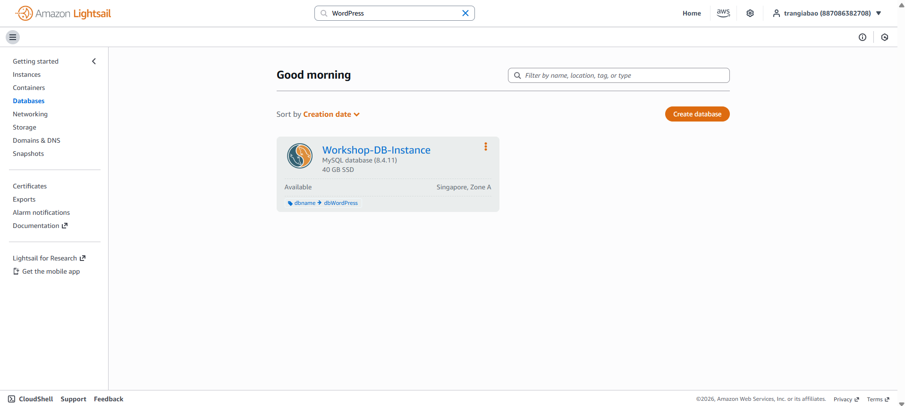

> **💡 Khó khăn gặp phải & Cách xử lý tại Bước 1:**  
> Thời gian khởi tạo một Managed Database trên Lightsail thường mất khoảng 5 - 10 phút. Ngay khi bấm khởi tạo, hãy lưu lại cẩn thận tên Master User (`LightsailAdmin`), mật khẩu tự sinh và chuỗi kết nối Endpoint. Nếu quên mật khẩu ở bước này, bạn sẽ phải reset lại mật khẩu và đợi database cập nhật trạng thái mất thêm thời gian.

---

#### Bước 2: Khởi tạo Máy chủ Ứng dụng WordPress (`WordPress-1`)
* **Thao tác / Hướng dẫn:** Điều hướng tới thẻ **Instances** trên Lightsail ➔ Nhấn nút **Create instance**.
* **Thông số điền cụ thể:**
  * *Vị trí máy chủ (Instance location):* `Singapore (Zone A)`
  * *Nền tảng (Platform):* `Linux/Unix`
  * *Blueprint:* Tích chọn ứng dụng **WordPress** (đóng gói sẵn bởi Bitnami)
  * *Gói cấu hình máy chủ (Instance plan):* Gói $5/tháng (1 GB RAM, 1 vCPU, 40 GB SSD, 2 TB Transfer)
  * *Định danh máy chủ (Instance name):* `WordPress-1`
* **Thao tác tiếp theo:** Nhấn **Create instance**. Máy chủ sẽ được khởi chạy trong vòng 1 - 2 phút.

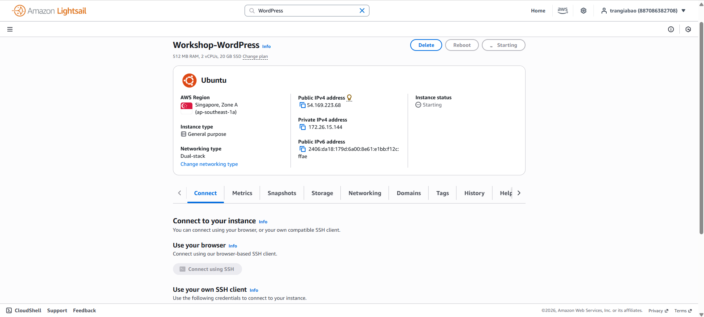

---

#### Bước 3: Kết nối SSH & Cấu hình Hệ điều hành Ubuntu
* **Thao tác / Hướng dẫn:** Tại card máy chủ `WordPress-1`, nhấn vào biểu tượng dòng lệnh màu cam (**Connect using SSH**) để mở terminal trực tiếp trên trình duyệt web.
* **Lệnh thực thi:**
  ```bash
  # Cập nhật danh mục gói phần mềm hệ thống
  sudo apt-get update -y

  # Kiểm tra vị trí mã nguồn ứng dụng WordPress
  ls -la /opt/bitnami/wordpress
  ```
* **Mục đích:** Xác thực phiên bản hệ điều hành Linux/Ubuntu, kiểm tra quyền hạn tệp tin và chuẩn bị thông số để liên kết với cơ sở dữ liệu bên ngoài.

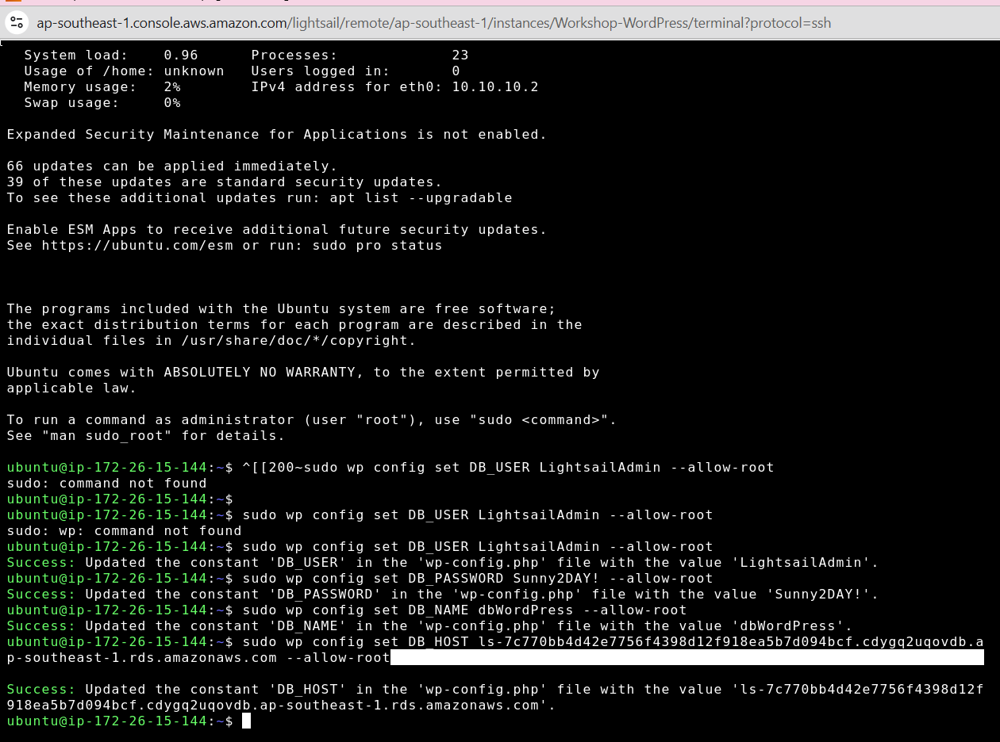

---

#### Bước 4: Thiết lập Mạng, Gán Static IP & Mở Firewall cho WordPress
* **Thao tác / Hướng dẫn:** Mở chi tiết máy chủ `WordPress-1` ➔ Chọn thẻ **Networking**.
* **Thông số điền cụ thể:**
  * *Tạo Static IP:* Nhấn **Attach static IP** ➔ Đặt tên `StaticIP-WordPress-1` ➔ Gắn trực tiếp vào `WordPress-1` (đảm bảo địa chỉ IP không bị thay đổi khi khởi động lại).
  * *Quy tắc tường lửa Inbound (IPv4 Firewall):*
    * **HTTP:** Cổng `80` (TCP), Nguồn: `Custom / Anywhere`
    * **HTTPS:** Cổng `443` (TCP), Nguồn: `Custom / Anywhere`
    * **SSH:** Cổng `22` (TCP) giới hạn IP quản trị hoặc mở theo mặc định Lightsail.

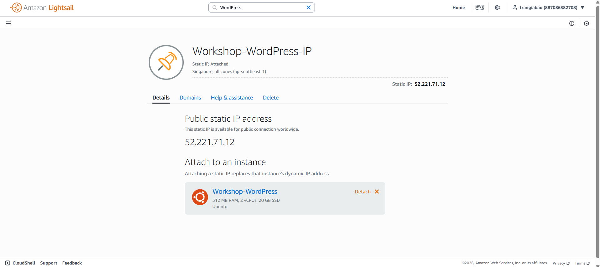

---

#### Bước 5: Cấu hình Kết nối CSDL & Cài đặt WordPress ban đầu
* **Thao tác / Hướng dẫn:** Mở trình duyệt web mới, truy cập vào địa chỉ IP tĩnh vừa gán: `http://<Static-IP-WordPress-1>`. Trình cài đặt WordPress Welcome Wizard sẽ hiển thị.
* **Thông số điền cụ thể:**
  * *Database Name:* `dbWordPress`
  * *Username:* `LightsailAdmin`
  * *Password:* `[Mật khẩu quản trị database đã lưu tại Bước 1]`
  * *Database Host:* `[Endpoint của Workshop-DB-Instance]:3306`
  * *Table Prefix:* `wp_`
* **Thao tác tiếp theo:** Nhấn nút **Submit** ➔ Nhấn **Run the installation**.

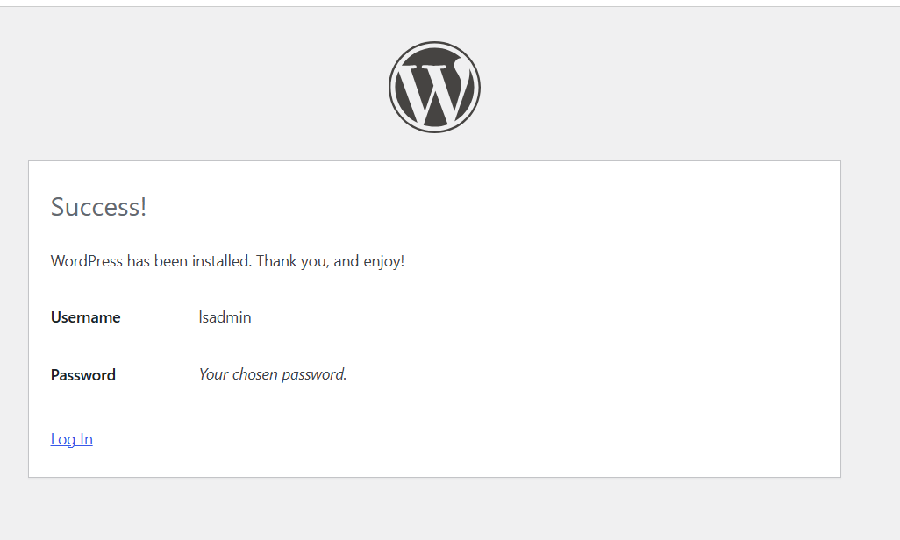

> **💡 Khó khăn gặp phải & Cách xử lý tại Bước 5:**  
> Nếu màn hình báo lỗi *"Error establishing a database connection"*, nguyên nhân thường do: (1) Nhập sai Database Host (phải bao gồm toàn bộ chuỗi Endpoint Lightsail, không dùng `localhost`), (2) Tên CSDL phải khớp chính xác là `dbWordPress` (chữ hoa chữ thường), hoặc (3) Managed Database chưa sẵn sàng kết nối. Kiểm tra kết nối từ SSH bằng lệnh `mysql -h <endpoint> -u LightsailAdmin -p` để xác thực cổng 3306.

---

#### Bước 6: Xác thực & Đăng nhập Trang Quản trị WordPress Dashboard
* **Thao tác / Hướng dẫn:** Sau khi cài đặt hoàn tất, truy cập đường dẫn `http://<Static-IP-WordPress-1>/wp-admin`.
* **Thông số điền cụ thể:**
  * *Site Title:* `Cloud Journey Blog`
  * *Username:* `admin`
  * *Password:* `[Mật khẩu quản trị website]`
  * *Email:* `trangiabao@example.com`
* **Kết quả:** Đăng nhập thành công vào bảng điều khiển quản trị **WordPress Admin Dashboard**, hệ thống hoạt động ổn định và lưu trữ toàn bộ dữ liệu bài viết vào Lightsail Managed DB.

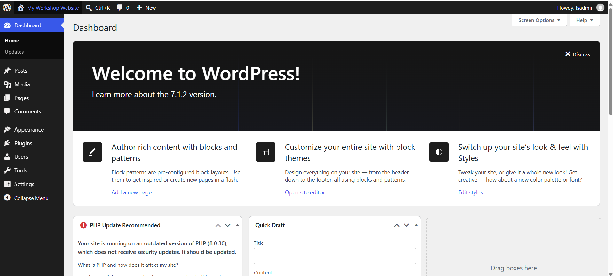

---

#### Bước 7: Khởi tạo Máy chủ Prestashop & Cấu hình Mạng (Prestashop Networking)
* **Thao tác / Hướng dẫn:** Quay lại Lightsail Console ➔ Thẻ **Instances** ➔ Tạo máy chủ mới với Blueprint ứng dụng **Prestashop** ➔ Đặt tên `Prestashop-1`.
* **Thông số điền cụ thể:**
  * *Platform:* `Linux/Unix`
  * *Blueprint:* `Prestashop`
  * *Instance Plan:* Gói $5/tháng hoặc $10/tháng
  * *Instance Name:* `Prestashop-1`
  * *Networking:* Gán địa chỉ Static IP mới `StaticIP-Prestashop-1`, kiểm tra mở cổng tường lửa `80` (HTTP) và `443` (HTTPS).

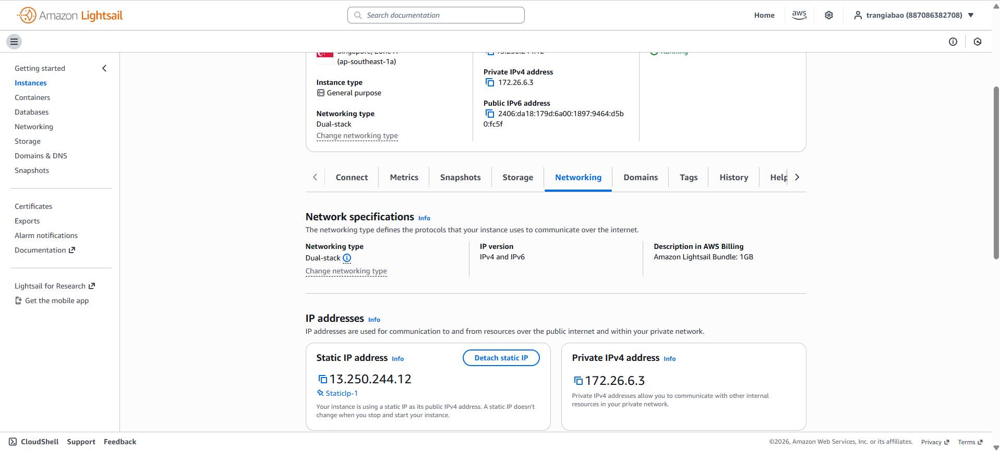

---

#### Bước 8: Cài đặt Cấu hình Cửa hàng Trực tuyến Prestashop Setup Wizard
* **Thao tác / Hướng dẫn:** Mở tab trình duyệt mới, truy cập `http://<Static-IP-Prestashop-1>` để khởi chạy trình hướng dẫn cài đặt trực tuyến Prestashop gồm 6 bước liên tiếp.
* **Thông số điền cụ thể:**
  * *1. Welcome page:* Chọn ngôn ngữ `English` hoặc `Vietnamese` ➔ Nhấn **Next**.
  * *2. License agreements:* Tích chọn *"I agree to the above terms and conditions"*.
  * *3. System compatibility:* Xác nhận tất cả các chỉ số máy chủ đều đạt màu xanh lá cây.
  * *4. Store information:* Nhập tên cửa hàng `Cloud Store Demo`, phân loại `Technology`, quốc gia `Vietnam`.
  * *5. Database configuration:*
    * *Database server address:* `[Endpoint của Workshop-DB-Instance]`
    * *Database name:* `dbPrestashop`
    * *Database login:* `LightsailAdmin`
    * *Database password:* `[Mật khẩu CSDL]`
* **Thao tác tiếp theo:** Nhấn nút **Test your database connection now!** để xác nhận kết nối thành công trước khi hoàn tất cài đặt.

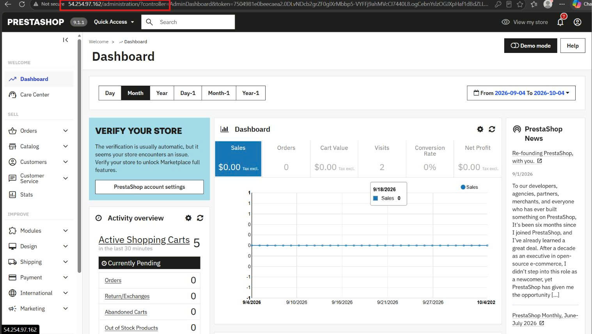

> **💡 Khó khăn gặp phải & Cách xử lý tại Bước 8:**  
> Trình cài đặt Prestashop yêu cầu tài khoản MySQL phải có quyền `CREATE DATABASE`, `ALTER`, `INDEX`. Nếu bạn dùng chung tài khoản `LightsailAdmin`, cần đảm bảo database `dbPrestashop` đã được khởi tạo trước hoặc tài khoản có quyền tự tạo schema mới trên máy chủ MySQL.

---

#### Bước 9: Đăng nhập Trang Quản trị Doanh nghiệp Prestashop Dashboard
* **Thao tác / Hướng dẫn:** Kết nối SSH vào máy chủ `Prestashop-1`, xóa thư mục cài đặt `/install` theo cảnh báo bảo mật, sau đó truy cập đường dẫn Back Office.
* **Lệnh thực thi:**
  ```bash
  # Xóa thư mục cài đặt tạm thời theo khuyến nghị bảo mật
  sudo rm -rf /opt/bitnami/prestashop/install
  ```
* **Kết quả:** Đăng nhập thành công vào giao diện **Prestashop Back Office / Dashboard**, hiển thị đầy đủ các biểu đồ thống kê đơn hàng, doanh số và danh mục quản lý sản phẩm.

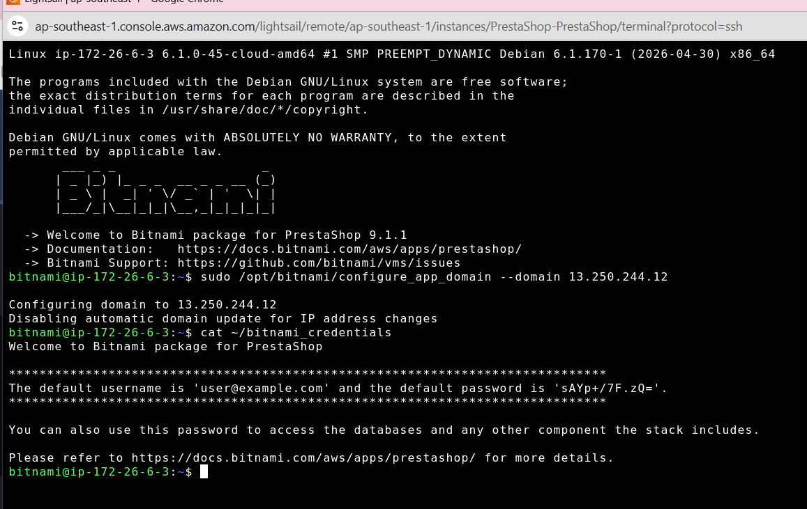

---

#### Bước 10: Khởi tạo Bản sao lưu Điểm thời gian (Create Snapshot)
* **Thao tác / Hướng dẫn:** Tại giao diện máy chủ `WordPress-1`, chọn tab **Snapshots** ➔ Nhấn nút **Create snapshot**.
* **Thông số điền cụ thể:**
  * *Instance cần sao lưu:* `WordPress-1`
  * *Snapshot name:* `wordpress-backup-snapshot`
* **Mục đích:** Đóng gói toàn bộ hệ điều hành, cấu hình web server, mã nguồn WordPress và các thư viện liên quan thành một bản chụp an toàn trước khi thực hiện nâng cấp cấu hình phần cứng.

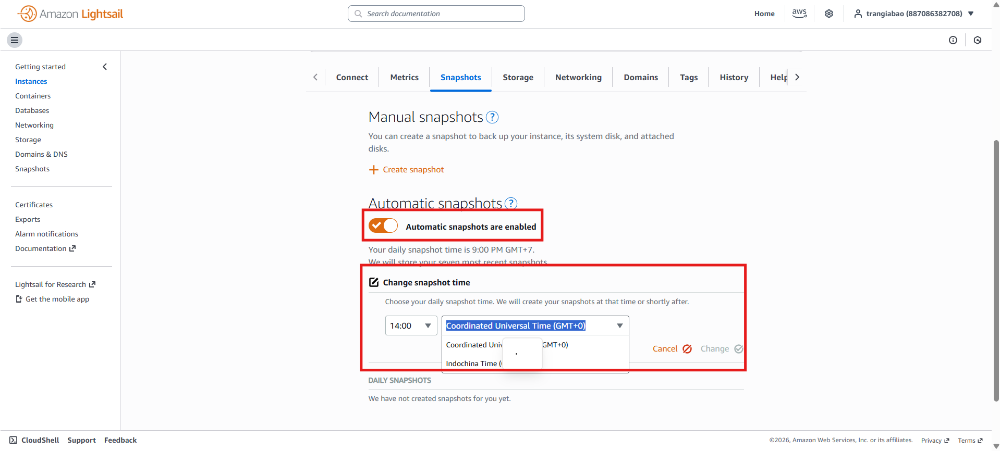

> **💡 Khó khăn gặp phải & Cách xử lý tại Bước 10:**  
> Thao tác tạo Snapshot cần đọc ghi toàn bộ block lưu trữ của ổ đĩa máy chủ (~20 GB). Trong quá trình này, tránh thực hiện các thao tác ghi dữ liệu lớn hoặc nâng cấp phiên bản ứng dụng để dữ liệu trong snapshot đạt trạng thái nhất quán hoàn hảo.

---

#### Bước 11: Theo dõi Trạng thái Tiến trình Chụp Snapshot
* **Thao tác / Hướng dẫn:** Giữ nguyên giao diện tab **Snapshots** và theo dõi trạng thái tiến trình tạo bản sao lưu.
* **Quan sát:** Trạng thái ban đầu hiển thị là **Snapshotting...** cùng thanh tiến trình biểu thị dữ liệu đang được đồng bộ lên hạ tầng lưu trữ Lightsail.

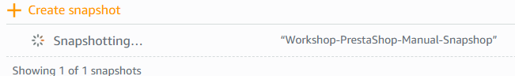

---

#### Bước 12: Xác nhận Snapshot Sẵn sàng Hoạt động (Available)
* **Thao tác / Hướng dẫn:** Sau khoảng 5 - 8 phút, làm mới danh sách snapshot.
* **Quan sát:** Bản chụp `wordpress-backup-snapshot` chuyển sang trạng thái **Available** kèm ngày giờ chụp chính xác và dung lượng lưu trữ đầy đủ.

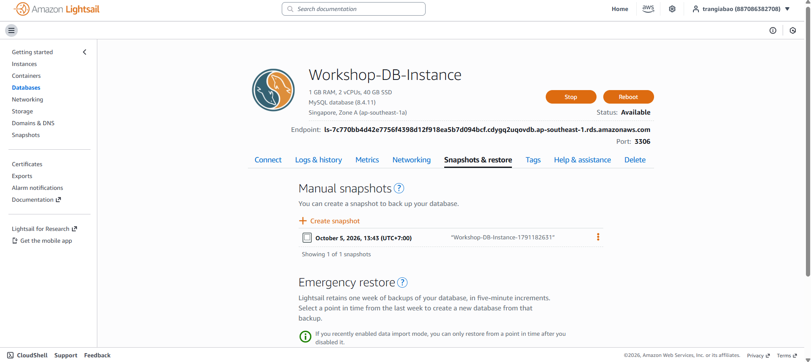

---

#### Bước 13: Mở rộng Phần cứng bằng cách Tạo Máy chủ mới từ Snapshot (Migration)
* **Thao tác / Hướng dẫn:** Tại bản snapshot `wordpress-backup-snapshot`, nhấn vào biểu tượng dấu 3 chấm `...` bên phải ➔ Chọn **Create new instance from snapshot**.
* **Thông số điền cụ thể:**
  * *Vùng triển khai:* `Singapore (ap-southeast-1)`
  * *Gói máy chủ nâng cấp (Larger instance plan):* Gói $10/tháng (2 GB RAM, 1 vCPU, 60 GB SSD) hoặc gói $20/tháng (4 GB RAM, 2 vCPUs) tùy nhu cầu mở rộng
  * *Định danh máy chủ mới (Instance name):* `WordPress-Migrated`
* **Thao tác chuyển đổi IP cố định:**
  * Sau khi máy chủ `WordPress-Migrated` khởi chạy thành công, vào thẻ **Networking**.
  * Chọn `StaticIP-WordPress-1` ➔ Nhấn **Detach** khỏi máy chủ cũ `WordPress-1`.
  * Nhấn **Attach** và gắn trực tiếp vào máy chủ mới `WordPress-Migrated`.
* **Kết quả:** Người dùng tiếp tục truy cập website bình thường qua địa chỉ IP cũ mà không bị gián đoạn hay phải cấu hình lại DNS.

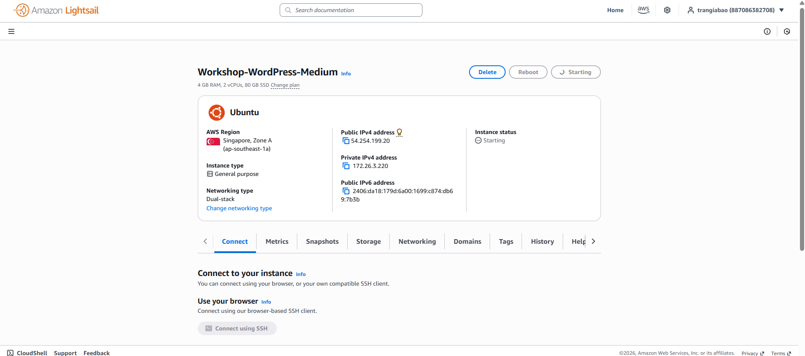

> **💡 Khó khăn gặp phải & Cách xử lý tại Bước 13:**  
> Thao tác thường bị quên nhất khi nâng cấp máy chủ là tái gắn (Re-attach) Static IP. Nếu quên gán lại IP tĩnh, máy chủ mới sẽ nhận một IP động ngẫu nhiên khiến người dùng và tên miền trỏ về IP cũ bị mất kết nối hoàn toàn. Luôn kiểm tra lại bảng Static IP sau khi hoàn thành migration.

---

### 📝 Tổng kết & Bài học kinh nghiệm:
1. **Ưu điểm của Amazon Lightsail:** Cung cấp trải nghiệm đơn giản hóa tuyệt vời, giao diện trực quan, chi phí dự đoán được theo tháng (predictable pricing), rất phù hợp cho doanh nghiệp vừa và nhỏ, blog cá nhân hoặc môi trường thử nghiệm nhanh.
2. **Kiến trúc Tách biệt CSDL (Decoupled Architecture):** Luôn tách cơ sở dữ liệu sang một Managed Database độc lập thay vì cài đặt MySQL trực tiếp trên máy chủ web. Điều này cho phép mở rộng, nâng cấp và sao lưu máy chủ web dễ dàng mà không làm ảnh hưởng tới tính toàn vẹn của dữ liệu nghiệp vụ.
3. **Chiến lược Sao lưu & Scale-up an toàn:** Sử dụng Snapshot làm cầu nối nâng cấp cấu hình phần cứng (Vertical Scaling) giúp hệ thống dễ dàng thích ứng khi lưu lượng truy cập gia tăng đột biến mà không cần cài đặt lại ứng dụng từ đầu.

- **Làm quen với Amazon Lightsail:** Hiểu được mô hình dịch vụ đám mây tinh giản của AWS, phù hợp cho việc khởi tạo nhanh các ứng dụng vừa và nhỏ với chi phí dự đoán được.
- **Triển khai ứng dụng Web & Cơ sở dữ liệu:** Nắm vững quy trình dựng website (WordPress và nền tảng thương mại điện tử Prestashop) kết nối với cơ sở dữ liệu quản lý độc lập (Managed Database).
- **Quản trị mạng và bảo vệ dữ liệu:** Nắm được cách cấp phát IP tĩnh, cấu hình tường lửa cơ bản, tạo bản sao lưu (Snapshot) và nâng cấp cấu hình máy chủ linh hoạt khi nhu cầu tài nguyên tăng.

---

#### 📌 Kết quả Thứ 3 (06/10/2026) - Triển khai Amazon Lightsail Container:

{}
Bài thực hành **Triển khai Amazon Lightsail Container** (Run Apps on Lightsail Container) được thực hiện vào **Thứ 3 (06/10/2026)** trong khuôn khổ **Tuần 4**. Trang này hướng dẫn chi tiết từng bước thực hiện kèm thông số cụ thể, câu lệnh CLI, giải pháp xử lý sự cố và bộ 11 hình ảnh minh chứng thực hành.
<br>🔗 **Nguồn tài liệu thực hành (Workshop Reference):** [Amazon Lightsail Container - Run Apps on Lightsail Container](https://000046.awsfcaj.com/)
{}

### 🎯 Mục tiêu bài thực hành (Lab Objectives):
* Làm quen với tính năng **Containers** trên Amazon Lightsail — giải pháp triển khai ứng dụng container hóa đơn giản và nhanh chóng.
* Cài đặt và cấu hình **AWS CLI** cùng công cụ mở rộng **Lightsail Control (lightsailctl)** để tương tác với container service từ máy trạm.
* Khởi tạo **Container Service** trên Lightsail với gói tài nguyên tối ưu chi phí (Nano bundle).
* Triển khai một **Public Container Image** (Nginx) từ Docker Hub lên Lightsail Container Service.
* Khởi tạo máy ảo **Build-Instance** (Ubuntu) để tự build và đẩy một **Custom Container Image** lên kho lưu trữ riêng của Lightsail bằng lệnh `aws lightsail push-container-image`.
* Kích hoạt Public Endpoint và kiểm tra website hoạt động ổn định trên tên miền công khai có chứng chỉ SSL/TLS tự động.

---

### 📊 Bảng tổng hợp thông số tài nguyên đã triển khai:

| Tài nguyên | Tên / Định danh | Cấu hình & Chi tiết kỹ thuật | Địa chỉ / Cổng truy cập | Ghi chú |
| :--- | :--- | :--- | :--- | :--- |
| **AWS CLI** | Version 2.37.9 | Cài đặt qua PowerShell, cấu hình Profile | User IAM: `Bao` (`ap-southeast-1`) | Công cụ dòng lệnh quản trị AWS |
| **Container Service** | `lightsail-container` | Nano (512 MB RAM, 0.25 vCPUs x 1 node) | Singapore (`ap-southeast-1a`) | Status: `Running` |
| **Public Deployment** | `test1` | Image: `nginx` (Docker Hub Public Registry) | Port 80 (HTTP), Health check: `/` | Triển khai nhanh từ image công khai |
| **Build Instance** | `Build-Instance` | Ubuntu 22.04 LTS, 512 MB RAM, 20 GB SSD | Public IP: `47.129.162.155` | Dùng để build & push Docker image |
| **Stored Container** | `:lightsail-container.nginx-container-hello.1` | Custom image đẩy từ máy chủ build lên kho lưu trữ | SHA256 digest xác thực | Kho ảnh container riêng của Lightsail |
| **Public Domain** | `lightsail-container...amazonlightsail.com` | HTTPS tự động cấp chứng chỉ SSL bởi AWS | Port 443 / 80 | Endpoint truy cập ứng dụng công khai |

---

### 🚀 Chi tiết các bước thực hiện & Hình ảnh minh chứng:

#### Bước 1: Cài đặt AWS CLI v2 trên Máy trạm Windows
* **Thao tác / Hướng dẫn:** Mở **PowerShell** với quyền Administrator (Run as Administrator) ➔ Thực thi lệnh tải về và cài đặt tự động phiên bản AWS CLI v2.
* **Lệnh thực thi:**
  ```powershell
  irm https://awscli.amazonaws.com/v2/install.ps1 | iex
  ```
* **Mục đích:** Thiết lập môi trường dòng lệnh chuẩn hóa nhằm phục vụ tương tác, cấu hình dịch vụ và đẩy container image lên nền tảng Lightsail.

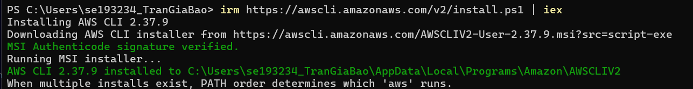

---

#### Bước 2: Kiểm tra Xác nhận Phiên bản AWS CLI Hoàn tất
* **Thao tác / Hướng dẫn:** Khởi động lại cửa sổ dòng lệnh và chạy lệnh kiểm tra phiên bản.
* **Lệnh thực thi:**
  ```powershell
  aws --version
  ```
* **Kết quả hiển thị:** Hệ thống trả về `aws-cli/2.37.9 Python/3.14.0 Windows/10 exe/AMD64`, xác nhận AWS CLI đã sẵn sàng.

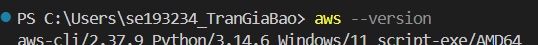

---

#### Bước 3: Cấu hình Thông tin Định danh Truy cập (`aws configure`)
* **Thao tác / Hướng dẫn:** Chạy lệnh `aws configure` và nhập lần lượt các thông số xác thực của IAM User.
* **Thông số điền cụ thể:**
  * *AWS Access Key ID:* Nhập Access Key của IAM User `Bao`
  * *AWS Secret Access Key:* Nhập Secret Access Key tương ứng
  * *Default region name:* `ap-southeast-1` (Singapore)
  * *Default output format:* `json`
* **Lệnh thực thi:**
  ```powershell
  aws configure
  ```

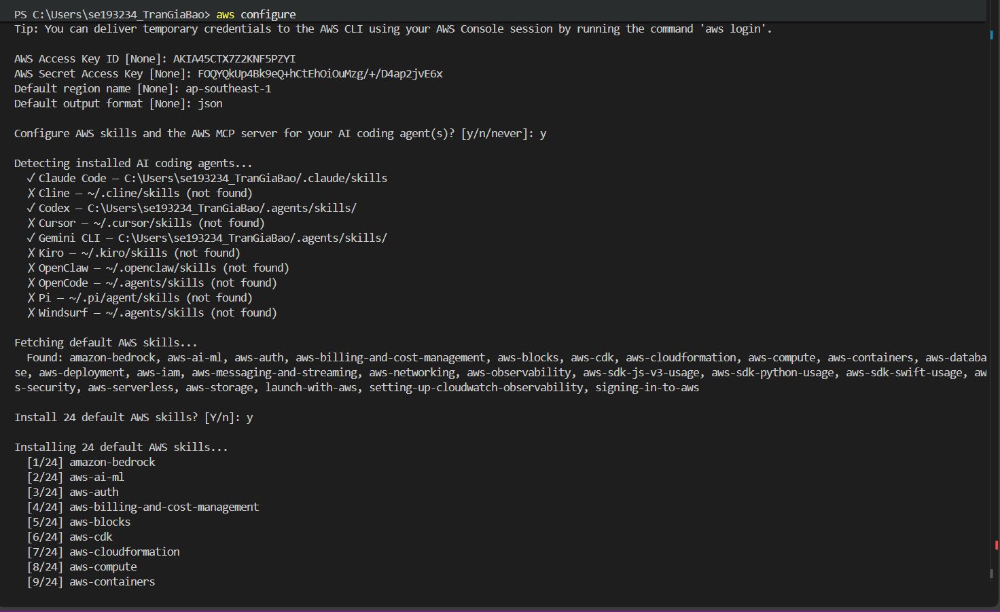

---

#### Bước 4: Kiểm tra Quyền Hạn IAM User & Khắc phục Lỗi `AccessDenied`
* **Thao tác / Hướng dẫn:** Kiểm tra kết nối dịch vụ bằng lệnh CLI `aws s3 ls`.
* **Hiện tượng lỗi:** Hệ thống trả về lỗi `An error occurred (AccessDenied) when calling the ListBuckets operation`.
* **Cách khắc phục:** Truy cập **IAM Management Console** ➔ Tìm User **`Bao`** ➔ Chọn **Add permissions** ➔ Gắn trực tiếp chính sách quản trị **`AmazonLightsailFullAccess`** và kiểm tra lại lệnh thành công.

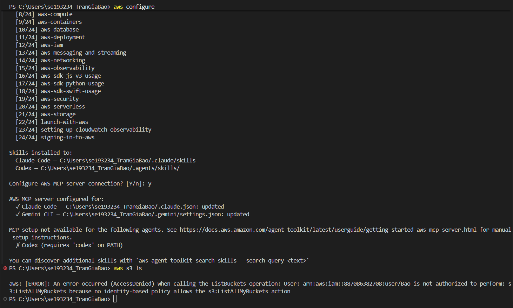

> **💡 Khó khăn gặp phải & Cách xử lý tại Bước 4:**  
> Khi thao tác với Lightsail qua CLI, nếu IAM User chỉ có quyền cơ bản trên EC2/S3 thì các lệnh `aws lightsail push-container-image` sẽ bị chặn ngay lập tức. Cần gán chính sách `AmazonLightsailFullAccess` để người dùng có đầy đủ quyền tạo Container Service và upload image lên ECR private repository ngầm của Lightsail.

---

#### Bước 5: Khởi tạo Dịch vụ Container Service trên Amazon Lightsail
* **Thao tác / Hướng dẫn:** Đăng nhập bảng điều khiển **Amazon Lightsail** ➔ Điều hướng tới thẻ **Containers** ➔ Nhấn nút **Create container service**.
* **Thông số điền cụ thể:**
  * *Region:* `Singapore (ap-southeast-1)`
  * *Cấu hình dung lượng (Capacity):* Gói **Nano** (512 MB RAM, 0.25 vCPUs x 1 node) với mức phí $7/tháng nhằm tiết kiệm chi phí thử nghiệm
  * *Container service name:* `lightsail-container`
* **Kết quả:** Hệ thống khởi tạo thành công dịch vụ với trạng thái **Ready**, đồng thời tự động sinh tên miền truy cập công khai dạng `lightsail-container.<id>.ap-southeast-1.cs.amazonlightsail.com`.

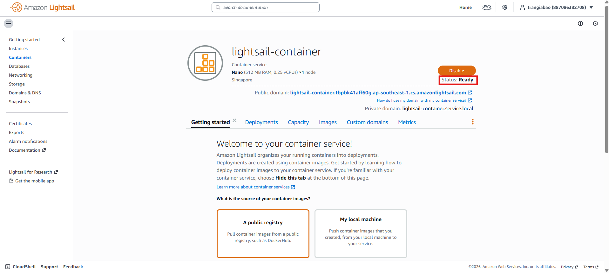

---

#### Bước 6: Khai báo Bản triển khai Đầu tiên với Public Image Nginx
* **Thao tác / Hướng dẫn:** Tại trang quản lý dịch vụ `lightsail-container`, bấm **Create your first deployment**.
* **Thông số điền cụ thể:**
  * *Container name:* `test1`
  * *Image:* `nginx` (kéo trực tiếp từ Docker Hub Public Registry)
  * *Open ports:* Cổng `80`, Giao thức `HTTP`

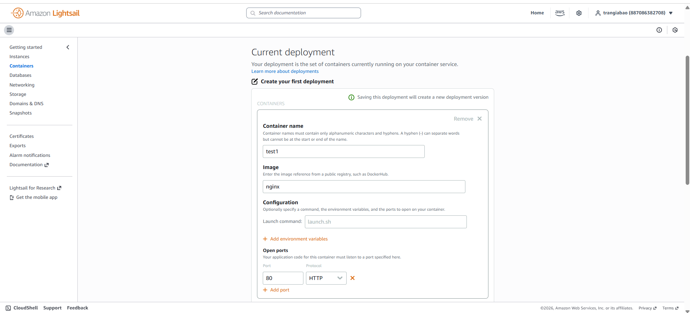

---

#### Bước 7: Thiết lập Public Endpoint & Đường dẫn Kiểm tra Sức khỏe (Health Check)
* **Thao tác / Hướng dẫn:** Cuộn xuống phần **PUBLIC ENDPOINT** tại cùng trang cấu hình deployment.
* **Thông số điền cụ thể:**
  * *Target container:* Chọn container `test1`
  * *Port:* `80`
  * *Health check path:* `/`
* **Thao tác tiếp theo:** Nhấn nút **Save and deploy**.

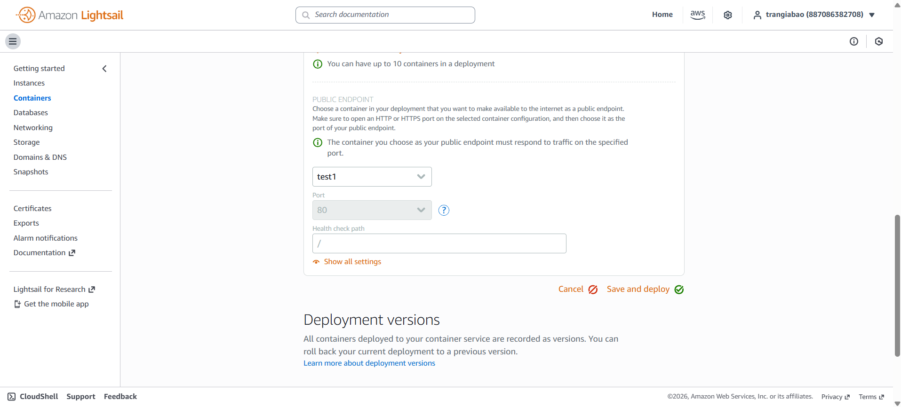

---

#### Bước 8: Xác nhận Trạng thái Active & Running của Container Service
* **Thao tác / Hướng dẫn:** Theo dõi bảng điều khiển trong khi Lightsail tự động tải image và phân bổ tài nguyên mạng.
* **Quan sát:** Bản triển khai chuyển sang trạng thái **Active**, và trạng thái dịch vụ tổng thể chuyển từ *Deploying* sang **Running**.

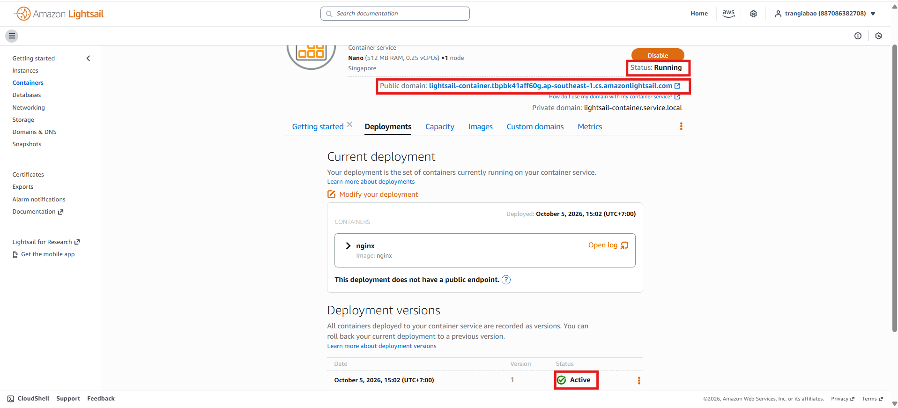

---

#### Bước 9: Khởi tạo Máy ảo Build-Instance trên Lightsail
* **Thao tác / Hướng dẫn:** Điều hướng tới thẻ **Instances** trên Lightsail ➔ Nhấn **Create instance** để tạo máy chủ chuyên dụng đóng gói container.
* **Thông số điền cụ thể:**
  * *Platform:* `Linux/Unix`
  * *Blueprint:* `OS Only` ➔ Tích chọn `Ubuntu 22.04 LTS`
  * *Instance plan:* Gói $3.50/tháng (512 MB RAM, 1 vCPU, 20 GB SSD)
  * *Instance name:* `Build-Instance`
  * *Public IP được cấp:* `47.129.162.155`

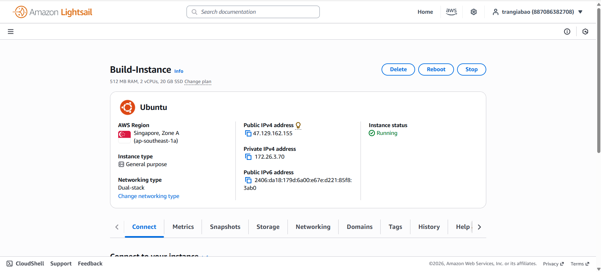

---

#### Bước 10: Đóng gói Custom Container Image & Đẩy lên Kho lưu trữ Lightsail
* **Thao tác / Hướng dẫn:** Kết nối SSH vào `Build-Instance`, cài đặt Docker, cài đặt tiện ích mở rộng `lightsailctl` và thực thi lệnh build & push image.
* **Lệnh thực thi:**
  ```bash
  # 1. Cài đặt plugin lightsailctl
  sudo curl "https://s3.us-west-2.amazonaws.com/lightsailctl/latest/linux-amd64/lightsailctl" -o "/usr/local/bin/lightsailctl"
  sudo chmod +x /usr/local/bin/lightsailctl

  # 2. Tạo Dockerfile tùy biến và build image
  docker build -t nginx-container-hello:latest .

  # 3. Đẩy image trực tiếp lên kho lưu trữ của Container Service
  aws lightsail push-container-image \
    --region ap-southeast-1 \
    --service-name lightsail-container \
    --label nginx-container-hello \
    --image nginx-container-hello:latest
  ```
* **Kết quả:** CLI trả về chuỗi định danh image lưu trữ: `:lightsail-container.nginx-container-hello.1` kèm mã băm SHA256.

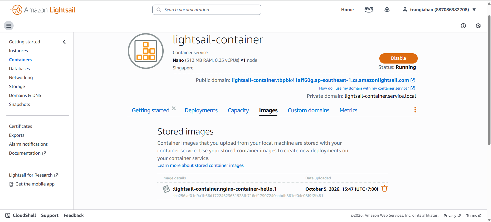

> **💡 Khó khăn gặp phải & Cách xử lý tại Bước 10:**  
> Nếu thiếu plugin **lightsailctl**, lệnh `aws lightsail push-container-image` sẽ báo lỗi ngay lập tức vì AWS CLI không thể tự đóng gói stream Docker image sang Lightsail backend. Cần đảm bảo plugin được cấp quyền thực thi (`chmod +x`) và đặt đúng tại `/usr/local/bin/lightsailctl`. Ngoài ra, tham số `--label` chỉ chấp nhận chữ thường và dấu gạch nối, không dùng ký tự đặc biệt.

---

#### Bước 11: Cập nhật Bản Triển khai & Xác thực Ứng dụng qua HTTPS
* **Thao tác / Hướng dẫn:** Trên Lightsail Console, chỉnh sửa deployment trỏ nguồn image tới `:lightsail-container.nginx-container-hello.1` ➔ Nhấn **Save and deploy** ➔ Mở trình duyệt truy cập tên miền công khai.
* **Địa chỉ truy cập:** `https://lightsail-container.5vpta1mr2570.ap-southeast-1.cs.amazonlightsail.com`
* **Kết quả:** Website tải nhanh chóng với trang chào mừng **"Welcome to nginx!"**, biểu tượng ổ khóa SSL/HTTPS hiển thị đầy đủ, xác nhận container hoạt động ổn định và sẵn sàng phục vụ lưu lượng truy cập.

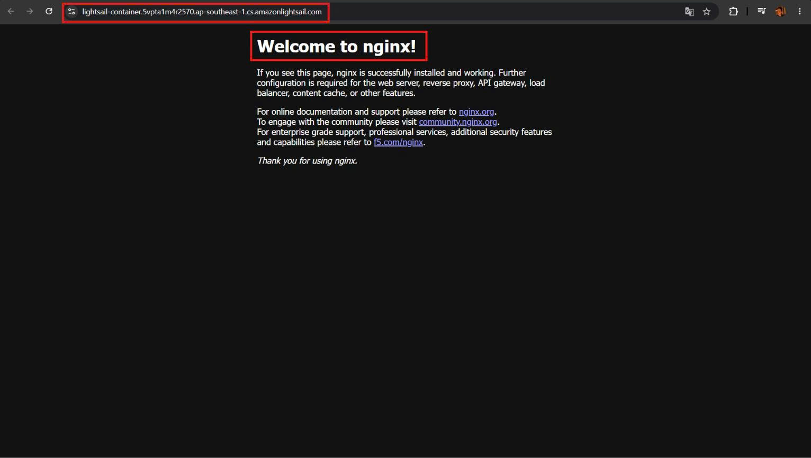

---

### 📝 Tổng kết & Bài học kinh nghiệm:
1. **Sự tiện lợi của Lightsail Container:** Cung cấp trải nghiệm triển khai container cực kỳ nhanh chóng mà không cần thiết lập cụm máy chủ Kubernetes phức tạp như EKS hay quản lý cluster tác vụ như ECS.
2. **Tự động hóa SSL/TLS:** Lightsail tự động cấp phát tên miền công khai kèm chứng chỉ HTTPS miễn phí bởi Amazon Trust Services cho mỗi Container Service, giảm bớt công đoạn đăng ký domain và tạo cert thủ công.
3. **Mô hình phối hợp Build & Deploy:** Sử dụng một máy ảo Lightsail nhỏ (`Build-Instance`) làm máy trạm build Docker và đẩy image lên kho lưu trữ riêng giúp quy trình CI/CD thử nghiệm diễn ra độc lập, tiết kiệm chi phí và an toàn bảo mật.

- **Khái niệm Container Service trên Lightsail:** Hiểu cách vận hành ứng dụng đóng gói dưới dạng container trên đám mây mà không cần trực tiếp quản trị cụm máy chủ phức tạp.
- **Triển khai ứng dụng Container:** Làm quen với việc chạy các image có sẵn từ Docker Hub cũng như cách đóng gói và đẩy container image tùy chỉnh lên kho lưu trữ đám mây.
- **Truy cập ứng dụng an toàn:** Nắm được quy trình kích hoạt và kiểm tra ứng dụng chạy thực tế với chứng chỉ bảo mật SSL/HTTPS tự động được tích hợp sẵn.

---

#### 📌 Kết quả Thứ 4 (07/10/2026) - Tự động co giãn với EC2 Auto Scaling:

{}
Bài thực hành **Tự động co giãn với EC2 Auto Scaling** (Scaling Applications with EC2 Auto Scaling) được thực hiện vào **Thứ 4 (07/10/2026)** trong khuôn khổ **Tuần 4**. Trang này hướng dẫn chi tiết từng bước với đầy đủ thông số điền, câu lệnh kiểm thử tải, giải pháp xử lý sự cố thực tế và trọn bộ 44 hình ảnh minh chứng thực hành.
<br>🔗 **Nguồn tài liệu thực hành (Workshop Reference):** [Triển khai ứng dụng FCAJ Management với Auto Scaling Group](https://000006.awsfcaj.com/)
{}

### 🎯 Mục tiêu bài thực hành (Lab Objectives):
* Hiểu sâu về kiến trúc ứng dụng có khả năng co giãn linh hoạt (**Scalable & Highly Available Architecture**) trên AWS.
* Đóng gói máy chủ ứng dụng mẫu thành một bản ảnh tái sử dụng (**Custom AMI**).
* Xây dựng **Launch Template** chuẩn hóa nhằm định nghĩa cấu hình khởi chạy máy chủ tự động.
* Thiết lập **Application Load Balancer (ALB)** kết hợp với **Target Group** để phân phối lưu lượng truy cập cân bằng.
* Cấu hình **Auto Scaling Group (ASG)** với các chính sách co giãn động (**Dynamic Scaling Policies**) dựa trên chỉ số CPU CloudWatch.
* Thực hiện kiểm thử chịu tải (**Stress Test**) để quan sát cơ chế tự động tăng máy chủ (**Scale Out**) và giảm máy chủ (**Scale In**).
* Thực hiện quy trình dọn dẹp giải phóng toàn bộ tài nguyên nhằm tối ưu chi phí.

---

### 📊 Bảng tổng hợp thông số tài nguyên đã triển khai:

| Tài nguyên | Tên / Định danh | Cấu hình & Chi tiết kỹ thuật | Địa chỉ / Cổng truy cập | Ghi chú |
| :--- | :--- | :--- | :--- | :--- |
| **Custom AMI** | `fcaj-app-ami` | Đóng gói máy chủ mẫu Node.js + App Code | AMI ID: `ami-0...` | Bản mẫu tạo các instance mới |
| **Launch Template** | `fcaj-launch-template` | `t2.micro`, Amazon Linux, SG: Port 80/3000 | Version 1 | Tự động hóa cài đặt khi khởi động |
| **Target Group** | `fcaj-tg` | Target Type: Instance, Protocol: HTTP (Port 80) | Health Check: `/` | Quản lý tình trạng máy chủ |
| **Load Balancer** | `fcaj-alb` | Application Load Balancer, Multi-AZ Subnets | DNS Name của ALB | Cổng tiếp nhận lưu lượng tập trung |
| **Auto Scaling Group**| `fcaj-asg` | Min: 1, Desired: 1, Max: 3 instances | Phân bổ trên 2 Availability Zones | Tự động cân đối số lượng máy chủ |
| **Scaling Policy** | `TargetTracking-CPU` | Metric: Average CPU Utilization > 50% | Warmup: 300s | Tự động Scale Out khi tải tăng |

---

### 🚀 Chi tiết các bước thực hiện & Hình ảnh minh chứng:

#### Bước 1: Khởi tạo Bản ảnh Máy chủ Custom AMI từ EC2 Instance mẫu
* **Thao tác / Hướng dẫn:** Mở bảng điều khiển **Amazon EC2** ➔ Vào mục **Instances** ➔ Chọn máy chủ ứng dụng mẫu đang chạy ➔ Chọn menu **Actions** ➔ **Image and templates** ➔ Nhấn **Create image**.
* **Mục đích:** Đóng gói toàn bộ mã nguồn ứng dụng, môi trường runtime và các gói phụ thuộc thành một bản ảnh AMI để dùng cho việc scale tự động.

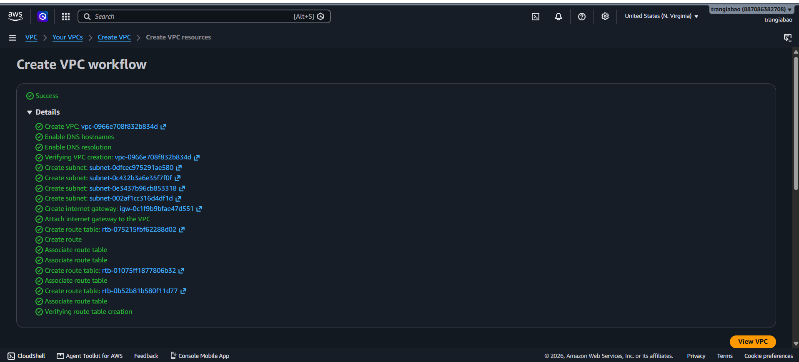

> **💡 Khó khăn gặp phải & Cách xử lý tại Bước 1:**  
> Mặc định khi tạo Image, AWS sẽ tạm thời reboot instance mẫu để đồng bộ filesystem. Nếu không muốn máy chủ bị gián đoạn, bạn có thể tích chọn ô *"No reboot"*, tuy nhiên khuyến nghị vẫn nên reboot để đảm bảo tính toàn vẹn của dữ liệu trong AMI.

---

#### Bước 2: Khai báo Tên và Cấu hình Lưu trữ cho Custom AMI
* **Thao tác / Hướng dẫn:** Điền các thông số khởi tạo AMI tại cửa sổ cấu hình.
* **Thông số điền cụ thể:**
  * *Image name:* `fcaj-app-ami`
  * *Image description:* `Custom AMI for FCAJ Management Application with Node.js`
  * *Instance volumes:* 1x Root volume EBS (8 GiB, General Purpose SSD gp2)
* **Thao tác tiếp theo:** Nhấn nút **Create image**.

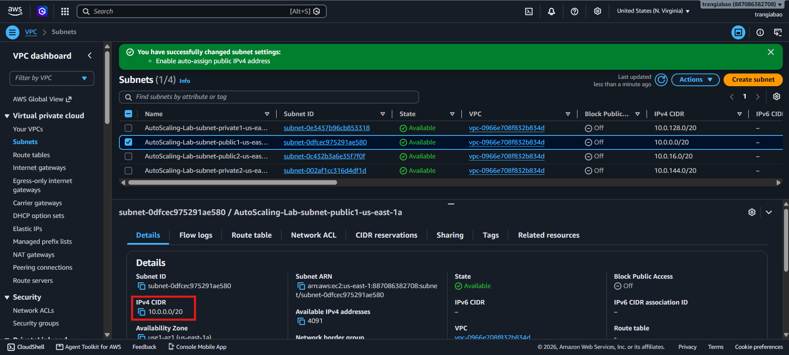

---

#### Bước 3: Theo dõi Trạng thái Tiến trình Tạo AMI
* **Thao tác / Hướng dẫn:** Điều hướng menu bên trái EC2 chọn **Images** ➔ **AMIs**.
* **Quan sát:** Bản ảnh `fcaj-app-ami` đang trong quá trình sao chép các block dữ liệu với trạng thái hiển thị là **pending**.

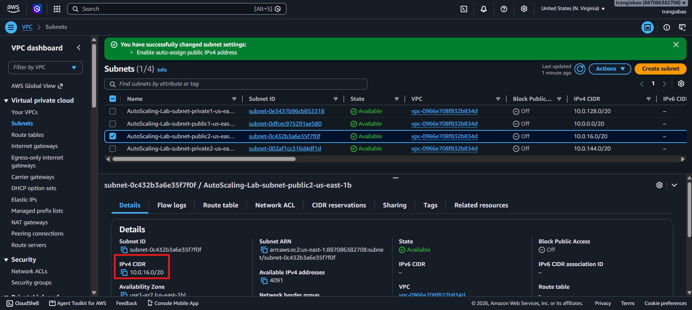

---

#### Bước 4: Xác nhận AMI Sẵn sàng Hoạt động (Available)
* **Thao tác / Hướng dẫn:** Đợi khoảng 3 - 5 phút và làm mới danh sách AMIs.
* **Quan sát:** Trạng thái chuyển sang **available**, xác nhận AMI đã sẵn sàng để tích hợp vào Launch Template.

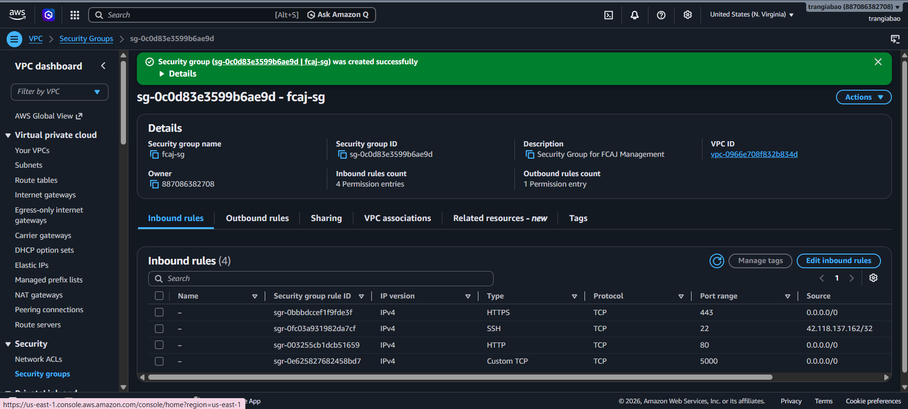

---

#### Bước 5: Kiểm tra Chi tiết Cấu hình và EBS Snapshot của AMI
* **Thao tác / Hướng dẫn:** Bấm chọn `fcaj-app-ami` và xem xét thẻ Details.
* **Thông số quan sát:** Snapshot ID tương ứng được tự động tạo trong mục Elastic Block Store, virtualization type `hvm`, architecture `x86_64`.

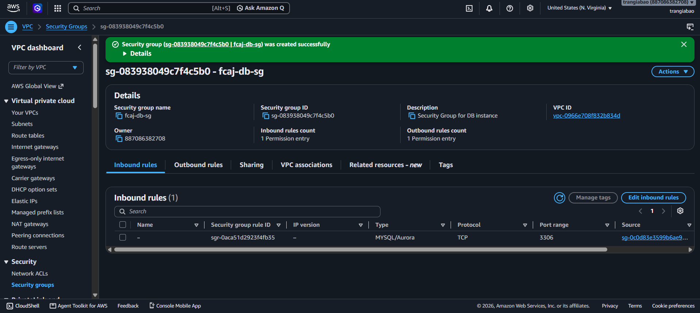

---

#### Bước 6: Khởi tạo Target Group cho Application Load Balancer
* **Thao tác / Hướng dẫn:** Menu bên trái EC2 chọn **Target Groups** ➔ Nhấn **Create target group**.
* **Thông số điền cụ thể:**
  * *Target type:* **Instances**
  * *Target group name:* `fcaj-tg`
  * *Protocol / Port:* `HTTP` : `80`
  * *VPC:* Chọn Default VPC hoặc Workshop VPC
  * *Health checks:* Protocol `HTTP`, Path `/`
* **Thao tác tiếp theo:** Nhấn **Next** ➔ Nhấn **Create target group** (chưa cần đăng ký thủ công target vì ASG sẽ tự động đăng ký).

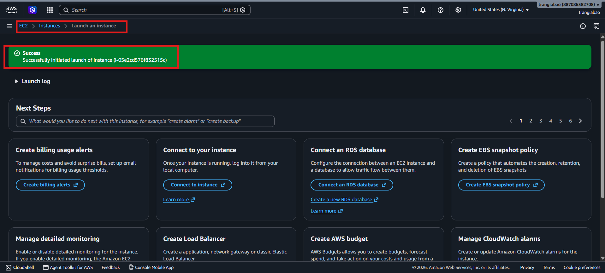

---

#### Bước 7: Khởi tạo Application Load Balancer (`fcaj-alb`)
* **Thao tác / Hướng dẫn:** Menu bên trái chọn **Load Balancers** ➔ Nhấn **Create load balancer** ➔ Chọn loại **Application Load Balancer**.
* **Thông số điền cụ thể:**
  * *Load balancer name:* `fcaj-alb`
  * *Scheme:* **Internet-facing**
  * *IP address type:* `IPv4`
  * *Network mapping:* Chọn VPC và tích chọn tối thiểu 2 Availability Zones / Subnets công khai
  * *Security groups:* Chọn Security Group mở Inbound Port `80` (HTTP) từ `0.0.0.0/0`
  * *Listeners and routing:* Port `80` (HTTP) ➔ Forward to `fcaj-tg`
* **Thao tác tiếp theo:** Cuộn xuống và nhấn **Create load balancer**.

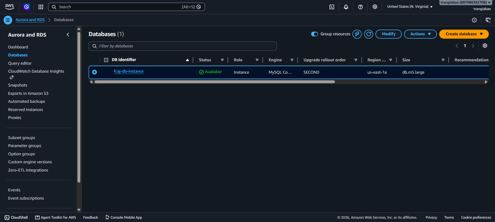

> **💡 Khó khăn gặp phải & Cách xử lý tại Bước 7:**  
> Security Group của ALB phải mở cổng 80 cho mọi IP (`0.0.0.0/0`), nhưng Security Group của các EC2 Instance bên trong chỉ nên chấp nhận lưu lượng đến từ chính Security Group của ALB (Source = Security Group ID của ALB). Cấu hình này giúp ngăn chặn người dùng bên ngoài vượt qua Load Balancer để truy cập trực tiếp vào máy chủ backend.

---

#### Bước 8: Bắt đầu Thiết lập Launch Template Chuẩn hóa
* **Thao tác / Hướng dẫn:** Menu bên trái EC2 chọn **Launch Templates** ➔ Nhấn nút **Create launch template**.
* **Mục đích:** Khởi tạo khuôn mẫu định nghĩa cấu hình phần cứng, mạng và phần mềm để ASG tự động tạo máy chủ đồng nhất.

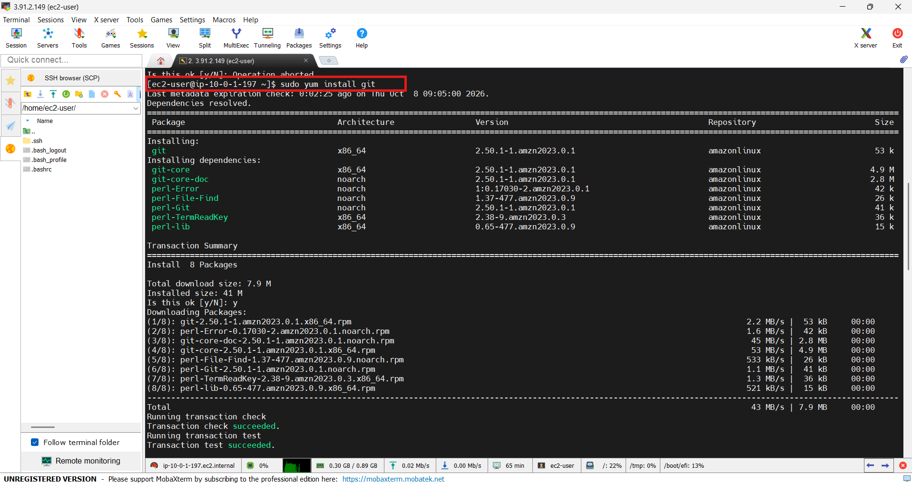

---

#### Bước 9: Đặt Tên & Khai báo Phiên bản Launch Template
* **Thao tác / Hướng dẫn:** Điền thông tin nhận diện ban đầu cho Template.
* **Thông số điền cụ thể:**
  * *Launch template name:* `fcaj-launch-template`
  * *Template version description:* `Initial version for FCAJ ASG`
  * *Auto Scaling guidance:* Tích chọn ô *"Provide guidance to help me set up a template that I can use with EC2 Auto Scaling"*.

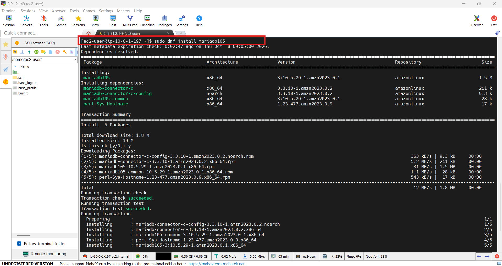

---

#### Bước 10: Chọn Nguồn Bản ảnh Custom AMI (`fcaj-app-ami`)
* **Thao tác / Hướng dẫn:** Tại mục **Application and OS Images (Amazon Machine Image)** ➔ Chọn tab **My AMIs** ➔ Chọn **Owned by me**.
* **Thông số chọn:** Tích chọn bản ảnh `fcaj-app-ami` đã tạo ở Bước 4.

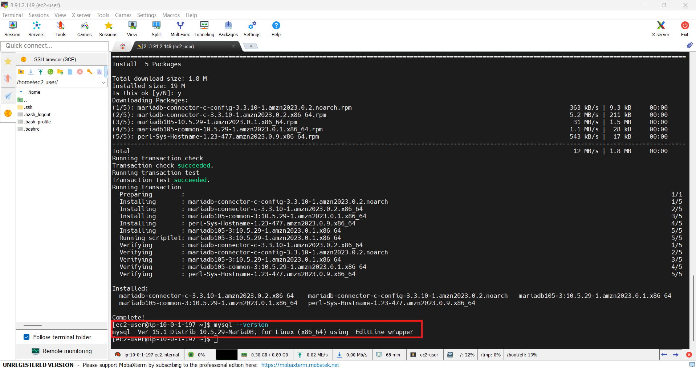

---

#### Bước 11: Lựa chọn Loại Máy chủ (Instance Type)
* **Thao tác / Hướng dẫn:** Tại mục **Instance type**, chọn kích thước máy chủ phù hợp với ngân sách Free Tier.
* **Thông số chọn:** `t2.micro` (1 vCPU, 1 GiB Memory).

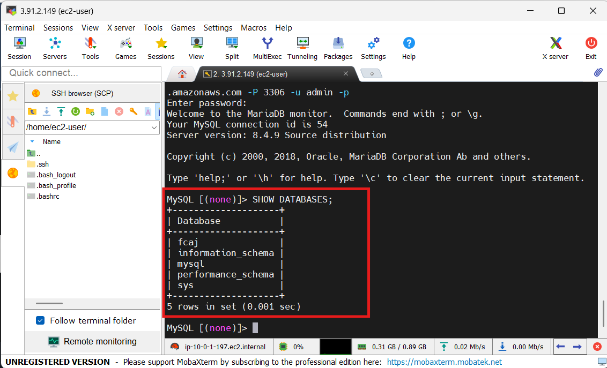

---

#### Bước 12: Thiết lập Key Pair Xác thực SSH
* **Thao tác / Hướng dẫn:** Tại mục **Key pair (login)**, chọn khóa bảo mật để kết nối từ xa.
* **Thông số chọn:** Lựa chọn Key Pair sẵn có của bạn hoặc chọn `Don't include in launch template` nếu không cần truy cập SSH trực tiếp.

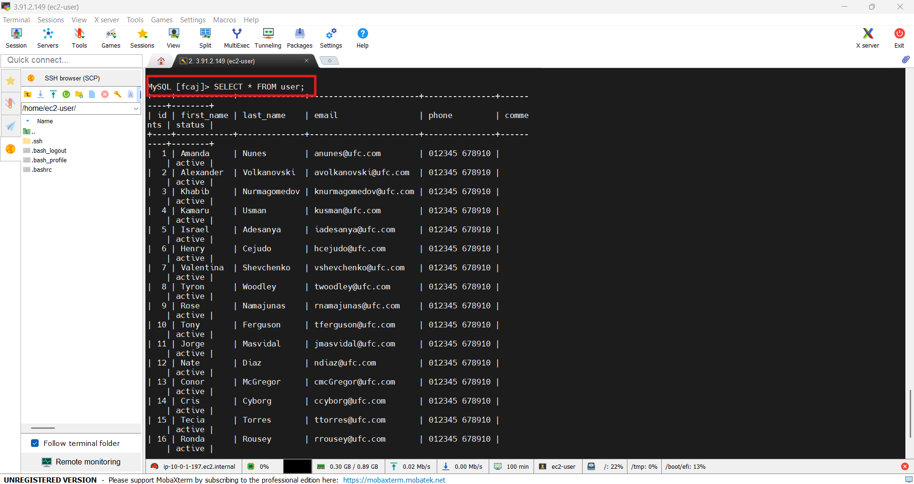

---

#### Bước 13: Cấu hình Mạng & Security Group cho Launch Template
* **Thao tác / Hướng dẫn:** Tại mục **Network settings**, chọn cấu hình tường lửa.
* **Thông số điền cụ thể:**
  * *Subnet:* `Don't include in launch template` (để ASG tự phân bổ subnet theo AZ)
  * *Firewall (Security groups):* Chọn **Select existing security group** ➔ Chọn Security Group cho phép traffic HTTP từ Load Balancer.

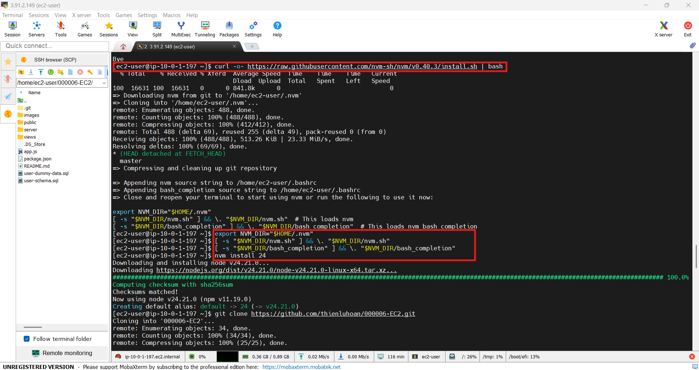

---

#### Bước 14: Cấu hình Phân vùng Lưu trữ Storage (EBS Volume)
* **Thao tác / Hướng dẫn:** Tại mục **Configure storage**, giữ thông số mặc định của AMI.
* **Thông số điền cụ thể:** 1x 8 GiB General Purpose SSD (gp2) hoặc (gp3), Delete on termination: `Yes`.

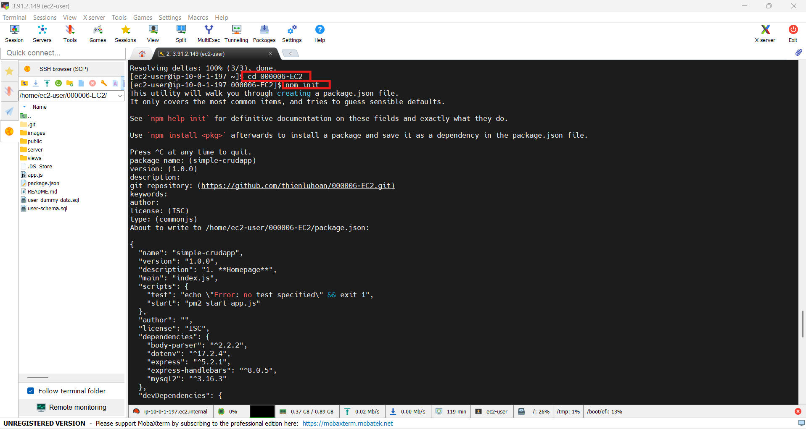

---

#### Bước 15: Cấu hình Nâng cao & Script User Data Tự động Khởi động
* **Thao tác / Hướng dẫn:** Mở rộng mục **Advanced details**, cuộn xuống dưới cùng tới ô **User data**.
* **Lệnh thực thi trong User Data:**
  ```bash
  #!/bin/bash
  # Khởi động dịch vụ ứng dụng khi máy chủ boot lên
  cd /home/ec2-user/fcaj-app || cd /var/www/html
  npm start || systemctl restart httpd
  ```

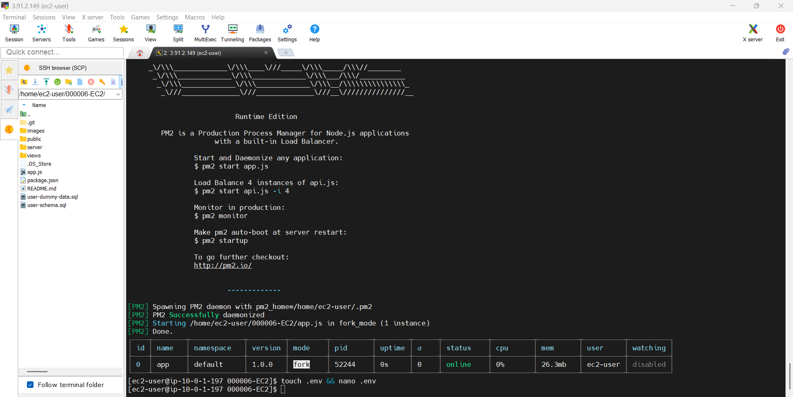

---

#### Bước 16: Xác nhận Tạo Thành công Launch Template
* **Thao tác / Hướng dẫn:** Nhấn **Create launch template**.
* **Quan sát:** Màn hình thông báo màu xanh lá xác nhận Launch Template `fcaj-launch-template` đã được tạo thành công với Version 1.

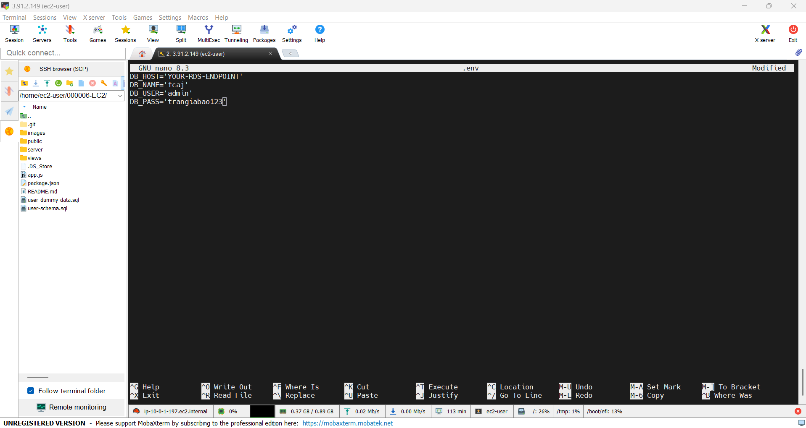

---

#### Bước 17: Bắt đầu Khởi tạo Auto Scaling Group (`fcaj-asg`)
* **Thao tác / Hướng dẫn:** Menu bên trái chọn **Auto Scaling Groups** ➔ Nhấn **Create Auto Scaling group**.
* **Thông số điền cụ thể:**
  * *Auto Scaling group name:* `fcaj-asg`
  * *Launch template:* Chọn `fcaj-launch-template` (Version `Default (1)`)
* **Thao tác tiếp theo:** Nhấn **Next**.

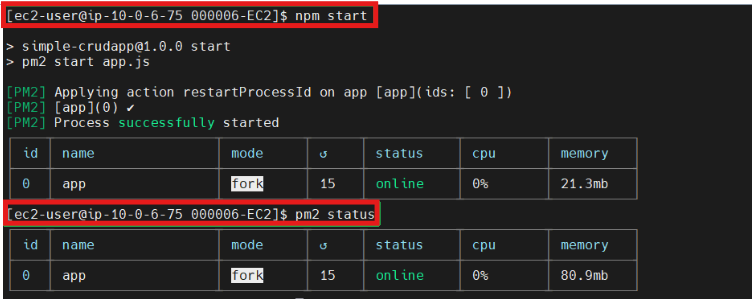

---

#### Bước 18: Chọn Mạng VPC và Các Subnets Dự phòng (Multi-AZ)
* **Thao tác / Hướng dẫn:** Tại bước *Choose instance launch options*.
* **Thông số điền cụ thể:**
  * *VPC:* Chọn VPC của bài thực hành
  * *Availability Zones and subnets:* Tích chọn tối thiểu **2 Subnets** ở 2 AZ khác nhau (ví dụ: `ap-southeast-1a` và `ap-southeast-1b`) để đảm bảo tính sẵn sàng cao (High Availability).
* **Thao tác tiếp theo:** Nhấn **Next**.

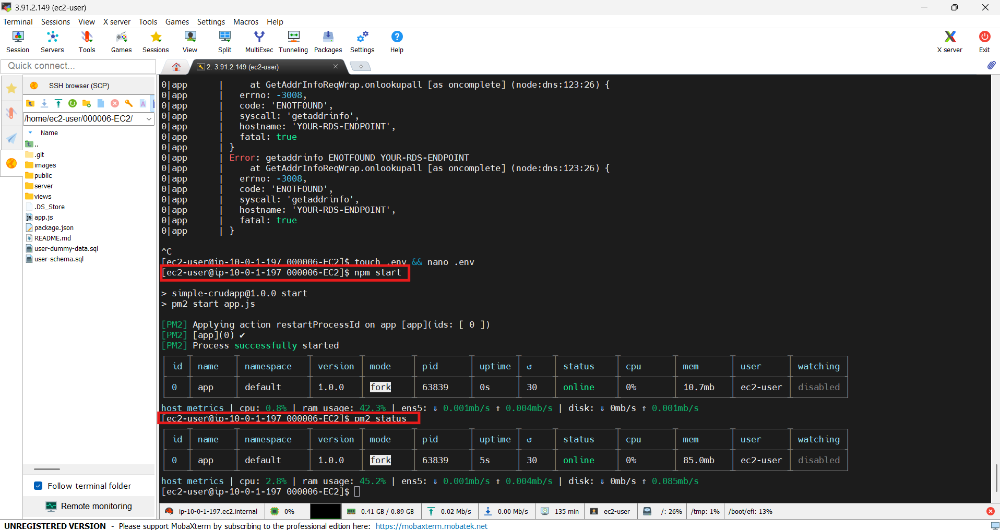

---

#### Bước 19: Đính kèm Target Group của ALB & Kích hoạt ELB Health Checks
* **Thao tác / Hướng dẫn:** Tại bước *Configure advanced options*.
* **Thông số điền cụ thể:**
  * *Load balancing:* Chọn **Attach to an existing load balancer** ➔ Chọn **Choose from your load balancer target groups** ➔ Tích chọn `fcaj-tg`.
  * *Health checks:* Bật thêm tùy chọn **Turn on Elastic Load Balancing health checks**.
  * *Health check grace period:* `300` giây (cho phép instance có đủ thời gian khởi động app trước khi bị kiểm tra).
* **Thao tác tiếp theo:** Nhấn **Next**.

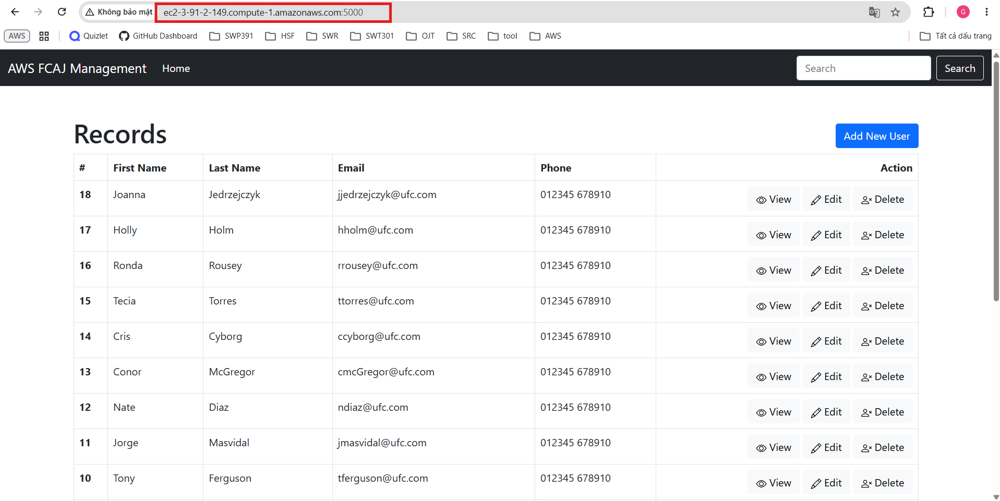

> **💡 Khó khăn gặp phải & Cách xử lý tại Bước 19:**  
> Nếu không bật ELB Health checks, ASG chỉ theo dõi tình trạng phần cứng máy chủ (EC2 Status Check) mà không biết ứng dụng web có bị treo hay không. Khi bật ELB Health checks, nếu ứng dụng trả về lỗi 5xx hoặc không phản hồi trên cổng 80, ASG sẽ tự động hủy instance lỗi và sinh máy chủ thay thế. Cần đặt Health check grace period đủ dài (tối thiểu 300s) để tránh instance bị terminate nhầm khi app chưa nạp xong.

---

#### Bước 20: Cấu hình Quy mô Máy chủ (Group Size: Min, Desired, Max)
* **Thao tác / Hướng dẫn:** Tại bước *Configure group size and scaling policies*.
* **Thông số điền cụ thể:**
  * *Desired capacity:* `1`
  * *Minimum capacity:* `1`
  * *Maximum capacity:* `3`
  * *Scaling policies:* Tạm thời chọn **None** (sẽ tạo chính sách Target Tracking chi tiết ở Bước 28).
* **Thao tác tiếp theo:** Nhấn **Next** qua các bước Notifications và Tags.

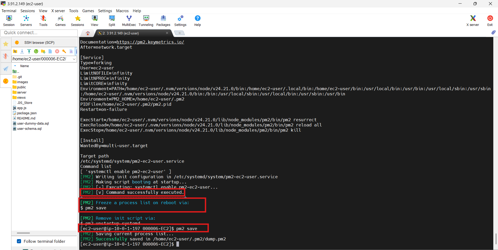

---

#### Bước 21: Xem lại Toàn bộ Thông số Cấu hình ASG trước khi Khởi tạo
* **Thao tác / Hướng dẫn:** Tại bước *Review*, kiểm tra cẩn thận Launch Template, VPC, Subnets, Target Group và Group Size.
* **Thao tác tiếp theo:** Nhấn **Create Auto Scaling group**.

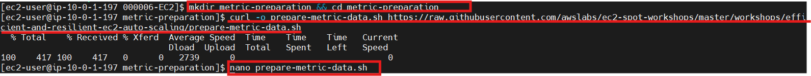

---

#### Bước 22: ASG Tự động Kích hoạt Tạo Instance Đầu tiên
* **Thao tác / Hướng dẫn:** Bấm vào `fcaj-asg` vừa tạo ➔ Chọn thẻ **Activity**.
* **Quan sát:** Lịch sử hoạt động ghi nhận sự kiện `Launching a new EC2 instance` nhằm thỏa mãn Desired capacity = 1.

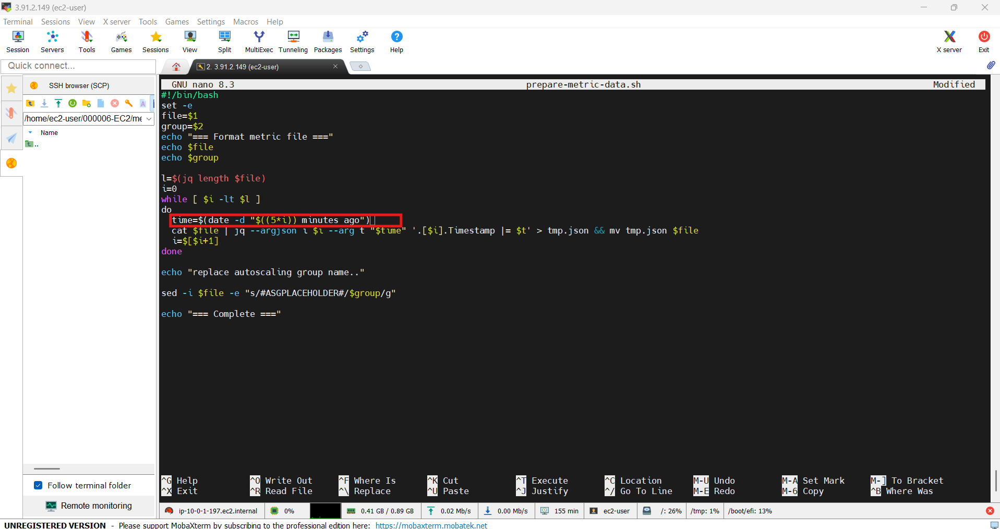

---

#### Bước 23: Xác nhận Instance Chuyển sang Trạng thái InService
* **Thao tác / Hướng dẫn:** Chuyển sang thẻ **Instance management** của `fcaj-asg`.
* **Quan sát:** Instance mới hiển thị Health status là **Healthy** và Lifecycle state là **InService**.

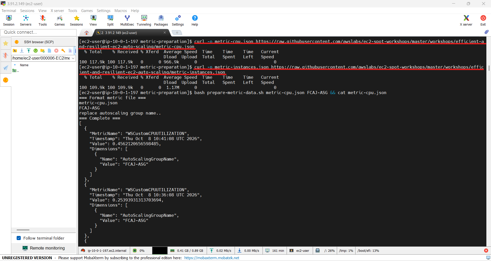

---

#### Bước 24: Kiểm tra Target Group Xác nhận Máy chủ Healthy
* **Thao tác / Hướng dẫn:** Quay lại mục **Target Groups** ➔ Chọn `fcaj-tg` ➔ Xem thẻ **Targets**.
* **Quan sát:** Máy chủ do ASG tự động đăng ký hiển thị trạng thái Health status là **healthy** trên cổng 80.

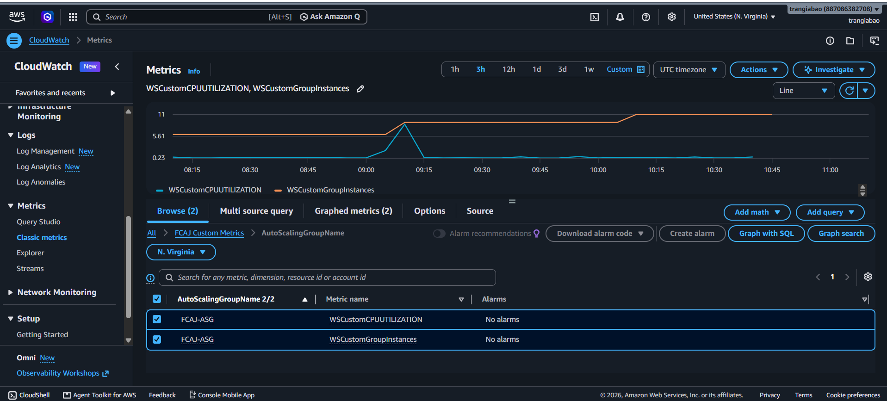

---

#### Bước 25: Truy cập Ứng dụng qua DNS Name của Application Load Balancer
* **Thao tác / Hướng dẫn:** Vào mục **Load Balancers**, sao chép trường **DNS name** của `fcaj-alb` ➔ Mở trình duyệt web và dán vào thanh địa chỉ (`http://fcaj-alb-...amazonaws.com`).
* **Kết quả:** Yêu cầu được cân bằng tải chuyển tiếp chính xác tới instance đang hoạt động.

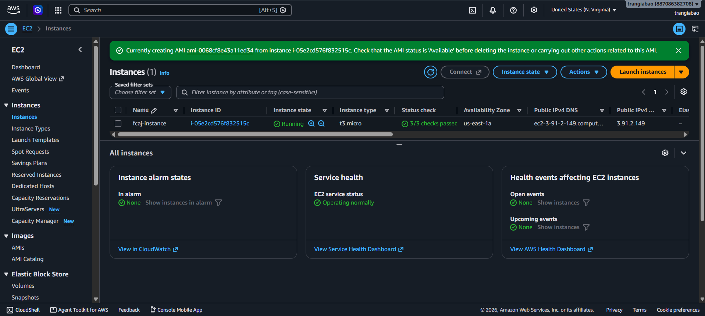

---

#### Bước 26: Đăng nhập vào Hệ thống Ứng dụng FCAJ Management
* **Thao tác / Hướng dẫn:** Trên màn hình ứng dụng web, điền thông tin xác thực để kiểm tra tính toàn vẹn của ứng dụng đã được đóng gói trong AMI.
* **Thông số điền cụ thể:**
  * *Username:* `admin`
  * *Password:* `[Mật khẩu mẫu của ứng dụng]`
* **Thao tác tiếp theo:** Nhấn **Sign In**.

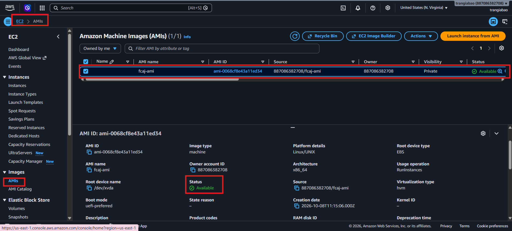

---

#### Bước 27: Xác nhận Dashboard Ứng dụng Hoạt động Ổn định
* **Thao tác / Hướng dẫn:** Kiểm tra các chức năng trên thanh điều hướng sau khi đăng nhập.
* **Kết quả:** Dashboard hiển thị danh mục quản trị đầy đủ, dữ liệu tải mượt mà thông qua Application Load Balancer.


---

#### Bước 28: Thiết lập Dynamic Scaling Policy theo Ngưỡng CPU
* **Thao tác / Hướng dẫn:** Mở chi tiết `fcaj-asg` ➔ Chọn thẻ **Automatic scaling** ➔ Mục *Dynamic scaling policies* nhấn **Create dynamic scaling policy**.
* **Thông số chọn:**
  * *Policy type:* **Target tracking scaling**
  * *Scaling policy name:* `TargetTracking-CPU`


---

#### Bước 29: Khai báo Giá trị Ngưỡng Mục tiêu 50% Average CPU Utilization
* **Thao tác / Hướng dẫn:** Điền thông số chi tiết cho chính sách Target Tracking.
* **Thông số điền cụ thể:**
  * *Metric type:* **Average CPU utilization**
  * *Target value:* `50` (%)
  * *Instance warmup:* `300` giây
* **Thao tác tiếp theo:** Nhấn nút **Create**.


---

#### Bước 30: Kiểm tra CloudWatch Alarm Giám sát Chỉ số CPU
* **Thao tác / Hướng dẫn:** Vào dịch vụ **CloudWatch** ➔ Chọn mục **Alarms**.
* **Quan sát:** AWS tự động tạo 2 Alarm cho ASG: Một Alarm phát hiện CPU > 50% (kích hoạt Scale Out) và một Alarm phát hiện CPU < 35% (kích hoạt Scale In).


---

#### Bước 31: Thực thi Kịch bản Kiểm thử Chịu tải Stress Test trên Máy chủ
* **Thao tác / Hướng dẫn:** Kết nối SSH vào máy chủ EC2 đang chạy trong ASG và thực thi lệnh tạo tải giả lập CPU bằng công cụ `stress`.
* **Lệnh thực thi:**
  ```bash
  # Cài đặt công cụ stress nếu chưa có
  sudo amazon-linux-extras install epel -y || sudo dnf install -y epel-release
  sudo yum install -y stress

  # Chạy tải giả lập 2 luồng CPU tối đa trong 600 giây
  stress --cpu 2 --timeout 600s
  ```


> **💡 Khó khăn gặp phải & Cách xử lý tại Bước 31:**  
> Chu kỳ thu thập số liệu mặc định của CloudWatch cơ bản là 5 phút. Để kiểm thử phản hồi nhanh, nên duy trì lệnh `stress` tối thiểu 600 giây (10 phút) hoặc kích hoạt Detailed Monitoring (chu kỳ 1 phút) để CloudWatch Alarm kịp thời chuyển trạng thái.

---

#### Bước 32: Theo dõi Đồ thị CPU Tăng vọt trên Amazon CloudWatch
* **Thao tác / Hướng dẫn:** Trên bảng điều khiển CloudWatch, mở biểu đồ metric `CPUUtilization` của máy chủ.
* **Quan sát:** Tải CPU tăng dốc đứng từ mức bình thường (~1%) vọt lên gần 100%, vượt xa ngưỡng mục tiêu 50%.


---

#### Bước 33: Báo động CloudWatch Kích hoạt Sự kiện Scale Out
* **Thao tác / Hướng dẫn:** Quay lại tab **Activity** của `fcaj-asg`.
* **Quan sát:** Alarm chuyển trạng thái sang **In alarm**, ASG tự động kích hoạt hành động mở rộng: `Launching a new EC2 instance to balance the target metric`.


---

#### Bước 34: Máy chủ Mới Khởi chạy & Cân bằng Tải Ổn định
* **Thao tác / Hướng dẫn:** Kiểm tra tab **Instance management** và **Target Groups**.
* **Kết quả:** Số lượng máy chủ tự động tăng từ 1 lên 2 (và có thể lên tối đa 3 instance theo cấu hình Max size), tất cả đều chuyển sang trạng thái `InService` và `Healthy`, chia sẻ tải CPU hiệu quả.


---

#### Bước 35: Dọn dẹp Tài nguyên Bước 1 - Xóa Auto Scaling Group
* **Thao tác / Hướng dẫn:** Sau khi hoàn thành kiểm thử, vào mục **Auto Scaling Groups** ➔ Chọn `fcaj-asg` ➔ Chọn menu **Actions** ➔ Nhấn **Delete**.


---

#### Bước 36: Xác nhận Lệnh Xóa và Chờ Toàn bộ Máy chủ Terminated
* **Thao tác / Hướng dẫn:** Điền từ khóa xác nhận vào hộp thoại cảnh báo.
* **Thông số điền cụ thể:** Nhập chữ `delete` ➔ Nhấn **Delete**. Toàn bộ các máy chủ EC2 do ASG quản lý sẽ được tự động chấm dứt.


---

#### Bước 37: Kiểm tra Danh sách EC2 Instances đã Bị Hủy Hoàn toàn
* **Thao tác / Hướng dẫn:** Vào mục **Instances** trên EC2 Console.
* **Quan sát:** Toàn bộ các máy chủ thuộc `fcaj-asg` chuyển sang trạng thái **Terminated**, giải phóng chi phí tính toán.


---

#### Bước 38: Dọn dẹp Tài nguyên Bước 2 - Xóa Application Load Balancer
* **Thao tác / Hướng dẫn:** Menu bên trái chọn **Load Balancers** ➔ Chọn `fcaj-alb` ➔ Chọn **Actions** ➔ Nhấn **Delete load balancer** ➔ Nhấn **Delete**.


---

#### Bước 39: Xóa Target Group Liên kết (`fcaj-tg`)
* **Thao tác / Hướng dẫn:** Chuyển sang mục **Target Groups** ➔ Chọn `fcaj-tg` ➔ Chọn **Actions** ➔ Nhấn **Delete**.


---

#### Bước 40: Dọn dẹp Tài nguyên Bước 3 - Chọn Xóa Launch Template
* **Thao tác / Hướng dẫn:** Vào mục **Launch Templates** ➔ Chọn `fcaj-launch-template` ➔ Chọn menu **Actions** ➔ Nhấn **Delete template**.


---

#### Bước 41: Xác nhận Xóa Vĩnh viễn Launch Template
* **Thao tác / Hướng dẫn:** Tại hộp thoại xác nhận, nhập chữ `Delete` ➔ Nhấn **Delete**.


---

#### Bước 42: Dọn dẹp Tài nguyên Bước 4 - Hủy Đăng ký (Deregister) Custom AMI
* **Thao tác / Hướng dẫn:** Menu bên trái vào mục **AMIs** ➔ Chọn `fcaj-app-ami` ➔ Chọn **Actions** ➔ Nhấn **Deregister AMI** ➔ Xác nhận hủy đăng ký.


---

#### Bước 43: Tìm kiếm EBS Snapshot Liên kết của AMI
* **Thao tác / Hướng dẫn:** Điều hướng sang mục **Elastic Block Store** ➔ **Snapshots** ➔ Tìm bản chụp có phần Description trỏ tới AMI vừa hủy đăng ký.


---

#### Bước 44: Xóa Vĩnh viễn EBS Snapshot để Tránh Phát sinh Chi phí Lưu trữ
* **Thao tác / Hướng dẫn:** Chọn bản snapshot tìm được ➔ Chọn **Actions** ➔ Nhấn **Delete snapshot** ➔ Nhấn **Delete**.
* **Kết quả:** Toàn bộ hạ tầng thực hành đã được giải phóng sạch sẽ, không còn bất kỳ chi phí phát sinh ngầm nào.


> **💡 Khó khăn gặp phải & Cách xử lý tại Bước 44:**  
> Rất nhiều người dùng chỉ Deregister AMI mà quên xóa EBS Snapshot liên kết. Snapshot vẫn sẽ tiếp tục bị tính phí lưu trữ hàng tháng nếu không được xóa thủ công. Luôn kiểm tra kỹ mục Snapshots sau khi deregister bất kỳ AMI nào.

---

### 📝 Tổng kết & Bài học kinh nghiệm:
1. **Khả năng Tự phục hồi (Self-healing Architecture):** Auto Scaling Group không chỉ tự động mở rộng theo tải mà còn liên tục kiểm tra ELB Health Check và tự động thay thế tức thì các instance bị treo hoặc hỏng hóc mà không cần sự can thiệp thủ công của kỹ sư vận hành.
2. **Tối ưu hóa Chi phí Thông minh (Cost Efficiency):** Hệ thống chỉ tiêu tốn tài nguyên đúng mức cần thiết; máy chủ tự động thu hẹp trong các khung giờ vắng khách và chỉ tăng quy mô khi lượng người dùng gia tăng đột biến, giúp tiết kiệm đáng kể chi phí so với việc thuê cố định máy chủ cấu hình lớn.
3. **Mô hình Kiến trúc Phi trạng thái (Stateless Tier):** Ứng dụng đặt trong ASG cần được thiết kế phi trạng thái, dữ liệu người dùng nên lưu trữ tập trung tại cơ sở dữ liệu (Amazon RDS) hoặc bộ nhớ cache dùng chung (Amazon ElastiCache) để các máy chủ có thể thêm/bớt linh hoạt mà không ảnh hưởng tới phiên làm việc của khách hàng.

- **Chuẩn hóa khuôn mẫu máy chủ:** Hiểu cách tạo bản sao ảnh (AMI) và mẫu khởi chạy (Launch Template) để tự động hóa việc sinh ra các máy chủ đồng nhất.
- **Phân phối tải với Application Load Balancer:** Nắm nguyên lý điều phối lưu lượng truy cập của người dùng đến nhiều máy chủ phân bổ trên các vùng sẵn sàng khác nhau nhằm tăng tính sẵn sàng.
- **Cơ chế tự động co giãn (Auto Scaling):** Trải nghiệm cách hệ thống tự động bổ sung máy chủ khi tải tăng cao và tự động thu gọn lại khi tải giảm để tối ưu hóa chi phí vận hành.

---

#### 📌 Kết quả Thứ 5 (08/10/2026) - Giám sát với Amazon CloudWatch:

{}
Bài thực hành **Giám sát với Amazon CloudWatch** (Monitoring with Amazon CloudWatch) được thực hiện vào **Thứ 5 (08/10/2026)** trong khuôn khổ **Tuần 4**. Trang này hướng dẫn chi tiết từng bước với đầy đủ thông số kỹ thuật, cú pháp truy vấn Logs Insights, công thức toán học Math Expressions, xử lý sự cố thực tế và trọn bộ 33 hình ảnh minh chứng thực hành.
<br>🔗 **Nguồn tài liệu thực hành (Workshop Reference):** [Monitoring with Amazon CloudWatch](https://000008.awsfcaj.com/)
{}

### 🎯 Mục tiêu bài thực hành (Lab Objectives):
* Hiểu sâu về dịch vụ giám sát và quan sát trung tâm **Amazon CloudWatch** trên AWS.
* Quan sát và trực quan hóa các số liệu hiệu năng (**CloudWatch Metrics**) của tài nguyên hệ thống theo thời gian thực.
* Sử dụng các biểu thức tìm kiếm (**Search Expressions**) và biểu thức toán học (**Math Expressions**) để phân tích, tổng hợp chỉ số tải.
* Cấu hình nhãn động (**Dynamic Labels**) giúp tự động đặt tên biểu đồ theo ngữ cảnh tài nguyên.
* Quản lý nhật ký hệ thống (**CloudWatch Logs**) và sử dụng ngôn ngữ truy vấn mạnh mẽ **CloudWatch Logs Insights** để trích xuất dữ liệu nhanh chóng.
* Tạo bộ lọc số liệu (**Metric Filters**) từ log để chuyển đổi thông tin nhật ký thành biểu đồ đo lường.
* Thiết lập chuông báo động (**CloudWatch Alarms**) kết hợp kênh thông báo **Amazon SNS** tự động cảnh báo khi tài nguyên chạm ngưỡng tới hạn.

---

### 📊 Bảng tổng hợp thông số tài nguyên đã triển khai:

| Tài nguyên | Tên / Định danh | Cấu hình & Chi tiết kỹ thuật | Vùng / Trạng thái | Ghi chú |
| :--- | :--- | :--- | :--- | :--- |
| **EC2 Instance Monitored** | `Web-Server-Lab` | Amazon Linux 2023, CloudWatch Agent cài đặt | `ap-southeast-1` | Thu thập metrics & logs |
| **Metric Monitored** | `CPUUtilization`, `DiskReadBytes` | Namespace: `AWS/EC2`, Chu kỳ thống kê: 1 phút | Real-time monitoring | Đồ thị hóa chỉ số hiệu năng |
| **Search Expression** | `SEARCH(' {AWS/EC2,InstanceId} MetricName="CPUUtilization" ', 'Average', 300)` | Tìm nạp tự động số liệu của mọi instance | Dynamic Metric Dashboard | Tự động cập nhật khi có máy mới |
| **Math Expression** | `m1 * 100 / MAX(m1)` | Chuẩn hóa phần trăm tải CPU theo tỷ lệ | Math expression plot | Biểu diễn dữ liệu toán học |
| **Log Group** | `/aws/ec2/system-logs` | Thời gian lưu trữ (Retention): 7 ngày | Ingestion: Active | Lưu trữ log truy cập & hệ điều hành |
| **Metric Filter** | `HTTP404ErrorCount` | Pattern: `[ip, user, username, timestamp, request, status_code = 404, size]` | Namespace: `Custom/Web` | Đếm số lỗi 404 từ access log |
| **CloudWatch Alarm** | `High-CPU-Utilization-Alarm` | Ngưỡng cảnh báo: CPU > 70% trong 2 kỳ liên tiếp | Trạng thái: `OK` / `ALARM` | Gửi cảnh báo email qua SNS |

---

### 🚀 Chi tiết các bước thực hiện & Hình ảnh minh chứng:

#### Bước 1: Chuẩn bị Môi trường & Cài đặt CloudWatch Agent trên EC2
* **Thao tác / Hướng dẫn:** Khởi chạy máy chủ EC2 `Web-Server-Lab`, gán IAM Role có quyền `CloudWatchAgentServerPolicy` ➔ Kết nối SSH và cài đặt gói agent.
* **Lệnh thực thi:**
  ```bash
  # Cài đặt Amazon CloudWatch Agent
  sudo yum install -y amazon-cloudwatch-agent

  # Khởi động dịch vụ Agent với file cấu hình
  sudo /opt/aws/amazon-cloudwatch-agent/bin/amazon-cloudwatch-agent-ctl \
    -a fetch-config -m ec2 -s -c file:/opt/aws/amazon-cloudwatch-agent/etc/amazon-cloudwatch-agent.json
  ```


> **💡 Khó khăn gặp phải & Cách xử lý tại Bước 1:**  
> Nếu máy chủ EC2 không được gán IAM Role chứa quyền `CloudWatchAgentServerPolicy`, file nhật ký tại `/var/log/amazon/amazon-cloudwatch-agent/amazon-cloudwatch-agent.log` sẽ báo lỗi `AccessDeniedException` khi đẩy log. Luôn kiểm tra IAM Role trước khi khởi động agent.

---

#### Bước 2: Khám phá Bảng Điều khiển All Metrics của Amazon CloudWatch
* **Thao tác / Hướng dẫn:** Truy cập **CloudWatch Console** ➔ Menu bên trái chọn **Metrics** ➔ **All metrics**.
* **Mục đích:** Xem toàn cảnh các Namespace có sẵn do AWS tự động cung cấp (như `AWS/EC2`, `AWS/EBS`, `AWS/ApplicationELB`).


---

#### Bước 3: Lựa chọn Chỉ số Theo dõi EC2 Per-Instance Metrics
* **Thao tác / Hướng dẫn:** Tại thẻ **All metrics**, chọn namespace **EC2** ➔ Chọn **Per-Instance Metrics**.
* **Thông số chọn:** Tìm kiếm theo Instance ID của máy chủ và tích chọn các chỉ số `CPUUtilization`, `NetworkIn`, `DiskReadBytes`.


---

#### Bước 4: Tùy biến Đồ thị Hiển thị các Chỉ số (Graphed Metrics)
* **Thao tác / Hướng dẫn:** Chuyển sang thẻ **Graphed metrics** để quản lý các chỉ số đang được vẽ trên đồ thị.
* **Thông số cấu hình:** Bật/tắt hiển thị từng đường vẽ, tùy chỉnh màu sắc và gán trục Y bên trái hoặc bên phải.


---

#### Bước 5: Chỉnh sửa Chu kỳ Thống kê (Period) và Hàm Thống kê (Statistic)
* **Thao tác / Hướng dẫn:** Tại cột **Statistic**, chuyển từ mặc định sang **Average**. Tại cột **Period**, chọn chu kỳ lấy mẫu **1 Minute** (1 phút) để có độ phân giải chi tiết.


---

#### Bước 6: Trực quan hóa Số liệu CPUUtilization theo Thời gian Thực
* **Thao tác / Hướng dẫn:** Điều chỉnh khung thời gian hiển thị đồ thị về **1h** (1 giờ gần nhất).
* **Quan sát:** Biểu đồ hiển thị dao động tải CPU của máy chủ theo từng phút với độ sắc nét cao.


---

#### Bước 7: Nhập Cú pháp Search Expression Tự động Tìm kiếm Chỉ số
* **Thao tác / Hướng dẫn:** Tại thẻ **Graphed metrics**, chọn menu **Add math** ➔ **Search expression**.
* **Cú pháp nhập cụ thể:**
  ```text
  SEARCH(' {AWS/EC2,InstanceId} MetricName="CPUUtilization" ', 'Average', 300)
  ```
* **Mục đích:** Tự động truy vấn và hiển thị chỉ số CPU của tất cả máy chủ EC2 hiện có mà không cần chọn thủ công từng máy.


> **💡 Khó khăn gặp phải & Cách xử lý tại Bước 7:**  
> Cú pháp Search Expression rất nhạy cảm với khoảng trắng và dấu ngoặc nhọn `{}` định nghĩa dimension. Đảm bảo tên MetricName và Dimension khớp chính xác chữ hoa chữ thường.

---

#### Bước 8: Trực quan hóa Đồ thị Tổng hợp Đa Máy chủ bằng Search Expression
* **Thao tác / Hướng dẫn:** Nhấn **Apply**.
* **Quan sát:** Đồ thị tự động vẽ nhiều đường tương ứng với tất cả các instance đang hoạt động trong Region.


---

#### Bước 9: Kiểm tra Danh sách các Chuỗi Chỉ số Khớp với Biểu thức
* **Thao tác / Hướng dẫn:** Mở rộng danh sách kết quả bên dưới biểu đồ.
* **Quan sát:** Toàn bộ các chuỗi số liệu khớp với biểu thức tìm kiếm đều được liệt kê với InstanceId tương ứng.


---

#### Bước 10: Áp dụng Biểu thức Toán học Math Expression trên Đồ thị
* **Thao tác / Hướng dẫn:** Chọn **Add math** ➔ **Start with empty expression**.
* **Công thức toán học nhập cụ thể:**
  ```text
  (m1 / 100) * 100
  ```
* **Mục đích:** Thực hiện chuẩn hóa dữ liệu, tính toán phần trăm sử dụng hoặc tổng hợp lưu lượng giữa nhiều card mạng.


---

#### Bước 11: Cấu hình Nhãn Động Dynamic Labels theo Thuộc tính Tài nguyên
* **Thao tác / Hướng dẫn:** Tại cột Label của chỉ số, nhập cú pháp nội suy biến.
* **Cú pháp nhập cụ thể:**
  ```text
  ${PROP('Dim.InstanceId')} - CPU Load
  ```
* **Mục đích:** Tự động hiển thị ID hoặc tên của từng instance trên thanh chú giải thay vì các chuỗi định danh mặc định khó hiểu.


---

#### Bước 12: Hoàn thiện Biểu đồ Trực quan với Nhãn Chú thích Rõ ràng
* **Thao tác / Hướng dẫn:** Kiểm tra lại toàn bộ đồ thị sau khi áp dụng Dynamic Labels.
* **Quan sát:** Mỗi đường biểu diễn có màu sắc riêng và chú giải tên máy chủ rõ ràng, sẵn sàng để ghim vào CloudWatch Dashboard.


---

#### Bước 13: Truy cập & Quản lý Danh sách Log Groups trên CloudWatch Logs
* **Thao tác / Hướng dẫn:** Menu bên trái chọn **Logs** ➔ **Log groups**.
* **Thông số chọn:** Nhóm nhật ký `/aws/ec2/system-logs` do CloudWatch Agent đẩy về.


---

#### Bước 14: Duyệt các Log Streams Chi tiết của Từng Máy chủ
* **Thao tác / Hướng dẫn:** Bấm vào Log Group `/aws/ec2/system-logs` ➔ Xem thẻ **Log streams**.
* **Quan sát:** Mỗi instance có một luồng stream riêng biệt mang định danh Instance ID.


---

#### Bước 15: Xem Chi tiết Nội dung Sự kiện Nhật ký Hệ thống (Log Events)
* **Thao tác / Hướng dẫn:** Bấm vào một Log Stream cụ thể để kiểm tra luồng tin nhắn thô.
* **Quan sát:** Toàn bộ thông điệp hệ thống, tiến trình boot và lỗi ứng dụng được lưu trữ đầy đủ kèm mốc thời gian UTC/Local.


---

#### Bước 16: Mở Giao diện Trình soạn thảo Truy vấn CloudWatch Logs Insights
* **Thao tác / Hướng dẫn:** Menu bên trái chọn **Logs** ➔ **Logs Insights**.
* **Thông số chọn:** Tại ô *Select log group(s)*, chọn `/aws/ec2/system-logs`.


---

#### Bước 17: Soạn thảo Câu lệnh Truy vấn Lọc Thông điệp Lỗi
* **Thao tác / Hướng dẫn:** Nhập câu lệnh truy vấn lọc các dòng log chứa thông điệp lỗi.
* **Cú pháp truy vấn cụ thể:**
  ```text
  fields @timestamp, @message
  | filter @message like /(?i)(error|exception|fail)/
  | sort @timestamp desc
  | limit 20
  ```
* **Thao tác tiếp theo:** Nhấn nút **Run query**.


---

#### Bước 18: Xem Bảng Dữ liệu Kết quả Trả về từ Logs Insights
* **Thao tác / Hướng dẫn:** Kiểm tra bảng kết quả hiển thị bên dưới trình soạn thảo.
* **Quan sát:** Tất cả các bản ghi có chứa từ khóa lỗi được trích xuất tức thì với thời gian và nội dung chi tiết.


---

#### Bước 19: Trực quan hóa Số lượng Sự kiện Log Lỗi theo Mốc Thời gian
* **Thao tác / Hướng dẫn:** Chuyển sang thẻ **Visualization** trên bảng kết quả ➔ Chọn dạng **Line chart**.
* **Quan sát:** Biểu đồ hiển thị tần suất phát sinh lỗi theo từng khoảng thời gian (binning).


---

#### Bước 20: Thực thi Truy vấn Thống kê Phân bố Mã Trạng thái HTTP
* **Thao tác / Hướng dẫn:** Nhập câu lệnh tổng hợp số lượng truy cập theo mã trạng thái HTTP status code.
* **Cú pháp truy vấn cụ thể:**
  ```text
  stats count(*) by status_code
  ```
* **Kết quả:** Hiển thị số lượng request thành công (200), lỗi client (404) và lỗi server (500).


---

#### Bước 21: Phân tích Trích xuất Trường Dữ liệu Tùy chỉnh (Parse Field)
* **Thao tác / Hướng dẫn:** Dùng lệnh `parse` để tách các trường IP, Method và URI từ chuỗi log thô.
* **Cú pháp truy vấn cụ thể:**
  ```text
  parse @message "* * [*] \"* * *\" * *" as client_ip, user, timestamp, method, uri, protocol, status, bytes
  | display client_ip, method, uri, status
  ```


---

#### Bước 22: Thiết lập Bộ lọc Nâng cao Trích xuất Top IP Truy cập
* **Thao tác / Hướng dẫn:** Truy vấn đếm và xếp hạng các địa chỉ IP gửi yêu cầu nhiều nhất vào hệ thống.
* **Cú pháp truy vấn cụ thể:**
  ```text
  stats count(*) as request_count by client_ip
  | sort request_count desc
  | limit 10
  ```


---

#### Bước 23: Lưu Câu Truy vấn Tối ưu vào Danh sách Saved Queries
* **Thao tác / Hướng dẫn:** Nhấn nút **Save** ở góc trên bên phải ➔ Đặt tên truy vấn `Top-Error-Analysis` ➔ Chọn thư mục lưu.


---

#### Bước 24: Kiểm tra và Tải lại Câu Truy vấn từ Saved Queries
* **Thao tác / Hướng dẫn:** Chọn tab **Queries** bên phải màn hình để xem lại danh sách câu truy vấn đã lưu và tái sử dụng nhanh chóng.


---

#### Bước 25: Trích xuất & Phân tích Chi tiết Từng Bản ghi Log Sự kiện
* **Thao tác / Hướng dẫn:** Bấm vào dấu mũi tên bên cạnh dòng kết quả để mở rộng toàn bộ các trường JSON và metadata liên quan.


---

#### Bước 26: Tối ưu hóa Phạm vi Thời gian Truy vấn (Scan Window)
* **Thao tác / Hướng dẫn:** Điều chỉnh bộ chọn thời gian góc trên bên phải (chọn 15 phút, 1 giờ hoặc dải ngày cụ thể) để tối ưu lượng dữ liệu được quét và tăng tốc độ trả về kết quả.


---

#### Bước 27: Khởi tạo Bộ lọc Chỉ số (Metric Filter) từ Log Group
* **Thao tác / Hướng dẫn:** Trở lại **Log groups** ➔ Chọn `/aws/ec2/system-logs` ➔ Chọn tab **Metric filters** ➔ Nhấn **Create metric filter**.


---

#### Bước 28: Khai báo Mẫu Biểu thức Bộ lọc (Filter Pattern)
* **Thao tác / Hướng dẫn:** Định nghĩa cú pháp phát hiện lỗi HTTP 404 trong nhật ký.
* **Cú pháp Filter Pattern:**
  ```text
  [ip, user, username, timestamp, request, status_code = 404, size]
  ```


> **💡 Khó khăn gặp phải & Cách xử lý tại Bước 28:**  
> Cú pháp Filter Pattern dạng mảng `[field1, field2, ...]` chỉ hoạt động đúng khi định dạng log được phân tách bằng khoảng trắng chuẩn. Nếu log ở định dạng JSON, phải dùng cú pháp `{ $.status_code = 404 }`. Kiểm thử pattern trước khi lưu để đảm bảo khớp dữ liệu.

---

#### Bước 29: Kiểm thử Mẫu Bộ lọc Trực tiếp trên Nhật ký (Test Pattern)
* **Thao tác / Hướng dẫn:** Chọn luồng log mẫu và nhấn **Test pattern**.
* **Quan sát:** Bảng kiểm thử hiển thị các dòng log khớp mẫu kèm các giá trị trường được bóc tách chính xác.


---

#### Bước 30: Gán Tên Metric, Metric Value & Namespace Tùy biến
* **Thao tác / Hướng dẫn:** Nhấn **Next** để chuyển sang bước đặt tên metric.
* **Thông số điền cụ thể:**
  * *Metric namespace:* `Custom/Web`
  * *Metric name:* `HTTP404ErrorCount`
  * *Metric value:* `1` (mỗi lần phát hiện khớp mẫu, giá trị đếm tăng 1 đơn vị)
  * *Default value:* `0`


---

#### Bước 31: Kích hoạt Hoàn tất Metric Filter & Bắt đầu Thu thập Số liệu
* **Thao tác / Hướng dẫn:** Nhấn **Create metric filter**.
* **Quan sát:** Bộ lọc được kích hoạt thành công và chỉ số `HTTP404ErrorCount` lập tức xuất hiện trong mục All Metrics của CloudWatch.


---

#### Bước 32: Cấu hình Điều kiện Ngưỡng Báo động Tự động (CloudWatch Alarm)
* **Thao tác / Hướng dẫn:** Menu bên trái chọn **Alarms** ➔ Nhấn **Create alarm** ➔ Chọn metric `CPUUtilization` của máy chủ EC2.
* **Thông số điền cụ thể:**
  * *Statistic:* `Average`
  * *Period:* `1 minute`
  * *Threshold type:* `Static`
  * *Whenever CPUUtilization is:* `Greater > 70`
  * *Datapoints to alarm:* `2 out of 2` (vượt ngưỡng liên tiếp trong 2 phút)


---

#### Bước 33: Thiết lập Thông báo SNS Topic & Xác nhận Trạng thái Theo dõi OK
* **Thao tác / Hướng dẫn:** Tại bước cấu hình Actions, chọn gửi thông báo tới Amazon SNS Topic ➔ Đặt tên Alarm là `High-CPU-Utilization-Alarm` ➔ Nhấn **Create alarm**.
* **Quan sát:** Chuông báo động được kích hoạt và duy trì trạng thái **OK** màu xanh lá cây khi máy chủ chạy tải bình thường.


---

### 📝 Tổng kết & Bài học kinh nghiệm:
1. **Khả năng Quan sát Toàn diện (Full-stack Observability):** CloudWatch đóng vai trò trung tâm thu thập cả 3 trụ cột quan sát: Metrics (số liệu đo lường), Logs (nhật ký chi tiết) và Alarms (cảnh báo tức thời).
2. **Sức mạnh Vượt trội của Logs Insights:** Cho phép truy vấn, phân tích và trích xuất hàng gigabyte dữ liệu log chỉ trong vài giây mà không cần đầu tư dựng các cụm máy chủ ELK (Elasticsearch/Logstash/Kibana) phức tạp và tốn kém tài nguyên.
3. **Cơ chế Chuyển hóa Log thành Metric:** Metric Filters là cầu nối cực kỳ hiệu quả để giám sát các chỉ số kinh doanh hoặc lỗi ứng dụng phát sinh từ nhật ký thô, từ đó kích hoạt hệ thống chuông báo động bảo vệ hệ thống 24/7.

- **Thu thập dữ liệu giám sát hệ thống:** Hiểu cách cài đặt tác tử (Agent) để theo dõi các chỉ số hiệu năng (CPU, RAM, ổ đĩa) và tập trung nhật ký (Logs) của máy chủ.
- **Trực quan hóa và truy vấn nhật ký:** Học cách xây dựng biểu đồ giám sát trực quan và sử dụng công cụ truy vấn nâng cao (Logs Insights) để nhanh chóng phát hiện các bất thường của hệ thống.
- **Thiết lập cảnh báo tự động:** Nắm cách định nghĩa ngưỡng kích hoạt cảnh báo (Alarms) và kết hợp với dịch vụ thông báo (SNS) để gửi tin tức thời cho quản trị viên khi có sự cố.

---

#### 📌 Kết quả Thứ 6 (09/10/2026) - Tổng kết Tuần 4, Viết Worklog & Làm Project:

{}
👉 **Kế hoạch định kỳ Thứ 6:** Dành trọn vẹn ngày Thứ 6 cho 3 trọng tâm chính: (1) Tổng kết kiến thức đã tích lũy trong tuần; (2) Hoàn thiện hệ thống Worklog và minh chứng thực hành; (3) Nghiên cứu và triển khai Đồ án thực tập (**[Project Proposal](/vi/2-proposal/)**).
{}

- **1. Tổng kết kiến thức tuần 4:**
  - Hệ thống hóa toàn diện kiến thức về giải pháp triển khai ứng dụng đơn giản với **Amazon Lightsail** và **Lightsail Container Service**.
  - Nắm vững nguyên lý xây dựng hạ tầng co giãn tự động linh hoạt với **EC2 Auto Scaling** kết hợp cân bằng tải **Application Load Balancer**.
  - Làm chủ công cụ giám sát, thu thập chỉ số hiệu năng và phân tích log chuyên sâu với **Amazon CloudWatch** (CloudWatch Agent, Alarms, Logs Insights).
- **2. Hoàn thiện hệ thống Worklog:**
  - Soát lỗi toàn bộ các bài thực hành trong tuần từ **1.4.1 đến 1.4.4**, bổ sung đầy đủ các bảng thông số kỹ thuật và hình ảnh thực tế.
  - Đảm bảo tính nhất quán song ngữ (Tiếng Việt và Tiếng Anh), định dạng chuẩn Markdown và kiểm tra đường dẫn liên kết nội bộ.
- **3. Nghiên cứu & Triển khai Project (Proposal):**
  - Dành thời gian nghiên cứu tài liệu kỹ thuật của AWS Well-Architected Framework phục vụ cho đồ án thực tập.
  - Cập nhật và tinh chỉnh các phần kiến trúc đề xuất trong **[Project Proposal](/vi/2-proposal/)**, chuẩn bị các kịch bản triển khai thực tế.

---

### Mục tiêu cho tuần sau (Tuần 5):

- **Thiết lập Hybrid DNS với Route 53 Resolver (1.5.1):**
  - Tạo hạ tầng CloudFormation đa VPC mô phỏng môi trường On-premises và AWS Cloud.
  - Triển khai AWS Directory Service (AWS Managed Microsoft AD) đóng vai trò máy chủ phân giải tên miền On-premises.
  - Cấu hình Route 53 Outbound Endpoints & Forwarding Rules và Inbound Endpoints để thực hiện phân giải tên miền hai chiều thông suốt qua `nslookup`.
- **Thao tác dòng lệnh với AWS CLI (1.5.2):**
  - Quản trị tập trung IAM User Groups, Users và cấp phát Access Keys an toàn.
  - Thiết lập máy trạm quản trị EC2 Linux và kết nối từ xa qua SSH (MobaXterm).
  - Cài đặt AWS CLI v2 trên Linux, cấu hình đa hồ sơ định danh (`default`, `devops`).
  - Quản trị lưu trữ hướng đối tượng trên Amazon S3 và kênh phân phối thông điệp Amazon SNS bằng lệnh CLI.
  - Tự động hóa toàn diện quy trình xây dựng hệ thống mạng Amazon VPC độc lập và điều khiển vòng đời máy chủ EC2.
- **Làm việc với Amazon DynamoDB (1.5.3):**
  - Quản trị cơ sở dữ liệu NoSQL, tạo bảng `Music` và thao tác dữ liệu linh hoạt trên AWS Management Console.
  - Thao tác dòng lệnh toàn diện qua AWS CloudShell (CRUD, quản trị và truy vấn qua Global Secondary Index - GSI).
  - Lập trình tự động hóa với Python 3 & Boto3 SDK: khởi tạo bảng `Movies`, nạp tập dữ liệu lớn 4.609 bộ phim (`moviedata.json`), thực thi truy vấn Primary Key và quét bảng (Scan) có điều kiện lọc nâng cao.
- **Triển khai Amazon ElastiCache - Redis (1.5.4):**
  - Quy hoạch VPC 3 Subnets trải đều 3 Availability Zones (`us-east-1a`, `1b`, `1c`) và tạo ElastiCache Subnet Group.
  - Triển khai cụm Redis cả hai chế độ: Cluster Mode Disabled và Cluster Mode Enabled trên Web Console và Python Boto3 SDK.
  - Thiết lập bảo mật doanh nghiệp với Mã hóa đường truyền (TLS Transit Encryption) kết hợp phân quyền RBAC Users & User Groups.
  - Viết mã nguồn Python trên EC2 Client tương tác với Redis: kiểm tra TLS RBAC, Strings kèm TTL 60s, Hash kèm xử lý ngoại lệ WRONGTYPE, và Pub/Sub thời gian thực.
- **Tổng kết Tuần 5, Viết Worklog & Làm Project:** Hệ thống hóa toàn bộ kiến thức, hoàn thiện bài viết và tiếp tục hoàn thiện đề xuất đồ án.


