{}
The **Hybrid DNS with Route 53 Resolver** (Hybrid DNS Management with Amazon Route 53) hands-on lab was conducted on **Monday (12/10/2026)** during **Week 5**. This page provides an exhaustive step-by-step implementation guide complete with precise IP CIDR allocations, `nslookup` validation commands, troubleshooting resolutions, and all 11 verification screenshots.
<br>🔗 **Lab Reference Material:** [Set up Hybrid DNS with Route 53 Resolver](https://000010.awsstudygroup.com/)
{}

### 🎯 Lab Objectives:
* Master network topology design and **Hybrid DNS** resolution bridging on-premises enterprise networks with AWS cloud environments.
* Automate multi-VPC networking infrastructure deployment via **AWS CloudFormation**.
* Configure **Security Groups** permitting bidirectional DNS queries (UDP and TCP Port 53) across VPC boundaries.
* Deploy **AWS Directory Service (AWS Managed Microsoft Active Directory)** acting as the authoritative on-premises enterprise DNS controller.
* Configure **Route 53 Resolver Outbound Endpoints** and **Resolver Rules** to conditionally forward queries originating in AWS to on-premises DNS servers.
* Configure **Route 53 Resolver Inbound Endpoints** to receive and resolve incoming queries from on-premises clients targeting AWS Private Hosted Zones.
* Validate end-to-end bidirectional DNS resolution using `nslookup`.

---

### 📊 Provisioned Resource Specifications:

| Resource | Name / Identifier | Configuration & Detailed Specs | Environment / Region | Notes |
| :--- | :--- | :--- | :--- | :--- |
| **EC2 Key Pair** | `hybrid-dns-keypair` | RSA, `.pem` format | `us-east-1` | Administrative access to RDGW client |
| **CloudFormation Stack** | `Hybrid-DNS-Stack` | Provisions On-Prem VPC, Cloud VPC, Subnets, Route Tables, NAT GW | `us-east-1` | Automates multi-VPC baseline environment |
| **Security Group** | `Route53-Resolver-SG` | Inbound: TCP/UDP 53 (DNS), Outbound: All traffic | Cloud & On-prem VPCs | Secures DNS Resolver query paths |
| **Microsoft AD** | `corp.example.com` | AWS Managed Microsoft AD Standard Edition | On-Prem VPC | Authoritative on-premises DNS controller |
| **Outbound Endpoint** | `r53-outbound-resolver` | 2 IP Endpoints across 2 Availability Zones | Cloud VPC Subnets | Forwards AWS queries to On-Prem |
| **Resolver Forwarding Rule** | `forward-to-corp-ad` | Forwards `corp.example.com` to Active Directory IPs | Cloud VPC Association | Routes on-premises domain queries |
| **Inbound Endpoint** | `r53-inbound-resolver` | 2 IP Endpoints across 2 Availability Zones | Cloud VPC Subnets | Accepts on-premises queries to AWS |
| **Test Client EC2** | `RDGW-Client-Tester` | Windows Server 2022 / Amazon Linux | Test Environment | Executes `nslookup` validation scripts |

---

### 🚀 Step-by-Step Implementation & Screenshot Gallery:

#### Step 1: Create Administrative EC2 Key Pair (`hybrid-dns-keypair`)
* **Action / Navigation:** Open the **Amazon EC2** console in **us-east-1** (N. Virginia) ➔ In the sidebar, select **Network & Security** ➔ **Key Pairs** ➔ Click **Create key pair**.
* **Configuration Parameters:**
  * *Name:* `hybrid-dns-keypair`
  * *Key pair type:* `RSA`
  * *Private key file format:* `.pem` (for SSH or Windows Administrator password decryption)
* **Next Action:** Click **Create key pair** and securely store the downloaded `.pem` file.

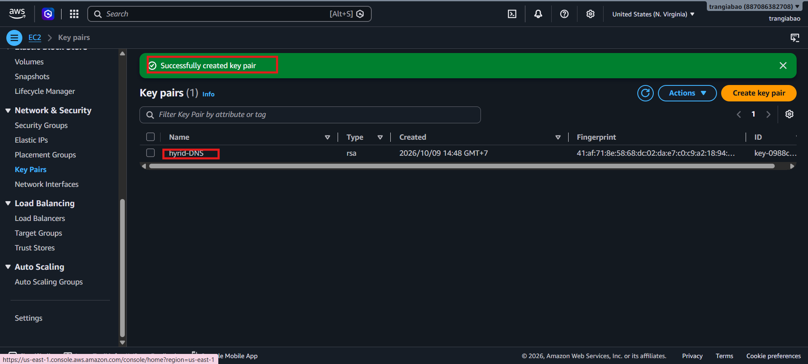

---

#### Step 2: Deploy Multi-VPC Topology via AWS CloudFormation
* **Action / Navigation:** Navigate to **AWS CloudFormation** ➔ Click **Create stack (with new resources)** ➔ Select **Upload a template file**.
* **Configuration Parameters:**
  * *Stack name:* `Hybrid-DNS-Stack`
  * *Parameters:* Select Key Pair `hybrid-dns-keypair` created in Step 1
* **Purpose:** Automatically provisions two isolated VPCs (simulated Cloud VPC `10.0.0.0/16` and On-premises VPC `192.168.0.0/16`), establishes VPC Peering, Internet Gateways, Subnets, and Route Tables.

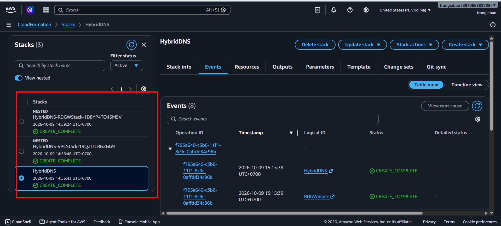

---

#### Step 3: Select Security Group for Route 53 Resolver Endpoints
* **Action / Navigation:** Navigate to **EC2 Console** ➔ Under **Network & Security** ➔ Select **Security Groups**.
* **Selection:** Locate the designated Security Group named `Route53-Resolver-SG` (created by CloudFormation for Resolver endpoints).

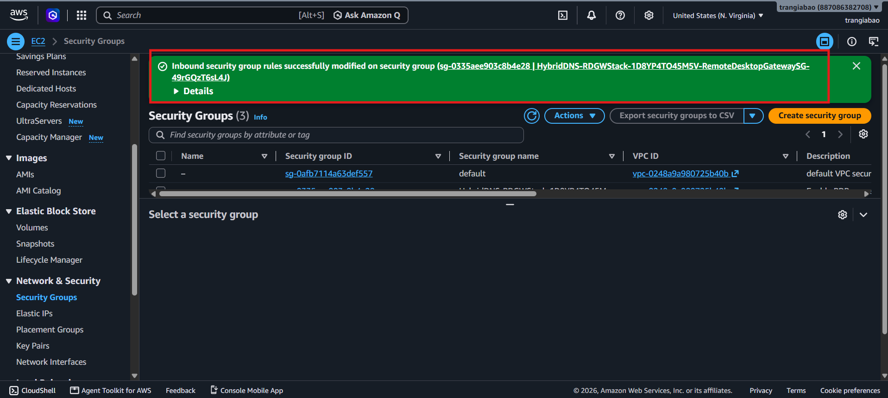

---

#### Step 4: Configure Inbound Rules (Allow Port 53 UDP & TCP)
* **Action / Navigation:** Select the **Inbound rules** tab ➔ Click **Edit inbound rules**.
* **Configuration Parameters:**
  * *Rule 1:* Type `DNS (UDP)`, Port `53`, Source: On-premises VPC CIDR (`192.168.0.0/16`) and Cloud VPC CIDR (`10.0.0.0/16`)
  * *Rule 2:* Type `DNS (TCP)`, Port `53`, Source: On-premises VPC CIDR (`192.168.0.0/16`) and Cloud VPC CIDR (`10.0.0.0/16`)
* **Next Action:** Click **Save rules**.

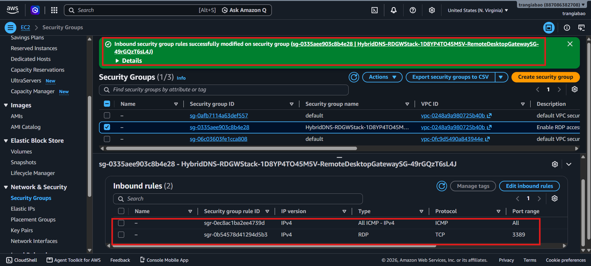

> **💡 Difficulties Encountered & Troubleshooting at Step 4:**  
> A frequent pitfall is opening only **UDP 53** while omitting **TCP 53**. Standard lightweight queries use UDP, but DNS queries exceeding 512 bytes (such as DNSSEC or large responses) automatically fallback to TCP. Without TCP 53, queries will experience intermittent timeouts. Always configure both UDP and TCP rules.

---

#### Step 5: Verify Port 53 Security Group Inbound Permissions
* **Action / Navigation:** Review the finalized Inbound rules table.
* **Observation:** Both DNS (UDP) and DNS (TCP) rules on port 53 are verified active across internal VPC ranges.

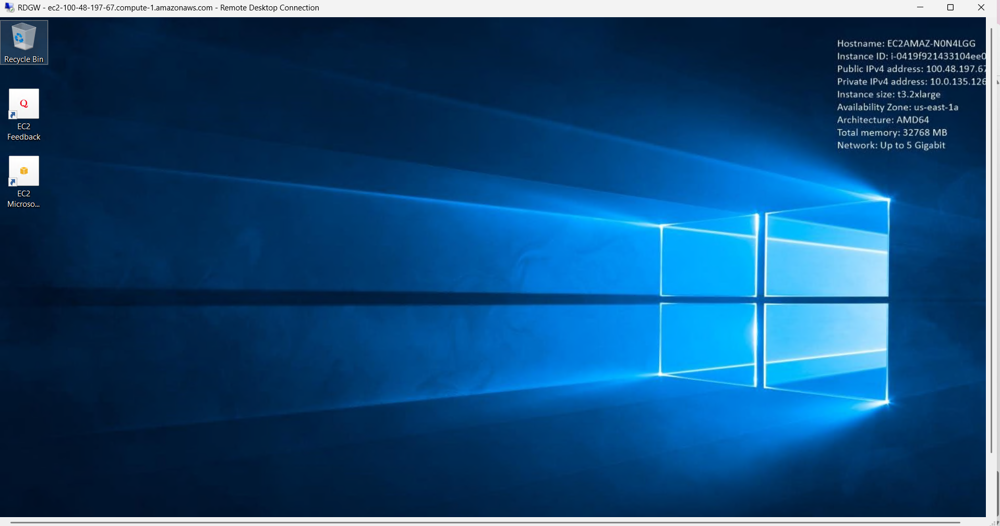

---

#### Step 6: Provision AWS Managed Microsoft Active Directory
* **Action / Navigation:** Navigate to **AWS Directory Service** ➔ Click **Set up directory** ➔ Select **AWS Managed Microsoft AD**.
* **Configuration Parameters:**
  * *Edition:* `Standard Edition`
  * *Directory DNS name:* `corp.example.com`
  * *Directory NetBIOS name:* `CORP`
  * *VPC:* Select On-premises VPC (`192.168.0.0/16`)
  * *Subnets:* Select 2 Private Subnets across distinct Availability Zones
* **Purpose:** Simulates the authoritative corporate Domain Controller and internal DNS server.

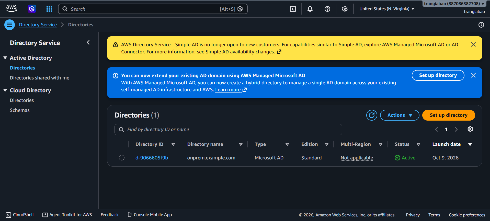

---

#### Step 7: Inspect Directory Status & Note Active Directory DNS IPs
* **Action / Navigation:** Allow 15-20 minutes for directory provisioning, then open directory details.
* **Details Recorded:**
  * *Status:* **Active**
  * *DNS address 1:* `192.168.1.xxx`
  * *DNS address 2:* `192.168.2.xxx`
* **Note:** These two DNS IP addresses represent target endpoints for Route 53 Resolver forwarding rules.

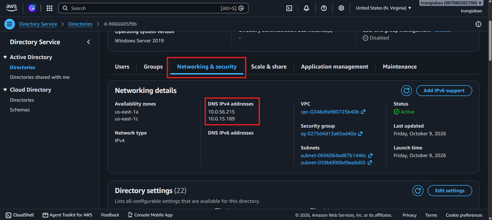

---

#### Step 8: Provision Route 53 Resolver Outbound Endpoint (`r53-outbound-resolver`)
* **Action / Navigation:** Navigate to **Amazon Route 53** ➔ Under *Resolver*, click **Outbound endpoints** ➔ Click **Create outbound endpoint**.
* **Configuration Parameters:**
  * *Endpoint name:* `r53-outbound-resolver`
  * *VPC:* Select Cloud VPC (`10.0.0.0/16`)
  * *Security Group:* Select `Route53-Resolver-SG` verified in Step 5
  * *IP addresses:* Choose at least **2 Availability Zones**, assign 1 subnet per AZ, and choose Auto-allocate IP
* **Next Action:** Click **Submit**. Verify operational status transitions to **Operational**.

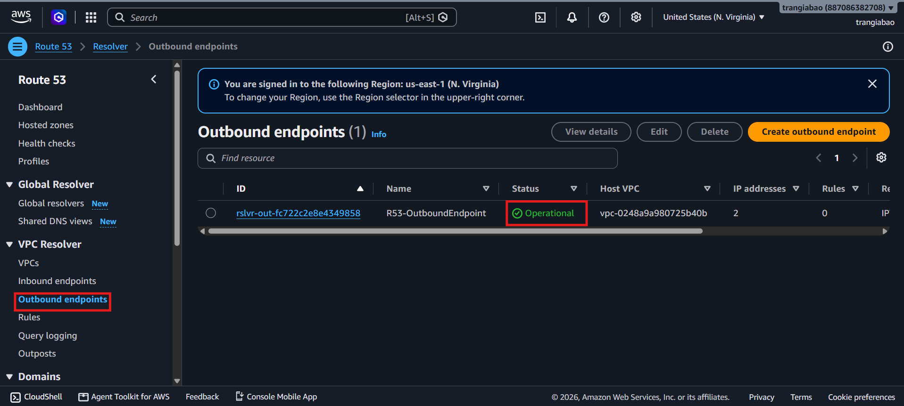

> **💡 Difficulties Encountered & Troubleshooting at Step 8:**  
> Route 53 Resolver strictly mandates a minimum of two IP endpoints residing in separate Availability Zones for High Availability redundancy. Selecting only one AZ halts the wizard.

---

#### Step 9: Configure Resolver Forwarding Rule for `corp.example.com`
* **Action / Navigation:** In the sidebar, select **Resolver** ➔ **Rules** ➔ Click **Create rule**.
* **Configuration Parameters:**
  * *Rule name:* `forward-to-corp-ad`
  * *Rule type:* **Forward**
  * *Domain name:* `corp.example.com`
  * *VPCs that use this rule:* Associate Cloud VPC
  * *Outbound endpoint:* Select `r53-outbound-resolver`
  * *Target IP addresses:* Enter the **2 Microsoft AD DNS IP addresses** recorded in Step 7 (Port `53`)
* **Next Action:** Click **Submit**.

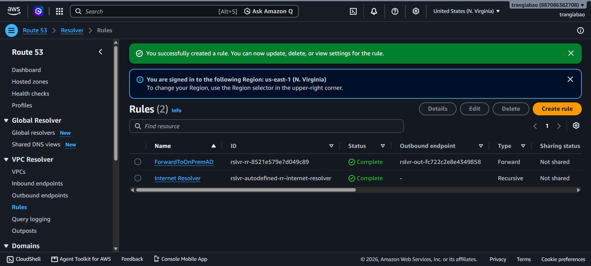

---

#### Step 10: Provision Route 53 Resolver Inbound Endpoint (`r53-inbound-resolver`)
* **Action / Navigation:** In the sidebar, select **Resolver** ➔ **Inbound endpoints** ➔ Click **Create inbound endpoint**.
* **Configuration Parameters:**
  * *Endpoint name:* `r53-inbound-resolver`
  * *VPC:* Select Cloud VPC (`10.0.0.0/16`)
  * *Security Group:* Select `Route53-Resolver-SG`
  * *IP addresses:* Choose 2 Availability Zones and matching subnets
* **Purpose:** Exposes static private IP addresses within AWS for on-premises DNS conditional forwarders to query AWS Private Hosted Zones (e.g., `aws.local`).

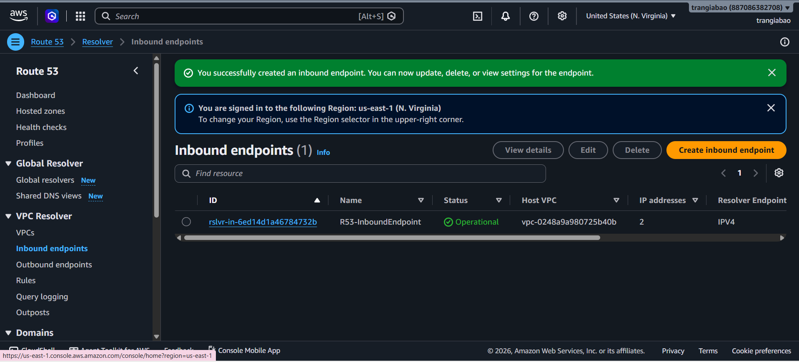

---

#### Step 11: Validate Bidirectional DNS Resolution via `nslookup`
* **Action / Navigation:** Connect to the test instance (RDGW or Linux test client) and execute bidirectional DNS lookups.
* **Commands Executed:**
  ```powershell
  # 1. Query on-premises domain from AWS Cloud via Outbound Endpoint
  nslookup dc01.corp.example.com

  # 2. Query AWS private hosted zone from On-premises via Inbound Endpoint
  nslookup app.aws.local <Inbound-Endpoint-IP>
  ```
* **Output:** Both lookups return resolved internal IP addresses without NXDOMAIN errors or timeouts, confirming seamless bidirectional Hybrid DNS operation.

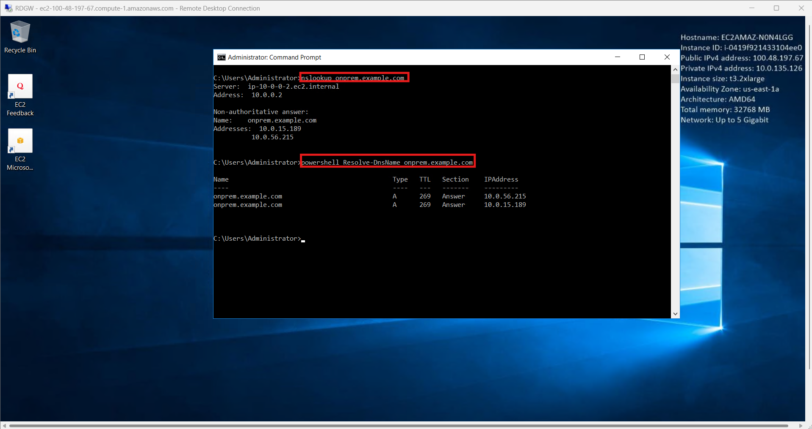

---

### 📝 Summary & Key Takeaways:
1. **Seamless Hybrid DNS Architecture:** Route 53 Resolver delivers an enterprise-grade DNS bridge, completely replacing burdensome, self-managed BIND forwarder instances on EC2.
2. **Clear Inbound vs Outbound Demarcation:**
   * **Inbound Endpoint:** Ingests external on-premises DNS queries into AWS to resolve Private Hosted Zones.
   * **Outbound Endpoint:** Forwards internal AWS queries out to on-premises DNS controllers via Resolver Rules.
3. **Migration Acceleration:** Enables migrating cloud workloads to interact with legacy on-premises databases, SAP, and ERP systems using standard internal domain names without rewriting network configuration strings.
