---
title: "Thiết lập Hybrid DNS với Route 53 Resolver"
date: 2026-10-12
weight: 1
chapter: false
pre: " <b> 1.5.1. </b> "
---

{}
Bài thực hành **Thiết lập Hybrid DNS với Route 53 Resolver** (Hybrid DNS Management with Amazon Route 53) được thực hiện vào **Thứ 2 (12/10/2026)** trong khuôn khổ **Tuần 5**. Trang này hướng dẫn chi tiết từng bước với đầy đủ thông số mạng, dải IP, câu lệnh kiểm tra `nslookup`, giải pháp xử lý sự cố thực tế và trọn bộ 11 hình ảnh minh chứng thực hành.
<br>🔗 **Nguồn tài liệu thực hành (Workshop Reference):** [Set up Hybrid DNS with Route 53 Resolver](https://000010.awsfcaj.com/)
{}

### 🎯 Mục tiêu bài thực hành (Lab Objectives):
* Hiểu sâu về kiến trúc mạng và giải pháp **Hybrid DNS** kết nối phân giải tên miền hai chiều giữa hệ thống tại chỗ (On-premises) và đám mây AWS.
* Tự động hóa triển khai hạ tầng mạng đa VPC (mô phỏng On-prem và AWS Cloud) bằng **AWS CloudFormation**.
* Thiết lập **Security Groups** cho phép lưu lượng truy vấn DNS (cả UDP và TCP Port 53) an toàn giữa các dải mạng.
* Triển khai dịch vụ **AWS Directory Service (AWS Managed Microsoft Active Directory)** đóng vai trò máy chủ phân giải tên miền nội bộ cho môi trường doanh nghiệp.
* Cấu hình **Route 53 Resolver Outbound Endpoint** và **Resolver Rules** để chuyển tiếp truy vấn phân giải tên miền từ VPC trên AWS về DNS On-premises.
* Cấu hình **Route 53 Resolver Inbound Endpoint** để tiếp nhận và phản hồi các truy vấn DNS từ hệ thống On-premises gửi lên các tên miền riêng trên AWS.
* Kiểm thử phân giải tên miền hai chiều (Bidirectional DNS Resolution) thành công thông qua công cụ `nslookup`.

---

### 📊 Bảng tổng hợp thông số tài nguyên đã triển khai:

| Tài nguyên | Tên / Định danh | Cấu hình & Chi tiết kỹ thuật | Môi trường / Vùng | Ghi chú |
| :--- | :--- | :--- | :--- | :--- |
| **EC2 Key Pair** | `hybrid-dns-keypair` | RSA, định dạng file `.pem` | `us-east-1` | Dùng đăng nhập quản trị RDGW |
| **CloudFormation Stack** | `Hybrid-DNS-Stack` | Tạo VPC On-Prem, VPC Cloud, Subnets, Route Tables, NAT GW | `us-east-1` | Tự động hóa hạ tầng mô phỏng |
| **Security Group** | `Route53-Resolver-SG` | Inbound: TCP/UDP 53 (DNS), Outbound: All traffic | Cloud & On-prem VPCs | Bảo mật luồng truy vấn Resolver |
| **Microsoft AD** | `corp.example.com` | AWS Managed Microsoft AD Standard Edition | On-Prem VPC | Máy chủ DNS nội bộ On-premise |
| **Outbound Endpoint** | `r53-outbound-resolver` | 2 IP Endpoints tại 2 Availability Zones khác nhau | Cloud VPC Subnets | Chuyển tiếp query từ AWS về On-prem |
| **Resolver Forwarding Rule** | `forward-to-corp-ad` | Forward domain `corp.example.com` về IP Active Directory | Cloud VPC Association | Định tuyến tên miền On-premises |
| **Inbound Endpoint** | `r53-inbound-resolver` | 2 IP Endpoints tại 2 Availability Zones khác nhau | Cloud VPC Subnets | Tiếp nhận query từ On-prem lên AWS |
| **Test Client EC2** | `RDGW-Client-Tester` | Windows Server 2022 / Amazon Linux | Test Environment | Dùng thực thi lệnh `nslookup` |

---

### 🚀 Chi tiết các bước thực hiện & Hình ảnh minh chứng:

#### Bước 1: Khởi tạo EC2 Key Pair Quản trị (`hybrid-dns-keypair`)
* **Thao tác / Hướng dẫn:** Mở bảng điều khiển **Amazon EC2** tại vùng **us-east-1** (N. Virginia) ➔ Menu bên trái chọn **Network & Security** ➔ **Key Pairs** ➔ Nhấn **Create key pair**.
* **Thông số điền cụ thể:**
  * *Name:* `hybrid-dns-keypair`
  * *Key pair type:* `RSA`
  * *Private key file format:* `.pem` (phục vụ kết nối SSH hoặc giải mã mật khẩu Windows Administrator)
* **Thao tác tiếp theo:** Nhấn **Create key pair** và lưu file `.pem` về máy an toàn.

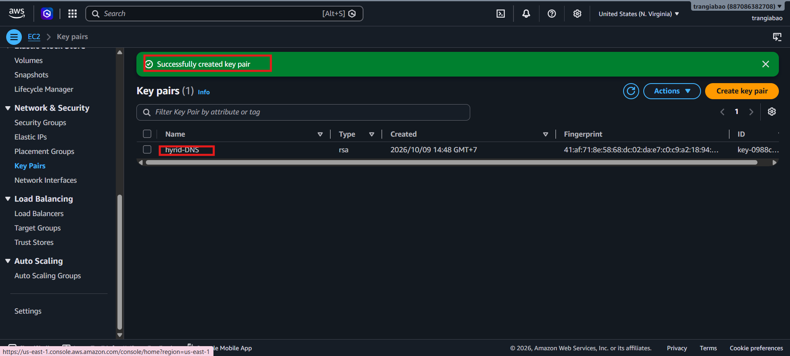

---

#### Bước 2: Triển khai Hạ tầng Mạng Đa VPC tự động bằng AWS CloudFormation
* **Thao tác / Hướng dẫn:** Truy cập dịch vụ **AWS CloudFormation** ➔ Chọn **Create stack (with new resources)** ➔ Chọn **Upload a template file**.
* **Thông số điền cụ thể:**
  * *Stack name:* `Hybrid-DNS-Stack`
  * *Parameters:* Chọn Key Pair `hybrid-dns-keypair` đã tạo ở Bước 1
* **Mục đích:** Tự động khởi tạo 2 VPC riêng biệt (mô phỏng Cloud VPC dải `10.0.0.0/16` và On-premises VPC dải `192.168.0.0/16`), thiết lập VPC Peering, Internet Gateway, Subnets và các bảng định tuyến Route Tables.

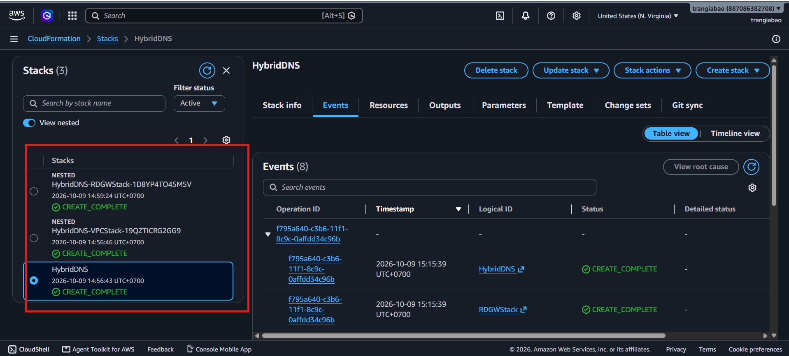

---

#### Bước 3: Lựa chọn Security Group cho Route 53 Resolver Endpoints
* **Thao tác / Hướng dẫn:** Điều hướng tới **EC2 Console** ➔ Mục **Network & Security** ➔ **Security Groups**.
* **Thông số chọn:** Tìm kiếm và chọn Security Group chuyên dụng mang tên `Route53-Resolver-SG` (hoặc Security Group được CloudFormation tạo cho Resolver).

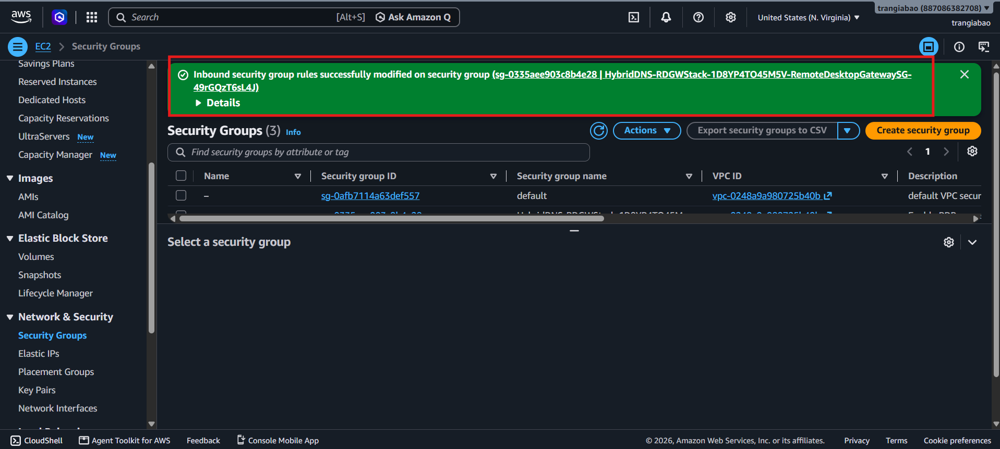

---

#### Bước 4: Chỉnh sửa Inbound Rules cho Security Group (Mở Port 53 UDP & TCP)
* **Thao tác / Hướng dẫn:** Chọn tab **Inbound rules** ➔ Nhấn **Edit inbound rules**.
* **Thông số điền cụ thể:**
  * *Rule 1:* Type `DNS (UDP)`, Port `53`, Source: Dải CIDR của On-premise VPC (`192.168.0.0/16`) và Cloud VPC (`10.0.0.0/16`)
  * *Rule 2:* Type `DNS (TCP)`, Port `53`, Source: Dải CIDR của On-premise VPC (`192.168.0.0/16`) và Cloud VPC (`10.0.0.0/16`)
* **Thao tác tiếp theo:** Nhấn **Save rules**.

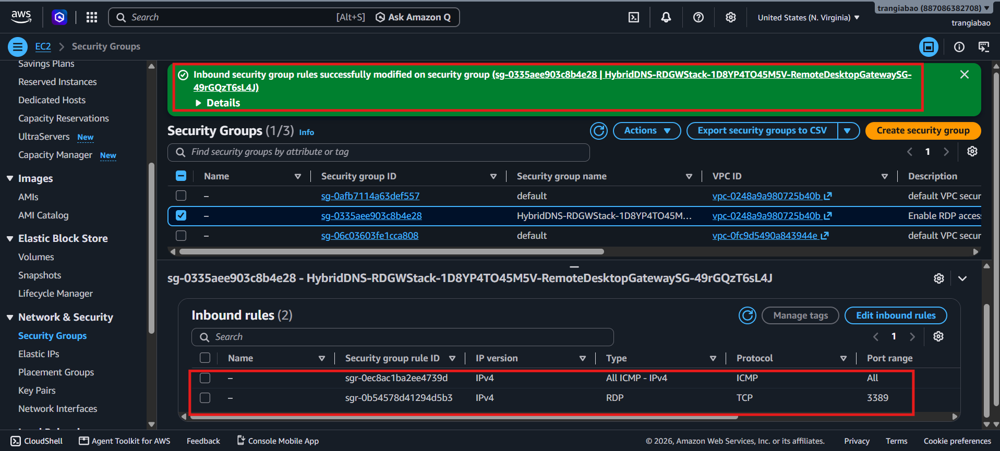

> **💡 Khó khăn gặp phải & Cách xử lý tại Bước 4:**  
> Rất nhiều kỹ sư mạng chỉ mở cổng **UDP 53** cho DNS mà quên mở **TCP 53**. Mặc dù hầu hết truy vấn DNS kích thước nhỏ chạy trên UDP, các truy vấn lớn hơn 512 bytes (như phản hồi có chữ ký số DNSSEC hoặc zone transfer) bắt buộc phải chuyển sang giao thức TCP. Nếu thiếu luật TCP 53, truy vấn sẽ bị timeout thất thường. Luôn mở đồng thời cả hai giao thức UDP và TCP.

---

#### Bước 5: Xác nhận Cấu hình Security Group Chấp nhận Lưu lượng Port 53
* **Thao tác / Hướng dẫn:** Kiểm tra lại bảng tổng hợp Inbound Rules vừa lưu.
* **Quan sát:** Cả hai luật DNS (UDP) và DNS (TCP) trên cổng 53 đều hiển thị trạng thái hoạt động chính xác từ các dải mạng nội bộ.

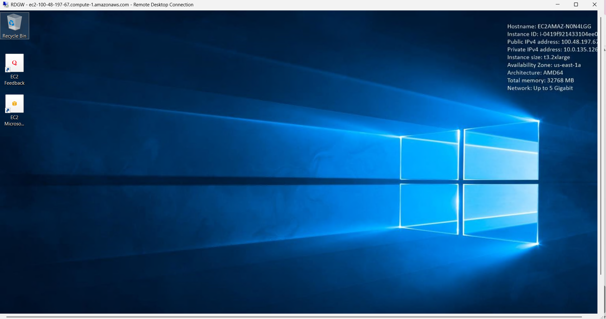

---

#### Bước 6: Khởi tạo Dịch vụ AWS Managed Microsoft Active Directory
* **Thao tác / Hướng dẫn:** Điều hướng tới **AWS Directory Service** ➔ Nhấn **Set up directory** ➔ Chọn **AWS Managed Microsoft AD**.
* **Thông số điền cụ thể:**
  * *Edition:* `Standard Edition`
  * *Directory DNS name:* `corp.example.com`
  * *Directory NetBIOS name:* `CORP`
  * *VPC:* Chọn On-premises VPC (`192.168.0.0/16`)
  * *Subnets:* Chọn 2 Private Subnets ở 2 Availability Zones khác nhau
* **Mục đích:** Mô phỏng hệ thống quản trị định danh Domain Controller và máy chủ DNS nội bộ của doanh nghiệp tại On-premise.

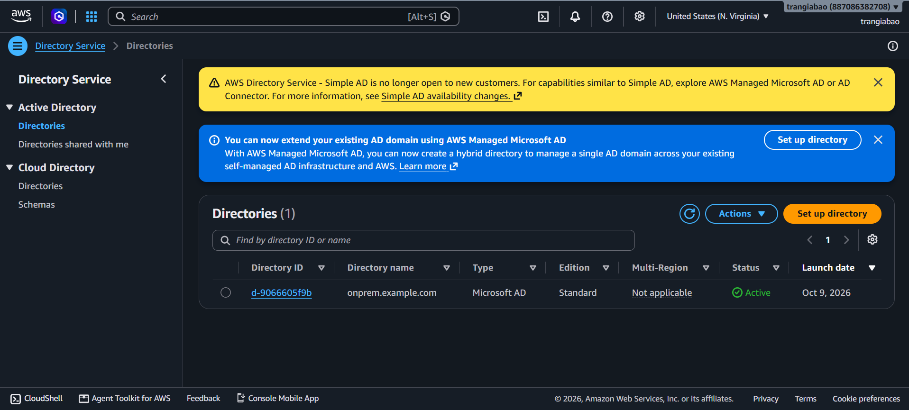

---

#### Bước 7: Kiểm tra Trạng thái Active & Ghi nhận 2 IP của Microsoft AD DNS
* **Thao tác / Hướng dẫn:** Đợi hệ thống hoàn tất khởi tạo (khoảng 15-20 phút), kiểm tra thông tin chi tiết thư mục.
* **Thông số quan sát & ghi chú lại:**
  * *Status:* **Active**
  * *DNS address 1:* `192.168.1.xxx`
  * *DNS address 2:* `192.168.2.xxx`
* **Ghi chú:** Đây là 2 địa chỉ IP máy chủ DNS mà Route 53 Resolver Rule sẽ chuyển tiếp truy vấn tới.

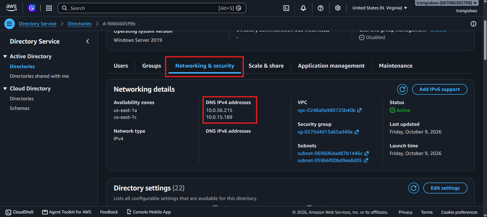

---

#### Bước 8: Khởi tạo Route 53 Resolver Outbound Endpoint (`r53-outbound-resolver`)
* **Thao tác / Hướng dẫn:** Mở dịch vụ **Amazon Route 53** ➔ Menu bên trái mục *Resolver* chọn **Outbound endpoints** ➔ Nhấn **Create outbound endpoint**.
* **Thông số điền cụ thể:**
  * *Endpoint name:* `r53-outbound-resolver`
  * *VPC:* Chọn Cloud VPC (`10.0.0.0/16`)
  * *Security Group:* Chọn `Route53-Resolver-SG` đã cấu hình ở Bước 5
  * *IP addresses:* Chọn tối thiểu **2 Availability Zones**, mỗi AZ chọn 1 subnet và chọn gán IP tự động (Auto-allocate IP)
* **Thao tác tiếp theo:** Nhấn **Submit**. Chờ trạng thái chuyển sang **Operational**.

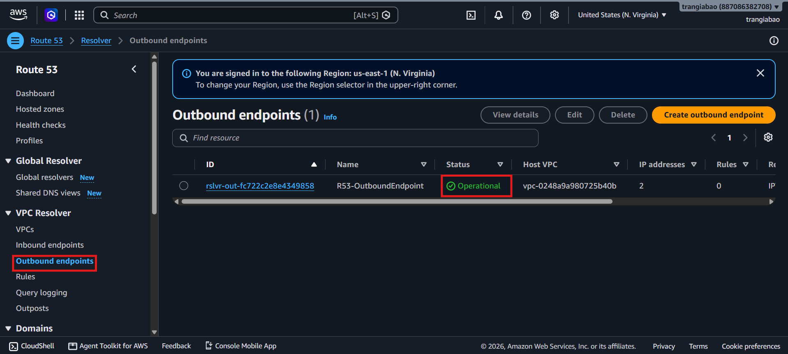

> **💡 Khó khăn gặp phải & Cách xử lý tại Bước 8:**  
> AWS Route 53 Resolver bắt buộc phải chỉ định tối thiểu 2 IP Endpoints phân bổ trên 2 Availability Zones riêng biệt để bảo đảm tính sẵn sàng cao. Nếu chỉ chọn 1 AZ, hệ thống sẽ báo lỗi không cho phép tiếp tục.

---

#### Bước 9: Thiết lập Route 53 Resolver Forwarding Rule về Active Directory
* **Thao tác / Hướng dẫn:** Menu bên trái chọn **Resolver** ➔ **Rules** ➔ Nhấn **Create rule**.
* **Thông số điền cụ thể:**
  * *Rule name:* `forward-to-corp-ad`
  * *Rule type:* **Forward**
  * *Domain name:* `corp.example.com`
  * *VPCs that use this rule:* Chọn Cloud VPC
  * *Outbound endpoint:* Chọn `r53-outbound-resolver` vừa tạo ở Bước 8
  * *Target IP addresses:* Nhập lần lượt **2 địa chỉ IP DNS của Microsoft AD** đã ghi lại ở Bước 7 (Port `53`)
* **Thao tác tiếp theo:** Nhấn **Submit**.

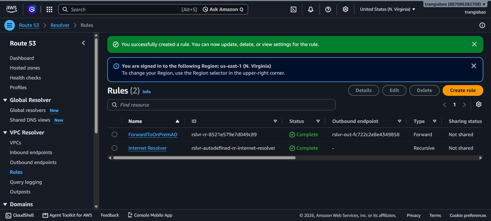

---

#### Bước 10: Khởi tạo Route 53 Resolver Inbound Endpoint (`r53-inbound-resolver`)
* **Thao tác / Hướng dẫn:** Menu bên trái chọn **Resolver** ➔ **Inbound endpoints** ➔ Nhấn **Create inbound endpoint**.
* **Thông số điền cụ thể:**
  * *Endpoint name:* `r53-inbound-resolver`
  * *VPC:* Chọn Cloud VPC (`10.0.0.0/16`)
  * *Security Group:* Chọn `Route53-Resolver-SG`
  * *IP addresses:* Chọn 2 Availability Zones và 2 Subnets tương ứng
* **Mục đích:** Cung cấp các địa chỉ IP tĩnh trên AWS để máy chủ DNS On-premises cấu hình DNS Conditional Forwarder chuyển tiếp các truy vấn tên miền AWS riêng (ví dụ: `aws.local` hoặc các Private Hosted Zone) lên Route 53 Resolver.

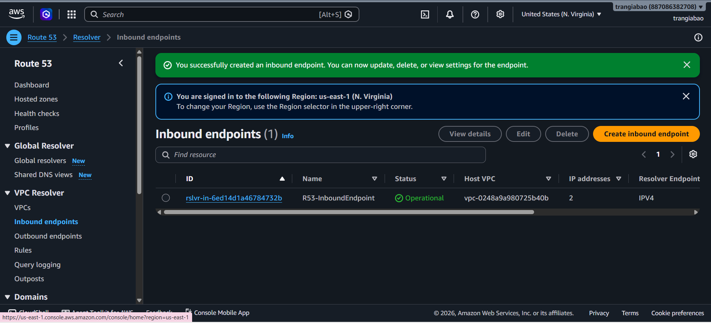

---

#### Bước 11: Kiểm thử Phân giải Tên miền Hai chiều bằng Lệnh `nslookup`
* **Thao tác / Hướng dẫn:** Đăng nhập máy chủ kiểm thử (RDGW hoặc Test Instance) và mở PowerShell / Command Prompt để kiểm tra phân giải DNS hai chiều.
* **Lệnh thực thi & Kết quả:**
  ```powershell
  # 1. Từ AWS Cloud: Truy vấn tên miền On-premises qua Route 53 Outbound Endpoint
  nslookup dc01.corp.example.com

  # 2. Từ On-premises: Truy vấn tên miền AWS Private Zone qua Route 53 Inbound Endpoint
  nslookup app.aws.local <Inbound-Endpoint-IP>
  ```
* **Kết quả hiển thị:** Cả hai câu lệnh đều trả về địa chỉ IP nội bộ chính xác mà không gặp bất kỳ lỗi `Non-existent domain` hay timeout nào, chứng minh giải pháp Hybrid DNS đã vận hành thông suốt hai chiều.

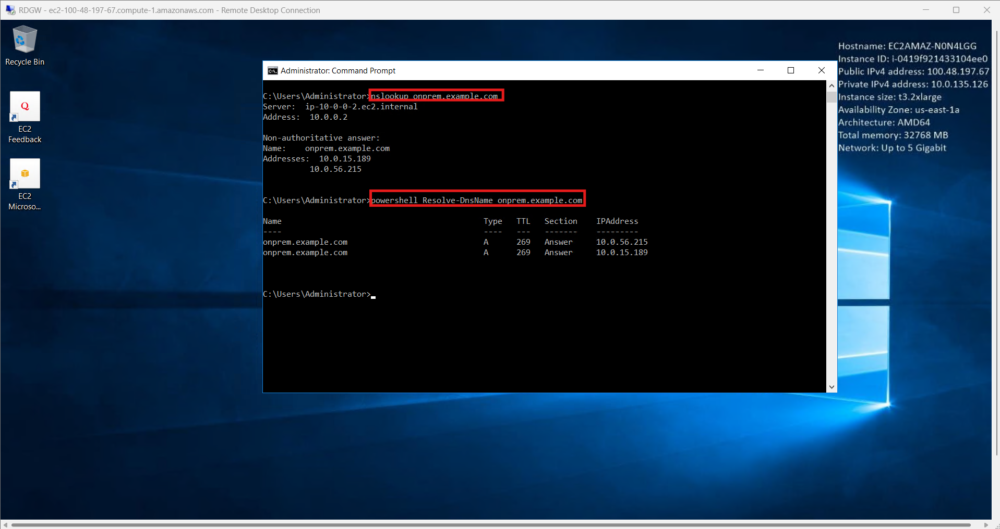

---

### 📝 Tổng kết & Bài học kinh nghiệm:
1. **Kiến trúc Hybrid DNS Liền mạch:** Route 53 Resolver đóng vai trò cầu nối DNS đắc lực loại bỏ hoàn toàn việc phải dựng và quản lý các cụm máy chủ BIND/DNS Forwarder trung gian tự quản lý tốn kém tài nguyên trên EC2.
2. **Phân biệt Rạch ròi Inbound vs Outbound Endpoints:**
   * **Inbound Endpoint:** Tiếp nhận truy vấn DNS từ hệ thống bên ngoài (On-premises) gửi vào mạng AWS để phân giải các Private Hosted Zones.
   * **Outbound Endpoint:** Bắn truy vấn từ máy chủ trong AWS VPC đi ra ngoài hệ thống DNS nội bộ On-premises thông qua các quy tắc Resolver Forwarding Rules.
3. **Tối ưu hóa Trải nghiệm Di chuyển Lên Đám mây (Cloud Migration):** Cho phép các ứng dụng đang trong quá trình chuyển đổi di chuyển lên AWS truy cập các hệ thống cơ sở dữ liệu, ERP, SAP nội bộ tại On-premise thông qua tên miền thân thiện quen thuộc mà không cần viết lại mã nguồn cấu hình mạng.
