{}
The **Command Line Operations with AWS CLI** workshop was conducted on **Tuesday (13/10/2026)** as part of **Week 5**. This page records the authentic step-by-step walkthrough: exact console clicks, specific parameter inputs, shell commands executed, and resolution of encountered technical issues.
<br>🔗 **Workshop Reference:** [Getting Started with the AWS CLI](https://000011.awsstudygroup.com/)
{}

### 🎯 Lab Objectives:
* Establish a standard practice environment using **IAM User Groups**, **IAM Users** (`aws-cli-user`, `devops`), and generated **CLI Access Keys**.
* Launch an **Amazon EC2 Management Instance (Amazon Linux 2023)** workstation and establish secure remote access via **MobaXterm**.
* Install the latest version of **AWS CLI v2** in a Linux environment and configure multiple profiles (`default`, `devops`).
* Use AWS CLI to manage object storage on **Amazon S3** (bucket creation, file upload, object listing, and safe deletion using the `--force` flag).
* Administer notification messaging services using **Amazon SNS** (Topic creation, Email subscription, subscription confirmation, and CLI message publication).
* Construct a complete **Amazon VPC** networking architecture via CLI (VPC, Subnet, Internet Gateway, Route Table, and route associations).
* Automate the complete compute lifecycle of **Amazon EC2** via CLI (Key Pair creation, Security Group configuration, opening inbound port 22, executing `run-instances`, allocating/associating an Elastic IP, SSH verification, and terminating instances).

---

### 📊 Provisioned Resource Specifications:

| Resource | Name / Identifier | Configuration & Detailed Specs | Region | Notes |
| :--- | :--- | :--- | :--- | :--- |
| **IAM Group** | `aws-cli` | Policy: `AdministratorAccess` | Global | Centralized privilege management |
| **IAM User 1** | `aws-cli-user` | Group: `aws-cli` + CLI Access Key | Global | Configured for `default` profile |
| **IAM User 2** | `devops` | Group: `aws-cli` + CLI Access Key | Global | Configured for `--profile devops` |
| **EC2 Management** | `aws-cli-instance` | `t3.micro`, Amazon Linux 2023, Key: `aws-cli-keypair` | `us-east-1` | Bastion workstation connected via MobaXterm |
| **Management Subnet**| `subnet-01` | CIDR: `172.31.100.0/24`, Auto-assign Public IP: Yes | `us-east-1` | Subnet with Internet Gateway routing |
| **S3 Bucket** | `aws-cli-trangiabao-2026` | Standard Storage, Globally unique bucket name | `ap-southeast-1` | Object storage for testing file `text.txt` |
| **SNS Topic** | `aws-cli` | ARN: `arn:aws:sns:ap-southeast-1:887086382708:aws-cli` | `ap-southeast-1` | Notification topic for email alerts |
| **VPC (via CLI)** | `vpc-07ebcfa7f5b9c659c` | CIDR: `10.0.0.0/16` | `ap-southeast-1` | Isolated custom network infrastructure |
| **Subnet (via CLI)** | `subnet-03c90d43fb1f53b06` | CIDR: `10.0.1.0/24`, AZ: `ap-southeast-1a` | `ap-southeast-1` | Subnet hosting CLI-provisioned EC2 |
| **Internet Gateway** | `igw-006783ef67381e1d4` | Attached to `vpc-07ebcfa7f5b9c659c` | `ap-southeast-1` | VPC Internet egress gateway |
| **Route Table (CLI)**| `rtb-xxxx` | Route: `0.0.0.0/0` targeted to Internet Gateway | `ap-southeast-1` | Routes internet traffic for custom subnet |
| **Key Pair (CLI)** | `MyKeyPair` | Type: RSA, file saved as: `MyKeyPair.pem` (chmod 400)| `ap-southeast-1` | SSH credential for automated EC2 |
| **Security Group** | `SSHAccess` | Inbound: Port 22 (TCP) from `0.0.0.0/0` | `ap-southeast-1` | Firewall rule allowing remote SSH |
| **Automated EC2** | `i-03171455cd0278073` | `t2.micro`, Private IP: `10.0.1.41` | `ap-southeast-1` | Automated EC2 instance launched via CLI |
| **Elastic IP** | `47.131.189.63` | Allocation: `eipalloc-0f52955fe9fe8ad41` | `ap-southeast-1` | Public IP attached to access instance |

---

### 📋 Section 1: Prerequisites & Identity Setup

#### Step 1: Create an IAM User Group
* **Action:** Log in to the AWS Management Console ➔ Navigate to **IAM** ➔ In the left navigation pane, select **User groups** ➔ Click **Create group**.
* **Purpose:** Establish a centralized group for granting administrative privileges to CLI users.

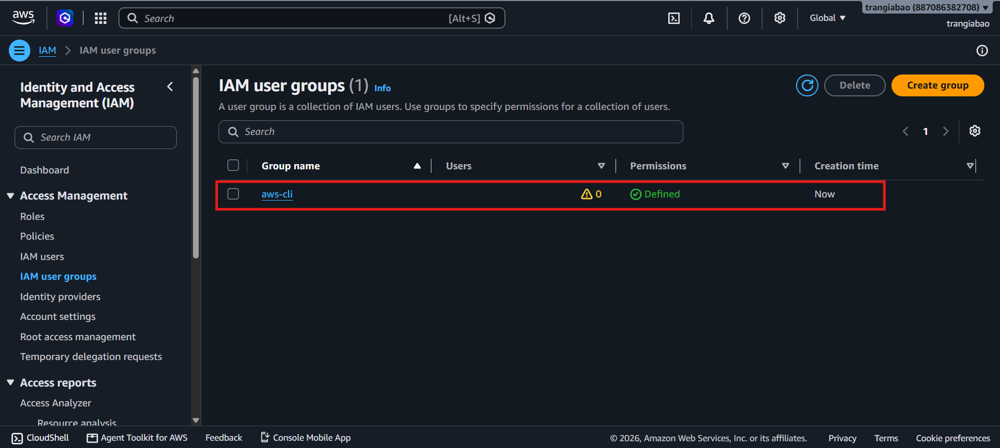

#### Step 2: Configure Group Parameters for `aws-cli`
* **Input Parameters:**
  * **User group name:** `aws-cli`
  * **Attach permissions policies:** Search and select **`AdministratorAccess`**.
* **Action:** Scroll to the bottom and click **Create group**.

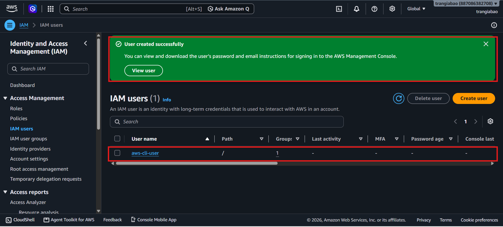

#### Step 3: Create IAM User `aws-cli-user`
* **Action:** In the left navigation pane, select **Users** ➔ Click **Create user**.
* **Input Parameters:**
  * **User name:** `aws-cli-user`
  * **Add user to group:** Check the **`aws-cli`** group created in Step 2.
* **Action:** Click **Next** ➔ Click **Create user**.

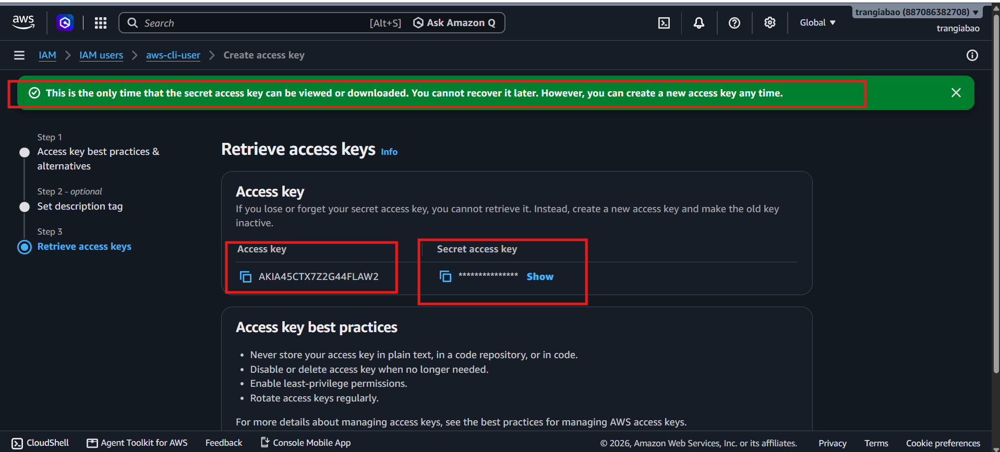

#### Step 4: Provision CLI Access Key for `aws-cli-user`
* **Action:** Click on user **`aws-cli-user`** ➔ Open the **Security credentials** tab ➔ Scroll down to *Access keys* ➔ Click **Create access key**.
* **Options Selected:**
  * **Use case:** Select **Command Line Interface (CLI)**.
  * **Confirmation:** Check *"I understand the above recommendation..."*.
* **Action:** Click **Next** ➔ Click **Create access key** ➔ Download the `.csv` file containing the **Access key ID** and **Secret access key**.

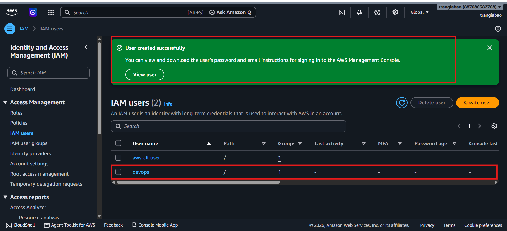

#### Step 5: Create Second IAM User `devops` for Multi-Profile
* **Action:** Repeat the user creation process for a second user named **`devops`**.
* **Input Parameters:**
  * **User name:** `devops`
  * **User group:** Assign to group `aws-cli`.
  * **Access Key:** Generate a separate CLI Access Key pair and save securely.

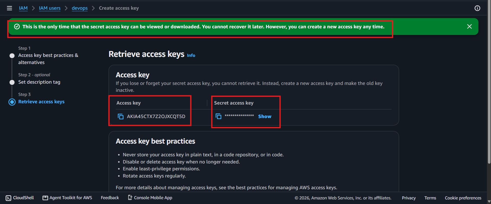

#### Step 6: Launch EC2 Management Workstation (`aws-cli-instance`)
* **Action:** Open the **EC2** console ➔ Click **Instances** ➔ Click **Launch instances**.
* **Specific Parameters:**
  * **Name:** `aws-cli-instance`
  * **Application and OS Images (AMI):** Select `Amazon Linux 2023 kernel-6.1 AMI`.
  * **Instance type:** `t3.micro` (or `t2.micro`).
  * **Key pair (login):** Click *Create new key pair* ➔ Name it **`aws-cli-keypair`**, type **RSA**, format **`.pem`** ➔ Download to local disk.
  * **Network settings:** Click **Edit** and configure:
    * *VPC:* Select your default VPC (`vpc-0fc9d5490a843944e`).
    * *Subnet:* Select `subnet-01` (CIDR `172.31.100.0/24`).
    * *Auto-assign public IP:* **`Enable`** *(required to acquire a public IP for SSH)*.
    * *Firewall (Security group):* Choose *Create security group* ➔ Ensure **Allow SSH traffic from Anywhere (0.0.0.0/0)** is enabled.
* **Action:** Click **Launch instance**.

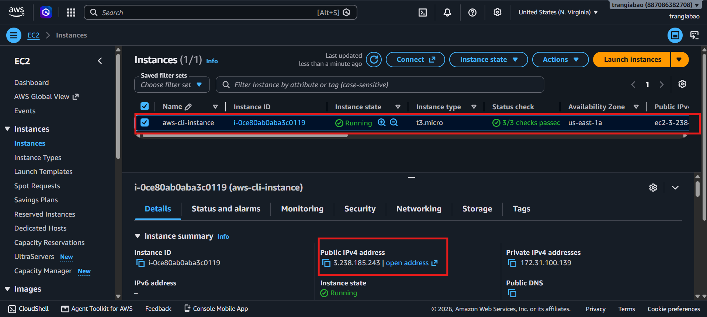

> **💡 Difficulties Encountered & Solution at Step 6:**  
> The Subnet field prevented selecting `default` because default subnets had been deleted during previous lab cleanups.  
> ➔ **Solution:** Navigated to **VPC** ➔ **Subnets** ➔ Clicked **Create subnet**, created a new subnet named `subnet-01` (`172.31.100.0/24`) in `us-east-1a`, then selected this subnet in EC2 Network settings with `Auto-assign public IP: Enable`.

#### Step 7: Connect via SSH Using MobaXterm
* **Action in MobaXterm:**
  1. Open MobaXterm ➔ Click **Session** in the top-left corner ➔ Select **SSH**.
  2. **Remote host:** Enter the **Public IPv4** address of the running instance (e.g. `3.238.185.243` or `32.197.220.215`).
  3. **Specify username:** Check and enter **`ec2-user`**.
  4. **Port:** `22`.
  5. Go to **Advanced SSH settings** ➔ Check **Use private key** ➔ Select the downloaded file **`aws-cli-keypair.pem`**.
  6. Click **OK** ➔ Accept the host key prompt to log in.

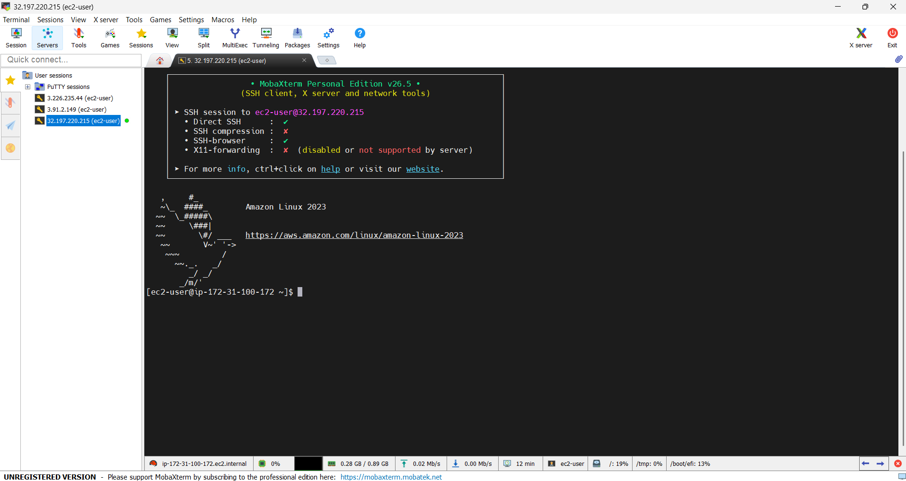

> **💡 Difficulties Encountered & Solution at Step 7:**  
> MobaXterm reported `Network error: Connection timed out`.  
> ➔ **Root Cause:** The manually created `subnet-01` had no default route to an Internet Gateway.  
> ➔ **Solution:** In **VPC** ➔ **Internet gateways**, created `my-igw` and attached it to the VPC. In **Route tables**, edited routes and added `Destination: 0.0.0.0/0` targeted to `Internet Gateway (igw-xxxx)`. Pressed `R` in MobaXterm and connected instantly.

---

### 📋 Section 2: Install & Configure AWS CLI v2

#### Step 8: Install AWS CLI v2 on Linux
* **Commands Executed:** Run the following commands on the remote terminal:
  ```bash
  curl "https://awscli.amazonaws.com/awscli-exe-linux-x86_64.zip" -o "awscliv2.zip"
  unzip awscliv2.zip
  sudo ./aws/install
  aws --version
  ```
* **Verification:** Terminal prints `aws-cli/2.x.x` confirming successful installation.

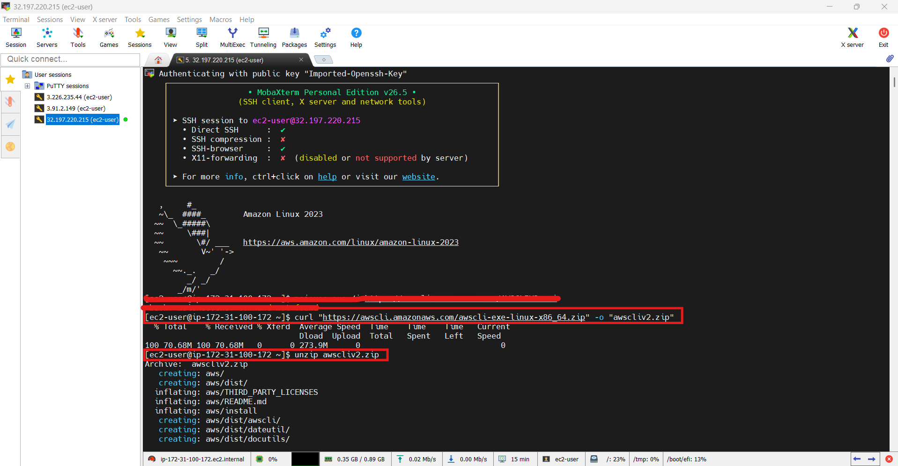

#### Step 9: Configure Default Profile with `aws configure`
* **Command:** `aws configure`
* **Parameters Entered:**
  * `AWS Access Key ID [None]:` Enter Access Key of **`aws-cli-user`** (from Step 4).
  * `AWS Secret Access Key [None]:` Enter Secret Key of **`aws-cli-user`**.
  * `Default region name [None]:` **`ap-southeast-1`** (Singapore).
  * `Default output format [None]:` **`json`**.

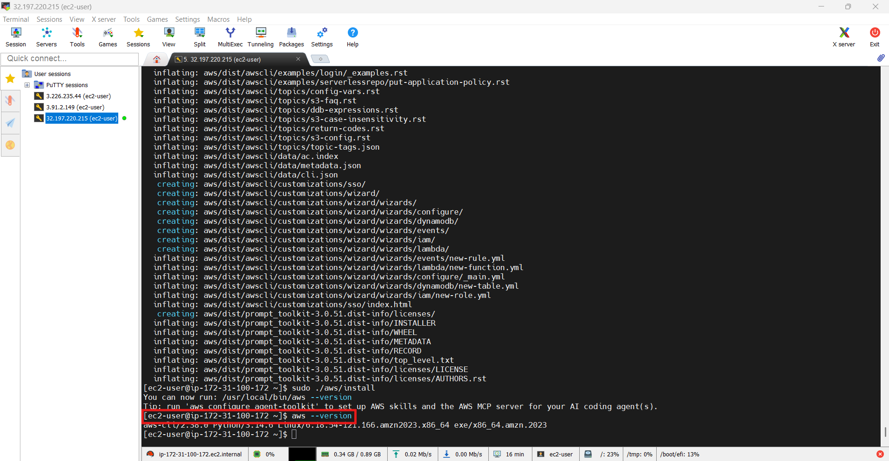

#### Step 10: Configure Named Profile `devops`
* **Command:** `aws configure --profile devops`
* **Parameters Entered:**
  * `AWS Access Key ID [None]:` Enter Access Key of user **`devops`** (from Step 5).
  * `AWS Secret Access Key [None]:` Enter Secret Key of user **`devops`**.
  * `Default region name [None]:` **`ap-southeast-1`**.
  * `Default output format [None]:` **`json`**.

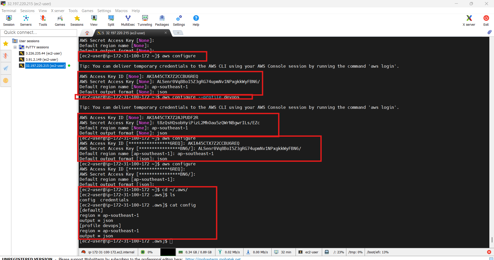

#### Step 11: Inspect Configuration Files and Active Profiles
* **Commands Executed:**
  ```bash
  cat ~/.aws/config
  cat ~/.aws/credentials
  aws configure list-profiles
  ```
* **Output:** Displays separate configurations for `default` and `devops` profiles.

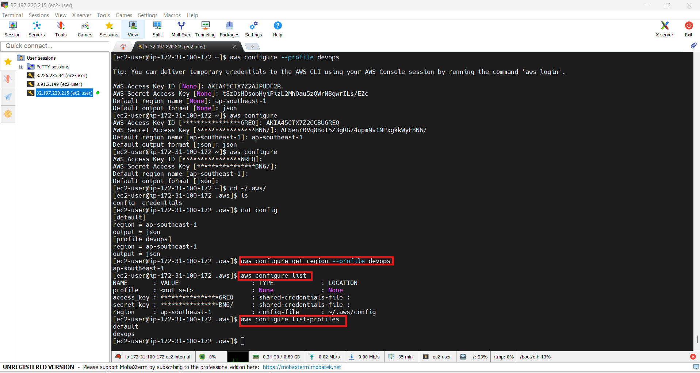

---

### 📋 Section 3: Verify Resources via CLI

#### Step 12: Query EC2 Instance Details
* **Command Executed:**
  ```bash
  aws ec2 describe-instances --profile devops --region us-east-1 --output table
  ```
* **Description:** Retrieves all instance metadata in `us-east-1` and formats the result as a clear table.

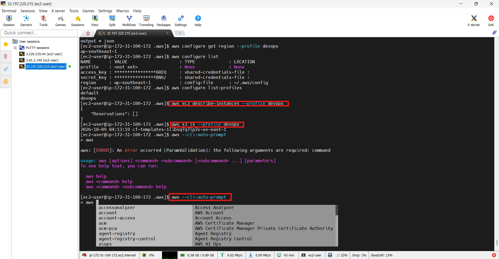

> **💡 Difficulties Encountered & Solution at Step 12:**  
> Running `aws ec2 describe-instances --profile devops` initially returned an empty list `[]`.  
> ➔ **Root Cause:** The `devops` profile default region is `ap-southeast-1` (Singapore), whereas the EC2 management host was launched in `us-east-1`.  
> ➔ **Solution:** Explicitly passed `--region us-east-1` to query the correct region.

#### Step 13: List S3 Storage Buckets
* **Command Executed:**
  ```bash
  aws s3 ls --profile devops
  ```
* **Output:** Lists existing S3 buckets in the AWS account.

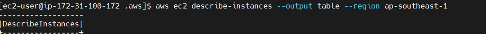

---

### 📋 Section 4: Administer Amazon S3 via CLI

#### Step 14: Create S3 Bucket and Upload Object
* **Parameters & Commands:**
  1. *Create new bucket:*
     ```bash
     aws s3 mb s3://aws-cli-trangiabao-2026
     ```
  2. *Create a test file on the EC2 host:*
     ```bash
     echo "Hello AWS S3 from CLI" > text.txt
     ```
  3. *Upload the file to S3:*
     ```bash
     aws s3 cp text.txt s3://aws-cli-trangiabao-2026
     ```

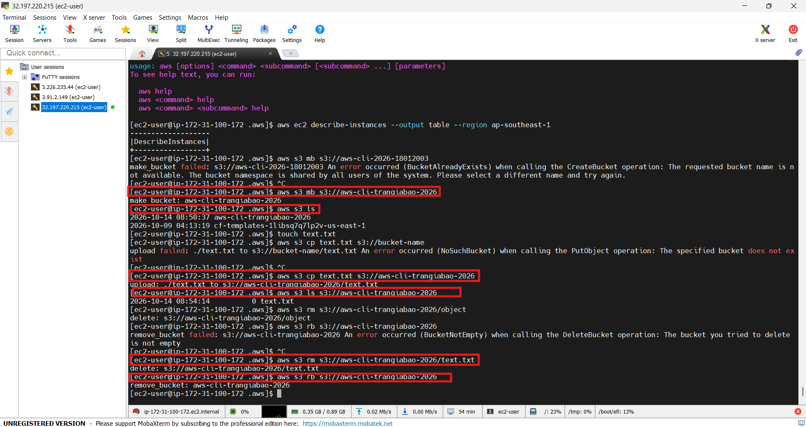

> **💡 Difficulties Encountered & Solution at Step 14:**  
> * **`BucketAlreadyExists` Error:** Using the tutorial's sample bucket name `aws-cli-2026-18012003` failed because S3 bucket names are globally unique. Solution: Used a custom name `aws-cli-trangiabao-2026`.  
> * **`NoSuchBucket` Error:** Copying the placeholder `bucket-name` caused AWS to look for a non-existent bucket. Solution: Replaced with the exact bucket name `s3://aws-cli-trangiabao-2026`.

#### Step 15: List Objects and Delete Bucket
* **Commands Executed:**
  1. *List objects:*
     ```bash
     aws s3 ls s3://aws-cli-trangiabao-2026
     ```
  2. *Delete objects and remove bucket cleanly:*
     ```bash
     aws s3 rb s3://aws-cli-trangiabao-2026 --force
     ```

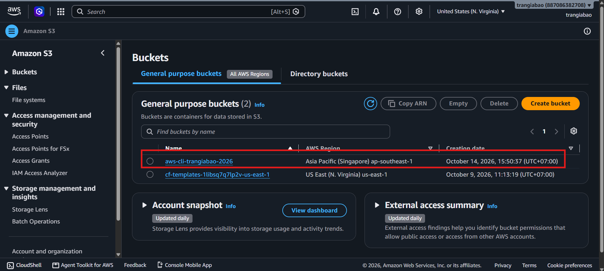

> **💡 Difficulties Encountered & Solution at Step 15:**  
> Running `aws s3 rb s3://...` failed with `BucketNotEmpty` because `text.txt` was still inside.  
> ➔ **Solution:** Appended the `--force` flag to automatically delete all objects prior to bucket deletion.

---

### 📋 Section 5: Administer Amazon SNS via CLI

#### Step 16: Create SNS Topic
* **Command Executed:**
  ```bash
  aws sns create-topic --name aws-cli
  ```
* **Output:** Returns the generated Topic ARN:
  `"TopicArn": "arn:aws:sns:ap-southeast-1:887086382708:aws-cli"`

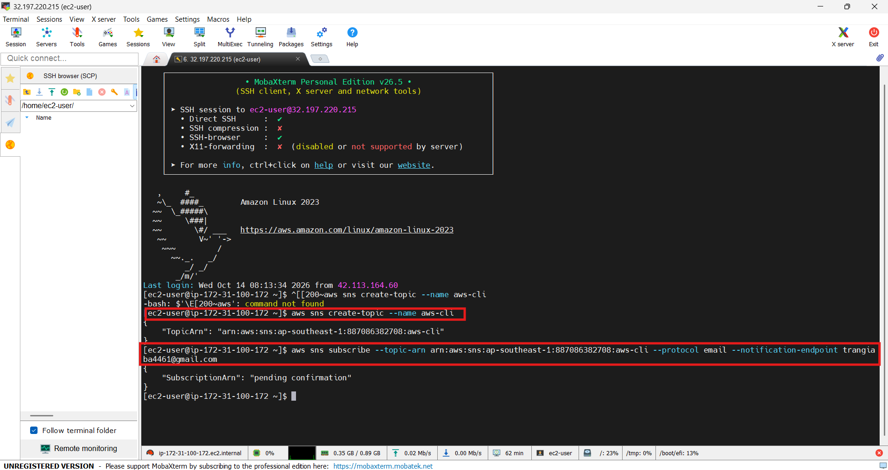

#### Step 17: Subscribe Email Endpoint
* **Command Executed:**
  ```bash
  aws sns subscribe --topic-arn arn:aws:sns:ap-southeast-1:887086382708:aws-cli --protocol email --notification-endpoint trangiabao4461@gmail.com
  ```
* **Parameters:**
  * `--topic-arn`: Actual ARN from Step 16.
  * `--protocol`: `email`.
  * `--notification-endpoint`: Target Gmail address.

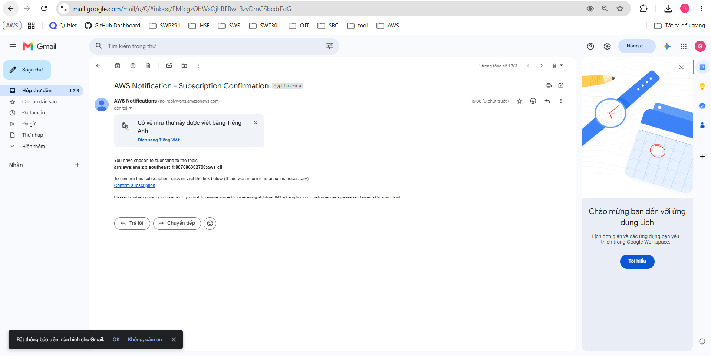

> **💡 Difficulties Encountered & Solution at Step 17:**  
> Terminal threw `Unknown options: Topic**` from copying the bold text `**ARN Topic**`.  
> ➔ **Solution:** Replaced `**ARN Topic**` with the actual Topic ARN string.

#### Step 18: Pending Confirmation Status
* **Output:** Returns `"SubscriptionArn": "pending confirmation"`.

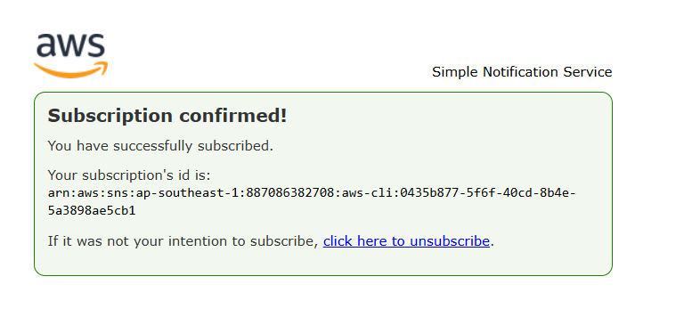

#### Step 19: Confirm Subscription in Gmail
* **Action:**
  1. Open Gmail, search `in:anywhere AWS Notification`.
  2. Open email from `no-reply@sns.amazonaws.com` titled *AWS Notification - Subscription Confirmation*.
  3. Click **Confirm subscription**.
* **Output:** Browser displays **Subscription confirmed!**.

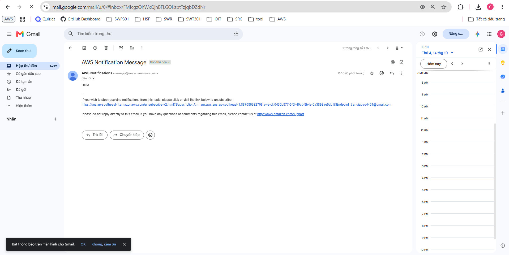

> **💡 Difficulties Encountered at Step 19:** Confirmation email was not in the primary inbox due to a typo in the address and Gmail filtering AWS emails into Spam. Solution: Corrected the typo and searched in Spam folder.

#### Step 20: Publish Message via CLI
* **Command Executed:**
  ```bash
  aws sns publish --topic-arn arn:aws:sns:ap-southeast-1:887086382708:aws-cli --message "Hello"
  ```
* **Output:** Terminal outputs a `MessageId`, and the notification email containing "Hello" is received in the Gmail inbox.

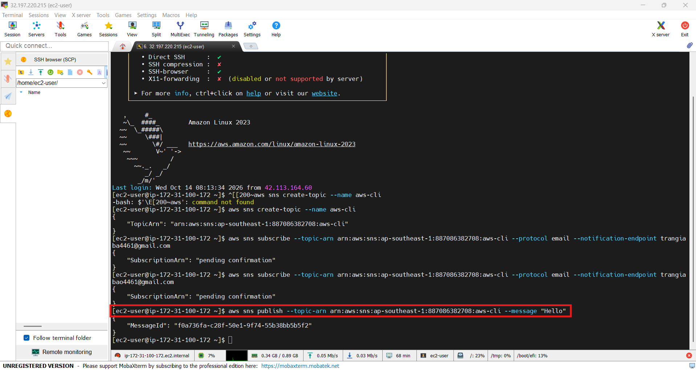

---

### 📋 Section 6: Manage IAM via CLI

#### Step 21: List IAM Users
* **Command Executed:**
  ```bash
  aws iam list-users
  ```
* **Output:** Outputs JSON list of all IAM users with creation dates and ARNs.

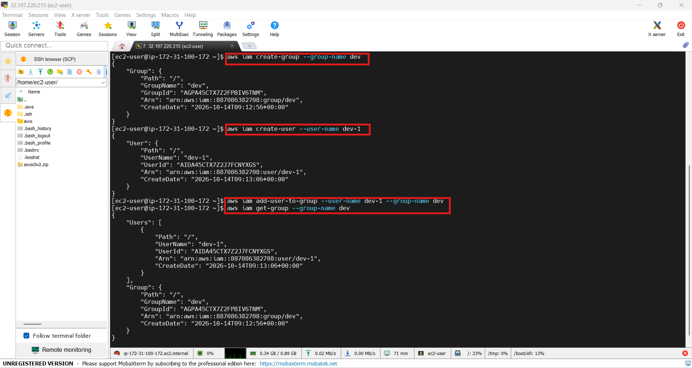

#### Step 22: Inspect Policies and Permissions
* **Command Executed:** Query policy attachments to verify administrative boundaries.

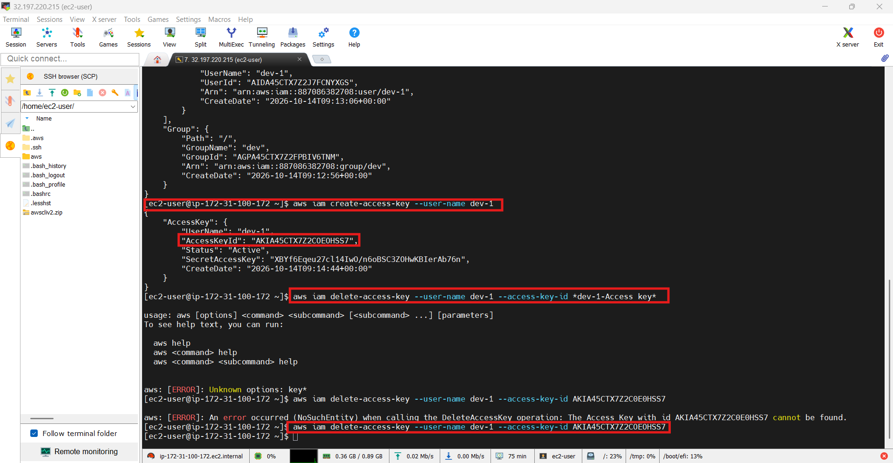

---

### 📋 Section 7: Construct VPC Networking via CLI

#### Step 23: Create VPC
* **Command Executed:**
  ```bash
  aws ec2 create-vpc --cidr-block 10.0.0.0/16 --query Vpc.VpcId --output text
  ```
* **Output:** Returns VPC ID: **`vpc-07ebcfa7f5b9c659c`**.

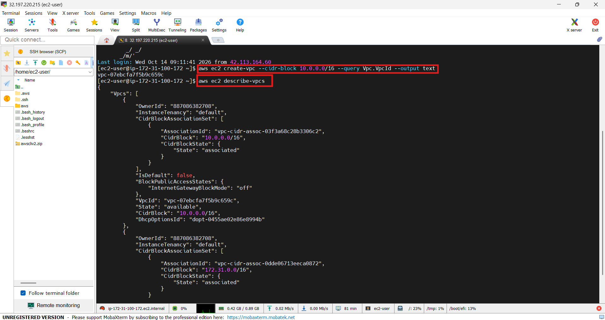

#### Step 24: Create Subnet
* **Command Executed:**
  ```bash
  aws ec2 create-subnet --vpc-id vpc-07ebcfa7f5b9c659c --cidr-block 10.0.1.0/24 --query Subnet.SubnetId --output text
  ```
* **Output:** Returns Subnet ID: **`subnet-03c90d43fb1f53b06`**.

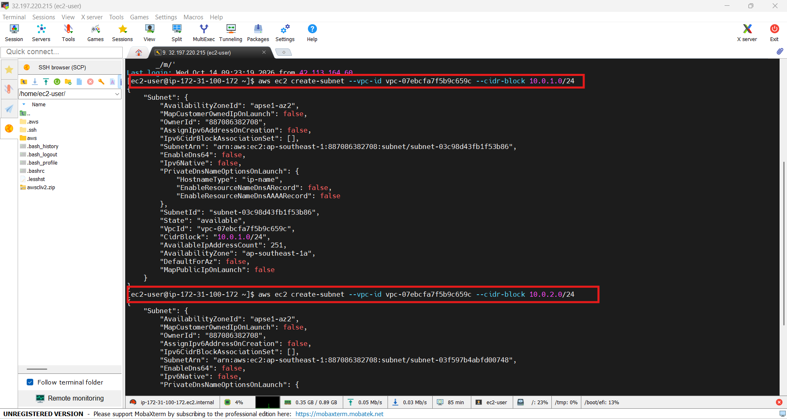

#### Step 25: Create Internet Gateway
* **Command Executed:**
  ```bash
  aws ec2 create-internet-gateway --query InternetGateway.InternetGatewayId --output text
  ```
* **Output:** Returns Internet Gateway ID: **`igw-006783ef67381e1d4`**.

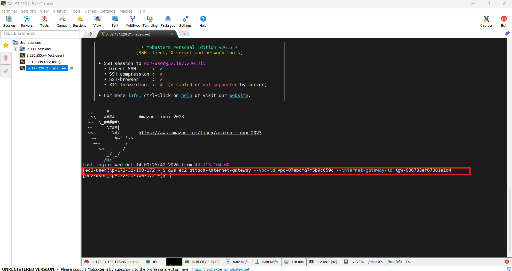

> **💡 Difficulties Encountered at Step 25:** IGW did not appear on the AWS Console. Root cause: The CLI created resources in Singapore (`ap-southeast-1`), while the web console was on N. Virginia (`us-east-1`). Solution: Switched console region to Singapore.

#### Step 26: Attach Internet Gateway to VPC
* **Command Executed:**
  ```bash
  aws ec2 attach-internet-gateway --vpc-id vpc-07ebcfa7f5b9c659c --internet-gateway-id igw-006783ef67381e1d4
  ```
* **Output:** IGW state becomes **`Attached`** to `vpc-07ebcfa7f5b9c659c`.

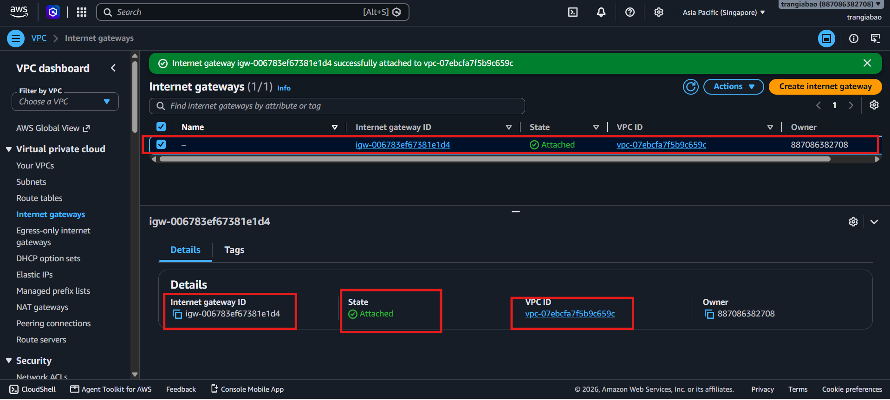

> **💡 Note at Step 26:** Running this command again produces `Resource.AlreadyAssociated`. This is an acknowledgment of prior success, not an error.

#### Step 27: Create Route Table and Add `0.0.0.0/0` Route
* **Commands Executed:**
  1. *Create Route Table:*
     ```bash
     aws ec2 create-route-table --vpc-id vpc-07ebcfa7f5b9c659c --query RouteTable.RouteTableId --output text
     ```
     *(Returns Route Table ID `rtb-xxxx`).*
  2. *Add default route to Internet Gateway:*
     ```bash
     aws ec2 create-route --route-table-id <RTB-ID> --destination-cidr-block 0.0.0.0/0 --gateway-id igw-006783ef67381e1d4
     ```

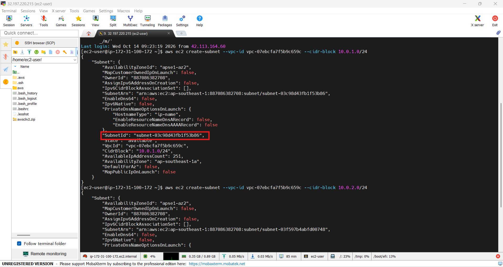

#### Step 28: Associate Route Table with Subnet
* **Command Executed:**
  ```bash
  aws ec2 associate-route-table --subnet-id subnet-03c90d43fb1f53b06 --route-table-id <RTB-ID>
  ```
* **Output:** Successfully binds the subnet to the route table for internet access.

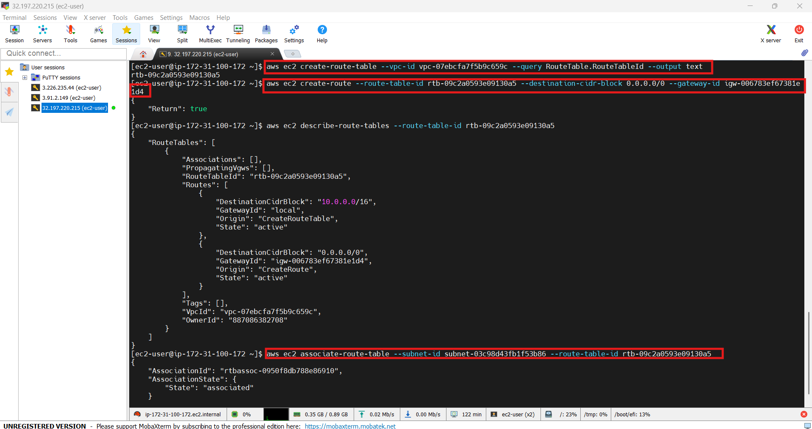

---

### 📋 Section 8: Automate EC2 Lifecycle via CLI

#### Step 29: Create Key Pair via CLI
* **Command Executed:**
  ```bash
  aws ec2 create-key-pair --key-name MyKeyPair --query "KeyMaterial" --output text > MyKeyPair.pem
  ```

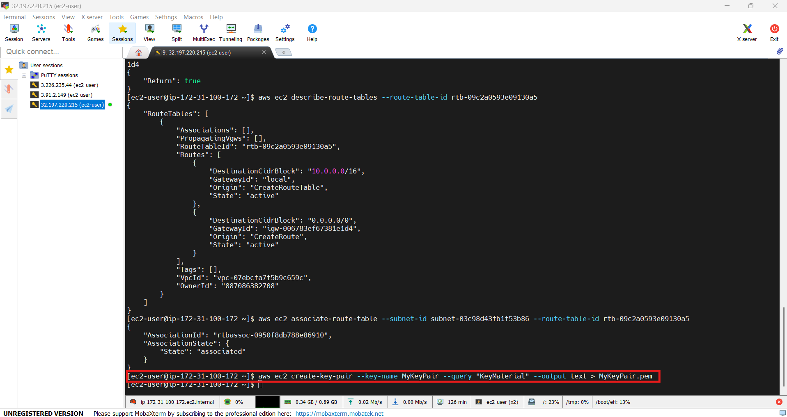

#### Step 30: Set Permissions `chmod 400`
* **Command Executed:**
  ```bash
  chmod 400 MyKeyPair.pem
  ```

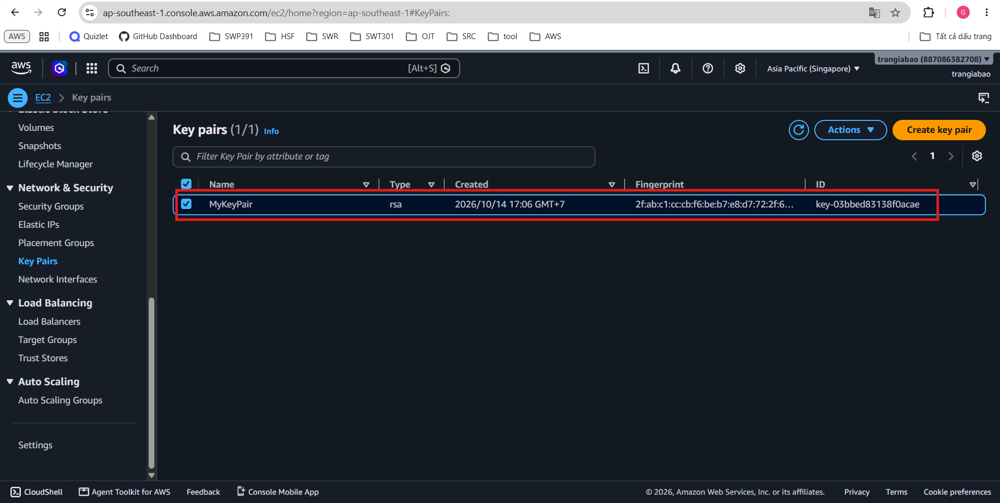

#### Step 31: Create Security Group `SSHAccess`
* **Command Executed:**
  ```bash
  aws ec2 create-security-group --group-name SSHAccess --description "Security group for SSH access" --vpc-id vpc-07ebcfa7f5b9c659c
  ```
* **Output:** Returns Security Group ID (e.g. `sg-08d6567ccc7edc1f0`).

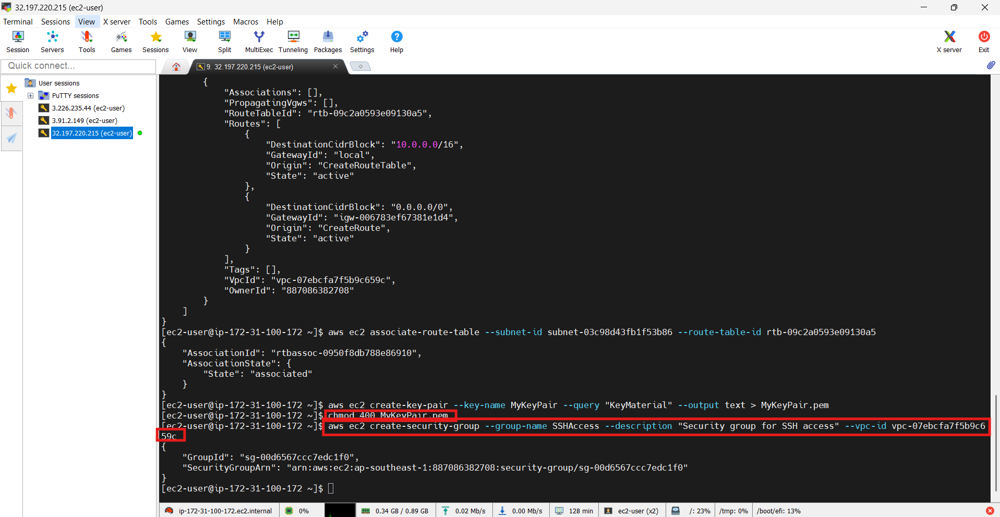

#### Step 32: Authorize Inbound SSH Port 22
* **Command Executed:**
  ```bash
  aws ec2 authorize-security-group-ingress --group-id <SG-ID> --protocol tcp --port 22 --cidr 0.0.0.0/0
  ```

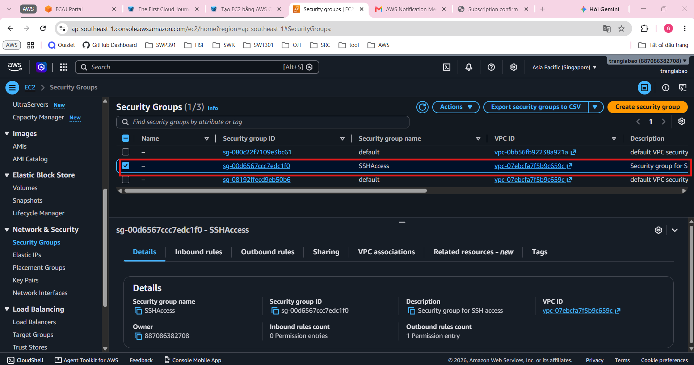

#### Step 33: Launch EC2 Instance via `run-instances`
* **Command Executed:**
  ```bash
  aws ec2 run-instances --image-id ami-0a37aadea3f79d3c3 --count 1 --instance-type t2.micro --key-name MyKeyPair --security-group-ids <SG-ID> --subnet-id subnet-03c90d43fb1f53b06
  ```
* **Output:** Returns Instance ID: **`i-03171455cd0278073`**, Private IP: **`10.0.1.41`**.

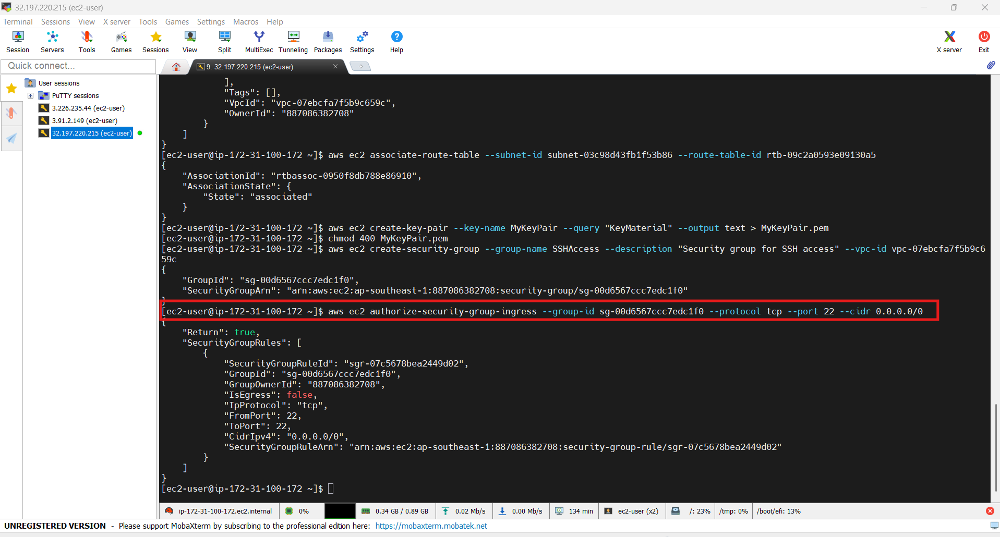

#### Step 34: Check Instance State
* **Command Executed:**
  ```bash
  aws ec2 describe-instances --instance-id i-03171455cd0278073 --query "Reservations[*].Instances[*].{State:State.Name,Address:PublicIpAddress}"
  ```
* **Output:** Returns `"State": "running"`, but `"Address": null`.

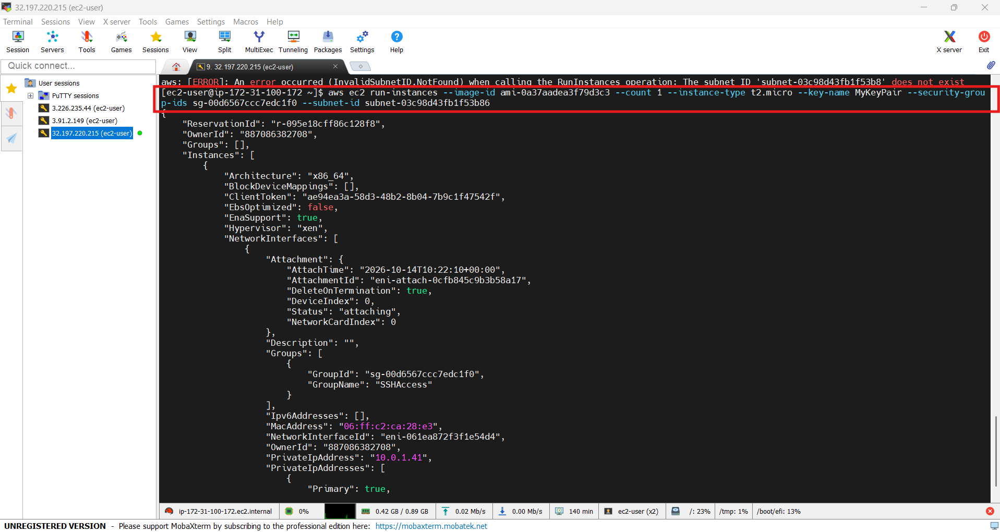

> **💡 Difficulties Encountered & Solution at Step 34:**  
> The query returned `"Address": null` because subnets created via CLI do not map public IPs by default (`MapPublicIpOnLaunch: false`).  
> ➔ **Solution:** Allocated an Elastic IP and associated it directly to the instance without re-creating it (executed in Steps 35 & 36).

#### Step 35: Allocate Elastic IP
* **Command Executed:**
  ```bash
  aws ec2 allocate-address --domain vpc
  ```
* **Output:** Public IP: **`47.131.189.63`**, AllocationId: **`eipalloc-0f52955fe9fe8ad41`**.

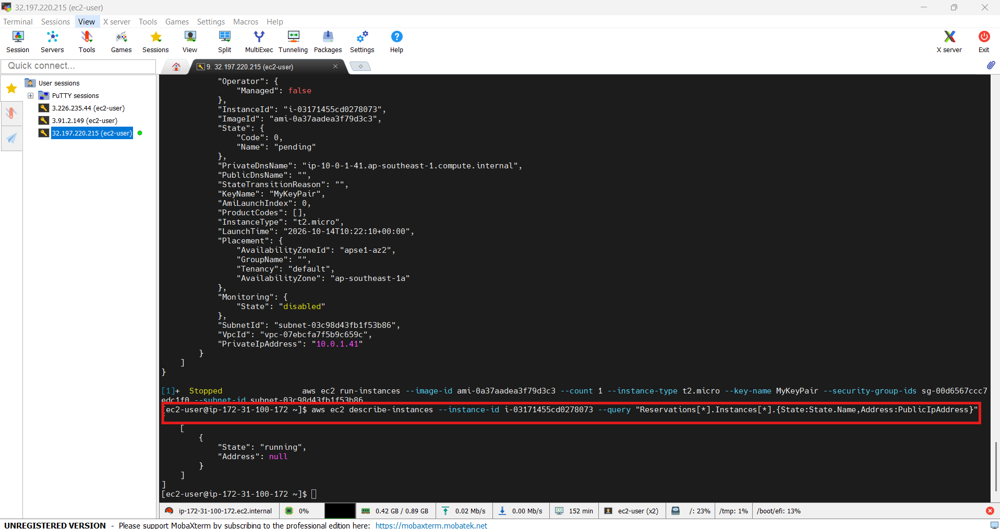

#### Step 36: Associate Elastic IP to Instance `i-03171455cd0278073`
* **Command Executed:**
  ```bash
  aws ec2 associate-address --instance-id i-03171455cd0278073 --allocation-id eipalloc-0f52955fe9fe8ad41
  ```

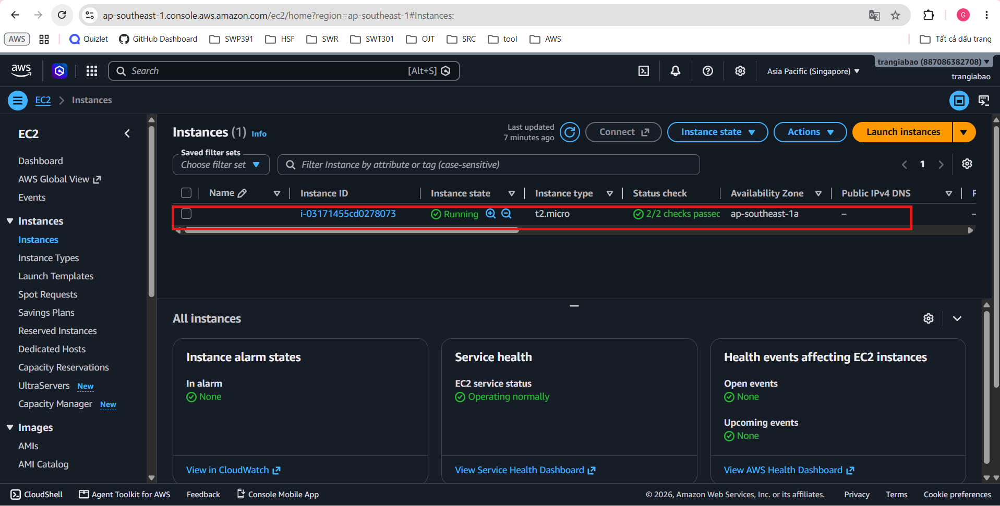

> **💡 Difficulties Encountered at Step 36:** Running the SSH command before running `associate-address` caused the terminal to hang indefinitely. Used `Ctrl + C` to interrupt, associated the IP first, and then connected.

#### Step 37: Connect to New EC2 Instance via SSH
* **Command Executed:**
  ```bash
  ssh -i "MyKeyPair.pem" ec2-user@47.131.189.63
  ```
* **Action:** Type `yes` when prompted.
* **Result:** Connected successfully! Prompt changes to **`[ec2-user@ip-10-0-1-41 ~]$`**.

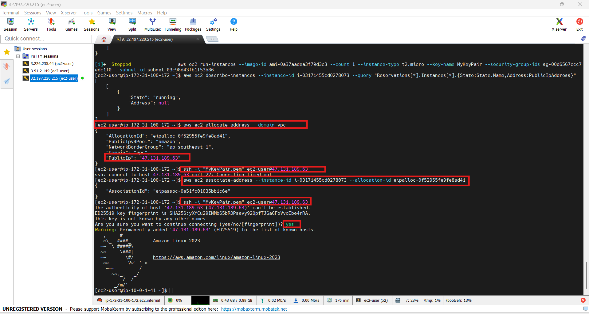

#### Step 38: Exit and Safely Terminate Instance
* **Commands Executed:**
  1. *Exit guest instance:*
     ```bash
     exit
     ```
     *(Returns to management host prompt: `[ec2-user@ip-172-31-100-172 ~]$`).*
  2. *Terminate instance:*
     ```bash
     aws ec2 terminate-instances --instance-ids i-03171455cd0278073
     ```
* **Result:** Instance transitions to `shutting-down` and `terminated`.

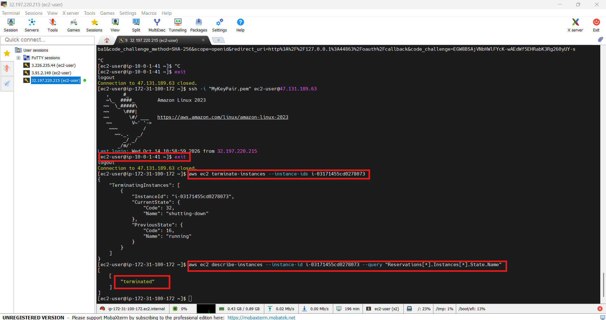

> **💡 Difficulties Encountered at Step 38:** Running `terminate-instances` inside the newly provisioned instance (`ip-10-0-1-41`) returned `Unable to locate credentials`. Typed `exit` to return to the management host and executed the command successfully.

---

### 🏆 Key Takeaways & Lessons Learned:
1. **Accurate Parameter Passing:** Learned to extract output values dynamically using `--query ... --output text` for subsequent CLI commands.
2. **Real-world Network Debugging:** Diagnosed and rectified multiple AWS network hurdles including missing route table targets, public IP mapping flags, and Elastic IP association workflows.
3. **Infrastructure Automation Readiness:** Built end-to-end operational confidence to replace manual GUI clicks with structured, reusable command line automation scripts.
