---
title: "Thao tác dòng lệnh với AWS CLI"
date: 2026-10-13
weight: 2
chapter: false
pre: " <b> 1.5.2. </b> "
---

{}
Bài thực hành **Thao tác dòng lệnh với AWS CLI** được thực hiện vào **Thứ 3 (13/10/2026)** trong khuôn khổ **Tuần 5**. Trang này ghi lại chi tiết từng bước thực hành thực tế: các bước click chuột, thông số cấu hình cụ thể cần điền, câu lệnh thực thi và cách xử lý các lỗi phát sinh.
<br>🔗 **Nguồn tài liệu thực hành:** [Getting Started with the AWS CLI](https://000011.awsfcaj.com/)
{}

### 🎯 Mục tiêu bài thực hành (Lab Objectives):
* Thiết lập môi trường thực hành chuẩn với **IAM User Groups**, **IAM Users** (`aws-cli-user`, `devops`) và cấp phát **Access Keys**.
* Khởi tạo máy chủ **Amazon EC2 (Amazon Linux 2023)** làm máy trạm quản trị và kết nối an toàn qua **MobaXterm**.
* Cài đặt phiên bản mới nhất **AWS CLI v2** trên môi trường Linux và cấu hình nhiều Profile (`default`, `devops`).
* Sử dụng AWS CLI để quản trị dữ liệu hướng đối tượng trên **Amazon S3** (tạo bucket, tải file, quản lý đối tượng và xóa an toàn với cờ `--force`).
* Quản trị dịch vụ gửi thông báo **Amazon SNS** (tạo Topic, đăng ký Subscription qua Email và phát tán tin nhắn Publish).
* Xây dựng toàn bộ hệ thống mạng **Amazon VPC** bằng lệnh CLI (VPC, Subnet, Internet Gateway, Route Table và liên kết tuyến đường).
* Tự động hóa vòng đời máy chủ **Amazon EC2** bằng CLI (tạo Key Pair, Security Group, mở cổng Inbound 22, chạy `run-instances`, cấp Elastic IP, SSH kết nối và hủy máy).

---

### 📊 Bảng tổng hợp thông số tài nguyên đã triển khai:

| Tài nguyên | Tên / Định danh | Cấu hình & Thông số kỹ thuật | Region | Ghi chú |
| :--- | :--- | :--- | :--- | :--- |
| **IAM Group** | `aws-cli` | Policy: `AdministratorAccess` | Global | Quản trị tập trung quyền hạn admin |
| **IAM User 1** | `aws-cli-user` | Nhóm: `aws-cli` + CLI Access Key | Global | Cấu hình cho Profile `default` |
| **IAM User 2** | `devops` | Nhóm: `aws-cli` + CLI Access Key | Global | Cấu hình cho Profile `--profile devops` |
| **EC2 Management** | `aws-cli-instance` | `t3.micro`, Amazon Linux 2023, Key: `aws-cli-keypair` | `us-east-1` | Máy trạm kết nối SSH qua MobaXterm |
| **Subnet quản trị** | `subnet-01` | CIDR: `172.31.100.0/24`, Auto-assign Public IP: Yes | `us-east-1` | Subnet kết nối ra Internet Gateway |
| **S3 Bucket** | `aws-cli-trangiabao-2026` | Standard Storage, Bucket name duy nhất toàn cầu | `ap-southeast-1` | Lưu trữ file kiểm thử `text.txt` |
| **SNS Topic** | `aws-cli` | ARN: `arn:aws:sns:ap-southeast-1:887086382708:aws-cli` | `ap-southeast-1` | Kênh gửi thông báo Email tự động |
| **VPC (Tạo qua CLI)**| `vpc-07ebcfa7f5b9c659c` | CIDR: `10.0.0.0/16` | `ap-southeast-1` | Hạ tầng mạng độc lập phục vụ CLI Lab |
| **Subnet (CLI)** | `subnet-03c90d43fb1f53b06` | CIDR: `10.0.1.0/24`, Availability Zone: `ap-southeast-1a` | `ap-southeast-1` | Subnet chứa máy chủ EC2 tự động |
| **Internet Gateway** | `igw-006783ef67381e1d4` | Attached to `vpc-07ebcfa7f5b9c659c` | `ap-southeast-1` | Cổng kết nối Internet cho VPC |
| **Route Table (CLI)**| `rtb-xxxx` | Route: `0.0.0.0/0` trỏ tới Internet Gateway | `ap-southeast-1` | Định tuyến lưu lượng ra Internet |
| **Key Pair (CLI)** | `MyKeyPair` | Loại: RSA, định dạng file lưu: `MyKeyPair.pem` (400) | `ap-southeast-1` | Xác thực SSH vào máy chủ tạo qua CLI |
| **Security Group** | `SSHAccess` | Inbound: Port 22 (TCP) từ `0.0.0.0/0` | `ap-southeast-1` | Tường lửa mở cổng SSH cho EC2 |
| **EC2 tự động (CLI)**| `i-03171455cd0278073` | `t2.micro`, Private IP: `10.0.1.41` | `ap-southeast-1` | Máy chủ tạo tự động qua CLI |
| **Elastic IP** | `47.131.189.63` | Allocation: `eipalloc-0f52955fe9fe8ad41` | `ap-southeast-1` | IP công khai gán vào EC2 để SSH |

---

### 📋 Mục 1: Chuẩn bị môi trường & Thiết lập định danh (Prerequisites)

#### Bước 1: Khởi tạo User Group trên IAM
* **Thao tác:** Đăng nhập AWS Management Console ➔ Tìm dịch vụ **IAM** ➔ Menu bên trái chọn **User groups** ➔ Nhấn nút **Create group**.
* **Mục đích:** Tạo nhóm quyền quản trị tập trung để phân quyền nhanh cho các tài khoản CLI.

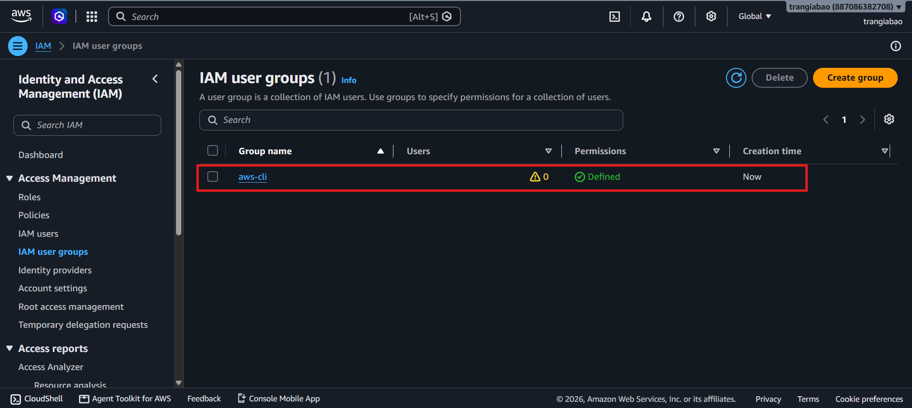

#### Bước 2: Cấu hình thông số nhóm `aws-cli`
* **Thông số điền:**
  * **User group name:** `aws-cli`
  * **Attach permissions policies:** Tìm và tích chọn chính sách **`AdministratorAccess`**.
* **Thao tác:** Cuộn xuống dưới cùng và nhấn **Create group**.

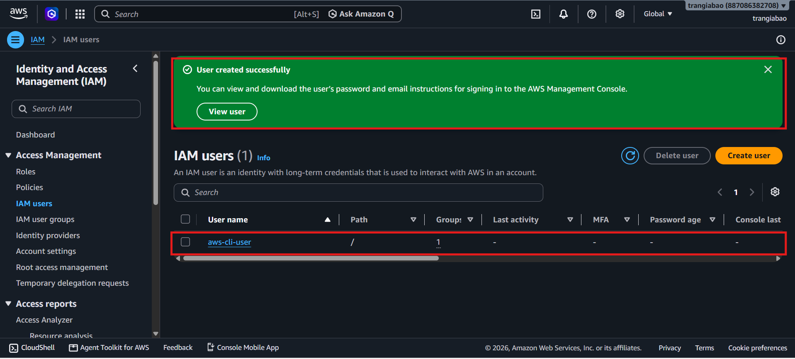

#### Bước 3: Tạo người dùng IAM `aws-cli-user`
* **Thao tác:** Menu bên trái IAM chọn **Users** ➔ Nhấn nút **Create user**.
* **Thông số điền:**
  * **User name:** `aws-cli-user`
  * **Add user to group:** Tích chọn nhóm **`aws-cli`** vừa tạo ở Bước 2.
* **Thao tác:** Nhấn **Next** ➔ Nhấn **Create user**.

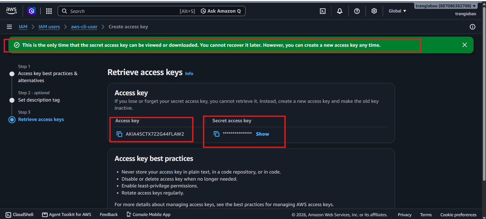

#### Bước 4: Cấp phát Access Key CLI cho `aws-cli-user`
* **Thao tác:** Bấm vào user **`aws-cli-user`** ➔ Chọn tab **Security credentials** ➔ Cuộn xuống mục *Access keys* ➔ Nhấn **Create access key**.
* **Thông số chọn:**
  * **Use case:** Chọn **Command Line Interface (CLI)**.
  * **Confirmation:** Tích chọn ô *"I understand the above recommendation..."*.
* **Thao tác:** Nhấn **Next** ➔ Nhấn **Create access key** ➔ Tải file `.csv` chứa **Access key ID** và **Secret access key** về máy để dùng cho CLI.

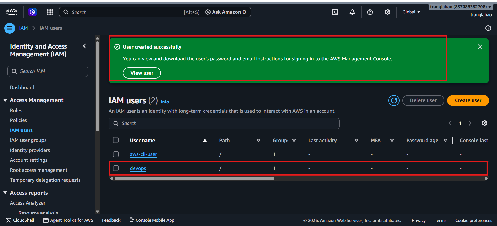

#### Bước 5: Tạo thêm người dùng `devops` phục vụ Multi-profile
* **Thao tác:** Lặp lại quy trình tạo User cho tài khoản thứ hai mang tên **`devops`**.
* **Thông số điền:**
  * **User name:** `devops`
  * **User group:** Gán vào nhóm `aws-cli`.
  * **Access Key:** Tạo bộ Access Key (CLI) riêng và lưu lại khóa bảo mật.

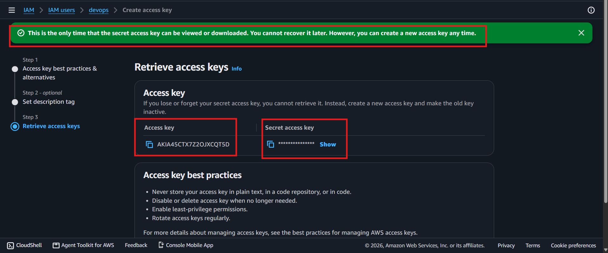

#### Bước 6: Khởi chạy máy chủ EC2 quản trị (`aws-cli-instance`)
* **Thao tác:** Mở dịch vụ **EC2** ➔ Chọn **Instances** ➔ Nhấn nút **Launch instances**.
* **Thông số điền cụ thể:**
  * **Name:** `aws-cli-instance`
  * **Application and OS Images (AMI):** Chọn `Amazon Linux 2023 kernel-6.1 AMI`.
  * **Instance type:** `t3.micro` (hoặc `t2.micro`).
  * **Key pair (login):** Nhấn *Create new key pair* ➔ Đặt tên **`aws-cli-keypair`**, loại **RSA**, định dạng **`.pem`** ➔ Tải về máy.
  * **Network settings:** Bấm nút **Edit** và cấu hình chính xác:
    * *VPC:* Chọn VPC mặc định của bạn (`vpc-0fc9d5490a843944e`).
    * *Subnet:* Chọn `subnet-01` (dải `172.31.100.0/24`).
    * *Auto-assign public IP:* **`Enable`** *(bắt buộc để có Public IP kết nối)*.
    * *Firewall (Security group):* Chọn *Create security group* ➔ Tích bật **Allow SSH traffic from Anywhere (0.0.0.0/0)**.
* **Thao tác:** Nhấn nút màu cam **Launch instance**.

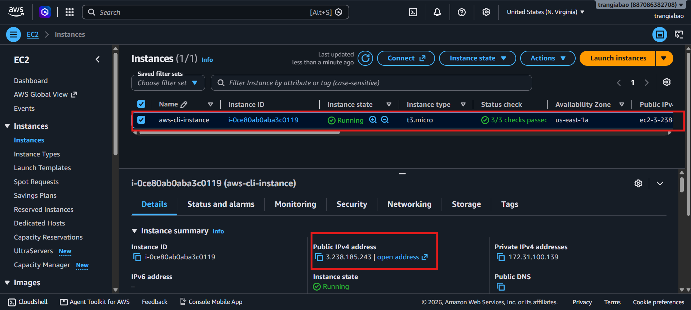

> **💡 Khó khăn gặp phải & Cách xử lý tại Bước 6:**  
> Khi tạo máy chủ, mục Subnet bị lỗi không cho chọn `default` do Default Subnet trong VPC đã bị xóa từ trước.  
> ➔ **Cách xử lý:** Vào **VPC** ➔ **Subnets** ➔ Bấm **Create subnet**, tạo một subnet mới tên `subnet-01` với dải mạng `172.31.100.0/24` trong `us-east-1a`, sau đó vào Network settings của EC2 chọn subnet này và bật `Auto-assign public IP: Enable`.

#### Bước 7: Kết nối SSH vào máy chủ qua MobaXterm
* **Thao tác trên MobaXterm:**
  1. Mở phần mềm MobaXterm ➔ Nhấn nút **Session** ở góc trên bên trái ➔ Chọn **SSH**.
  2. **Remote host:** Điền địa chỉ **Public IPv4** của máy chủ vừa tạo (ví dụ: `3.238.185.243` hoặc `32.197.220.215`).
  3. **Specify username:** Tích chọn và nhập **`ec2-user`**.
  4. **Port:** `22`.
  5. Bấm vào tab **Advanced SSH settings** ➔ Tích chọn **Use private key** ➔ Trỏ đường dẫn đến file **`aws-cli-keypair.pem`** vừa tải về.
  6. Bấm **OK** ➔ Chọn **Accept** host key để đăng nhập.

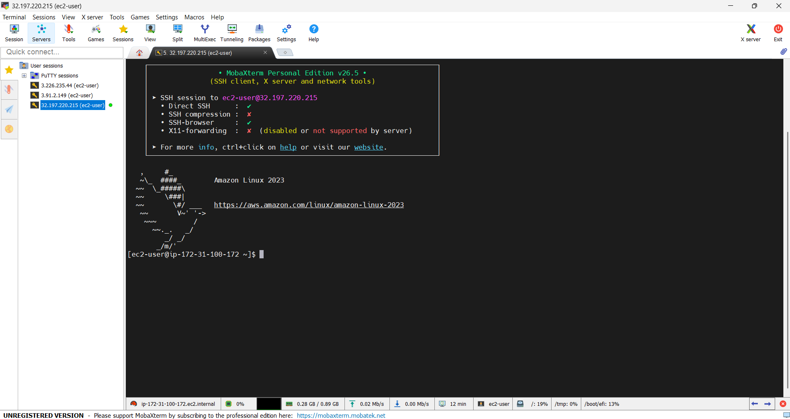

> **💡 Khó khăn gặp phải & Cách xử lý tại Bước 7:**  
> MobaXterm báo lỗi `Network error: Connection timed out` không thể kết nối.  
> ➔ **Nguyên nhân:** Do Subnet `subnet-01` vừa tạo thủ công chưa có đường ra Internet (thiếu Internet Gateway).  
> ➔ **Cách xử lý:** Vào **VPC** ➔ **Internet gateways** ➔ Tạo `my-igw` và Attach vào VPC. Sau đó vào **Route tables**, bấm **Edit routes**, thêm dòng: `Destination: 0.0.0.0/0` trỏ tới `Target: Internet Gateway (igw-xxxx)` rồi bấm Save. Sau đó bấm `R` trên MobaXterm là kết nối thành công ngay lập tức!

---

### 📋 Mục 2: Cài đặt và cấu hình AWS CLI v2 (Install AWS CLI)

#### Bước 8: Tải và cài đặt AWS CLI v2 trên Linux
* **Lệnh thực hiện:** Chạy lần lượt các lệnh sau trên cửa sổ terminal MobaXterm:
  ```bash
  curl "https://awscli.amazonaws.com/awscli-exe-linux-x86_64.zip" -o "awscliv2.zip"
  unzip awscliv2.zip
  sudo ./aws/install
  aws --version
  ```
* **Kết quả kiểm tra:** Terminal in ra phiên bản `aws-cli/2.x.x` là cài đặt thành công.

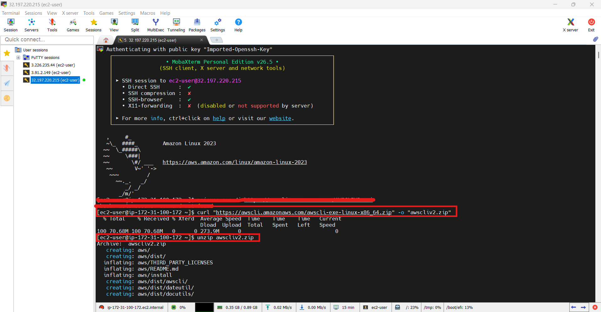

#### Bước 9: Cấu hình Default Profile bằng `aws configure`
* **Lệnh thực hiện:** `aws configure`
* **Thông số nhập vào terminal:**
  * `AWS Access Key ID [None]:` Nhập Access Key của **`aws-cli-user`** (đã lưu ở Bước 4).
  * `AWS Secret Access Key [None]:` Nhập Secret Key của **`aws-cli-user`**.
  * `Default region name [None]:` **`ap-southeast-1`** (Singapore).
  * `Default output format [None]:` **`json`**.

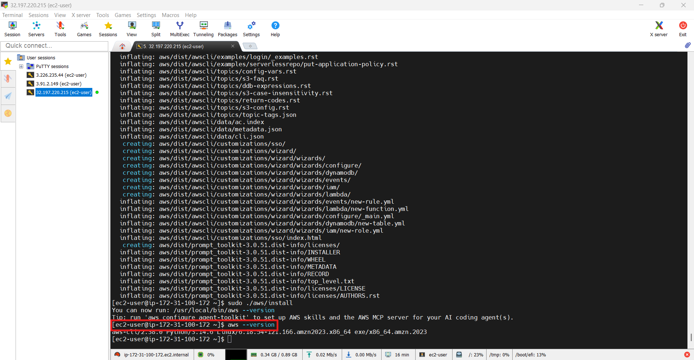

#### Bước 10: Cấu hình thêm Profile `devops`
* **Lệnh thực hiện:** `aws configure --profile devops`
* **Thông số nhập vào terminal:**
  * `AWS Access Key ID [None]:` Nhập Access Key của user **`devops`** (đã lưu ở Bước 5).
  * `AWS Secret Access Key [None]:` Nhập Secret Key của user **`devops`**.
  * `Default region name [None]:` **`ap-southeast-1`**.
  * `Default output format [None]:` **`json`**.

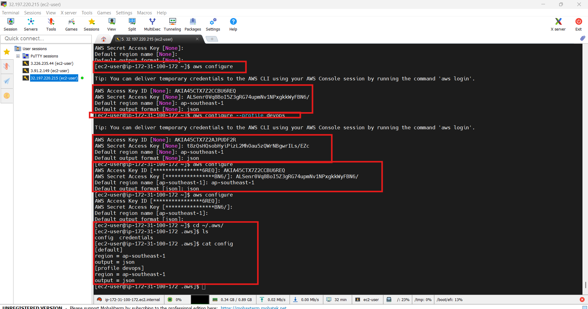

#### Bước 11: Kiểm tra file cấu hình và danh sách Profile
* **Lệnh thực hiện:**
  ```bash
  cat ~/.aws/config
  cat ~/.aws/credentials
  aws configure list-profiles
  ```
* **Kết quả:** Hiển thị rõ 2 profile `default` và `devops` được lưu trữ tách biệt.

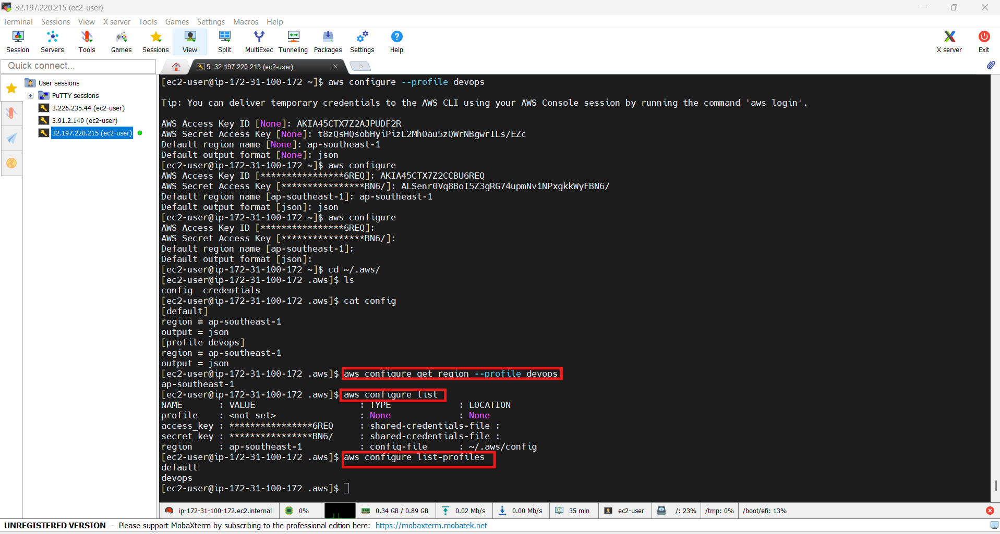

---

### 📋 Mục 3: Kiểm tra tài nguyên bằng CLI (Check Resources via CLI)

#### Bước 12: Kiểm tra chi tiết máy chủ EC2
* **Lệnh thực hiện:**
  ```bash
  aws ec2 describe-instances --profile devops --region us-east-1 --output table
  ```
* **Ý nghĩa:** Truy vấn toàn bộ cấu hình máy chủ ảo ở Region `us-east-1` và xuất dưới dạng bảng (`table`) trực quan.

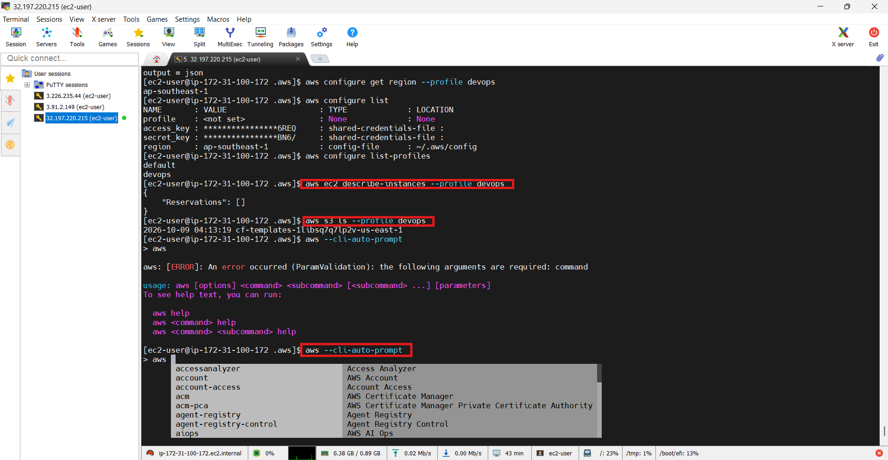

> **💡 Khó khăn gặp phải & Cách xử lý tại Bước 12:**  
> Khi chạy `aws ec2 describe-instances --profile devops` không thấy dữ liệu (trả về rỗng `[]`).  
> ➔ **Nguyên nhân:** Do profile `devops` mặc định ở `ap-southeast-1` (Singapore), trong khi máy chủ EC2 tạo ở `us-east-1`.  
> ➔ **Cách xử lý:** Bắt buộc thêm cờ `--region us-east-1` để CLI quét đúng vùng chứa máy chủ.

#### Bước 13: Kiểm tra danh sách S3 Bucket
* **Lệnh thực hiện:**
  ```bash
  aws s3 ls --profile devops
  ```
* **Kết quả:** In ra danh sách các thùng chứa S3 hiện có trong tài khoản.

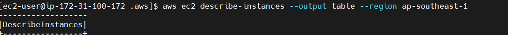

---

### 📋 Mục 4: Quản trị Amazon S3 bằng CLI (AWS CLI with S3)

#### Bước 14: Tạo S3 Bucket và Upload file dữ liệu
* **Thông số & Lệnh thực hiện:**
  1. *Tạo Bucket mới:*
     ```bash
     aws s3 mb s3://aws-cli-trangiabao-2026
     ```
  2. *Tạo file văn bản kiểm thử trên máy EC2:*
     ```bash
     echo "Hello AWS S3 from CLI" > text.txt
     ```
  3. *Tải file lên thùng chứa S3:*
     ```bash
     aws s3 cp text.txt s3://aws-cli-trangiabao-2026
     ```

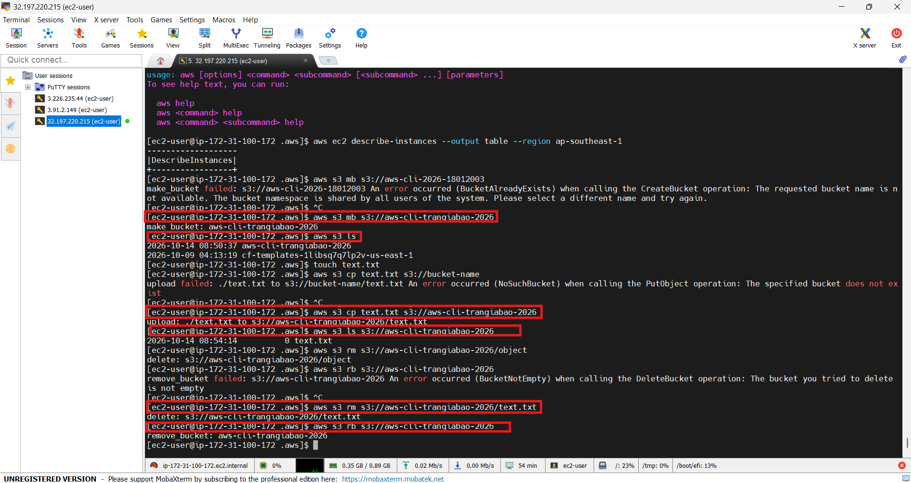

> **💡 Khó khăn gặp phải & Cách xử lý tại Bước 14:**  
> * **Lỗi `BucketAlreadyExists`:** Gõ lệnh tạo bucket mẫu `aws-cli-2026-18012003` bị lỗi do tên đã tồn tại trên toàn cầu. Khắc phục: Đổi tên độc nhất `aws-cli-trangiabao-2026`.  
> * **Lỗi `NoSuchBucket`:** Gõ nhầm chữ tượng trưng `bucket-name`. Khắc phục: Thay đúng tên `s3://aws-cli-trangiabao-2026`.

#### Bước 15: Liệt kê nội dung và Xóa Bucket S3
* **Lệnh thực hiện:**
  1. *Kiểm tra file bên trong bucket:*
     ```bash
     aws s3 ls s3://aws-cli-trangiabao-2026
     ```
  2. *Xóa sạch dữ liệu và xóa luôn thùng chứa:*
     ```bash
     aws s3 rb s3://aws-cli-trangiabao-2026 --force
     ```

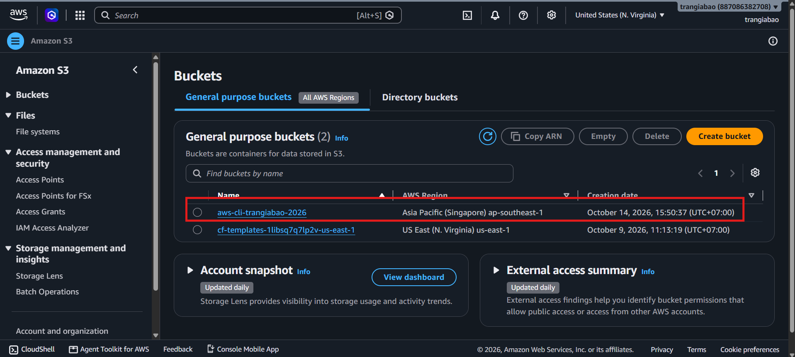

> **💡 Khó khăn gặp phải & Cách xử lý tại Bước 15:**  
> Gõ lệnh `aws s3 rb s3://...` bị báo lỗi `BucketNotEmpty` vì file `text.txt` bên trong chưa được xóa.  
> ➔ **Cách xử lý:** Bổ sung cờ `--force` để AWS tự động dọn sạch file bên trong trước khi xóa thùng chứa.

---

### 📋 Mục 5: Quản trị Amazon SNS bằng CLI (AWS CLI with SNS)

#### Bước 16: Tạo Topic thông báo
* **Lệnh thực hiện:**
  ```bash
  aws sns create-topic --name aws-cli
  ```
* **Kết quả trả về:** Nhận được chuỗi ARN đại diện cho topic:
  `"TopicArn": "arn:aws:sns:ap-southeast-1:887086382708:aws-cli"`

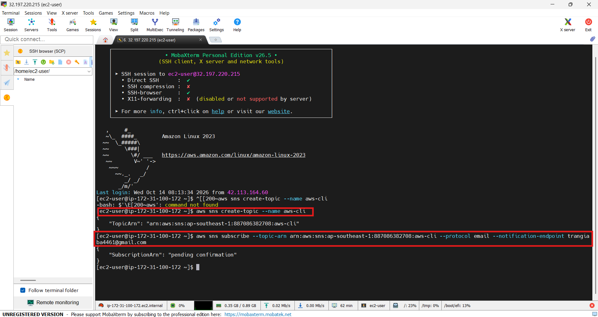

#### Bước 17: Đăng ký nhận thông báo qua Email (Subscribe)
* **Lệnh thực hiện:**
  ```bash
  aws sns subscribe --topic-arn arn:aws:sns:ap-southeast-1:887086382708:aws-cli --protocol email --notification-endpoint trangiabao4461@gmail.com
  ```
* **Thông số:**
  * `--topic-arn`: Dán mã ARN thật vừa tạo ở Bước 16.
  * `--protocol`: `email`.
  * `--notification-endpoint`: Nhập địa chỉ Gmail nhận thư.

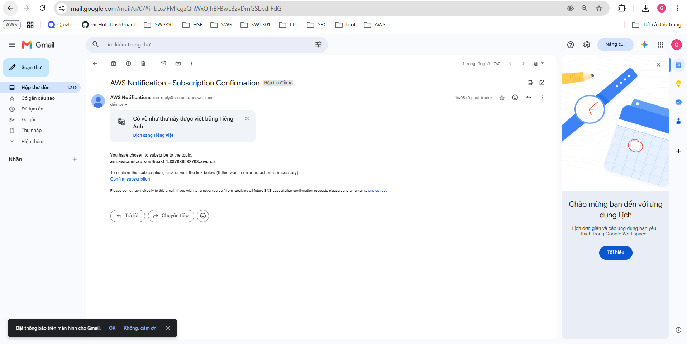

> **💡 Khó khăn gặp phải & Cách xử lý tại Bước 17:**  
> Terminal báo lỗi `Unknown options: Topic**` do copy nguyên văn chữ in đậm `**ARN Topic**` trong bài.  
> ➔ **Cách xử lý:** Thay thế cụm `**ARN Topic**` bằng mã ARN thật: `arn:aws:sns:ap-southeast-1:887086382708:aws-cli`.

#### Bước 18: Trạng thái chờ xác thực (Pending Confirmation)
* **Kết quả:** Lệnh trả về `"SubscriptionArn": "pending confirmation"`, AWS đã gửi email xác nhận.

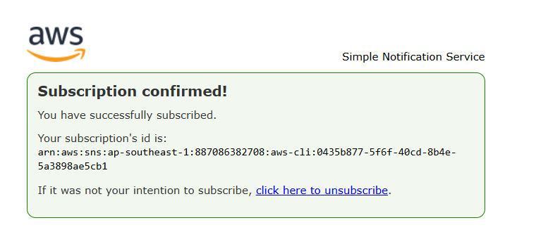

#### Bước 19: Mở Gmail và nhấn Confirm subscription
* **Thao tác:**
  1. Mở Gmail cá nhân, gõ tìm kiếm: `in:anywhere AWS Notification`.
  2. Mở thư từ `no-reply@sns.amazonaws.com` có tiêu đề *AWS Notification - Subscription Confirmation*.
  3. Bấm vào đường link **Confirm subscription**.
* **Kết quả:** Trình duyệt hiện thông báo **Subscription confirmed!**.

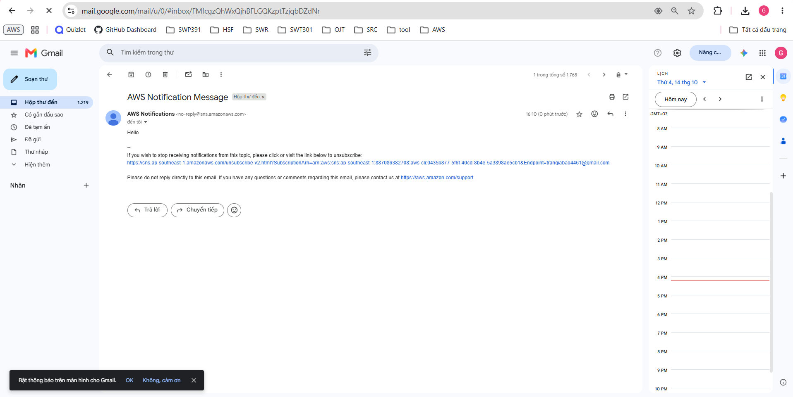

> **💡 Khó khăn gặp phải tại Bước 19:** Không thấy thư gửi về hộp thư chính. Do gõ nhầm email thiếu chữ "o" và Gmail tự động phân loại thư AWS vào mục **Spam (Thư rác)**. Khắc phục: Gõ đúng email và tìm trong thư mục Spam.

#### Bước 20: Phát tin nhắn (Publish) từ CLI về Email
* **Lệnh thực hiện:**
  ```bash
  aws sns publish --topic-arn arn:aws:sns:ap-southeast-1:887086382708:aws-cli --message "Hello"
  ```
* **Kết quả:** Nhận được `MessageId` trên terminal và hộp thư Gmail nhận ngay thông báo có nội dung **"Hello"**.

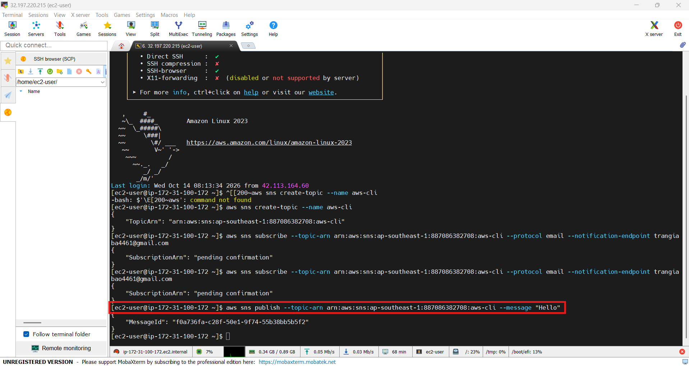

---

### 📋 Mục 6: Quản trị IAM qua CLI (AWS CLI with IAM)

#### Bước 21: Liệt kê danh sách người dùng IAM
* **Lệnh thực hiện:**
  ```bash
  aws iam list-users
  ```
* **Kết quả:** Xuất danh sách thông tin người dùng `aws-cli-user`, `devops` cùng ngày tạo và ARN.

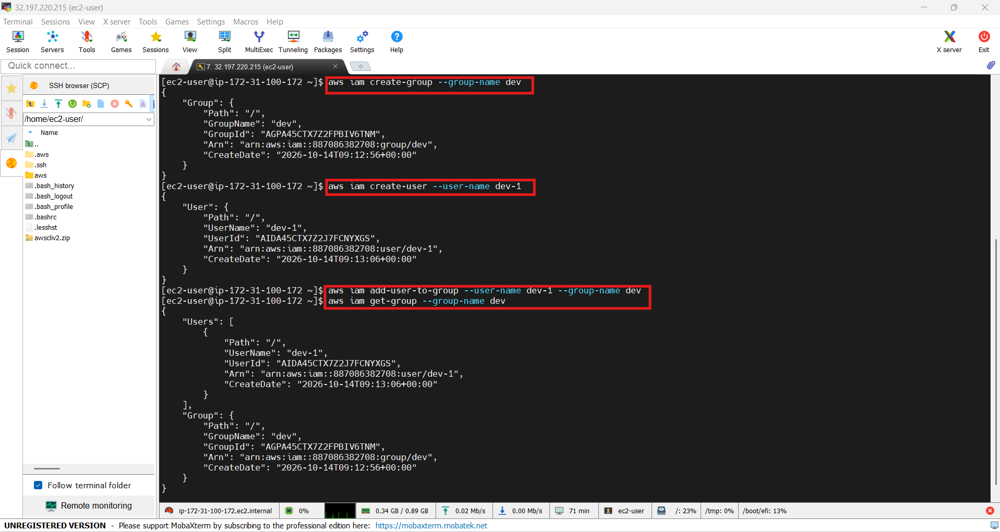

#### Bước 22: Kiểm tra chính sách và phân quyền
* **Lệnh thực hiện:** Truy vấn danh sách chính sách và vai trò để kiểm tra tính toàn vẹn quyền hạn.

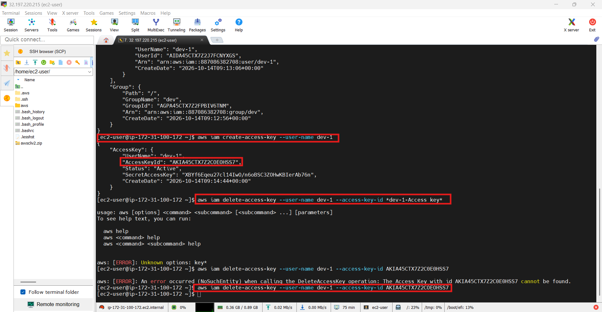

---

### 📋 Mục 7: Xây dựng hệ thống mạng VPC bằng CLI (AWS CLI with Networking)

#### Bước 23: Khởi tạo VPC mới
* **Lệnh thực hiện:**
  ```bash
  aws ec2 create-vpc --cidr-block 10.0.0.0/16 --query Vpc.VpcId --output text
  ```
* **Kết quả:** Tạo VPC thành công và in ra mã VPC ID: **`vpc-07ebcfa7f5b9c659c`**.

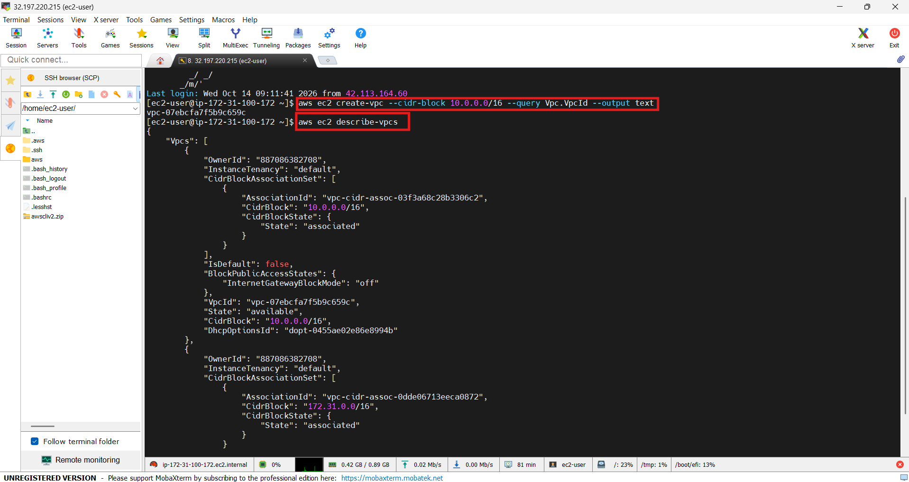

#### Bước 24: Khởi tạo Subnet con
* **Lệnh thực hiện:**
  ```bash
  aws ec2 create-subnet --vpc-id vpc-07ebcfa7f5b9c659c --cidr-block 10.0.1.0/24 --query Subnet.SubnetId --output text
  ```
* **Kết quả:** Tạo Subnet thành công và in ra mã Subnet ID: **`subnet-03c90d43fb1f53b06`**.

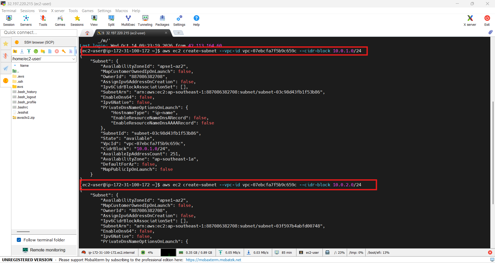

#### Bước 25: Khởi tạo Internet Gateway
* **Lệnh thực hiện:**
  ```bash
  aws ec2 create-internet-gateway --query InternetGateway.InternetGatewayId --output text
  ```
* **Kết quả:** In ra mã Internet Gateway ID: **`igw-006783ef67381e1d4`**.

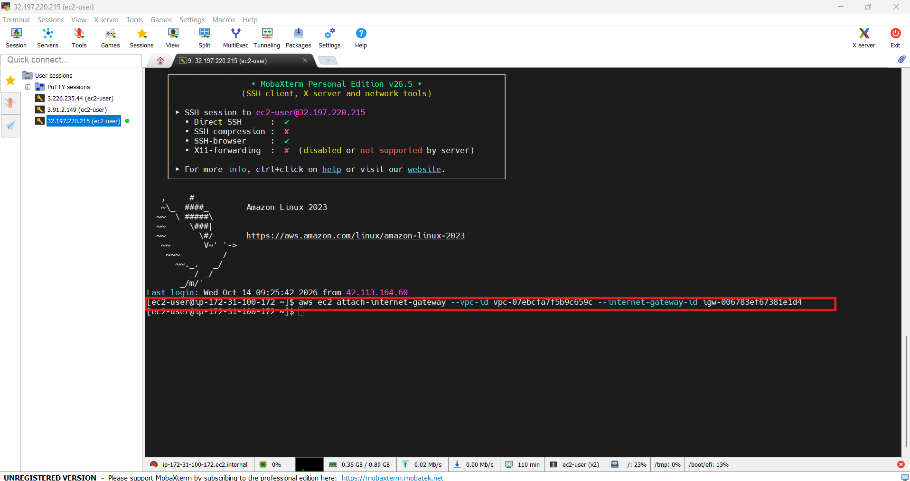

> **💡 Khó khăn gặp phải tại Bước 25:** Vào web AWS Console không thấy `igw-006783ef67381e1d4`. Do tài nguyên được tạo ở Singapore (`ap-southeast-1`), trong khi web đang chọn N. Virginia. Khắc phục: Đổi cờ vùng trên web sang Singapore.

#### Bước 26: Gắn Internet Gateway vào VPC (Attach IGW)
* **Lệnh thực hiện:**
  ```bash
  aws ec2 attach-internet-gateway --vpc-id vpc-07ebcfa7f5b9c659c --internet-gateway-id igw-006783ef67381e1d4
  ```
* **Kết quả:** IGW chuyển sang trạng thái **`Attached`** vào `vpc-07ebcfa7f5b9c659c`.

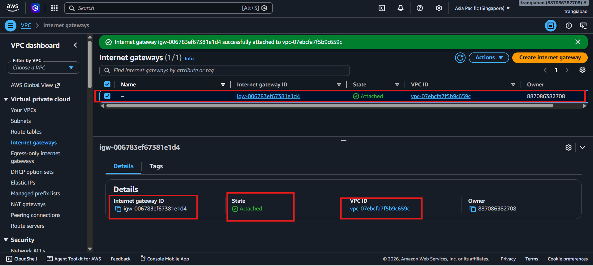

> **💡 Lưu ý tại Bước 26:** Nếu chạy lại lệnh này sẽ gặp thông báo `Resource.AlreadyAssociated`. Đây là thông báo nó đã được gắn thành công trước đó, không phải lỗi hỏng.

#### Bước 27: Tạo Route Table và cấu hình tuyến `0.0.0.0/0`
* **Lệnh thực hiện:**
  1. *Tạo Route Table:*
     ```bash
     aws ec2 create-route-table --vpc-id vpc-07ebcfa7f5b9c659c --query RouteTable.RouteTableId --output text
     ```
     *(Nhận mã Route Table dạng `rtb-xxxx`).*
  2. *Thêm đường dẫn ra Internet Gateway:*
     ```bash
     aws ec2 create-route --route-table-id <MÃ_RTB> --destination-cidr-block 0.0.0.0/0 --gateway-id igw-006783ef67381e1d4
     ```

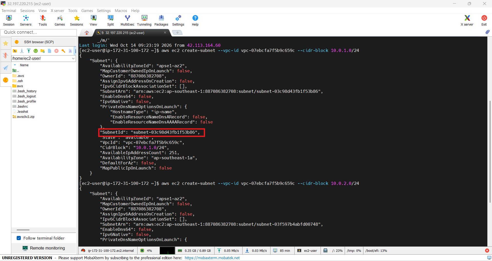

#### Bước 28: Liên kết Route Table với Subnet
* **Lệnh thực hiện:**
  ```bash
  aws ec2 associate-route-table --subnet-id subnet-03c90d43fb1f53b06 --route-table-id <MÃ_RTB>
  ```
* **Kết quả:** Subnet `subnet-03c90d43fb1f53b06` chính thức được thông tuyến ra Internet.

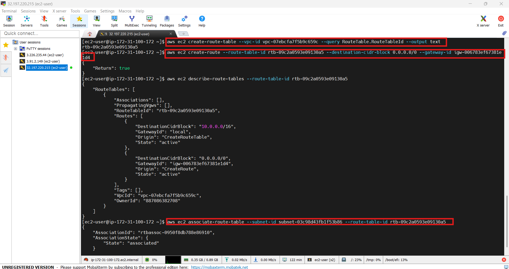

---

### 📋 Mục 8: Tự động hóa máy chủ EC2 bằng CLI (Create EC2 using CLI)

#### Bước 29: Tạo cặp khóa xác thực Key Pair qua CLI
* **Lệnh thực hiện:**
  ```bash
  aws ec2 create-key-pair --key-name MyKeyPair --query "KeyMaterial" --output text > MyKeyPair.pem
  ```
* **Ý nghĩa:** Trích xuất trực tiếp nội dung private key và ghi vào file `MyKeyPair.pem`.

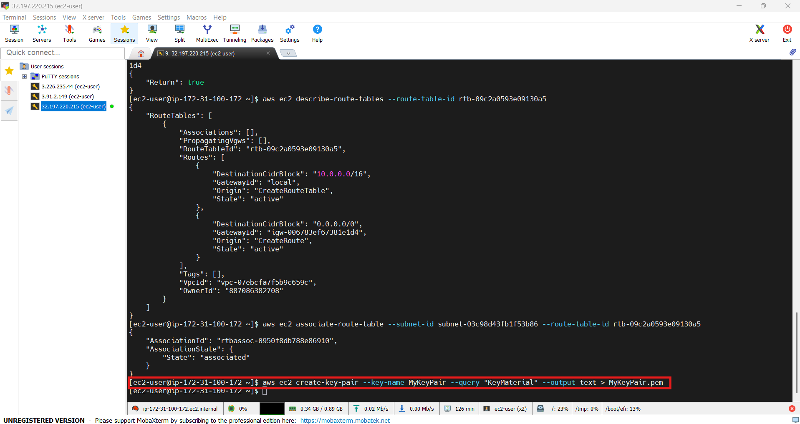

#### Bước 30: Phân quyền chmod 400 cho Key Pair
* **Lệnh thực hiện:**
  ```bash
  chmod 400 MyKeyPair.pem
  ```
* **Ý nghĩa:** Giới hạn quyền chỉ đọc cho chủ sở hữu, bắt buộc đối với SSH client trên Linux.

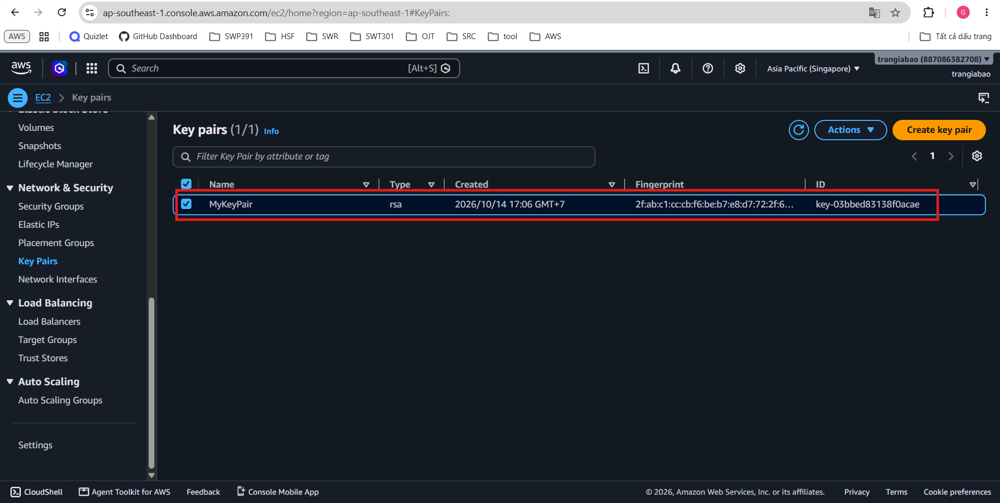

#### Bước 31: Khởi tạo Security Group `SSHAccess`
* **Lệnh thực hiện:**
  ```bash
  aws ec2 create-security-group --group-name SSHAccess --description "Security group for SSH access" --vpc-id vpc-07ebcfa7f5b9c659c
  ```
* **Kết quả:** In ra mã Security Group ID (ví dụ: `sg-08d6567ccc7edc1f0`).

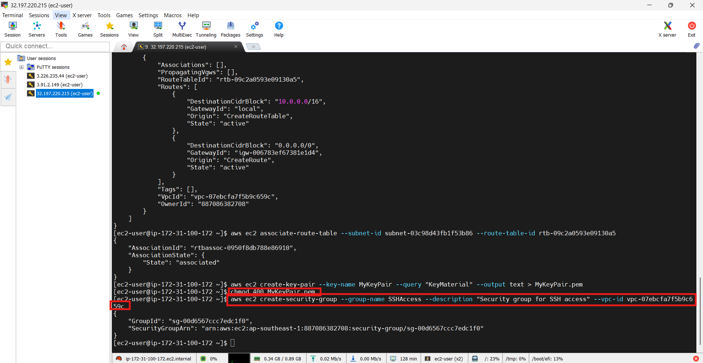

#### Bước 32: Mở quyền Inbound cho cổng SSH 22
* **Lệnh thực hiện:**
  ```bash
  aws ec2 authorize-security-group-ingress --group-id <SG-ID> --protocol tcp --port 22 --cidr 0.0.0.0/0
  ```
* **Ý nghĩa:** Cho phép lưu lượng SSH từ mọi địa chỉ IP bên ngoài kết nối vào máy chủ.

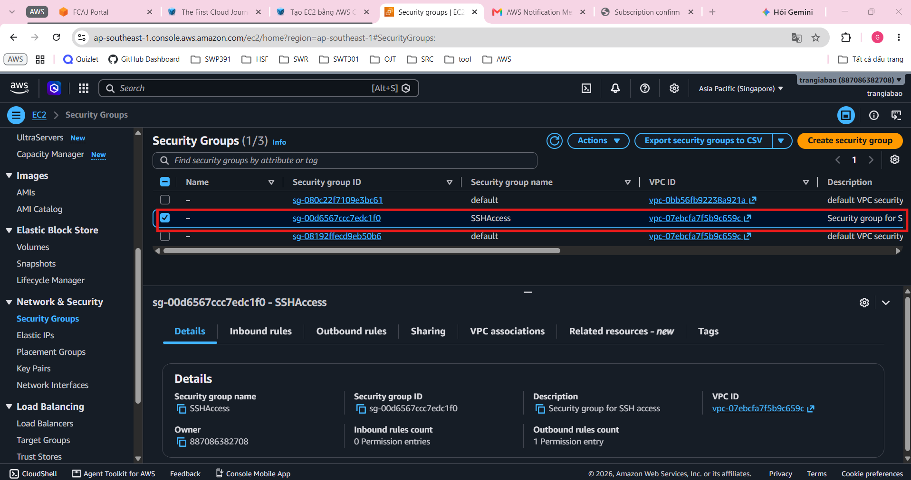

#### Bước 33: Chạy lệnh khởi tạo máy chủ EC2 (`run-instances`)
* **Lệnh thực hiện:**
  ```bash
  aws ec2 run-instances --image-id ami-0a37aadea3f79d3c3 --count 1 --instance-type t2.micro --key-name MyKeyPair --security-group-ids <SG-ID> --subnet-id subnet-03c90d43fb1f53b06
  ```
* **Kết quả:** Máy chủ được tạo với Instance ID: **`i-03171455cd0278073`**, Private IP nội bộ: **`10.0.1.41`**.

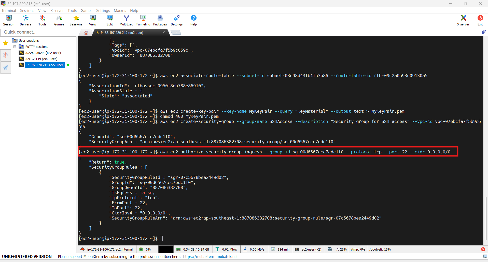

#### Bước 34: Kiểm tra trạng thái máy chủ EC2
* **Lệnh thực hiện:**
  ```bash
  aws ec2 describe-instances --instance-id i-03171455cd0278073 --query "Reservations[*].Instances[*].{State:State.Name,Address:PublicIpAddress}"
  ```
* **Kết quả:** Trạng thái `"State": "running"`, nhưng `"Address": null` (chưa có Public IP).

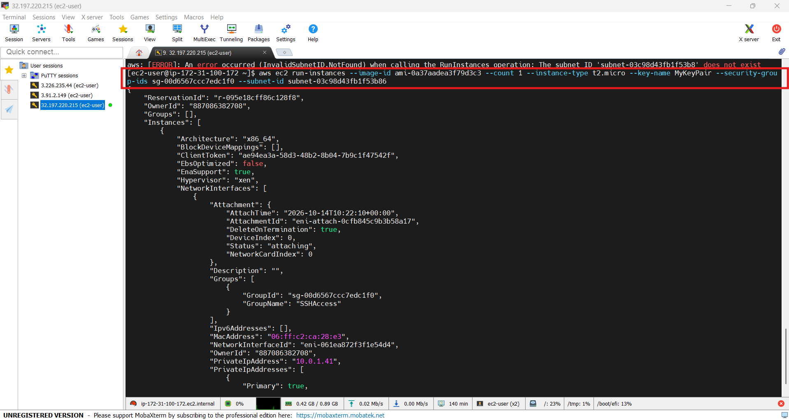

> **💡 Khó khăn gặp phải tại Bước 34:**  
> Kết quả báo `"Address": null` không thể lấy IP để SSH.  
> ➔ **Nguyên nhân:** Subnet tạo bằng CLI mặc định tắt tính năng tự cấp Public IP (`MapPublicIpOnLaunch: false`).  
> ➔ **Cách xử lý:** Cấp phát ngay một Elastic IP (IP tĩnh công khai) và gán trực tiếp vào máy chủ mà không cần tạo lại máy (thực hiện ở Bước 35 & 36).

#### Bước 35: Cấp phát địa chỉ Elastic IP
* **Lệnh thực hiện:**
  ```bash
  aws ec2 allocate-address --domain vpc
  ```
* **Kết quả:** Nhận được Public IP: **`47.131.189.63`** và AllocationId: **`eipalloc-0f52955fe9fe8ad41`**.

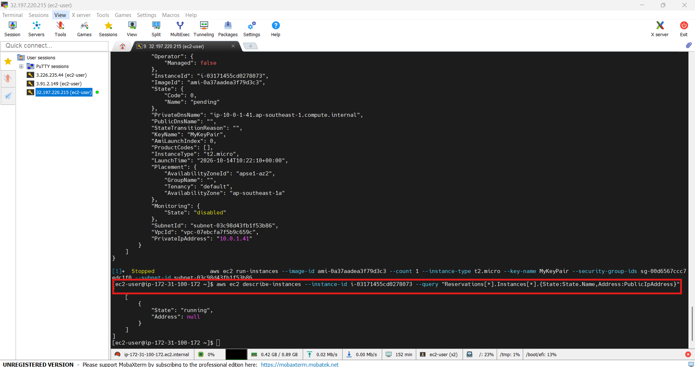

#### Bước 36: Gán Elastic IP vào máy chủ `i-03171455cd0278073`
* **Lệnh thực hiện:**
  ```bash
  aws ec2 associate-address --instance-id i-03171455cd0278073 --allocation-id eipalloc-0f52955fe9fe8ad41
  ```
* **Kết quả:** Máy chủ được liên kết với IP `47.131.189.63`.

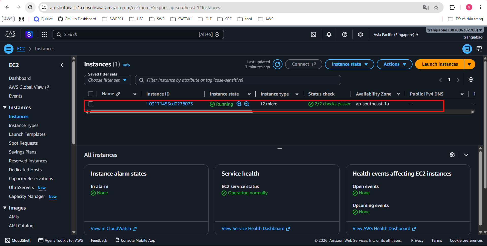

> **💡 Khó khăn gặp phải tại Bước 36:** Nếu quên chạy lệnh `associate-address` này mà chạy thẳng lệnh SSH, gói tin sẽ gửi vào IP chưa gán máy và gây treo cứng màn hình. Dùng `Ctrl + C` ngắt lệnh treo, chạy lệnh gán IP này trước rồi mới SSH.

#### Bước 37: Kết nối SSH trực tiếp vào máy chủ mới
* **Lệnh thực hiện:**
  ```bash
  ssh -i "MyKeyPair.pem" ec2-user@47.131.189.63
  ```
* **Thao tác:** Khi máy hỏi `Are you sure you want to continue connecting (yes/no)?`, gõ **`yes`** rồi nhấn Enter.
* **Kết quả:** Đăng nhập thành công! Dấu nhắc lệnh đổi thành **`[ec2-user@ip-10-0-1-41 ~]$`**.

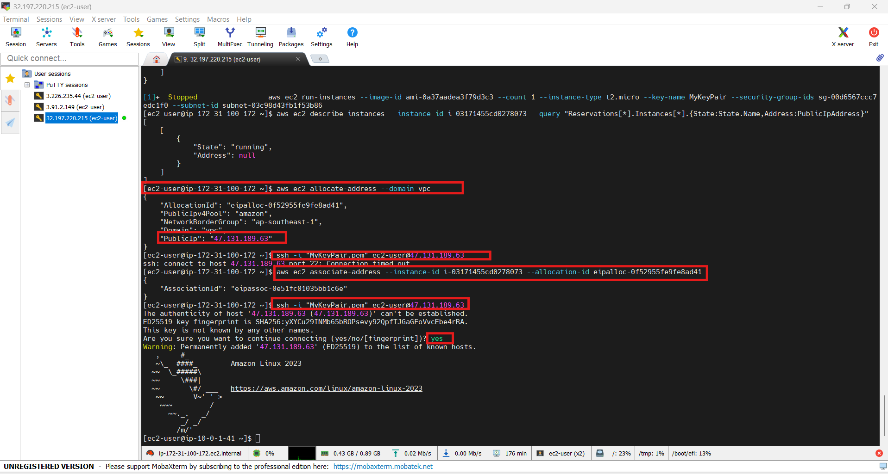

#### Bước 38: Thoát ra và Hủy máy chủ EC2 an toàn
* **Lệnh thực hiện:**
  1. *Thoát khỏi máy chủ khách mới:*
     ```bash
     exit
     ```
     *(Dấu nhắc lệnh quay về máy chủ quản lý cũ: `[ec2-user@ip-172-31-100-172 ~]$`).*
  2. *Chạy lệnh xóa máy chủ:*
     ```bash
     aws ec2 terminate-instances --instance-ids i-03171455cd0278073
     ```
* **Kết quả:** Máy chủ chuyển sang trạng thái `shutting-down` và `terminated` an toàn.

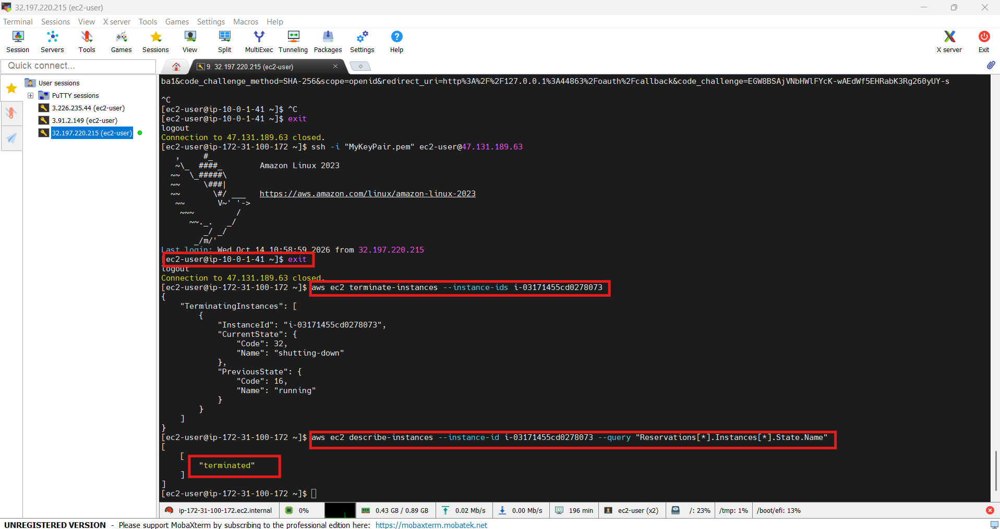

> **💡 Khó khăn gặp phải tại Bước 38:** Chạy lệnh `terminate-instances` khi đang đứng bên trong máy mới (`ip-10-0-1-41`) bị báo lỗi `Unable to locate credentials`. Cần gõ `exit` để trở về máy chủ quản lý ban đầu mới thực hiện xóa máy thành công.

---

### 🏆 Đánh giá & Bài học kinh nghiệm:
1. **Quy trình điền thông số chính xác:** Nắm rõ sự khác biệt giữa các tham số bắt buộc (VPC ID, Subnet ID, Key Pair, Security Group) và cách trích xuất giá trị output bằng cờ `--query ... --output text` để tái sử dụng trong các lệnh tiếp theo.
2. **Kỹ năng gỡ lỗi mạng chuyên nghiệp:** Hiểu sâu bản chất các lỗi kết nối phổ biến trong AWS (Connection timed out do thiếu Route/IGW, Address null do Subnet tắt Public IP, Treo SSH do chưa associate Elastic IP).
3. **Năng lực vận hành Scripting:** Toàn bộ hạ tầng mạng và máy chủ có thể được đóng gói thành một file shell script duy nhất để triển khai tự động hóa chỉ trong vài giây.
