{}
The **Work with Amazon DynamoDB** hands-on lab was conducted on **Wednesday (14/10/2026)** as part of **Week 5**. This document details the end-to-end implementation process across three operational methods: AWS Management Console, AWS CloudShell CLI, and Programmatic Automation with Python SDK (Boto3).
<br>🔗 **Workshop Source:** [Work with Amazon DynamoDB (Workshop 000060)](https://000060.awsstudygroup.com/)
{}

### 🎯 Lab Objectives:
* Master the NoSQL architecture of **Amazon DynamoDB**, comprehend partition distribution mechanisms using **Partition Key (HASH)**, composite key strategies using **Composite Primary Key (HASH + RANGE)**, and schema flexibility with Scalar/Document attribute types.
* Perform lifecycle management for the `Music` table via **AWS Management Console**: table creation, item insertion, in-place updates, conditional queries and full table scans, alongside configuring and querying a **Global Secondary Index (GSI)** named `AlbumTitle-index`.
* Leverage the command-line interface of **AWS CloudShell**: authenticate via IAM credentials, provision tables, perform atomic CRUD operations (`put-item`, `get-item`, `update-item`, `query`), attach a GSI via `update-table`, and understand the asynchronous **Backfilling** phase.
* Implement programmatic automation on Windows using **Python 3** and **Boto3 SDK**: automated provisioning of the `Movies` table, item CRUD scripts, batch ingestion from a JSON payload (`moviedata.json` with 4,609 records), key-based queries, and filtered table scans (`MoviesScan.py`).
* Analyze and document **10 in-depth real-world troubleshooting scenarios**: workshop documentation flag typos, IAM policy authorization, duplicate resource conflicts, hidden zero-width Unicode characters (`\u200b`), terminal CLI pager behavior, GSI backfilling locks, environment execution mismatches, and multi-region routing.

---

### 📊 Provisioned Resource Specifications:

| Resource | Name / Identifier | Attributes & Key Schema | Throughput / Mode | Region | Purpose |
| :--- | :--- | :--- | :--- | :--- | :--- |
| **DynamoDB Table 1**| `Music` | Partition Key: `Artist` (S) <br>Sort Key: `SongTitle` (S) | Provisioned (RCU=10, WCU=5) | `us-east-1` | Console & CloudShell CLI lab exercises |
| **Secondary Index** | `AlbumTitle-index` | Partition Key: `AlbumTitle` (S) <br>Projection: `ALL` | Provisioned (RCU=10, WCU=5) | `us-east-1` | Global Secondary Index for `Music` table |
| **DynamoDB Table 2**| `Movies` | Partition Key: `year` (N) <br>Sort Key: `title` (S) | Provisioned (RCU=10, WCU=10) | `ap-southeast-1` | Python SDK (Boto3) lab automation |
| **IAM User** | `AWS-FCAJ-DynamDB` | Attached Policy: `AmazonDynamoDBFullAccess` | Programmatic CLI Access | Global | Dedicated identity for CLI and SDK access |
| **Dataset Payload** | `moviedata.json` | 4,609 movie entries (3.7 MB), JSON format | Parsed Floats to Decimal | Local | Benchmark dataset for query & scan routines |
| **SDK Environment** | Windows Workstation | Python 3.14.5 + Boto3 1.43.114 | CLI Default: `ap-southeast-1` | Local | Host environment for Python test scripts |

---

### 📋 Section 1: Managing DynamoDB via AWS Management Console

#### Step 1: Accessing the Amazon DynamoDB Console
* **Action:** Sign in to the AWS Management Console and open the **DynamoDB** service dashboard.
* **Purpose:** Access the centralized control pane to monitor database capacity, active tables, and operational metrics.

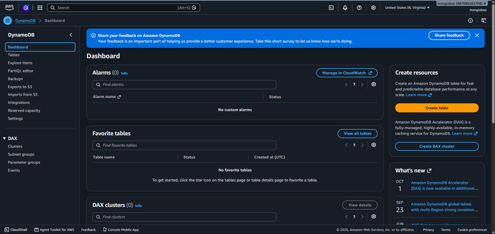

#### Step 2: Creating an IAM Access Key for Authentication
* **Action:** Navigate to **IAM** ➔ **Users** ➔ Select user `AWS-FCAJ-DynamDB` ➔ **Security credentials** tab ➔ Click **Create access key** ➔ Select **Command Line Interface (CLI)** ➔ Download the credentials `.csv` file containing the `Access Key ID` and `Secret Access Key`.

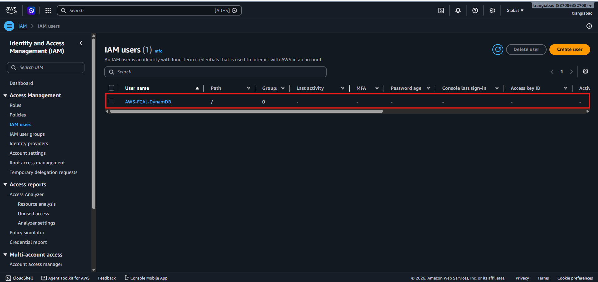

#### Step 3: Creating the `Music` Table on Web Console
* **Action:** In the DynamoDB Console navigation sidebar, select **Tables** ➔ Click **Create table**.
* **Configuration Parameters:**
  * **Table name:** `Music`
  * **Partition key:** `Artist` (Data Type: **String**)
  * **Sort key:** `SongTitle` (Data Type: **String**)
  * **Table settings:** Select **Default settings** (Provisioned capacity mode, RCU=5, WCU=5, default KMS encryption).
* **Action:** Click **Create table** and monitor until the status turns to `Active`.

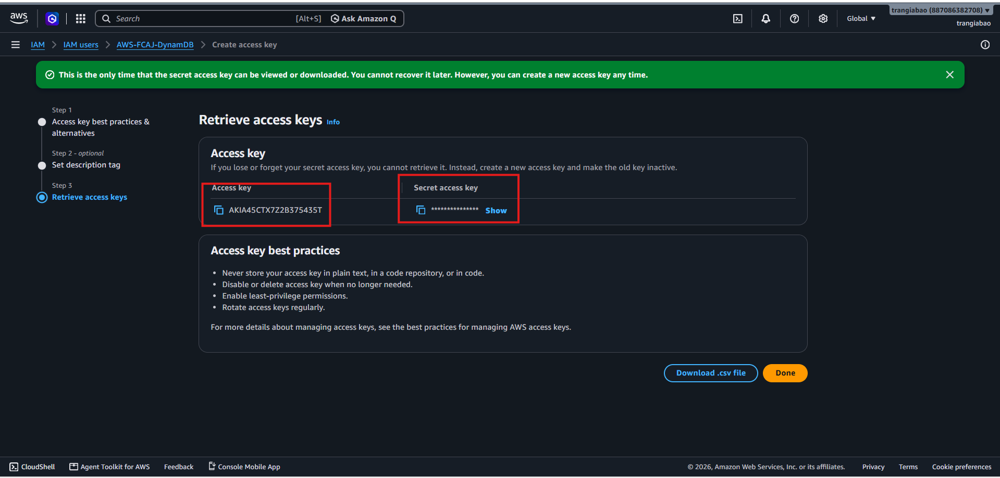

#### Step 4: Writing the First Item to `Music` Table
* **Action:** Select table **`Music`** ➔ Click **Explore items** ➔ Click **Create item**.
* **Attribute Entries:**
  * `Artist` (String): `No One You Know`
  * `SongTitle` (String): `Call Me Today`
  * Click **Add new attribute** ➔ **String** ➔ Name: `AlbumTitle`, Value: `Somewhat Famous`
  * Click **Add new attribute** ➔ **Number** ➔ Name: `Awards`, Value: `1`
* **Action:** Click **Create item** to commit the record to storage.

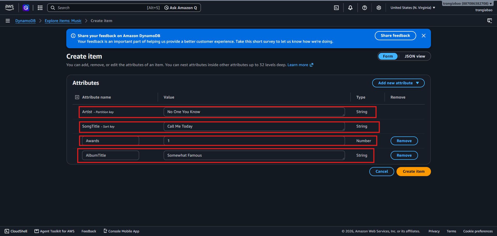

#### Step 5: Viewing and Scanning Stored Records
* **Action:** In **Explore items**, select the `Music` table and execute a **Scan** operation to list all persisted items.
* **Verification:** The view displays all assigned attributes for the newly inserted track.

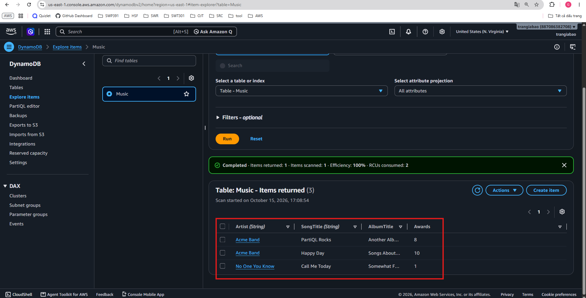

#### Step 6: Inspecting Item Attributes
* **Action:** Click on the record row for `No One You Know` to inspect the underlying document structure in Form or JSON format.

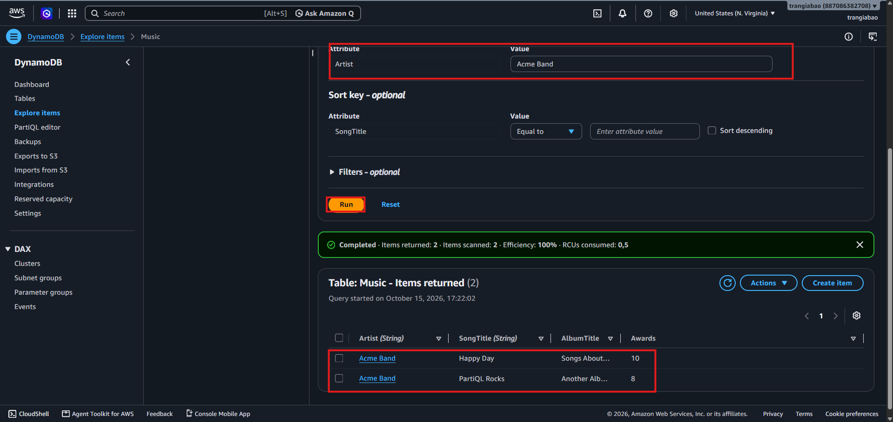

#### Step 7: Updating Item Attributes in Place
* **Action:** Select the record, modify attribute values or add new fields, and click **Save changes**.

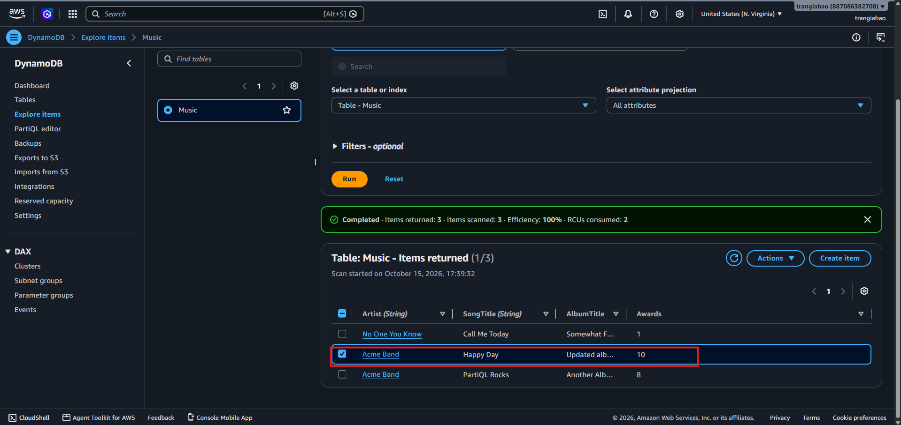

#### Step 8: Querying Data by Primary Key
* **Action:** Under **Explore items**, toggle the execution mode from *Scan* to **Query**.
* **Query Parameters:**
  * **Partition key (`Artist`):** `Acme Band`
  * **Sort key (`SongTitle`):** Optional condition or left blank to fetch all tracks under this partition.
* **Result:** Ultra-low latency retrieval restricted exclusively to the target hash partition.

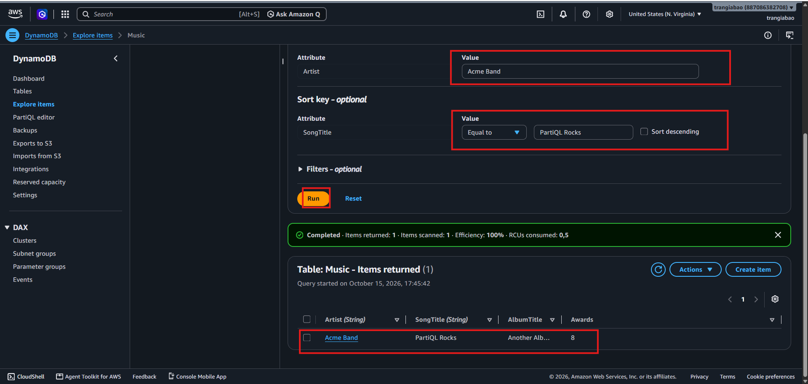

#### Step 9: Creating a Global Secondary Index (GSI)
* **Action:** Open table `Music` ➔ Select the **Indexes** tab ➔ Click **Create index**.
* **Index Configuration:**
  * **Partition key:** `AlbumTitle` (Type: **String**)
  * **Index name:** `AlbumTitle-index`
  * **Attribute projections:** **All**
* **Action:** Click **Create index**. The index status switches to `Creating` as the background **Backfilling** process begins.

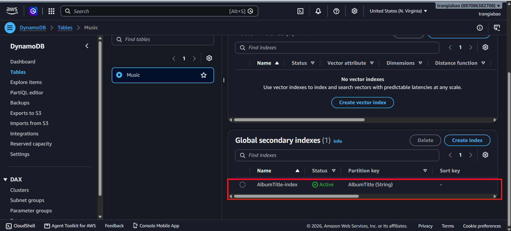

#### Step 10: Querying Stored Items via GSI
* **Action:** Return to **Explore items** ➔ Select **Query** ➔ Choose **`AlbumTitle-index`** from the target dropdown.
* **Search Parameters:**
  * **Partition key (`AlbumTitle`):** `Somewhat Famous`
* **Result:** Returns matching tracks without requiring knowledge of the primary key's partition key (`Artist`), demonstrating multi-dimensional query flexibility.

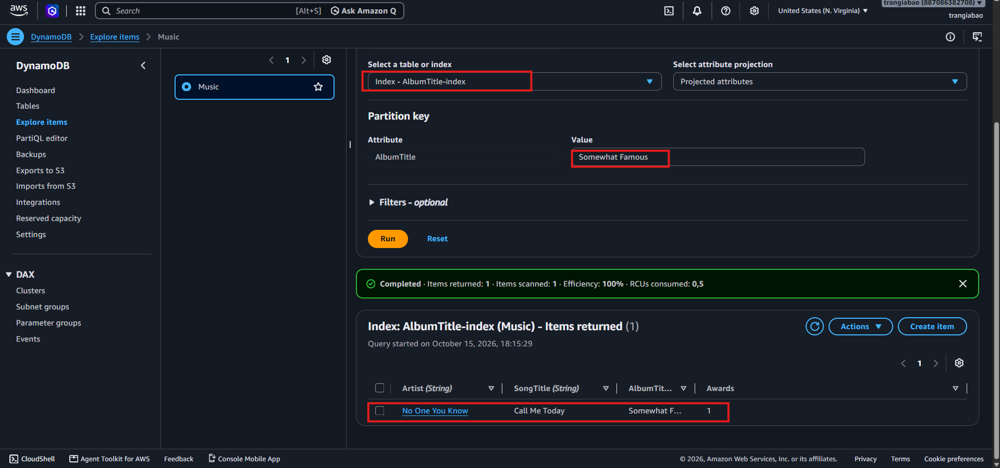

---

### 📋 Section 2: Command-Line Operations via AWS CloudShell

#### Step 11: Launching AWS CloudShell
* **Action:** Click the **CloudShell** terminal icon on the top navigation bar of the AWS Console to open an authenticated Linux browser shell.

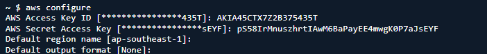

#### Step 12: Configuring CLI Credentials in CloudShell
* **Execution Command:**
  ```bash
  aws configure
  ```
* **Input Parameters:**
  * **AWS Access Key ID:** Provide Access Key for `AWS-FCAJ-DynamDB`.
  * **AWS Secret Access Key:** Provide matching Secret Access Key.
  * **Default region name:** `us-east-1`
  * **Default output format:** `json`

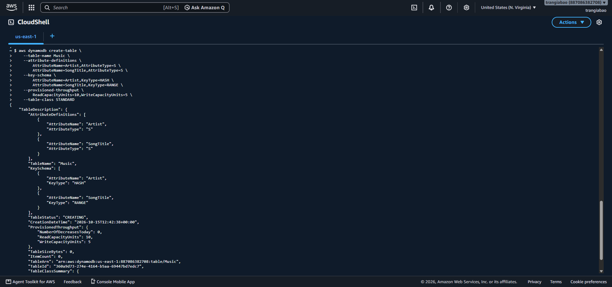

#### Step 13: Creating Table `Music` via AWS CLI
* **Execution Command:**
  ```bash
  aws dynamodb create-table \
      --table-name Music \
      --attribute-definitions \
          AttributeName=Artist,AttributeType=S \
          AttributeName=SongTitle,AttributeType=S \
      --key-schema \
          AttributeName=Artist,KeyType=HASH \
          AttributeName=SongTitle,KeyType=RANGE \
      --provisioned-throughput \
          ReadCapacityUnits=10,WriteCapacityUnits=5 \
      --table-class STANDARD
  ```

{}
💡 **Trouble 1 & Resolution - Workshop Documentation Syntax Typo:**
* **Issue:** The original workshop instructions specified `--provided-throughput`, throwing: `aws: [ERROR]: Unknown options: --provided-throughput, ReadCapacityUnits=10,WriteCapacityUnits=5`.
* **Root Cause:** Standard AWS CLI v2 syntax mandates `--provisioned-throughput`.
* **Resolution:** Replaced flag with `--provisioned-throughput ReadCapacityUnits=10,WriteCapacityUnits=5`.
{}

{}
💡 **Trouble 2 & Resolution - Missing IAM Permissions (`AccessDeniedException`):**
* **Issue:** Call denied with `User: .../AWS-FCAJ-DynamDB is not authorized to perform: dynamodb:CreateTable because no identity-based policy allows...`.
* **Root Cause:** The IAM User lacked permissions policies for DynamoDB APIs.
* **Resolution:** Attached managed policy **`AmazonDynamoDBFullAccess`** directly to user `AWS-FCAJ-DynamDB` via IAM Console.
{}

{}
💡 **Trouble 3 & Resolution - Resource Name Collision (`ResourceInUseException`):**
* **Issue:** Output indicated: `Table already exists: Music`.
* **Root Cause:** Table `Music` had already been created in Section 1 via Web Console in the identical region (`us-east-1`).
* **Resolution:** Executed `describe-table` to confirm `ACTIVE` state and proceeded directly to subsequent data manipulation steps.
{}

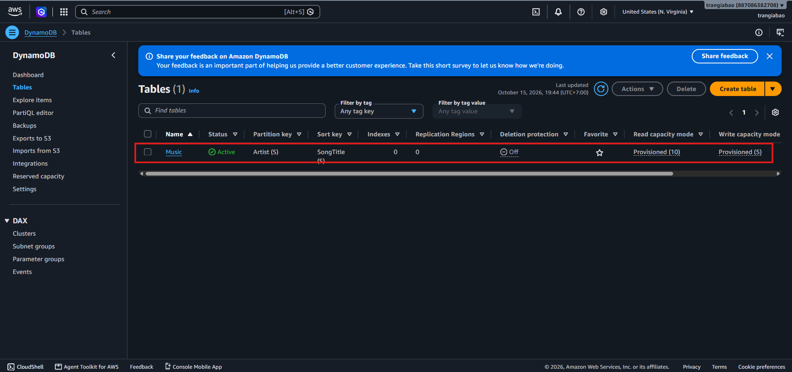

#### Step 14: Verifying Table Status
* **Execution Command:**
  ```bash
  aws dynamodb describe-table --table-name Music | grep TableStatus
  ```
* **Output:** Returned `"TableStatus": "ACTIVE"`.

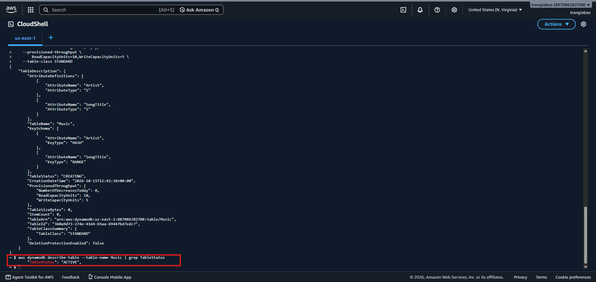

#### Step 15: Ingesting an Item via `put-item`
* **Execution Command:**
  ```bash
  aws dynamodb put-item \
      --table-name Music \
      --item '{
          "Artist": {"S": "No One You Know"},
          "SongTitle": {"S": "Call Me Today"},
          "AlbumTitle": {"S": "Somewhat Famous"},
          "Awards": {"N": "1"}
      }'
  ```

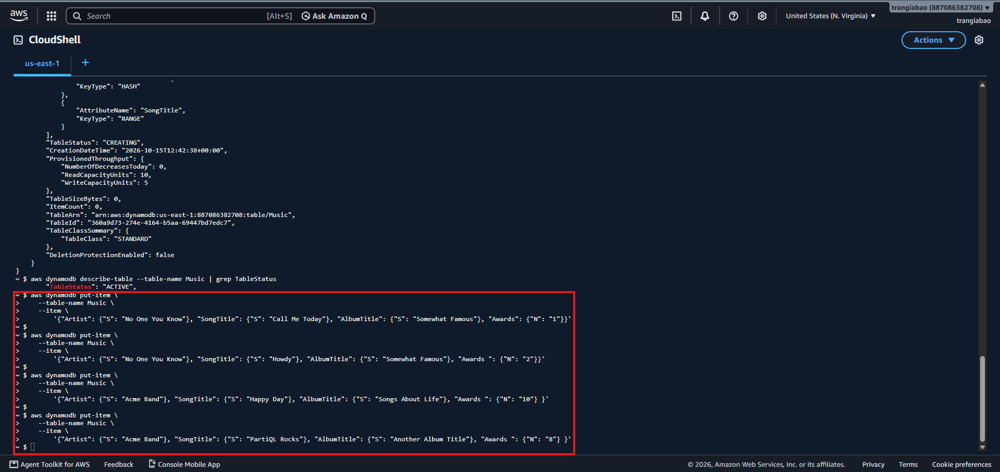

#### Step 16: Ingesting Additional Items for `Acme Band`
* **Action:** Repeated `put-item` commands for tracks `Happy Day` (Awards: 10, Album: `Songs About Life`) and `PartiQL Rocks` (Awards: 8, Album: `Another Album Title`).

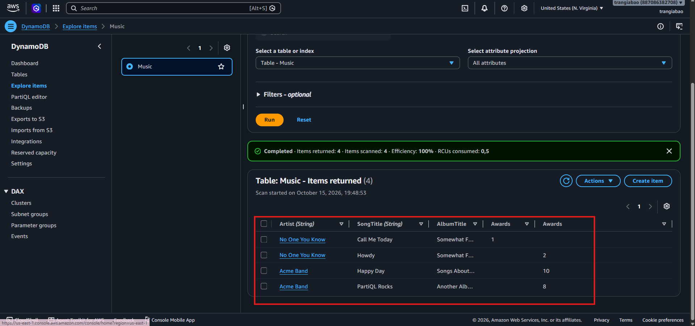

#### Step 17: Fetching a Single Item via `get-item`
* **Execution Command:**
  ```bash
  aws dynamodb get-item \
      --table-name Music \
      --key '{
          "Artist": {"S": "Acme Band"},
          "SongTitle": {"S": "Happy Day"}
      }'
  ```

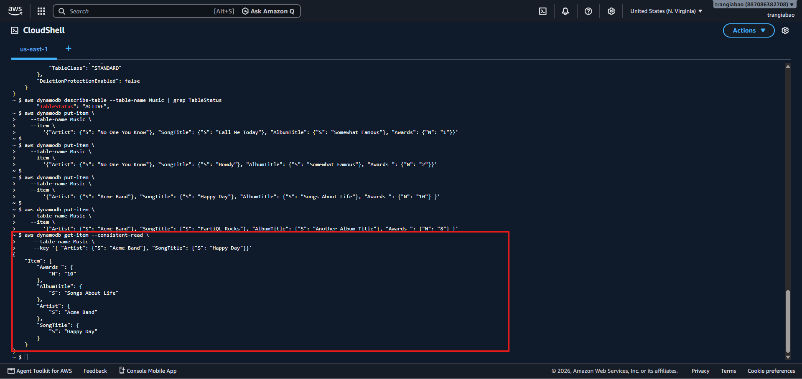

#### Step 18: Updating Attributes via `update-item`
* **Execution Command:**
  ```bash
  aws dynamodb update-item \
      --table-name Music \
      --key '{
          "Artist": {"S": "Acme Band"},
          "SongTitle": {"S": "Happy Day"}
      }' \
      --update-expression "SET AlbumTitle = :a" \
      --expression-attribute-values '{":a": {"S": "Updated Album Title"}}' \
      --return-values ALL_NEW
  ```

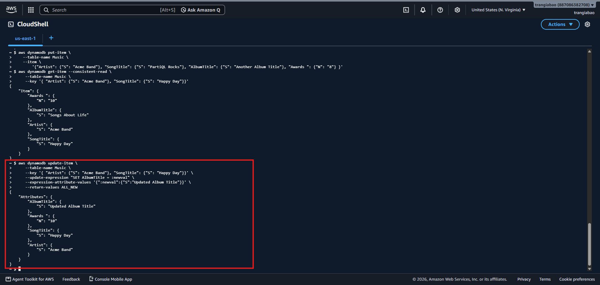

#### Step 19: Confirming Updated Attributes
* **Result:** Output returned `ReturnValues` indicating `AlbumTitle` was successfully updated to `"Updated Album Title"`.

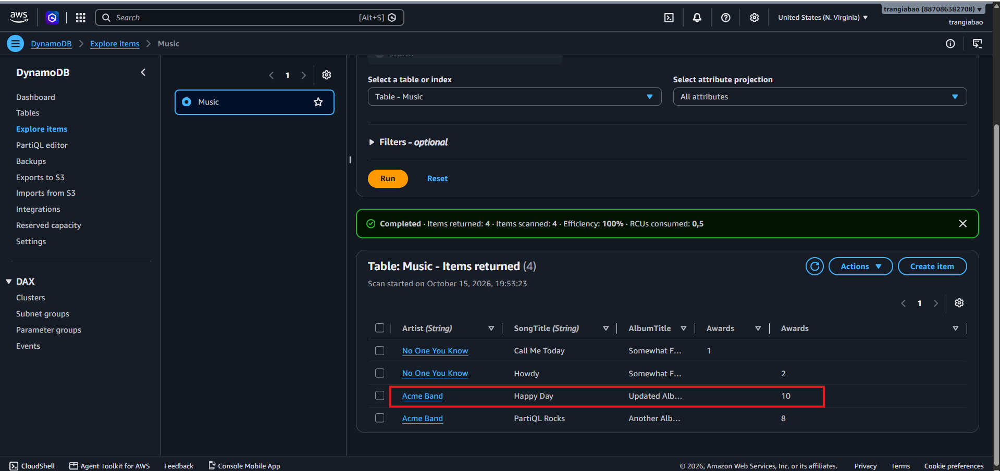

#### Step 20: Querying Items with `query`
* **Execution Command:**
  ```bash
  aws dynamodb query \
      --table-name Music \
      --key-condition-expression "Artist = :name" \
      --expression-attribute-values '{":name":{"S":"Acme Band"}}'
  ```

{}
💡 **Trouble 4 & Resolution - Hidden Zero-Width Unicode Characters (`\u200b`):**
* **Issue:** Command parsing failed with: `Error parsing parameter '--expression-attribute-values': Expected: '=', received: '' for input: {":name"...}`.
* **Root Cause:** Copying from the workshop web page pulled two invisible Zero-Width Space characters (`\u200b\u200b`) directly behind `--expression-attribute-values`, breaking CLI argument interpretation.
* **Resolution:** Stripped hidden unicode bytes and reconstructed with standard ASCII spaces.
{}

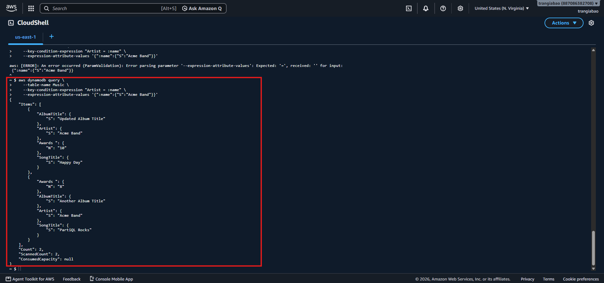

#### Step 21: Attaching a Global Secondary Index via `update-table`
* **Execution Command:**
  ```bash
  aws dynamodb update-table \
      --table-name Music \
      --attribute-definitions AttributeName=AlbumTitle,AttributeType=S \
      --global-secondary-index-updates \
          "[{\"Create\":{\"IndexName\": \"AlbumTitle-index\",\"KeySchema\":[{\"AttributeName\":\"AlbumTitle\",\"KeyType\": \"HASH\"}], \
          \"ProvisionedThroughput\": {\"ReadCapacityUnits\": 10, \"WriteCapacityUnits\": 5 },\"Projection\":{\"ProjectionType\":\"ALL\"}}}]"
  ```

{}
💡 **Trouble 5 & Resolution - Terminal Pager Auto-Exit Behavior:**
* **Issue:** After execution, the terminal momentarily flashed JSON output and immediately exited back to the prompt `~ $`.
* **Root Cause:** AWS CLI pipes voluminous responses to the `less` pager by default. Pressing `q` or scrolling to EOF closes the pager. The underlying GSI provisioning continues normally in the background.
* **Resolution:** Executed `export AWS_PAGER=""` to disable the pager and print JSON directly to standard output.
{}

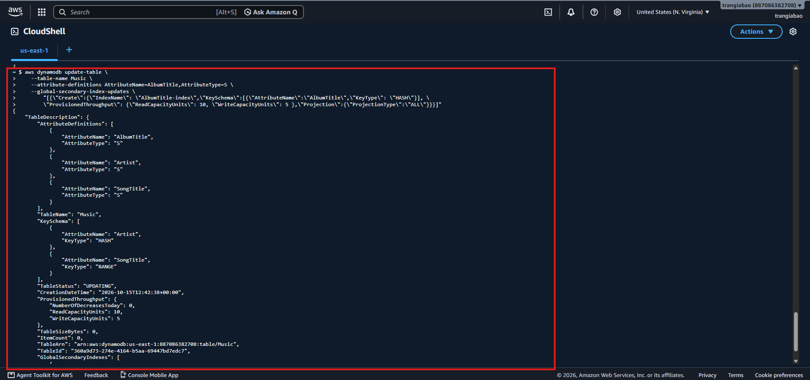

#### Step 22: Querying the GSI via `query`
* **Execution Command:**
  ```bash
  aws dynamodb query \
      --table-name Music \
      --index-name AlbumTitle-index \
      --key-condition-expression "AlbumTitle = :name" \
      --expression-attribute-values '{":name":{"S":"Somewhat Famous"}}'
  ```

{}
💡 **Trouble 6 & Resolution - Querying a Backfilling Index:**
* **Issue:** Threw: `ValidationException: Cannot read from backfilling global secondary index: AlbumTitle-index`.
* **Root Cause:** New GSIs created on populated tables undergo asynchronous data copying (Backfilling). Reads are disallowed while `IndexStatus` is `CREATING`.
* **Resolution:** Polled `describe-table` until `IndexStatus` transitioned to `ACTIVE` before re-issuing query.
{}

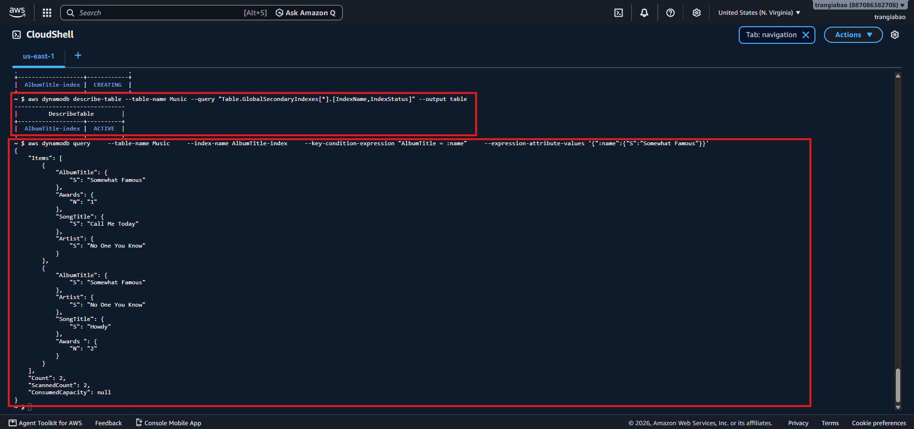

---

### 📋 Section 3: Programmatic Automation with Python SDK (Boto3)

#### Step 23: Setting up Python & Boto3 Environment on Windows
* **Action:** Open Command Prompt (`cmd.exe`), verify Python installation, install Boto3, and configure credentials:
  ```cmd
  python --version
  pip install boto3
  aws configure
  ```

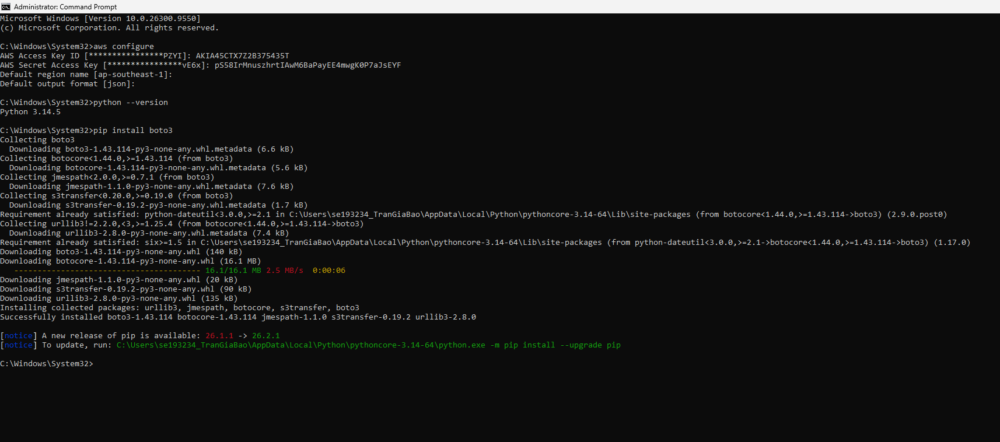

#### Step 24: Provisioning Table `Movies` with `MoviesCreateTable.py`
* **File:** `MoviesCreateTable.py`
* **Script Code:**
  ```python
  import boto3

  def create_movie_table(dynamodb=None):
      dynamodb = boto3.resource('dynamodb')
      table = dynamodb.create_table(
          TableName='Movies',
          KeySchema=[
              {'AttributeName': 'year', 'KeyType': 'HASH'},  # Partition key
              {'AttributeName': 'title', 'KeyType': 'RANGE'}  # Sort key
          ],
          AttributeDefinitions=[
              {'AttributeName': 'year', 'AttributeType': 'N'},
              {'AttributeName': 'title', 'AttributeType': 'S'}
          ],
          ProvisionedThroughput={
              'ReadCapacityUnits': 10,
              'WriteCapacityUnits': 10
          }
      )
      return table

  if __name__ == '__main__':
      movie_table = create_movie_table()
      print("Table status:", movie_table.table_status)
  ```
* **Execution:**
  ```cmd
  cd /d D:\AWS\template_AWS\fcj-workshop-template-main
  python MoviesCreateTable.py
  ```

{}
💡 **Trouble 7 & Resolution - Pasting Raw Python Code into Windows CMD:**
* **Issue:** Directly pasting Python statements into `cmd.exe` triggered multiple errors: `'import' is not recognized as an internal or external command`.
* **Root Cause:** Windows CMD is a command-line shell, not an interactive Python interpreter.
* **Resolution:** Saved source code into dedicated `.py` files and invoked them using `python <file>.py`.
{}

{}
💡 **Trouble 8 & Resolution - Default Working Directory at `System32`:**
* **Issue:** Execution yielded: `can't open file 'C:\Windows\System32\MoviesCreateTable.py': No such file or directory`.
* **Root Cause:** CMD opened inside protected system directories rather than the project workspace.
* **Resolution:** Changed working directory using: `cd /d D:\AWS\template_AWS\fcj-workshop-template-main`.
{}

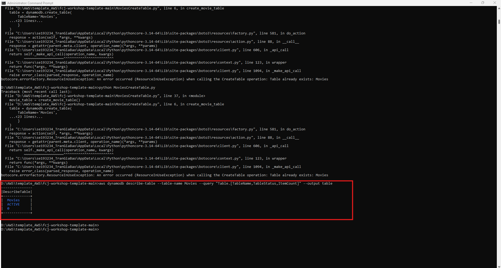

#### Step 25: Inserting Movies with `MoviesItemOps01.py`
* **File:** `MoviesItemOps01.py`
* **Script Code:**
  ```python
  from pprint import pprint
  import boto3

  def put_movie(title, year, plot, rating, dynamodb=None):
      dynamodb = boto3.resource('dynamodb')
      table = dynamodb.Table('Movies')
      response = table.put_item(
          Item={
              'year': year,
              'title': title,
              'info': {'plot': plot, 'rating': rating}
          }
      )
      return response

  if __name__ == '__main__':
      movie_resp = put_movie("The Big New Movie", 2015, "Nothing happens at all.", 0)
      print("Put movie succeeded:")
      pprint(movie_resp, sort_dicts=False)
  ```
* **Execution Command:**
  ```cmd
  python MoviesItemOps01.py
  ```
* **Result:** Returned HTTP 200 indicating successful write.

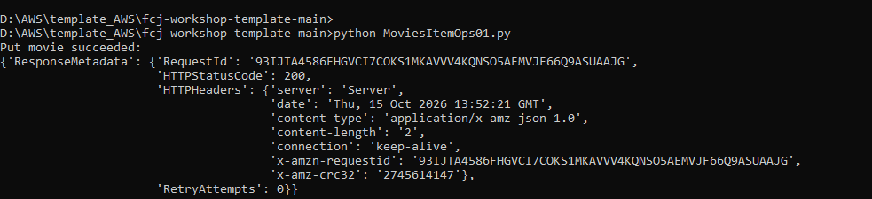

#### Step 26: Reading Stored Movies with `MoviesItemOps02.py`
* **File:** `MoviesItemOps02.py`
* **Script Code:**
  ```python
  from pprint import pprint
  import boto3
  from botocore.exceptions import ClientError

  def get_movie(title, year, dynamodb=None):
      dynamodb = boto3.resource('dynamodb')
      table = dynamodb.Table('Movies')
      try:
          response = table.get_item(Key={'year': year, 'title': title})
      except ClientError as e:
          print(e.response['Error']['Message'])
      else:
          return response['Item']

  if __name__ == '__main__':
      movie = get_movie("The Big New Movie", 2015)
      if movie:
          print("Get movie succeeded:")
          pprint(movie, sort_dicts=False)
  ```
* **Execution Command:**
  ```cmd
  python MoviesItemOps02.py
  ```

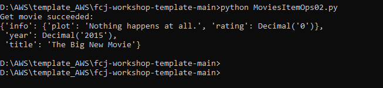

#### Step 27: Updating Records with `MoviesItemOps03.py`
* **File:** `MoviesItemOps03.py`
* **Script Code:**
  ```python
  from decimal import Decimal
  from pprint import pprint
  import boto3

  def update_movie(title, year, rating, plot, actors, dynamodb=None):
      dynamodb = boto3.resource('dynamodb')
      table = dynamodb.Table('Movies')
      response = table.update_item(
          Key={'year': year, 'title': title},
          UpdateExpression="set info.rating=:r, info.plot=:p, info.actors=:a",
          ExpressionAttributeValues={
              ':r': Decimal(str(rating)),
              ':p': plot,
              ':a': actors
          },
          ReturnValues="UPDATED_NEW"
      )
      return response

  if __name__ == '__main__':
      update_response = update_movie(
          "The Big New Movie", 2015, 5.5, "Everything happens all at once.",
          ["Larry", "Moe", "Curly"])
      print("Update movie succeeded:")
      pprint(update_response, sort_dicts=False)
  ```
* **Execution Command:**
  ```cmd
  python MoviesItemOps03.py
  ```

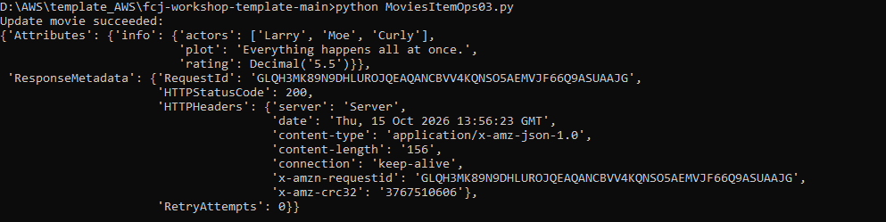

#### Step 28: Conditional Deletion with `MoviesItemOps04.py`
* **File:** `MoviesItemOps04.py`
* **Script Code:**
  ```python
  from decimal import Decimal
  from pprint import pprint
  import boto3
  from botocore.exceptions import ClientError

  def delete_underrated_movie(title, year, rating, dynamodb=None):
      dynamodb = boto3.resource('dynamodb')
      table = dynamodb.Table('Movies')
      try:
          response = table.delete_item(Key={'year': year, 'title': title})
      except ClientError as e:
          if e.response['Error']['Code'] == "ConditionalCheckFailedException":
              print(e.response['Error']['Message'])
          else:
              raise
      else:
          return response

  if __name__ == '__main__':
      print("Attempting a conditional delete...")
      delete_response = delete_underrated_movie("The Big New Movie", 2015, 5)
      if delete_response:
          print("Delete movie succeeded:")
          pprint(delete_response, sort_dicts=False)
  ```
* **Execution Command:**
  ```cmd
  python MoviesItemOps04.py
  ```

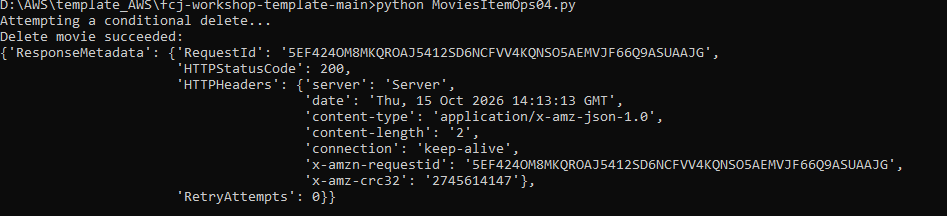

#### Step 29: Ingesting Bulk Dataset with `MoviesLoadData.py`
* **Dataset:** Extracted `moviedata.json` (3.7MB, 4,609 entries) from `moviedata.zip`.
* **File:** `MoviesLoadData.py`
* **Script Code:**
  ```python
  from decimal import Decimal
  import json
  import boto3

  def load_movies(movies, dynamodb=None):
      dynamodb = boto3.resource('dynamodb')
      table = dynamodb.Table('Movies')
      for movie in movies:
          year = int(movie['year'])
          title = movie['title']
          print("Adding movie:", year, title)
          table.put_item(Item=movie)

  if __name__ == '__main__':
      with open("moviedata.json") as json_file:
          movie_list = json.load(json_file, parse_float=Decimal)
      load_movies(movie_list)
  ```
* **Execution Command:**
  ```cmd
  python MoviesLoadData.py
  ```

{}
💡 **Trouble 9 & Resolution - Large Dataset Ingestion Throughput:**
* With 4,609 records, standard iterative `put_item` operations may take several minutes depending on provisioned WCU. Ingestion can be safely interrupted (`Ctrl + C`) after seeding sufficient benchmark data for query verification.
{}

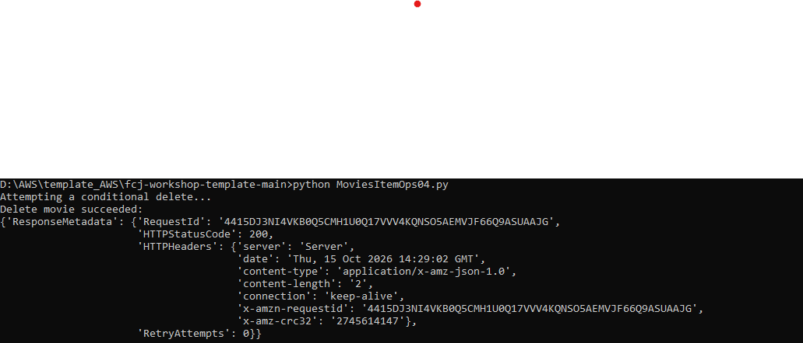

#### Step 30: Querying Released Movies for 1985 with `MoviesQuery01.py`
* **File:** `MoviesQuery01.py`
* **Script Code:**
  ```python
  import boto3
  from boto3.dynamodb.conditions import Key

  def query_movies(year, dynamodb=None):
      dynamodb = boto3.resource('dynamodb')
      table = dynamodb.Table('Movies')
      response = table.query(
          KeyConditionExpression=Key('year').eq(year)
      )
      return response['Items']

  if __name__ == '__main__':
      query_year = 1985
      print(f"Movies from {query_year}")
      movies = query_movies(query_year)
      for movie in movies:
          print(movie['year'], ":", movie['title'])
  ```
* **Execution Command:**
  ```cmd
  python MoviesQuery01.py
  ```
* **Output:** Fetched all 1985 classics including *Back to the Future*, *Rambo: First Blood Part II*, *Rocky IV*, *The Breakfast Club*...

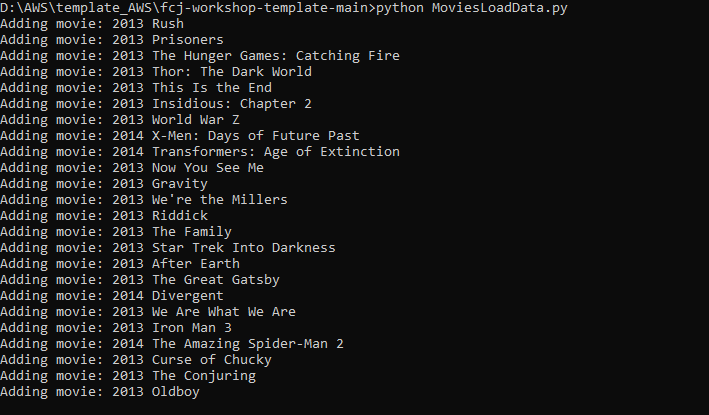

#### Step 31: Full Table Scan with Filters using `MoviesScan.py`
* **File:** `MoviesScan.py`
* **Script Code:**
  ```python
  from pprint import pprint
  import boto3
  from boto3.dynamodb.conditions import Key

  def scan_movies(year_range, display_movies, dynamodb=None):
      dynamodb = boto3.resource('dynamodb')
      table = dynamodb.Table('Movies')
      scan_kwargs = {
          'FilterExpression': Key('year').between(*year_range),
          'ProjectionExpression': "#yr, title, info.rating",
          'ExpressionAttributeNames': {"#yr": "year"}
      }
      done = False
      start_key = None
      while not done:
          if start_key:
              scan_kwargs['ExclusiveStartKey'] = start_key
          response = table.scan(**scan_kwargs)
          display_movies(response.get('Items', []))
          start_key = response.get('LastEvaluatedKey', None)
          done = start_key is None

  if __name__ == '__main__':
      def print_movies(movies):
          for movie in movies:
              print(f"\n{movie['year']} : {movie['title']}")
              pprint(movie['info'])

      query_range = (1950, 1959)
      print(f"Scanning for movies released from {query_range[0]} to {query_range[1]}...")
      scan_movies(query_range, print_movies)
  ```
* **Execution Command:**
  ```cmd
  python MoviesScan.py
  ```

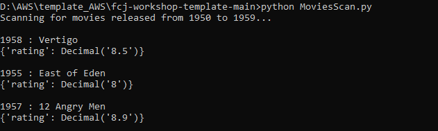

#### Step 32: Decommissioning the `Movies` Table with `MoviesDeleteTable.py`
* **File:** `MoviesDeleteTable.py`
* **Script Code:**
  ```python
  import boto3

  def delete_movie_table(dynamodb=None):
      dynamodb = boto3.resource('dynamodb')
      table = dynamodb.Table('Movies')
      table.delete()

  if __name__ == '__main__':
      delete_movie_table()
      print("Movies table deleted.")
  ```
* **Execution Command:**
  ```cmd
  python MoviesDeleteTable.py
  ```


---

### 📋 Section 4: Resource Cleanup & Summary of Troubles

{}
💡 **Trouble 10 & Resolution - Cross-Region Deletion Failure (`ResourceNotFoundException`):**
* **Issue:** CloudShell command `aws dynamodb delete-table --table-name Music` threw: `Requested resource not found: Table: Music not found`.
* **Root Cause:** Default CloudShell region pointed to `ap-southeast-1` (Singapore) whereas table `Music` was provisioned in `us-east-1` (N. Virginia), or was previously dropped via Web Console.
* **Resolution:** Target explicit region by appending `--region us-east-1`.
{}

---

### 💡 Summary Table of 10 Real-World Troubleshooting Cases:

| # | Technical Difficulty | Root Cause | Standardized Resolution |
| :---: | :--- | :--- | :--- |
| **1** | Flag parsing error `--provided-throughput` | Typographical error in upstream workshop documentation. | Replaced with standard AWS CLI flag: `--provisioned-throughput`. |
| **2** | `AccessDeniedException` on table creation | IAM User `AWS-FCAJ-DynamDB` lacked DynamoDB policies. | Attached managed policy `AmazonDynamoDBFullAccess` via IAM Console. |
| **3** | `ResourceInUseException: Table already exists` | Duplicate table `Music` already provisioned in same region. | Inspected via `describe-table` and reused existing active table. |
| **4** | `Expected: '=', received: ''` during query | Embedded zero-width space unicode characters (`\u200b`). | Stripped unicode bytes and applied clean ASCII command string. |
| **5** | Terminal prompt auto-exit after update | AWS CLI v2 automatically activates `less` pager for large JSON. | Pressed `q` to dismiss or ran `export AWS_PAGER=""` to disable pager. |
| **6** | `Cannot read from backfilling GSI` | Querying index while asynchronous data backfill is in flight. | Monitored `IndexStatus` via `describe-table` until reaching `ACTIVE`. |
| **7** | `'import' is not recognized` in Windows CMD | Directly pasting Python script statements into Windows shell. | Persisted code into dedicated `.py` files and invoked via `python <file>.py`. |
| **8** | `No such file or directory` at `System32` | CMD launched inside Windows system directory by default. | Shifted working directory: `cd /d D:\AWS\template_AWS\fcj-workshop-template-main`. |
| **9** | Slow ingestion of 4,609 sample records | Large JSON payload throttled by provisioned WCU limit. | Ingested sufficient benchmark partition records before running queries. |
| **10**| `Table: Music not found` on table deletion | Region mismatch between CLI configuration (`ap-southeast-1`) and table (`us-east-1`). | Appended explicit region parameter: `aws dynamodb delete-table --region us-east-1`. |
