{}
Bài thực hành **Làm việc với Amazon DynamoDB** được triển khai vào **Thứ 4 (14/10/2026)** thuộc khuôn khổ **Tuần 5**. Bài viết trình bày chi tiết quy trình thực tế qua 3 phương thức quản trị: Giao diện web AWS Console, Giao diện dòng lệnh AWS CloudShell, và Lập trình tự động hóa với Python SDK (Boto3).
<br>🔗 **Nguồn tài liệu thực hành:** [Work with Amazon DynamoDB (Workshop 000060)](https://000060.awsstudygroup.com/)
{}

### 🎯 Mục tiêu bài thực hành (Lab Objectives):
* Nắm vững kiến trúc NoSQL của **Amazon DynamoDB**, hiểu rõ cơ chế phân vùng với **Partition Key (HASH)**, khóa kết hợp **Composite Key (HASH + RANGE)** và các kiểu dữ liệu Scalar/Document.
* Thực hiện quản trị vòng đời bảng dữ liệu `Music` trên **AWS Management Console**: Tạo bảng, thêm item, cập nhật, truy vấn (Query/Scan), thiết lập và truy vấn **Global Secondary Index (GSI)** `AlbumTitle-index`.
* Khai thác sức mạnh dòng lệnh của **AWS CloudShell**: Cấu hình phân quyền IAM, tạo bảng CLI, thực hiện các thao tác CRUD dữ liệu (`put-item`, `get-item`, `update-item`, `query`), thêm GSI qua `update-table` và xử lý quá trình **Backfilling**.
* Làm chủ lập trình SDK trên môi trường Windows với **Python 3** và thư viện **Boto3**: Tự động hóa tạo bảng `Movies`, CRUD từng bản ghi, nạp hàng loạt dữ liệu mẫu từ file JSON (`moviedata.json` với 4.609 phim), truy vấn theo năm và quét bảng (Scan) có lọc điều kiện.
* Rèn luyện kỹ năng phân tích và khắc phục **10 sự cố kỹ thuật thực tế chuyên sâu**: Lỗi cú pháp tài liệu gốc, phân quyền IAM Policy, xung đột tài nguyên trùng lặp, ký tự ẩn Unicode `\u200b`, cơ chế Pager, lỗi Backfilling index, nhầm lẫn môi trường CMD/Python và lệch Region.

---

### 📊 Bảng tổng hợp thông số tài nguyên đã triển khai:

| Tài nguyên | Tên / Định danh | Thuộc tính & Khóa chính (Primary Key) | Throughput / Chế độ | Region | Mục đích sử dụng |
| :--- | :--- | :--- | :--- | :--- | :--- |
| **DynamoDB Table 1**| `Music` | Partition Key: `Artist` (S) <br>Sort Key: `SongTitle` (S) | Provisioned (RCU=10, WCU=5) | `us-east-1` | Thực hành Console & CloudShell CLI |
| **Secondary Index** | `AlbumTitle-index` | Partition Key: `AlbumTitle` (S) <br>Projection: `ALL` | Provisioned (RCU=10, WCU=5) | `us-east-1` | Global Secondary Index cho bảng `Music` |
| **DynamoDB Table 2**| `Movies` | Partition Key: `year` (N) <br>Sort Key: `title` (S) | Provisioned (RCU=10, WCU=10) | `ap-southeast-1` | Thực hành Python SDK (Boto3) |
| **IAM User** | `AWS-FCAJ-DynamDB` | Attached Policy: `AmazonDynamoDBFullAccess` | Programmatic Access (CLI) | Global | Tài khoản thực thi CLI & Python Boto3 |
| **Tập dữ liệu mẫu** | `moviedata.json` | 4.609 bản ghi phim (3.7 MB), định dạng JSON | Parse Float sang Decimal | Local | Dữ liệu kiểm thử Query & Scan nâng cao |
| **Môi trường SDK** | Windows Local | Python 3.14.5 + Boto3 1.43.114 | CLI Default: `ap-southeast-1` | Local | Môi trường lập trình máy trạm |

---

### 📋 Mục 1: Quản trị DynamoDB qua AWS Management Console

#### Bước 1: Tổng quan giao diện Amazon DynamoDB Console
* **Thao tác:** Đăng nhập AWS Management Console ➔ Tìm kiếm và chọn dịch vụ **DynamoDB**.
* **Mục đích:** Truy cập Dashboard trung tâm để theo dõi tổng thể dung lượng, số lượng bảng và các chỉ số hoạt động.

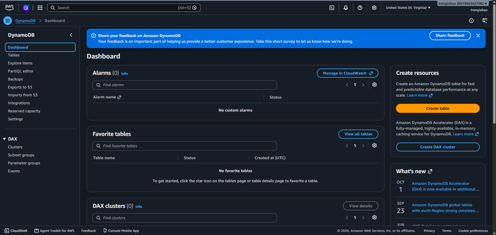

#### Bước 2: Tạo IAM Access Key cho tài khoản quản trị
* **Thao tác:** Mở dịch vụ **IAM** ➔ Vào menu **Users** ➔ Chọn người dùng `AWS-FCAJ-DynamDB` ➔ Tab **Security credentials** ➔ Nhấn **Create access key** ➔ Chọn **Command Line Interface (CLI)** ➔ Tải file `.csv` lưu trữ `Access Key ID` và `Secret Access Key`.
* **Mục đích:** Cấp thông tin định danh phục vụ kết nối bảo mật cho CloudShell và Python SDK sau này.

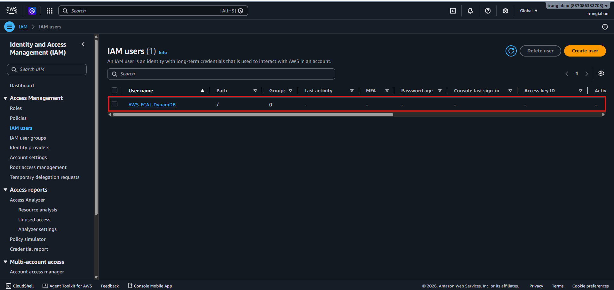

#### Bước 3: Khởi tạo bảng `Music` trên Web Console
* **Thao tác:** Quay lại DynamoDB Console ➔ Chọn **Tables** ở thanh bên trái ➔ Nhấn nút **Create table**.
* **Thông số điền chi tiết:**
  * **Table name:** `Music`
  * **Partition key:** `Artist` (Kiểu dữ liệu: **String**)
  * **Sort key:** `SongTitle` (Kiểu dữ liệu: **String**)
  * **Table settings:** Chọn **Default settings** (Chế độ Provisioned capacity, RCU=5, WCU=5, Default encryption).
* **Thao tác:** Nhấn nút **Create table** và chờ bảng chuyển sang trạng thái `Active`.

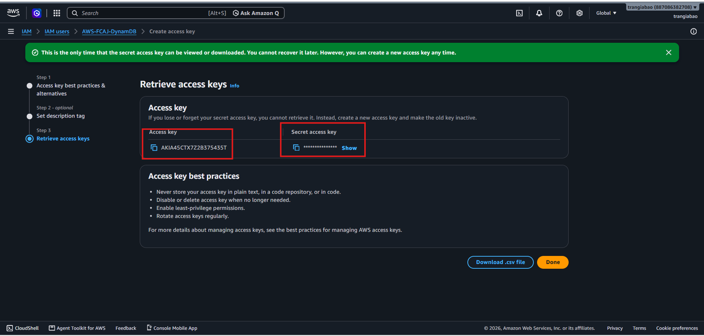

#### Bước 4: Ghi bản ghi đầu tiên vào bảng `Music`
* **Thao tác:** Chọn bảng **`Music`** trong danh sách ➔ Chọn tab hoặc nút **Explore items** ➔ Nhấn **Create item**.
* **Thông số nhập liệu:**
  * `Artist` (String): `No One You Know`
  * `SongTitle` (String): `Call Me Today`
  * Nhấn **Add new attribute** ➔ Chọn **String** ➔ Đặt tên `AlbumTitle` giá trị: `Somewhat Famous`
  * Nhấn **Add new attribute** ➔ Chọn **Number** ➔ Đặt tên `Awards` giá trị: `1`
* **Thao tác:** Nhấn **Create item** để lưu bản ghi vào cơ sở dữ liệu.

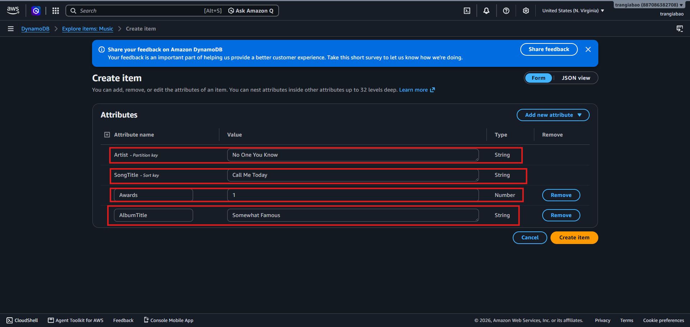

#### Bước 5: Xem và duyệt danh sách dữ liệu (Read Data)
* **Thao tác:** Trong giao diện **Explore items**, chọn bảng `Music` và nhấn **Run** với chế độ Scan để duyệt danh sách các mục đang có.
* **Kết quả:** Bảng hiển thị đầy đủ các thuộc tính của bài hát vừa thêm.

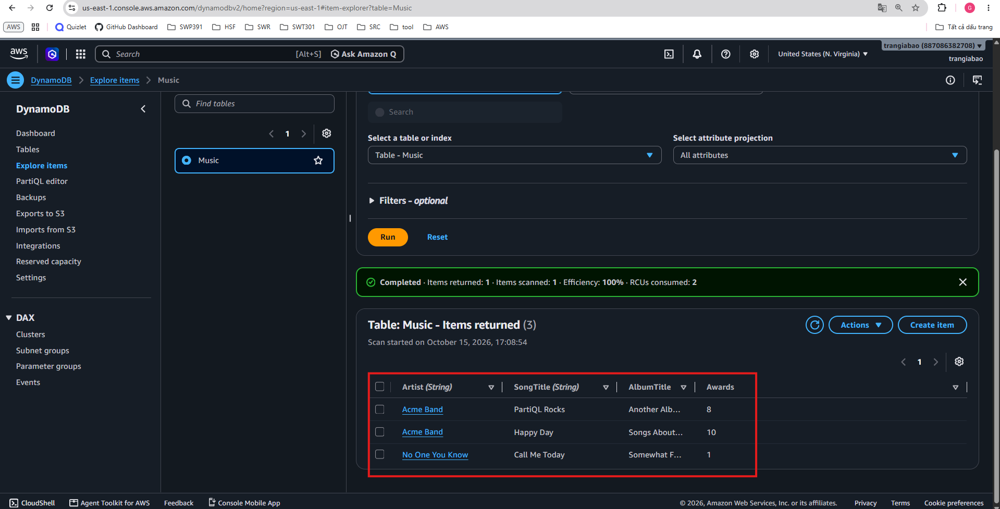

#### Bước 6: Kiểm tra chi tiết cấu trúc bản ghi
* **Thao tác:** Nhấp chuột trực tiếp vào dòng bản ghi `No One You Know` để mở trình xem chi tiết dạng bảng (Form) hoặc JSON View.

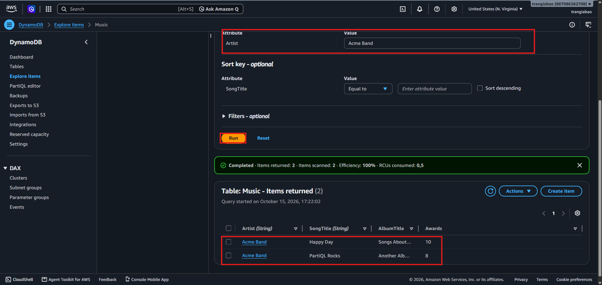

#### Bước 7: Cập nhật thông tin bản ghi (Update Data)
* **Thao tác:** Chọn bản ghi cần cập nhật ➔ Chỉnh sửa giá trị của trường thuộc tính (hoặc bổ sung thêm thuộc tính mới) ➔ Nhấn nút **Save changes**.

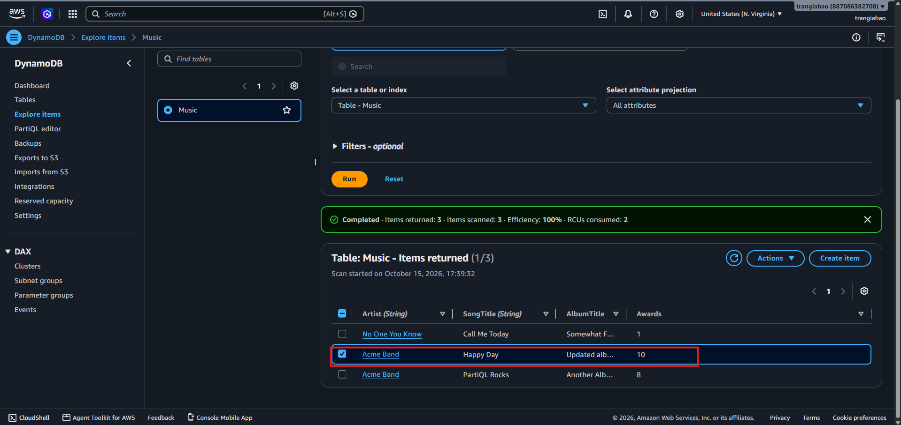

#### Bước 8: Truy vấn dữ liệu theo khóa chính (Query Data)
* **Thao tác:** Trong mục **Explore items**, chuyển từ chế độ *Scan* sang **Query**.
* **Thông số chọn:**
  * **Partition key (`Artist`):** Nhập `Acme Band`
  * **Sort key (`SongTitle`):** Có thể nhập điều kiện bắt đầu bằng hoặc để trống để lấy toàn bộ bài hát của ca sĩ này.
* **Kết quả:** Hệ thống chỉ duyệt trong phân vùng của `Acme Band` và trả về kết quả cực nhanh với chi phí đọc tối thiểu.

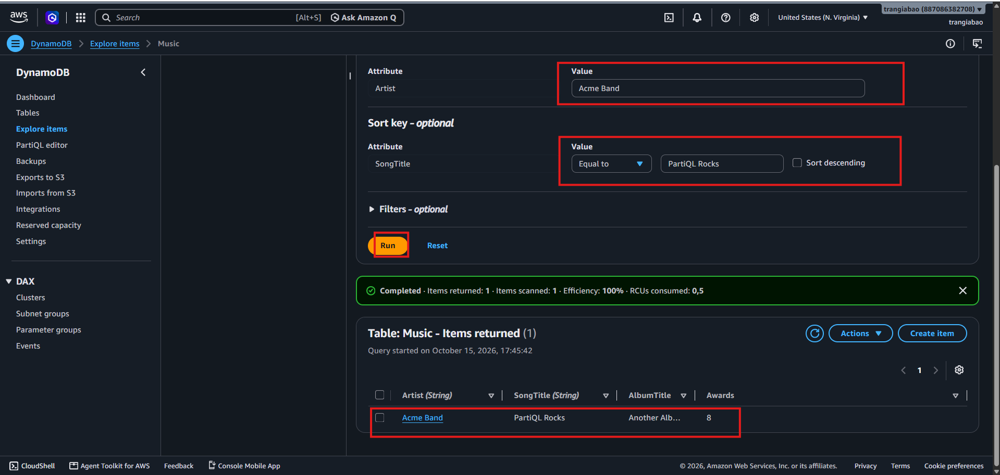

#### Bước 9: Tạo Global Secondary Index (GSI) `AlbumTitle-index`
* **Thao tác:** Vào bảng `Music` ➔ Chọn tab **Indexes** ➔ Nhấn nút **Create index**.
* **Thông số cấu hình:**
  * **Partition key:** `AlbumTitle` (Kiểu: **String**)
  * **Index name:** `AlbumTitle-index` (tự động điền)
  * **Attribute projections:** Chọn **All** (sao chép toàn bộ thuộc tính sang GSI)
* **Thao tác:** Nhấn **Create index**. Trạng thái GSI sẽ chuyển sang `Creating` và tự động thực hiện tiến trình **Backfilling** dữ liệu ngầm.

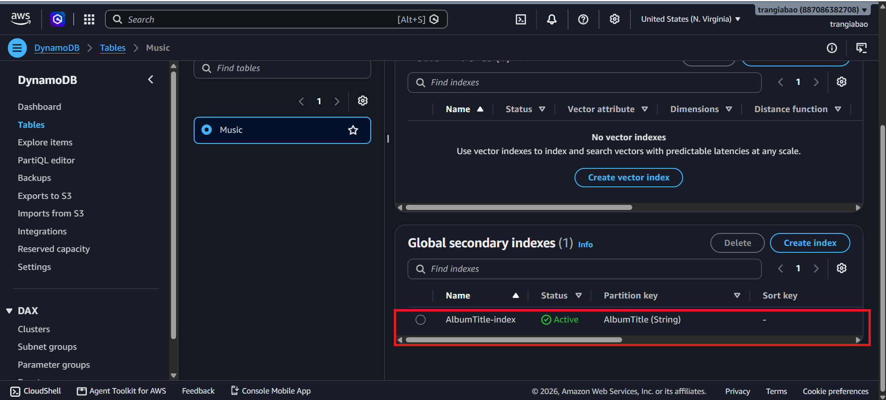

#### Bước 10: Truy vấn dữ liệu thông qua GSI
* **Thao tác:** Quay lại giao diện **Explore items** ➔ Chọn mục **Query** ➔ Tại ô *Select a table or index*, chọn **`AlbumTitle-index`**.
* **Thông số tìm kiếm:**
  * **Partition key (`AlbumTitle`):** Nhập `Somewhat Famous`
* **Kết quả:** Trả về bài hát thuộc album này mà không cần biết trước tên ca sĩ (`Artist`), chứng minh sức mạnh tra cứu đa chiều của GSI.

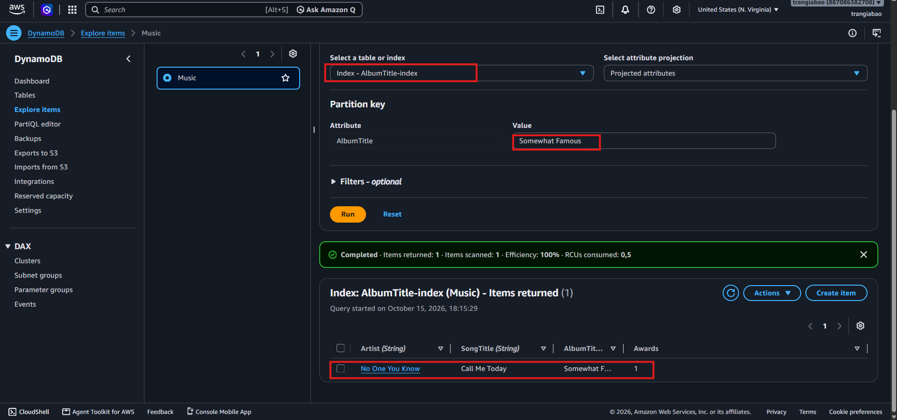

---

### 📋 Mục 2: Thao tác Dòng lệnh Quản trị qua AWS CloudShell

#### Bước 11: Khởi chạy môi trường AWS CloudShell
* **Thao tác:** Nhấp vào biểu tượng terminal **CloudShell** trên thanh điều hướng góc trên bên phải của AWS Console.
* **Mục đích:** Mở môi trường dòng lệnh Linux trực tiếp trên trình duyệt web, được cấu hình sẵn môi trường AWS CLI v2.

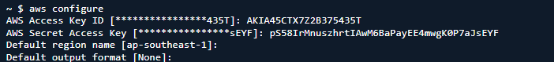

#### Bước 12: Cấu hình xác thực AWS CLI trên CloudShell
* **Lệnh thực thi:**
  ```bash
  aws configure
  ```
* **Thông số nhập:**
  * **AWS Access Key ID:** Nhập Access Key của IAM User `AWS-FCAJ-DynamDB`.
  * **AWS Secret Access Key:** Nhập Secret Key tương ứng.
  * **Default region name:** `us-east-1`
  * **Default output format:** `json`

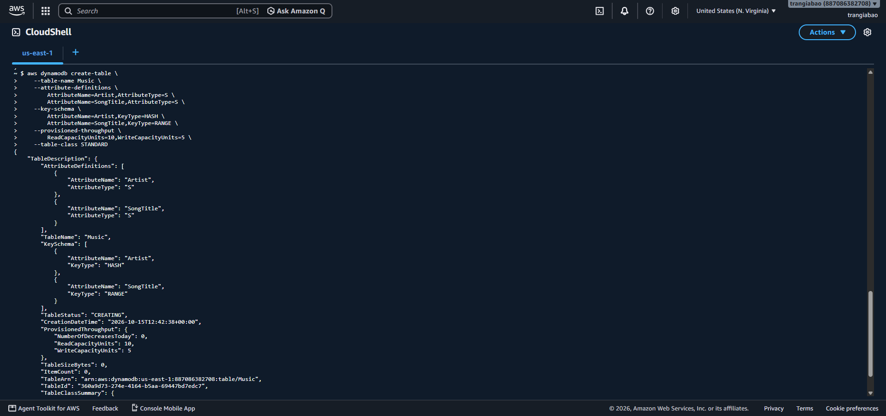

#### Bước 13: Tạo bảng `Music` bằng câu lệnh CLI
* **Lệnh thực thi:**
  ```bash
  aws dynamodb create-table \
      --table-name Music \
      --attribute-definitions \
          AttributeName=Artist,AttributeType=S \
          AttributeName=SongTitle,AttributeType=S \
      --key-schema \
          AttributeName=Artist,KeyType=HASH \
          AttributeName=SongTitle,KeyType=RANGE \
      --provisioned-throughput \
          ReadCapacityUnits=10,WriteCapacityUnits=5 \
      --table-class STANDARD
  ```

{}
💡 **Khó khăn 1 & Cách xử lý - Lỗi sai cú pháp cờ lệnh trong tài liệu Workshop gốc:**
* **Sự cố:** Tài liệu workshop ghi cờ cấu hình thông lượng là `--provided-throughput`, khiến lệnh bị văng: `aws: [ERROR]: Unknown options: --provided-throughput, ReadCapacityUnits=10,WriteCapacityUnits=5`.
* **Nguyên nhân:** Cú pháp chuẩn của AWS CLI v2 là `--provisioned-throughput` (từ khóa *Provisioned* mang nghĩa cung ứng trước).
* **Xử lý:** Sửa thành `--provisioned-throughput ReadCapacityUnits=10,WriteCapacityUnits=5` là lệnh thực thi chuẩn xác.
{}

{}
💡 **Khó khăn 2 & Cách xử lý - Lỗi thiếu quyền IAM User (`AccessDeniedException`):**
* **Sự cố:** Bị từ chối truy cập: `User: arn:aws:iam::.../AWS-FCAJ-DynamDB is not authorized to perform: dynamodb:CreateTable because no identity-based policy allows...`.
* **Nguyên nhân:** Người dùng IAM mới tạo Access Key nhưng chưa được quản trị viên gắn Policy quyền hạn.
* **Xử lý:** Vào IAM Console ➔ User `AWS-FCAJ-DynamDB` ➔ Gắn chính sách quyền hạn trực tiếp **`AmazonDynamoDBFullAccess`**.
{}

{}
💡 **Khó khăn 3 & Cách xử lý - Xung đột tài nguyên trùng lặp (`ResourceInUseException`):**
* **Sự cố:** Lệnh báo: `Table already exists: Music`.
* **Nguyên nhân:** Do ở Mục 1 (bước 3) ta đã tạo bảng `Music` trên Web Console trong cùng Region `us-east-1`. DynamoDB cấm tạo 2 bảng trùng tên trong 1 Region.
* **Xử lý:** Dùng lệnh `aws dynamodb describe-table --table-name Music` để kiểm tra bảng đã ở trạng thái `ACTIVE` và tiếp tục sử dụng để thực hành các bước sau.
{}

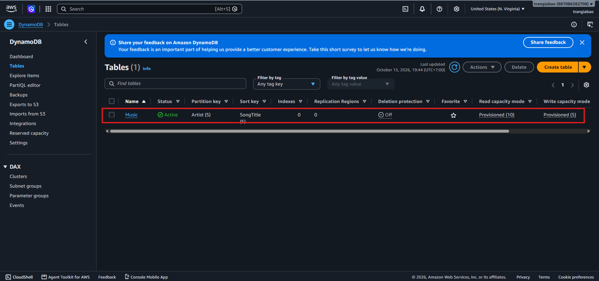

#### Bước 14: Kiểm tra trạng thái hoạt động của bảng
* **Lệnh thực thi:**
  ```bash
  aws dynamodb describe-table --table-name Music | grep TableStatus
  ```
* **Kết quả:** Trả về `"TableStatus": "ACTIVE"`, xác nhận bảng đã sẵn sàng tiếp nhận các thao tác đọc ghi.

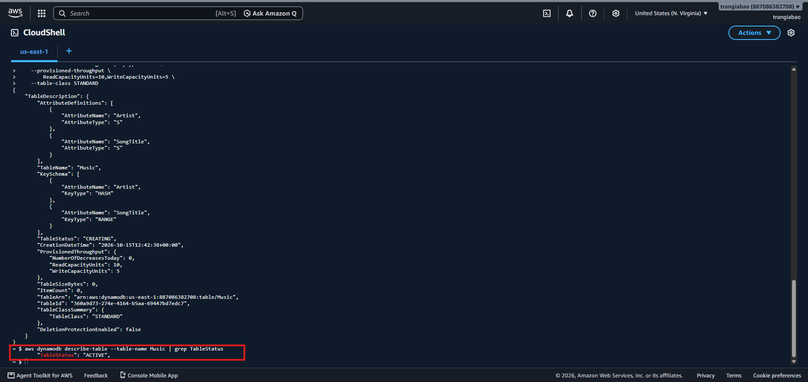

#### Bước 15: Thêm bản ghi mới bằng lệnh `put-item`
* **Lệnh thực thi:**
  ```bash
  aws dynamodb put-item \
      --table-name Music \
      --item '{
          "Artist": {"S": "No One You Know"},
          "SongTitle": {"S": "Call Me Today"},
          "AlbumTitle": {"S": "Somewhat Famous"},
          "Awards": {"N": "1"}
      }'
  ```

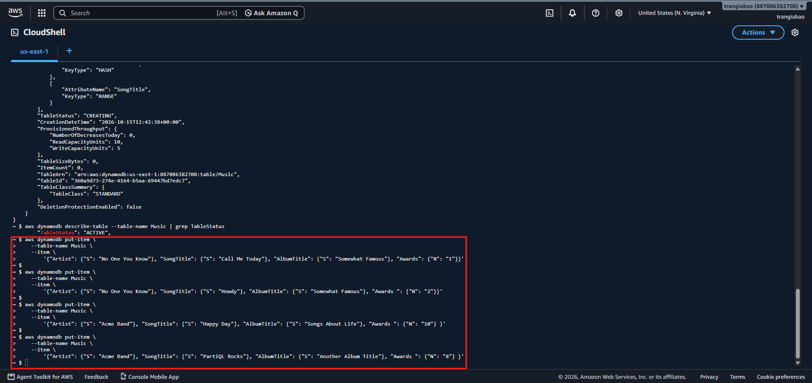

#### Bước 16: Thêm các bản ghi bổ sung cho ban nhạc `Acme Band`
* **Thao tác:** Lặp lại lệnh `put-item` để thêm bài hát `Happy Day` (Awards: 10, Album: `Songs About Life`) và bài hát `PartiQL Rocks` (Awards: 8, Album: `Another Album Title`).

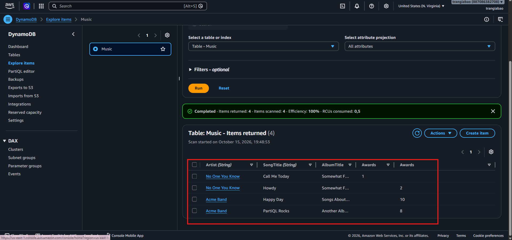

#### Bước 17: Đọc dữ liệu chi tiết bằng lệnh `get-item`
* **Lệnh thực thi:**
  ```bash
  aws dynamodb get-item \
      --table-name Music \
      --key '{
          "Artist": {"S": "Acme Band"},
          "SongTitle": {"S": "Happy Day"}
      }'
  ```
* **Kết quả:** Trả về khối JSON chứa toàn bộ thuộc tính của bản ghi được lưu trong bảng.

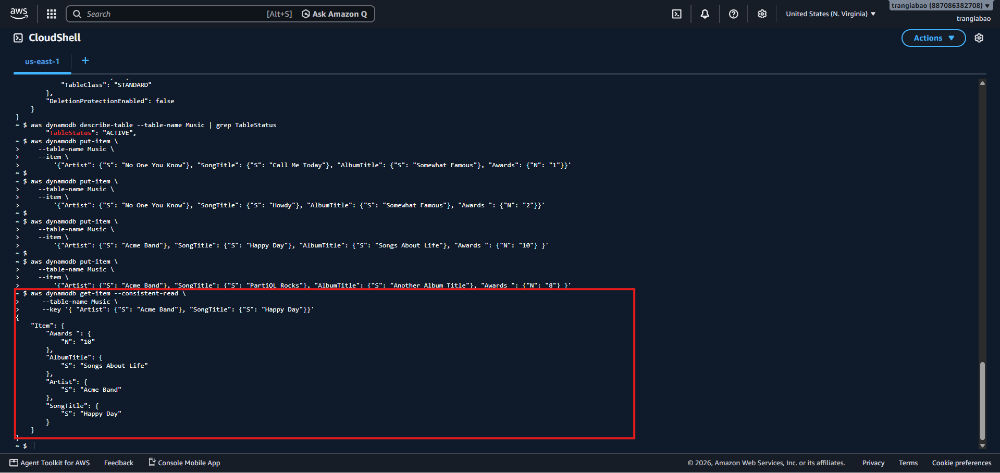

#### Bước 18: Cập nhật dữ liệu bằng lệnh `update-item`
* **Lệnh thực thi:**
  ```bash
  aws dynamodb update-item \
      --table-name Music \
      --key '{
          "Artist": {"S": "Acme Band"},
          "SongTitle": {"S": "Happy Day"}
      }' \
      --update-expression "SET AlbumTitle = :a" \
      --expression-attribute-values '{":a": {"S": "Updated Album Title"}}' \
      --return-values ALL_NEW
  ```

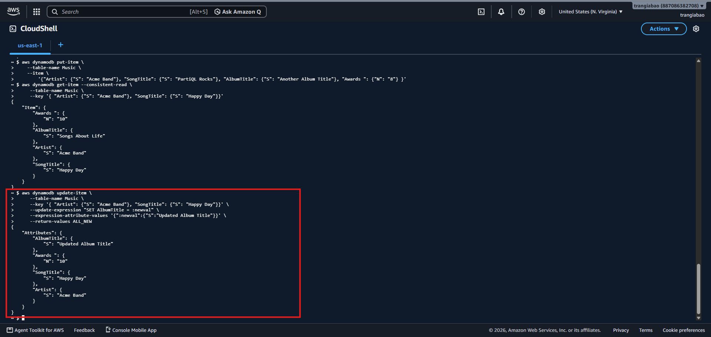

#### Bước 19: Kiểm tra lại thuộc tính vừa cập nhật
* **Kết quả:** `ReturnValues` trả về trường `AlbumTitle` mang giá trị mới là `"Updated Album Title"`.

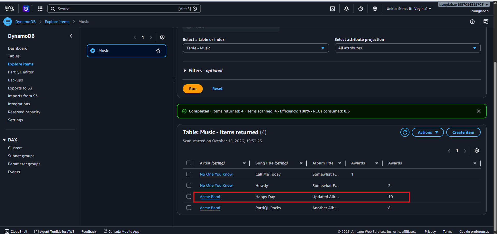

#### Bước 20: Truy vấn dữ liệu theo phân vùng bằng lệnh `query`
* **Lệnh thực thi chuẩn:**
  ```bash
  aws dynamodb query \
      --table-name Music \
      --key-condition-expression "Artist = :name" \
      --expression-attribute-values '{":name":{"S":"Acme Band"}}'
  ```

{}
💡 **Khó khăn 4 & Cách xử lý - Lỗi ký tự ẩn Zero-Width Space Unicode (`\u200b`):**
* **Sự cố:** Chạy lệnh bị báo lỗi phân tích cú pháp khó hiểu: `Error parsing parameter '--expression-attribute-values': Expected: '=', received: '' for input: {":name"...}`.
* **Nguyên nhân:** Khi sao chép lệnh từ tài liệu HTML của Workshop, đoạn text chứa 2 ký tự khoảng trắng tàng hình Unicode `\u200b\u200b` ngay sau `--expression-attribute-values`. AWS CLI không nhận diện được dấu cách này nên coi chuỗi JSON là tham số lỗi.
* **Xử lý:** Lọc sạch toàn bộ ký tự rác, gõ lại dấu cách chuẩn ASCII trên bàn phím là lệnh thực thi trơn tru.
{}

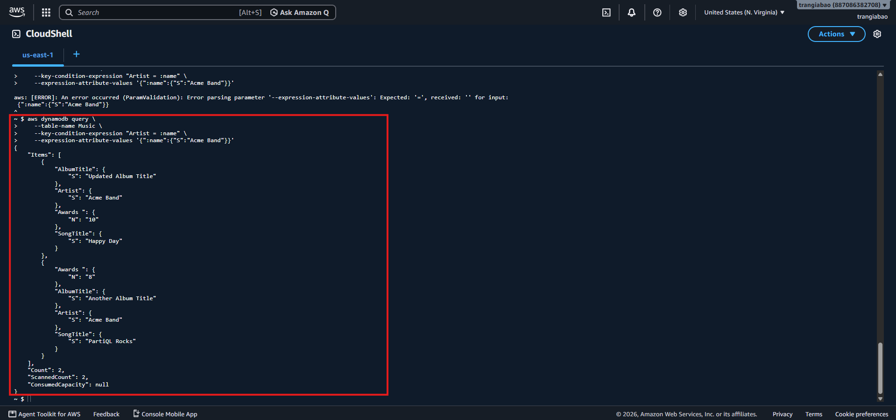

#### Bước 21: Tạo Global Secondary Index (GSI) bằng lệnh `update-table`
* **Lệnh thực thi:**
  ```bash
  aws dynamodb update-table \
      --table-name Music \
      --attribute-definitions AttributeName=AlbumTitle,AttributeType=S \
      --global-secondary-index-updates \
          "[{\"Create\":{\"IndexName\": \"AlbumTitle-index\",\"KeySchema\":[{\"AttributeName\":\"AlbumTitle\",\"KeyType\": \"HASH\"}], \
          \"ProvisionedThroughput\": {\"ReadCapacityUnits\": 10, \"WriteCapacityUnits\": 5 },\"Projection\":{\"ProjectionType\":\"ALL\"}}}]"
  ```

{}
💡 **Khó khăn 5 & Cách xử lý - Hiện tượng màn hình tự out ra dòng lệnh:**
* **Sự cố:** Sau khi chạy lệnh `update-table`, terminal hiển thị một trang JSON rồi tự động văng ra dấu nhắc lệnh `~ $`.
* **Nguyên nhân:** Do kết quả JSON quá dài, AWS CLI tự động chuyển qua trình đọc trang (pager `less`). Khi người dùng chạm nút `q` hoặc cuộn hết trang thì pager tự đóng. Lệnh thực chất đã chạy thành công.
* **Xử lý:** Chạy `export AWS_PAGER=""` để tắt pager, in thẳng kết quả ra màn hình.
{}

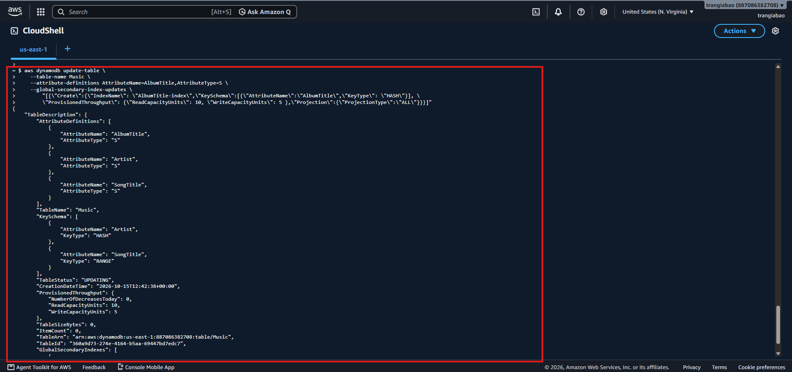

#### Bước 22: Truy vấn dữ liệu thông qua GSI bằng lệnh `query`
* **Lệnh thực thi:**
  ```bash
  aws dynamodb query \
      --table-name Music \
      --index-name AlbumTitle-index \
      --key-condition-expression "AlbumTitle = :name" \
      --expression-attribute-values '{":name":{"S":"Somewhat Famous"}}'
  ```

{}
💡 **Khó khăn 6 & Cách xử lý - Lỗi truy vấn khi GSI đang trong tiến trình Backfilling:**
* **Sự cố:** Bị từ chối truy vấn: `ValidationException: Cannot read from backfilling global secondary index: AlbumTitle-index`.
* **Nguyên nhân:** Khi tạo mới GSI trên bảng đã có dữ liệu, DynamoDB phải mất từ 1-2 phút để sao chép dữ liệu ngầm (Backfilling). Trong thời gian này `IndexStatus` mang giá trị `CREATING` và cấm truy vấn đọc.
* **Xử lý:** Chạy lệnh `aws dynamodb describe-table --table-name Music --query "Table.GlobalSecondaryIndexes[*].[IndexName,IndexStatus]"` để theo dõi. Chờ khoảng 1 phút đến khi chuyển sang `ACTIVE` mới chạy lại lệnh query.
{}

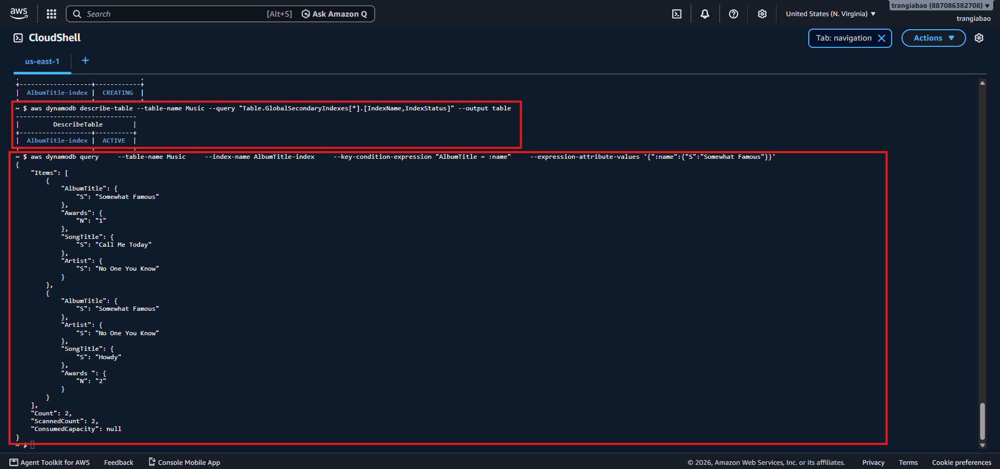

---

### 📋 Mục 3: Lập trình Tự động hóa với Python SDK (Boto3)

#### Bước 23: Thiết lập môi trường Python & Boto3 trên máy trạm Windows
* **Thao tác:** Mở cửa sổ **Command Prompt (CMD)** trên Windows và kiểm tra phiên bản Python, sau đó cài đặt thư viện AWS SDK:
  ```cmd
  python --version
  pip install boto3
  aws configure
  ```
* **Thông số cấu hình:**
  * **AWS Access Key ID:** Điền Access Key của IAM User `AWS-FCAJ-DynamDB`.
  * **AWS Secret Access Key:** Điền Secret Key tương ứng.
  * **Default region name:** `ap-southeast-1`
  * **Default output format:** `json`

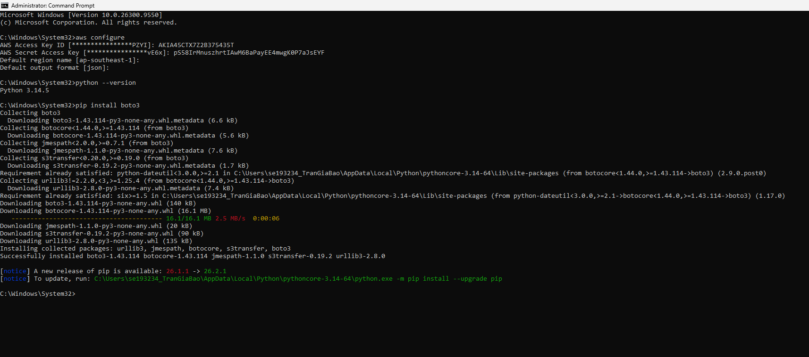

#### Bước 24: Khởi tạo bảng `Movies` với `MoviesCreateTable.py`
* **Tạo file:** `MoviesCreateTable.py`
* **Mã nguồn:**
  ```python
  import boto3

  def create_movie_table(dynamodb=None):
      dynamodb = boto3.resource('dynamodb')
      table = dynamodb.create_table(
          TableName='Movies',
          KeySchema=[
              {'AttributeName': 'year', 'KeyType': 'HASH'},  # Partition key
              {'AttributeName': 'title', 'KeyType': 'RANGE'}  # Sort key
          ],
          AttributeDefinitions=[
              {'AttributeName': 'year', 'AttributeType': 'N'},
              {'AttributeName': 'title', 'AttributeType': 'S'}
          ],
          ProvisionedThroughput={
              'ReadCapacityUnits': 10,
              'WriteCapacityUnits': 10
          }
      )
      return table

  if __name__ == '__main__':
      movie_table = create_movie_table()
      print("Table status:", movie_table.table_status)
  ```
* **Lệnh thực thi:**
  ```cmd
  cd /d D:\AWS\template_AWS\fcj-workshop-template-main
  python MoviesCreateTable.py
  ```

{}
💡 **Khó khăn 7 & Cách xử lý - Lỗi dán nhầm code Python vào CMD Windows:**
* **Sự cố:** Dán trực tiếp các dòng mã Python vào màn hình CMD dẫn đến một loạt thông báo `'import' is not recognized as an internal or external command`.
* **Nguyên nhân:** CMD là shell Windows chỉ nhận lệnh hệ thống, không hiểu cú pháp ngôn ngữ lập trình Python.
* **Xử lý:** Lưu code vào file `.py` riêng biệt rồi gọi thực thi qua lệnh `python <ten_file>.py`.
{}

{}
💡 **Khó khăn 8 & Cách xử lý - Lỗi đường dẫn thư mục hệ thống `System32`:**
* **Sự cố:** Khi chạy lệnh bị lỗi: `can't open file 'C:\Windows\System32\MoviesCreateTable.py': No such file or directory`.
* **Nguyên nhân:** Mặc định CMD mở tại thư mục hệ thống Windows, file python thực tế nằm ở thư mục dự án khác.
* **Xử lý:** Dùng lệnh chuyển ổ đĩa và thư mục: `cd /d D:\AWS\template_AWS\fcj-workshop-template-main`.
{}

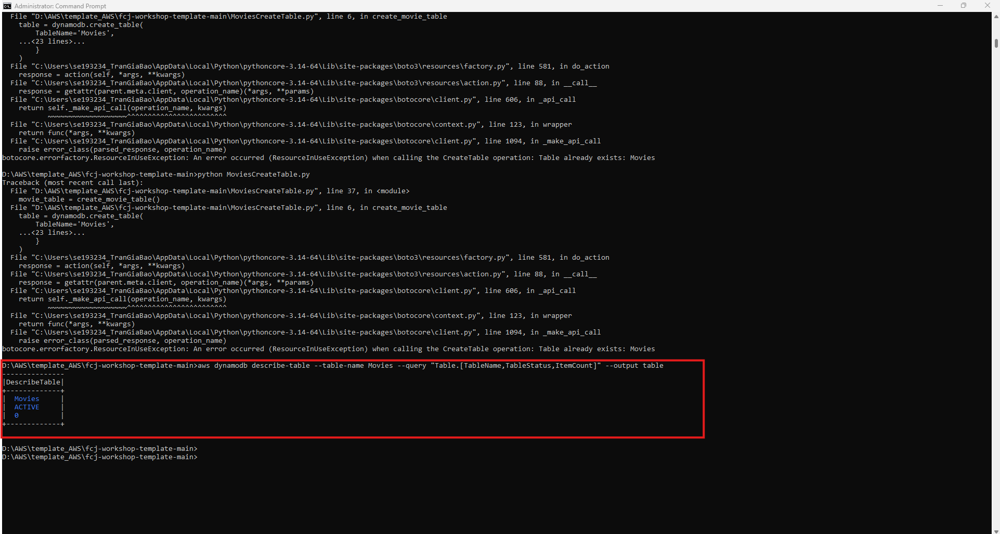

#### Bước 25: Thêm phim mới vào bảng với `MoviesItemOps01.py`
* **Tạo file:** `MoviesItemOps01.py`
* **Mã nguồn:**
  ```python
  from pprint import pprint
  import boto3

  def put_movie(title, year, plot, rating, dynamodb=None):
      dynamodb = boto3.resource('dynamodb')
      table = dynamodb.Table('Movies')
      response = table.put_item(
          Item={
              'year': year,
              'title': title,
              'info': {'plot': plot, 'rating': rating}
          }
      )
      return response

  if __name__ == '__main__':
      movie_resp = put_movie("The Big New Movie", 2015, "Nothing happens at all.", 0)
      print("Put movie succeeded:")
      pprint(movie_resp, sort_dicts=False)
  ```
* **Lệnh thực thi:**
  ```cmd
  python MoviesItemOps01.py
  ```
* **Kết quả:** Trả về `'HTTPStatusCode': 200`, xác nhận bộ phim đã được lưu thành công.

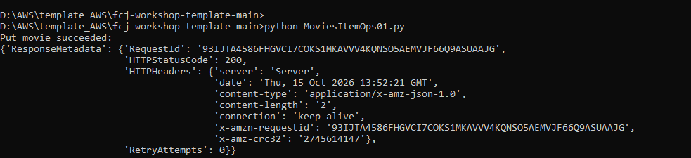

#### Bước 26: Đọc dữ liệu phim với `MoviesItemOps02.py`
* **Tạo file:** `MoviesItemOps02.py`
* **Mã nguồn:**
  ```python
  from pprint import pprint
  import boto3
  from botocore.exceptions import ClientError

  def get_movie(title, year, dynamodb=None):
      dynamodb = boto3.resource('dynamodb')
      table = dynamodb.Table('Movies')
      try:
          response = table.get_item(Key={'year': year, 'title': title})
      except ClientError as e:
          print(e.response['Error']['Message'])
      else:
          return response['Item']

  if __name__ == '__main__':
      movie = get_movie("The Big New Movie", 2015)
      if movie:
          print("Get movie succeeded:")
          pprint(movie, sort_dicts=False)
  ```
* **Lệnh thực thi:**
  ```cmd
  python MoviesItemOps02.py
  ```

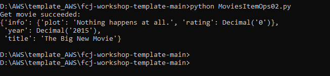

#### Bước 27: Cập nhật thông tin và điểm số với `MoviesItemOps03.py`
* **Tạo file:** `MoviesItemOps03.py`
* **Mã nguồn:**
  ```python
  from decimal import Decimal
  from pprint import pprint
  import boto3

  def update_movie(title, year, rating, plot, actors, dynamodb=None):
      dynamodb = boto3.resource('dynamodb')
      table = dynamodb.Table('Movies')
      response = table.update_item(
          Key={'year': year, 'title': title},
          UpdateExpression="set info.rating=:r, info.plot=:p, info.actors=:a",
          ExpressionAttributeValues={
              ':r': Decimal(str(rating)),
              ':p': plot,
              ':a': actors
          },
          ReturnValues="UPDATED_NEW"
      )
      return response

  if __name__ == '__main__':
      update_response = update_movie(
          "The Big New Movie", 2015, 5.5, "Everything happens all at once.",
          ["Larry", "Moe", "Curly"])
      print("Update movie succeeded:")
      pprint(update_response, sort_dicts=False)
  ```
* **Lệnh thực thi:**
  ```cmd
  python MoviesItemOps03.py
  ```

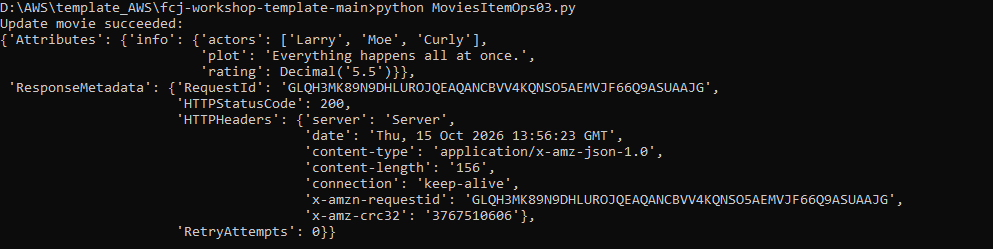

#### Bước 28: Xóa bản ghi phim với `MoviesItemOps04.py`
* **Tạo file:** `MoviesItemOps04.py`
* **Mã nguồn:**
  ```python
  from decimal import Decimal
  from pprint import pprint
  import boto3
  from botocore.exceptions import ClientError

  def delete_underrated_movie(title, year, rating, dynamodb=None):
      dynamodb = boto3.resource('dynamodb')
      table = dynamodb.Table('Movies')
      try:
          response = table.delete_item(Key={'year': year, 'title': title})
      except ClientError as e:
          if e.response['Error']['Code'] == "ConditionalCheckFailedException":
              print(e.response['Error']['Message'])
          else:
              raise
      else:
          return response

  if __name__ == '__main__':
      print("Attempting a conditional delete...")
      delete_response = delete_underrated_movie("The Big New Movie", 2015, 5)
      if delete_response:
          print("Delete movie succeeded:")
          pprint(delete_response, sort_dicts=False)
  ```
* **Lệnh thực thi:**
  ```cmd
  python MoviesItemOps04.py
  ```

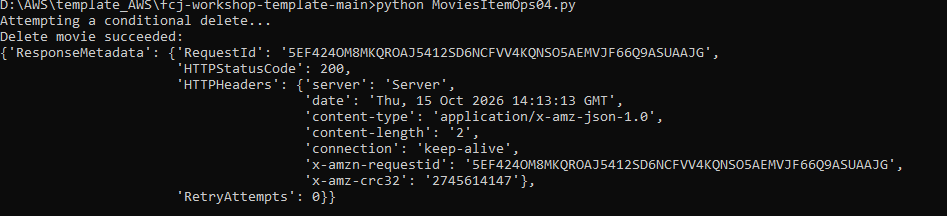

#### Bước 29: Nạp hàng loạt dữ liệu mẫu từ JSON với `MoviesLoadData.py`
* **Chuẩn bị dữ liệu:** Tải file `moviedata.zip` từ GitHub FCJ Sample, giải nén thu được file `moviedata.json` dung lượng 3.7MB gồm 4.609 bộ phim.
* **Tạo file:** `MoviesLoadData.py`
* **Mã nguồn:**
  ```python
  from decimal import Decimal
  import json
  import boto3

  def load_movies(movies, dynamodb=None):
      dynamodb = boto3.resource('dynamodb')
      table = dynamodb.Table('Movies')
      for movie in movies:
          year = int(movie['year'])
          title = movie['title']
          print("Adding movie:", year, title)
          table.put_item(Item=movie)

  if __name__ == '__main__':
      with open("moviedata.json") as json_file:
          movie_list = json.load(json_file, parse_float=Decimal)
      load_movies(movie_list)
  ```
* **Lệnh thực thi:**
  ```cmd
  python MoviesLoadData.py
  ```

{}
💡 **Khó khăn 9 & Cách xử lý - Quản lý file dữ liệu mẫu dung lượng lớn:**
* Tập dữ liệu `moviedata.json` có tới 4.609 phim. Khi nạp qua mạng Internet sẽ mất từ 3-5 phút tùy thuộc vào thông lượng WCU đã ấn định. Ta có thể cho script nạp một số lượng bản ghi nhất định rồi tiếp tục kiểm thử truy vấn mà không nhất thiết phải chờ hết toàn bộ danh sách.
{}

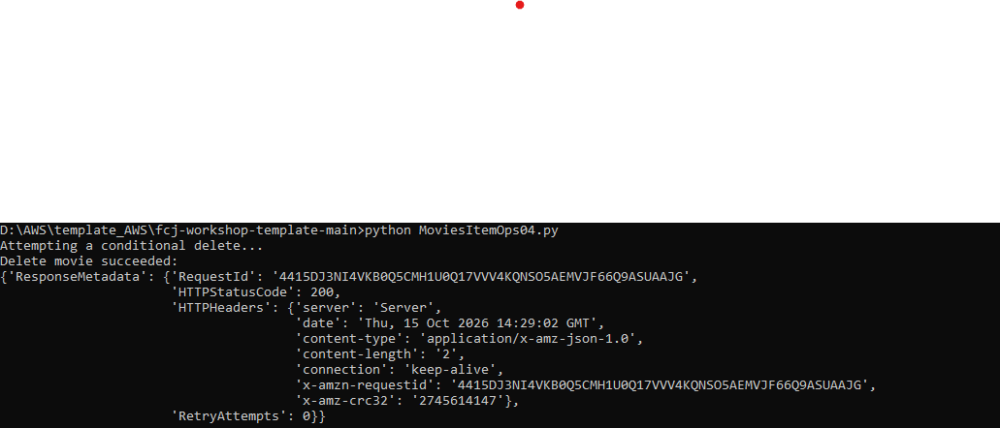

#### Bước 30: Truy vấn các phim sản xuất năm 1985 với `MoviesQuery01.py`
* **Tạo file:** `MoviesQuery01.py`
* **Mã nguồn:**
  ```python
  import boto3
  from boto3.dynamodb.conditions import Key

  def query_movies(year, dynamodb=None):
      dynamodb = boto3.resource('dynamodb')
      table = dynamodb.Table('Movies')
      response = table.query(
          KeyConditionExpression=Key('year').eq(year)
      )
      return response['Items']

  if __name__ == '__main__':
      query_year = 1985
      print(f"Movies from {query_year}")
      movies = query_movies(query_year)
      for movie in movies:
          print(movie['year'], ":", movie['title'])
  ```
* **Lệnh thực thi:**
  ```cmd
  python MoviesQuery01.py
  ```
* **Kết quả:** Trả về hàng chục bộ phim kinh điển năm 1985 như *Back to the Future*, *Rambo: First Blood Part II*, *Rocky IV*, *The Breakfast Club*...

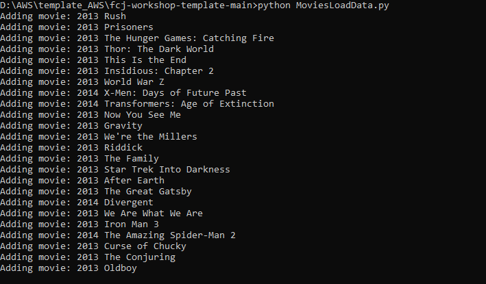

#### Bước 31: Quét toàn bảng (Scan) có lọc điều kiện với `MoviesScan.py`
* **Tạo file:** `MoviesScan.py`
* **Mã nguồn:**
  ```python
  from pprint import pprint
  import boto3
  from boto3.dynamodb.conditions import Key

  def scan_movies(year_range, display_movies, dynamodb=None):
      dynamodb = boto3.resource('dynamodb')
      table = dynamodb.Table('Movies')
      scan_kwargs = {
          'FilterExpression': Key('year').between(*year_range),
          'ProjectionExpression': "#yr, title, info.rating",
          'ExpressionAttributeNames': {"#yr": "year"}
      }
      done = False
      start_key = None
      while not done:
          if start_key:
              scan_kwargs['ExclusiveStartKey'] = start_key
          response = table.scan(**scan_kwargs)
          display_movies(response.get('Items', []))
          start_key = response.get('LastEvaluatedKey', None)
          done = start_key is None

  if __name__ == '__main__':
      def print_movies(movies):
          for movie in movies:
              print(f"\n{movie['year']} : {movie['title']}")
              pprint(movie['info'])

      query_range = (1950, 1959)
      print(f"Scanning for movies released from {query_range[0]} to {query_range[1]}...")
      scan_movies(query_range, print_movies)
  ```
* **Lệnh thực thi:**
  ```cmd
  python MoviesScan.py
  ```

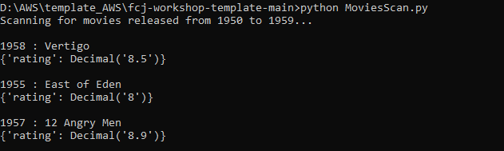

#### Bước 32: Dọn dẹp và hủy bảng `Movies` với `MoviesDeleteTable.py`
* **Tạo file:** `MoviesDeleteTable.py`
* **Mã nguồn:**
  ```python
  import boto3

  def delete_movie_table(dynamodb=None):
      dynamodb = boto3.resource('dynamodb')
      table = dynamodb.Table('Movies')
      table.delete()

  if __name__ == '__main__':
      delete_movie_table()
      print("Movies table deleted.")
  ```
* **Lệnh thực thi:**
  ```cmd
  python MoviesDeleteTable.py
  ```
* **Kết quả:** In ra `Movies table deleted.` xác nhận bảng đã được gửi yêu cầu hủy thành công.

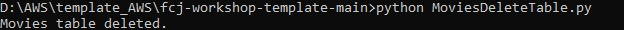

---

### 📋 Mục 4: Dọn dẹp tài nguyên & Tổng kết Khó khăn

{}
💡 **Khó khăn 10 & Cách xử lý - Lỗi lệch Region khi xóa bảng (`ResourceNotFoundException`):**
* **Sự cố:** Chạy lệnh `aws dynamodb delete-table --table-name Music` trên CloudShell bị văng lỗi: `Requested resource not found: Table: Music not found`.
* **Nguyên nhân:** CloudShell đang dùng Region mặc định `ap-southeast-1` trong khi bảng `Music` ban đầu được khởi tạo ở `us-east-1` (Bắc Virginia), hoặc bảng đã được bấm xóa trên Web Console trước đó.
* **Xử lý:** Chạy `aws dynamodb list-tables --region us-east-1` để xác minh vùng, sau đó thêm tham số `--region us-east-1` để xóa dọn dẹp hoàn toàn tài nguyên.
{}

---

### 💡 Bảng tổng kết 10 sự cố kỹ thuật thực tế & Cách khắc phục triệt để:

| STT | Sự cố kỹ thuật (Difficulties Encountered) | Nguyên nhân cốt lõi (Root Cause) | Giải pháp xử lý chuẩn hóa (Resolution) |
| :---: | :--- | :--- | :--- |
| **1** | Lỗi cờ lệnh `--provided-throughput` | Tài liệu workshop gốc bị lỗi chính tả (typo). | Thay bằng cú pháp chuẩn của AWS CLI: `--provisioned-throughput`. |
| **2** | Lỗi `AccessDeniedException` khi tạo bảng | IAM User `AWS-FCAJ-DynamDB` chưa được cấp quyền thao tác DynamoDB. | Vào IAM Console, gắn trực tiếp chính sách `AmazonDynamoDBFullAccess`. |
| **3** | Lỗi `ResourceInUseException: Table already exists` | Trùng tên bảng `Music` đã tạo trước đó trên Web Console trong cùng Region. | Kiểm tra bảng bằng `describe-table`, dùng tiếp bảng hiện có để thực hành CRUD. |
| **4** | Lỗi `Expected: '=', received: ''` khi query | Trang web tài liệu bị dính 2 ký tự khoảng trắng ẩn Unicode Zero-Width Space (`\u200b`). | Xóa khoảng trắng ẩn, gõ lại dấu cách chuẩn ASCII hoặc dùng chuỗi lệnh đã lọc sạch. |
| **5** | Màn hình terminal tự động out sau khi chạy lệnh | AWS CLI tự kích hoạt trình đọc trang `less` pager khi chuỗi JSON quá dài. | Nhấn `q` để thoát, hoặc gõ lệnh `export AWS_PAGER=""` để tắt pager in thẳng ra terminal. |
| **6** | Lỗi `Cannot read from backfilling GSI` | GSI mới tạo đang trong tiến trình sao chép dữ liệu ngầm (Backfilling). | Dùng lệnh `describe-table` theo dõi, đợi 1-2 phút khi trạng thái sang `ACTIVE` mới query. |
| **7** | Lỗi `'import' is not recognized` trong CMD | Dán nhầm code lập trình Python thẳng vào cửa sổ Command Prompt của Windows. | Lưu mã nguồn vào file có đuôi `.py` (Notepad/VS Code) rồi chạy qua lệnh `python <file>.py`. |
| **8** | Lỗi `No such file or directory` tại `System32` | Cửa sổ CMD mở mặc định ở thư mục hệ thống Windows, không tìm thấy file code. | Chuyển thư mục bằng lệnh: `cd /d D:\AWS\template_AWS\fcj-workshop-template-main`. |
| **9** | Quá trình nạp 4.609 phim tốn nhiều thời gian | File mẫu `moviedata.json` rất lớn, thông lượng ghi WCU có giới hạn. | Để nạp một phần dữ liệu mẫu phục vụ kiểm thử rồi chuyển sang query, hoặc tăng WCU. |
| **10**| Lỗi `Table: Music not found` khi xóa bảng | Lệch Region giữa cấu hình CloudShell (`ap-southeast-1`) và nơi đặt bảng (`us-east-1`). | Thêm cờ `--region us-east-1` vào câu lệnh xóa: `aws dynamodb delete-table --region us-east-1`. |
