---
title: "Deploy Amazon ElastiCache - Redis"
date: 2026-10-15
weight: 4
chapter: false
pre: " <b> 1.5.4. </b> "
---

{}
The **Amazon ElastiCache - Redis** workshop was conducted on **Wednesday (10/14/2026)** as part of **Week 5**. This document presents a comprehensive technical walkthrough: AWS Console configurations, infrastructure specifications, RBAC security hardening with Users and User Groups, programmatic automation with AWS CLI & Python Boto3 SDK, as well as hands-on troubleshooting of real-world operational challenges.
<br>🔗 **Reference Documentation:** [Amazon ElastiCache - Redis](https://000061.awsfcaj.com/)
{}

### 🎯 Lab Objectives:
* Design and provision an isolated VPC network topology with **3 Subnets distributed across 3 Availability Zones** (`us-east-1a`, `us-east-1b`, `us-east-1c`) and configure an **ElastiCache Subnet Group** to satisfy Multi-AZ high availability and data sharding requirements.
* Configure **Security Group** firewall policies permitting inbound traffic on TCP port **6379** (Redis) and TCP port **22** (SSH).
* Provision an intermediate **Amazon EC2 Client (`redis-client`)** within the same VPC to interface with the private, isolated cache clusters.
* Deploy and manage Redis clusters across both fundamental architectures:
  * **Cluster Mode Disabled:** 1 Shard, 1 Primary node, and 2 Replica nodes with automated failover (Auto-failover).
  * **Cluster Mode Enabled:** Multi-shard distributed architecture (3 Shards, 9 Nodes) enabling horizontal scaling and hash slot partitioning.
* Fully automate Redis cluster provisioning utilizing the **AWS CLI** and the **Python Boto3 SDK**.
* Implement enterprise-grade security controls: **Transit Encryption (TLS)** paired with **Role-Based Access Control (RBAC)** using custom Users and User Groups.
* Develop Python client scripts to interact with Redis: cluster connectivity verification, string storage (**Strings**) with Time-to-Live (**TTL**), hash map data structures (**Hash**), and real-time asynchronous message streaming (**Pub/Sub**).
* Resolve 12 critical technical challenges (Route Table Blackholes, missing package managers, deprecated third-party libraries, WRONGTYPE schema collisions, and User Group dependency errors).

---

### 📊 Provisioned Resource Specifications:

| Resource | Name / Identifier | Technical Configuration & Specs | Region / AZ | Notes |
| :--- | :--- | :--- | :--- | :--- |
| **VPC** | `vpc-0fc9d5490a843944e` | CIDR: `10.0.0.0/16`, attached Internet Gateway `my-igw` | `us-east-1` | Isolated network environment for ElastiCache |
| **Subnet Group** | `subnet-group` | 3 subnets spanning 3 distinct Availability Zones | `us-east-1a, 1b, 1c` | Satisfies Multi-AZ & Sharding topology constraints |
| **Security Group** | `sg-06c03603fe1cca808` | Inbound: Port 22 (SSH), Port 6379 (Redis) | `us-east-1` | Firewall protecting EC2 and ElastiCache |
| **EC2 Redis Client** | `redis-client` | ID: `i-02673f346989f7c23`, AL2023, Python 3 + `redis` v8.1.0 | `us-east-1a` | Bastion client accessed via EC2 Instance Connect |
| **Cluster 1 (Console)** | `my-cluster-disable` | Mode: Disabled, `cache.r6g.large`, 1 Shard, 3 Nodes, Multi-AZ | `us-east-1` | Primary Endpoint: `my-cluster-disable.1vblox.ng.0001.use1...:6379` |
| **Cluster 2 (Console)** | `my-cluster-enable` | Mode: Enabled, `cache.r6g.large`, 3 Shards, 9 Nodes, Multi-AZ | `us-east-1` | Config Endpoint: `my-cluster-enable.1vblox.clustercfg.use1...:6379` |
| **Cluster 3 (SDK)** | `redis-disabled-sdk` | Mode: Disabled, `cache.t4g.micro`, Engine 6.0, 2 Nodes | `us-east-1` | Automated provisioning via Boto3 script |
| **Cluster 4 (SDK)** | `redis-enabled-sdk` | Mode: Enabled, `cache.t4g.micro`, 2 Shards, 4 Nodes | `us-east-1` | Automated provisioning via Boto3 script |
| **Cluster 5 (SDK + RBAC)**| `redis-rbac-sdk` | Mode: Disabled, Transit Encryption: True, UserGroup: `mygroup` | `us-east-1` | Primary Endpoint: `master.redis-rbac-sdk.1vblox.use1...:6379` |
| **Cluster 6 (SDK + RBAC)**| `redis-enabled-rbac-sdk`| Mode: Enabled, 2 Shards, TLS Encryption: True, UserGroup: `mygroup`| `us-east-1` | Sharded cluster protected by TLS and RBAC |
| **RBAC User Group** | `mygroup`, `mygroup2` | User Groups governing authenticated client access | Global / Regional | Bound to TLS-enabled Redis clusters |
| **RBAC Users** | `myuser`, `default` | Password: `MyStrongPasswordWithNumbers123`, Access: `on ~* +@all` | Global / Regional | Assigned to User Groups `mygroup` and `mygroup2` |

---

### 📋 Section 1: Environment Preparation & Identity Management (Prerequisites)

#### Step 1: Create IAM User for ElastiCache Administration
* **Action:** Navigate to the AWS Management Console ➔ Access **IAM** ➔ Select **Users** in the left navigation pane ➔ Click **Create user**.
* **Configuration:**
  * **User name:** `ElastiCache`
  * **Permissions options:** Select **Attach policies directly** ➔ Attach `AmazonElastiCacheFullAccess` and `AdministratorAccess` to facilitate automated administration.
* **Objective:** Establish a dedicated programmatic identity for ElastiCache operations via AWS CLI and Python SDK.

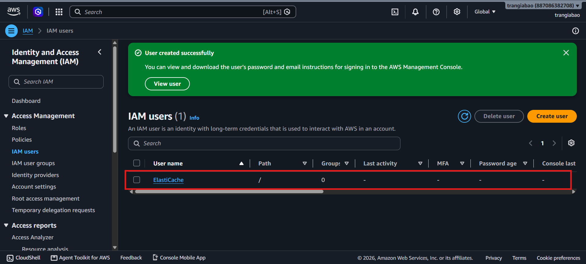

#### Step 2: Install and Verify AWS CLI v2
* **Action:** Open Windows Command Prompt (`cmd.exe`).
* **Command:**
  ```cmd
  msiexec.exe /i https://awscli.amazonaws.com/AWSCLIV2.msi
  aws --version
  ```
* **Output:** AWS CLI v2 successfully installed: `aws-cli/2.38.1 Python/3.14.6 Windows/11 exe/AMD64`.

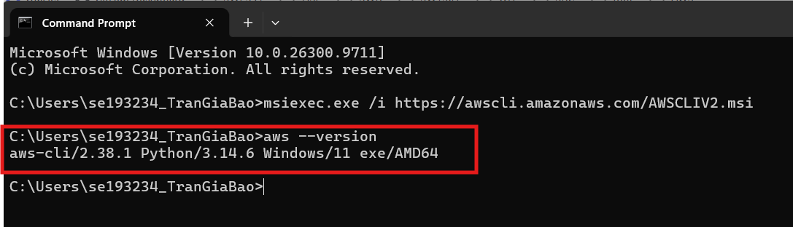

#### Step 3: Configure AWS CLI Credentials
* **Action:** Configure the local CLI profile with the newly provisioned IAM User credentials.
* **Command:**
  ```cmd
  aws configure
  ```
* **Parameters:**
  * **AWS Access Key ID:** `AKIA_DEMO_SAMPLE_KEY_ID`
  * **AWS Secret Access Key:** `DEMO_SECRET_KEY_SAMPLE_TEST_12345`
  * **Default region name:** `us-east-1` (or `ap-southeast-1`)
  * **Default output format:** `json`

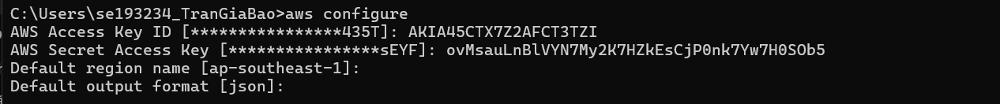

---

### 📋 Section 2: VPC Networking & Web Console Redis Provisioning

#### Step 4: Create Multi-AZ ElastiCache Subnet Group
* **Action:** In the AWS Console ➔ Search for **Amazon ElastiCache** ➔ Select **Subnet groups** in the left pane ➔ Click **Create subnet group**.
* **Parameters:**
  * **Name:** `subnet-group`
  * **Description:** `test ElastiCache`
  * **VPC ID:** Select VPC `vpc-0fc9d5490a843944e`
  * **Subnets:** Select subnets across at least 2 distinct Availability Zones (select all 3 subnets in `us-east-1a`, `us-east-1b`, `us-east-1c`).
* **Action:** Click **Create** to initialize the Subnet Group.

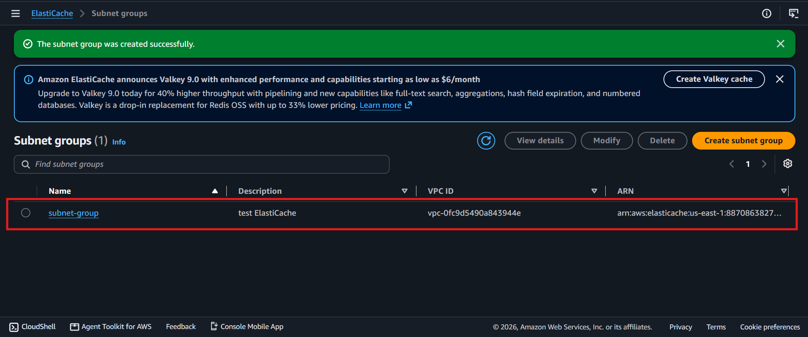

{}
💡 **Troubleshooting Note for Step 4 (Availability Zone Requirements):**
<br>ElastiCache clusters configured with Multi-AZ or Cluster Mode Enabled require nodes to be distributed across at least two distinct Availability Zones. Associating subnets from only one AZ will cause AWS to disable cluster creation or return the error `Each Node Group needs to have at least two distinct Availability Zones`. Always ensure subnets from at least 2 to 3 distinct AZs are added to the `subnet-group`.
{}

#### Step 5: Verify Subnet Group Configuration via AWS CLI
* **Action:** Query the newly provisioned subnet group from the command line.
* **Command:**
  ```cmd
  aws elasticache describe-cache-subnet-groups --cache-subnet-group-name subnet-group --region us-east-1
  ```
* **Output:** Returns a JSON payload showing `VpcId`, `SubnetIdentifier` list (`subnet-0fdbddde41a5c456d`), `SubnetAvailabilityZone` (`us-east-1a`), and the associated ARN.

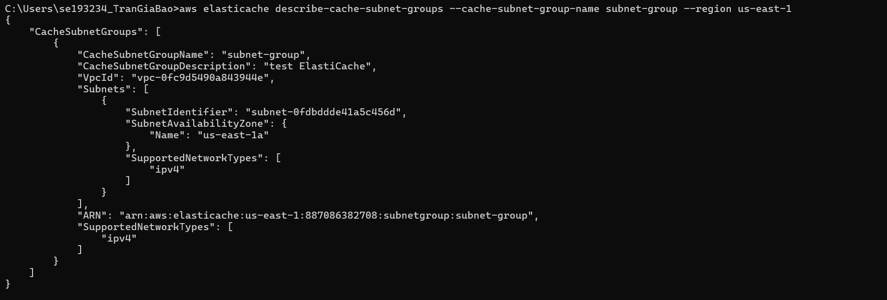

#### Step 6: Provision Cluster Mode Disabled Redis Cluster on Web Console
* **Action:** In the ElastiCache Console ➔ Select **Redis OSS caches** ➔ Click **Create Redis OSS cache**.
* **Configuration:**
  * **Cluster name:** `my-cluster-disable`
  * **Description:** `create cluster`
  * **Node type:** `cache.r6g.large`
  * **Engine version:** `6.2.6`
  * **Cluster mode:** **Disabled**
  * **Shards:** `1`
  * **Number of nodes:** `3` (1 Primary + 2 Replicas)
  * **Multi-AZ:** **Enabled**
  * **Auto-failover:** **Enabled**
  * **Subnet group:** Select `subnet-group`
* **Output:** Cluster enters `Available` status. Retrieve the **Primary endpoint** (`my-cluster-disable.1vblox.ng.0001.use1.cache.amazonaws.com:6379`) and **Reader endpoint** (`my-cluster-disable-ro.1vblox.ng.0001.use1.cache.amazonaws.com:6379`).

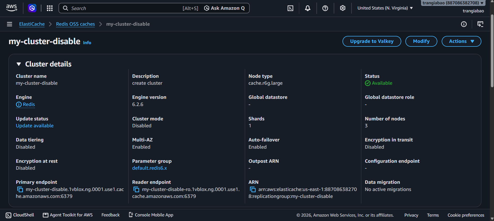

#### Step 7: Provision Cluster Mode Enabled Redis Cluster on Web Console
* **Action:** In **Redis OSS caches** ➔ Click **Create Redis OSS cache**.
* **Configuration:**
  * **Cluster name:** `my-cluster-enable`
  * **Description:** `create cluster enable`
  * **Node type:** `cache.r6g.large`
  * **Engine version:** `6.2.6`
  * **Cluster mode:** **Enabled**
  * **Shards:** `3`
  * **Replicas per shard:** `2` (Total `9` nodes)
  * **Multi-AZ:** **Enabled**
  * **Auto-failover:** **Enabled**
  * **Subnet group:** Select `subnet-group`
* **Output:** Successfully provisioned cluster providing a unified **Configuration endpoint**: `my-cluster-enable.1vblox.clustercfg.use1.cache.amazonaws.com:6379`.

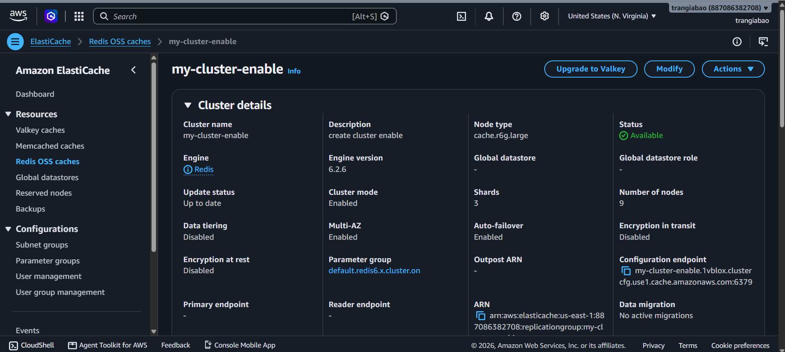

#### Step 8: Configure Security Group Rules for Redis and EC2
* **Action:** Navigate to VPC Console ➔ **Security Groups** ➔ Select default security group (`sg-06c03603fe1cca808`) ➔ Click **Edit inbound rules**.
* **Inbound Rules:**
  1. **Rule 1 (Redis):** Type: **Custom TCP**, Port range: `6379`, Source: `sg-06c03603fe1cca808` (or VPC CIDR `10.0.0.0/16`) to allow inter-VPC cache communication.
  2. **Rule 2 (SSH):** Type: **SSH**, Port range: `22`, Source: `0.0.0.0/0` to enable EC2 Instance Connect.
* **Action:** Click **Save rules**.

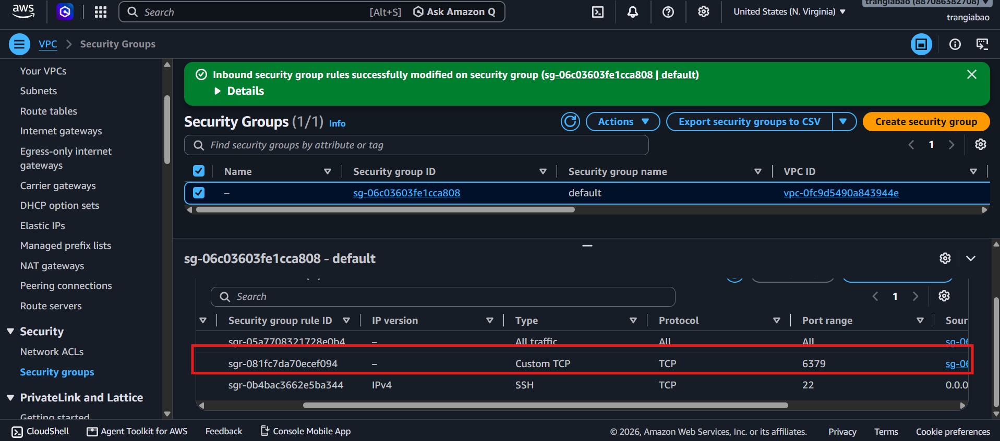

{}
💡 **Troubleshooting Note for Step 8 (Route Table Blackhole Mitigation):**
<br>Network testing revealed that the EC2 client could not reach external package repositories and connection attempts timed out. Inspecting the VPC Route Table showed that route `0.0.0.0/0` targeted a previously detached/deleted Internet Gateway, leaving the routing state in a `Blackhole`. To resolve this, a new Internet Gateway named `my-igw` was created and attached to VPC `vpc-0fc9d5490a843944e`. The blackhole route was purged and replaced with `0.0.0.0/0 -> my-igw`.
{}

#### Step 9: Inspect Nodes and Retrieve Primary Endpoint
* **Action:** Open `my-cluster-disable` ➔ Navigate to the **Nodes** tab.
* **Observation:** Three nodes are operational: `my-cluster-disable-001` (Role: `primary`), `002` (Role: `replica`), and `003` (Role: `replica`). Copy the Primary endpoint for write operations.

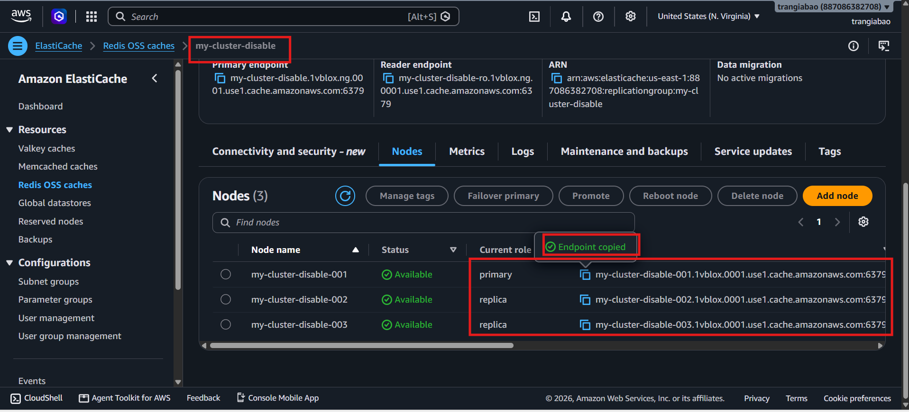

#### Step 10: Inspect Shards and Distributed Endpoints for Cluster Mode Enabled
* **Action:** Open `my-cluster-enable` ➔ Switch to the **Shards and nodes** tab.
* **Observation:** Review the distribution across 3 Shards and 9 constituent nodes (`my-cluster-enable-0001-001`, `002`, `003`) along with their respective individual node endpoints and assigned hash slot allocations.

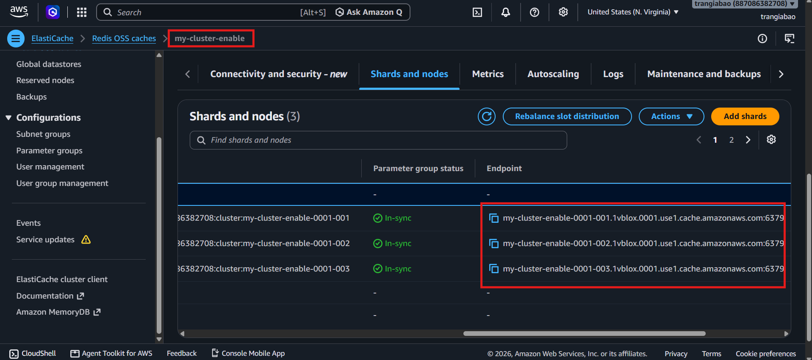

#### Step 11: Inspect Cache Cluster Node via AWS CLI
* **Action:** Open Command Prompt to query individual node metadata.
* **Command:**
  ```cmd
  aws elasticache describe-cache-clusters --cache-cluster-id my-cluster-enable-0001-001 --show-cache-node-info --region us-east-1
  ```
* **Output:** Validates engine version `6.2.6`, `available` status, maintenance schedules, endpoints, and parameter group sync state.

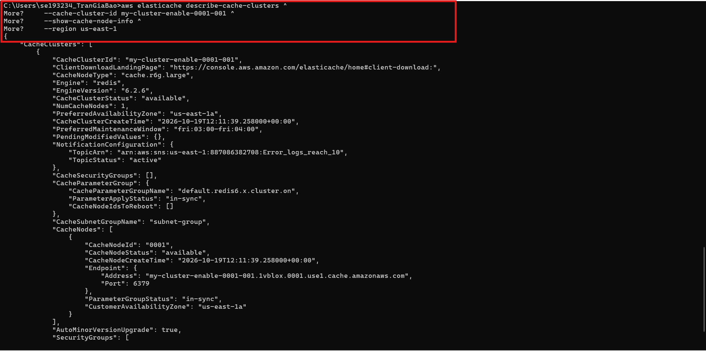

#### Step 12: Query Replication Group Metadata via AWS CLI
* **Action:** Validate the distributed cluster slot partitions across the replication group.
* **Command:**
  ```cmd
  aws elasticache describe-replication-groups --replication-group-id my-cluster-enable --region us-east-1
  ```
* **Output:** Confirms `NodeGroups` with `Slots: "0-5461"`, validating that the cluster is healthy and primed for distributed operations.

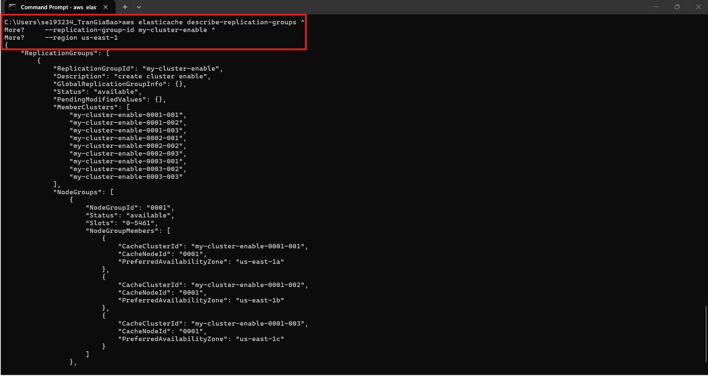
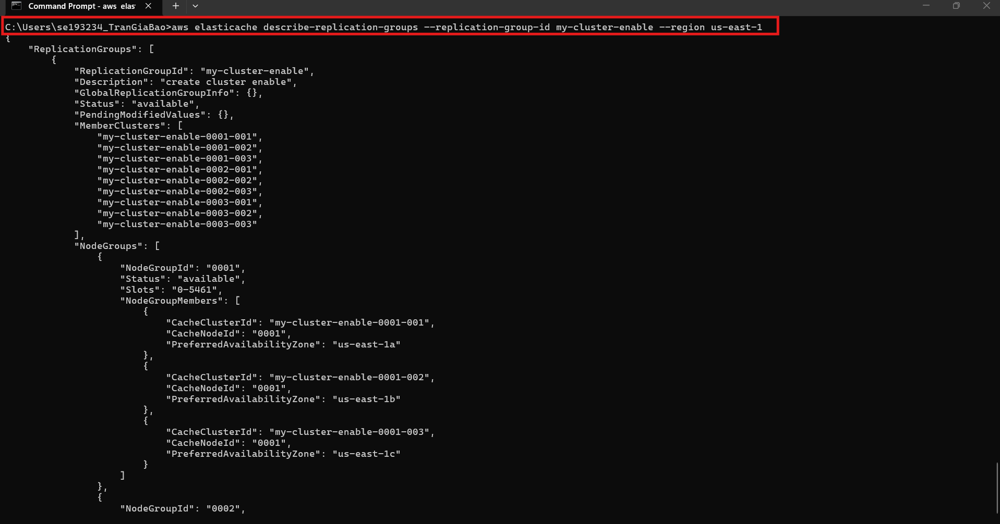

---

### 📋 Section 3: Programmatic Automation via Python Boto3 SDK & RBAC Administration

#### Step 13: Provision Cluster Mode Disabled Cluster via SDK (`CreateClusterModeDisabledCluster.py`)
* **Action:** In Windows PowerShell, switch to the project root and trigger automated provisioning:
* **Command:**
  ```powershell
  cd d:\AWS\template_AWS\fcj-workshop-template-main
  python CreateClusterModeDisabledCluster.py
  ```
* **Output:** Boto3 invokes the `create_replication_group` API, creating cluster `redis-disabled-sdk` with `NumCacheClusters=2`, `CacheNodeType='cache.t4g.micro'`, initial status `creating`, and HTTP response code `200`.

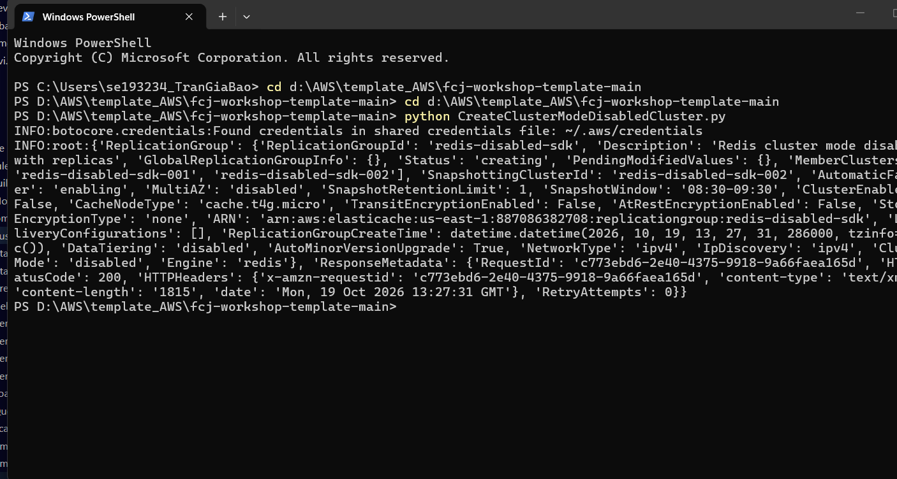

---

#### Step 14: ⚠️ Critical Incident: RBAC Cluster Creation Failure When User Group (`testusergroup` / `mygroup`) Does Not Exist
* **Action:** Attempt to provision an encrypted Redis cluster bound to an RBAC User Group:
  ```powershell
  python ClusterModeDisabledWithRBAC.py
  ```
* **Observed Error Stack:**
  The execution halts immediately with a fatal Boto3 client exception:
  ```text
  Traceback (most recent call last):
    File "D:\AWS\template_AWS\fcj-workshop-template-main\ClusterModeDisabledWithRBAC.py", line 62, in <module>
      response = create_cluster_mode_disabled_rbac(...)
    File "D:\AWS\template_AWS\fcj-workshop-template-main\ClusterModeDisabledWithRBAC.py", line 56, in create_cluster_mode_disabled_rbac
      response = client.create_replication_group(**params)
  botocore.errorfactory.UserGroupNotFoundFault: An error occurred (UserGroupNotFound) when calling the CreateReplicationGroup operation: User group mygroup not found.
  ```
* **Root Cause Analysis:**
  The script specifies `UserGroupIds=['mygroup']` (or `testusergroup` in standard lab templates). However, **no User Group with this ID exists on the ElastiCache service** at this point! During `CreateReplicationGroup` validation, AWS confirms the existence of all specified UserGroupIds. Because `mygroup` has not yet been provisioned, the API rejects the request and throws `UserGroupNotFoundFault`.

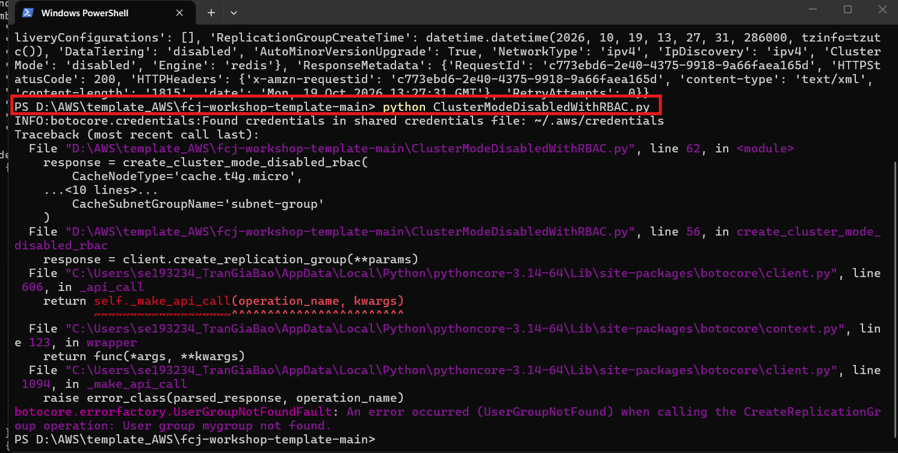

---

#### Step 15: Provision Cluster Mode Enabled Cluster via SDK (`ClusterModeEnabled.py`)
* **Action:** In parallel, provision an automated multi-shard cluster:
  ```powershell
  python ClusterModeEnabled.py
  ```
* **Output:** Successfully initializes cluster `redis-enabled-sdk` featuring 2 Shards and 4 Nodes with `ClusterEnabled: True` and HTTP response code `200`.

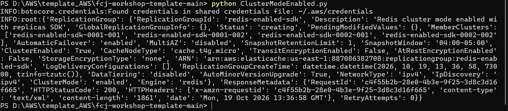

#### Step 16: Re-confirming User Group Prerequisite Dependency
* **Observation:** Repeating execution of `ClusterModeDisabledWithRBAC.py` before creating the User Group confirms the identical `UserGroupNotFoundFault` exception, validating that User Groups are a strict prerequisite for RBAC-secured clusters.

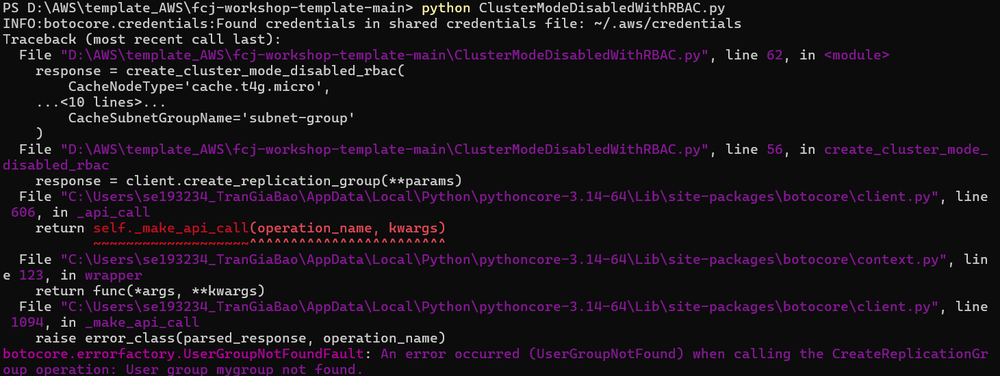

---

#### Step 17: ✅ Remediation: Provision RBAC Users and User Groups via `UserAndUserGroups.py`
* **Resolution Strategy:**
  Execute the Python script `UserAndUserGroups.py` to provision the full RBAC identity hierarchy:
  1. Create application user: `mygroup-myuser` (UserName: `myuser`) with password `MyStrongPasswordWithNumbers123` and access string `on ~* +@all` (granting full privileges across all keys and command categories).
  2. **Create mandatory `default` user:** `mygroup-default` (UserName: `default`), fulfilling the ElastiCache RBAC requirement that every group contains a default administrative user.
  3. **Create User Group `mygroup` (or `testusergroup`):** Bind `mygroup-myuser` and `mygroup-default` into the group.
  4. Concurrently provision a standby group `mygroup2` (`mygroup2-myuser2` and `mygroup2-default`).
* **Command:**
  ```powershell
  python UserAndUserGroups.py
  ```
* **Output:** All Users and User Groups provisioned successfully with valid ARNs:
  * `arn:aws:elasticache:us-east-1:887086382708:user:mygroup-myuser`
  * `arn:aws:elasticache:us-east-1:887086382708:user:mygroup-default`
  * `arn:aws:elasticache:us-east-1:887086382708:usergroup:mygroup`

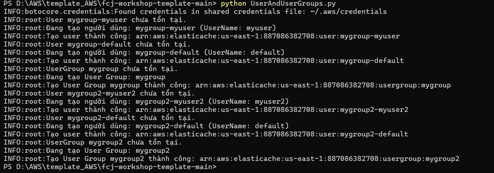

---

#### Step 18: 🎉 Successful Execution: Re-running RBAC Cluster Creation After User Group Exists!
* **Action:** Re-execute the RBAC cluster provisioning script now that `mygroup` exists:
  ```powershell
  python ClusterModeDisabledWithRBAC.py
  ```
* **Output:** The `UserGroupNotFoundFault` error is completely eliminated! The request succeeds with HTTP status `200`. Cluster `redis-rbac-sdk` transitions to `creating` with `TransitEncryptionEnabled: True` and successfully binds to `UserGroupIds: ['mygroup']`.

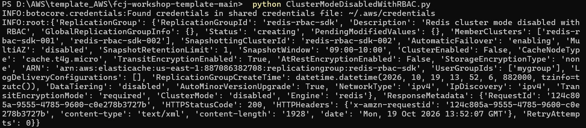

#### Step 19: Provision Sharded Cluster with TLS and RBAC
* **Action:** Execute `ClusterModeEnabledWithRBAC.py` to launch a multi-shard cluster protected by TLS Transit Encryption and User Group `mygroup`.
* **Command:**
  ```powershell
  python ClusterModeEnabledWithRBAC.py
  ```
* **Output:** Cluster `redis-enabled-rbac-sdk` initializes with 2 Shards, `TransitEncryptionEnabled: True`, `UserGroupIds: ['mygroup']`, and `ClusterMode: 'enabled'`.

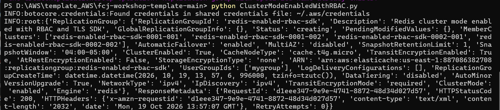

---

### 📋 Section 4: EC2 Client Environment & Programmatic Data Operations

#### Step 20: Resolve Missing `pip3` and Install `redis` Library on EC2 Client
* **Action:** Open AWS Console ➔ Select instance `redis-client` (`i-02673f346989f7c23`) ➔ Connect via **EC2 Instance Connect**.
* **Observed Issue:** Running `pip3 install redis` returns:
  ```bash
  -bash: pip3: command not found
  ```
* **Resolution:** Install `python3-pip` via Amazon Linux package repositories, then install the Python `redis` driver:
  ```bash
  sudo dnf install -y python3-pip && pip3 install redis
  ```
* **Output:** Library `redis-7.0.1` installed successfully.

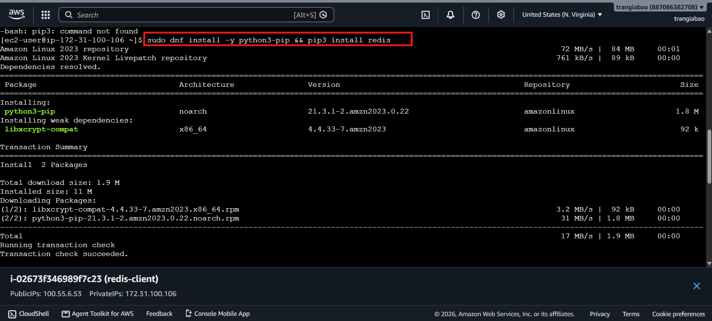

#### Step 21: Verify TLS Encrypted Redis Connection with RBAC Credentials
* **Action:** Test authenticated TLS connectivity to `redis-rbac-sdk` using `myuser` credentials:
* **Command:**
  ```bash
  python3 -c "
  from redis import Redis
  redis = Redis(
      host='master.redis-rbac-sdk.1vblox.use1.cache.amazonaws.com',
      port=6379,
      decode_responses=True,
      ssl=True,
      username='myuser',
      password='MyStrongPasswordWithNumbers123'
  )
  if redis.ping():
      print('>>> CONNECTED TO REDIS SUCCESSFULLY! <<<')
  "
  ```
* **Output:** Confirms connection: `>>> CONNECTED TO REDIS SUCCESSFULLY! <<<`.

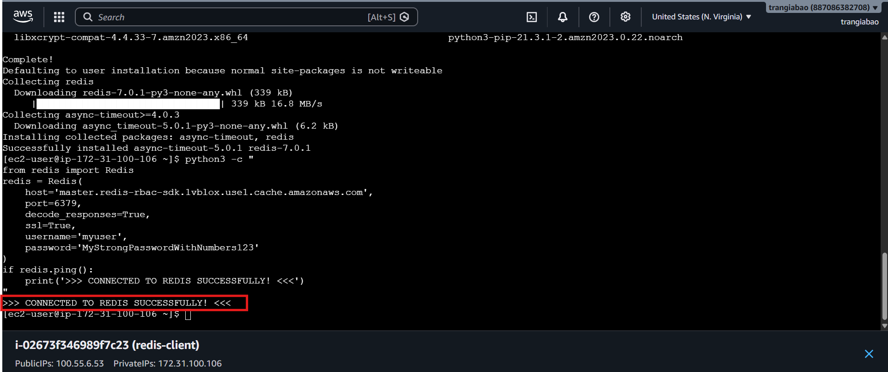

{}
💡 **Critical Network Security Architecture:**
<br>Amazon ElastiCache clusters reside strictly within VPC Private Subnets, have no Public IPs, and lack direct Internet routing. Any attempt to reach the cache from a local workstation will trigger a `Connection Timed Out`. All administrative and data access must originate from an EC2 client residing within the same VPC.
{}

#### Step 22: Connect to Cluster Mode Enabled Cluster (`ConnectClusterModeEnabled.py`)
* **Action:** Connect to sharded cluster `my-cluster-enable` using the modern official SDK syntax:
* **Command:**
  ```bash
  cat << 'EOF' > ConnectClusterModeEnabled.py
  from redis.cluster import RedisCluster
  import logging

  logging.basicConfig(level=logging.INFO)

  # Target configuration endpoint of my-cluster-enable
  redis = RedisCluster(
      host="my-cluster-enable.1vblox.clustercfg.use1.cache.amazonaws.com",
      port=6379,
      decode_responses=True
  )

  if redis.ping():
      logging.info("Connected to Redis")
  EOF

  python3 ConnectClusterModeEnabled.py
  ```
* **Output:** Emits: `INFO:root:Connected to Redis`.

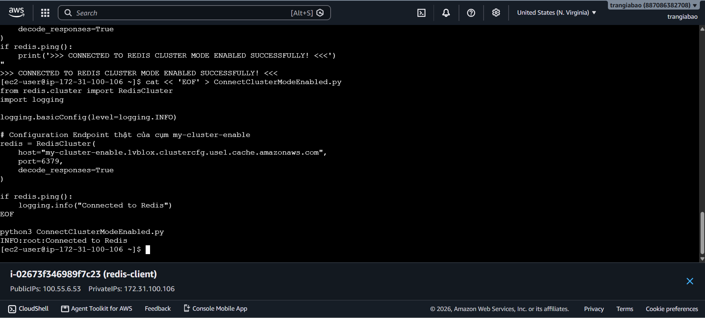

{}
💡 **Troubleshooting Note for Step 22 (Library Deprecation):**
<br>Original lab instructions recommend `from rediscluster import RedisCluster`. That third-party package (`redis-py-cluster`) is obsolete and unmaintained. Cluster capabilities are now natively bundled inside the primary `redis` library. Use `from redis.cluster import RedisCluster` and replace placeholder endpoints (`xxx.yyy...`) with the actual cluster **Configuration Endpoint**.
{}

#### Step 23: String Operations and Time-to-Live Expiration (`SetAndGetStrings.py`)
* **Action:** Execute a script storing key `mykey` with a 60-second TTL (`ex=60`), sleep for 5 seconds, and verify TTL countdown.
* **Command:**
  ```bash
  python3 SetAndGetStrings.py
  ```
* **Output:** Displays remaining TTL:
  ```text
  2026-10-19 14:45:28,612: Key mykey was set at Mon Oct 19 14:45:23 2026 and has 55 seconds until expired
  ```

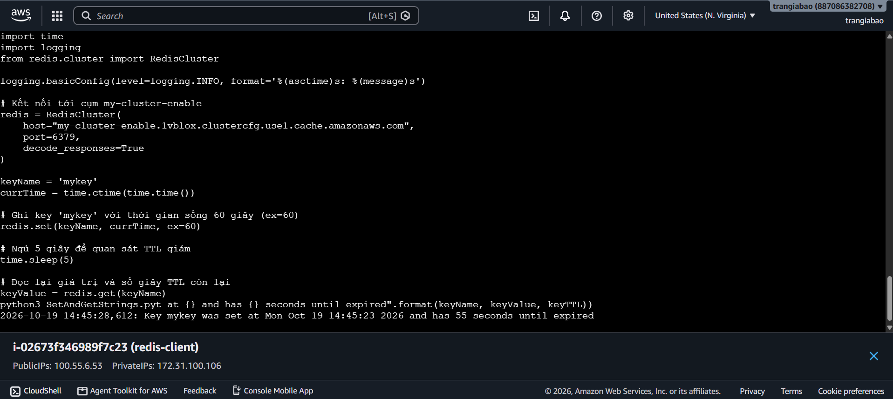

#### Step 24: Hash Map Data Structures (`SetAndGetHash.py`)
* **Action:** Store a Hash object containing `datetime` and `epochtime` fields, including a preemptive key deletion to avoid data type collisions.
* **Command:**
  ```bash
  python3 SetAndGetHash.py
  ```
* **Output:**
  ```text
  2026-10-19 14:49:02,703: Key mykey was set at {'datetime': 'Mon Oct 19 14:48:57 2026', 'epochtime': '1792421337.696463'} and has 55 seconds until expired
  ```

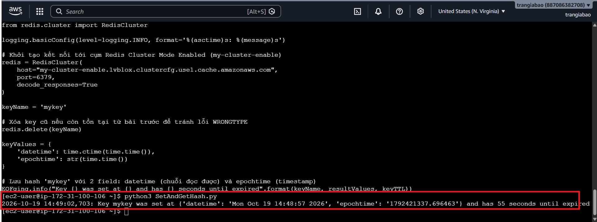

{}
💡 **Troubleshooting Note for Step 24 (WRONGTYPE Data Collision):**
<br>Step 23 stored key `mykey` as a `String`. In Step 24, attempting an immediate `hset` against `mykey` before its 60-second TTL expires will trigger `WRONGTYPE Operation against a key holding the wrong kind of value`. Prepend `redis.delete(keyName)` to clear existing data before writing the Hash.
{}

#### Step 25: Real-Time Asynchronous Message Streaming with Pub/Sub (`PubAndSub.py`)
* **Action:** Launch an asynchronous subscriber thread via `run_in_thread` listening on channel `mychannel`, while the main loop publishes timestamped payloads.
* **Command:**
  ```bash
  python3 PubAndSub.py
  ```
* **Output:** Subscriber stream processes messages in sub-millisecond intervals:
  ```text
  INFO:root:{'type': 'message', 'pattern': None, 'channel': 'mychannel', 'data': 'My message'}
  INFO:root:{'type': 'message', 'pattern': None, 'channel': 'mychannel', 'data': 'Mon Oct 19 15:03:07 2026'}
  INFO:root:{'type': 'message', 'pattern': None, 'channel': 'mychannel', 'data': 'Mon Oct 19 15:03:08 2026'}
  ```

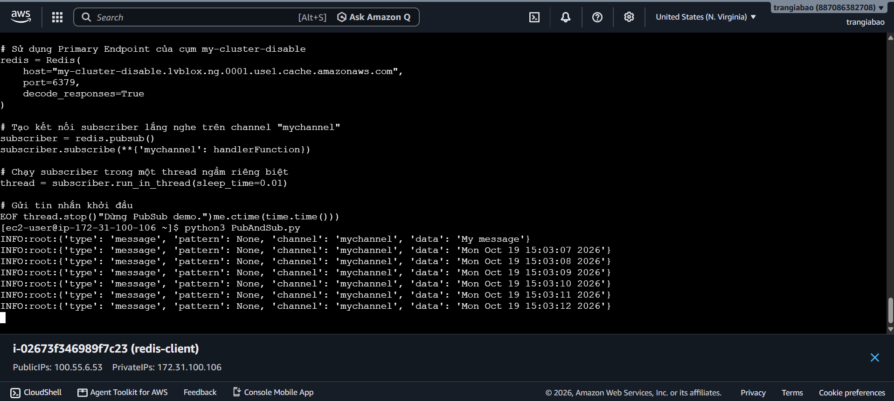

#### Step 26: Pub/Sub Stream Verification and Graceful Termination
* **Observation:** The real-time messaging pipeline maintains sub-millisecond throughput. Wrapping the execution in `try...except KeyboardInterrupt` ensures clean detachment upon pressing `Ctrl + C`.

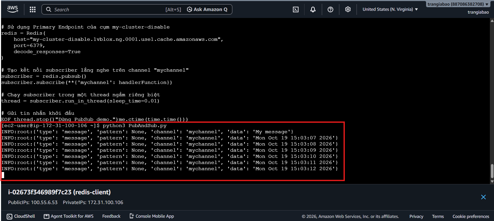

---

### 🔍 Summary of 12 Technical Challenges & Production Resolutions:

1. **Route Table Blackhole Causing Complete Network Disconnection:**
   * *Symptom:* EC2 Instance Connect failed and external package installations timed out.
   * *Root Cause:* Default route `0.0.0.0/0` referenced a detached/deleted Internet Gateway.
   * *Resolution:* Attached new gateway `my-igw` and re-pointed `0.0.0.0/0 -> my-igw`.
2. **Missing `pip3` Package Manager (`-bash: pip3: command not found`):**
   * *Symptom:* Package installation aborted on Amazon Linux 2023.
   * *Root Cause:* Minimalist OS footprint omits pip by default.
   * *Resolution:* Executed `sudo dnf install -y python3-pip`.
3. **Missing Redis Client Driver (`ModuleNotFoundError: No module named 'redis'`):**
   * *Symptom:* Script execution failed due to missing Redis driver.
   * *Root Cause:* Environment lacked the `redis-py` library.
   * *Resolution:* Executed `pip3 install redis`.
4. **Deprecated `rediscluster` Third-Party Library:**
   * *Symptom:* `from rediscluster import RedisCluster` failed.
   * *Root Cause:* Legacy package has been deprecated and merged into official `redis`.
   * *Resolution:* Updated code to `from redis.cluster import RedisCluster`.
5. **Template Placeholder Endpoints (`xxx.yyy...`):**
   * *Symptom:* Failed hostname resolution.
   * *Root Cause:* Sample documentation used dummy placeholder strings.
   * *Resolution:* Replaced with the active **Configuration Endpoint** from the console.
6. **Missing Redis Connection Initialization in Sample Code:**
   * *Symptom:* `NameError: name 'redis' is not defined`.
   * *Root Cause:* Workshop assumed an active interactive shell session where the client had already been declared.
   * *Resolution:* Prepended explicit `RedisCluster(...)` connection instantiation in both scripts.
7. **Data Structure Collision (`WRONGTYPE`):**
   * *Symptom:* `WRONGTYPE Operation against a key holding the wrong kind of value`.
   * *Root Cause:* Key `mykey` retained its String datatype during its active 60-second TTL window.
   * *Resolution:* Added `redis.delete(keyName)` prior to invoking `hset`.
8. **Pub/Sub Import Omission and Terminal Hang:**
   * *Symptom:* `NameError: name 'Redis' is not defined` and unstoppable infinite loop.
   * *Root Cause:* Missing `from redis import Redis` import and absence of signal handling.
   * *Resolution:* Added import and encapsulated the loop inside `try...except KeyboardInterrupt`.
9. **Inability to Connect from Local Workstation (Connection Timed Out):**
   * *Symptom:* Local Python scripts timed out.
   * *Root Cause:* ElastiCache resides in private subnets with no public Internet ingress.
   * *Resolution:* Provisioned an in-VPC EC2 client and opened port 6379 in the security group.
10. **Subnet Group Multi-AZ Constraint Failures:**
    * *Symptom:* `Each Node Group needs to have at least two distinct Availability Zones`.
    * *Root Cause:* Multi-AZ and Sharded clusters mandate nodes across at least two distinct AZs.
    * *Resolution:* Configured `subnet-group` with 3 subnets spanning `us-east-1a`, `us-east-1b`, and `us-east-1c`.
11. **Critical Failure When Provisioning RBAC Clusters Without User Group (`UserGroupNotFoundFault`):**
    * *Symptom:* `ClusterModeDisabledWithRBAC.py` threw `UserGroupNotFoundFault: User group mygroup not found`.
    * *Root Cause:* The target `UserGroupIds=['mygroup']` (or `testusergroup`) did not yet exist in ElastiCache.
    * *Resolution:* Executed `UserAndUserGroups.py` to provision `myuser`, the mandatory `default` user, and group `mygroup`. Re-executing cluster creation succeeded with HTTP 200.
12. **Python Function Signature Syntax Error in Sample Code:**
    * *Symptom:* `SyntaxError: non-default argument follows default argument`.
    * *Root Cause:* Parameter without default value placed after parameters with default values.
    * *Resolution:* Assigned default value `CacheSubnetGroupName=None` to standardize the signature.
