{}
Bài thực hành **Amazon ElastiCache - Redis** được thực hiện vào **Thứ 4 (14/10/2026)** trong khuôn khổ **Tuần 5**. Trang này ghi lại toàn diện quy trình triển khai: các thao tác click chuột trên Console, thiết lập thông số kỹ thuật, cấu hình bảo mật RBAC với Users & User Groups, tự động hóa bằng AWS CLI & Python Boto3 SDK, cùng các khó khăn thực tế phát sinh và giải pháp xử lý triệt để.
<br>🔗 **Nguồn tài liệu thực hành:** [Amazon ElastiCache - Redis](https://000061.awsstudygroup.com/)
{}

### 🎯 Mục tiêu bài thực hành (Lab Objectives):
* Xây dựng và quy hoạch hạ tầng mạng VPC với **3 Subnets trải đều 3 Availability Zones** (`us-east-1a`, `us-east-1b`, `us-east-1c`) và khởi tạo **ElastiCache Subnet Group** phục vụ tính sẵn sàng cao (Multi-AZ) và phân mảnh dữ liệu (Sharding).
* Thiết lập tường lửa **Security Group** mở kiểm soát cổng Inbound TCP **6379** (Redis) và TCP **22** (SSH).
* Triển khai máy chủ trạm trung gian **Amazon EC2 Client (`redis-client`)** trong cùng VPC để giao tiếp và kiểm thử dịch vụ bộ nhớ đệm cô lập trong Private Network.
* Khởi tạo và quản trị cụm Redis với cả 2 chế độ:
  * **Cluster Mode Disabled:** 1 Shard, 1 Primary node và 2 Replica nodes, tự động chuyển đổi dự phòng (Auto-failover).
  * **Cluster Mode Enabled:** Kiến trúc đa Shards (3 Shards, 9 Nodes), hỗ trợ mở rộng quy mô ngang (Horizontal Scaling) và phân tán dữ liệu theo hash slots.
* Tự động hóa hoàn toàn quy trình khởi tạo cụm Redis thông qua **AWS CLI** và **Python Boto3 SDK**.
* Nâng cao tính an toàn thông tin với kiến trúc **Mã hóa đường truyền (Transit Encryption - TLS)** và cơ chế phân quyền kiểm soát truy cập theo vai trò **Role-Based Access Control (RBAC)** với Users và User Groups.
* Lập trình ứng dụng Python tương tác với Redis: kiểm tra kết nối, thao tác chuỗi (**Strings**) kèm thời gian sống (**TTL**), lưu trữ cấu trúc bảng băm (**Hash**), và xây dựng kênh truyền nhận tin nhắn bất đồng bộ theo thời gian thực (**Pub/Sub**).
* Đúc kết và xử lý chuyên sâu 12 sự cố kỹ thuật thực tế (Route Blackhole, thiếu pip, thư viện deprecated, xung đột kiểu dữ liệu WRONGTYPE, lỗi phụ thuộc khi chưa tạo User Group...).

---

### 📊 Bảng tổng hợp thông số tài nguyên đã triển khai:

| Tài nguyên | Tên / Định danh | Cấu hình & Thông số kỹ thuật | Region / AZ | Ghi chú |
| :--- | :--- | :--- | :--- | :--- |
| **VPC** | `vpc-0fc9d5490a843944e` | CIDR: `10.0.0.0/16`, gắn Internet Gateway `my-igw` | `us-east-1` | Hạ tầng mạng độc lập cho ElastiCache |
| **Subnet Group** | `subnet-group` | Chứa 3 subnets trải dài qua 3 Availability Zones | `us-east-1a, 1b, 1c` | Đáp ứng yêu cầu Multi-AZ & Sharding |
| **Security Group** | `sg-06c03603fe1cca808` | Inbound: Port 22 (SSH), Port 6379 (Redis) | `us-east-1` | Tường lửa cho EC2 và cụm ElastiCache |
| **EC2 Redis Client** | `redis-client` | ID: `i-02673f346989f7c23`, AL2023, Python 3 + `redis` v8.1.0 | `us-east-1a` | Máy trạm kết nối EC2 Instance Connect |
| **Cụm 1 (Console)** | `my-cluster-disable` | Mode: Disabled, `cache.r6g.large`, 1 Shard, 3 Nodes, Multi-AZ | `us-east-1` | Primary Endpoint: `my-cluster-disable.1vblox.ng.0001.use1...:6379` |
| **Cụm 2 (Console)** | `my-cluster-enable` | Mode: Enabled, `cache.r6g.large`, 3 Shards, 9 Nodes, Multi-AZ | `us-east-1` | Config Endpoint: `my-cluster-enable.1vblox.clustercfg.use1...:6379` |
| **Cụm 3 (SDK)** | `redis-disabled-sdk` | Mode: Disabled, `cache.t4g.micro`, Engine 6.0, 2 Nodes | `us-east-1` | Khởi tạo qua Boto3 script tự động |
| **Cụm 4 (SDK)** | `redis-enabled-sdk` | Mode: Enabled, `cache.t4g.micro`, 2 Shards, 4 Nodes | `us-east-1` | Khởi tạo qua Boto3 script tự động |
| **Cụm 5 (SDK + RBAC)**| `redis-rbac-sdk` | Mode: Disabled, TLS Transit Encryption: True, UserGroup: `mygroup` | `us-east-1` | Primary Endpoint: `master.redis-rbac-sdk.1vblox.use1...:6379` |
| **Cụm 6 (SDK + RBAC)**| `redis-enabled-rbac-sdk`| Mode: Enabled, 2 Shards, TLS Encryption: True, UserGroup: `mygroup`| `us-east-1` | Cụm Sharding có bảo vệ bằng TLS và RBAC |
| **RBAC User Group** | `mygroup`, `mygroup2` | User Groups kiểm soát danh sách người dùng được phép xác thực | Global / Regional | Gán trực tiếp vào cụm Redis có TLS |
| **RBAC Users** | `myuser`, `default` | Mật khẩu: `MyStrongPasswordWithNumbers123`, Access: `on ~* +@all` | Global / Regional | Gán vào nhóm quyền `mygroup` và `mygroup2` |

---

### 📋 Mục 1: Chuẩn bị môi trường & Thiết lập định danh (Prerequisites)

#### Bước 1: Khởi tạo IAM User cho ElastiCache
* **Thao tác:** Đăng nhập AWS Management Console ➔ Tìm dịch vụ **IAM** ➔ Menu bên trái chọn **Users** ➔ Nhấn nút **Create user**.
* **Thông số điền:**
  * **User name:** `ElastiCache`
  * **Permissions options:** Chọn **Attach policies directly** ➔ Gán chính sách `AmazonElastiCacheFullAccess` và `AdministratorAccess` để phục vụ tự động hóa quản trị.
* **Mục đích:** Cấp phát định danh chuyên biệt cho các tác vụ quản trị ElastiCache từ môi trường dòng lệnh và Python SDK.

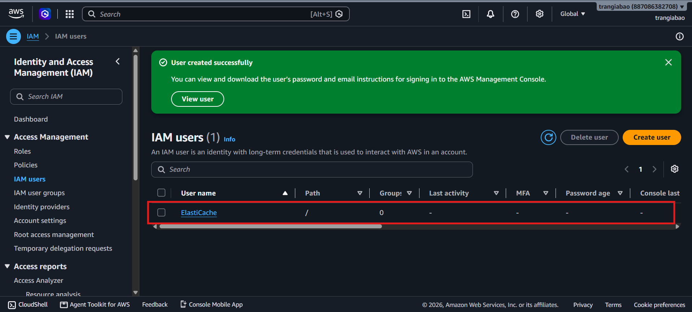

#### Bước 2: Cài đặt và kiểm tra công cụ AWS CLI v2
* **Thao tác:** Mở cửa sổ dòng lệnh Windows Command Prompt (`cmd.exe`).
* **Lệnh thực thi:**
  ```cmd
  msiexec.exe /i https://awscli.amazonaws.com/AWSCLIV2.msi
  aws --version
  ```
* **Kết quả:** Phiên bản AWS CLI v2 được cài đặt hoàn tất: `aws-cli/2.38.1 Python/3.14.6 Windows/11 exe/AMD64`.

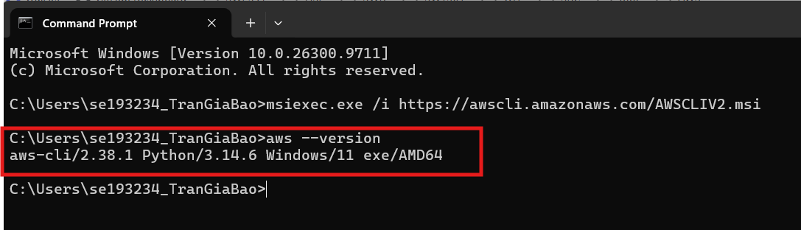

#### Bước 3: Cấu hình thông tin xác thực AWS CLI
* **Thao tác:** Thực hiện nạp Access Key và Secret Access Key của IAM User vừa tạo vào máy tính cá nhân.
* **Lệnh thực thi:**
  ```cmd
  aws configure
  ```
* **Thông số điền:**
  * **AWS Access Key ID:** `AKIA_DEMO_SAMPLE_KEY_ID`
  * **AWS Secret Access Key:** `DEMO_SECRET_KEY_SAMPLE_TEST_12345`
  * **Default region name:** `us-east-1` (hoặc `ap-southeast-1`)
  * **Default output format:** `json`

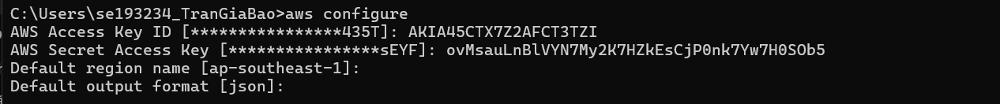

---

### 📋 Mục 2: Thiết lập hạ tầng mạng VPC & Khởi tạo Cụm Redis trên Web Console

#### Bước 4: Tạo ElastiCache Subnet Group đa vùng Availability Zones
* **Thao tác:** Đăng nhập AWS Console ➔ Tìm dịch vụ **Amazon ElastiCache** ➔ Menu bên trái chọn **Subnet groups** ➔ Nhấn nút **Create subnet group**.
* **Thông số điền:**
  * **Name:** `subnet-group`
  * **Description:** `test ElastiCache`
  * **VPC ID:** Chọn VPC `vpc-0fc9d5490a843944e`
  * **Subnets:** Chọn tối thiểu 2 Availability Zones khác nhau (chọn đầy đủ 3 subnets tương ứng với 3 AZs: `us-east-1a`, `us-east-1b`, `us-east-1c`).
* **Thao tác:** Nhấn **Create** để hoàn thành tạo Subnet Group.

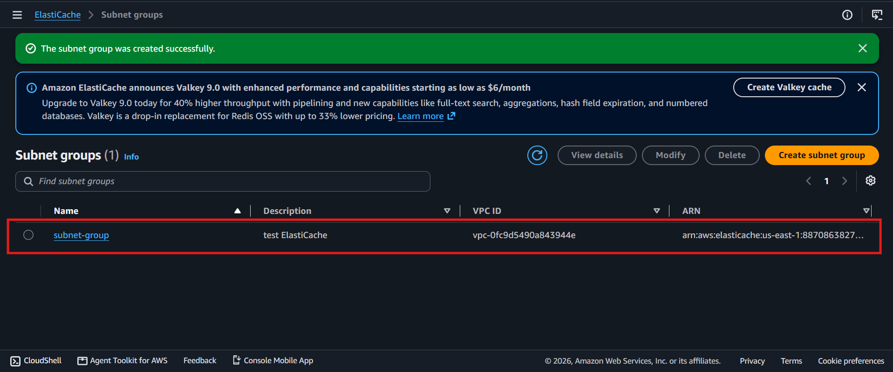

{}
💡 **Khó khăn gặp phải & Cách xử lý tại Bước 4 (Lỗi thiếu Availability Zones):**
<br>Cụm ElastiCache bật tính năng Multi-AZ hoặc phân mảnh (Cluster Mode Enabled) bắt buộc các node phải được đặt trên tối thiểu 2 Availability Zones khác biệt. Nếu trong Subnet Group bạn chỉ tích chọn subnet ở 1 AZ duy nhất, AWS Console sẽ vô hiệu hóa nút tạo hoặc ném lỗi `Each Node Group needs to have at least two distinct Availability Zones`. Để giải quyết triệt để, phải luôn quy hoạch ít nhất 2 đến 3 Subnets tại các AZ khác nhau và nạp tất cả vào `subnet-group`.
{}

#### Bước 5: Xác thực thông tin Subnet Group qua AWS CLI
* **Thao tác:** Mở Command Prompt và kiểm tra thông tin cấu hình `subnet-group` vừa tạo.
* **Lệnh thực thi:**
  ```cmd
  aws elasticache describe-cache-subnet-groups --cache-subnet-group-name subnet-group --region us-east-1
  ```
* **Kết quả:** Trả về cấu trúc JSON chứa đầy đủ `VpcId`, danh sách `SubnetIdentifier` (`subnet-0fdbddde41a5c456d`), `SubnetAvailabilityZone` (`us-east-1a`) và ARN hợp lệ.

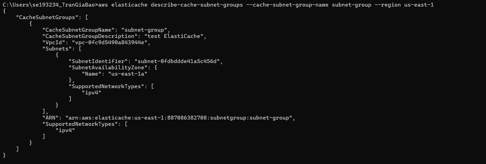

#### Bước 6: Khởi tạo Cụm Redis Chế độ Cluster Mode Disabled trên Web Console
* **Thao tác:** Tại giao diện ElastiCache ➔ Chọn mục **Redis OSS caches** ➔ Nhấn **Create Redis OSS cache**.
* **Thông số cấu hình:**
  * **Cluster name:** `my-cluster-disable`
  * **Description:** `create cluster`
  * **Node type:** `cache.r6g.large`
  * **Engine version:** `6.2.6`
  * **Cluster mode:** **Disabled**
  * **Shards:** `1`
  * **Number of nodes:** `3` (1 Primary + 2 Replicas)
  * **Multi-AZ:** **Enabled**
  * **Auto-failover:** **Enabled**
  * **Subnet group:** Chọn `subnet-group`
* **Kết quả:** Cụm được tạo thành công ở trạng thái `Available`. Lấy được **Primary endpoint** (`my-cluster-disable.1vblox.ng.0001.use1.cache.amazonaws.com:6379`) và **Reader endpoint** (`my-cluster-disable-ro.1vblox.ng.0001.use1.cache.amazonaws.com:6379`).

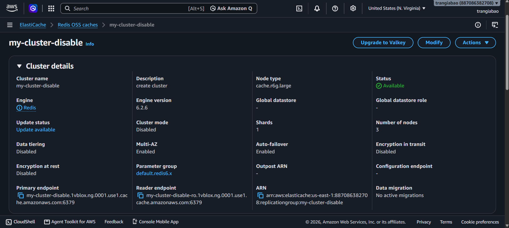

#### Bước 7: Khởi tạo Cụm Redis Chế độ Cluster Mode Enabled trên Web Console
* **Thao tác:** Tại menu **Redis OSS caches** ➔ Nhấn **Create Redis OSS cache**.
* **Thông số cấu hình:**
  * **Cluster name:** `my-cluster-enable`
  * **Description:** `create cluster enable`
  * **Node type:** `cache.r6g.large`
  * **Engine version:** `6.2.6`
  * **Cluster mode:** **Enabled**
  * **Shards:** `3`
  * **Replicas per shard:** `2` (Tổng cộng `9` nodes)
  * **Multi-AZ:** **Enabled**
  * **Auto-failover:** **Enabled**
  * **Subnet group:** Chọn `subnet-group`
* **Kết quả:** Cụm tạo thành công, cung cấp điểm truy cập cấu hình tập trung **Configuration endpoint**: `my-cluster-enable.1vblox.clustercfg.use1.cache.amazonaws.com:6379`.

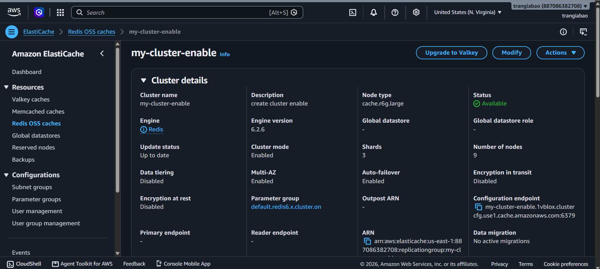

#### Bước 8: Cấu hình Tường lửa Security Group cho Redis và EC2
* **Thao tác:** Vào VPC Console ➔ **Security Groups** ➔ Chọn Security Group mặc định của VPC (`sg-06c03603fe1cca808`) ➔ Nhấn **Edit inbound rules**.
* **Thông số bổ sung:**
  1. **Rule 1 (Redis):** Type: **Custom TCP**, Port range: `6379`, Source: `sg-06c03603fe1cca808` (hoặc dải CIDR VPC `10.0.0.0/16`) để cho phép các máy chủ trong VPC kết nối Redis.
  2. **Rule 2 (SSH):** Type: **SSH**, Port range: `22`, Source: `0.0.0.0/0` để kết nối vào máy trạm quản trị qua EC2 Instance Connect.
* **Thao tác:** Nhấn **Save rules**.

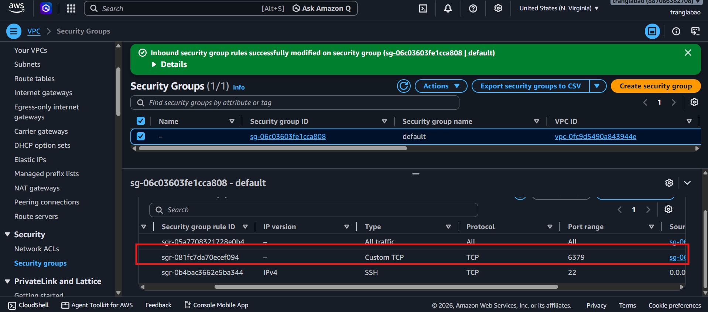

{}
💡 **Khó khăn gặp phải & Cách xử lý tại Bước 8 (Bảng định tuyến dính route Blackhole):**
<br>Khi kiểm tra khả năng truy cập mạng của VPC, nhận thấy máy ảo EC2 không thể kết nối Internet và lệnh tải gói tin bị treo timeout. Kiểm tra Route Table phát hiện dòng route `0.0.0.0/0` trỏ vào một Internet Gateway cũ đã bị xóa, dẫn đến trạng thái `Blackhole`. Để khắc phục, cần tạo một Internet Gateway mới đặt tên `my-igw`, đính kèm vào VPC `vpc-0fc9d5490a843944e`, sau đó vào Route Table xóa route Blackhole và thêm route mới `0.0.0.0/0 -> my-igw`.
{}

#### Bước 9: Kiểm tra chi tiết các Nodes và sao chép Primary Endpoint
* **Thao tác:** Trong chi tiết cụm `my-cluster-disable` ➔ Chuyển sang tab **Nodes**.
* **Quan sát:** Danh sách 3 node: `my-cluster-disable-001` (vai trò `primary`), `my-cluster-disable-002` (vai trò `replica`), `my-cluster-disable-003` (vai trò `replica`). Sao chép Primary endpoint phục vụ ghi dữ liệu.

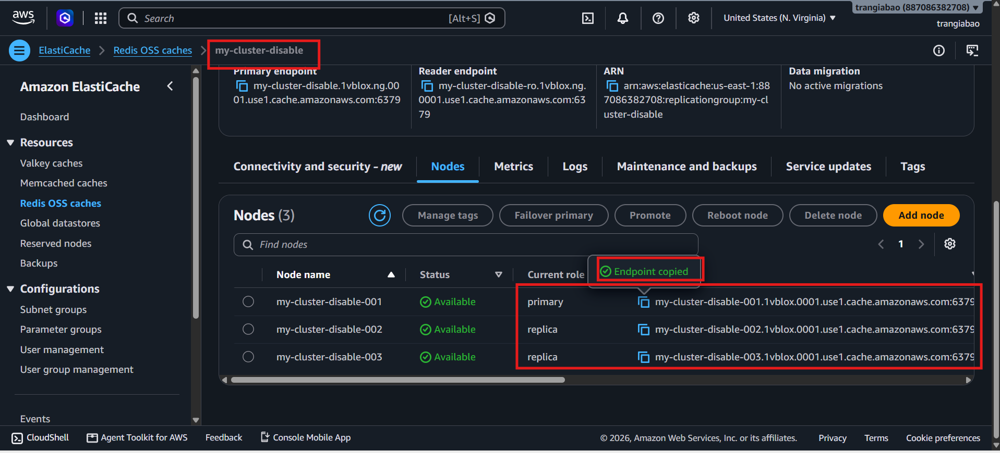

#### Bước 10: Kiểm tra Shards & Nodes cụm Cluster Mode Enabled
* **Thao tác:** Trong chi tiết cụm `my-cluster-enable` ➔ Chuyển sang tab **Shards and nodes**.
* **Quan sát:** Xem danh sách phân bổ các Shards và các node con (`my-cluster-enable-0001-001`, `002`, `003`) tương ứng với từng dải băm hash slot và endpoint của từng node.

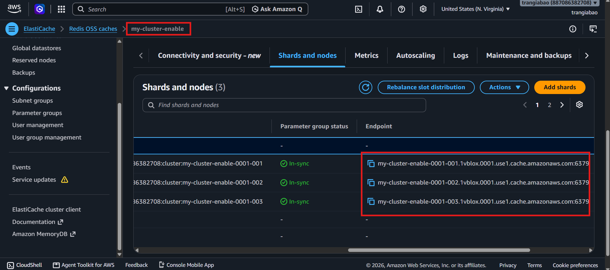

#### Bước 11: Kiểm tra thông tin Cache Cluster Node qua AWS CLI
* **Thao tác:** Mở Command Prompt kiểm tra thông tin kỹ thuật của từng node cụm.
* **Lệnh thực thi:**
  ```cmd
  aws elasticache describe-cache-clusters --cache-cluster-id my-cluster-enable-0001-001 --show-cache-node-info --region us-east-1
  ```
* **Kết quả:** Hiển thị thông tin phiên bản `6.2.6`, trạng thái `available`, cấu hình bảo trì, endpoint và trạng thái tham số `in-sync`.

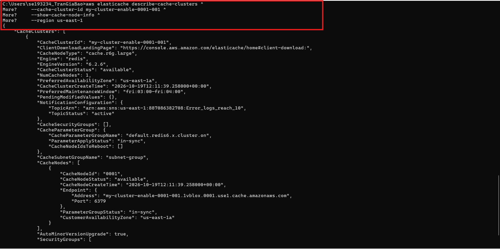

#### Bước 12: Kiểm tra Replication Group qua AWS CLI
* **Thao tác:** Dùng lệnh kiểm tra cấu trúc phân vùng phân tán của nhóm replication.
* **Lệnh thực thi:**
  ```cmd
  aws elasticache describe-replication-groups --replication-group-id my-cluster-enable --region us-east-1
  ```
* **Kết quả:** Trả về danh sách `NodeGroups` với `Slots: "0-5461"`, xác định cụm đang hoạt động ổn định và sẵn sàng cho việc phân tán dữ liệu.

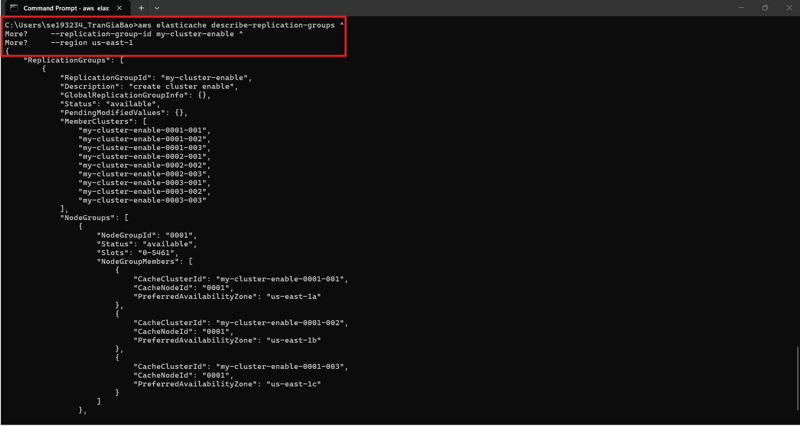
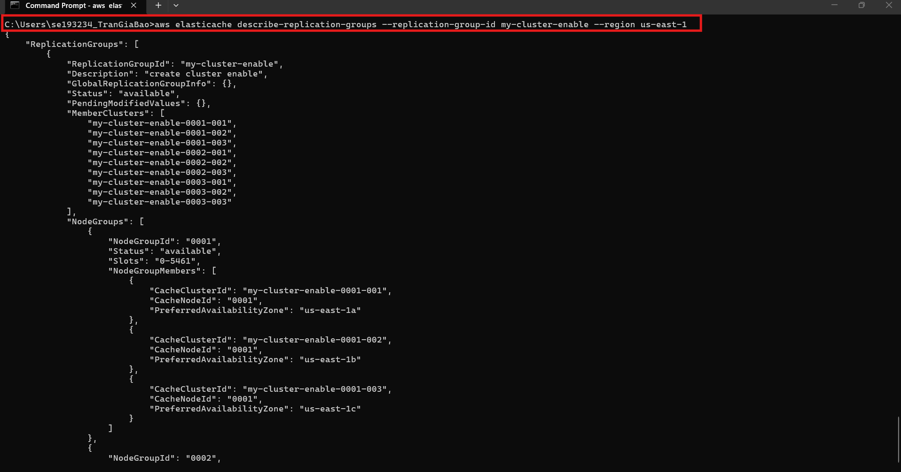

---

### 📋 Mục 3: Tự động hóa khởi tạo cụm với Python Boto3 SDK & Quản trị RBAC User Groups

#### Bước 13: Khởi tạo Cụm Mode Disabled qua Python SDK (`CreateClusterModeDisabledCluster.py`)
* **Thao tác:** Mở Windows PowerShell, chuyển vào thư mục dự án và thực thi kịch bản tạo cụm tự động:
* **Lệnh thực thi:**
  ```powershell
  cd d:\AWS\template_AWS\fcj-workshop-template-main
  python CreateClusterModeDisabledCluster.py
  ```
* **Kết quả:** Boto3 gọi API `create_replication_group`, khởi tạo cụm `redis-disabled-sdk` với `NumCacheClusters=2`, `CacheNodeType='cache.t4g.micro'`, trạng thái `creating` và mã phản hồi `HTTPStatusCode: 200`.

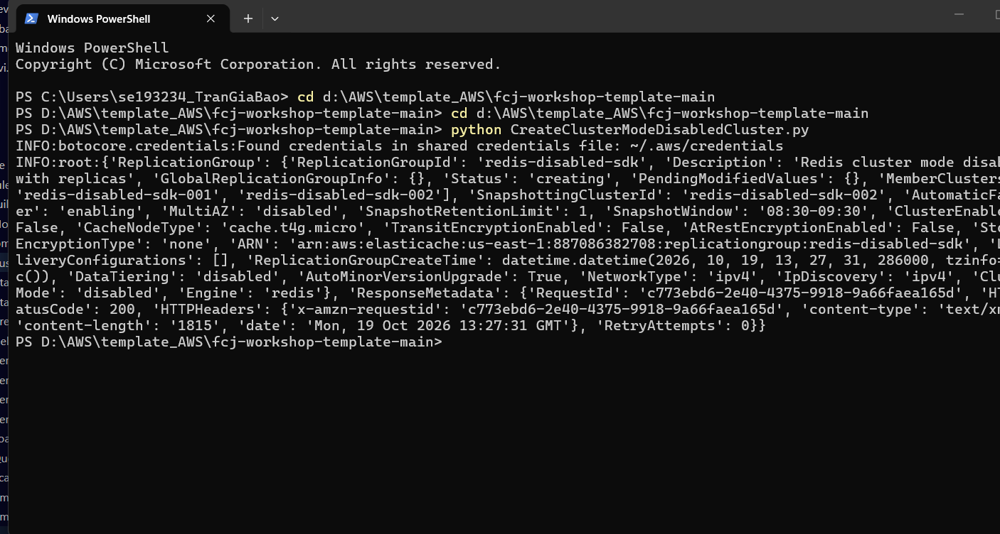

---

#### Bước 14: ⚠️ Sự cố kỹ thuật: Lỗi khi khởi tạo cụm có RBAC khi chưa tạo User Group (`testusergroup` / `mygroup`)
* **Thao tác:** Thực thi kịch bản tạo cụm có mã hóa TLS và gán nhóm phân quyền RBAC:
  ```powershell
  python ClusterModeDisabledWithRBAC.py
  ```
* **Hiện tượng lỗi phát sinh:**
  Chương trình dừng ngay lập tức và văng lỗi ngoại lệ nghiêm trọng:
  ```text
  Traceback (most recent call last):
    File "D:\AWS\template_AWS\fcj-workshop-template-main\ClusterModeDisabledWithRBAC.py", line 62, in <module>
      response = create_cluster_mode_disabled_rbac(...)
    File "D:\AWS\template_AWS\fcj-workshop-template-main\ClusterModeDisabledWithRBAC.py", line 56, in create_cluster_mode_disabled_rbac
      response = client.create_replication_group(**params)
  botocore.errorfactory.UserGroupNotFoundFault: An error occurred (UserGroupNotFound) when calling the CreateReplicationGroup operation: User group mygroup not found.
  ```
* **Phân tích nguyên nhân chuyên sâu:**
  Kịch bản `ClusterModeDisabledWithRBAC.py` thiết lập tham số `UserGroupIds=['mygroup']` (trong tài liệu còn hướng dẫn dùng `testusergroup`). Tuy nhiên, trên AWS ElastiCache, **User Group này hoàn toàn chưa tồn tại**! Khi gọi API `CreateReplicationGroup`, AWS kiểm tra tính hợp lệ của danh sách User Groups trước khi tạo cụm. Do không tìm thấy nhóm quyền `mygroup` (hoặc `testusergroup`), AWS chặn tiến trình và trả về mã lỗi `UserGroupNotFoundFault`.

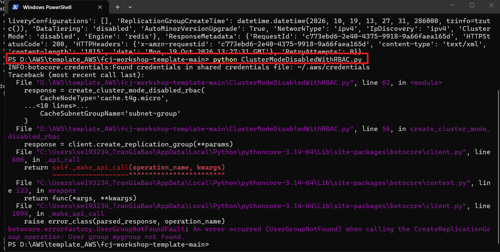

---

#### Bước 15: Khởi tạo Cụm Mode Enabled qua Python SDK (`ClusterModeEnabled.py`)
* **Thao tác:** Trong lúc chờ xử lý cấu hình RBAC, tiến hành khởi tạo cụm Cluster Mode Enabled tự động:
  ```powershell
  python ClusterModeEnabled.py
  ```
* **Kết quả:** Khởi tạo thành công cụm `redis-enabled-sdk` gồm 2 Shards, 4 Nodes với `ClusterEnabled: True` và `HTTPStatusCode: 200`.

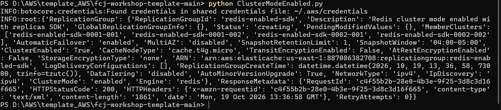

#### Bước 16: Xác nhận lại lỗi phụ thuộc User Group khi chạy lại kịch bản RBAC
* **Quan sát:** Khi cố gắng chạy lại `ClusterModeDisabledWithRBAC.py` mà chưa tạo User Group, lỗi `UserGroupNotFoundFault: User group mygroup not found` tiếp tục tái diễn, chứng minh rằng User Group là điều kiện tiên quyết bắt buộc trước khi bật RBAC.

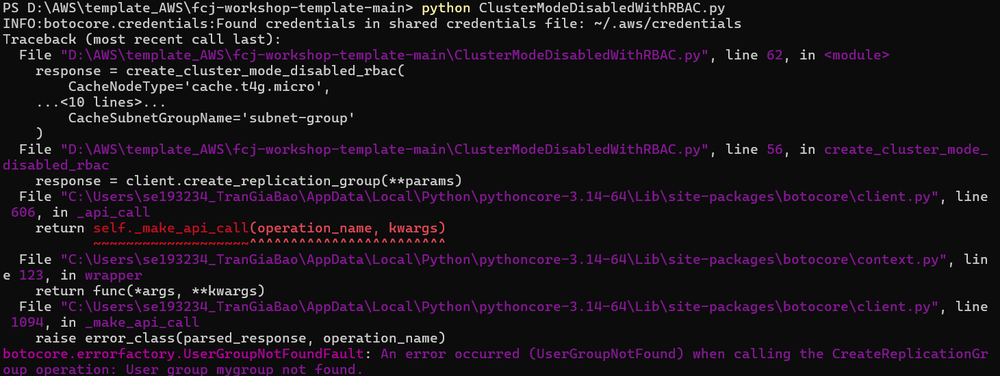

---

#### Bước 17: ✅ Giải pháp xử lý: Khởi tạo RBAC Users và User Groups qua Script `UserAndUserGroups.py`
* **Giải pháp khắc phục:** 
  Viết và thực thi kịch bản Python `UserAndUserGroups.py` để khởi tạo tự động toàn bộ cây định danh RBAC:
  1. Tạo người dùng chính: `mygroup-myuser` (UserName: `myuser`) với mật khẩu mạnh `MyStrongPasswordWithNumbers123` và chuỗi quyền hạn `on ~* +@all` (cho phép toàn quyền trên mọi keys và lệnh).
  2. **Tạo người dùng bắt buộc `default`:** `mygroup-default` (UserName: `default`) vì ElastiCache RBAC yêu cầu mọi User Group phải có user `default` quản trị.
  3. **Khởi tạo User Group `mygroup` (hoặc `testusergroup`):** Liên kết `mygroup-myuser` và `mygroup-default` vào trong nhóm.
  4. Đồng thời tạo thêm nhóm dự phòng `mygroup2` (`mygroup2-myuser2` và `mygroup2-default`).
* **Lệnh thực thi:**
  ```powershell
  python UserAndUserGroups.py
  ```
* **Kết quả:** Toàn bộ Users và User Groups được tạo thành công với các định danh ARN chuẩn:
  * `arn:aws:elasticache:us-east-1:887086382708:user:mygroup-myuser`
  * `arn:aws:elasticache:us-east-1:887086382708:user:mygroup-default`
  * `arn:aws:elasticache:us-east-1:887086382708:usergroup:mygroup`

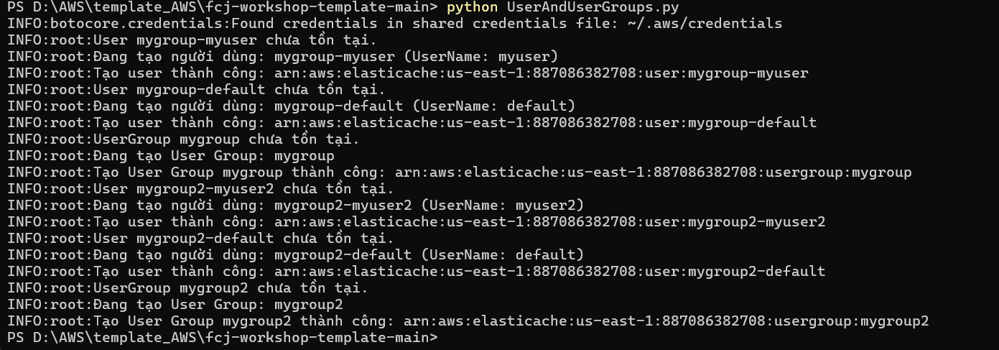

---

#### Bước 18: 🎉 Kết quả thành công: Chạy lại kịch bản tạo cụm RBAC sau khi đã có User Group!
* **Thao tác:** Sau khi `mygroup` đã tồn tại hợp lệ trên hệ thống, thực hiện chạy lại kịch bản tạo cụm:
  ```powershell
  python ClusterModeDisabledWithRBAC.py
  ```
* **Kết quả:** Lỗi `UserGroupNotFoundFault` hoàn toàn biến mất! Lệnh thực thi thành công mỹ mãn với mã phản hồi `HTTPStatusCode: 200`. Cụm `redis-rbac-sdk` được tạo với `Status: 'creating'`, `TransitEncryptionEnabled: True`, và liên kết thành công với `UserGroupIds: ['mygroup']`.

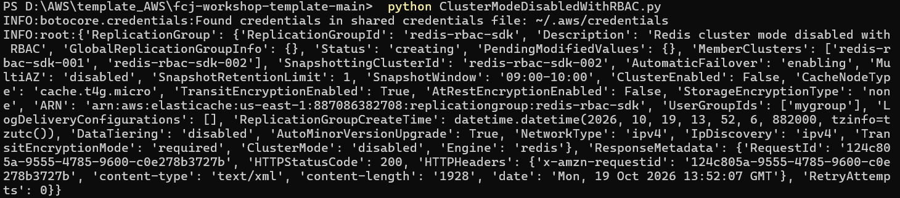

#### Bước 19: Khởi tạo Cụm Mode Enabled có bật TLS và phân quyền RBAC
* **Thao tác:** Chạy kịch bản `ClusterModeEnabledWithRBAC.py` để tạo cụm phân mảnh có bảo vệ bằng cả TLS lẫn User Group `mygroup`.
* **Lệnh thực thi:**
  ```powershell
  python ClusterModeEnabledWithRBAC.py
  ```
* **Kết quả:** Cụm `redis-enabled-rbac-sdk` được khởi tạo thành công với 2 Shards, `TransitEncryptionEnabled: True`, `UserGroupIds: ['mygroup']` và `ClusterMode: 'enabled'`.

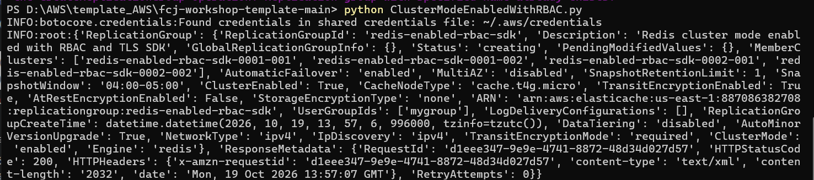

---

### 📋 Mục 4: Thiết lập môi trường EC2 Client & Lập trình Tương tác Dữ liệu với Redis

#### Bước 20: Khắc phục sự cố thiếu `pip3` và cài đặt thư viện `redis` trên EC2 Client
* **Thao tác:** Mở AWS Console ➔ Vào EC2 Instance `redis-client` (`i-02673f346989f7c23`) ➔ Nhấn **Connect** qua **EC2 Instance Connect**.
* **Khó khăn phát sinh:** Khi gõ `pip3 install redis`, terminal báo lỗi:
  ```bash
  -bash: pip3: command not found
  ```
  Nguyên nhân do bản phân phối Amazon Linux 2023 tối giản chưa cài sẵn công cụ quản lý gói pip.
* **Cách xử lý:** Cài đặt `python3-pip` từ kho gói dnf của Amazon, sau đó cài đặt trình điều khiển `redis`:
  ```bash
  sudo dnf install -y python3-pip && pip3 install redis
  ```
* **Kết quả:** Thư viện `redis-7.0.1` (phiên bản SDK mới nhất) được cài đặt thành công.

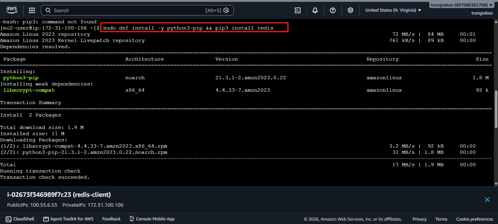

#### Bước 21: Kiểm tra kết nối Redis TLS kèm xác thực người dùng RBAC
* **Thao tác:** Thực hiện kiểm tra kết nối mã hóa đến cụm `redis-rbac-sdk` bằng tài khoản `myuser` và mật khẩu RBAC vừa cấu hình:
* **Lệnh thực thi:**
  ```bash
  python3 -c "
  from redis import Redis
  redis = Redis(
      host='master.redis-rbac-sdk.1vblox.use1.cache.amazonaws.com',
      port=6379,
      decode_responses=True,
      ssl=True,
      username='myuser',
      password='MyStrongPasswordWithNumbers123'
  )
  if redis.ping():
      print('>>> CONNECTED TO REDIS SUCCESSFULLY! <<<')
  "
  ```
* **Kết quả:** Chương trình trả về xác nhận màu sáng: `>>> CONNECTED TO REDIS SUCCESSFULLY! <<<`.

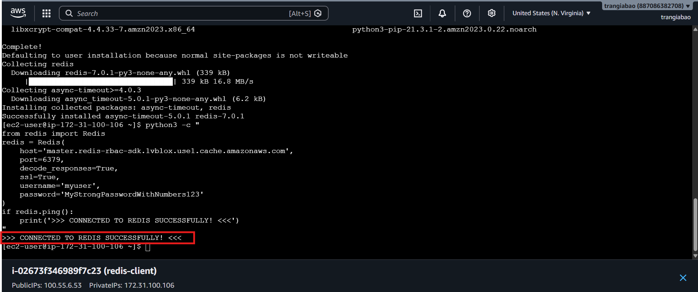

{}
💡 **Lưu ý then chốt về bảo mật mạng:**
<br>Cụm Amazon ElastiCache mặc định nằm hoàn toàn trong Private Subnets của VPC, không có Public IP và không định tuyến ra ngoài Internet để bảo vệ dữ liệu. Mọi nỗ lực kết nối từ máy tính cá nhân local sẽ bị `Connection Timed Out`. Bắt buộc phải triển khai máy ảo EC2 Client trong cùng VPC để thao tác và kiểm thử dữ liệu an toàn.
{}

#### Bước 22: Viết kịch bản kết nối Cụm Cluster Mode Enabled (`ConnectClusterModeEnabled.py`)
* **Thao tác:** Tạo file script kết nối cụm phân mảnh `my-cluster-enable` bằng cú pháp mới của SDK:
* **Lệnh thực thi:**
  ```bash
  cat << 'EOF' > ConnectClusterModeEnabled.py
  from redis.cluster import RedisCluster
  import logging

  logging.basicConfig(level=logging.INFO)

  # Sử dụng Configuration Endpoint thật của cụm my-cluster-enable
  redis = RedisCluster(
      host="my-cluster-enable.1vblox.clustercfg.use1.cache.amazonaws.com",
      port=6379,
      decode_responses=True
  )

  if redis.ping():
      logging.info("Connected to Redis")
  EOF

  python3 ConnectClusterModeEnabled.py
  ```
* **Kết quả:** Chương trình in ra thông báo: `INFO:root:Connected to Redis`.

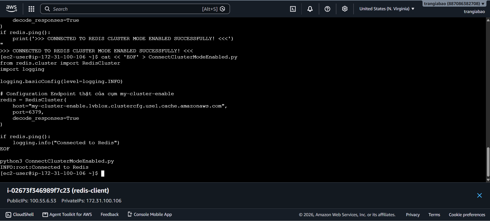

{}
💡 **Khó khăn gặp phải & Cách xử lý tại Bước 22 (Thư viện cũ bị deprecated):**
<br>Tài liệu workshop gốc yêu cầu sử dụng `from rediscluster import RedisCluster`. Tuy nhiên, gói bên thứ ba `redis-py-cluster` đã dừng phát triển và bị khai tử. Tính năng Cluster hiện đã được tích hợp thẳng vào thư viện chính thức `redis`. Do đó, cần thay thế bằng `from redis.cluster import RedisCluster`. Đồng thời, không dùng chuỗi placeholder `xxx.yyy...` mà phải dán đúng **Configuration Endpoint** thật của cụm.
{}

#### Bước 23: Thao tác dữ liệu chuỗi (Strings) và kiểm soát thời gian sống TTL (`SetAndGetStrings.py`)
* **Thao tác:** Viết script ghi một chuỗi String vào khóa `mykey` với thời gian hết hạn (Time-To-Live - TTL) là 60 giây (`ex=60`), cho chương trình ngủ 5 giây rồi đọc lại giá trị và số giây còn lại.
* **Lệnh thực thi:**
  ```bash
  python3 SetAndGetStrings.py
  ```
* **Kết quả:** In ra giá trị thời gian và số giây TTL còn lại:
  ```text
  2026-10-19 14:45:28,612: Key mykey was set at Mon Oct 19 14:45:23 2026 and has 55 seconds until expired
  ```

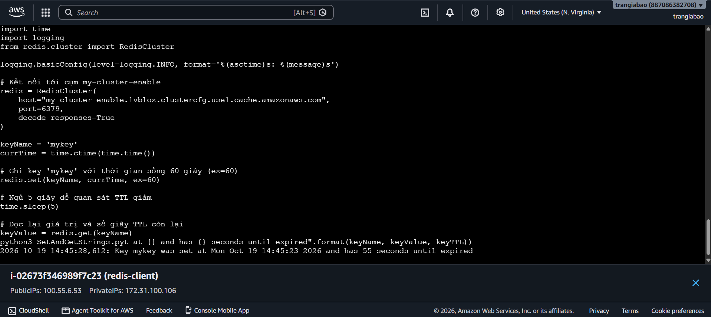

#### Bước 24: Thao tác cấu trúc dữ liệu bảng băm Hash (`SetAndGetHash.py`)
* **Thao tác:** Viết script lưu trữ đối tượng Hash gồm 2 trường (`datetime` và `epochtime`) kèm cơ chế tự động xóa key cũ để chống xung đột kiểu dữ liệu.
* **Lệnh thực thi:**
  ```bash
  python3 SetAndGetHash.py
  ```
* **Kết quả:**
  ```text
  2026-10-19 14:49:02,703: Key mykey was set at {'datetime': 'Mon Oct 19 14:48:57 2026', 'epochtime': '1792421337.696463'} and has 55 seconds until expired
  ```

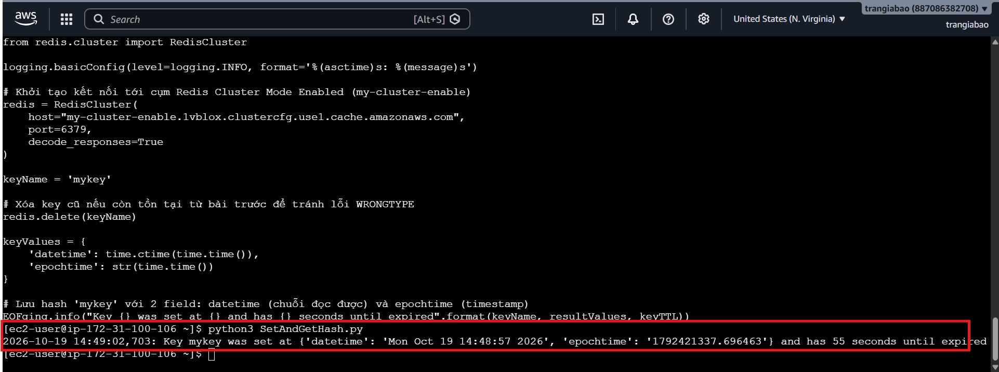

{}
💡 **Khó khăn gặp phải & Cách xử lý tại Bước 24 (Lỗi xung đột kiểu dữ liệu `WRONGTYPE`):**
<br>Ở bài 23, khóa `mykey` được lưu dưới dạng chuỗi (`String`). Khi sang bài 24, nếu thực hiện lệnh `hset(mykey, ...)` ngay khi key cũ chưa hết 60 giây TTL, Redis sẽ từ chối và báo lỗi `WRONGTYPE Operation against a key holding the wrong kind of value`. Để giải quyết triệt để, trong script `SetAndGetHash.py` cần thêm dòng lệnh `redis.delete(keyName)` ở đầu chương trình để dọn sạch key cũ trước khi ghi cấu trúc Hash mới.
{}

#### Bước 25: Triển khai mô hình phát/nhận thông điệp thời gian thực Pub/Sub (`PubAndSub.py`)
* **Thao tác:** Khởi tạo luồng Subscriber bất đồng bộ lắng nghe trên kênh `mychannel` qua phương thức `run_in_thread`, đồng thời vòng lặp chính liên tục phát (Publish) các thông điệp kèm dấu thời gian.
* **Lệnh thực thi:**
  ```bash
  python3 PubAndSub.py
  ```
* **Kết quả:** Luồng subscriber tiếp nhận các gói tin và hiển thị thời gian thực liên tục:
  ```text
  INFO:root:{'type': 'message', 'pattern': None, 'channel': 'mychannel', 'data': 'My message'}
  INFO:root:{'type': 'message', 'pattern': None, 'channel': 'mychannel', 'data': 'Mon Oct 19 15:03:07 2026'}
  INFO:root:{'type': 'message', 'pattern': None, 'channel': 'mychannel', 'data': 'Mon Oct 19 15:03:08 2026'}
  ```

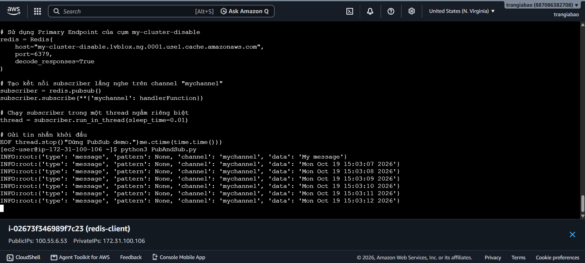

#### Bước 26: Xác nhận luồng tin nhắn Pub/Sub ổn định và cơ chế dừng an toàn
* **Quan sát:** Các gói tin được truyền phát với độ trễ gần như bằng 0 (sub-millisecond latency). Chương trình được bọc trong khối `try...except KeyboardInterrupt` cho phép người dùng dừng kịch bản gọn gàng bằng tổ hợp phím `Ctrl + C` mà không làm crash tiến trình.

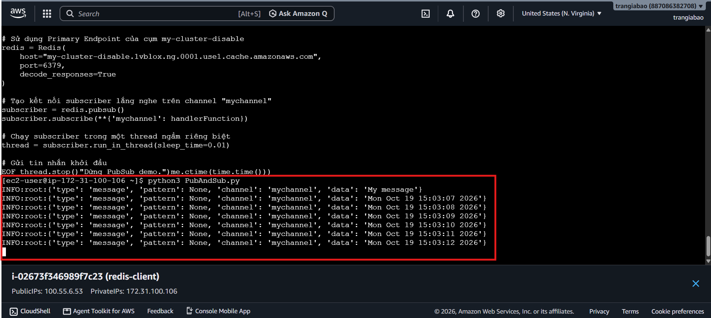

---

### 🔍 Tổng kết 12 Khó khăn Kỹ thuật Thực tế & Giải pháp Đã Xử lý Thành công:

1. **Bảng định tuyến dính route Blackhole làm mất kết nối mạng:**
   * *Hiện tượng:* EC2 Instance Connect không thể kết nối, các lệnh cài gói phần mềm bị treo timeout.
   * *Nguyên nhân:* Tuyến `0.0.0.0/0` trỏ vào một Internet Gateway cũ đã bị xóa khỏi VPC.
   * *Xử lý:* Tạo Internet Gateway mới `my-igw`, đính kèm vào VPC và sửa lại tuyến `0.0.0.0/0 -> my-igw`.
2. **Lệnh `pip3` không tìm thấy (`-bash: pip3: command not found`):**
   * *Hiện tượng:* Gõ `pip3 install redis` trên máy ảo EC2 bị báo lệnh không tồn tại.
   * *Nguyên nhân:* Môi trường Amazon Linux 2023 tối giản không tích hợp sẵn công cụ pip.
   * *Xử lý:* Chạy lệnh cài đặt `sudo dnf install -y python3-pip`.
3. **Lỗi thiếu thư viện `redis` (`ModuleNotFoundError: No module named 'redis'`):**
   * *Hiện tượng:* Chạy mã nguồn Python trên EC2 bị báo thiếu module giao tiếp với Redis.
   * *Nguyên nhân:* Chưa cài driver `redis-py` trong hệ thống.
   * *Xử lý:* Chạy lệnh `pip3 install redis` để cài đặt thư viện phiên bản mới nhất.
4. **Thư viện `rediscluster` bị khai tử (deprecated):**
   * *Hiện tượng:* Tài liệu gốc yêu cầu `from rediscluster import RedisCluster` khiến code văng lỗi import.
   * *Nguyên nhân:* Gói `redis-py-cluster` đã dừng phát triển và được sáp nhập trực tiếp vào thư viện chính thức `redis`.
   * *Xử lý:* Đổi cú pháp import thành `from redis.cluster import RedisCluster`.
5. **Endpoint dạng placeholder `xxx.yyy...` trong tài liệu:**
   * *Hiện tượng:* Copy code mẫu dán vào terminal báo lỗi không phân giải được tên miền máy chủ.
   * *Nguyên nhân:* Tài liệu để ký hiệu ví dụ, không phải endpoint thực tế của hạ tầng vừa tạo.
   * *Xử lý:* Lấy đúng **Configuration Endpoint** thực tế của cụm `my-cluster-enable` trên AWS Console để thay thế.
6. **Code mẫu Strings và Hash thiếu đoạn khởi tạo kết nối:**
   * *Hiện tượng:* Chạy file script báo lỗi `NameError: name 'redis' is not defined`.
   * *Nguyên nhân:* Tác giả workshop giả định người dùng chạy Interactive Shell nơi biến `redis` đã được tạo từ bài trước.
   * *Xử lý:* Bổ sung khối khởi tạo kết nối `RedisCluster(...)` vào đầu cả 2 file script.
7. **Xung đột kiểu dữ liệu Redis (`WRONGTYPE`):**
   * *Hiện tượng:* Chạy bài lưu Hash báo lỗi `WRONGTYPE Operation against a key holding the wrong kind of value`.
   * *Nguyên nhân:* Key `mykey` vừa được lưu kiểu String ở bài trước và vẫn còn thời gian sống TTL 60 giây.
   * *Xử lý:* Thêm lệnh xóa an toàn `redis.delete(keyName)` ở đầu bài Hash trước khi gọi `hset`.
8. **Code mẫu Pub/Sub thiếu import và vòng lặp vô hạn:**
   * *Hiện tượng:* Báo lỗi `NameError: name 'Redis' is not defined` và vòng lặp `while True` làm đơ terminal.
   * *Nguyên nhân:* Thiếu import `from redis import Redis` và thiếu khối bắt sự kiện ngắt bàn phím.
   * *Xử lý:* Bổ sung import và bọc vòng lặp trong `try...except KeyboardInterrupt` để dừng sạch bằng `Ctrl + C`.
9. **Không thể kết nối tới Redis từ máy tính cá nhân (Connection Timed Out):**
   * *Hiện tượng:* Chạy code từ máy local bị treo và timeout.
   * *Nguyên nhân:* Cụm ElastiCache nằm trong Private VPC, không có Public IP và không định tuyến ra Internet.
   * *Xử lý:* Dựng máy ảo EC2 Client cùng VPC, mở port 6379 trên Security Group và chạy toàn bộ mã nguồn từ bên trong EC2.
10. **Lỗi Subnet Group thiếu Availability Zones khi tạo cụm Sharding:**
    * *Hiện tượng:* Bị lỗi `Each Node Group needs to have at least two distinct Availability Zones`.
    * *Nguyên nhân:* Cụm Multi-AZ và Cluster Mode Enabled bắt buộc các node phải nằm trên tối thiểu 2 AZs khác nhau.
    * *Xử lý:* Cấu hình `subnet-group` bao gồm đủ 3 Subnets tại 3 AZs (`us-east-1a`, `us-east-1b`, `us-east-1c`).
11. **Lỗi nghiêm trọng khi tạo cụm RBAC khi chưa có User Group (`UserGroupNotFoundFault: User group mygroup not found`):**
    * *Hiện tượng:* Chạy script `ClusterModeDisabledWithRBAC.py` bị AWS API từ chối với mã lỗi `UserGroupNotFoundFault`.
    * *Nguyên nhân:* Tham số `UserGroupIds=['mygroup']` (hoặc `testusergroup`) trỏ tới nhóm quyền chưa hề được tạo trên hệ thống ElastiCache.
    * *Xử lý:* Chạy kịch bản `UserAndUserGroups.py` để khởi tạo người dùng `myuser`, người dùng bắt buộc `default`, và gom vào User Group `mygroup` trước. Sau khi tạo xong User Group thì kịch bản tạo cụm RBAC chạy thành công mỹ mãn với HTTP 200.
12. **Lỗi cú pháp Python trong file mẫu SDK `ClusterModeDisabledWithRBAC.py`:**
    * *Hiện tượng:* Bị lỗi `SyntaxError: non-default argument follows default argument`.
    * *Nguyên nhân:* Tham số không có giá trị mặc định đặt phía sau tham số có giá trị mặc định trong định nghĩa hàm.
    * *Xử lý:* Gán giá trị mặc định `CacheSubnetGroupName=None` cho tham số trong hàm.
