---
title: "Week 5"
date: 2026-10-12
weight: 5
chapter: false
pre: " <b> 1.5. </b> "
---


### Week 5 Objectives:

- Architect and deploy a bidirectional **Hybrid DNS** resolution topology connecting on-premises enterprise networks with AWS via **Amazon Route 53 Resolver**.
- Master the **AWS Command Line Interface (AWS CLI v2)** and configure **Multiple Named Profiles** to automate foundational infrastructure (S3, SNS, VPC, EC2).
- Administer non-relational database tables via **Amazon DynamoDB**, optimize access patterns with **Global Secondary Indexes (GSI)**, and implement SDK automation via **Python Boto3**.
- Deploy distributed in-memory caching clusters with **Amazon ElastiCache - Redis** (Cluster Mode Disabled & Enabled), enforce TLS/RBAC security, and develop client code.
- Synthesize all Week 5 knowledge, finalize comprehensive Worklog documentation, and advance the internship capstone project (**Project Proposal**).

---

### Tasks to be Carried Out This Week:

| Day           | Tasks                                                                                                                                                                                                                                                                                                                                                                                                                                                                                                                                                                        | Start Date | Completion Date | Reference Sources                                                |
| :------------ | :--------------------------------------------------------------------------------------------------------------------------------------------------------------------------------------------------------------------------------------------------------------------------------------------------------------------------------------------------------------------------------------------------------------------------------------------------------------------------------------------------------------------------------------------------------------------------- | :--------- | :-------------- | :--------------------------------------------------------------- |
| **Monday**    | **Set up Hybrid DNS with Route 53 Resolver:** <br>- Deploy multi-VPC CloudFormation stack & configure Security Groups. <br>- Deploy AWS Managed Microsoft AD acting as on-premises enterprise DNS. <br>- Build Route 53 Outbound Endpoints & Resolver Rules. <br>- Build Inbound Endpoints & validate bidirectional resolution via `nslookup`.                                                                                                                                                                                                                      | 12/10/2026 | 12/10/2026      | [Hybrid DNS Workshop](https://000010.awsfcaj.com/)         |
| **Tuesday**   | **Command Line Operations with AWS CLI:** <br>- Set up IAM Groups, Users & CLI Access Keys. <br>- Launch EC2 Management Workstation & connect via MobaXterm. <br>- Install AWS CLI v2 & configure multiple profiles (`default`, `devops`). <br>- Administer Amazon S3, Amazon SNS & IAM via CLI. <br>- Construct VPC Network & automate EC2 lifecycle.                                                                                                                                                                                                                       | 13/10/2026 | 13/10/2026      | [AWS CLI Workshop](https://000011.awsfcaj.com/)            |
| **Wednesday** | **Work with Amazon DynamoDB:** <br>- Administer NoSQL database tables via AWS Management Console. <br>- Execute command-line CRUD operations and manage GSIs using AWS CloudShell. <br>- Master DynamoDB Partition Key distribution and GSI Backfilling mechanisms. <br>- Programmatic SDK automation using Python 3 and Boto3. <br>- Ingest benchmark payload of 4,609 movies (`moviedata.json`), Query & Scan.                                                                                                                                                             | 14/10/2026 | 14/10/2026      | [DynamoDB Workshop](https://000060.awsfcaj.com/)           |
| **Thursday**  | **Deploy Amazon ElastiCache - Redis:** <br>- Design VPC 3 AZs network topology & create Subnet Group. <br>- Provision Cluster Mode Disabled & Enabled on Web Console. <br>- Automate cluster deployment using Python Boto3 SDK. <br>- Configure TLS Transit Encryption & RBAC Users/Groups. <br>- Programmatic Python operations (Strings TTL, Hash, Pub/Sub).                                                                                                                                                                                                               | 15/10/2026 | 15/10/2026      | [ElastiCache Workshop](https://000061.awsfcaj.com/)        |
| **Friday**    | **Week 5 Review, Worklog & Project:** <br>- Synthesize concepts across Route 53 Resolver, AWS CLI, DynamoDB, and ElastiCache Redis. <br>- Finalize technical details and evidence screenshots for Worklogs 1.5.1 through 1.5.4. <br>- Research cloud architectural patterns and advance internship project proposal deliverables.                                                                                                                                                                                                                                        | 16/10/2026 | 16/10/2026      | [Internal Review & Project Documentation](/2-proposal/)          |

---

### Week 5 Achievements:

#### 📌 Monday (12/10/2026) - Set up Hybrid DNS with Route 53 Resolver:

{}
The **Hybrid DNS with Route 53 Resolver** (Hybrid DNS Management with Amazon Route 53) hands-on lab was conducted on **Monday (12/10/2026)** during **Week 5**. This page provides an exhaustive step-by-step implementation guide complete with precise IP CIDR allocations, `nslookup` validation commands, troubleshooting resolutions, and all 11 verification screenshots.
<br>🔗 **Lab Reference Material:** [Set up Hybrid DNS with Route 53 Resolver](https://000010.awsfcaj.com/)
{}

### 🎯 Lab Objectives:
* Master network topology design and **Hybrid DNS** resolution bridging on-premises enterprise networks with AWS cloud environments.
* Automate multi-VPC networking infrastructure deployment via **AWS CloudFormation**.
* Configure **Security Groups** permitting bidirectional DNS queries (UDP and TCP Port 53) across VPC boundaries.
* Deploy **AWS Directory Service (AWS Managed Microsoft Active Directory)** acting as the authoritative on-premises enterprise DNS controller.
* Configure **Route 53 Resolver Outbound Endpoints** and **Resolver Rules** to conditionally forward queries originating in AWS to on-premises DNS servers.
* Configure **Route 53 Resolver Inbound Endpoints** to receive and resolve incoming queries from on-premises clients targeting AWS Private Hosted Zones.
* Validate end-to-end bidirectional DNS resolution using `nslookup`.

---

### 📊 Provisioned Resource Specifications:

| Resource | Name / Identifier | Configuration & Detailed Specs | Environment / Region | Notes |
| :--- | :--- | :--- | :--- | :--- |
| **EC2 Key Pair** | `hybrid-dns-keypair` | RSA, `.pem` format | `us-east-1` | Administrative access to RDGW client |
| **CloudFormation Stack** | `Hybrid-DNS-Stack` | Provisions On-Prem VPC, Cloud VPC, Subnets, Route Tables, NAT GW | `us-east-1` | Automates multi-VPC baseline environment |
| **Security Group** | `Route53-Resolver-SG` | Inbound: TCP/UDP 53 (DNS), Outbound: All traffic | Cloud & On-prem VPCs | Secures DNS Resolver query paths |
| **Microsoft AD** | `corp.example.com` | AWS Managed Microsoft AD Standard Edition | On-Prem VPC | Authoritative on-premises DNS controller |
| **Outbound Endpoint** | `r53-outbound-resolver` | 2 IP Endpoints across 2 Availability Zones | Cloud VPC Subnets | Forwards AWS queries to On-Prem |
| **Resolver Forwarding Rule** | `forward-to-corp-ad` | Forwards `corp.example.com` to Active Directory IPs | Cloud VPC Association | Routes on-premises domain queries |
| **Inbound Endpoint** | `r53-inbound-resolver` | 2 IP Endpoints across 2 Availability Zones | Cloud VPC Subnets | Accepts on-premises queries to AWS |
| **Test Client EC2** | `RDGW-Client-Tester` | Windows Server 2022 / Amazon Linux | Test Environment | Executes `nslookup` validation scripts |

---

### 🚀 Step-by-Step Implementation & Screenshot Gallery:

#### Step 1: Create Administrative EC2 Key Pair (`hybrid-dns-keypair`)
* **Action / Navigation:** Open the **Amazon EC2** console in **us-east-1** (N. Virginia) ➔ In the sidebar, select **Network & Security** ➔ **Key Pairs** ➔ Click **Create key pair**.
* **Configuration Parameters:**
  * *Name:* `hybrid-dns-keypair`
  * *Key pair type:* `RSA`
  * *Private key file format:* `.pem` (for SSH or Windows Administrator password decryption)
* **Next Action:** Click **Create key pair** and securely store the downloaded `.pem` file.

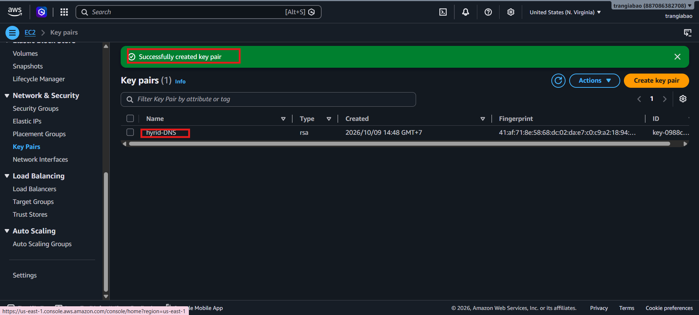

---

#### Step 2: Deploy Multi-VPC Topology via AWS CloudFormation
* **Action / Navigation:** Navigate to **AWS CloudFormation** ➔ Click **Create stack (with new resources)** ➔ Select **Upload a template file**.
* **Configuration Parameters:**
  * *Stack name:* `Hybrid-DNS-Stack`
  * *Parameters:* Select Key Pair `hybrid-dns-keypair` created in Step 1
* **Purpose:** Automatically provisions two isolated VPCs (simulated Cloud VPC `10.0.0.0/16` and On-premises VPC `192.168.0.0/16`), establishes VPC Peering, Internet Gateways, Subnets, and Route Tables.

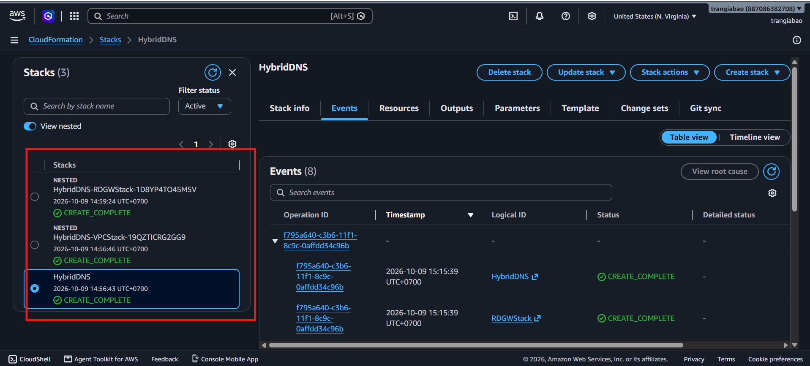

---

#### Step 3: Select Security Group for Route 53 Resolver Endpoints
* **Action / Navigation:** Navigate to **EC2 Console** ➔ Under **Network & Security** ➔ Select **Security Groups**.
* **Selection:** Locate the designated Security Group named `Route53-Resolver-SG` (created by CloudFormation for Resolver endpoints).

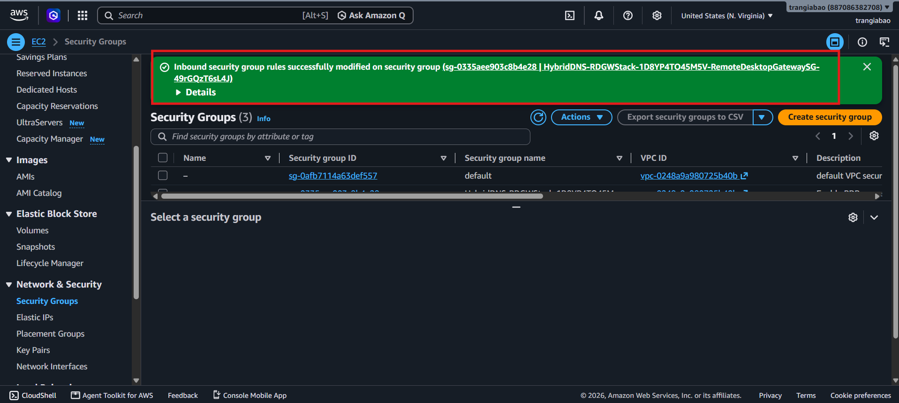

---

#### Step 4: Configure Inbound Rules (Allow Port 53 UDP & TCP)
* **Action / Navigation:** Select the **Inbound rules** tab ➔ Click **Edit inbound rules**.
* **Configuration Parameters:**
  * *Rule 1:* Type `DNS (UDP)`, Port `53`, Source: On-premises VPC CIDR (`192.168.0.0/16`) and Cloud VPC CIDR (`10.0.0.0/16`)
  * *Rule 2:* Type `DNS (TCP)`, Port `53`, Source: On-premises VPC CIDR (`192.168.0.0/16`) and Cloud VPC CIDR (`10.0.0.0/16`)
* **Next Action:** Click **Save rules**.

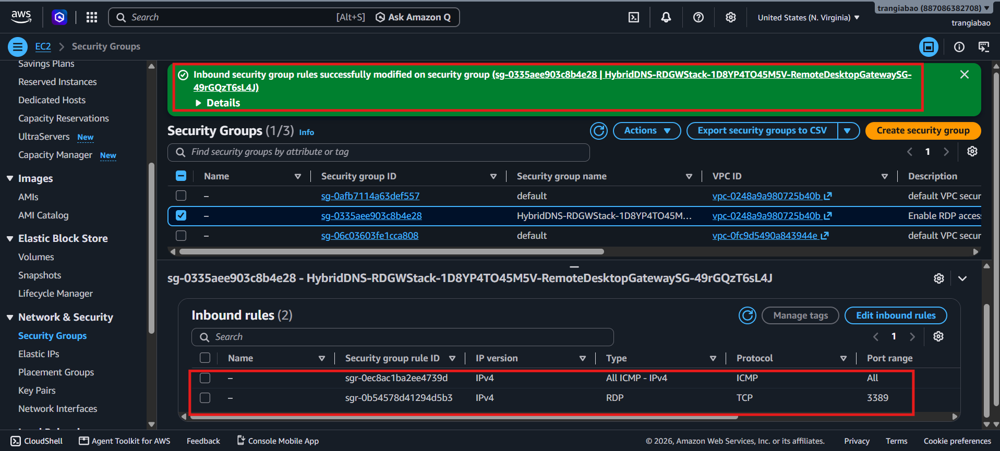

> **💡 Difficulties Encountered & Troubleshooting at Step 4:**  
> A frequent pitfall is opening only **UDP 53** while omitting **TCP 53**. Standard lightweight queries use UDP, but DNS queries exceeding 512 bytes (such as DNSSEC or large responses) automatically fallback to TCP. Without TCP 53, queries will experience intermittent timeouts. Always configure both UDP and TCP rules.

---

#### Step 5: Verify Port 53 Security Group Inbound Permissions
* **Action / Navigation:** Review the finalized Inbound rules table.
* **Observation:** Both DNS (UDP) and DNS (TCP) rules on port 53 are verified active across internal VPC ranges.

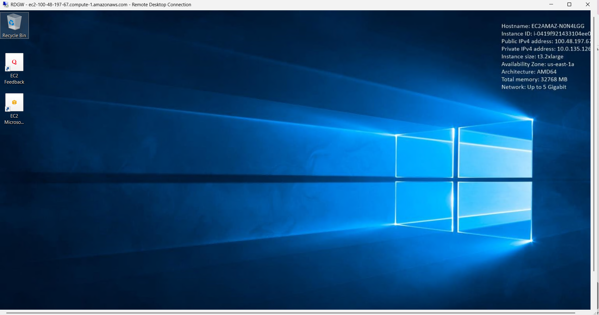

---

#### Step 6: Provision AWS Managed Microsoft Active Directory
* **Action / Navigation:** Navigate to **AWS Directory Service** ➔ Click **Set up directory** ➔ Select **AWS Managed Microsoft AD**.
* **Configuration Parameters:**
  * *Edition:* `Standard Edition`
  * *Directory DNS name:* `corp.example.com`
  * *Directory NetBIOS name:* `CORP`
  * *VPC:* Select On-premises VPC (`192.168.0.0/16`)
  * *Subnets:* Select 2 Private Subnets across distinct Availability Zones
* **Purpose:** Simulates the authoritative corporate Domain Controller and internal DNS server.

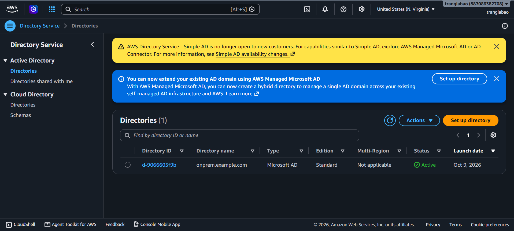

---

#### Step 7: Inspect Directory Status & Note Active Directory DNS IPs
* **Action / Navigation:** Allow 15-20 minutes for directory provisioning, then open directory details.
* **Details Recorded:**
  * *Status:* **Active**
  * *DNS address 1:* `192.168.1.xxx`
  * *DNS address 2:* `192.168.2.xxx`
* **Note:** These two DNS IP addresses represent target endpoints for Route 53 Resolver forwarding rules.

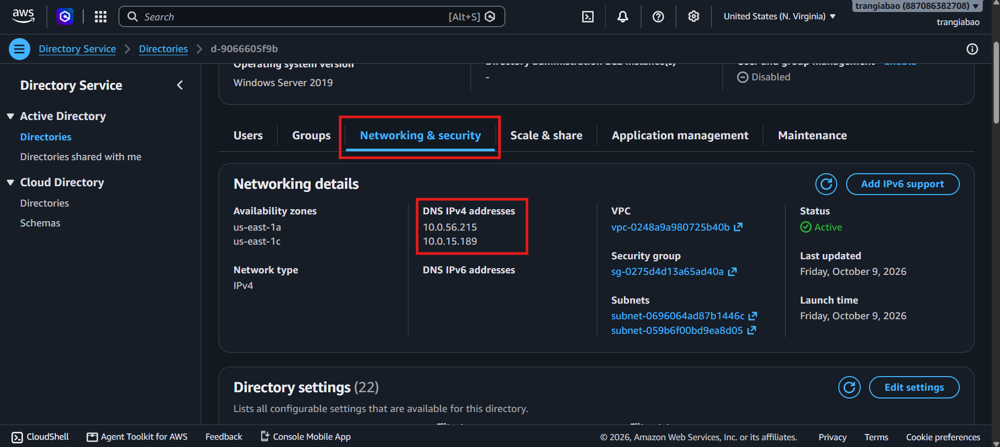

---

#### Step 8: Provision Route 53 Resolver Outbound Endpoint (`r53-outbound-resolver`)
* **Action / Navigation:** Navigate to **Amazon Route 53** ➔ Under *Resolver*, click **Outbound endpoints** ➔ Click **Create outbound endpoint**.
* **Configuration Parameters:**
  * *Endpoint name:* `r53-outbound-resolver`
  * *VPC:* Select Cloud VPC (`10.0.0.0/16`)
  * *Security Group:* Select `Route53-Resolver-SG` verified in Step 5
  * *IP addresses:* Choose at least **2 Availability Zones**, assign 1 subnet per AZ, and choose Auto-allocate IP
* **Next Action:** Click **Submit**. Verify operational status transitions to **Operational**.

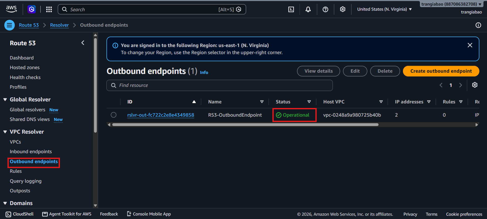

> **💡 Difficulties Encountered & Troubleshooting at Step 8:**  
> Route 53 Resolver strictly mandates a minimum of two IP endpoints residing in separate Availability Zones for High Availability redundancy. Selecting only one AZ halts the wizard.

---

#### Step 9: Configure Resolver Forwarding Rule for `corp.example.com`
* **Action / Navigation:** In the sidebar, select **Resolver** ➔ **Rules** ➔ Click **Create rule**.
* **Configuration Parameters:**
  * *Rule name:* `forward-to-corp-ad`
  * *Rule type:* **Forward**
  * *Domain name:* `corp.example.com`
  * *VPCs that use this rule:* Associate Cloud VPC
  * *Outbound endpoint:* Select `r53-outbound-resolver`
  * *Target IP addresses:* Enter the **2 Microsoft AD DNS IP addresses** recorded in Step 7 (Port `53`)
* **Next Action:** Click **Submit**.

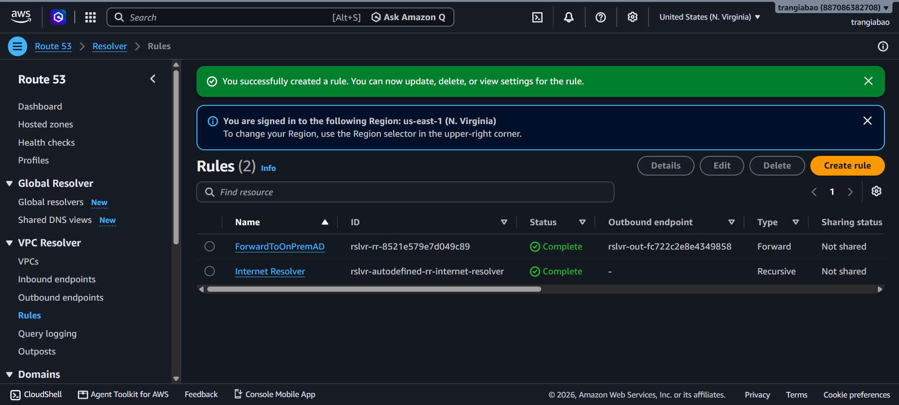

---

#### Step 10: Provision Route 53 Resolver Inbound Endpoint (`r53-inbound-resolver`)
* **Action / Navigation:** In the sidebar, select **Resolver** ➔ **Inbound endpoints** ➔ Click **Create inbound endpoint**.
* **Configuration Parameters:**
  * *Endpoint name:* `r53-inbound-resolver`
  * *VPC:* Select Cloud VPC (`10.0.0.0/16`)
  * *Security Group:* Select `Route53-Resolver-SG`
  * *IP addresses:* Choose 2 Availability Zones and matching subnets
* **Purpose:** Exposes static private IP addresses within AWS for on-premises DNS conditional forwarders to query AWS Private Hosted Zones (e.g., `aws.local`).

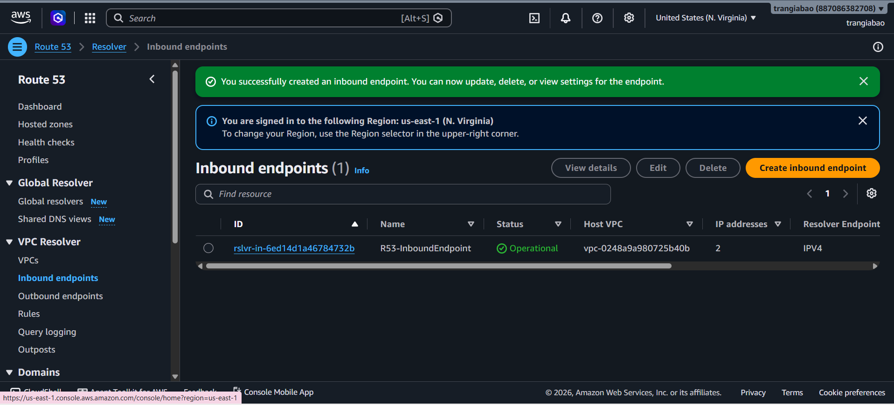

---

#### Step 11: Validate Bidirectional DNS Resolution via `nslookup`
* **Action / Navigation:** Connect to the test instance (RDGW or Linux test client) and execute bidirectional DNS lookups.
* **Commands Executed:**
  ```powershell
  # 1. Query on-premises domain from AWS Cloud via Outbound Endpoint
  nslookup dc01.corp.example.com

  # 2. Query AWS private hosted zone from On-premises via Inbound Endpoint
  nslookup app.aws.local <Inbound-Endpoint-IP>
  ```
* **Output:** Both lookups return resolved internal IP addresses without NXDOMAIN errors or timeouts, confirming seamless bidirectional Hybrid DNS operation.

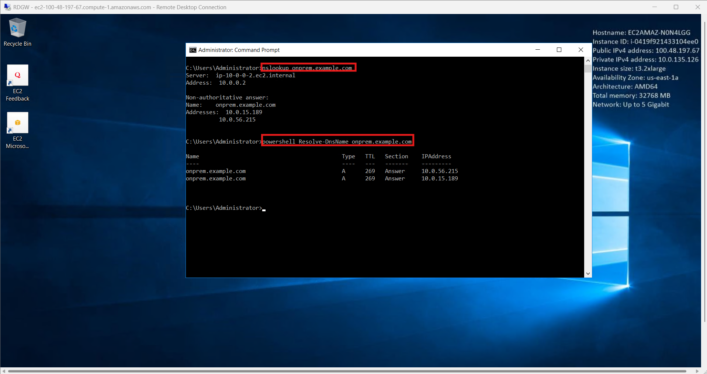

---

### 📝 Summary & Key Takeaways:
1. **Seamless Hybrid DNS Architecture:** Route 53 Resolver delivers an enterprise-grade DNS bridge, completely replacing burdensome, self-managed BIND forwarder instances on EC2.
2. **Clear Inbound vs Outbound Demarcation:**
   * **Inbound Endpoint:** Ingests external on-premises DNS queries into AWS to resolve Private Hosted Zones.
   * **Outbound Endpoint:** Forwards internal AWS queries out to on-premises DNS controllers via Resolver Rules.
3. **Migration Acceleration:** Enables migrating cloud workloads to interact with legacy on-premises databases, SAP, and ERP systems using standard internal domain names without rewriting network configuration strings.

- **Hybrid Cloud Networking Architecture:** Understood the DNS resolution challenge when bridging traditional on-premises enterprise data centers with AWS Cloud environments.
- **Bidirectional DNS Routing:** Mastered the core principles of Route 53 Resolver Inbound and Outbound Endpoints to enable seamless domain lookup across both networks.
- **Validation & Troubleshooting:** Verified low-latency domain lookup and end-to-end name resolution accuracy using `nslookup` across multi-VPC enterprise topologies.

---

#### 📌 Tuesday (13/10/2026) - Command Line Operations with AWS CLI:

{}
The **Command Line Operations with AWS CLI** workshop was conducted on **Tuesday (13/10/2026)** as part of **Week 5**. This page records the authentic step-by-step walkthrough: exact console clicks, specific parameter inputs, shell commands executed, and resolution of encountered technical issues.
<br>🔗 **Workshop Reference:** [Getting Started with the AWS CLI](https://000011.awsfcaj.com/)
{}

### 🎯 Lab Objectives:
* Establish a standard practice environment using **IAM User Groups**, **IAM Users** (`aws-cli-user`, `devops`), and generated **CLI Access Keys**.
* Launch an **Amazon EC2 Management Instance (Amazon Linux 2023)** workstation and establish secure remote access via **MobaXterm**.
* Install the latest version of **AWS CLI v2** in a Linux environment and configure multiple profiles (`default`, `devops`).
* Use AWS CLI to manage object storage on **Amazon S3** (bucket creation, file upload, object listing, and safe deletion using the `--force` flag).
* Administer notification messaging services using **Amazon SNS** (Topic creation, Email subscription, subscription confirmation, and CLI message publication).
* Construct a complete **Amazon VPC** networking architecture via CLI (VPC, Subnet, Internet Gateway, Route Table, and route associations).
* Automate the complete compute lifecycle of **Amazon EC2** via CLI (Key Pair creation, Security Group configuration, opening inbound port 22, executing `run-instances`, allocating/associating an Elastic IP, SSH verification, and terminating instances).

---

### 📊 Provisioned Resource Specifications:

| Resource | Name / Identifier | Configuration & Detailed Specs | Region | Notes |
| :--- | :--- | :--- | :--- | :--- |
| **IAM Group** | `aws-cli` | Policy: `AdministratorAccess` | Global | Centralized privilege management |
| **IAM User 1** | `aws-cli-user` | Group: `aws-cli` + CLI Access Key | Global | Configured for `default` profile |
| **IAM User 2** | `devops` | Group: `aws-cli` + CLI Access Key | Global | Configured for `--profile devops` |
| **EC2 Management** | `aws-cli-instance` | `t3.micro`, Amazon Linux 2023, Key: `aws-cli-keypair` | `us-east-1` | Bastion workstation connected via MobaXterm |
| **Management Subnet**| `subnet-01` | CIDR: `172.31.100.0/24`, Auto-assign Public IP: Yes | `us-east-1` | Subnet with Internet Gateway routing |
| **S3 Bucket** | `aws-cli-trangiabao-2026` | Standard Storage, Globally unique bucket name | `ap-southeast-1` | Object storage for testing file `text.txt` |
| **SNS Topic** | `aws-cli` | ARN: `arn:aws:sns:ap-southeast-1:887086382708:aws-cli` | `ap-southeast-1` | Notification topic for email alerts |
| **VPC (via CLI)** | `vpc-07ebcfa7f5b9c659c` | CIDR: `10.0.0.0/16` | `ap-southeast-1` | Isolated custom network infrastructure |
| **Subnet (via CLI)** | `subnet-03c90d43fb1f53b06` | CIDR: `10.0.1.0/24`, AZ: `ap-southeast-1a` | `ap-southeast-1` | Subnet hosting CLI-provisioned EC2 |
| **Internet Gateway** | `igw-006783ef67381e1d4` | Attached to `vpc-07ebcfa7f5b9c659c` | `ap-southeast-1` | VPC Internet egress gateway |
| **Route Table (CLI)**| `rtb-xxxx` | Route: `0.0.0.0/0` targeted to Internet Gateway | `ap-southeast-1` | Routes internet traffic for custom subnet |
| **Key Pair (CLI)** | `MyKeyPair` | Type: RSA, file saved as: `MyKeyPair.pem` (chmod 400)| `ap-southeast-1` | SSH credential for automated EC2 |
| **Security Group** | `SSHAccess` | Inbound: Port 22 (TCP) from `0.0.0.0/0` | `ap-southeast-1` | Firewall rule allowing remote SSH |
| **Automated EC2** | `i-03171455cd0278073` | `t2.micro`, Private IP: `10.0.1.41` | `ap-southeast-1` | Automated EC2 instance launched via CLI |
| **Elastic IP** | `47.131.189.63` | Allocation: `eipalloc-0f52955fe9fe8ad41` | `ap-southeast-1` | Public IP attached to access instance |

---

### 📋 Section 1: Prerequisites & Identity Setup

#### Step 1: Create an IAM User Group
* **Action:** Log in to the AWS Management Console ➔ Navigate to **IAM** ➔ In the left navigation pane, select **User groups** ➔ Click **Create group**.
* **Purpose:** Establish a centralized group for granting administrative privileges to CLI users.

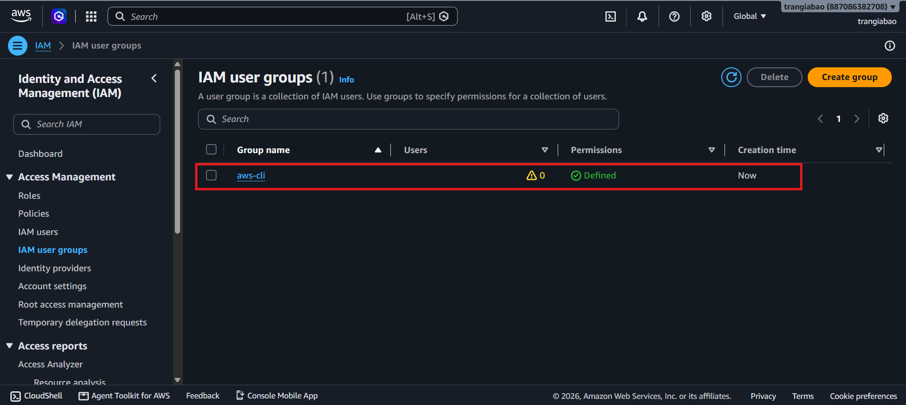

#### Step 2: Configure Group Parameters for `aws-cli`
* **Input Parameters:**
  * **User group name:** `aws-cli`
  * **Attach permissions policies:** Search and select **`AdministratorAccess`**.
* **Action:** Scroll to the bottom and click **Create group**.

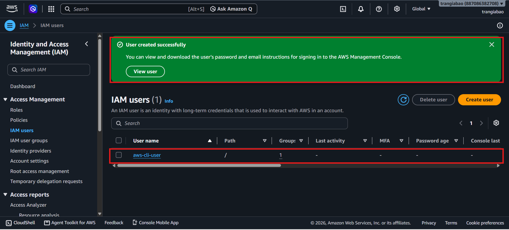

#### Step 3: Create IAM User `aws-cli-user`
* **Action:** In the left navigation pane, select **Users** ➔ Click **Create user**.
* **Input Parameters:**
  * **User name:** `aws-cli-user`
  * **Add user to group:** Check the **`aws-cli`** group created in Step 2.
* **Action:** Click **Next** ➔ Click **Create user**.

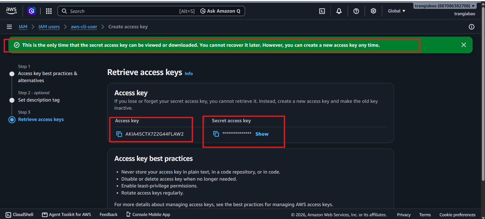

#### Step 4: Provision CLI Access Key for `aws-cli-user`
* **Action:** Click on user **`aws-cli-user`** ➔ Open the **Security credentials** tab ➔ Scroll down to *Access keys* ➔ Click **Create access key**.
* **Options Selected:**
  * **Use case:** Select **Command Line Interface (CLI)**.
  * **Confirmation:** Check *"I understand the above recommendation..."*.
* **Action:** Click **Next** ➔ Click **Create access key** ➔ Download the `.csv` file containing the **Access key ID** and **Secret access key**.

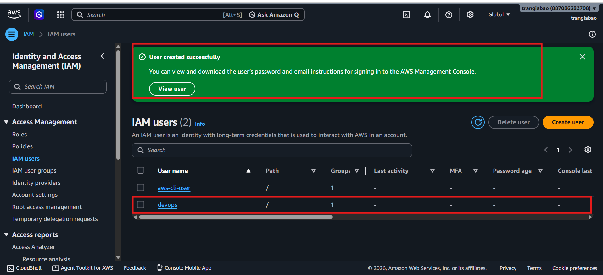

#### Step 5: Create Second IAM User `devops` for Multi-Profile
* **Action:** Repeat the user creation process for a second user named **`devops`**.
* **Input Parameters:**
  * **User name:** `devops`
  * **User group:** Assign to group `aws-cli`.
  * **Access Key:** Generate a separate CLI Access Key pair and save securely.

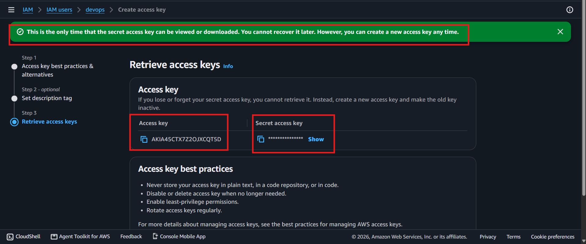

#### Step 6: Launch EC2 Management Workstation (`aws-cli-instance`)
* **Action:** Open the **EC2** console ➔ Click **Instances** ➔ Click **Launch instances**.
* **Specific Parameters:**
  * **Name:** `aws-cli-instance`
  * **Application and OS Images (AMI):** Select `Amazon Linux 2023 kernel-6.1 AMI`.
  * **Instance type:** `t3.micro` (or `t2.micro`).
  * **Key pair (login):** Click *Create new key pair* ➔ Name it **`aws-cli-keypair`**, type **RSA**, format **`.pem`** ➔ Download to local disk.
  * **Network settings:** Click **Edit** and configure:
    * *VPC:* Select your default VPC (`vpc-0fc9d5490a843944e`).
    * *Subnet:* Select `subnet-01` (CIDR `172.31.100.0/24`).
    * *Auto-assign public IP:* **`Enable`** *(required to acquire a public IP for SSH)*.
    * *Firewall (Security group):* Choose *Create security group* ➔ Ensure **Allow SSH traffic from Anywhere (0.0.0.0/0)** is enabled.
* **Action:** Click **Launch instance**.

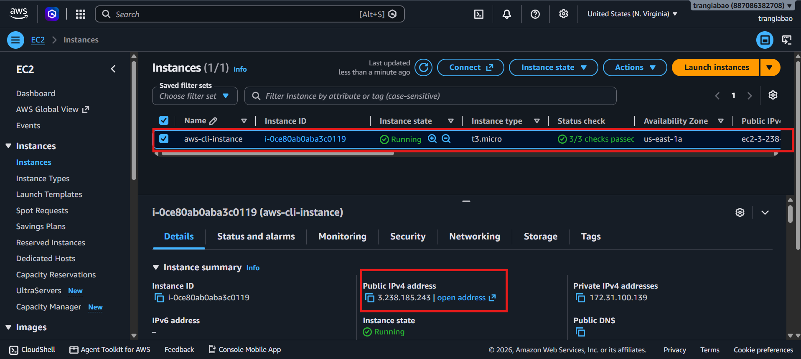

> **💡 Difficulties Encountered & Solution at Step 6:**  
> The Subnet field prevented selecting `default` because default subnets had been deleted during previous lab cleanups.  
> ➔ **Solution:** Navigated to **VPC** ➔ **Subnets** ➔ Clicked **Create subnet**, created a new subnet named `subnet-01` (`172.31.100.0/24`) in `us-east-1a`, then selected this subnet in EC2 Network settings with `Auto-assign public IP: Enable`.

#### Step 7: Connect via SSH Using MobaXterm
* **Action in MobaXterm:**
  1. Open MobaXterm ➔ Click **Session** in the top-left corner ➔ Select **SSH**.
  2. **Remote host:** Enter the **Public IPv4** address of the running instance (e.g. `3.238.185.243` or `32.197.220.215`).
  3. **Specify username:** Check and enter **`ec2-user`**.
  4. **Port:** `22`.
  5. Go to **Advanced SSH settings** ➔ Check **Use private key** ➔ Select the downloaded file **`aws-cli-keypair.pem`**.
  6. Click **OK** ➔ Accept the host key prompt to log in.

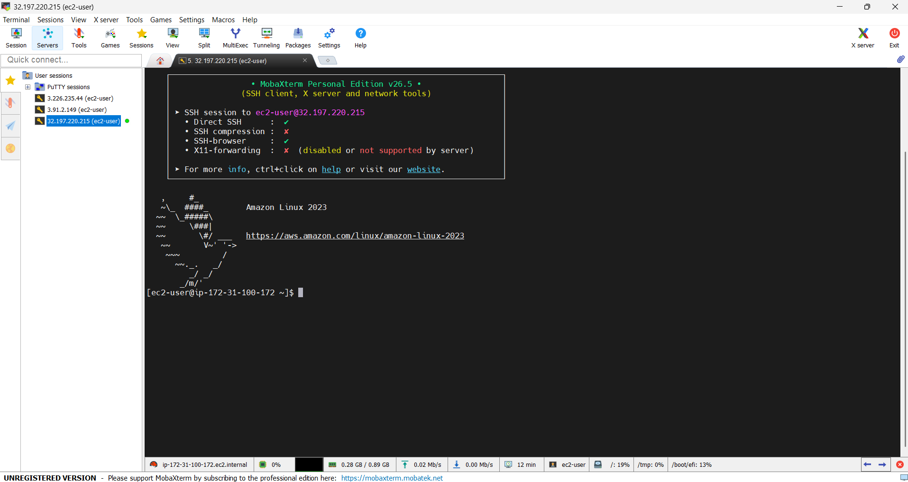

> **💡 Difficulties Encountered & Solution at Step 7:**  
> MobaXterm reported `Network error: Connection timed out`.  
> ➔ **Root Cause:** The manually created `subnet-01` had no default route to an Internet Gateway.  
> ➔ **Solution:** In **VPC** ➔ **Internet gateways**, created `my-igw` and attached it to the VPC. In **Route tables**, edited routes and added `Destination: 0.0.0.0/0` targeted to `Internet Gateway (igw-xxxx)`. Pressed `R` in MobaXterm and connected instantly.

---

### 📋 Section 2: Install & Configure AWS CLI v2

#### Step 8: Install AWS CLI v2 on Linux
* **Commands Executed:** Run the following commands on the remote terminal:
  ```bash
  curl "https://awscli.amazonaws.com/awscli-exe-linux-x86_64.zip" -o "awscliv2.zip"
  unzip awscliv2.zip
  sudo ./aws/install
  aws --version
  ```
* **Verification:** Terminal prints `aws-cli/2.x.x` confirming successful installation.

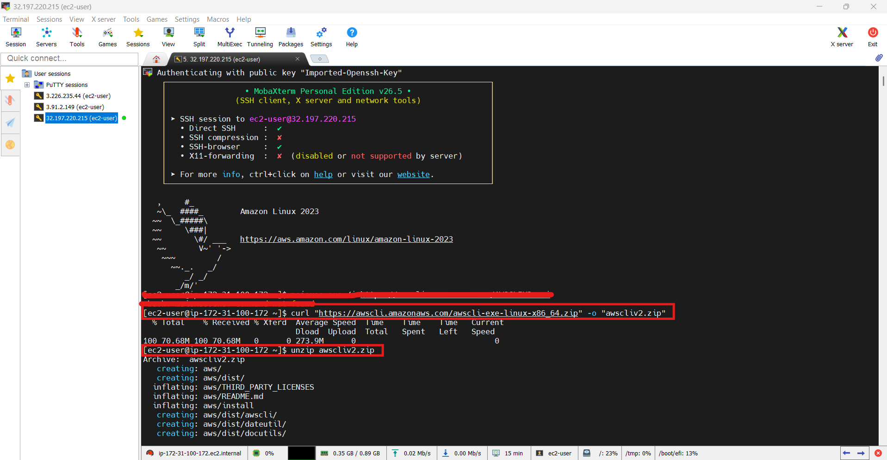

#### Step 9: Configure Default Profile with `aws configure`
* **Command:** `aws configure`
* **Parameters Entered:**
  * `AWS Access Key ID [None]:` Enter Access Key of **`aws-cli-user`** (from Step 4).
  * `AWS Secret Access Key [None]:` Enter Secret Key of **`aws-cli-user`**.
  * `Default region name [None]:` **`ap-southeast-1`** (Singapore).
  * `Default output format [None]:` **`json`**.

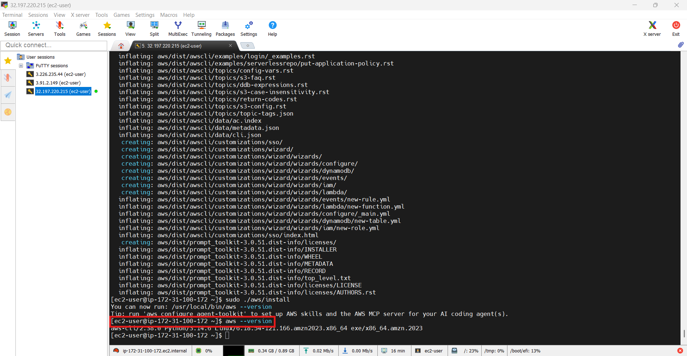

#### Step 10: Configure Named Profile `devops`
* **Command:** `aws configure --profile devops`
* **Parameters Entered:**
  * `AWS Access Key ID [None]:` Enter Access Key of user **`devops`** (from Step 5).
  * `AWS Secret Access Key [None]:` Enter Secret Key of user **`devops`**.
  * `Default region name [None]:` **`ap-southeast-1`**.
  * `Default output format [None]:` **`json`**.

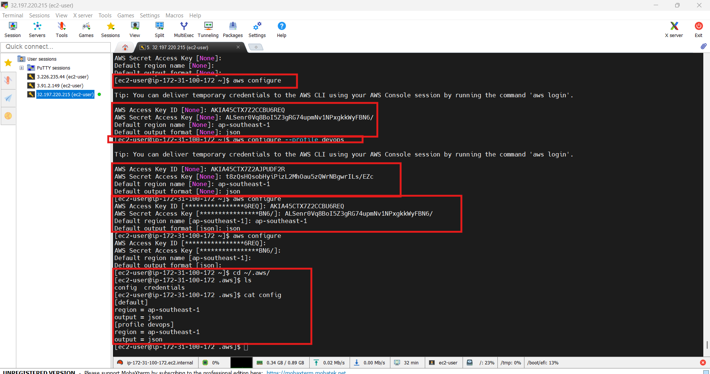

#### Step 11: Inspect Configuration Files and Active Profiles
* **Commands Executed:**
  ```bash
  cat ~/.aws/config
  cat ~/.aws/credentials
  aws configure list-profiles
  ```
* **Output:** Displays separate configurations for `default` and `devops` profiles.

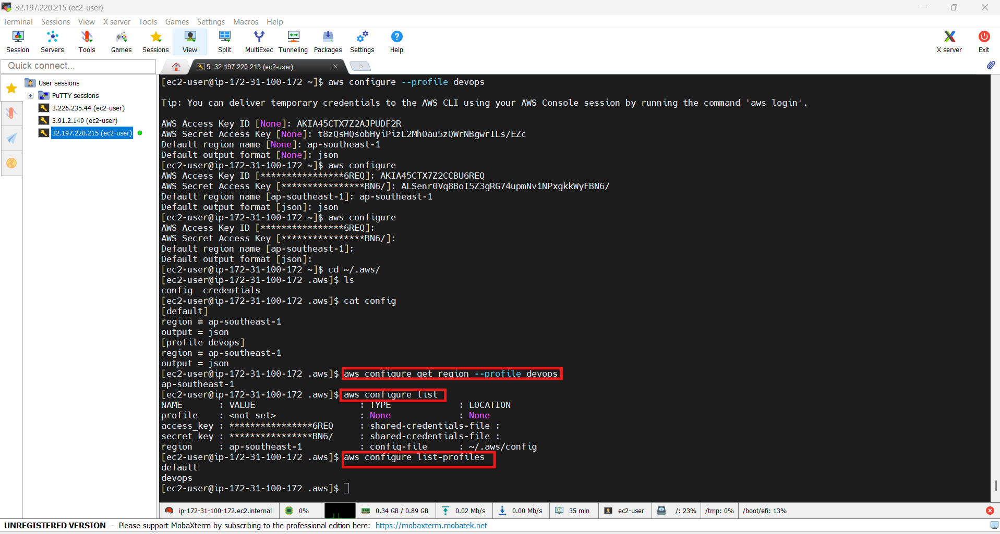

---

### 📋 Section 3: Verify Resources via CLI

#### Step 12: Query EC2 Instance Details
* **Command Executed:**
  ```bash
  aws ec2 describe-instances --profile devops --region us-east-1 --output table
  ```
* **Description:** Retrieves all instance metadata in `us-east-1` and formats the result as a clear table.

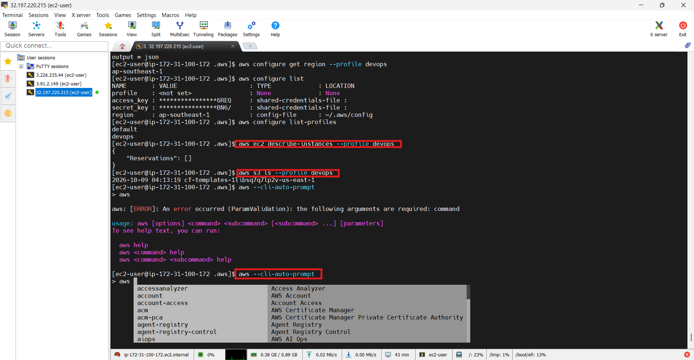

> **💡 Difficulties Encountered & Solution at Step 12:**  
> Running `aws ec2 describe-instances --profile devops` initially returned an empty list `[]`.  
> ➔ **Root Cause:** The `devops` profile default region is `ap-southeast-1` (Singapore), whereas the EC2 management host was launched in `us-east-1`.  
> ➔ **Solution:** Explicitly passed `--region us-east-1` to query the correct region.

#### Step 13: List S3 Storage Buckets
* **Command Executed:**
  ```bash
  aws s3 ls --profile devops
  ```
* **Output:** Lists existing S3 buckets in the AWS account.

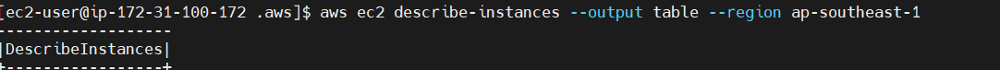

---

### 📋 Section 4: Administer Amazon S3 via CLI

#### Step 14: Create S3 Bucket and Upload Object
* **Parameters & Commands:**
  1. *Create new bucket:*
     ```bash
     aws s3 mb s3://aws-cli-trangiabao-2026
     ```
  2. *Create a test file on the EC2 host:*
     ```bash
     echo "Hello AWS S3 from CLI" > text.txt
     ```
  3. *Upload the file to S3:*
     ```bash
     aws s3 cp text.txt s3://aws-cli-trangiabao-2026
     ```

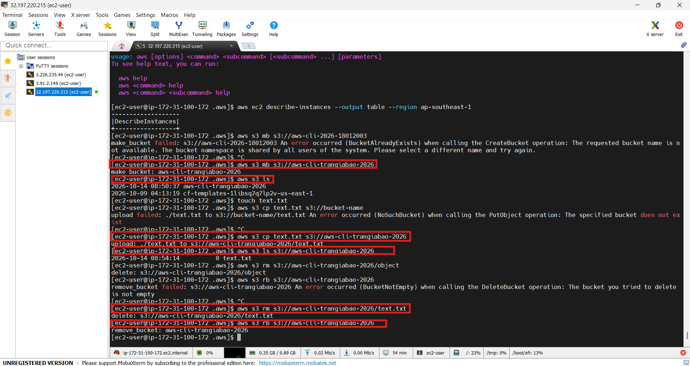

> **💡 Difficulties Encountered & Solution at Step 14:**  
> * **`BucketAlreadyExists` Error:** Using the tutorial's sample bucket name `aws-cli-2026-18012003` failed because S3 bucket names are globally unique. Solution: Used a custom name `aws-cli-trangiabao-2026`.  
> * **`NoSuchBucket` Error:** Copying the placeholder `bucket-name` caused AWS to look for a non-existent bucket. Solution: Replaced with the exact bucket name `s3://aws-cli-trangiabao-2026`.

#### Step 15: List Objects and Delete Bucket
* **Commands Executed:**
  1. *List objects:*
     ```bash
     aws s3 ls s3://aws-cli-trangiabao-2026
     ```
  2. *Delete objects and remove bucket cleanly:*
     ```bash
     aws s3 rb s3://aws-cli-trangiabao-2026 --force
     ```

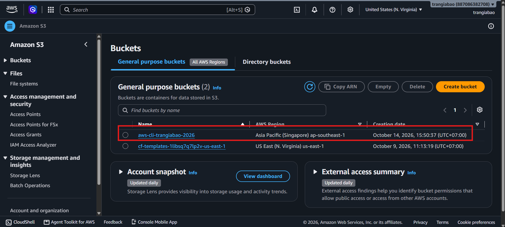

> **💡 Difficulties Encountered & Solution at Step 15:**  
> Running `aws s3 rb s3://...` failed with `BucketNotEmpty` because `text.txt` was still inside.  
> ➔ **Solution:** Appended the `--force` flag to automatically delete all objects prior to bucket deletion.

---

### 📋 Section 5: Administer Amazon SNS via CLI

#### Step 16: Create SNS Topic
* **Command Executed:**
  ```bash
  aws sns create-topic --name aws-cli
  ```
* **Output:** Returns the generated Topic ARN:
  `"TopicArn": "arn:aws:sns:ap-southeast-1:887086382708:aws-cli"`

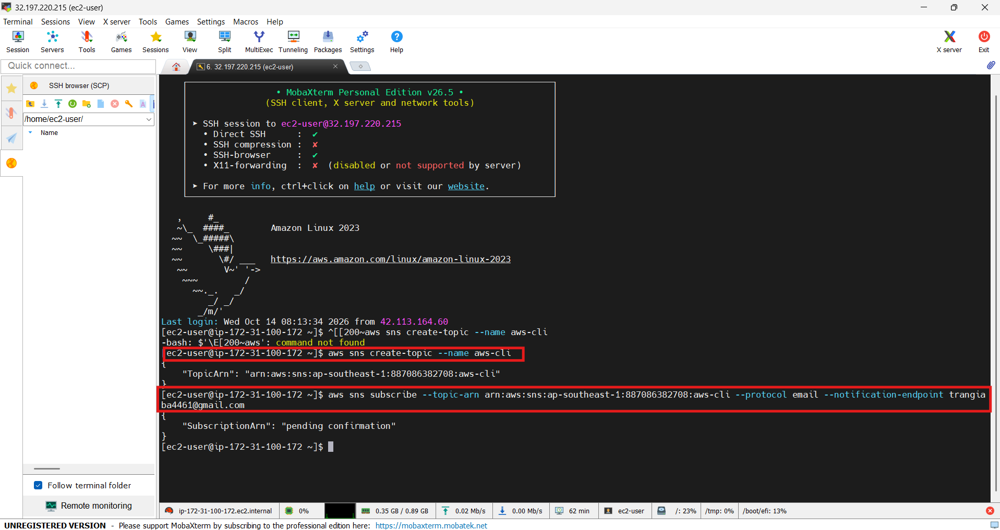

#### Step 17: Subscribe Email Endpoint
* **Command Executed:**
  ```bash
  aws sns subscribe --topic-arn arn:aws:sns:ap-southeast-1:887086382708:aws-cli --protocol email --notification-endpoint trangiabao4461@gmail.com
  ```
* **Parameters:**
  * `--topic-arn`: Actual ARN from Step 16.
  * `--protocol`: `email`.
  * `--notification-endpoint`: Target Gmail address.

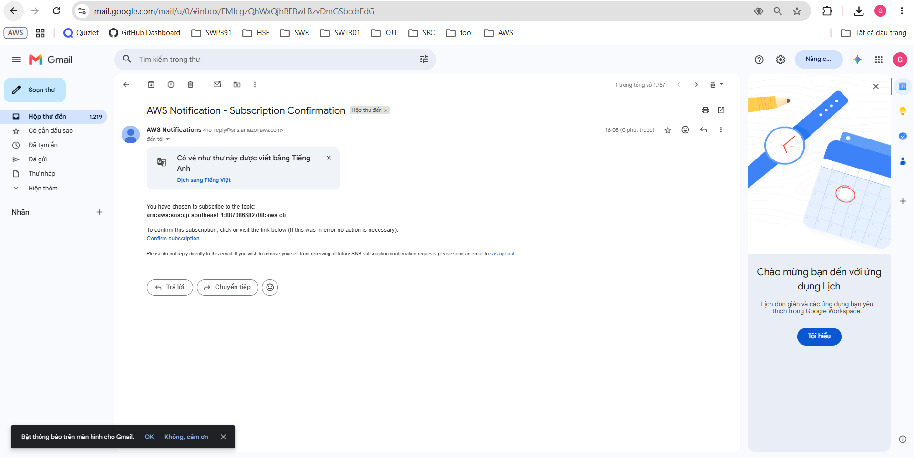

> **💡 Difficulties Encountered & Solution at Step 17:**  
> Terminal threw `Unknown options: Topic**` from copying the bold text `**ARN Topic**`.  
> ➔ **Solution:** Replaced `**ARN Topic**` with the actual Topic ARN string.

#### Step 18: Pending Confirmation Status
* **Output:** Returns `"SubscriptionArn": "pending confirmation"`.

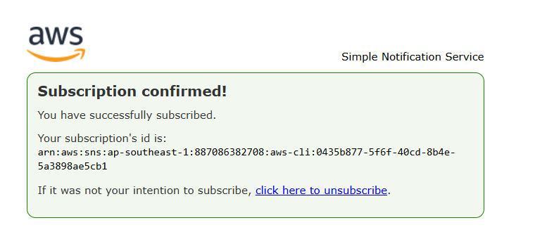

#### Step 19: Confirm Subscription in Gmail
* **Action:**
  1. Open Gmail, search `in:anywhere AWS Notification`.
  2. Open email from `no-reply@sns.amazonaws.com` titled *AWS Notification - Subscription Confirmation*.
  3. Click **Confirm subscription**.
* **Output:** Browser displays **Subscription confirmed!**.

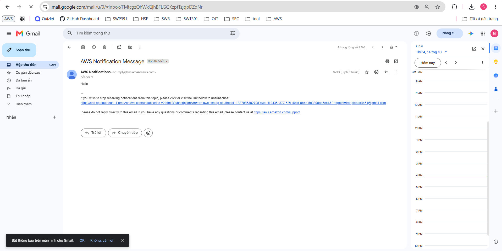

> **💡 Difficulties Encountered at Step 19:** Confirmation email was not in the primary inbox due to a typo in the address and Gmail filtering AWS emails into Spam. Solution: Corrected the typo and searched in Spam folder.

#### Step 20: Publish Message via CLI
* **Command Executed:**
  ```bash
  aws sns publish --topic-arn arn:aws:sns:ap-southeast-1:887086382708:aws-cli --message "Hello"
  ```
* **Output:** Terminal outputs a `MessageId`, and the notification email containing "Hello" is received in the Gmail inbox.

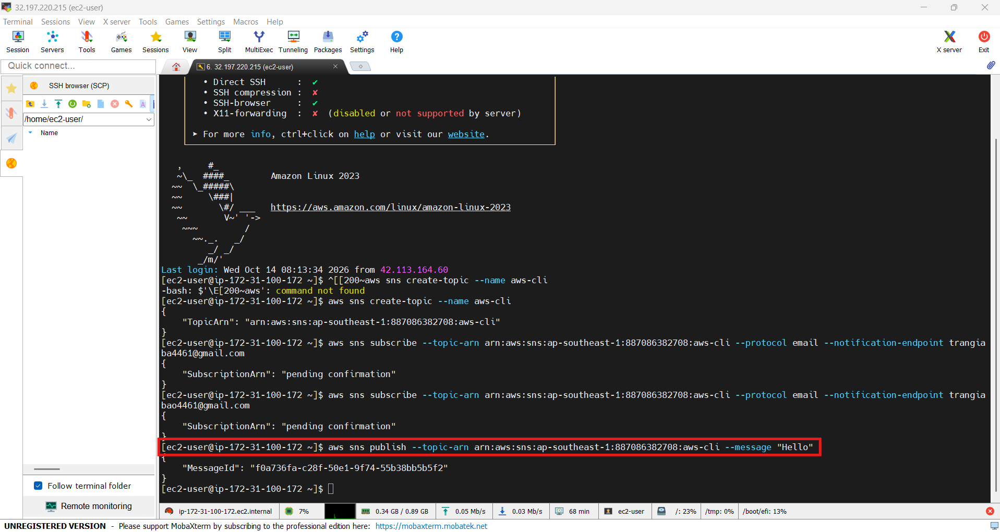

---

### 📋 Section 6: Manage IAM via CLI

#### Step 21: List IAM Users
* **Command Executed:**
  ```bash
  aws iam list-users
  ```
* **Output:** Outputs JSON list of all IAM users with creation dates and ARNs.

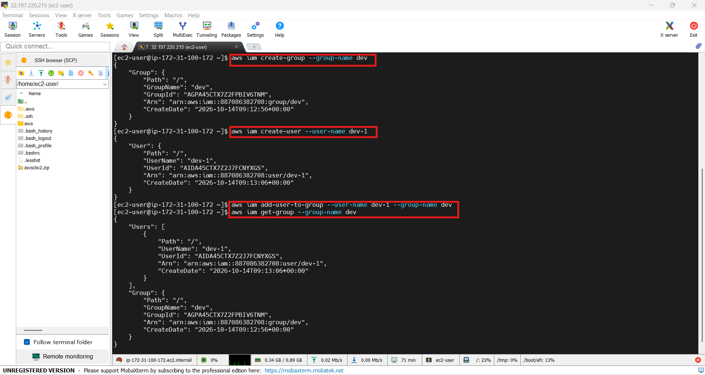

#### Step 22: Inspect Policies and Permissions
* **Command Executed:** Query policy attachments to verify administrative boundaries.

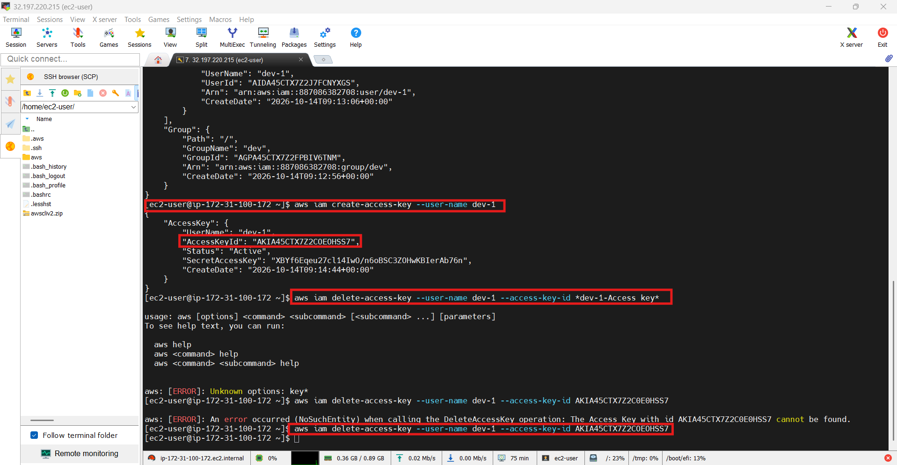

---

### 📋 Section 7: Construct VPC Networking via CLI

#### Step 23: Create VPC
* **Command Executed:**
  ```bash
  aws ec2 create-vpc --cidr-block 10.0.0.0/16 --query Vpc.VpcId --output text
  ```
* **Output:** Returns VPC ID: **`vpc-07ebcfa7f5b9c659c`**.

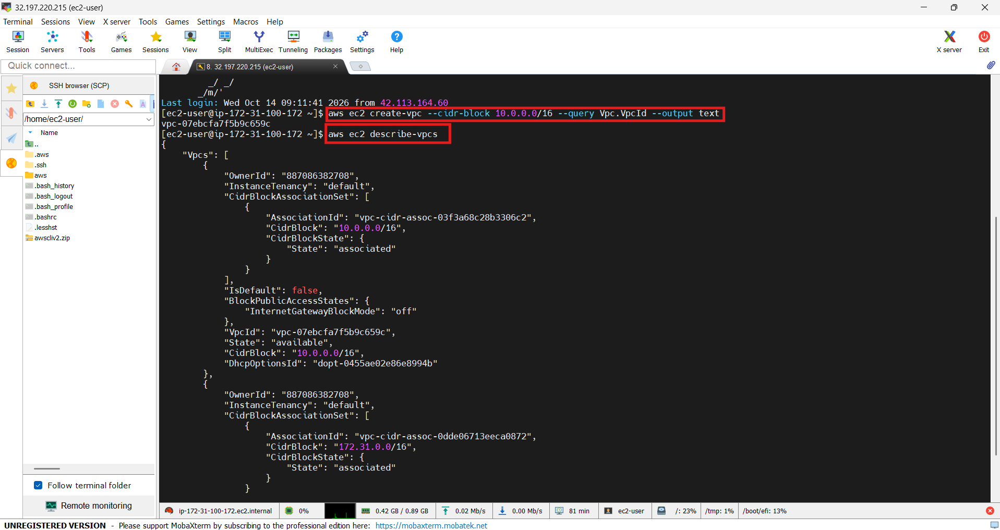

#### Step 24: Create Subnet
* **Command Executed:**
  ```bash
  aws ec2 create-subnet --vpc-id vpc-07ebcfa7f5b9c659c --cidr-block 10.0.1.0/24 --query Subnet.SubnetId --output text
  ```
* **Output:** Returns Subnet ID: **`subnet-03c90d43fb1f53b06`**.

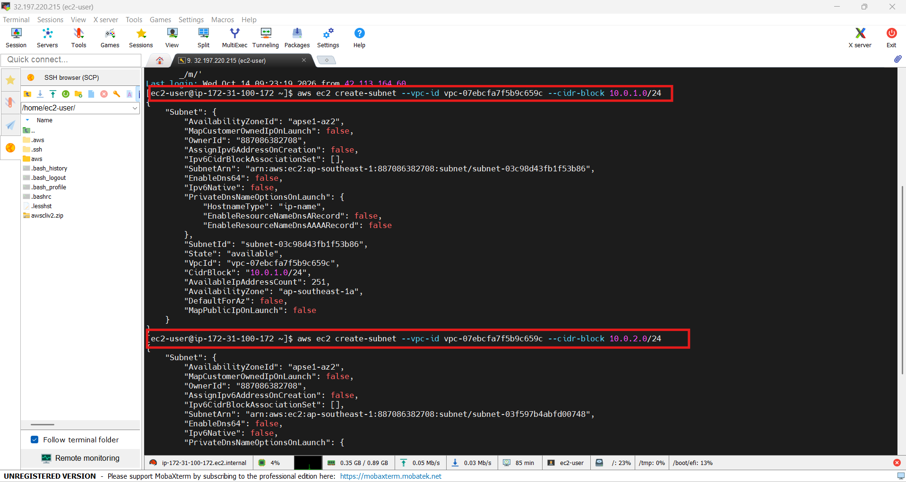

#### Step 25: Create Internet Gateway
* **Command Executed:**
  ```bash
  aws ec2 create-internet-gateway --query InternetGateway.InternetGatewayId --output text
  ```
* **Output:** Returns Internet Gateway ID: **`igw-006783ef67381e1d4`**.

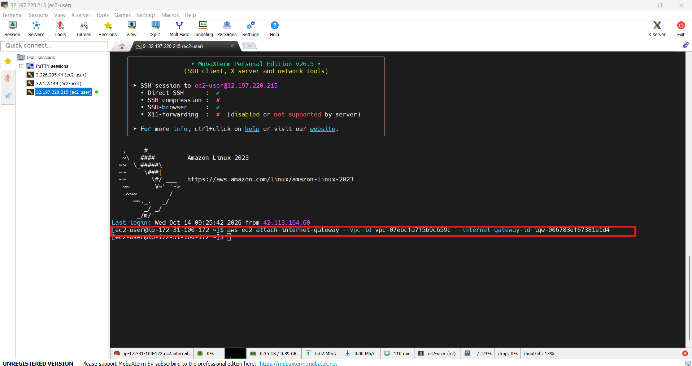

> **💡 Difficulties Encountered at Step 25:** IGW did not appear on the AWS Console. Root cause: The CLI created resources in Singapore (`ap-southeast-1`), while the web console was on N. Virginia (`us-east-1`). Solution: Switched console region to Singapore.

#### Step 26: Attach Internet Gateway to VPC
* **Command Executed:**
  ```bash
  aws ec2 attach-internet-gateway --vpc-id vpc-07ebcfa7f5b9c659c --internet-gateway-id igw-006783ef67381e1d4
  ```
* **Output:** IGW state becomes **`Attached`** to `vpc-07ebcfa7f5b9c659c`.

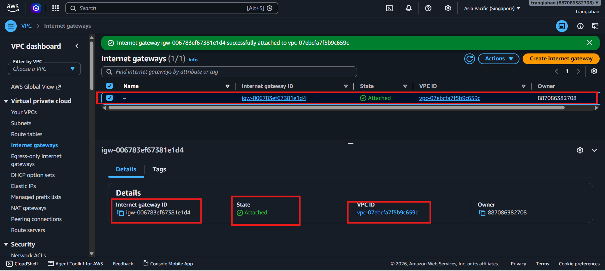

> **💡 Note at Step 26:** Running this command again produces `Resource.AlreadyAssociated`. This is an acknowledgment of prior success, not an error.

#### Step 27: Create Route Table and Add `0.0.0.0/0` Route
* **Commands Executed:**
  1. *Create Route Table:*
     ```bash
     aws ec2 create-route-table --vpc-id vpc-07ebcfa7f5b9c659c --query RouteTable.RouteTableId --output text
     ```
     *(Returns Route Table ID `rtb-xxxx`).*
  2. *Add default route to Internet Gateway:*
     ```bash
     aws ec2 create-route --route-table-id <RTB-ID> --destination-cidr-block 0.0.0.0/0 --gateway-id igw-006783ef67381e1d4
     ```

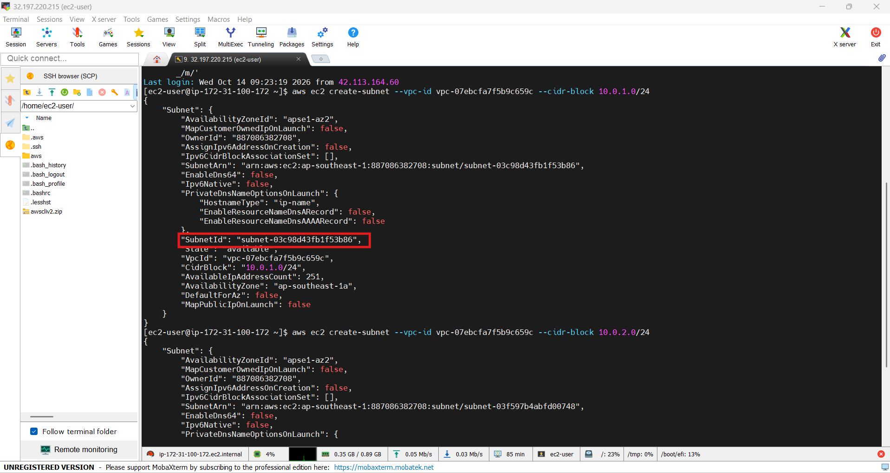

#### Step 28: Associate Route Table with Subnet
* **Command Executed:**
  ```bash
  aws ec2 associate-route-table --subnet-id subnet-03c90d43fb1f53b06 --route-table-id <RTB-ID>
  ```
* **Output:** Successfully binds the subnet to the route table for internet access.

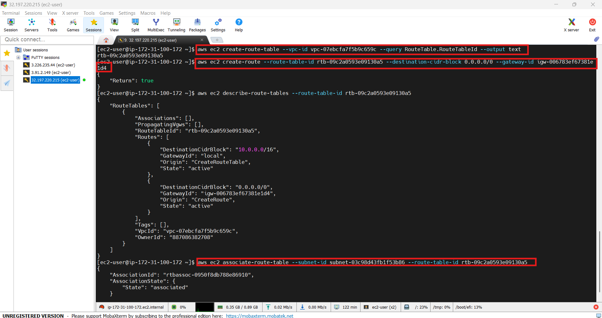

---

### 📋 Section 8: Automate EC2 Lifecycle via CLI

#### Step 29: Create Key Pair via CLI
* **Command Executed:**
  ```bash
  aws ec2 create-key-pair --key-name MyKeyPair --query "KeyMaterial" --output text > MyKeyPair.pem
  ```

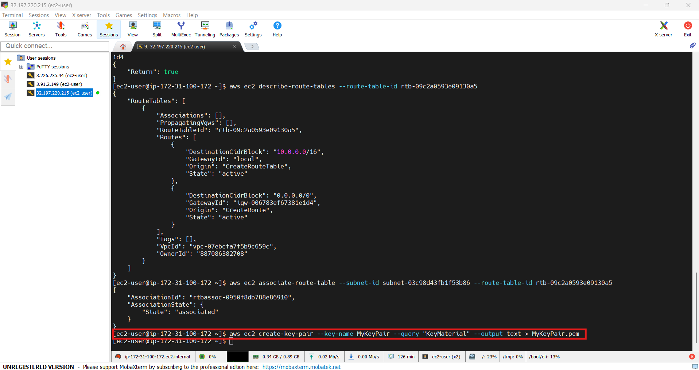

#### Step 30: Set Permissions `chmod 400`
* **Command Executed:**
  ```bash
  chmod 400 MyKeyPair.pem
  ```

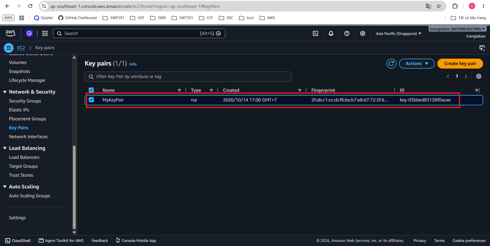

#### Step 31: Create Security Group `SSHAccess`
* **Command Executed:**
  ```bash
  aws ec2 create-security-group --group-name SSHAccess --description "Security group for SSH access" --vpc-id vpc-07ebcfa7f5b9c659c
  ```
* **Output:** Returns Security Group ID (e.g. `sg-08d6567ccc7edc1f0`).

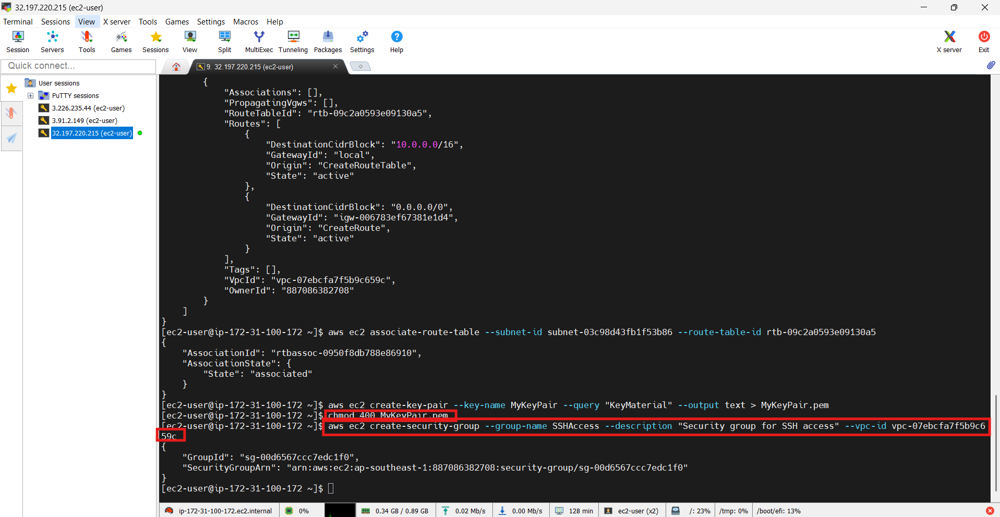

#### Step 32: Authorize Inbound SSH Port 22
* **Command Executed:**
  ```bash
  aws ec2 authorize-security-group-ingress --group-id <SG-ID> --protocol tcp --port 22 --cidr 0.0.0.0/0
  ```

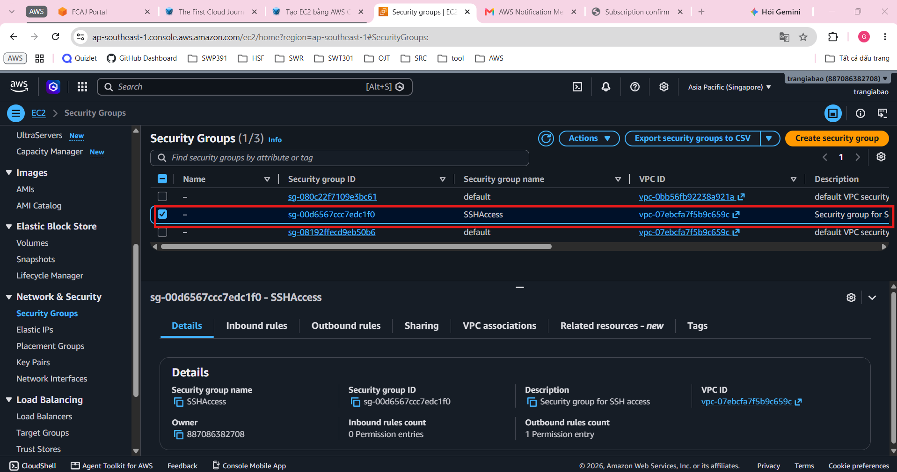

#### Step 33: Launch EC2 Instance via `run-instances`
* **Command Executed:**
  ```bash
  aws ec2 run-instances --image-id ami-0a37aadea3f79d3c3 --count 1 --instance-type t2.micro --key-name MyKeyPair --security-group-ids <SG-ID> --subnet-id subnet-03c90d43fb1f53b06
  ```
* **Output:** Returns Instance ID: **`i-03171455cd0278073`**, Private IP: **`10.0.1.41`**.

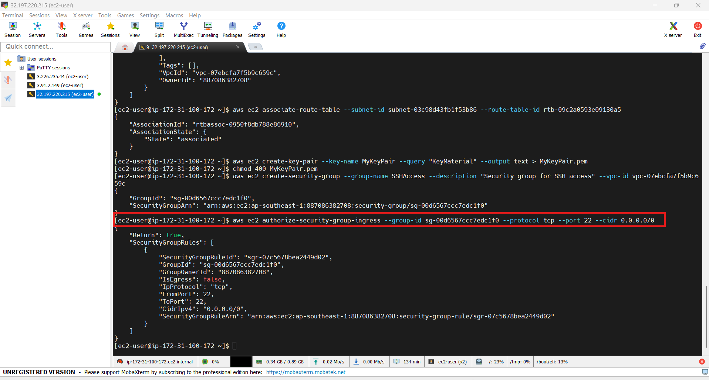

#### Step 34: Check Instance State
* **Command Executed:**
  ```bash
  aws ec2 describe-instances --instance-id i-03171455cd0278073 --query "Reservations[*].Instances[*].{State:State.Name,Address:PublicIpAddress}"
  ```
* **Output:** Returns `"State": "running"`, but `"Address": null`.

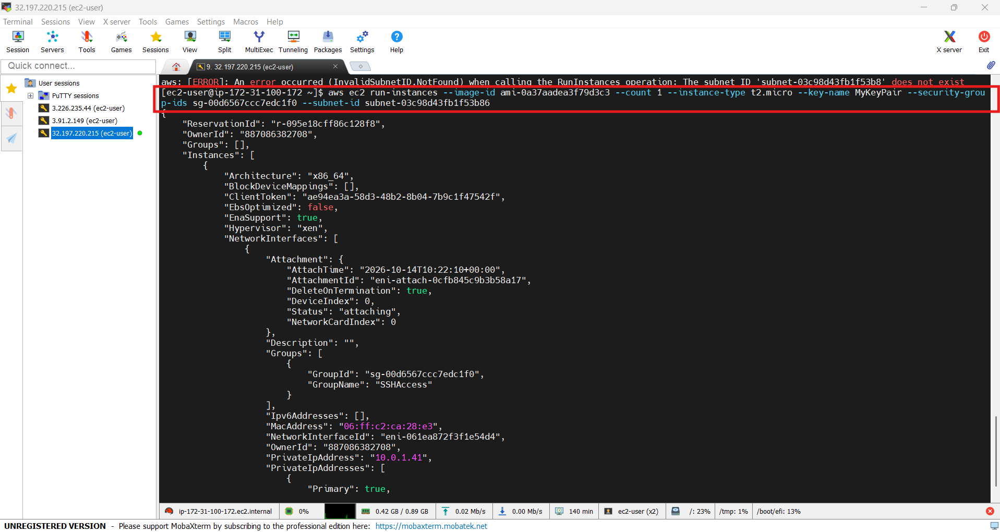

> **💡 Difficulties Encountered & Solution at Step 34:**  
> The query returned `"Address": null` because subnets created via CLI do not map public IPs by default (`MapPublicIpOnLaunch: false`).  
> ➔ **Solution:** Allocated an Elastic IP and associated it directly to the instance without re-creating it (executed in Steps 35 & 36).

#### Step 35: Allocate Elastic IP
* **Command Executed:**
  ```bash
  aws ec2 allocate-address --domain vpc
  ```
* **Output:** Public IP: **`47.131.189.63`**, AllocationId: **`eipalloc-0f52955fe9fe8ad41`**.

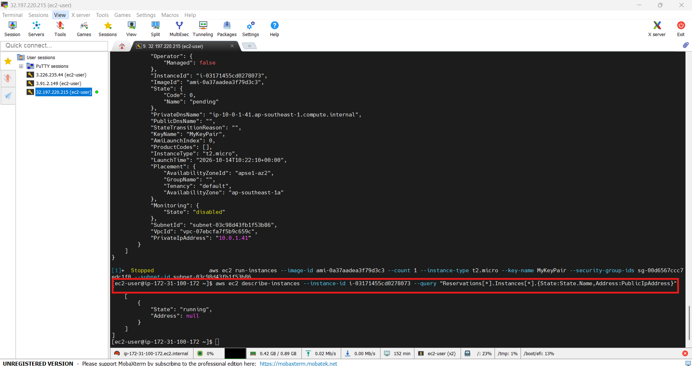

#### Step 36: Associate Elastic IP to Instance `i-03171455cd0278073`
* **Command Executed:**
  ```bash
  aws ec2 associate-address --instance-id i-03171455cd0278073 --allocation-id eipalloc-0f52955fe9fe8ad41
  ```

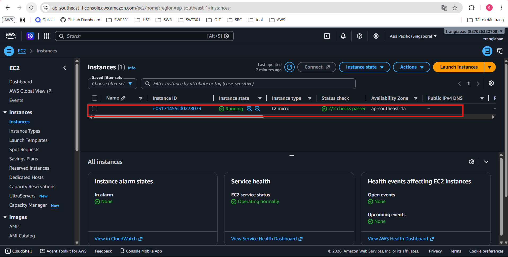

> **💡 Difficulties Encountered at Step 36:** Running the SSH command before running `associate-address` caused the terminal to hang indefinitely. Used `Ctrl + C` to interrupt, associated the IP first, and then connected.

#### Step 37: Connect to New EC2 Instance via SSH
* **Command Executed:**
  ```bash
  ssh -i "MyKeyPair.pem" ec2-user@47.131.189.63
  ```
* **Action:** Type `yes` when prompted.
* **Result:** Connected successfully! Prompt changes to **`[ec2-user@ip-10-0-1-41 ~]$`**.

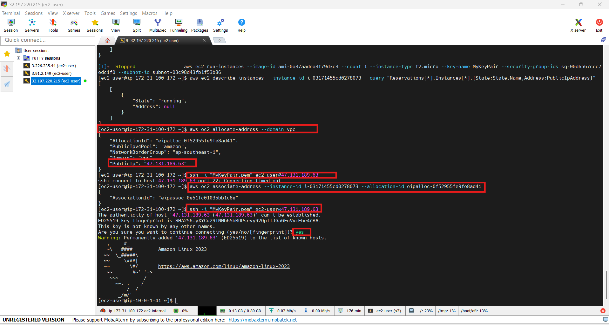

#### Step 38: Exit and Safely Terminate Instance
* **Commands Executed:**
  1. *Exit guest instance:*
     ```bash
     exit
     ```
     *(Returns to management host prompt: `[ec2-user@ip-172-31-100-172 ~]$`).*
  2. *Terminate instance:*
     ```bash
     aws ec2 terminate-instances --instance-ids i-03171455cd0278073
     ```
* **Result:** Instance transitions to `shutting-down` and `terminated`.

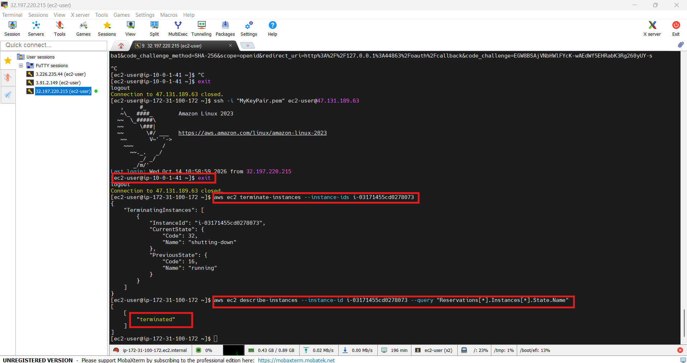

> **💡 Difficulties Encountered at Step 38:** Running `terminate-instances` inside the newly provisioned instance (`ip-10-0-1-41`) returned `Unable to locate credentials`. Typed `exit` to return to the management host and executed the command successfully.

---

### 🏆 Key Takeaways & Lessons Learned:
1. **Accurate Parameter Passing:** Learned to extract output values dynamically using `--query ... --output text` for subsequent CLI commands.
2. **Real-world Network Debugging:** Diagnosed and rectified multiple AWS network hurdles including missing route table targets, public IP mapping flags, and Elastic IP association workflows.
3. **Infrastructure Automation Readiness:** Built end-to-end operational confidence to replace manual GUI clicks with structured, reusable command line automation scripts.

- **Mastering the AWS CLI Interface:** Understood the power of command-line automation in managing cloud infrastructure compared to manual Web Console actions.
- **Identity Management & Access Control:** Learned best practices for IAM permissions, secure credential management, and configuring multiple environment profiles on a Linux management host.
- **Infrastructure Automation via Scripting:** Practiced provisioning and managing foundational services—including S3 buckets, SNS notification topics, custom VPC networks, and EC2 instances—entirely via terminal commands.
- **Practical Troubleshooting Skills:** Gained hands-on experience identifying and fixing common operational issues related to SSH keys, network routing, and permission constraints.

---

#### 📌 Wednesday (14/10/2026) - Work with Amazon DynamoDB:

{}
The **Work with Amazon DynamoDB** hands-on lab was conducted on **Wednesday (14/10/2026)** as part of **Week 5**. This document details the end-to-end implementation process across three operational methods: AWS Management Console, AWS CloudShell CLI, and Programmatic Automation with Python SDK (Boto3).
<br>🔗 **Workshop Source:** [Work with Amazon DynamoDB (Workshop 000060)](https://000060.awsfcaj.com/)
{}

### 🎯 Lab Objectives:
* Master the NoSQL architecture of **Amazon DynamoDB**, comprehend partition distribution mechanisms using **Partition Key (HASH)**, composite key strategies using **Composite Primary Key (HASH + RANGE)**, and schema flexibility with Scalar/Document attribute types.
* Perform lifecycle management for the `Music` table via **AWS Management Console**: table creation, item insertion, in-place updates, conditional queries and full table scans, alongside configuring and querying a **Global Secondary Index (GSI)** named `AlbumTitle-index`.
* Leverage the command-line interface of **AWS CloudShell**: authenticate via IAM credentials, provision tables, perform atomic CRUD operations (`put-item`, `get-item`, `update-item`, `query`), attach a GSI via `update-table`, and understand the asynchronous **Backfilling** phase.
* Implement programmatic automation on Windows using **Python 3** and **Boto3 SDK**: automated provisioning of the `Movies` table, item CRUD scripts, batch ingestion from a JSON payload (`moviedata.json` with 4,609 records), key-based queries, and filtered table scans (`MoviesScan.py`).
* Analyze and document **10 in-depth real-world troubleshooting scenarios**: workshop documentation flag typos, IAM policy authorization, duplicate resource conflicts, hidden zero-width Unicode characters (`\u200b`), terminal CLI pager behavior, GSI backfilling locks, environment execution mismatches, and multi-region routing.

---

### 📊 Provisioned Resource Specifications:

| Resource | Name / Identifier | Attributes & Key Schema | Throughput / Mode | Region | Purpose |
| :--- | :--- | :--- | :--- | :--- | :--- |
| **DynamoDB Table 1**| `Music` | Partition Key: `Artist` (S) <br>Sort Key: `SongTitle` (S) | Provisioned (RCU=10, WCU=5) | `us-east-1` | Console & CloudShell CLI lab exercises |
| **Secondary Index** | `AlbumTitle-index` | Partition Key: `AlbumTitle` (S) <br>Projection: `ALL` | Provisioned (RCU=10, WCU=5) | `us-east-1` | Global Secondary Index for `Music` table |
| **DynamoDB Table 2**| `Movies` | Partition Key: `year` (N) <br>Sort Key: `title` (S) | Provisioned (RCU=10, WCU=10) | `ap-southeast-1` | Python SDK (Boto3) lab automation |
| **IAM User** | `AWS-FCAJ-DynamDB` | Attached Policy: `AmazonDynamoDBFullAccess` | Programmatic CLI Access | Global | Dedicated identity for CLI and SDK access |
| **Dataset Payload** | `moviedata.json` | 4,609 movie entries (3.7 MB), JSON format | Parsed Floats to Decimal | Local | Benchmark dataset for query & scan routines |
| **SDK Environment** | Windows Workstation | Python 3.14.5 + Boto3 1.43.114 | CLI Default: `ap-southeast-1` | Local | Host environment for Python test scripts |

---

### 📋 Section 1: Managing DynamoDB via AWS Management Console

#### Step 1: Accessing the Amazon DynamoDB Console
* **Action:** Sign in to the AWS Management Console and open the **DynamoDB** service dashboard.
* **Purpose:** Access the centralized control pane to monitor database capacity, active tables, and operational metrics.

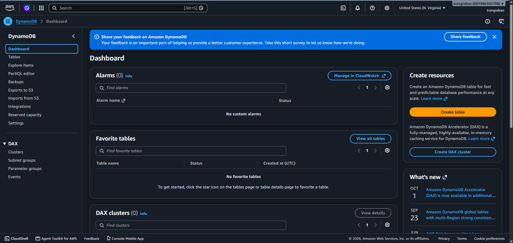

#### Step 2: Creating an IAM Access Key for Authentication
* **Action:** Navigate to **IAM** ➔ **Users** ➔ Select user `AWS-FCAJ-DynamDB` ➔ **Security credentials** tab ➔ Click **Create access key** ➔ Select **Command Line Interface (CLI)** ➔ Download the credentials `.csv` file containing the `Access Key ID` and `Secret Access Key`.


#### Step 3: Creating the `Music` Table on Web Console
* **Action:** In the DynamoDB Console navigation sidebar, select **Tables** ➔ Click **Create table**.
* **Configuration Parameters:**
  * **Table name:** `Music`
  * **Partition key:** `Artist` (Data Type: **String**)
  * **Sort key:** `SongTitle` (Data Type: **String**)
  * **Table settings:** Select **Default settings** (Provisioned capacity mode, RCU=5, WCU=5, default KMS encryption).
* **Action:** Click **Create table** and monitor until the status turns to `Active`.


#### Step 4: Writing the First Item to `Music` Table
* **Action:** Select table **`Music`** ➔ Click **Explore items** ➔ Click **Create item**.
* **Attribute Entries:**
  * `Artist` (String): `No One You Know`
  * `SongTitle` (String): `Call Me Today`
  * Click **Add new attribute** ➔ **String** ➔ Name: `AlbumTitle`, Value: `Somewhat Famous`
  * Click **Add new attribute** ➔ **Number** ➔ Name: `Awards`, Value: `1`
* **Action:** Click **Create item** to commit the record to storage.


#### Step 5: Viewing and Scanning Stored Records
* **Action:** In **Explore items**, select the `Music` table and execute a **Scan** operation to list all persisted items.
* **Verification:** The view displays all assigned attributes for the newly inserted track.


#### Step 6: Inspecting Item Attributes
* **Action:** Click on the record row for `No One You Know` to inspect the underlying document structure in Form or JSON format.


#### Step 7: Updating Item Attributes in Place
* **Action:** Select the record, modify attribute values or add new fields, and click **Save changes**.


#### Step 8: Querying Data by Primary Key
* **Action:** Under **Explore items**, toggle the execution mode from *Scan* to **Query**.
* **Query Parameters:**
  * **Partition key (`Artist`):** `Acme Band`
  * **Sort key (`SongTitle`):** Optional condition or left blank to fetch all tracks under this partition.
* **Result:** Ultra-low latency retrieval restricted exclusively to the target hash partition.


#### Step 9: Creating a Global Secondary Index (GSI)
* **Action:** Open table `Music` ➔ Select the **Indexes** tab ➔ Click **Create index**.
* **Index Configuration:**
  * **Partition key:** `AlbumTitle` (Type: **String**)
  * **Index name:** `AlbumTitle-index`
  * **Attribute projections:** **All**
* **Action:** Click **Create index**. The index status switches to `Creating` as the background **Backfilling** process begins.


#### Step 10: Querying Stored Items via GSI
* **Action:** Return to **Explore items** ➔ Select **Query** ➔ Choose **`AlbumTitle-index`** from the target dropdown.
* **Search Parameters:**
  * **Partition key (`AlbumTitle`):** `Somewhat Famous`
* **Result:** Returns matching tracks without requiring knowledge of the primary key's partition key (`Artist`), demonstrating multi-dimensional query flexibility.


---

### 📋 Section 2: Command-Line Operations via AWS CloudShell

#### Step 11: Launching AWS CloudShell
* **Action:** Click the **CloudShell** terminal icon on the top navigation bar of the AWS Console to open an authenticated Linux browser shell.


#### Step 12: Configuring CLI Credentials in CloudShell
* **Execution Command:**
  ```bash
  aws configure
  ```
* **Input Parameters:**
  * **AWS Access Key ID:** Provide Access Key for `AWS-FCAJ-DynamDB`.
  * **AWS Secret Access Key:** Provide matching Secret Access Key.
  * **Default region name:** `us-east-1`
  * **Default output format:** `json`


#### Step 13: Creating Table `Music` via AWS CLI
* **Execution Command:**
  ```bash
  aws dynamodb create-table \
      --table-name Music \
      --attribute-definitions \
          AttributeName=Artist,AttributeType=S \
          AttributeName=SongTitle,AttributeType=S \
      --key-schema \
          AttributeName=Artist,KeyType=HASH \
          AttributeName=SongTitle,KeyType=RANGE \
      --provisioned-throughput \
          ReadCapacityUnits=10,WriteCapacityUnits=5 \
      --table-class STANDARD
  ```

{}
💡 **Trouble 1 & Resolution - Workshop Documentation Syntax Typo:**
* **Issue:** The original workshop instructions specified `--provided-throughput`, throwing: `aws: [ERROR]: Unknown options: --provided-throughput, ReadCapacityUnits=10,WriteCapacityUnits=5`.
* **Root Cause:** Standard AWS CLI v2 syntax mandates `--provisioned-throughput`.
* **Resolution:** Replaced flag with `--provisioned-throughput ReadCapacityUnits=10,WriteCapacityUnits=5`.
{}

{}
💡 **Trouble 2 & Resolution - Missing IAM Permissions (`AccessDeniedException`):**
* **Issue:** Call denied with `User: .../AWS-FCAJ-DynamDB is not authorized to perform: dynamodb:CreateTable because no identity-based policy allows...`.
* **Root Cause:** The IAM User lacked permissions policies for DynamoDB APIs.
* **Resolution:** Attached managed policy **`AmazonDynamoDBFullAccess`** directly to user `AWS-FCAJ-DynamDB` via IAM Console.
{}

{}
💡 **Trouble 3 & Resolution - Resource Name Collision (`ResourceInUseException`):**
* **Issue:** Output indicated: `Table already exists: Music`.
* **Root Cause:** Table `Music` had already been created in Section 1 via Web Console in the identical region (`us-east-1`).
* **Resolution:** Executed `describe-table` to confirm `ACTIVE` state and proceeded directly to subsequent data manipulation steps.
{}


#### Step 14: Verifying Table Status
* **Execution Command:**
  ```bash
  aws dynamodb describe-table --table-name Music | grep TableStatus
  ```
* **Output:** Returned `"TableStatus": "ACTIVE"`.


#### Step 15: Ingesting an Item via `put-item`
* **Execution Command:**
  ```bash
  aws dynamodb put-item \
      --table-name Music \
      --item '{
          "Artist": {"S": "No One You Know"},
          "SongTitle": {"S": "Call Me Today"},
          "AlbumTitle": {"S": "Somewhat Famous"},
          "Awards": {"N": "1"}
      }'
  ```


#### Step 16: Ingesting Additional Items for `Acme Band`
* **Action:** Repeated `put-item` commands for tracks `Happy Day` (Awards: 10, Album: `Songs About Life`) and `PartiQL Rocks` (Awards: 8, Album: `Another Album Title`).


#### Step 17: Fetching a Single Item via `get-item`
* **Execution Command:**
  ```bash
  aws dynamodb get-item \
      --table-name Music \
      --key '{
          "Artist": {"S": "Acme Band"},
          "SongTitle": {"S": "Happy Day"}
      }'
  ```


#### Step 18: Updating Attributes via `update-item`
* **Execution Command:**
  ```bash
  aws dynamodb update-item \
      --table-name Music \
      --key '{
          "Artist": {"S": "Acme Band"},
          "SongTitle": {"S": "Happy Day"}
      }' \
      --update-expression "SET AlbumTitle = :a" \
      --expression-attribute-values '{":a": {"S": "Updated Album Title"}}' \
      --return-values ALL_NEW
  ```


#### Step 19: Confirming Updated Attributes
* **Result:** Output returned `ReturnValues` indicating `AlbumTitle` was successfully updated to `"Updated Album Title"`.


#### Step 20: Querying Items with `query`
* **Execution Command:**
  ```bash
  aws dynamodb query \
      --table-name Music \
      --key-condition-expression "Artist = :name" \
      --expression-attribute-values '{":name":{"S":"Acme Band"}}'
  ```

{}
💡 **Trouble 4 & Resolution - Hidden Zero-Width Unicode Characters (`\u200b`):**
* **Issue:** Command parsing failed with: `Error parsing parameter '--expression-attribute-values': Expected: '=', received: '' for input: {":name"...}`.
* **Root Cause:** Copying from the workshop web page pulled two invisible Zero-Width Space characters (`\u200b\u200b`) directly behind `--expression-attribute-values`, breaking CLI argument interpretation.
* **Resolution:** Stripped hidden unicode bytes and reconstructed with standard ASCII spaces.
{}


#### Step 21: Attaching a Global Secondary Index via `update-table`
* **Execution Command:**
  ```bash
  aws dynamodb update-table \
      --table-name Music \
      --attribute-definitions AttributeName=AlbumTitle,AttributeType=S \
      --global-secondary-index-updates \
          "[{\"Create\":{\"IndexName\": \"AlbumTitle-index\",\"KeySchema\":[{\"AttributeName\":\"AlbumTitle\",\"KeyType\": \"HASH\"}], \
          \"ProvisionedThroughput\": {\"ReadCapacityUnits\": 10, \"WriteCapacityUnits\": 5 },\"Projection\":{\"ProjectionType\":\"ALL\"}}}]"
  ```

{}
💡 **Trouble 5 & Resolution - Terminal Pager Auto-Exit Behavior:**
* **Issue:** After execution, the terminal momentarily flashed JSON output and immediately exited back to the prompt `~ $`.
* **Root Cause:** AWS CLI pipes voluminous responses to the `less` pager by default. Pressing `q` or scrolling to EOF closes the pager. The underlying GSI provisioning continues normally in the background.
* **Resolution:** Executed `export AWS_PAGER=""` to disable the pager and print JSON directly to standard output.
{}


#### Step 22: Querying the GSI via `query`
* **Execution Command:**
  ```bash
  aws dynamodb query \
      --table-name Music \
      --index-name AlbumTitle-index \
      --key-condition-expression "AlbumTitle = :name" \
      --expression-attribute-values '{":name":{"S":"Somewhat Famous"}}'
  ```

{}
💡 **Trouble 6 & Resolution - Querying a Backfilling Index:**
* **Issue:** Threw: `ValidationException: Cannot read from backfilling global secondary index: AlbumTitle-index`.
* **Root Cause:** New GSIs created on populated tables undergo asynchronous data copying (Backfilling). Reads are disallowed while `IndexStatus` is `CREATING`.
* **Resolution:** Polled `describe-table` until `IndexStatus` transitioned to `ACTIVE` before re-issuing query.
{}


---

### 📋 Section 3: Programmatic Automation with Python SDK (Boto3)

#### Step 23: Setting up Python & Boto3 Environment on Windows
* **Action:** Open Command Prompt (`cmd.exe`), verify Python installation, install Boto3, and configure credentials:
  ```cmd
  python --version
  pip install boto3
  aws configure
  ```


#### Step 24: Provisioning Table `Movies` with `MoviesCreateTable.py`
* **File:** `MoviesCreateTable.py`
* **Script Code:**
  ```python
  import boto3

  def create_movie_table(dynamodb=None):
      dynamodb = boto3.resource('dynamodb')
      table = dynamodb.create_table(
          TableName='Movies',
          KeySchema=[
              {'AttributeName': 'year', 'KeyType': 'HASH'},  # Partition key
              {'AttributeName': 'title', 'KeyType': 'RANGE'}  # Sort key
          ],
          AttributeDefinitions=[
              {'AttributeName': 'year', 'AttributeType': 'N'},
              {'AttributeName': 'title', 'AttributeType': 'S'}
          ],
          ProvisionedThroughput={
              'ReadCapacityUnits': 10,
              'WriteCapacityUnits': 10
          }
      )
      return table

  if __name__ == '__main__':
      movie_table = create_movie_table()
      print("Table status:", movie_table.table_status)
  ```
* **Execution:**
  ```cmd
  cd /d D:\AWS\template_AWS\fcj-workshop-template-main
  python MoviesCreateTable.py
  ```

{}
💡 **Trouble 7 & Resolution - Pasting Raw Python Code into Windows CMD:**
* **Issue:** Directly pasting Python statements into `cmd.exe` triggered multiple errors: `'import' is not recognized as an internal or external command`.
* **Root Cause:** Windows CMD is a command-line shell, not an interactive Python interpreter.
* **Resolution:** Saved source code into dedicated `.py` files and invoked them using `python <file>.py`.
{}

{}
💡 **Trouble 8 & Resolution - Default Working Directory at `System32`:**
* **Issue:** Execution yielded: `can't open file 'C:\Windows\System32\MoviesCreateTable.py': No such file or directory`.
* **Root Cause:** CMD opened inside protected system directories rather than the project workspace.
* **Resolution:** Changed working directory using: `cd /d D:\AWS\template_AWS\fcj-workshop-template-main`.
{}


#### Step 25: Inserting Movies with `MoviesItemOps01.py`
* **File:** `MoviesItemOps01.py`
* **Script Code:**
  ```python
  from pprint import pprint
  import boto3

  def put_movie(title, year, plot, rating, dynamodb=None):
      dynamodb = boto3.resource('dynamodb')
      table = dynamodb.Table('Movies')
      response = table.put_item(
          Item={
              'year': year,
              'title': title,
              'info': {'plot': plot, 'rating': rating}
          }
      )
      return response

  if __name__ == '__main__':
      movie_resp = put_movie("The Big New Movie", 2015, "Nothing happens at all.", 0)
      print("Put movie succeeded:")
      pprint(movie_resp, sort_dicts=False)
  ```
* **Execution Command:**
  ```cmd
  python MoviesItemOps01.py
  ```
* **Result:** Returned HTTP 200 indicating successful write.


#### Step 26: Reading Stored Movies with `MoviesItemOps02.py`
* **File:** `MoviesItemOps02.py`
* **Script Code:**
  ```python
  from pprint import pprint
  import boto3
  from botocore.exceptions import ClientError

  def get_movie(title, year, dynamodb=None):
      dynamodb = boto3.resource('dynamodb')
      table = dynamodb.Table('Movies')
      try:
          response = table.get_item(Key={'year': year, 'title': title})
      except ClientError as e:
          print(e.response['Error']['Message'])
      else:
          return response['Item']

  if __name__ == '__main__':
      movie = get_movie("The Big New Movie", 2015)
      if movie:
          print("Get movie succeeded:")
          pprint(movie, sort_dicts=False)
  ```
* **Execution Command:**
  ```cmd
  python MoviesItemOps02.py
  ```


#### Step 27: Updating Records with `MoviesItemOps03.py`
* **File:** `MoviesItemOps03.py`
* **Script Code:**
  ```python
  from decimal import Decimal
  from pprint import pprint
  import boto3

  def update_movie(title, year, rating, plot, actors, dynamodb=None):
      dynamodb = boto3.resource('dynamodb')
      table = dynamodb.Table('Movies')
      response = table.update_item(
          Key={'year': year, 'title': title},
          UpdateExpression="set info.rating=:r, info.plot=:p, info.actors=:a",
          ExpressionAttributeValues={
              ':r': Decimal(str(rating)),
              ':p': plot,
              ':a': actors
          },
          ReturnValues="UPDATED_NEW"
      )
      return response

  if __name__ == '__main__':
      update_response = update_movie(
          "The Big New Movie", 2015, 5.5, "Everything happens all at once.",
          ["Larry", "Moe", "Curly"])
      print("Update movie succeeded:")
      pprint(update_response, sort_dicts=False)
  ```
* **Execution Command:**
  ```cmd
  python MoviesItemOps03.py
  ```


#### Step 28: Conditional Deletion with `MoviesItemOps04.py`
* **File:** `MoviesItemOps04.py`
* **Script Code:**
  ```python
  from decimal import Decimal
  from pprint import pprint
  import boto3
  from botocore.exceptions import ClientError

  def delete_underrated_movie(title, year, rating, dynamodb=None):
      dynamodb = boto3.resource('dynamodb')
      table = dynamodb.Table('Movies')
      try:
          response = table.delete_item(Key={'year': year, 'title': title})
      except ClientError as e:
          if e.response['Error']['Code'] == "ConditionalCheckFailedException":
              print(e.response['Error']['Message'])
          else:
              raise
      else:
          return response

  if __name__ == '__main__':
      print("Attempting a conditional delete...")
      delete_response = delete_underrated_movie("The Big New Movie", 2015, 5)
      if delete_response:
          print("Delete movie succeeded:")
          pprint(delete_response, sort_dicts=False)
  ```
* **Execution Command:**
  ```cmd
  python MoviesItemOps04.py
  ```


#### Step 29: Ingesting Bulk Dataset with `MoviesLoadData.py`
* **Dataset:** Extracted `moviedata.json` (3.7MB, 4,609 entries) from `moviedata.zip`.
* **File:** `MoviesLoadData.py`
* **Script Code:**
  ```python
  from decimal import Decimal
  import json
  import boto3

  def load_movies(movies, dynamodb=None):
      dynamodb = boto3.resource('dynamodb')
      table = dynamodb.Table('Movies')
      for movie in movies:
          year = int(movie['year'])
          title = movie['title']
          print("Adding movie:", year, title)
          table.put_item(Item=movie)

  if __name__ == '__main__':
      with open("moviedata.json") as json_file:
          movie_list = json.load(json_file, parse_float=Decimal)
      load_movies(movie_list)
  ```
* **Execution Command:**
  ```cmd
  python MoviesLoadData.py
  ```

{}
💡 **Trouble 9 & Resolution - Large Dataset Ingestion Throughput:**
* With 4,609 records, standard iterative `put_item` operations may take several minutes depending on provisioned WCU. Ingestion can be safely interrupted (`Ctrl + C`) after seeding sufficient benchmark data for query verification.
{}


#### Step 30: Querying Released Movies for 1985 with `MoviesQuery01.py`
* **File:** `MoviesQuery01.py`
* **Script Code:**
  ```python
  import boto3
  from boto3.dynamodb.conditions import Key

  def query_movies(year, dynamodb=None):
      dynamodb = boto3.resource('dynamodb')
      table = dynamodb.Table('Movies')
      response = table.query(
          KeyConditionExpression=Key('year').eq(year)
      )
      return response['Items']

  if __name__ == '__main__':
      query_year = 1985
      print(f"Movies from {query_year}")
      movies = query_movies(query_year)
      for movie in movies:
          print(movie['year'], ":", movie['title'])
  ```
* **Execution Command:**
  ```cmd
  python MoviesQuery01.py
  ```
* **Output:** Fetched all 1985 classics including *Back to the Future*, *Rambo: First Blood Part II*, *Rocky IV*, *The Breakfast Club*...


#### Step 31: Full Table Scan with Filters using `MoviesScan.py`
* **File:** `MoviesScan.py`
* **Script Code:**
  ```python
  from pprint import pprint
  import boto3
  from boto3.dynamodb.conditions import Key

  def scan_movies(year_range, display_movies, dynamodb=None):
      dynamodb = boto3.resource('dynamodb')
      table = dynamodb.Table('Movies')
      scan_kwargs = {
          'FilterExpression': Key('year').between(*year_range),
          'ProjectionExpression': "#yr, title, info.rating",
          'ExpressionAttributeNames': {"#yr": "year"}
      }
      done = False
      start_key = None
      while not done:
          if start_key:
              scan_kwargs['ExclusiveStartKey'] = start_key
          response = table.scan(**scan_kwargs)
          display_movies(response.get('Items', []))
          start_key = response.get('LastEvaluatedKey', None)
          done = start_key is None

  if __name__ == '__main__':
      def print_movies(movies):
          for movie in movies:
              print(f"\n{movie['year']} : {movie['title']}")
              pprint(movie['info'])

      query_range = (1950, 1959)
      print(f"Scanning for movies released from {query_range[0]} to {query_range[1]}...")
      scan_movies(query_range, print_movies)
  ```
* **Execution Command:**
  ```cmd
  python MoviesScan.py
  ```


#### Step 32: Decommissioning the `Movies` Table with `MoviesDeleteTable.py`
* **File:** `MoviesDeleteTable.py`
* **Script Code:**
  ```python
  import boto3

  def delete_movie_table(dynamodb=None):
      dynamodb = boto3.resource('dynamodb')
      table = dynamodb.Table('Movies')
      table.delete()

  if __name__ == '__main__':
      delete_movie_table()
      print("Movies table deleted.")
  ```
* **Execution Command:**
  ```cmd
  python MoviesDeleteTable.py
  ```


---

### 📋 Section 4: Resource Cleanup & Summary of Troubles

{}
💡 **Trouble 10 & Resolution - Cross-Region Deletion Failure (`ResourceNotFoundException`):**
* **Issue:** CloudShell command `aws dynamodb delete-table --table-name Music` threw: `Requested resource not found: Table: Music not found`.
* **Root Cause:** Default CloudShell region pointed to `ap-southeast-1` (Singapore) whereas table `Music` was provisioned in `us-east-1` (N. Virginia), or was previously dropped via Web Console.
* **Resolution:** Target explicit region by appending `--region us-east-1`.
{}

---

### 💡 Summary Table of 10 Real-World Troubleshooting Cases:

| # | Technical Difficulty | Root Cause | Standardized Resolution |
| :---: | :--- | :--- | :--- |
| **1** | Flag parsing error `--provided-throughput` | Typographical error in upstream workshop documentation. | Replaced with standard AWS CLI flag: `--provisioned-throughput`. |
| **2** | `AccessDeniedException` on table creation | IAM User `AWS-FCAJ-DynamDB` lacked DynamoDB policies. | Attached managed policy `AmazonDynamoDBFullAccess` via IAM Console. |
| **3** | `ResourceInUseException: Table already exists` | Duplicate table `Music` already provisioned in same region. | Inspected via `describe-table` and reused existing active table. |
| **4** | `Expected: '=', received: ''` during query | Embedded zero-width space unicode characters (`\u200b`). | Stripped unicode bytes and applied clean ASCII command string. |
| **5** | Terminal prompt auto-exit after update | AWS CLI v2 automatically activates `less` pager for large JSON. | Pressed `q` to dismiss or ran `export AWS_PAGER=""` to disable pager. |
| **6** | `Cannot read from backfilling GSI` | Querying index while asynchronous data backfill is in flight. | Monitored `IndexStatus` via `describe-table` until reaching `ACTIVE`. |
| **7** | `'import' is not recognized` in Windows CMD | Directly pasting Python script statements into Windows shell. | Persisted code into dedicated `.py` files and invoked via `python <file>.py`. |
| **8** | `No such file or directory` at `System32` | CMD launched inside Windows system directory by default. | Shifted working directory: `cd /d D:\AWS\template_AWS\fcj-workshop-template-main`. |
| **9** | Slow ingestion of 4,609 sample records | Large JSON payload throttled by provisioned WCU limit. | Ingested sufficient benchmark partition records before running queries. |
| **10**| `Table: Music not found` on table deletion | Region mismatch between CLI configuration (`ap-southeast-1`) and table (`us-east-1`). | Appended explicit region parameter: `aws dynamodb delete-table --region us-east-1`. |

- **NoSQL Database Concepts:** Grasped key differences between non-relational (NoSQL) and relational (SQL) databases, focusing on document schema flexibility and performance.
- **Multi-Interface Operations:** Mastered CRUD operations across both the AWS Management Console and command-line environments (AWS CloudShell).
- **Query Optimization & Secondary Indexes:** Understood primary key design (Partition Key & Sort Key) and the strategic use of Global Secondary Indexes (GSI) for multidimensional queries.
- **Automation with Python SDK (Boto3):** Learned how to write Python scripts to programmatically create tables, ingest large datasets in bulk, and run filtered scans and queries.

---

#### 📌 Thursday (15/10/2026) - Deploy Amazon ElastiCache - Redis:

{}
The **Amazon ElastiCache - Redis** workshop was conducted on **Wednesday (10/14/2026)** as part of **Week 5**. This document presents a comprehensive technical walkthrough: AWS Console configurations, infrastructure specifications, RBAC security hardening with Users and User Groups, programmatic automation with AWS CLI & Python Boto3 SDK, as well as hands-on troubleshooting of real-world operational challenges.
<br>🔗 **Reference Documentation:** [Amazon ElastiCache - Redis](https://000061.awsfcaj.com/)
{}

### 🎯 Lab Objectives:
* Design and provision an isolated VPC network topology with **3 Subnets distributed across 3 Availability Zones** (`us-east-1a`, `us-east-1b`, `us-east-1c`) and configure an **ElastiCache Subnet Group** to satisfy Multi-AZ high availability and data sharding requirements.
* Configure **Security Group** firewall policies permitting inbound traffic on TCP port **6379** (Redis) and TCP port **22** (SSH).
* Provision an intermediate **Amazon EC2 Client (`redis-client`)** within the same VPC to interface with the private, isolated cache clusters.
* Deploy and manage Redis clusters across both fundamental architectures:
  * **Cluster Mode Disabled:** 1 Shard, 1 Primary node, and 2 Replica nodes with automated failover (Auto-failover).
  * **Cluster Mode Enabled:** Multi-shard distributed architecture (3 Shards, 9 Nodes) enabling horizontal scaling and hash slot partitioning.
* Fully automate Redis cluster provisioning utilizing the **AWS CLI** and the **Python Boto3 SDK**.
* Implement enterprise-grade security controls: **Transit Encryption (TLS)** paired with **Role-Based Access Control (RBAC)** using custom Users and User Groups.
* Develop Python client scripts to interact with Redis: cluster connectivity verification, string storage (**Strings**) with Time-to-Live (**TTL**), hash map data structures (**Hash**), and real-time asynchronous message streaming (**Pub/Sub**).
* Resolve 12 critical technical challenges (Route Table Blackholes, missing package managers, deprecated third-party libraries, WRONGTYPE schema collisions, and User Group dependency errors).

---

### 📊 Provisioned Resource Specifications:

| Resource | Name / Identifier | Technical Configuration & Specs | Region / AZ | Notes |
| :--- | :--- | :--- | :--- | :--- |
| **VPC** | `vpc-0fc9d5490a843944e` | CIDR: `10.0.0.0/16`, attached Internet Gateway `my-igw` | `us-east-1` | Isolated network environment for ElastiCache |
| **Subnet Group** | `subnet-group` | 3 subnets spanning 3 distinct Availability Zones | `us-east-1a, 1b, 1c` | Satisfies Multi-AZ & Sharding topology constraints |
| **Security Group** | `sg-06c03603fe1cca808` | Inbound: Port 22 (SSH), Port 6379 (Redis) | `us-east-1` | Firewall protecting EC2 and ElastiCache |
| **EC2 Redis Client** | `redis-client` | ID: `i-02673f346989f7c23`, AL2023, Python 3 + `redis` v8.1.0 | `us-east-1a` | Bastion client accessed via EC2 Instance Connect |
| **Cluster 1 (Console)** | `my-cluster-disable` | Mode: Disabled, `cache.r6g.large`, 1 Shard, 3 Nodes, Multi-AZ | `us-east-1` | Primary Endpoint: `my-cluster-disable.1vblox.ng.0001.use1...:6379` |
| **Cluster 2 (Console)** | `my-cluster-enable` | Mode: Enabled, `cache.r6g.large`, 3 Shards, 9 Nodes, Multi-AZ | `us-east-1` | Config Endpoint: `my-cluster-enable.1vblox.clustercfg.use1...:6379` |
| **Cluster 3 (SDK)** | `redis-disabled-sdk` | Mode: Disabled, `cache.t4g.micro`, Engine 6.0, 2 Nodes | `us-east-1` | Automated provisioning via Boto3 script |
| **Cluster 4 (SDK)** | `redis-enabled-sdk` | Mode: Enabled, `cache.t4g.micro`, 2 Shards, 4 Nodes | `us-east-1` | Automated provisioning via Boto3 script |
| **Cluster 5 (SDK + RBAC)**| `redis-rbac-sdk` | Mode: Disabled, Transit Encryption: True, UserGroup: `mygroup` | `us-east-1` | Primary Endpoint: `master.redis-rbac-sdk.1vblox.use1...:6379` |
| **Cluster 6 (SDK + RBAC)**| `redis-enabled-rbac-sdk`| Mode: Enabled, 2 Shards, TLS Encryption: True, UserGroup: `mygroup`| `us-east-1` | Sharded cluster protected by TLS and RBAC |
| **RBAC User Group** | `mygroup`, `mygroup2` | User Groups governing authenticated client access | Global / Regional | Bound to TLS-enabled Redis clusters |
| **RBAC Users** | `myuser`, `default` | Password: `MyStrongPasswordWithNumbers123`, Access: `on ~* +@all` | Global / Regional | Assigned to User Groups `mygroup` and `mygroup2` |

---

### 📋 Section 1: Environment Preparation & Identity Management (Prerequisites)

#### Step 1: Create IAM User for ElastiCache Administration
* **Action:** Navigate to the AWS Management Console ➔ Access **IAM** ➔ Select **Users** in the left navigation pane ➔ Click **Create user**.
* **Configuration:**
  * **User name:** `ElastiCache`
  * **Permissions options:** Select **Attach policies directly** ➔ Attach `AmazonElastiCacheFullAccess` and `AdministratorAccess` to facilitate automated administration.
* **Objective:** Establish a dedicated programmatic identity for ElastiCache operations via AWS CLI and Python SDK.


#### Step 2: Install and Verify AWS CLI v2
* **Action:** Open Windows Command Prompt (`cmd.exe`).
* **Command:**
  ```cmd
  msiexec.exe /i https://awscli.amazonaws.com/AWSCLIV2.msi
  aws --version
  ```
* **Output:** AWS CLI v2 successfully installed: `aws-cli/2.38.1 Python/3.14.6 Windows/11 exe/AMD64`.


#### Step 3: Configure AWS CLI Credentials
* **Action:** Configure the local CLI profile with the newly provisioned IAM User credentials.
* **Command:**
  ```cmd
  aws configure
  ```
* **Parameters:**
  * **AWS Access Key ID:** `AKIA_DEMO_SAMPLE_KEY_ID`
  * **AWS Secret Access Key:** `DEMO_SECRET_KEY_SAMPLE_TEST_12345`
  * **Default region name:** `us-east-1` (or `ap-southeast-1`)
  * **Default output format:** `json`


---

### 📋 Section 2: VPC Networking & Web Console Redis Provisioning

#### Step 4: Create Multi-AZ ElastiCache Subnet Group
* **Action:** In the AWS Console ➔ Search for **Amazon ElastiCache** ➔ Select **Subnet groups** in the left pane ➔ Click **Create subnet group**.
* **Parameters:**
  * **Name:** `subnet-group`
  * **Description:** `test ElastiCache`
  * **VPC ID:** Select VPC `vpc-0fc9d5490a843944e`
  * **Subnets:** Select subnets across at least 2 distinct Availability Zones (select all 3 subnets in `us-east-1a`, `us-east-1b`, `us-east-1c`).
* **Action:** Click **Create** to initialize the Subnet Group.


{}
💡 **Troubleshooting Note for Step 4 (Availability Zone Requirements):**
<br>ElastiCache clusters configured with Multi-AZ or Cluster Mode Enabled require nodes to be distributed across at least two distinct Availability Zones. Associating subnets from only one AZ will cause AWS to disable cluster creation or return the error `Each Node Group needs to have at least two distinct Availability Zones`. Always ensure subnets from at least 2 to 3 distinct AZs are added to the `subnet-group`.
{}

#### Step 5: Verify Subnet Group Configuration via AWS CLI
* **Action:** Query the newly provisioned subnet group from the command line.
* **Command:**
  ```cmd
  aws elasticache describe-cache-subnet-groups --cache-subnet-group-name subnet-group --region us-east-1
  ```
* **Output:** Returns a JSON payload showing `VpcId`, `SubnetIdentifier` list (`subnet-0fdbddde41a5c456d`), `SubnetAvailabilityZone` (`us-east-1a`), and the associated ARN.


#### Step 6: Provision Cluster Mode Disabled Redis Cluster on Web Console
* **Action:** In the ElastiCache Console ➔ Select **Redis OSS caches** ➔ Click **Create Redis OSS cache**.
* **Configuration:**
  * **Cluster name:** `my-cluster-disable`
  * **Description:** `create cluster`
  * **Node type:** `cache.r6g.large`
  * **Engine version:** `6.2.6`
  * **Cluster mode:** **Disabled**
  * **Shards:** `1`
  * **Number of nodes:** `3` (1 Primary + 2 Replicas)
  * **Multi-AZ:** **Enabled**
  * **Auto-failover:** **Enabled**
  * **Subnet group:** Select `subnet-group`
* **Output:** Cluster enters `Available` status. Retrieve the **Primary endpoint** (`my-cluster-disable.1vblox.ng.0001.use1.cache.amazonaws.com:6379`) and **Reader endpoint** (`my-cluster-disable-ro.1vblox.ng.0001.use1.cache.amazonaws.com:6379`).


#### Step 7: Provision Cluster Mode Enabled Redis Cluster on Web Console
* **Action:** In **Redis OSS caches** ➔ Click **Create Redis OSS cache**.
* **Configuration:**
  * **Cluster name:** `my-cluster-enable`
  * **Description:** `create cluster enable`
  * **Node type:** `cache.r6g.large`
  * **Engine version:** `6.2.6`
  * **Cluster mode:** **Enabled**
  * **Shards:** `3`
  * **Replicas per shard:** `2` (Total `9` nodes)
  * **Multi-AZ:** **Enabled**
  * **Auto-failover:** **Enabled**
  * **Subnet group:** Select `subnet-group`
* **Output:** Successfully provisioned cluster providing a unified **Configuration endpoint**: `my-cluster-enable.1vblox.clustercfg.use1.cache.amazonaws.com:6379`.


#### Step 8: Configure Security Group Rules for Redis and EC2
* **Action:** Navigate to VPC Console ➔ **Security Groups** ➔ Select default security group (`sg-06c03603fe1cca808`) ➔ Click **Edit inbound rules**.
* **Inbound Rules:**
  1. **Rule 1 (Redis):** Type: **Custom TCP**, Port range: `6379`, Source: `sg-06c03603fe1cca808` (or VPC CIDR `10.0.0.0/16`) to allow inter-VPC cache communication.
  2. **Rule 2 (SSH):** Type: **SSH**, Port range: `22`, Source: `0.0.0.0/0` to enable EC2 Instance Connect.
* **Action:** Click **Save rules**.


{}
💡 **Troubleshooting Note for Step 8 (Route Table Blackhole Mitigation):**
<br>Network testing revealed that the EC2 client could not reach external package repositories and connection attempts timed out. Inspecting the VPC Route Table showed that route `0.0.0.0/0` targeted a previously detached/deleted Internet Gateway, leaving the routing state in a `Blackhole`. To resolve this, a new Internet Gateway named `my-igw` was created and attached to VPC `vpc-0fc9d5490a843944e`. The blackhole route was purged and replaced with `0.0.0.0/0 -> my-igw`.
{}

#### Step 9: Inspect Nodes and Retrieve Primary Endpoint
* **Action:** Open `my-cluster-disable` ➔ Navigate to the **Nodes** tab.
* **Observation:** Three nodes are operational: `my-cluster-disable-001` (Role: `primary`), `002` (Role: `replica`), and `003` (Role: `replica`). Copy the Primary endpoint for write operations.


#### Step 10: Inspect Shards and Distributed Endpoints for Cluster Mode Enabled
* **Action:** Open `my-cluster-enable` ➔ Switch to the **Shards and nodes** tab.
* **Observation:** Review the distribution across 3 Shards and 9 constituent nodes (`my-cluster-enable-0001-001`, `002`, `003`) along with their respective individual node endpoints and assigned hash slot allocations.


#### Step 11: Inspect Cache Cluster Node via AWS CLI
* **Action:** Open Command Prompt to query individual node metadata.
* **Command:**
  ```cmd
  aws elasticache describe-cache-clusters --cache-cluster-id my-cluster-enable-0001-001 --show-cache-node-info --region us-east-1
  ```
* **Output:** Validates engine version `6.2.6`, `available` status, maintenance schedules, endpoints, and parameter group sync state.


#### Step 12: Query Replication Group Metadata via AWS CLI
* **Action:** Validate the distributed cluster slot partitions across the replication group.
* **Command:**
  ```cmd
  aws elasticache describe-replication-groups --replication-group-id my-cluster-enable --region us-east-1
  ```
* **Output:** Confirms `NodeGroups` with `Slots: "0-5461"`, validating that the cluster is healthy and primed for distributed operations.


---

### 📋 Section 3: Programmatic Automation via Python Boto3 SDK & RBAC Administration

#### Step 13: Provision Cluster Mode Disabled Cluster via SDK (`CreateClusterModeDisabledCluster.py`)
* **Action:** In Windows PowerShell, switch to the project root and trigger automated provisioning:
* **Command:**
  ```powershell
  cd d:\AWS\template_AWS\fcj-workshop-template-main
  python CreateClusterModeDisabledCluster.py
  ```
* **Output:** Boto3 invokes the `create_replication_group` API, creating cluster `redis-disabled-sdk` with `NumCacheClusters=2`, `CacheNodeType='cache.t4g.micro'`, initial status `creating`, and HTTP response code `200`.


---

#### Step 14: ⚠️ Critical Incident: RBAC Cluster Creation Failure When User Group (`testusergroup` / `mygroup`) Does Not Exist
* **Action:** Attempt to provision an encrypted Redis cluster bound to an RBAC User Group:
  ```powershell
  python ClusterModeDisabledWithRBAC.py
  ```
* **Observed Error Stack:**
  The execution halts immediately with a fatal Boto3 client exception:
  ```text
  Traceback (most recent call last):
    File "D:\AWS\template_AWS\fcj-workshop-template-main\ClusterModeDisabledWithRBAC.py", line 62, in <module>
      response = create_cluster_mode_disabled_rbac(...)
    File "D:\AWS\template_AWS\fcj-workshop-template-main\ClusterModeDisabledWithRBAC.py", line 56, in create_cluster_mode_disabled_rbac
      response = client.create_replication_group(**params)
  botocore.errorfactory.UserGroupNotFoundFault: An error occurred (UserGroupNotFound) when calling the CreateReplicationGroup operation: User group mygroup not found.
  ```
* **Root Cause Analysis:**
  The script specifies `UserGroupIds=['mygroup']` (or `testusergroup` in standard lab templates). However, **no User Group with this ID exists on the ElastiCache service** at this point! During `CreateReplicationGroup` validation, AWS confirms the existence of all specified UserGroupIds. Because `mygroup` has not yet been provisioned, the API rejects the request and throws `UserGroupNotFoundFault`.


---

#### Step 15: Provision Cluster Mode Enabled Cluster via SDK (`ClusterModeEnabled.py`)
* **Action:** In parallel, provision an automated multi-shard cluster:
  ```powershell
  python ClusterModeEnabled.py
  ```
* **Output:** Successfully initializes cluster `redis-enabled-sdk` featuring 2 Shards and 4 Nodes with `ClusterEnabled: True` and HTTP response code `200`.


#### Step 16: Re-confirming User Group Prerequisite Dependency
* **Observation:** Repeating execution of `ClusterModeDisabledWithRBAC.py` before creating the User Group confirms the identical `UserGroupNotFoundFault` exception, validating that User Groups are a strict prerequisite for RBAC-secured clusters.


---

#### Step 17: ✅ Remediation: Provision RBAC Users and User Groups via `UserAndUserGroups.py`
* **Resolution Strategy:**
  Execute the Python script `UserAndUserGroups.py` to provision the full RBAC identity hierarchy:
  1. Create application user: `mygroup-myuser` (UserName: `myuser`) with password `MyStrongPasswordWithNumbers123` and access string `on ~* +@all` (granting full privileges across all keys and command categories).
  2. **Create mandatory `default` user:** `mygroup-default` (UserName: `default`), fulfilling the ElastiCache RBAC requirement that every group contains a default administrative user.
  3. **Create User Group `mygroup` (or `testusergroup`):** Bind `mygroup-myuser` and `mygroup-default` into the group.
  4. Concurrently provision a standby group `mygroup2` (`mygroup2-myuser2` and `mygroup2-default`).
* **Command:**
  ```powershell
  python UserAndUserGroups.py
  ```
* **Output:** All Users and User Groups provisioned successfully with valid ARNs:
  * `arn:aws:elasticache:us-east-1:887086382708:user:mygroup-myuser`
  * `arn:aws:elasticache:us-east-1:887086382708:user:mygroup-default`
  * `arn:aws:elasticache:us-east-1:887086382708:usergroup:mygroup`


---

#### Step 18: 🎉 Successful Execution: Re-running RBAC Cluster Creation After User Group Exists!
* **Action:** Re-execute the RBAC cluster provisioning script now that `mygroup` exists:
  ```powershell
  python ClusterModeDisabledWithRBAC.py
  ```
* **Output:** The `UserGroupNotFoundFault` error is completely eliminated! The request succeeds with HTTP status `200`. Cluster `redis-rbac-sdk` transitions to `creating` with `TransitEncryptionEnabled: True` and successfully binds to `UserGroupIds: ['mygroup']`.


#### Step 19: Provision Sharded Cluster with TLS and RBAC
* **Action:** Execute `ClusterModeEnabledWithRBAC.py` to launch a multi-shard cluster protected by TLS Transit Encryption and User Group `mygroup`.
* **Command:**
  ```powershell
  python ClusterModeEnabledWithRBAC.py
  ```
* **Output:** Cluster `redis-enabled-rbac-sdk` initializes with 2 Shards, `TransitEncryptionEnabled: True`, `UserGroupIds: ['mygroup']`, and `ClusterMode: 'enabled'`.


---

### 📋 Section 4: EC2 Client Environment & Programmatic Data Operations

#### Step 20: Resolve Missing `pip3` and Install `redis` Library on EC2 Client
* **Action:** Open AWS Console ➔ Select instance `redis-client` (`i-02673f346989f7c23`) ➔ Connect via **EC2 Instance Connect**.
* **Observed Issue:** Running `pip3 install redis` returns:
  ```bash
  -bash: pip3: command not found
  ```
* **Resolution:** Install `python3-pip` via Amazon Linux package repositories, then install the Python `redis` driver:
  ```bash
  sudo dnf install -y python3-pip && pip3 install redis
  ```
* **Output:** Library `redis-7.0.1` installed successfully.


#### Step 21: Verify TLS Encrypted Redis Connection with RBAC Credentials
* **Action:** Test authenticated TLS connectivity to `redis-rbac-sdk` using `myuser` credentials:
* **Command:**
  ```bash
  python3 -c "
  from redis import Redis
  redis = Redis(
      host='master.redis-rbac-sdk.1vblox.use1.cache.amazonaws.com',
      port=6379,
      decode_responses=True,
      ssl=True,
      username='myuser',
      password='MyStrongPasswordWithNumbers123'
  )
  if redis.ping():
      print('>>> CONNECTED TO REDIS SUCCESSFULLY! <<<')
  "
  ```
* **Output:** Confirms connection: `>>> CONNECTED TO REDIS SUCCESSFULLY! <<<`.


{}
💡 **Critical Network Security Architecture:**
<br>Amazon ElastiCache clusters reside strictly within VPC Private Subnets, have no Public IPs, and lack direct Internet routing. Any attempt to reach the cache from a local workstation will trigger a `Connection Timed Out`. All administrative and data access must originate from an EC2 client residing within the same VPC.
{}

#### Step 22: Connect to Cluster Mode Enabled Cluster (`ConnectClusterModeEnabled.py`)
* **Action:** Connect to sharded cluster `my-cluster-enable` using the modern official SDK syntax:
* **Command:**
  ```bash
  cat << 'EOF' > ConnectClusterModeEnabled.py
  from redis.cluster import RedisCluster
  import logging

  logging.basicConfig(level=logging.INFO)

  # Target configuration endpoint of my-cluster-enable
  redis = RedisCluster(
      host="my-cluster-enable.1vblox.clustercfg.use1.cache.amazonaws.com",
      port=6379,
      decode_responses=True
  )

  if redis.ping():
      logging.info("Connected to Redis")
  EOF

  python3 ConnectClusterModeEnabled.py
  ```
* **Output:** Emits: `INFO:root:Connected to Redis`.


{}
💡 **Troubleshooting Note for Step 22 (Library Deprecation):**
<br>Original lab instructions recommend `from rediscluster import RedisCluster`. That third-party package (`redis-py-cluster`) is obsolete and unmaintained. Cluster capabilities are now natively bundled inside the primary `redis` library. Use `from redis.cluster import RedisCluster` and replace placeholder endpoints (`xxx.yyy...`) with the actual cluster **Configuration Endpoint**.
{}

#### Step 23: String Operations and Time-to-Live Expiration (`SetAndGetStrings.py`)
* **Action:** Execute a script storing key `mykey` with a 60-second TTL (`ex=60`), sleep for 5 seconds, and verify TTL countdown.
* **Command:**
  ```bash
  python3 SetAndGetStrings.py
  ```
* **Output:** Displays remaining TTL:
  ```text
  2026-10-19 14:45:28,612: Key mykey was set at Mon Oct 19 14:45:23 2026 and has 55 seconds until expired
  ```


#### Step 24: Hash Map Data Structures (`SetAndGetHash.py`)
* **Action:** Store a Hash object containing `datetime` and `epochtime` fields, including a preemptive key deletion to avoid data type collisions.
* **Command:**
  ```bash
  python3 SetAndGetHash.py
  ```
* **Output:**
  ```text
  2026-10-19 14:49:02,703: Key mykey was set at {'datetime': 'Mon Oct 19 14:48:57 2026', 'epochtime': '1792421337.696463'} and has 55 seconds until expired
  ```


{}
💡 **Troubleshooting Note for Step 24 (WRONGTYPE Data Collision):**
<br>Step 23 stored key `mykey` as a `String`. In Step 24, attempting an immediate `hset` against `mykey` before its 60-second TTL expires will trigger `WRONGTYPE Operation against a key holding the wrong kind of value`. Prepend `redis.delete(keyName)` to clear existing data before writing the Hash.
{}

#### Step 25: Real-Time Asynchronous Message Streaming with Pub/Sub (`PubAndSub.py`)
* **Action:** Launch an asynchronous subscriber thread via `run_in_thread` listening on channel `mychannel`, while the main loop publishes timestamped payloads.
* **Command:**
  ```bash
  python3 PubAndSub.py
  ```
* **Output:** Subscriber stream processes messages in sub-millisecond intervals:
  ```text
  INFO:root:{'type': 'message', 'pattern': None, 'channel': 'mychannel', 'data': 'My message'}
  INFO:root:{'type': 'message', 'pattern': None, 'channel': 'mychannel', 'data': 'Mon Oct 19 15:03:07 2026'}
  INFO:root:{'type': 'message', 'pattern': None, 'channel': 'mychannel', 'data': 'Mon Oct 19 15:03:08 2026'}
  ```


#### Step 26: Pub/Sub Stream Verification and Graceful Termination
* **Observation:** The real-time messaging pipeline maintains sub-millisecond throughput. Wrapping the execution in `try...except KeyboardInterrupt` ensures clean detachment upon pressing `Ctrl + C`.


---

### 🔍 Summary of 12 Technical Challenges & Production Resolutions:

1. **Route Table Blackhole Causing Complete Network Disconnection:**
   * *Symptom:* EC2 Instance Connect failed and external package installations timed out.
   * *Root Cause:* Default route `0.0.0.0/0` referenced a detached/deleted Internet Gateway.
   * *Resolution:* Attached new gateway `my-igw` and re-pointed `0.0.0.0/0 -> my-igw`.
2. **Missing `pip3` Package Manager (`-bash: pip3: command not found`):**
   * *Symptom:* Package installation aborted on Amazon Linux 2023.
   * *Root Cause:* Minimalist OS footprint omits pip by default.
   * *Resolution:* Executed `sudo dnf install -y python3-pip`.
3. **Missing Redis Client Driver (`ModuleNotFoundError: No module named 'redis'`):**
   * *Symptom:* Script execution failed due to missing Redis driver.
   * *Root Cause:* Environment lacked the `redis-py` library.
   * *Resolution:* Executed `pip3 install redis`.
4. **Deprecated `rediscluster` Third-Party Library:**
   * *Symptom:* `from rediscluster import RedisCluster` failed.
   * *Root Cause:* Legacy package has been deprecated and merged into official `redis`.
   * *Resolution:* Updated code to `from redis.cluster import RedisCluster`.
5. **Template Placeholder Endpoints (`xxx.yyy...`):**
   * *Symptom:* Failed hostname resolution.
   * *Root Cause:* Sample documentation used dummy placeholder strings.
   * *Resolution:* Replaced with the active **Configuration Endpoint** from the console.
6. **Missing Redis Connection Initialization in Sample Code:**
   * *Symptom:* `NameError: name 'redis' is not defined`.
   * *Root Cause:* Workshop assumed an active interactive shell session where the client had already been declared.
   * *Resolution:* Prepended explicit `RedisCluster(...)` connection instantiation in both scripts.
7. **Data Structure Collision (`WRONGTYPE`):**
   * *Symptom:* `WRONGTYPE Operation against a key holding the wrong kind of value`.
   * *Root Cause:* Key `mykey` retained its String datatype during its active 60-second TTL window.
   * *Resolution:* Added `redis.delete(keyName)` prior to invoking `hset`.
8. **Pub/Sub Import Omission and Terminal Hang:**
   * *Symptom:* `NameError: name 'Redis' is not defined` and unstoppable infinite loop.
   * *Root Cause:* Missing `from redis import Redis` import and absence of signal handling.
   * *Resolution:* Added import and encapsulated the loop inside `try...except KeyboardInterrupt`.
9. **Inability to Connect from Local Workstation (Connection Timed Out):**
   * *Symptom:* Local Python scripts timed out.
   * *Root Cause:* ElastiCache resides in private subnets with no public Internet ingress.
   * *Resolution:* Provisioned an in-VPC EC2 client and opened port 6379 in the security group.
10. **Subnet Group Multi-AZ Constraint Failures:**
    * *Symptom:* `Each Node Group needs to have at least two distinct Availability Zones`.
    * *Root Cause:* Multi-AZ and Sharded clusters mandate nodes across at least two distinct AZs.
    * *Resolution:* Configured `subnet-group` with 3 subnets spanning `us-east-1a`, `us-east-1b`, and `us-east-1c`.
11. **Critical Failure When Provisioning RBAC Clusters Without User Group (`UserGroupNotFoundFault`):**
    * *Symptom:* `ClusterModeDisabledWithRBAC.py` threw `UserGroupNotFoundFault: User group mygroup not found`.
    * *Root Cause:* The target `UserGroupIds=['mygroup']` (or `testusergroup`) did not yet exist in ElastiCache.
    * *Resolution:* Executed `UserAndUserGroups.py` to provision `myuser`, the mandatory `default` user, and group `mygroup`. Re-executing cluster creation succeeded with HTTP 200.
12. **Python Function Signature Syntax Error in Sample Code:**
    * *Symptom:* `SyntaxError: non-default argument follows default argument`.
    * *Root Cause:* Parameter without default value placed after parameters with default values.
    * *Resolution:* Assigned default value `CacheSubnetGroupName=None` to standardize the signature.

- **In-Memory Caching Architecture:** Learned how in-memory caching dramatically speeds up application response times and offloads traffic from primary relational databases.
- **Distributed Cluster Topologies:** Explored and deployed both primary-replica failover setups (Cluster Mode Disabled) and horizontally sharded architectures (Cluster Mode Enabled).
- **Enterprise Security & Application Integration:** Configured in-transit encryption (TLS), role-based access control (RBAC), and wrote client code utilizing key expiration (TTL) and real-time Pub/Sub messaging.
- **SDK Automation & Operational Insights:** Automated cluster deployments using Python Boto3 and gained valuable experience resolving multi-AZ networking constraints.

---

#### 📌 Friday (16/10/2026) - Week 5 Review, Worklog & Project:

{}
👉 **Friday Milestone Focus:** Every Friday is systematically dedicated to three pillars: (1) Synthesizing hands-on technical skills; (2) Perfecting worklog entries with evidence screenshots; (3) Researching and advancing the internship capstone (**[Project Proposal](/2-proposal/)**).
{}

* **1. Weekly Knowledge Synthesis:**
  * Consolidated hybrid networking patterns with Route 53 Resolver bridging AWS VPCs and on-premises directory services.
  * Mastered command-line operations and multi-profile scripting workflows with AWS CLI v2.
  * Mastered modern database paradigms: NoSQL persistence with Amazon DynamoDB and high-throughput caching with Amazon ElastiCache Redis.
* **2. Worklog Documentation & Quality Audit:**
  * Rigorously reviewed and polished lab documentation across **1.5.1 to 1.5.4**, incorporating full parameter specifications and over 100 verification screenshots.
  * Maintained strict bilingual parity (Vietnamese and English), correct markdown standards, and unbroken internal cross-references.
* **3. Project Proposal Research & Design:**
  * Investigated caching integration and DynamoDB session store architectures for e-commerce workloads in the internship project.
  * Updated proposed architecture schematics and documentation within **[Project Proposal](/2-proposal/)**.

---

### Next Week's Objectives (Week 6):

* **Resource Limit Governance with AWS Service Quotas (1.6.1):**
  * Understand AWS account protection quotas, rate limiting, and governance models.
  * Practice real-world quota increase requests for Spot Instance vCPUs and coordinate with AWS Support Center.
  * Automate quota tracking with AWS CLI and configure proactive CloudWatch metric alarms.
* **Optimize Amazon EC2 Costs with AWS Lambda & Slack Notifications (1.6.2):**
  * Build a serverless automated start/stop solution for non-production EC2 instances outside working hours.
  * Program Python Boto3 Lambda functions and integrate ChatOps notifications via Slack Incoming Webhooks.
  * Automate scheduling using Amazon EventBridge Scheduler cron expressions.
* **AWS Tags and Resource Groups Management (1.6.3):**
  * Standardize tagging strategies (Cost Allocation Tags, ABAC) across the Console and automate bulk tagging via AWS CLI.
  * Create AWS Resource Groups (`EnvTest`) to organize and manage environment resources centrally.
* **Monitoring with Grafana & CloudWatch (1.6.4):**
  * Deploy a centralized monitoring and dashboard solution using Grafana integrated with Amazon CloudWatch metrics (Workshop 000029 - Getting started with Grafana basic).
  * Build real-time dashboards to track compute health, network throughput, and infrastructure performance.
* **Week 6 Review, Worklog & Project:** Consolidate observability and cost optimization knowledge, polish weekly worklogs, and advance internship project milestones.


