---
title: "Tuần 5"
date: 2026-10-12
weight: 5
chapter: false
pre: " <b> 1.5. </b> "
---


### Mục tiêu tuần 5:

- Xây dựng kiến trúc phân giải tên miền lai (**Hybrid DNS**) hai chiều giữa On-premises và AWS qua **Amazon Route 53 Resolver**.
- Làm chủ công cụ dòng lệnh **AWS Command Line Interface (AWS CLI v2)** và thiết lập cơ chế đa hồ sơ (**Multiple Named Profiles**) phục vụ tự động hóa hạ tầng (S3, SNS, VPC, EC2).
- Quản trị cơ sở dữ liệu phi quan hệ **Amazon DynamoDB**, tối ưu hóa truy vấn với **Global Secondary Index (GSI)** và lập trình tự động hóa với **Python SDK (Boto3)**.
- Triển khai cụm bộ nhớ đệm phân tán **Amazon ElastiCache - Redis** (Cluster Mode Disabled & Enabled), thiết lập bảo mật TLS/RBAC và lập trình tương tác.
- Tổng kết toàn bộ kiến thức tuần 5, hoàn thiện hệ thống Worklog và dành thời gian nghiên cứu triển khai đồ án thực tập (**Project Proposal**).

---

### Các công việc cần triển khai trong tuần này:

| Thứ       | Công việc                                                                                                                                                                                                                                                                                                                                                                                                                                                                                                                                                                                                                                                         | Ngày bắt đầu | Ngày hoàn thành | Nguồn tài liệu                                                   |
| :-------- | :---------------------------------------------------------------------------------------------------------------------------------------------------------------------------------------------------------------------------------------------------------------------------------------------------------------------------------------------------------------------------------------------------------------------------------------------------------------------------------------------------------------------------------------------------------------------------------------------------------------------------------------------------------------- | :----------- | :-------------- | :--------------------------------------------------------------- |
| **Thứ 2** | **Thiết lập Hybrid DNS với Route 53 Resolver:** <br>- Tạo hạ tầng CloudFormation đa VPC & cấu hình Security Groups. <br>- Triển khai AWS Managed Microsoft AD đóng vai trò DNS On-premises. <br>- Khởi tạo Route 53 Outbound Endpoints & Forwarding Rules. <br>- Khởi tạo Inbound Endpoints & kiểm thử phân giải DNS hai chiều qua `nslookup`.                                                                                                                                                                                                                                                                                                            | 12/10/2026   | 12/10/2026      | [Hybrid DNS Workshop](https://000010.awsfcaj.com/)         |
| **Thứ 3** | **Thao tác dòng lệnh với AWS CLI:** <br>- Thiết lập IAM Groups, Users & CLI Access Keys. <br>- Khởi tạo EC2 Management & kết nối MobaXterm. <br>- Cài đặt AWS CLI v2 & cấu hình đa hồ sơ (`default`, `devops`). <br>- Quản trị Amazon S3, Amazon SNS & IAM bằng CLI. <br>- Xây dựng mạng VPC & Tự động hóa máy chủ EC2.                                                                                                                                                                                                                                                                                                                                           | 13/10/2026   | 13/10/2026      | [AWS CLI Workshop](https://000011.awsfcaj.com/)            |
| **Thứ 4** | **Làm việc với Amazon DynamoDB:** <br>- Quản trị cơ sở dữ liệu NoSQL qua AWS Management Console. <br>- Thao tác CRUD dòng lệnh và quản lý GSI bằng AWS CloudShell. <br>- Hiểu rõ cơ chế phân vùng (Partition Key) và Backfilling của GSI. <br>- Tự động hóa quy trình với Python SDK (Boto3). <br>- Nạp tập dữ liệu mẫu 4.609 phim (`moviedata.json`), Query & Scan.                                                                                                                                                                                                                                                                                              | 14/10/2026   | 14/10/2026      | [DynamoDB Workshop](https://000060.awsfcaj.com/)           |
| **Thứ 5** | **Triển khai Amazon ElastiCache - Redis:** <br>- Quy hoạch VPC 3 AZs & tạo ElastiCache Subnet Group. <br>- Tạo cụm Cluster Mode Disabled & Enabled trên Web Console. <br>- Tự động hóa tạo cụm bằng Python Boto3 SDK. <br>- Thiết lập bảo mật mã hóa TLS & phân quyền RBAC Users/Groups. <br>- Lập trình Python tương tác Redis (Strings TTL, Hash, Pub/Sub).                                                                                                                                                                                                                                                                                                     | 15/10/2026   | 15/10/2026      | [ElastiCache Workshop](https://000061.awsfcaj.com/)        |
| **Thứ 6** | **Tổng kết Tuần 5, Viết Worklog & Làm Project:** <br>- Tổng kết và hệ thống hóa kiến thức Route 53 Resolver, AWS CLI, DynamoDB, ElastiCache Redis. <br>- Hoàn thiện chi tiết nội dung và hình ảnh cho các trang Worklog từ 1.5.1 đến 1.5.4. <br>- Dành thời gian nghiên cứu kiến trúc AWS và tiếp tục phát triển Đồ án thực tập (Project Proposal).                                                                                                                                                                                                                                                                                                      | 16/10/2026   | 16/10/2026      | [Internal Review & Project Documentation](/vi/2-proposal/)       |

---

### Kết quả đạt được tuần 5:

#### 📌 Kết quả Thứ 2 (12/10/2026) - Thiết lập Hybrid DNS với Route 53 Resolver:

{}
Bài thực hành **Thiết lập Hybrid DNS với Route 53 Resolver** (Hybrid DNS Management with Amazon Route 53) được thực hiện vào **Thứ 2 (12/10/2026)** trong khuôn khổ **Tuần 5**. Trang này hướng dẫn chi tiết từng bước với đầy đủ thông số mạng, dải IP, câu lệnh kiểm tra `nslookup`, giải pháp xử lý sự cố thực tế và trọn bộ 11 hình ảnh minh chứng thực hành.
<br>🔗 **Nguồn tài liệu thực hành (Workshop Reference):** [Set up Hybrid DNS with Route 53 Resolver](https://000010.awsfcaj.com/)
{}

### 🎯 Mục tiêu bài thực hành (Lab Objectives):
* Hiểu sâu về kiến trúc mạng và giải pháp **Hybrid DNS** kết nối phân giải tên miền hai chiều giữa hệ thống tại chỗ (On-premises) và đám mây AWS.
* Tự động hóa triển khai hạ tầng mạng đa VPC (mô phỏng On-prem và AWS Cloud) bằng **AWS CloudFormation**.
* Thiết lập **Security Groups** cho phép lưu lượng truy vấn DNS (cả UDP và TCP Port 53) an toàn giữa các dải mạng.
* Triển khai dịch vụ **AWS Directory Service (AWS Managed Microsoft Active Directory)** đóng vai trò máy chủ phân giải tên miền nội bộ cho môi trường doanh nghiệp.
* Cấu hình **Route 53 Resolver Outbound Endpoint** và **Resolver Rules** để chuyển tiếp truy vấn phân giải tên miền từ VPC trên AWS về DNS On-premises.
* Cấu hình **Route 53 Resolver Inbound Endpoint** để tiếp nhận và phản hồi các truy vấn DNS từ hệ thống On-premises gửi lên các tên miền riêng trên AWS.
* Kiểm thử phân giải tên miền hai chiều (Bidirectional DNS Resolution) thành công thông qua công cụ `nslookup`.

---

### 📊 Bảng tổng hợp thông số tài nguyên đã triển khai:

| Tài nguyên | Tên / Định danh | Cấu hình & Chi tiết kỹ thuật | Môi trường / Vùng | Ghi chú |
| :--- | :--- | :--- | :--- | :--- |
| **EC2 Key Pair** | `hybrid-dns-keypair` | RSA, định dạng file `.pem` | `us-east-1` | Dùng đăng nhập quản trị RDGW |
| **CloudFormation Stack** | `Hybrid-DNS-Stack` | Tạo VPC On-Prem, VPC Cloud, Subnets, Route Tables, NAT GW | `us-east-1` | Tự động hóa hạ tầng mô phỏng |
| **Security Group** | `Route53-Resolver-SG` | Inbound: TCP/UDP 53 (DNS), Outbound: All traffic | Cloud & On-prem VPCs | Bảo mật luồng truy vấn Resolver |
| **Microsoft AD** | `corp.example.com` | AWS Managed Microsoft AD Standard Edition | On-Prem VPC | Máy chủ DNS nội bộ On-premise |
| **Outbound Endpoint** | `r53-outbound-resolver` | 2 IP Endpoints tại 2 Availability Zones khác nhau | Cloud VPC Subnets | Chuyển tiếp query từ AWS về On-prem |
| **Resolver Forwarding Rule** | `forward-to-corp-ad` | Forward domain `corp.example.com` về IP Active Directory | Cloud VPC Association | Định tuyến tên miền On-premises |
| **Inbound Endpoint** | `r53-inbound-resolver` | 2 IP Endpoints tại 2 Availability Zones khác nhau | Cloud VPC Subnets | Tiếp nhận query từ On-prem lên AWS |
| **Test Client EC2** | `RDGW-Client-Tester` | Windows Server 2022 / Amazon Linux | Test Environment | Dùng thực thi lệnh `nslookup` |

---

### 🚀 Chi tiết các bước thực hiện & Hình ảnh minh chứng:

#### Bước 1: Khởi tạo EC2 Key Pair Quản trị (`hybrid-dns-keypair`)
* **Thao tác / Hướng dẫn:** Mở bảng điều khiển **Amazon EC2** tại vùng **us-east-1** (N. Virginia) ➔ Menu bên trái chọn **Network & Security** ➔ **Key Pairs** ➔ Nhấn **Create key pair**.
* **Thông số điền cụ thể:**
  * *Name:* `hybrid-dns-keypair`
  * *Key pair type:* `RSA`
  * *Private key file format:* `.pem` (phục vụ kết nối SSH hoặc giải mã mật khẩu Windows Administrator)
* **Thao tác tiếp theo:** Nhấn **Create key pair** và lưu file `.pem` về máy an toàn.

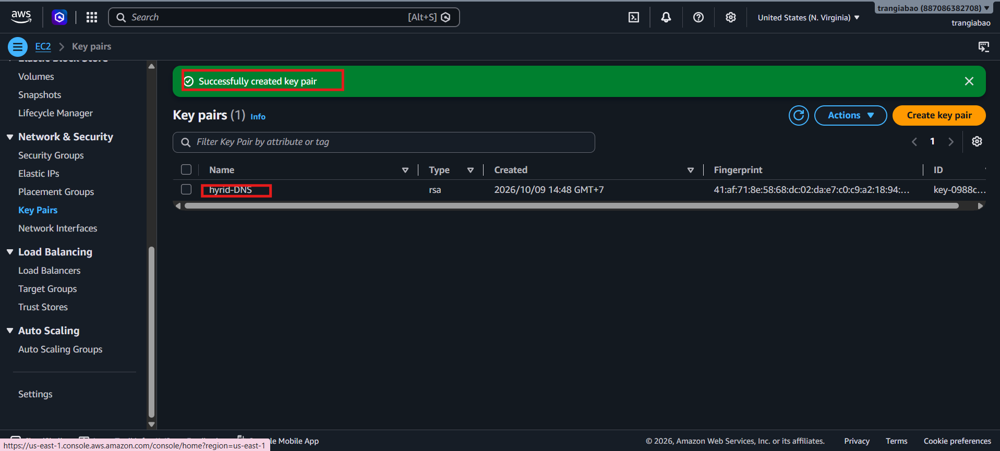

---

#### Bước 2: Triển khai Hạ tầng Mạng Đa VPC tự động bằng AWS CloudFormation
* **Thao tác / Hướng dẫn:** Truy cập dịch vụ **AWS CloudFormation** ➔ Chọn **Create stack (with new resources)** ➔ Chọn **Upload a template file**.
* **Thông số điền cụ thể:**
  * *Stack name:* `Hybrid-DNS-Stack`
  * *Parameters:* Chọn Key Pair `hybrid-dns-keypair` đã tạo ở Bước 1
* **Mục đích:** Tự động khởi tạo 2 VPC riêng biệt (mô phỏng Cloud VPC dải `10.0.0.0/16` và On-premises VPC dải `192.168.0.0/16`), thiết lập VPC Peering, Internet Gateway, Subnets và các bảng định tuyến Route Tables.

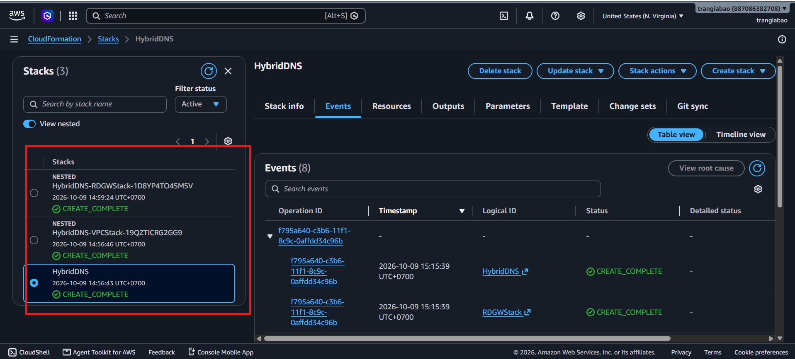

---

#### Bước 3: Lựa chọn Security Group cho Route 53 Resolver Endpoints
* **Thao tác / Hướng dẫn:** Điều hướng tới **EC2 Console** ➔ Mục **Network & Security** ➔ **Security Groups**.
* **Thông số chọn:** Tìm kiếm và chọn Security Group chuyên dụng mang tên `Route53-Resolver-SG` (hoặc Security Group được CloudFormation tạo cho Resolver).

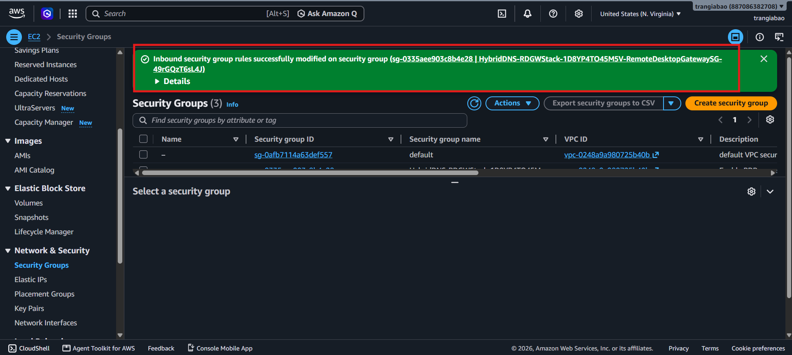

---

#### Bước 4: Chỉnh sửa Inbound Rules cho Security Group (Mở Port 53 UDP & TCP)
* **Thao tác / Hướng dẫn:** Chọn tab **Inbound rules** ➔ Nhấn **Edit inbound rules**.
* **Thông số điền cụ thể:**
  * *Rule 1:* Type `DNS (UDP)`, Port `53`, Source: Dải CIDR của On-premise VPC (`192.168.0.0/16`) và Cloud VPC (`10.0.0.0/16`)
  * *Rule 2:* Type `DNS (TCP)`, Port `53`, Source: Dải CIDR của On-premise VPC (`192.168.0.0/16`) và Cloud VPC (`10.0.0.0/16`)
* **Thao tác tiếp theo:** Nhấn **Save rules**.

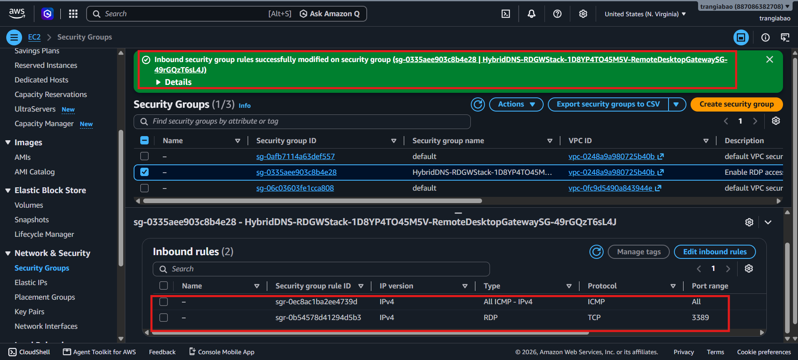

> **💡 Khó khăn gặp phải & Cách xử lý tại Bước 4:**  
> Rất nhiều kỹ sư mạng chỉ mở cổng **UDP 53** cho DNS mà quên mở **TCP 53**. Mặc dù hầu hết truy vấn DNS kích thước nhỏ chạy trên UDP, các truy vấn lớn hơn 512 bytes (như phản hồi có chữ ký số DNSSEC hoặc zone transfer) bắt buộc phải chuyển sang giao thức TCP. Nếu thiếu luật TCP 53, truy vấn sẽ bị timeout thất thường. Luôn mở đồng thời cả hai giao thức UDP và TCP.

---

#### Bước 5: Xác nhận Cấu hình Security Group Chấp nhận Lưu lượng Port 53
* **Thao tác / Hướng dẫn:** Kiểm tra lại bảng tổng hợp Inbound Rules vừa lưu.
* **Quan sát:** Cả hai luật DNS (UDP) và DNS (TCP) trên cổng 53 đều hiển thị trạng thái hoạt động chính xác từ các dải mạng nội bộ.

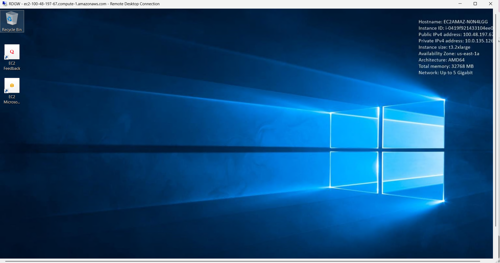

---

#### Bước 6: Khởi tạo Dịch vụ AWS Managed Microsoft Active Directory
* **Thao tác / Hướng dẫn:** Điều hướng tới **AWS Directory Service** ➔ Nhấn **Set up directory** ➔ Chọn **AWS Managed Microsoft AD**.
* **Thông số điền cụ thể:**
  * *Edition:* `Standard Edition`
  * *Directory DNS name:* `corp.example.com`
  * *Directory NetBIOS name:* `CORP`
  * *VPC:* Chọn On-premises VPC (`192.168.0.0/16`)
  * *Subnets:* Chọn 2 Private Subnets ở 2 Availability Zones khác nhau
* **Mục đích:** Mô phỏng hệ thống quản trị định danh Domain Controller và máy chủ DNS nội bộ của doanh nghiệp tại On-premise.

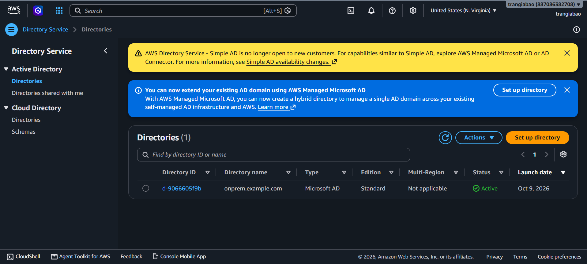

---

#### Bước 7: Kiểm tra Trạng thái Active & Ghi nhận 2 IP của Microsoft AD DNS
* **Thao tác / Hướng dẫn:** Đợi hệ thống hoàn tất khởi tạo (khoảng 15-20 phút), kiểm tra thông tin chi tiết thư mục.
* **Thông số quan sát & ghi chú lại:**
  * *Status:* **Active**
  * *DNS address 1:* `192.168.1.xxx`
  * *DNS address 2:* `192.168.2.xxx`
* **Ghi chú:** Đây là 2 địa chỉ IP máy chủ DNS mà Route 53 Resolver Rule sẽ chuyển tiếp truy vấn tới.

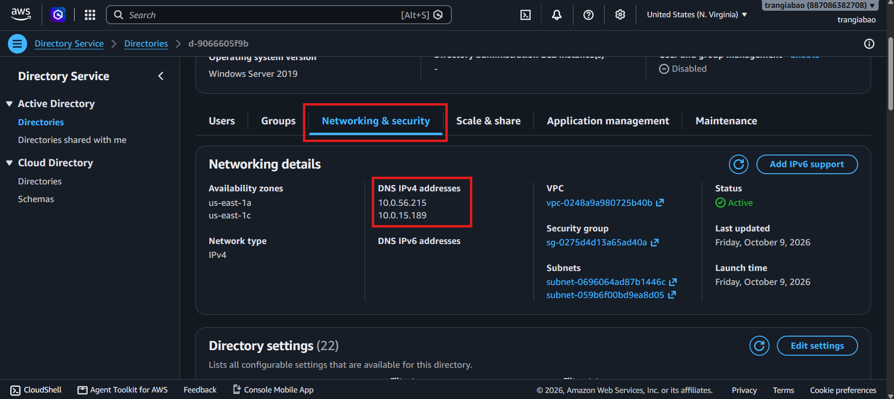

---

#### Bước 8: Khởi tạo Route 53 Resolver Outbound Endpoint (`r53-outbound-resolver`)
* **Thao tác / Hướng dẫn:** Mở dịch vụ **Amazon Route 53** ➔ Menu bên trái mục *Resolver* chọn **Outbound endpoints** ➔ Nhấn **Create outbound endpoint**.
* **Thông số điền cụ thể:**
  * *Endpoint name:* `r53-outbound-resolver`
  * *VPC:* Chọn Cloud VPC (`10.0.0.0/16`)
  * *Security Group:* Chọn `Route53-Resolver-SG` đã cấu hình ở Bước 5
  * *IP addresses:* Chọn tối thiểu **2 Availability Zones**, mỗi AZ chọn 1 subnet và chọn gán IP tự động (Auto-allocate IP)
* **Thao tác tiếp theo:** Nhấn **Submit**. Chờ trạng thái chuyển sang **Operational**.

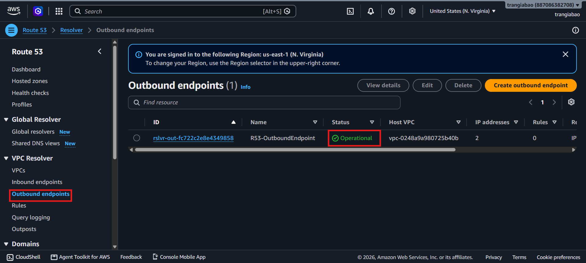

> **💡 Khó khăn gặp phải & Cách xử lý tại Bước 8:**  
> AWS Route 53 Resolver bắt buộc phải chỉ định tối thiểu 2 IP Endpoints phân bổ trên 2 Availability Zones riêng biệt để bảo đảm tính sẵn sàng cao. Nếu chỉ chọn 1 AZ, hệ thống sẽ báo lỗi không cho phép tiếp tục.

---

#### Bước 9: Thiết lập Route 53 Resolver Forwarding Rule về Active Directory
* **Thao tác / Hướng dẫn:** Menu bên trái chọn **Resolver** ➔ **Rules** ➔ Nhấn **Create rule**.
* **Thông số điền cụ thể:**
  * *Rule name:* `forward-to-corp-ad`
  * *Rule type:* **Forward**
  * *Domain name:* `corp.example.com`
  * *VPCs that use this rule:* Chọn Cloud VPC
  * *Outbound endpoint:* Chọn `r53-outbound-resolver` vừa tạo ở Bước 8
  * *Target IP addresses:* Nhập lần lượt **2 địa chỉ IP DNS của Microsoft AD** đã ghi lại ở Bước 7 (Port `53`)
* **Thao tác tiếp theo:** Nhấn **Submit**.

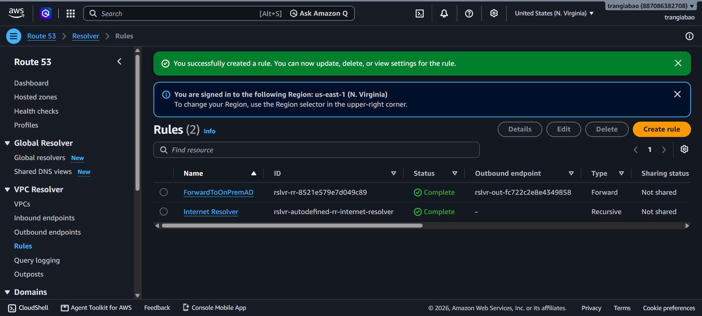

---

#### Bước 10: Khởi tạo Route 53 Resolver Inbound Endpoint (`r53-inbound-resolver`)
* **Thao tác / Hướng dẫn:** Menu bên trái chọn **Resolver** ➔ **Inbound endpoints** ➔ Nhấn **Create inbound endpoint**.
* **Thông số điền cụ thể:**
  * *Endpoint name:* `r53-inbound-resolver`
  * *VPC:* Chọn Cloud VPC (`10.0.0.0/16`)
  * *Security Group:* Chọn `Route53-Resolver-SG`
  * *IP addresses:* Chọn 2 Availability Zones và 2 Subnets tương ứng
* **Mục đích:** Cung cấp các địa chỉ IP tĩnh trên AWS để máy chủ DNS On-premises cấu hình DNS Conditional Forwarder chuyển tiếp các truy vấn tên miền AWS riêng (ví dụ: `aws.local` hoặc các Private Hosted Zone) lên Route 53 Resolver.

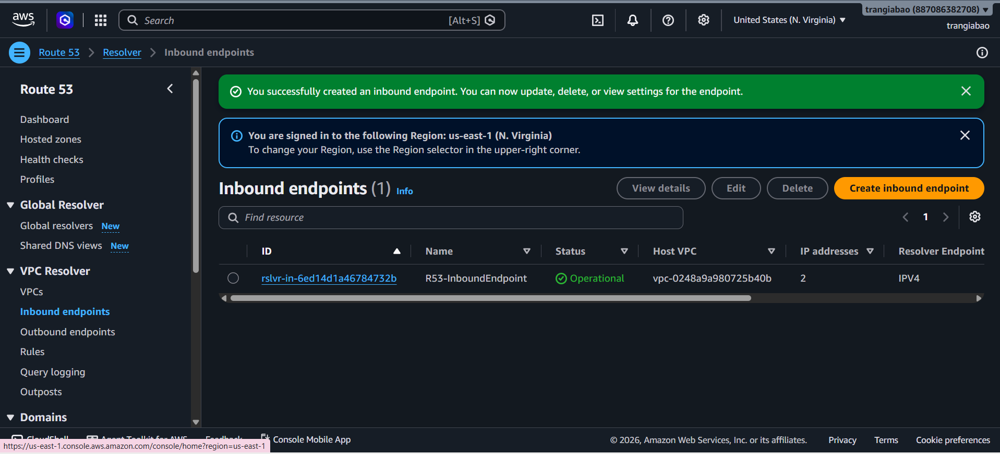

---

#### Bước 11: Kiểm thử Phân giải Tên miền Hai chiều bằng Lệnh `nslookup`
* **Thao tác / Hướng dẫn:** Đăng nhập máy chủ kiểm thử (RDGW hoặc Test Instance) và mở PowerShell / Command Prompt để kiểm tra phân giải DNS hai chiều.
* **Lệnh thực thi & Kết quả:**
  ```powershell
  # 1. Từ AWS Cloud: Truy vấn tên miền On-premises qua Route 53 Outbound Endpoint
  nslookup dc01.corp.example.com

  # 2. Từ On-premises: Truy vấn tên miền AWS Private Zone qua Route 53 Inbound Endpoint
  nslookup app.aws.local <Inbound-Endpoint-IP>
  ```
* **Kết quả hiển thị:** Cả hai câu lệnh đều trả về địa chỉ IP nội bộ chính xác mà không gặp bất kỳ lỗi `Non-existent domain` hay timeout nào, chứng minh giải pháp Hybrid DNS đã vận hành thông suốt hai chiều.

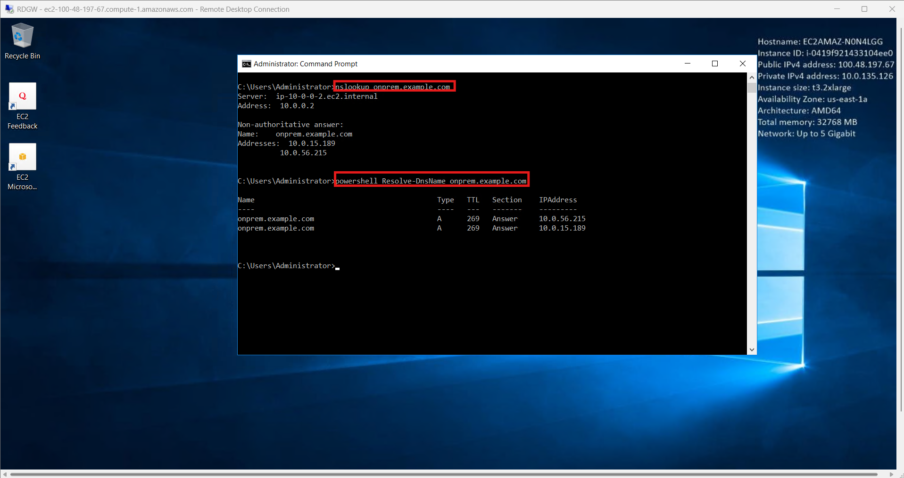

---

### 📝 Tổng kết & Bài học kinh nghiệm:
1. **Kiến trúc Hybrid DNS Liền mạch:** Route 53 Resolver đóng vai trò cầu nối DNS đắc lực loại bỏ hoàn toàn việc phải dựng và quản lý các cụm máy chủ BIND/DNS Forwarder trung gian tự quản lý tốn kém tài nguyên trên EC2.
2. **Phân biệt Rạch ròi Inbound vs Outbound Endpoints:**
   * **Inbound Endpoint:** Tiếp nhận truy vấn DNS từ hệ thống bên ngoài (On-premises) gửi vào mạng AWS để phân giải các Private Hosted Zones.
   * **Outbound Endpoint:** Bắn truy vấn từ máy chủ trong AWS VPC đi ra ngoài hệ thống DNS nội bộ On-premises thông qua các quy tắc Resolver Forwarding Rules.
3. **Tối ưu hóa Trải nghiệm Di chuyển Lên Đám mây (Cloud Migration):** Cho phép các ứng dụng đang trong quá trình chuyển đổi di chuyển lên AWS truy cập các hệ thống cơ sở dữ liệu, ERP, SAP nội bộ tại On-premise thông qua tên miền thân thiện quen thuộc mà không cần viết lại mã nguồn cấu hình mạng.

- **Mô hình kiến trúc mạng lai (Hybrid Cloud):** Hiểu rõ bài toán kết nối và định tuyến tên miền giữa trung tâm dữ liệu tại chỗ (On-premises) và môi trường đám mây AWS.
- **Phân giải tên miền hai chiều:** Nắm vững nguyên lý hoạt động của Inbound và Outbound Endpoints trong Route 53 Resolver để máy chủ hai bên nhận diện và phân giải DNS thông suốt.
- **Kiểm thử và xác thực thực tế:** Rèn luyện kỹ năng kiểm tra độ trễ và tính chính xác của các bản ghi DNS bằng `nslookup` trên môi trường đa VPC mô phỏng doanh nghiệp.

---

#### 📌 Kết quả Thứ 3 (13/10/2026) - Thao tác dòng lệnh với AWS CLI:

{}
Bài thực hành **Thao tác dòng lệnh với AWS CLI** được thực hiện vào **Thứ 3 (13/10/2026)** trong khuôn khổ **Tuần 5**. Trang này ghi lại chi tiết từng bước thực hành thực tế: các bước click chuột, thông số cấu hình cụ thể cần điền, câu lệnh thực thi và cách xử lý các lỗi phát sinh.
<br>🔗 **Nguồn tài liệu thực hành:** [Getting Started with the AWS CLI](https://000011.awsfcaj.com/)
{}

### 🎯 Mục tiêu bài thực hành (Lab Objectives):
* Thiết lập môi trường thực hành chuẩn với **IAM User Groups**, **IAM Users** (`aws-cli-user`, `devops`) và cấp phát **Access Keys**.
* Khởi tạo máy chủ **Amazon EC2 (Amazon Linux 2023)** làm máy trạm quản trị và kết nối an toàn qua **MobaXterm**.
* Cài đặt phiên bản mới nhất **AWS CLI v2** trên môi trường Linux và cấu hình nhiều Profile (`default`, `devops`).
* Sử dụng AWS CLI để quản trị dữ liệu hướng đối tượng trên **Amazon S3** (tạo bucket, tải file, quản lý đối tượng và xóa an toàn với cờ `--force`).
* Quản trị dịch vụ gửi thông báo **Amazon SNS** (tạo Topic, đăng ký Subscription qua Email và phát tán tin nhắn Publish).
* Xây dựng toàn bộ hệ thống mạng **Amazon VPC** bằng lệnh CLI (VPC, Subnet, Internet Gateway, Route Table và liên kết tuyến đường).
* Tự động hóa vòng đời máy chủ **Amazon EC2** bằng CLI (tạo Key Pair, Security Group, mở cổng Inbound 22, chạy `run-instances`, cấp Elastic IP, SSH kết nối và hủy máy).

---

### 📊 Bảng tổng hợp thông số tài nguyên đã triển khai:

| Tài nguyên | Tên / Định danh | Cấu hình & Thông số kỹ thuật | Region | Ghi chú |
| :--- | :--- | :--- | :--- | :--- |
| **IAM Group** | `aws-cli` | Policy: `AdministratorAccess` | Global | Quản trị tập trung quyền hạn admin |
| **IAM User 1** | `aws-cli-user` | Nhóm: `aws-cli` + CLI Access Key | Global | Cấu hình cho Profile `default` |
| **IAM User 2** | `devops` | Nhóm: `aws-cli` + CLI Access Key | Global | Cấu hình cho Profile `--profile devops` |
| **EC2 Management** | `aws-cli-instance` | `t3.micro`, Amazon Linux 2023, Key: `aws-cli-keypair` | `us-east-1` | Máy trạm kết nối SSH qua MobaXterm |
| **Subnet quản trị** | `subnet-01` | CIDR: `172.31.100.0/24`, Auto-assign Public IP: Yes | `us-east-1` | Subnet kết nối ra Internet Gateway |
| **S3 Bucket** | `aws-cli-trangiabao-2026` | Standard Storage, Bucket name duy nhất toàn cầu | `ap-southeast-1` | Lưu trữ file kiểm thử `text.txt` |
| **SNS Topic** | `aws-cli` | ARN: `arn:aws:sns:ap-southeast-1:887086382708:aws-cli` | `ap-southeast-1` | Kênh gửi thông báo Email tự động |
| **VPC (Tạo qua CLI)**| `vpc-07ebcfa7f5b9c659c` | CIDR: `10.0.0.0/16` | `ap-southeast-1` | Hạ tầng mạng độc lập phục vụ CLI Lab |
| **Subnet (CLI)** | `subnet-03c90d43fb1f53b06` | CIDR: `10.0.1.0/24`, Availability Zone: `ap-southeast-1a` | `ap-southeast-1` | Subnet chứa máy chủ EC2 tự động |
| **Internet Gateway** | `igw-006783ef67381e1d4` | Attached to `vpc-07ebcfa7f5b9c659c` | `ap-southeast-1` | Cổng kết nối Internet cho VPC |
| **Route Table (CLI)**| `rtb-xxxx` | Route: `0.0.0.0/0` trỏ tới Internet Gateway | `ap-southeast-1` | Định tuyến lưu lượng ra Internet |
| **Key Pair (CLI)** | `MyKeyPair` | Loại: RSA, định dạng file lưu: `MyKeyPair.pem` (400) | `ap-southeast-1` | Xác thực SSH vào máy chủ tạo qua CLI |
| **Security Group** | `SSHAccess` | Inbound: Port 22 (TCP) từ `0.0.0.0/0` | `ap-southeast-1` | Tường lửa mở cổng SSH cho EC2 |
| **EC2 tự động (CLI)**| `i-03171455cd0278073` | `t2.micro`, Private IP: `10.0.1.41` | `ap-southeast-1` | Máy chủ tạo tự động qua CLI |
| **Elastic IP** | `47.131.189.63` | Allocation: `eipalloc-0f52955fe9fe8ad41` | `ap-southeast-1` | IP công khai gán vào EC2 để SSH |

---

### 📋 Mục 1: Chuẩn bị môi trường & Thiết lập định danh (Prerequisites)

#### Bước 1: Khởi tạo User Group trên IAM
* **Thao tác:** Đăng nhập AWS Management Console ➔ Tìm dịch vụ **IAM** ➔ Menu bên trái chọn **User groups** ➔ Nhấn nút **Create group**.
* **Mục đích:** Tạo nhóm quyền quản trị tập trung để phân quyền nhanh cho các tài khoản CLI.

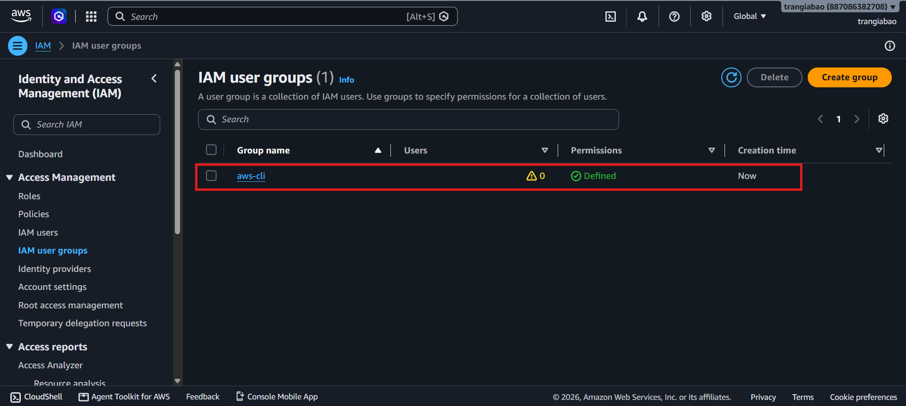

#### Bước 2: Cấu hình thông số nhóm `aws-cli`
* **Thông số điền:**
  * **User group name:** `aws-cli`
  * **Attach permissions policies:** Tìm và tích chọn chính sách **`AdministratorAccess`**.
* **Thao tác:** Cuộn xuống dưới cùng và nhấn **Create group**.

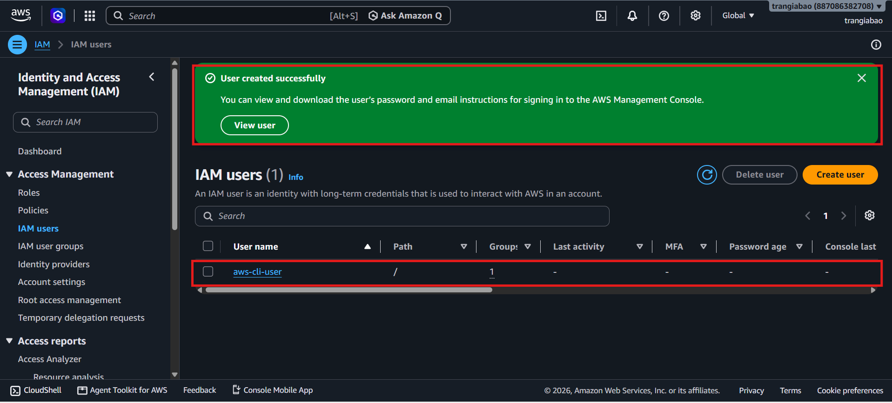

#### Bước 3: Tạo người dùng IAM `aws-cli-user`
* **Thao tác:** Menu bên trái IAM chọn **Users** ➔ Nhấn nút **Create user**.
* **Thông số điền:**
  * **User name:** `aws-cli-user`
  * **Add user to group:** Tích chọn nhóm **`aws-cli`** vừa tạo ở Bước 2.
* **Thao tác:** Nhấn **Next** ➔ Nhấn **Create user**.

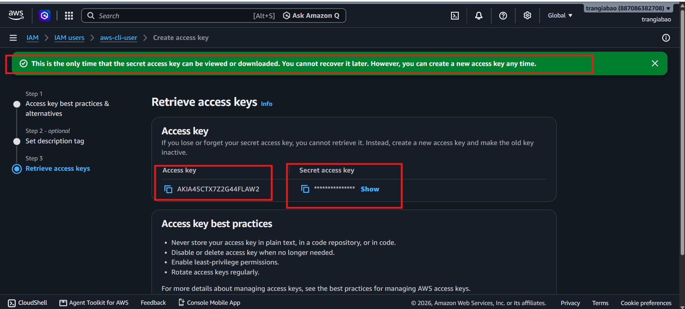

#### Bước 4: Cấp phát Access Key CLI cho `aws-cli-user`
* **Thao tác:** Bấm vào user **`aws-cli-user`** ➔ Chọn tab **Security credentials** ➔ Cuộn xuống mục *Access keys* ➔ Nhấn **Create access key**.
* **Thông số chọn:**
  * **Use case:** Chọn **Command Line Interface (CLI)**.
  * **Confirmation:** Tích chọn ô *"I understand the above recommendation..."*.
* **Thao tác:** Nhấn **Next** ➔ Nhấn **Create access key** ➔ Tải file `.csv` chứa **Access key ID** và **Secret access key** về máy để dùng cho CLI.

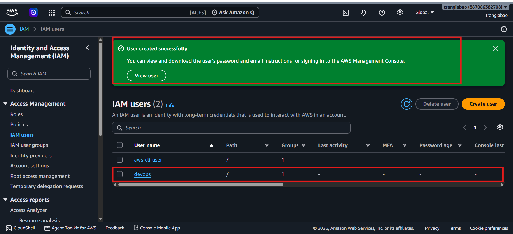

#### Bước 5: Tạo thêm người dùng `devops` phục vụ Multi-profile
* **Thao tác:** Lặp lại quy trình tạo User cho tài khoản thứ hai mang tên **`devops`**.
* **Thông số điền:**
  * **User name:** `devops`
  * **User group:** Gán vào nhóm `aws-cli`.
  * **Access Key:** Tạo bộ Access Key (CLI) riêng và lưu lại khóa bảo mật.

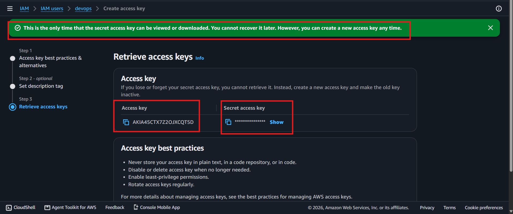

#### Bước 6: Khởi chạy máy chủ EC2 quản trị (`aws-cli-instance`)
* **Thao tác:** Mở dịch vụ **EC2** ➔ Chọn **Instances** ➔ Nhấn nút **Launch instances**.
* **Thông số điền cụ thể:**
  * **Name:** `aws-cli-instance`
  * **Application and OS Images (AMI):** Chọn `Amazon Linux 2023 kernel-6.1 AMI`.
  * **Instance type:** `t3.micro` (hoặc `t2.micro`).
  * **Key pair (login):** Nhấn *Create new key pair* ➔ Đặt tên **`aws-cli-keypair`**, loại **RSA**, định dạng **`.pem`** ➔ Tải về máy.
  * **Network settings:** Bấm nút **Edit** và cấu hình chính xác:
    * *VPC:* Chọn VPC mặc định của bạn (`vpc-0fc9d5490a843944e`).
    * *Subnet:* Chọn `subnet-01` (dải `172.31.100.0/24`).
    * *Auto-assign public IP:* **`Enable`** *(bắt buộc để có Public IP kết nối)*.
    * *Firewall (Security group):* Chọn *Create security group* ➔ Tích bật **Allow SSH traffic from Anywhere (0.0.0.0/0)**.
* **Thao tác:** Nhấn nút màu cam **Launch instance**.

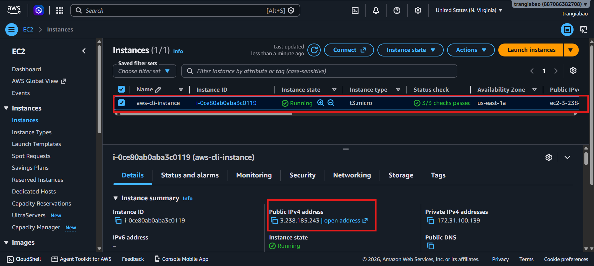

> **💡 Khó khăn gặp phải & Cách xử lý tại Bước 6:**  
> Khi tạo máy chủ, mục Subnet bị lỗi không cho chọn `default` do Default Subnet trong VPC đã bị xóa từ trước.  
> ➔ **Cách xử lý:** Vào **VPC** ➔ **Subnets** ➔ Bấm **Create subnet**, tạo một subnet mới tên `subnet-01` với dải mạng `172.31.100.0/24` trong `us-east-1a`, sau đó vào Network settings của EC2 chọn subnet này và bật `Auto-assign public IP: Enable`.

#### Bước 7: Kết nối SSH vào máy chủ qua MobaXterm
* **Thao tác trên MobaXterm:**
  1. Mở phần mềm MobaXterm ➔ Nhấn nút **Session** ở góc trên bên trái ➔ Chọn **SSH**.
  2. **Remote host:** Điền địa chỉ **Public IPv4** của máy chủ vừa tạo (ví dụ: `3.238.185.243` hoặc `32.197.220.215`).
  3. **Specify username:** Tích chọn và nhập **`ec2-user`**.
  4. **Port:** `22`.
  5. Bấm vào tab **Advanced SSH settings** ➔ Tích chọn **Use private key** ➔ Trỏ đường dẫn đến file **`aws-cli-keypair.pem`** vừa tải về.
  6. Bấm **OK** ➔ Chọn **Accept** host key để đăng nhập.

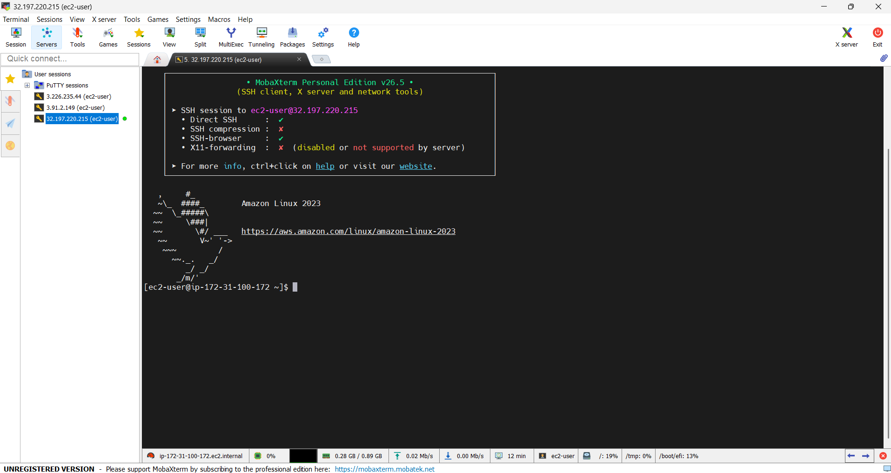

> **💡 Khó khăn gặp phải & Cách xử lý tại Bước 7:**  
> MobaXterm báo lỗi `Network error: Connection timed out` không thể kết nối.  
> ➔ **Nguyên nhân:** Do Subnet `subnet-01` vừa tạo thủ công chưa có đường ra Internet (thiếu Internet Gateway).  
> ➔ **Cách xử lý:** Vào **VPC** ➔ **Internet gateways** ➔ Tạo `my-igw` và Attach vào VPC. Sau đó vào **Route tables**, bấm **Edit routes**, thêm dòng: `Destination: 0.0.0.0/0` trỏ tới `Target: Internet Gateway (igw-xxxx)` rồi bấm Save. Sau đó bấm `R` trên MobaXterm là kết nối thành công ngay lập tức!

---

### 📋 Mục 2: Cài đặt và cấu hình AWS CLI v2 (Install AWS CLI)

#### Bước 8: Tải và cài đặt AWS CLI v2 trên Linux
* **Lệnh thực hiện:** Chạy lần lượt các lệnh sau trên cửa sổ terminal MobaXterm:
  ```bash
  curl "https://awscli.amazonaws.com/awscli-exe-linux-x86_64.zip" -o "awscliv2.zip"
  unzip awscliv2.zip
  sudo ./aws/install
  aws --version
  ```
* **Kết quả kiểm tra:** Terminal in ra phiên bản `aws-cli/2.x.x` là cài đặt thành công.

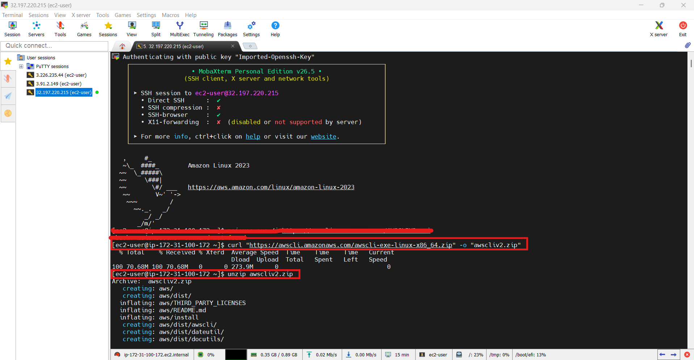

#### Bước 9: Cấu hình Default Profile bằng `aws configure`
* **Lệnh thực hiện:** `aws configure`
* **Thông số nhập vào terminal:**
  * `AWS Access Key ID [None]:` Nhập Access Key của **`aws-cli-user`** (đã lưu ở Bước 4).
  * `AWS Secret Access Key [None]:` Nhập Secret Key của **`aws-cli-user`**.
  * `Default region name [None]:` **`ap-southeast-1`** (Singapore).
  * `Default output format [None]:` **`json`**.

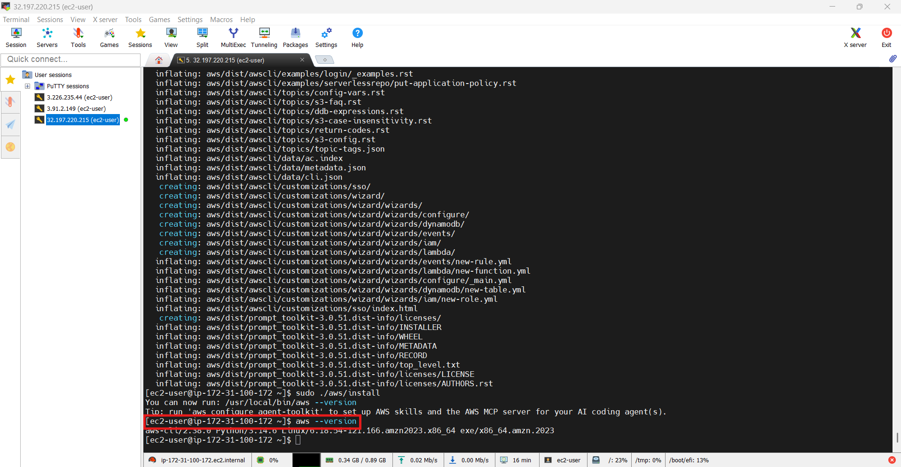

#### Bước 10: Cấu hình thêm Profile `devops`
* **Lệnh thực hiện:** `aws configure --profile devops`
* **Thông số nhập vào terminal:**
  * `AWS Access Key ID [None]:` Nhập Access Key của user **`devops`** (đã lưu ở Bước 5).
  * `AWS Secret Access Key [None]:` Nhập Secret Key của user **`devops`**.
  * `Default region name [None]:` **`ap-southeast-1`**.
  * `Default output format [None]:` **`json`**.

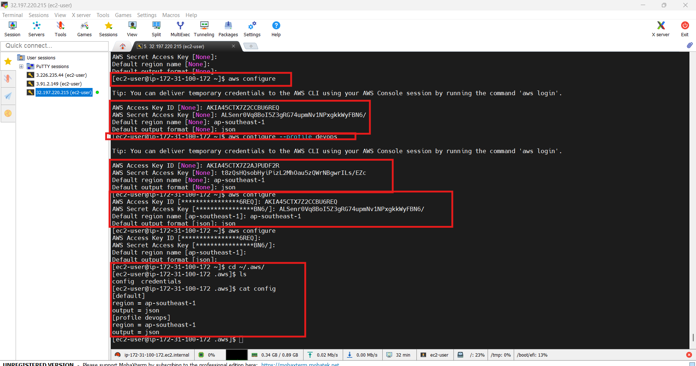

#### Bước 11: Kiểm tra file cấu hình và danh sách Profile
* **Lệnh thực hiện:**
  ```bash
  cat ~/.aws/config
  cat ~/.aws/credentials
  aws configure list-profiles
  ```
* **Kết quả:** Hiển thị rõ 2 profile `default` và `devops` được lưu trữ tách biệt.

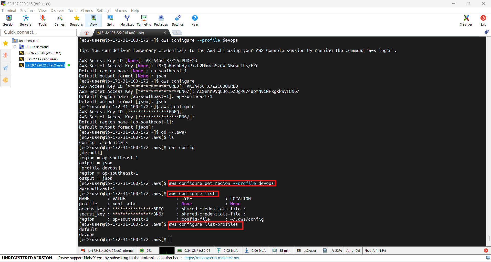

---

### 📋 Mục 3: Kiểm tra tài nguyên bằng CLI (Check Resources via CLI)

#### Bước 12: Kiểm tra chi tiết máy chủ EC2
* **Lệnh thực hiện:**
  ```bash
  aws ec2 describe-instances --profile devops --region us-east-1 --output table
  ```
* **Ý nghĩa:** Truy vấn toàn bộ cấu hình máy chủ ảo ở Region `us-east-1` và xuất dưới dạng bảng (`table`) trực quan.

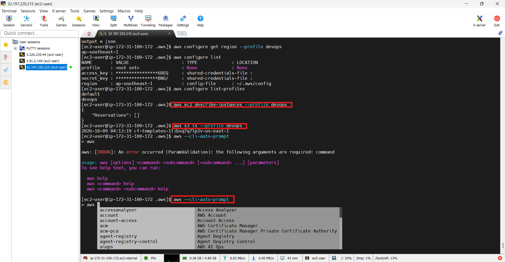

> **💡 Khó khăn gặp phải & Cách xử lý tại Bước 12:**  
> Khi chạy `aws ec2 describe-instances --profile devops` không thấy dữ liệu (trả về rỗng `[]`).  
> ➔ **Nguyên nhân:** Do profile `devops` mặc định ở `ap-southeast-1` (Singapore), trong khi máy chủ EC2 tạo ở `us-east-1`.  
> ➔ **Cách xử lý:** Bắt buộc thêm cờ `--region us-east-1` để CLI quét đúng vùng chứa máy chủ.

#### Bước 13: Kiểm tra danh sách S3 Bucket
* **Lệnh thực hiện:**
  ```bash
  aws s3 ls --profile devops
  ```
* **Kết quả:** In ra danh sách các thùng chứa S3 hiện có trong tài khoản.

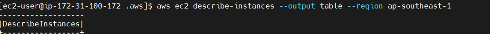

---

### 📋 Mục 4: Quản trị Amazon S3 bằng CLI (AWS CLI with S3)

#### Bước 14: Tạo S3 Bucket và Upload file dữ liệu
* **Thông số & Lệnh thực hiện:**
  1. *Tạo Bucket mới:*
     ```bash
     aws s3 mb s3://aws-cli-trangiabao-2026
     ```
  2. *Tạo file văn bản kiểm thử trên máy EC2:*
     ```bash
     echo "Hello AWS S3 from CLI" > text.txt
     ```
  3. *Tải file lên thùng chứa S3:*
     ```bash
     aws s3 cp text.txt s3://aws-cli-trangiabao-2026
     ```

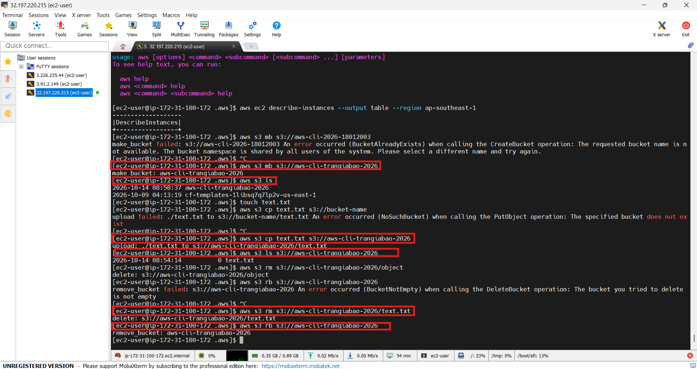

> **💡 Khó khăn gặp phải & Cách xử lý tại Bước 14:**  
> * **Lỗi `BucketAlreadyExists`:** Gõ lệnh tạo bucket mẫu `aws-cli-2026-18012003` bị lỗi do tên đã tồn tại trên toàn cầu. Khắc phục: Đổi tên độc nhất `aws-cli-trangiabao-2026`.  
> * **Lỗi `NoSuchBucket`:** Gõ nhầm chữ tượng trưng `bucket-name`. Khắc phục: Thay đúng tên `s3://aws-cli-trangiabao-2026`.

#### Bước 15: Liệt kê nội dung và Xóa Bucket S3
* **Lệnh thực hiện:**
  1. *Kiểm tra file bên trong bucket:*
     ```bash
     aws s3 ls s3://aws-cli-trangiabao-2026
     ```
  2. *Xóa sạch dữ liệu và xóa luôn thùng chứa:*
     ```bash
     aws s3 rb s3://aws-cli-trangiabao-2026 --force
     ```

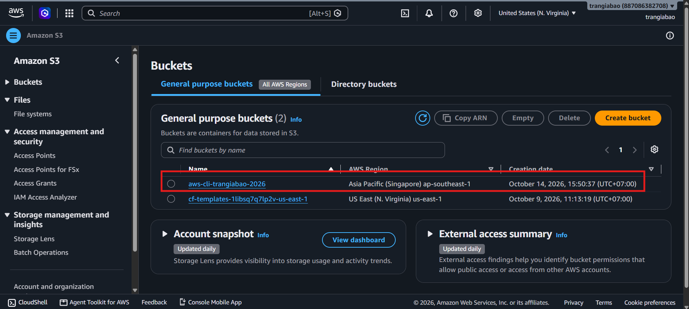

> **💡 Khó khăn gặp phải & Cách xử lý tại Bước 15:**  
> Gõ lệnh `aws s3 rb s3://...` bị báo lỗi `BucketNotEmpty` vì file `text.txt` bên trong chưa được xóa.  
> ➔ **Cách xử lý:** Bổ sung cờ `--force` để AWS tự động dọn sạch file bên trong trước khi xóa thùng chứa.

---

### 📋 Mục 5: Quản trị Amazon SNS bằng CLI (AWS CLI with SNS)

#### Bước 16: Tạo Topic thông báo
* **Lệnh thực hiện:**
  ```bash
  aws sns create-topic --name aws-cli
  ```
* **Kết quả trả về:** Nhận được chuỗi ARN đại diện cho topic:
  `"TopicArn": "arn:aws:sns:ap-southeast-1:887086382708:aws-cli"`

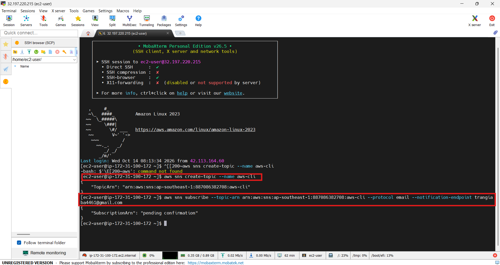

#### Bước 17: Đăng ký nhận thông báo qua Email (Subscribe)
* **Lệnh thực hiện:**
  ```bash
  aws sns subscribe --topic-arn arn:aws:sns:ap-southeast-1:887086382708:aws-cli --protocol email --notification-endpoint trangiabao4461@gmail.com
  ```
* **Thông số:**
  * `--topic-arn`: Dán mã ARN thật vừa tạo ở Bước 16.
  * `--protocol`: `email`.
  * `--notification-endpoint`: Nhập địa chỉ Gmail nhận thư.

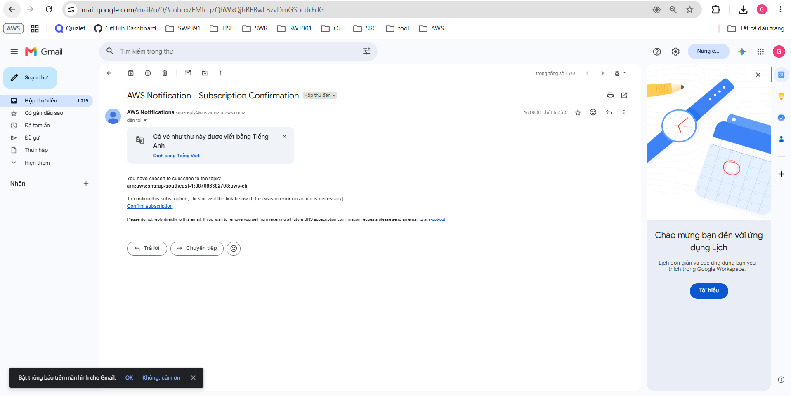

> **💡 Khó khăn gặp phải & Cách xử lý tại Bước 17:**  
> Terminal báo lỗi `Unknown options: Topic**` do copy nguyên văn chữ in đậm `**ARN Topic**` trong bài.  
> ➔ **Cách xử lý:** Thay thế cụm `**ARN Topic**` bằng mã ARN thật: `arn:aws:sns:ap-southeast-1:887086382708:aws-cli`.

#### Bước 18: Trạng thái chờ xác thực (Pending Confirmation)
* **Kết quả:** Lệnh trả về `"SubscriptionArn": "pending confirmation"`, AWS đã gửi email xác nhận.

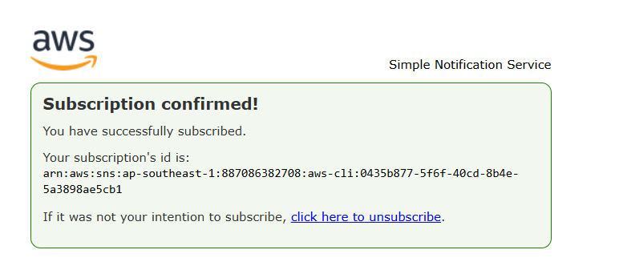

#### Bước 19: Mở Gmail và nhấn Confirm subscription
* **Thao tác:**
  1. Mở Gmail cá nhân, gõ tìm kiếm: `in:anywhere AWS Notification`.
  2. Mở thư từ `no-reply@sns.amazonaws.com` có tiêu đề *AWS Notification - Subscription Confirmation*.
  3. Bấm vào đường link **Confirm subscription**.
* **Kết quả:** Trình duyệt hiện thông báo **Subscription confirmed!**.

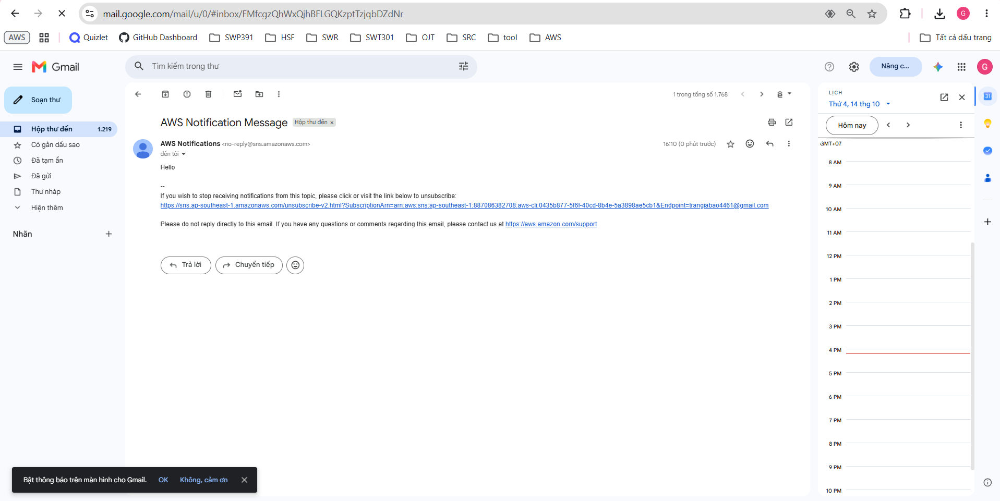

> **💡 Khó khăn gặp phải tại Bước 19:** Không thấy thư gửi về hộp thư chính. Do gõ nhầm email thiếu chữ "o" và Gmail tự động phân loại thư AWS vào mục **Spam (Thư rác)**. Khắc phục: Gõ đúng email và tìm trong thư mục Spam.

#### Bước 20: Phát tin nhắn (Publish) từ CLI về Email
* **Lệnh thực hiện:**
  ```bash
  aws sns publish --topic-arn arn:aws:sns:ap-southeast-1:887086382708:aws-cli --message "Hello"
  ```
* **Kết quả:** Nhận được `MessageId` trên terminal và hộp thư Gmail nhận ngay thông báo có nội dung **"Hello"**.

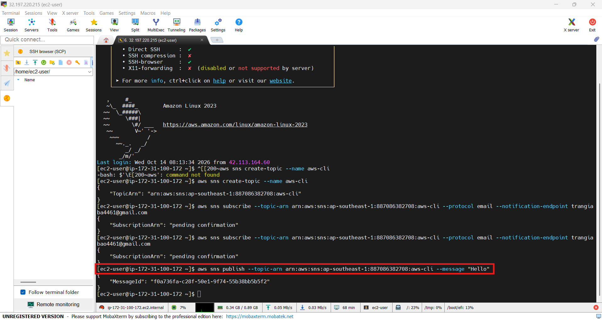

---

### 📋 Mục 6: Quản trị IAM qua CLI (AWS CLI with IAM)

#### Bước 21: Liệt kê danh sách người dùng IAM
* **Lệnh thực hiện:**
  ```bash
  aws iam list-users
  ```
* **Kết quả:** Xuất danh sách thông tin người dùng `aws-cli-user`, `devops` cùng ngày tạo và ARN.

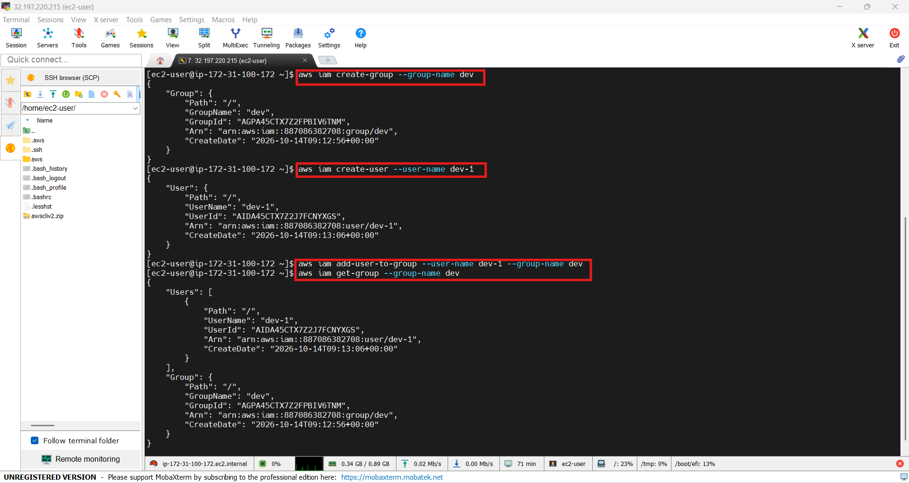

#### Bước 22: Kiểm tra chính sách và phân quyền
* **Lệnh thực hiện:** Truy vấn danh sách chính sách và vai trò để kiểm tra tính toàn vẹn quyền hạn.

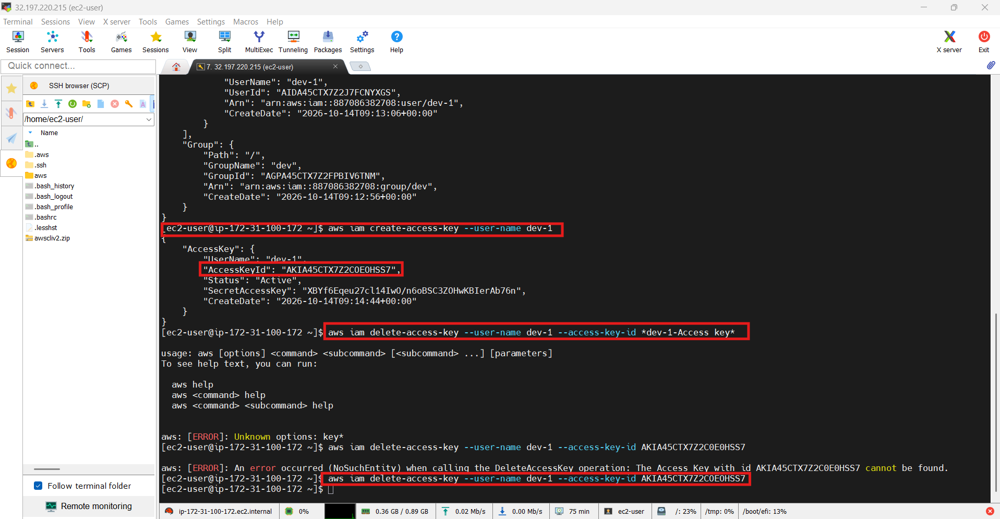

---

### 📋 Mục 7: Xây dựng hệ thống mạng VPC bằng CLI (AWS CLI with Networking)

#### Bước 23: Khởi tạo VPC mới
* **Lệnh thực hiện:**
  ```bash
  aws ec2 create-vpc --cidr-block 10.0.0.0/16 --query Vpc.VpcId --output text
  ```
* **Kết quả:** Tạo VPC thành công và in ra mã VPC ID: **`vpc-07ebcfa7f5b9c659c`**.

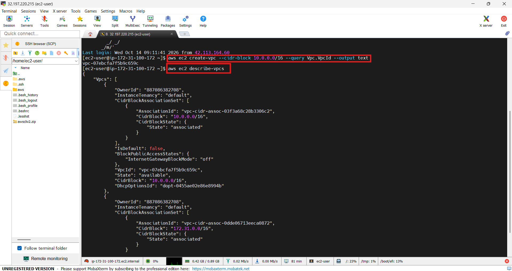

#### Bước 24: Khởi tạo Subnet con
* **Lệnh thực hiện:**
  ```bash
  aws ec2 create-subnet --vpc-id vpc-07ebcfa7f5b9c659c --cidr-block 10.0.1.0/24 --query Subnet.SubnetId --output text
  ```
* **Kết quả:** Tạo Subnet thành công và in ra mã Subnet ID: **`subnet-03c90d43fb1f53b06`**.

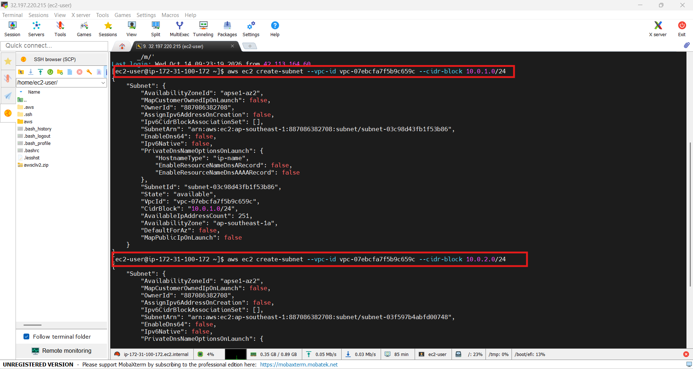

#### Bước 25: Khởi tạo Internet Gateway
* **Lệnh thực hiện:**
  ```bash
  aws ec2 create-internet-gateway --query InternetGateway.InternetGatewayId --output text
  ```
* **Kết quả:** In ra mã Internet Gateway ID: **`igw-006783ef67381e1d4`**.

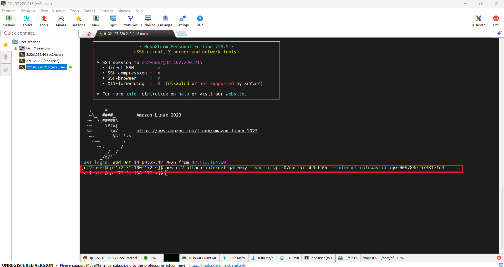

> **💡 Khó khăn gặp phải tại Bước 25:** Vào web AWS Console không thấy `igw-006783ef67381e1d4`. Do tài nguyên được tạo ở Singapore (`ap-southeast-1`), trong khi web đang chọn N. Virginia. Khắc phục: Đổi cờ vùng trên web sang Singapore.

#### Bước 26: Gắn Internet Gateway vào VPC (Attach IGW)
* **Lệnh thực hiện:**
  ```bash
  aws ec2 attach-internet-gateway --vpc-id vpc-07ebcfa7f5b9c659c --internet-gateway-id igw-006783ef67381e1d4
  ```
* **Kết quả:** IGW chuyển sang trạng thái **`Attached`** vào `vpc-07ebcfa7f5b9c659c`.

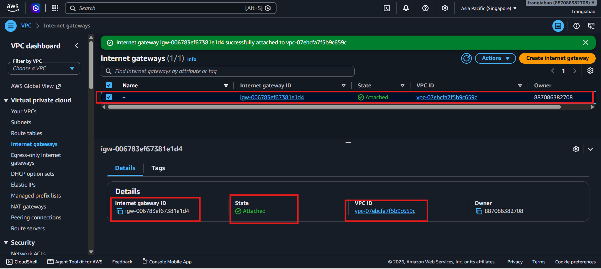

> **💡 Lưu ý tại Bước 26:** Nếu chạy lại lệnh này sẽ gặp thông báo `Resource.AlreadyAssociated`. Đây là thông báo nó đã được gắn thành công trước đó, không phải lỗi hỏng.

#### Bước 27: Tạo Route Table và cấu hình tuyến `0.0.0.0/0`
* **Lệnh thực hiện:**
  1. *Tạo Route Table:*
     ```bash
     aws ec2 create-route-table --vpc-id vpc-07ebcfa7f5b9c659c --query RouteTable.RouteTableId --output text
     ```
     *(Nhận mã Route Table dạng `rtb-xxxx`).*
  2. *Thêm đường dẫn ra Internet Gateway:*
     ```bash
     aws ec2 create-route --route-table-id <MÃ_RTB> --destination-cidr-block 0.0.0.0/0 --gateway-id igw-006783ef67381e1d4
     ```

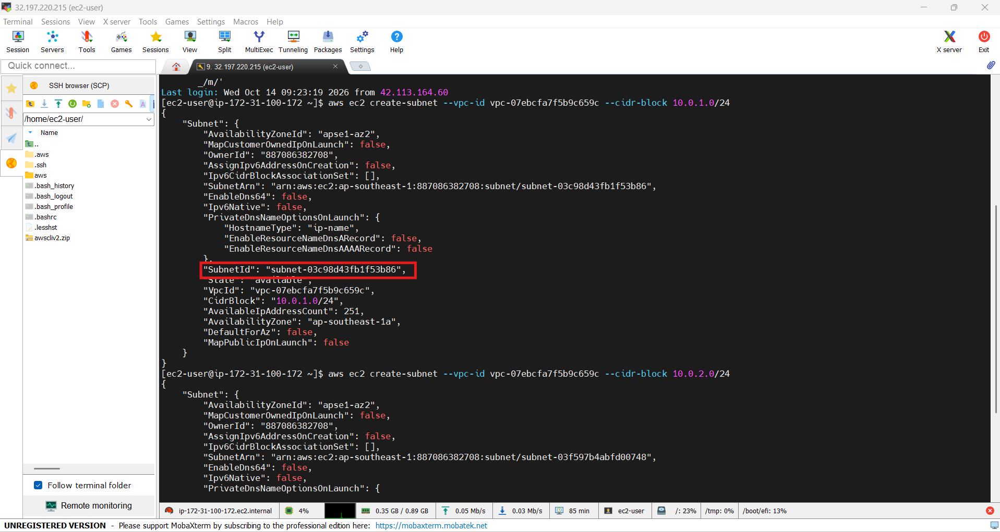

#### Bước 28: Liên kết Route Table với Subnet
* **Lệnh thực hiện:**
  ```bash
  aws ec2 associate-route-table --subnet-id subnet-03c90d43fb1f53b06 --route-table-id <MÃ_RTB>
  ```
* **Kết quả:** Subnet `subnet-03c90d43fb1f53b06` chính thức được thông tuyến ra Internet.

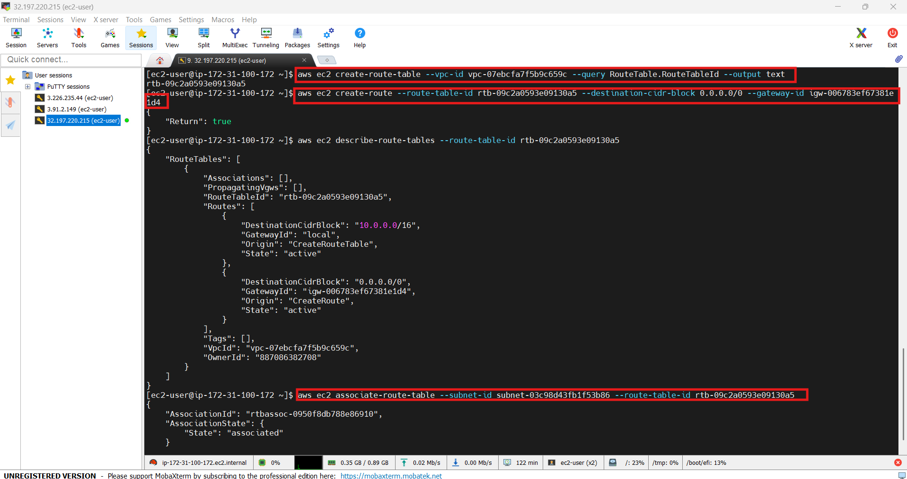

---

### 📋 Mục 8: Tự động hóa máy chủ EC2 bằng CLI (Create EC2 using CLI)

#### Bước 29: Tạo cặp khóa xác thực Key Pair qua CLI
* **Lệnh thực hiện:**
  ```bash
  aws ec2 create-key-pair --key-name MyKeyPair --query "KeyMaterial" --output text > MyKeyPair.pem
  ```
* **Ý nghĩa:** Trích xuất trực tiếp nội dung private key và ghi vào file `MyKeyPair.pem`.

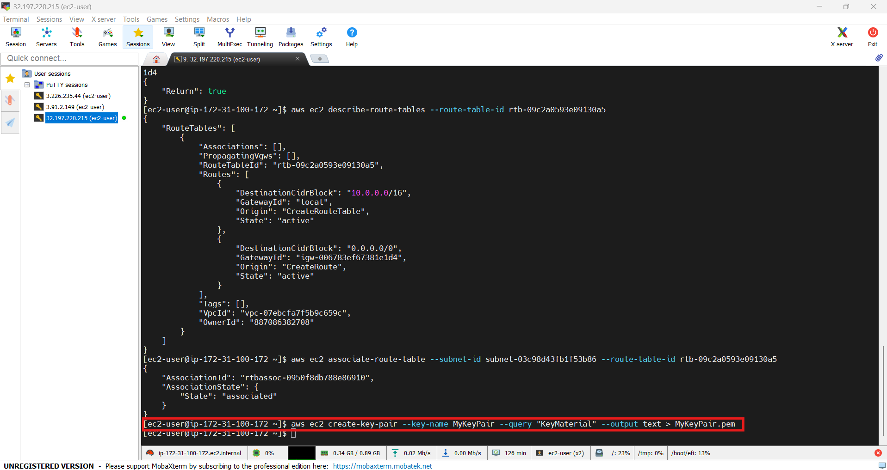

#### Bước 30: Phân quyền chmod 400 cho Key Pair
* **Lệnh thực hiện:**
  ```bash
  chmod 400 MyKeyPair.pem
  ```
* **Ý nghĩa:** Giới hạn quyền chỉ đọc cho chủ sở hữu, bắt buộc đối với SSH client trên Linux.

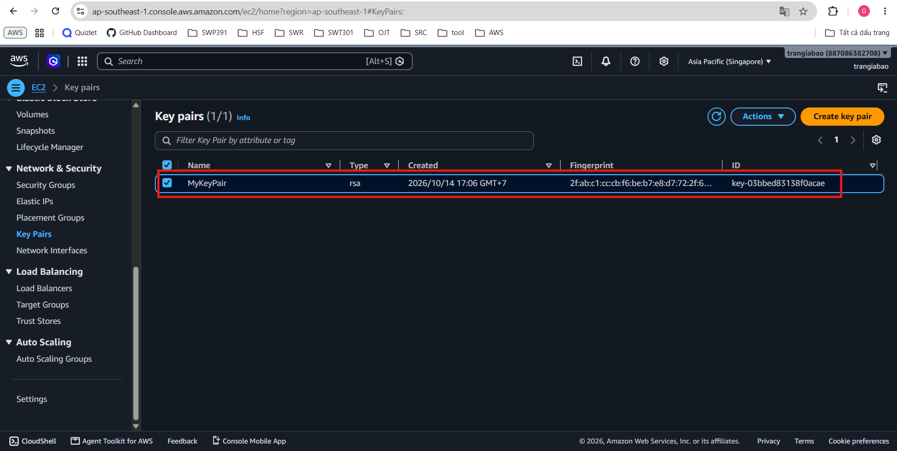

#### Bước 31: Khởi tạo Security Group `SSHAccess`
* **Lệnh thực hiện:**
  ```bash
  aws ec2 create-security-group --group-name SSHAccess --description "Security group for SSH access" --vpc-id vpc-07ebcfa7f5b9c659c
  ```
* **Kết quả:** In ra mã Security Group ID (ví dụ: `sg-08d6567ccc7edc1f0`).

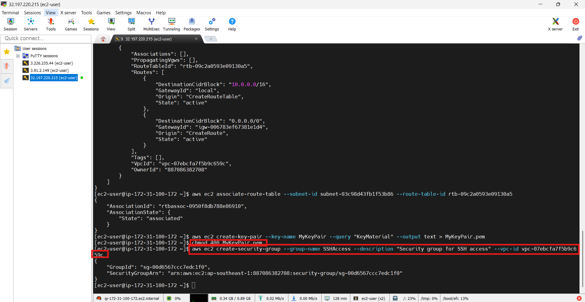

#### Bước 32: Mở quyền Inbound cho cổng SSH 22
* **Lệnh thực hiện:**
  ```bash
  aws ec2 authorize-security-group-ingress --group-id <SG-ID> --protocol tcp --port 22 --cidr 0.0.0.0/0
  ```
* **Ý nghĩa:** Cho phép lưu lượng SSH từ mọi địa chỉ IP bên ngoài kết nối vào máy chủ.

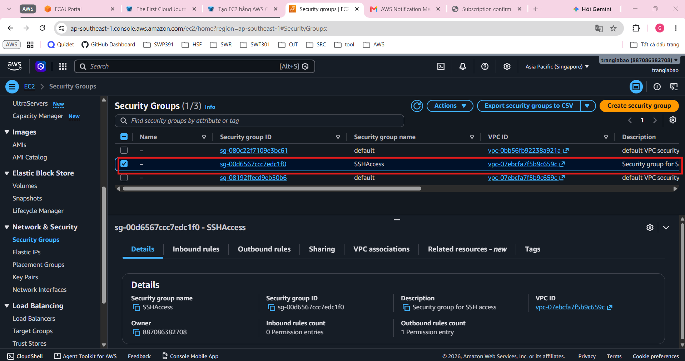

#### Bước 33: Chạy lệnh khởi tạo máy chủ EC2 (`run-instances`)
* **Lệnh thực hiện:**
  ```bash
  aws ec2 run-instances --image-id ami-0a37aadea3f79d3c3 --count 1 --instance-type t2.micro --key-name MyKeyPair --security-group-ids <SG-ID> --subnet-id subnet-03c90d43fb1f53b06
  ```
* **Kết quả:** Máy chủ được tạo với Instance ID: **`i-03171455cd0278073`**, Private IP nội bộ: **`10.0.1.41`**.

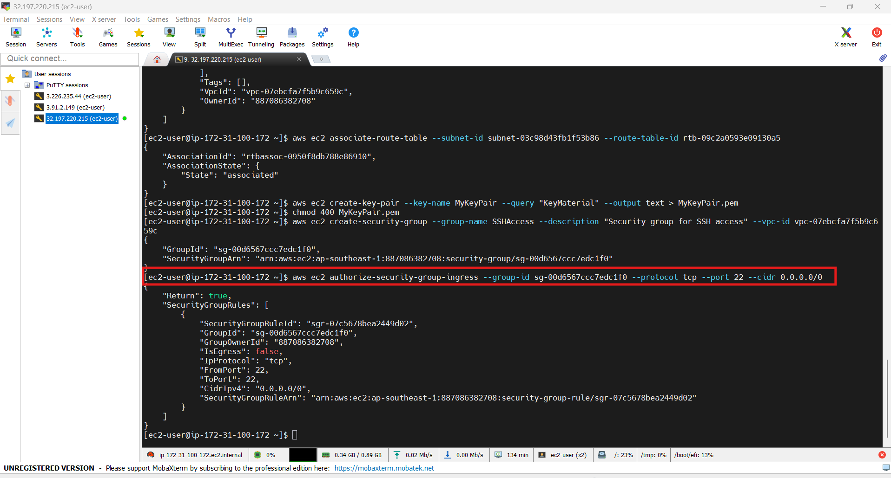

#### Bước 34: Kiểm tra trạng thái máy chủ EC2
* **Lệnh thực hiện:**
  ```bash
  aws ec2 describe-instances --instance-id i-03171455cd0278073 --query "Reservations[*].Instances[*].{State:State.Name,Address:PublicIpAddress}"
  ```
* **Kết quả:** Trạng thái `"State": "running"`, nhưng `"Address": null` (chưa có Public IP).

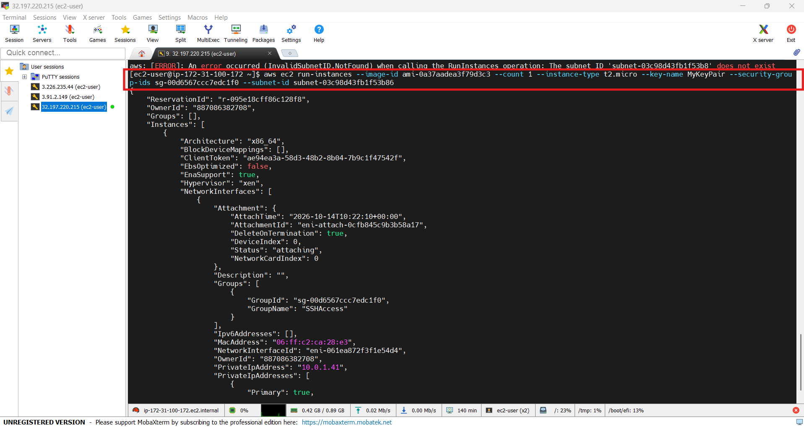

> **💡 Khó khăn gặp phải tại Bước 34:**  
> Kết quả báo `"Address": null` không thể lấy IP để SSH.  
> ➔ **Nguyên nhân:** Subnet tạo bằng CLI mặc định tắt tính năng tự cấp Public IP (`MapPublicIpOnLaunch: false`).  
> ➔ **Cách xử lý:** Cấp phát ngay một Elastic IP (IP tĩnh công khai) và gán trực tiếp vào máy chủ mà không cần tạo lại máy (thực hiện ở Bước 35 & 36).

#### Bước 35: Cấp phát địa chỉ Elastic IP
* **Lệnh thực hiện:**
  ```bash
  aws ec2 allocate-address --domain vpc
  ```
* **Kết quả:** Nhận được Public IP: **`47.131.189.63`** và AllocationId: **`eipalloc-0f52955fe9fe8ad41`**.

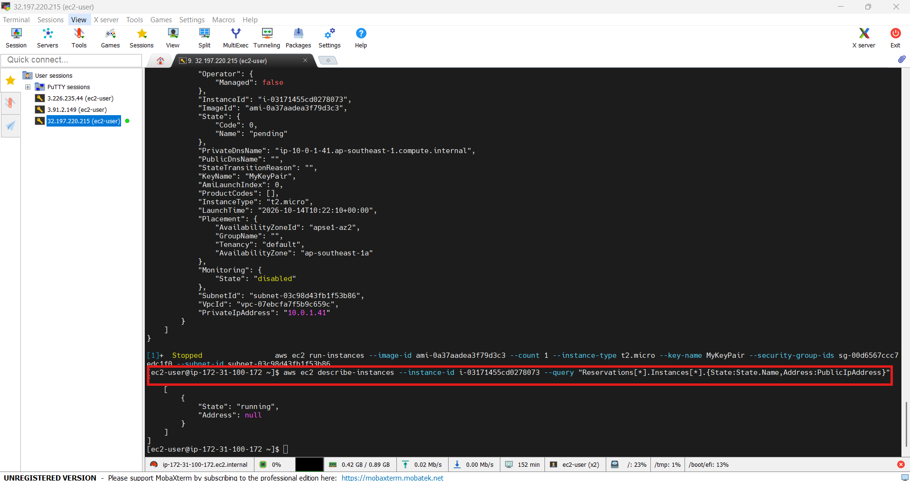

#### Bước 36: Gán Elastic IP vào máy chủ `i-03171455cd0278073`
* **Lệnh thực hiện:**
  ```bash
  aws ec2 associate-address --instance-id i-03171455cd0278073 --allocation-id eipalloc-0f52955fe9fe8ad41
  ```
* **Kết quả:** Máy chủ được liên kết với IP `47.131.189.63`.

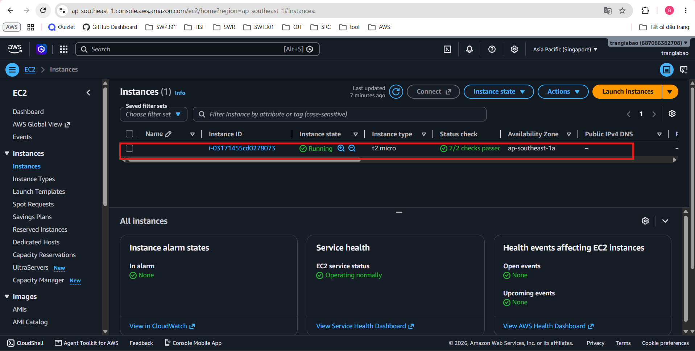

> **💡 Khó khăn gặp phải tại Bước 36:** Nếu quên chạy lệnh `associate-address` này mà chạy thẳng lệnh SSH, gói tin sẽ gửi vào IP chưa gán máy và gây treo cứng màn hình. Dùng `Ctrl + C` ngắt lệnh treo, chạy lệnh gán IP này trước rồi mới SSH.

#### Bước 37: Kết nối SSH trực tiếp vào máy chủ mới
* **Lệnh thực hiện:**
  ```bash
  ssh -i "MyKeyPair.pem" ec2-user@47.131.189.63
  ```
* **Thao tác:** Khi máy hỏi `Are you sure you want to continue connecting (yes/no)?`, gõ **`yes`** rồi nhấn Enter.
* **Kết quả:** Đăng nhập thành công! Dấu nhắc lệnh đổi thành **`[ec2-user@ip-10-0-1-41 ~]$`**.

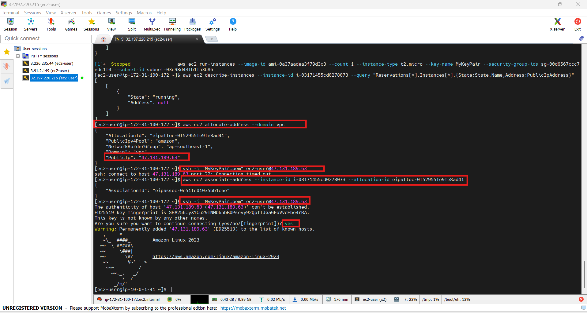

#### Bước 38: Thoát ra và Hủy máy chủ EC2 an toàn
* **Lệnh thực hiện:**
  1. *Thoát khỏi máy chủ khách mới:*
     ```bash
     exit
     ```
     *(Dấu nhắc lệnh quay về máy chủ quản lý cũ: `[ec2-user@ip-172-31-100-172 ~]$`).*
  2. *Chạy lệnh xóa máy chủ:*
     ```bash
     aws ec2 terminate-instances --instance-ids i-03171455cd0278073
     ```
* **Kết quả:** Máy chủ chuyển sang trạng thái `shutting-down` và `terminated` an toàn.

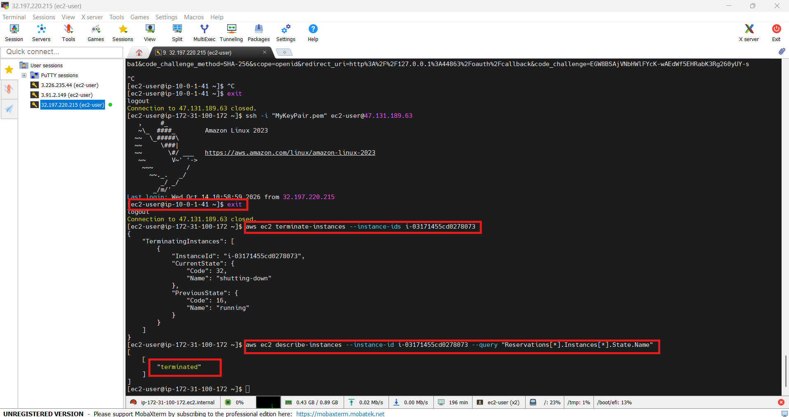

> **💡 Khó khăn gặp phải tại Bước 38:** Chạy lệnh `terminate-instances` khi đang đứng bên trong máy mới (`ip-10-0-1-41`) bị báo lỗi `Unable to locate credentials`. Cần gõ `exit` để trở về máy chủ quản lý ban đầu mới thực hiện xóa máy thành công.

---

### 🏆 Đánh giá & Bài học kinh nghiệm:
1. **Quy trình điền thông số chính xác:** Nắm rõ sự khác biệt giữa các tham số bắt buộc (VPC ID, Subnet ID, Key Pair, Security Group) và cách trích xuất giá trị output bằng cờ `--query ... --output text` để tái sử dụng trong các lệnh tiếp theo.
2. **Kỹ năng gỡ lỗi mạng chuyên nghiệp:** Hiểu sâu bản chất các lỗi kết nối phổ biến trong AWS (Connection timed out do thiếu Route/IGW, Address null do Subnet tắt Public IP, Treo SSH do chưa associate Elastic IP).
3. **Năng lực vận hành Scripting:** Toàn bộ hạ tầng mạng và máy chủ có thể được đóng gói thành một file shell script duy nhất để triển khai tự động hóa chỉ trong vài giây.

- **Làm quen với giao diện dòng lệnh AWS CLI:** Hiểu rõ vai trò và sức mạnh của việc tự động hóa quản trị hạ tầng bằng dòng lệnh thay vì thao tác thủ công qua giao diện Web.
- **Quản trị người dùng & bảo mật định danh:** Nắm được cách phân quyền IAM, quản lý Access Key an toàn và thiết lập nhiều hồ sơ tài khoản (CLI Profiles) trên máy chủ quản trị.
- **Tự động hóa tài nguyên cơ bản:** Thực hành khởi tạo, cấu hình và dọn dẹp các dịch vụ cốt lõi (lưu trữ S3, kênh thông báo SNS, hệ thống mạng VPC và vòng đời máy chủ EC2) hoàn toàn bằng câu lệnh.
- **Kỹ năng xử lý sự cố thực tế:** Rèn luyện phản xạ phát hiện và khắc phục các vấn đề phổ biến về định tuyến mạng, khóa kết nối SSH, quyền truy cập và xung đột tài nguyên.

---

#### 📌 Kết quả Thứ 4 (14/10/2026) - Làm việc với Amazon DynamoDB:

{}
Bài thực hành **Làm việc với Amazon DynamoDB** được triển khai vào **Thứ 4 (14/10/2026)** thuộc khuôn khổ **Tuần 5**. Bài viết trình bày chi tiết quy trình thực tế qua 3 phương thức quản trị: Giao diện web AWS Console, Giao diện dòng lệnh AWS CloudShell, và Lập trình tự động hóa với Python SDK (Boto3).
<br>🔗 **Nguồn tài liệu thực hành:** [Work with Amazon DynamoDB (Workshop 000060)](https://000060.awsfcaj.com/)
{}

### 🎯 Mục tiêu bài thực hành (Lab Objectives):
* Nắm vững kiến trúc NoSQL của **Amazon DynamoDB**, hiểu rõ cơ chế phân vùng với **Partition Key (HASH)**, khóa kết hợp **Composite Key (HASH + RANGE)** và các kiểu dữ liệu Scalar/Document.
* Thực hiện quản trị vòng đời bảng dữ liệu `Music` trên **AWS Management Console**: Tạo bảng, thêm item, cập nhật, truy vấn (Query/Scan), thiết lập và truy vấn **Global Secondary Index (GSI)** `AlbumTitle-index`.
* Khai thác sức mạnh dòng lệnh của **AWS CloudShell**: Cấu hình phân quyền IAM, tạo bảng CLI, thực hiện các thao tác CRUD dữ liệu (`put-item`, `get-item`, `update-item`, `query`), thêm GSI qua `update-table` và xử lý quá trình **Backfilling**.
* Làm chủ lập trình SDK trên môi trường Windows với **Python 3** và thư viện **Boto3**: Tự động hóa tạo bảng `Movies`, CRUD từng bản ghi, nạp hàng loạt dữ liệu mẫu từ file JSON (`moviedata.json` với 4.609 phim), truy vấn theo năm và quét bảng (Scan) có lọc điều kiện.
* Rèn luyện kỹ năng phân tích và khắc phục **10 sự cố kỹ thuật thực tế chuyên sâu**: Lỗi cú pháp tài liệu gốc, phân quyền IAM Policy, xung đột tài nguyên trùng lặp, ký tự ẩn Unicode `\u200b`, cơ chế Pager, lỗi Backfilling index, nhầm lẫn môi trường CMD/Python và lệch Region.

---

### 📊 Bảng tổng hợp thông số tài nguyên đã triển khai:

| Tài nguyên | Tên / Định danh | Thuộc tính & Khóa chính (Primary Key) | Throughput / Chế độ | Region | Mục đích sử dụng |
| :--- | :--- | :--- | :--- | :--- | :--- |
| **DynamoDB Table 1**| `Music` | Partition Key: `Artist` (S) <br>Sort Key: `SongTitle` (S) | Provisioned (RCU=10, WCU=5) | `us-east-1` | Thực hành Console & CloudShell CLI |
| **Secondary Index** | `AlbumTitle-index` | Partition Key: `AlbumTitle` (S) <br>Projection: `ALL` | Provisioned (RCU=10, WCU=5) | `us-east-1` | Global Secondary Index cho bảng `Music` |
| **DynamoDB Table 2**| `Movies` | Partition Key: `year` (N) <br>Sort Key: `title` (S) | Provisioned (RCU=10, WCU=10) | `ap-southeast-1` | Thực hành Python SDK (Boto3) |
| **IAM User** | `AWS-FCAJ-DynamDB` | Attached Policy: `AmazonDynamoDBFullAccess` | Programmatic Access (CLI) | Global | Tài khoản thực thi CLI & Python Boto3 |
| **Tập dữ liệu mẫu** | `moviedata.json` | 4.609 bản ghi phim (3.7 MB), định dạng JSON | Parse Float sang Decimal | Local | Dữ liệu kiểm thử Query & Scan nâng cao |
| **Môi trường SDK** | Windows Local | Python 3.14.5 + Boto3 1.43.114 | CLI Default: `ap-southeast-1` | Local | Môi trường lập trình máy trạm |

---

### 📋 Mục 1: Quản trị DynamoDB qua AWS Management Console

#### Bước 1: Tổng quan giao diện Amazon DynamoDB Console
* **Thao tác:** Đăng nhập AWS Management Console ➔ Tìm kiếm và chọn dịch vụ **DynamoDB**.
* **Mục đích:** Truy cập Dashboard trung tâm để theo dõi tổng thể dung lượng, số lượng bảng và các chỉ số hoạt động.

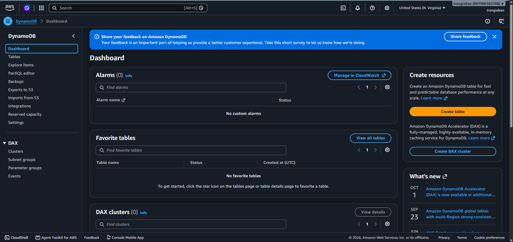

#### Bước 2: Tạo IAM Access Key cho tài khoản quản trị
* **Thao tác:** Mở dịch vụ **IAM** ➔ Vào menu **Users** ➔ Chọn người dùng `AWS-FCAJ-DynamDB` ➔ Tab **Security credentials** ➔ Nhấn **Create access key** ➔ Chọn **Command Line Interface (CLI)** ➔ Tải file `.csv` lưu trữ `Access Key ID` và `Secret Access Key`.
* **Mục đích:** Cấp thông tin định danh phục vụ kết nối bảo mật cho CloudShell và Python SDK sau này.


#### Bước 3: Khởi tạo bảng `Music` trên Web Console
* **Thao tác:** Quay lại DynamoDB Console ➔ Chọn **Tables** ở thanh bên trái ➔ Nhấn nút **Create table**.
* **Thông số điền chi tiết:**
  * **Table name:** `Music`
  * **Partition key:** `Artist` (Kiểu dữ liệu: **String**)
  * **Sort key:** `SongTitle` (Kiểu dữ liệu: **String**)
  * **Table settings:** Chọn **Default settings** (Chế độ Provisioned capacity, RCU=5, WCU=5, Default encryption).
* **Thao tác:** Nhấn nút **Create table** và chờ bảng chuyển sang trạng thái `Active`.


#### Bước 4: Ghi bản ghi đầu tiên vào bảng `Music`
* **Thao tác:** Chọn bảng **`Music`** trong danh sách ➔ Chọn tab hoặc nút **Explore items** ➔ Nhấn **Create item**.
* **Thông số nhập liệu:**
  * `Artist` (String): `No One You Know`
  * `SongTitle` (String): `Call Me Today`
  * Nhấn **Add new attribute** ➔ Chọn **String** ➔ Đặt tên `AlbumTitle` giá trị: `Somewhat Famous`
  * Nhấn **Add new attribute** ➔ Chọn **Number** ➔ Đặt tên `Awards` giá trị: `1`
* **Thao tác:** Nhấn **Create item** để lưu bản ghi vào cơ sở dữ liệu.


#### Bước 5: Xem và duyệt danh sách dữ liệu (Read Data)
* **Thao tác:** Trong giao diện **Explore items**, chọn bảng `Music` và nhấn **Run** với chế độ Scan để duyệt danh sách các mục đang có.
* **Kết quả:** Bảng hiển thị đầy đủ các thuộc tính của bài hát vừa thêm.


#### Bước 6: Kiểm tra chi tiết cấu trúc bản ghi
* **Thao tác:** Nhấp chuột trực tiếp vào dòng bản ghi `No One You Know` để mở trình xem chi tiết dạng bảng (Form) hoặc JSON View.


#### Bước 7: Cập nhật thông tin bản ghi (Update Data)
* **Thao tác:** Chọn bản ghi cần cập nhật ➔ Chỉnh sửa giá trị của trường thuộc tính (hoặc bổ sung thêm thuộc tính mới) ➔ Nhấn nút **Save changes**.


#### Bước 8: Truy vấn dữ liệu theo khóa chính (Query Data)
* **Thao tác:** Trong mục **Explore items**, chuyển từ chế độ *Scan* sang **Query**.
* **Thông số chọn:**
  * **Partition key (`Artist`):** Nhập `Acme Band`
  * **Sort key (`SongTitle`):** Có thể nhập điều kiện bắt đầu bằng hoặc để trống để lấy toàn bộ bài hát của ca sĩ này.
* **Kết quả:** Hệ thống chỉ duyệt trong phân vùng của `Acme Band` và trả về kết quả cực nhanh với chi phí đọc tối thiểu.


#### Bước 9: Tạo Global Secondary Index (GSI) `AlbumTitle-index`
* **Thao tác:** Vào bảng `Music` ➔ Chọn tab **Indexes** ➔ Nhấn nút **Create index**.
* **Thông số cấu hình:**
  * **Partition key:** `AlbumTitle` (Kiểu: **String**)
  * **Index name:** `AlbumTitle-index` (tự động điền)
  * **Attribute projections:** Chọn **All** (sao chép toàn bộ thuộc tính sang GSI)
* **Thao tác:** Nhấn **Create index**. Trạng thái GSI sẽ chuyển sang `Creating` và tự động thực hiện tiến trình **Backfilling** dữ liệu ngầm.


#### Bước 10: Truy vấn dữ liệu thông qua GSI
* **Thao tác:** Quay lại giao diện **Explore items** ➔ Chọn mục **Query** ➔ Tại ô *Select a table or index*, chọn **`AlbumTitle-index`**.
* **Thông số tìm kiếm:**
  * **Partition key (`AlbumTitle`):** Nhập `Somewhat Famous`
* **Kết quả:** Trả về bài hát thuộc album này mà không cần biết trước tên ca sĩ (`Artist`), chứng minh sức mạnh tra cứu đa chiều của GSI.


---

### 📋 Mục 2: Thao tác Dòng lệnh Quản trị qua AWS CloudShell

#### Bước 11: Khởi chạy môi trường AWS CloudShell
* **Thao tác:** Nhấp vào biểu tượng terminal **CloudShell** trên thanh điều hướng góc trên bên phải của AWS Console.
* **Mục đích:** Mở môi trường dòng lệnh Linux trực tiếp trên trình duyệt web, được cấu hình sẵn môi trường AWS CLI v2.


#### Bước 12: Cấu hình xác thực AWS CLI trên CloudShell
* **Lệnh thực thi:**
  ```bash
  aws configure
  ```
* **Thông số nhập:**
  * **AWS Access Key ID:** Nhập Access Key của IAM User `AWS-FCAJ-DynamDB`.
  * **AWS Secret Access Key:** Nhập Secret Key tương ứng.
  * **Default region name:** `us-east-1`
  * **Default output format:** `json`


#### Bước 13: Tạo bảng `Music` bằng câu lệnh CLI
* **Lệnh thực thi:**
  ```bash
  aws dynamodb create-table \
      --table-name Music \
      --attribute-definitions \
          AttributeName=Artist,AttributeType=S \
          AttributeName=SongTitle,AttributeType=S \
      --key-schema \
          AttributeName=Artist,KeyType=HASH \
          AttributeName=SongTitle,KeyType=RANGE \
      --provisioned-throughput \
          ReadCapacityUnits=10,WriteCapacityUnits=5 \
      --table-class STANDARD
  ```

{}
💡 **Khó khăn 1 & Cách xử lý - Lỗi sai cú pháp cờ lệnh trong tài liệu Workshop gốc:**
* **Sự cố:** Tài liệu workshop ghi cờ cấu hình thông lượng là `--provided-throughput`, khiến lệnh bị văng: `aws: [ERROR]: Unknown options: --provided-throughput, ReadCapacityUnits=10,WriteCapacityUnits=5`.
* **Nguyên nhân:** Cú pháp chuẩn của AWS CLI v2 là `--provisioned-throughput` (từ khóa *Provisioned* mang nghĩa cung ứng trước).
* **Xử lý:** Sửa thành `--provisioned-throughput ReadCapacityUnits=10,WriteCapacityUnits=5` là lệnh thực thi chuẩn xác.
{}

{}
💡 **Khó khăn 2 & Cách xử lý - Lỗi thiếu quyền IAM User (`AccessDeniedException`):**
* **Sự cố:** Bị từ chối truy cập: `User: arn:aws:iam::.../AWS-FCAJ-DynamDB is not authorized to perform: dynamodb:CreateTable because no identity-based policy allows...`.
* **Nguyên nhân:** Người dùng IAM mới tạo Access Key nhưng chưa được quản trị viên gắn Policy quyền hạn.
* **Xử lý:** Vào IAM Console ➔ User `AWS-FCAJ-DynamDB` ➔ Gắn chính sách quyền hạn trực tiếp **`AmazonDynamoDBFullAccess`**.
{}

{}
💡 **Khó khăn 3 & Cách xử lý - Xung đột tài nguyên trùng lặp (`ResourceInUseException`):**
* **Sự cố:** Lệnh báo: `Table already exists: Music`.
* **Nguyên nhân:** Do ở Mục 1 (bước 3) ta đã tạo bảng `Music` trên Web Console trong cùng Region `us-east-1`. DynamoDB cấm tạo 2 bảng trùng tên trong 1 Region.
* **Xử lý:** Dùng lệnh `aws dynamodb describe-table --table-name Music` để kiểm tra bảng đã ở trạng thái `ACTIVE` và tiếp tục sử dụng để thực hành các bước sau.
{}


#### Bước 14: Kiểm tra trạng thái hoạt động của bảng
* **Lệnh thực thi:**
  ```bash
  aws dynamodb describe-table --table-name Music | grep TableStatus
  ```
* **Kết quả:** Trả về `"TableStatus": "ACTIVE"`, xác nhận bảng đã sẵn sàng tiếp nhận các thao tác đọc ghi.


#### Bước 15: Thêm bản ghi mới bằng lệnh `put-item`
* **Lệnh thực thi:**
  ```bash
  aws dynamodb put-item \
      --table-name Music \
      --item '{
          "Artist": {"S": "No One You Know"},
          "SongTitle": {"S": "Call Me Today"},
          "AlbumTitle": {"S": "Somewhat Famous"},
          "Awards": {"N": "1"}
      }'
  ```


#### Bước 16: Thêm các bản ghi bổ sung cho ban nhạc `Acme Band`
* **Thao tác:** Lặp lại lệnh `put-item` để thêm bài hát `Happy Day` (Awards: 10, Album: `Songs About Life`) và bài hát `PartiQL Rocks` (Awards: 8, Album: `Another Album Title`).


#### Bước 17: Đọc dữ liệu chi tiết bằng lệnh `get-item`
* **Lệnh thực thi:**
  ```bash
  aws dynamodb get-item \
      --table-name Music \
      --key '{
          "Artist": {"S": "Acme Band"},
          "SongTitle": {"S": "Happy Day"}
      }'
  ```
* **Kết quả:** Trả về khối JSON chứa toàn bộ thuộc tính của bản ghi được lưu trong bảng.


#### Bước 18: Cập nhật dữ liệu bằng lệnh `update-item`
* **Lệnh thực thi:**
  ```bash
  aws dynamodb update-item \
      --table-name Music \
      --key '{
          "Artist": {"S": "Acme Band"},
          "SongTitle": {"S": "Happy Day"}
      }' \
      --update-expression "SET AlbumTitle = :a" \
      --expression-attribute-values '{":a": {"S": "Updated Album Title"}}' \
      --return-values ALL_NEW
  ```


#### Bước 19: Kiểm tra lại thuộc tính vừa cập nhật
* **Kết quả:** `ReturnValues` trả về trường `AlbumTitle` mang giá trị mới là `"Updated Album Title"`.


#### Bước 20: Truy vấn dữ liệu theo phân vùng bằng lệnh `query`
* **Lệnh thực thi chuẩn:**
  ```bash
  aws dynamodb query \
      --table-name Music \
      --key-condition-expression "Artist = :name" \
      --expression-attribute-values '{":name":{"S":"Acme Band"}}'
  ```

{}
💡 **Khó khăn 4 & Cách xử lý - Lỗi ký tự ẩn Zero-Width Space Unicode (`\u200b`):**
* **Sự cố:** Chạy lệnh bị báo lỗi phân tích cú pháp khó hiểu: `Error parsing parameter '--expression-attribute-values': Expected: '=', received: '' for input: {":name"...}`.
* **Nguyên nhân:** Khi sao chép lệnh từ tài liệu HTML của Workshop, đoạn text chứa 2 ký tự khoảng trắng tàng hình Unicode `\u200b\u200b` ngay sau `--expression-attribute-values`. AWS CLI không nhận diện được dấu cách này nên coi chuỗi JSON là tham số lỗi.
* **Xử lý:** Lọc sạch toàn bộ ký tự rác, gõ lại dấu cách chuẩn ASCII trên bàn phím là lệnh thực thi trơn tru.
{}


#### Bước 21: Tạo Global Secondary Index (GSI) bằng lệnh `update-table`
* **Lệnh thực thi:**
  ```bash
  aws dynamodb update-table \
      --table-name Music \
      --attribute-definitions AttributeName=AlbumTitle,AttributeType=S \
      --global-secondary-index-updates \
          "[{\"Create\":{\"IndexName\": \"AlbumTitle-index\",\"KeySchema\":[{\"AttributeName\":\"AlbumTitle\",\"KeyType\": \"HASH\"}], \
          \"ProvisionedThroughput\": {\"ReadCapacityUnits\": 10, \"WriteCapacityUnits\": 5 },\"Projection\":{\"ProjectionType\":\"ALL\"}}}]"
  ```

{}
💡 **Khó khăn 5 & Cách xử lý - Hiện tượng màn hình tự out ra dòng lệnh:**
* **Sự cố:** Sau khi chạy lệnh `update-table`, terminal hiển thị một trang JSON rồi tự động văng ra dấu nhắc lệnh `~ $`.
* **Nguyên nhân:** Do kết quả JSON quá dài, AWS CLI tự động chuyển qua trình đọc trang (pager `less`). Khi người dùng chạm nút `q` hoặc cuộn hết trang thì pager tự đóng. Lệnh thực chất đã chạy thành công.
* **Xử lý:** Chạy `export AWS_PAGER=""` để tắt pager, in thẳng kết quả ra màn hình.
{}


#### Bước 22: Truy vấn dữ liệu thông qua GSI bằng lệnh `query`
* **Lệnh thực thi:**
  ```bash
  aws dynamodb query \
      --table-name Music \
      --index-name AlbumTitle-index \
      --key-condition-expression "AlbumTitle = :name" \
      --expression-attribute-values '{":name":{"S":"Somewhat Famous"}}'
  ```

{}
💡 **Khó khăn 6 & Cách xử lý - Lỗi truy vấn khi GSI đang trong tiến trình Backfilling:**
* **Sự cố:** Bị từ chối truy vấn: `ValidationException: Cannot read from backfilling global secondary index: AlbumTitle-index`.
* **Nguyên nhân:** Khi tạo mới GSI trên bảng đã có dữ liệu, DynamoDB phải mất từ 1-2 phút để sao chép dữ liệu ngầm (Backfilling). Trong thời gian này `IndexStatus` mang giá trị `CREATING` và cấm truy vấn đọc.
* **Xử lý:** Chạy lệnh `aws dynamodb describe-table --table-name Music --query "Table.GlobalSecondaryIndexes[*].[IndexName,IndexStatus]"` để theo dõi. Chờ khoảng 1 phút đến khi chuyển sang `ACTIVE` mới chạy lại lệnh query.
{}


---

### 📋 Mục 3: Lập trình Tự động hóa với Python SDK (Boto3)

#### Bước 23: Thiết lập môi trường Python & Boto3 trên máy trạm Windows
* **Thao tác:** Mở cửa sổ **Command Prompt (CMD)** trên Windows và kiểm tra phiên bản Python, sau đó cài đặt thư viện AWS SDK:
  ```cmd
  python --version
  pip install boto3
  aws configure
  ```
* **Thông số cấu hình:**
  * **AWS Access Key ID:** Điền Access Key của IAM User `AWS-FCAJ-DynamDB`.
  * **AWS Secret Access Key:** Điền Secret Key tương ứng.
  * **Default region name:** `ap-southeast-1`
  * **Default output format:** `json`


#### Bước 24: Khởi tạo bảng `Movies` với `MoviesCreateTable.py`
* **Tạo file:** `MoviesCreateTable.py`
* **Mã nguồn:**
  ```python
  import boto3

  def create_movie_table(dynamodb=None):
      dynamodb = boto3.resource('dynamodb')
      table = dynamodb.create_table(
          TableName='Movies',
          KeySchema=[
              {'AttributeName': 'year', 'KeyType': 'HASH'},  # Partition key
              {'AttributeName': 'title', 'KeyType': 'RANGE'}  # Sort key
          ],
          AttributeDefinitions=[
              {'AttributeName': 'year', 'AttributeType': 'N'},
              {'AttributeName': 'title', 'AttributeType': 'S'}
          ],
          ProvisionedThroughput={
              'ReadCapacityUnits': 10,
              'WriteCapacityUnits': 10
          }
      )
      return table

  if __name__ == '__main__':
      movie_table = create_movie_table()
      print("Table status:", movie_table.table_status)
  ```
* **Lệnh thực thi:**
  ```cmd
  cd /d D:\AWS\template_AWS\fcj-workshop-template-main
  python MoviesCreateTable.py
  ```

{}
💡 **Khó khăn 7 & Cách xử lý - Lỗi dán nhầm code Python vào CMD Windows:**
* **Sự cố:** Dán trực tiếp các dòng mã Python vào màn hình CMD dẫn đến một loạt thông báo `'import' is not recognized as an internal or external command`.
* **Nguyên nhân:** CMD là shell Windows chỉ nhận lệnh hệ thống, không hiểu cú pháp ngôn ngữ lập trình Python.
* **Xử lý:** Lưu code vào file `.py` riêng biệt rồi gọi thực thi qua lệnh `python <ten_file>.py`.
{}

{}
💡 **Khó khăn 8 & Cách xử lý - Lỗi đường dẫn thư mục hệ thống `System32`:**
* **Sự cố:** Khi chạy lệnh bị lỗi: `can't open file 'C:\Windows\System32\MoviesCreateTable.py': No such file or directory`.
* **Nguyên nhân:** Mặc định CMD mở tại thư mục hệ thống Windows, file python thực tế nằm ở thư mục dự án khác.
* **Xử lý:** Dùng lệnh chuyển ổ đĩa và thư mục: `cd /d D:\AWS\template_AWS\fcj-workshop-template-main`.
{}


#### Bước 25: Thêm phim mới vào bảng với `MoviesItemOps01.py`
* **Tạo file:** `MoviesItemOps01.py`
* **Mã nguồn:**
  ```python
  from pprint import pprint
  import boto3

  def put_movie(title, year, plot, rating, dynamodb=None):
      dynamodb = boto3.resource('dynamodb')
      table = dynamodb.Table('Movies')
      response = table.put_item(
          Item={
              'year': year,
              'title': title,
              'info': {'plot': plot, 'rating': rating}
          }
      )
      return response

  if __name__ == '__main__':
      movie_resp = put_movie("The Big New Movie", 2015, "Nothing happens at all.", 0)
      print("Put movie succeeded:")
      pprint(movie_resp, sort_dicts=False)
  ```
* **Lệnh thực thi:**
  ```cmd
  python MoviesItemOps01.py
  ```
* **Kết quả:** Trả về `'HTTPStatusCode': 200`, xác nhận bộ phim đã được lưu thành công.


#### Bước 26: Đọc dữ liệu phim với `MoviesItemOps02.py`
* **Tạo file:** `MoviesItemOps02.py`
* **Mã nguồn:**
  ```python
  from pprint import pprint
  import boto3
  from botocore.exceptions import ClientError

  def get_movie(title, year, dynamodb=None):
      dynamodb = boto3.resource('dynamodb')
      table = dynamodb.Table('Movies')
      try:
          response = table.get_item(Key={'year': year, 'title': title})
      except ClientError as e:
          print(e.response['Error']['Message'])
      else:
          return response['Item']

  if __name__ == '__main__':
      movie = get_movie("The Big New Movie", 2015)
      if movie:
          print("Get movie succeeded:")
          pprint(movie, sort_dicts=False)
  ```
* **Lệnh thực thi:**
  ```cmd
  python MoviesItemOps02.py
  ```


#### Bước 27: Cập nhật thông tin và điểm số với `MoviesItemOps03.py`
* **Tạo file:** `MoviesItemOps03.py`
* **Mã nguồn:**
  ```python
  from decimal import Decimal
  from pprint import pprint
  import boto3

  def update_movie(title, year, rating, plot, actors, dynamodb=None):
      dynamodb = boto3.resource('dynamodb')
      table = dynamodb.Table('Movies')
      response = table.update_item(
          Key={'year': year, 'title': title},
          UpdateExpression="set info.rating=:r, info.plot=:p, info.actors=:a",
          ExpressionAttributeValues={
              ':r': Decimal(str(rating)),
              ':p': plot,
              ':a': actors
          },
          ReturnValues="UPDATED_NEW"
      )
      return response

  if __name__ == '__main__':
      update_response = update_movie(
          "The Big New Movie", 2015, 5.5, "Everything happens all at once.",
          ["Larry", "Moe", "Curly"])
      print("Update movie succeeded:")
      pprint(update_response, sort_dicts=False)
  ```
* **Lệnh thực thi:**
  ```cmd
  python MoviesItemOps03.py
  ```


#### Bước 28: Xóa bản ghi phim với `MoviesItemOps04.py`
* **Tạo file:** `MoviesItemOps04.py`
* **Mã nguồn:**
  ```python
  from decimal import Decimal
  from pprint import pprint
  import boto3
  from botocore.exceptions import ClientError

  def delete_underrated_movie(title, year, rating, dynamodb=None):
      dynamodb = boto3.resource('dynamodb')
      table = dynamodb.Table('Movies')
      try:
          response = table.delete_item(Key={'year': year, 'title': title})
      except ClientError as e:
          if e.response['Error']['Code'] == "ConditionalCheckFailedException":
              print(e.response['Error']['Message'])
          else:
              raise
      else:
          return response

  if __name__ == '__main__':
      print("Attempting a conditional delete...")
      delete_response = delete_underrated_movie("The Big New Movie", 2015, 5)
      if delete_response:
          print("Delete movie succeeded:")
          pprint(delete_response, sort_dicts=False)
  ```
* **Lệnh thực thi:**
  ```cmd
  python MoviesItemOps04.py
  ```


#### Bước 29: Nạp hàng loạt dữ liệu mẫu từ JSON với `MoviesLoadData.py`
* **Chuẩn bị dữ liệu:** Tải file `moviedata.zip` từ GitHub FCJ Sample, giải nén thu được file `moviedata.json` dung lượng 3.7MB gồm 4.609 bộ phim.
* **Tạo file:** `MoviesLoadData.py`
* **Mã nguồn:**
  ```python
  from decimal import Decimal
  import json
  import boto3

  def load_movies(movies, dynamodb=None):
      dynamodb = boto3.resource('dynamodb')
      table = dynamodb.Table('Movies')
      for movie in movies:
          year = int(movie['year'])
          title = movie['title']
          print("Adding movie:", year, title)
          table.put_item(Item=movie)

  if __name__ == '__main__':
      with open("moviedata.json") as json_file:
          movie_list = json.load(json_file, parse_float=Decimal)
      load_movies(movie_list)
  ```
* **Lệnh thực thi:**
  ```cmd
  python MoviesLoadData.py
  ```

{}
💡 **Khó khăn 9 & Cách xử lý - Quản lý file dữ liệu mẫu dung lượng lớn:**
* Tập dữ liệu `moviedata.json` có tới 4.609 phim. Khi nạp qua mạng Internet sẽ mất từ 3-5 phút tùy thuộc vào thông lượng WCU đã ấn định. Ta có thể cho script nạp một số lượng bản ghi nhất định rồi tiếp tục kiểm thử truy vấn mà không nhất thiết phải chờ hết toàn bộ danh sách.
{}


#### Bước 30: Truy vấn các phim sản xuất năm 1985 với `MoviesQuery01.py`
* **Tạo file:** `MoviesQuery01.py`
* **Mã nguồn:**
  ```python
  import boto3
  from boto3.dynamodb.conditions import Key

  def query_movies(year, dynamodb=None):
      dynamodb = boto3.resource('dynamodb')
      table = dynamodb.Table('Movies')
      response = table.query(
          KeyConditionExpression=Key('year').eq(year)
      )
      return response['Items']

  if __name__ == '__main__':
      query_year = 1985
      print(f"Movies from {query_year}")
      movies = query_movies(query_year)
      for movie in movies:
          print(movie['year'], ":", movie['title'])
  ```
* **Lệnh thực thi:**
  ```cmd
  python MoviesQuery01.py
  ```
* **Kết quả:** Trả về hàng chục bộ phim kinh điển năm 1985 như *Back to the Future*, *Rambo: First Blood Part II*, *Rocky IV*, *The Breakfast Club*...


#### Bước 31: Quét toàn bảng (Scan) có lọc điều kiện với `MoviesScan.py`
* **Tạo file:** `MoviesScan.py`
* **Mã nguồn:**
  ```python
  from pprint import pprint
  import boto3
  from boto3.dynamodb.conditions import Key

  def scan_movies(year_range, display_movies, dynamodb=None):
      dynamodb = boto3.resource('dynamodb')
      table = dynamodb.Table('Movies')
      scan_kwargs = {
          'FilterExpression': Key('year').between(*year_range),
          'ProjectionExpression': "#yr, title, info.rating",
          'ExpressionAttributeNames': {"#yr": "year"}
      }
      done = False
      start_key = None
      while not done:
          if start_key:
              scan_kwargs['ExclusiveStartKey'] = start_key
          response = table.scan(**scan_kwargs)
          display_movies(response.get('Items', []))
          start_key = response.get('LastEvaluatedKey', None)
          done = start_key is None

  if __name__ == '__main__':
      def print_movies(movies):
          for movie in movies:
              print(f"\n{movie['year']} : {movie['title']}")
              pprint(movie['info'])

      query_range = (1950, 1959)
      print(f"Scanning for movies released from {query_range[0]} to {query_range[1]}...")
      scan_movies(query_range, print_movies)
  ```
* **Lệnh thực thi:**
  ```cmd
  python MoviesScan.py
  ```


#### Bước 32: Dọn dẹp và hủy bảng `Movies` với `MoviesDeleteTable.py`
* **Tạo file:** `MoviesDeleteTable.py`
* **Mã nguồn:**
  ```python
  import boto3

  def delete_movie_table(dynamodb=None):
      dynamodb = boto3.resource('dynamodb')
      table = dynamodb.Table('Movies')
      table.delete()

  if __name__ == '__main__':
      delete_movie_table()
      print("Movies table deleted.")
  ```
* **Lệnh thực thi:**
  ```cmd
  python MoviesDeleteTable.py
  ```
* **Kết quả:** In ra `Movies table deleted.` xác nhận bảng đã được gửi yêu cầu hủy thành công.


---

### 📋 Mục 4: Dọn dẹp tài nguyên & Tổng kết Khó khăn

{}
💡 **Khó khăn 10 & Cách xử lý - Lỗi lệch Region khi xóa bảng (`ResourceNotFoundException`):**
* **Sự cố:** Chạy lệnh `aws dynamodb delete-table --table-name Music` trên CloudShell bị văng lỗi: `Requested resource not found: Table: Music not found`.
* **Nguyên nhân:** CloudShell đang dùng Region mặc định `ap-southeast-1` trong khi bảng `Music` ban đầu được khởi tạo ở `us-east-1` (Bắc Virginia), hoặc bảng đã được bấm xóa trên Web Console trước đó.
* **Xử lý:** Chạy `aws dynamodb list-tables --region us-east-1` để xác minh vùng, sau đó thêm tham số `--region us-east-1` để xóa dọn dẹp hoàn toàn tài nguyên.
{}

---

### 💡 Bảng tổng kết 10 sự cố kỹ thuật thực tế & Cách khắc phục triệt để:

| STT | Sự cố kỹ thuật (Difficulties Encountered) | Nguyên nhân cốt lõi (Root Cause) | Giải pháp xử lý chuẩn hóa (Resolution) |
| :---: | :--- | :--- | :--- |
| **1** | Lỗi cờ lệnh `--provided-throughput` | Tài liệu workshop gốc bị lỗi chính tả (typo). | Thay bằng cú pháp chuẩn của AWS CLI: `--provisioned-throughput`. |
| **2** | Lỗi `AccessDeniedException` khi tạo bảng | IAM User `AWS-FCAJ-DynamDB` chưa được cấp quyền thao tác DynamoDB. | Vào IAM Console, gắn trực tiếp chính sách `AmazonDynamoDBFullAccess`. |
| **3** | Lỗi `ResourceInUseException: Table already exists` | Trùng tên bảng `Music` đã tạo trước đó trên Web Console trong cùng Region. | Kiểm tra bảng bằng `describe-table`, dùng tiếp bảng hiện có để thực hành CRUD. |
| **4** | Lỗi `Expected: '=', received: ''` khi query | Trang web tài liệu bị dính 2 ký tự khoảng trắng ẩn Unicode Zero-Width Space (`\u200b`). | Xóa khoảng trắng ẩn, gõ lại dấu cách chuẩn ASCII hoặc dùng chuỗi lệnh đã lọc sạch. |
| **5** | Màn hình terminal tự động out sau khi chạy lệnh | AWS CLI tự kích hoạt trình đọc trang `less` pager khi chuỗi JSON quá dài. | Nhấn `q` để thoát, hoặc gõ lệnh `export AWS_PAGER=""` để tắt pager in thẳng ra terminal. |
| **6** | Lỗi `Cannot read from backfilling GSI` | GSI mới tạo đang trong tiến trình sao chép dữ liệu ngầm (Backfilling). | Dùng lệnh `describe-table` theo dõi, đợi 1-2 phút khi trạng thái sang `ACTIVE` mới query. |
| **7** | Lỗi `'import' is not recognized` trong CMD | Dán nhầm code lập trình Python thẳng vào cửa sổ Command Prompt của Windows. | Lưu mã nguồn vào file có đuôi `.py` (Notepad/VS Code) rồi chạy qua lệnh `python <file>.py`. |
| **8** | Lỗi `No such file or directory` tại `System32` | Cửa sổ CMD mở mặc định ở thư mục hệ thống Windows, không tìm thấy file code. | Chuyển thư mục bằng lệnh: `cd /d D:\AWS\template_AWS\fcj-workshop-template-main`. |
| **9** | Quá trình nạp 4.609 phim tốn nhiều thời gian | File mẫu `moviedata.json` rất lớn, thông lượng ghi WCU có giới hạn. | Để nạp một phần dữ liệu mẫu phục vụ kiểm thử rồi chuyển sang query, hoặc tăng WCU. |
| **10**| Lỗi `Table: Music not found` khi xóa bảng | Lệch Region giữa cấu hình CloudShell (`ap-southeast-1`) và nơi đặt bảng (`us-east-1`). | Thêm cờ `--region us-east-1` vào câu lệnh xóa: `aws dynamodb delete-table --region us-east-1`. |

- **Tư duy cơ sở dữ liệu NoSQL:** Hiểu sự khác biệt nền tảng giữa cơ sở dữ liệu phi quan hệ (NoSQL) và quan hệ truyền thống (SQL), đặc biệt là tính linh hoạt về cấu trúc dữ liệu theo từng bản ghi.
- **Thao tác dữ liệu đa nền tảng:** Nắm vững các thao tác thêm, đọc, cập nhật và xóa dữ liệu qua cả giao diện Console trực quan lẫn công cụ dòng lệnh CloudShell.
- **Tối ưu hóa tra cứu với Chỉ mục (Index):** Hiểu vai trò của khóa chính và cách áp dụng Global Secondary Index (GSI) để hỗ trợ tìm kiếm dữ liệu đa chiều hiệu quả.
- **Lập trình tự động hóa với Python SDK (Boto3):** Học cách viết mã nguồn Python để tự động tạo bảng, nạp tập dữ liệu lớn và thực thi các câu truy vấn, quét lọc dữ liệu theo nhu cầu thực tế.

---

#### 📌 Kết quả Thứ 5 (15/10/2026) - Triển khai Amazon ElastiCache - Redis:

{}
Bài thực hành **Amazon ElastiCache - Redis** được thực hiện vào **Thứ 4 (14/10/2026)** trong khuôn khổ **Tuần 5**. Trang này ghi lại toàn diện quy trình triển khai: các thao tác click chuột trên Console, thiết lập thông số kỹ thuật, cấu hình bảo mật RBAC với Users & User Groups, tự động hóa bằng AWS CLI & Python Boto3 SDK, cùng các khó khăn thực tế phát sinh và giải pháp xử lý triệt để.
<br>🔗 **Nguồn tài liệu thực hành:** [Amazon ElastiCache - Redis](https://000061.awsfcaj.com/)
{}

### 🎯 Mục tiêu bài thực hành (Lab Objectives):
* Xây dựng và quy hoạch hạ tầng mạng VPC với **3 Subnets trải đều 3 Availability Zones** (`us-east-1a`, `us-east-1b`, `us-east-1c`) và khởi tạo **ElastiCache Subnet Group** phục vụ tính sẵn sàng cao (Multi-AZ) và phân mảnh dữ liệu (Sharding).
* Thiết lập tường lửa **Security Group** mở kiểm soát cổng Inbound TCP **6379** (Redis) và TCP **22** (SSH).
* Triển khai máy chủ trạm trung gian **Amazon EC2 Client (`redis-client`)** trong cùng VPC để giao tiếp và kiểm thử dịch vụ bộ nhớ đệm cô lập trong Private Network.
* Khởi tạo và quản trị cụm Redis với cả 2 chế độ:
  * **Cluster Mode Disabled:** 1 Shard, 1 Primary node và 2 Replica nodes, tự động chuyển đổi dự phòng (Auto-failover).
  * **Cluster Mode Enabled:** Kiến trúc đa Shards (3 Shards, 9 Nodes), hỗ trợ mở rộng quy mô ngang (Horizontal Scaling) và phân tán dữ liệu theo hash slots.
* Tự động hóa hoàn toàn quy trình khởi tạo cụm Redis thông qua **AWS CLI** và **Python Boto3 SDK**.
* Nâng cao tính an toàn thông tin với kiến trúc **Mã hóa đường truyền (Transit Encryption - TLS)** và cơ chế phân quyền kiểm soát truy cập theo vai trò **Role-Based Access Control (RBAC)** với Users và User Groups.
* Lập trình ứng dụng Python tương tác với Redis: kiểm tra kết nối, thao tác chuỗi (**Strings**) kèm thời gian sống (**TTL**), lưu trữ cấu trúc bảng băm (**Hash**), và xây dựng kênh truyền nhận tin nhắn bất đồng bộ theo thời gian thực (**Pub/Sub**).
* Đúc kết và xử lý chuyên sâu 12 sự cố kỹ thuật thực tế (Route Blackhole, thiếu pip, thư viện deprecated, xung đột kiểu dữ liệu WRONGTYPE, lỗi phụ thuộc khi chưa tạo User Group...).

---

### 📊 Bảng tổng hợp thông số tài nguyên đã triển khai:

| Tài nguyên | Tên / Định danh | Cấu hình & Thông số kỹ thuật | Region / AZ | Ghi chú |
| :--- | :--- | :--- | :--- | :--- |
| **VPC** | `vpc-0fc9d5490a843944e` | CIDR: `10.0.0.0/16`, gắn Internet Gateway `my-igw` | `us-east-1` | Hạ tầng mạng độc lập cho ElastiCache |
| **Subnet Group** | `subnet-group` | Chứa 3 subnets trải dài qua 3 Availability Zones | `us-east-1a, 1b, 1c` | Đáp ứng yêu cầu Multi-AZ & Sharding |
| **Security Group** | `sg-06c03603fe1cca808` | Inbound: Port 22 (SSH), Port 6379 (Redis) | `us-east-1` | Tường lửa cho EC2 và cụm ElastiCache |
| **EC2 Redis Client** | `redis-client` | ID: `i-02673f346989f7c23`, AL2023, Python 3 + `redis` v8.1.0 | `us-east-1a` | Máy trạm kết nối EC2 Instance Connect |
| **Cụm 1 (Console)** | `my-cluster-disable` | Mode: Disabled, `cache.r6g.large`, 1 Shard, 3 Nodes, Multi-AZ | `us-east-1` | Primary Endpoint: `my-cluster-disable.1vblox.ng.0001.use1...:6379` |
| **Cụm 2 (Console)** | `my-cluster-enable` | Mode: Enabled, `cache.r6g.large`, 3 Shards, 9 Nodes, Multi-AZ | `us-east-1` | Config Endpoint: `my-cluster-enable.1vblox.clustercfg.use1...:6379` |
| **Cụm 3 (SDK)** | `redis-disabled-sdk` | Mode: Disabled, `cache.t4g.micro`, Engine 6.0, 2 Nodes | `us-east-1` | Khởi tạo qua Boto3 script tự động |
| **Cụm 4 (SDK)** | `redis-enabled-sdk` | Mode: Enabled, `cache.t4g.micro`, 2 Shards, 4 Nodes | `us-east-1` | Khởi tạo qua Boto3 script tự động |
| **Cụm 5 (SDK + RBAC)**| `redis-rbac-sdk` | Mode: Disabled, TLS Transit Encryption: True, UserGroup: `mygroup` | `us-east-1` | Primary Endpoint: `master.redis-rbac-sdk.1vblox.use1...:6379` |
| **Cụm 6 (SDK + RBAC)**| `redis-enabled-rbac-sdk`| Mode: Enabled, 2 Shards, TLS Encryption: True, UserGroup: `mygroup`| `us-east-1` | Cụm Sharding có bảo vệ bằng TLS và RBAC |
| **RBAC User Group** | `mygroup`, `mygroup2` | User Groups kiểm soát danh sách người dùng được phép xác thực | Global / Regional | Gán trực tiếp vào cụm Redis có TLS |
| **RBAC Users** | `myuser`, `default` | Mật khẩu: `MyStrongPasswordWithNumbers123`, Access: `on ~* +@all` | Global / Regional | Gán vào nhóm quyền `mygroup` và `mygroup2` |

---

### 📋 Mục 1: Chuẩn bị môi trường & Thiết lập định danh (Prerequisites)

#### Bước 1: Khởi tạo IAM User cho ElastiCache
* **Thao tác:** Đăng nhập AWS Management Console ➔ Tìm dịch vụ **IAM** ➔ Menu bên trái chọn **Users** ➔ Nhấn nút **Create user**.
* **Thông số điền:**
  * **User name:** `ElastiCache`
  * **Permissions options:** Chọn **Attach policies directly** ➔ Gán chính sách `AmazonElastiCacheFullAccess` và `AdministratorAccess` để phục vụ tự động hóa quản trị.
* **Mục đích:** Cấp phát định danh chuyên biệt cho các tác vụ quản trị ElastiCache từ môi trường dòng lệnh và Python SDK.


#### Bước 2: Cài đặt và kiểm tra công cụ AWS CLI v2
* **Thao tác:** Mở cửa sổ dòng lệnh Windows Command Prompt (`cmd.exe`).
* **Lệnh thực thi:**
  ```cmd
  msiexec.exe /i https://awscli.amazonaws.com/AWSCLIV2.msi
  aws --version
  ```
* **Kết quả:** Phiên bản AWS CLI v2 được cài đặt hoàn tất: `aws-cli/2.38.1 Python/3.14.6 Windows/11 exe/AMD64`.


#### Bước 3: Cấu hình thông tin xác thực AWS CLI
* **Thao tác:** Thực hiện nạp Access Key và Secret Access Key của IAM User vừa tạo vào máy tính cá nhân.
* **Lệnh thực thi:**
  ```cmd
  aws configure
  ```
* **Thông số điền:**
  * **AWS Access Key ID:** `AKIA_DEMO_SAMPLE_KEY_ID`
  * **AWS Secret Access Key:** `DEMO_SECRET_KEY_SAMPLE_TEST_12345`
  * **Default region name:** `us-east-1` (hoặc `ap-southeast-1`)
  * **Default output format:** `json`


---

### 📋 Mục 2: Thiết lập hạ tầng mạng VPC & Khởi tạo Cụm Redis trên Web Console

#### Bước 4: Tạo ElastiCache Subnet Group đa vùng Availability Zones
* **Thao tác:** Đăng nhập AWS Console ➔ Tìm dịch vụ **Amazon ElastiCache** ➔ Menu bên trái chọn **Subnet groups** ➔ Nhấn nút **Create subnet group**.
* **Thông số điền:**
  * **Name:** `subnet-group`
  * **Description:** `test ElastiCache`
  * **VPC ID:** Chọn VPC `vpc-0fc9d5490a843944e`
  * **Subnets:** Chọn tối thiểu 2 Availability Zones khác nhau (chọn đầy đủ 3 subnets tương ứng với 3 AZs: `us-east-1a`, `us-east-1b`, `us-east-1c`).
* **Thao tác:** Nhấn **Create** để hoàn thành tạo Subnet Group.


{}
💡 **Khó khăn gặp phải & Cách xử lý tại Bước 4 (Lỗi thiếu Availability Zones):**
<br>Cụm ElastiCache bật tính năng Multi-AZ hoặc phân mảnh (Cluster Mode Enabled) bắt buộc các node phải được đặt trên tối thiểu 2 Availability Zones khác biệt. Nếu trong Subnet Group bạn chỉ tích chọn subnet ở 1 AZ duy nhất, AWS Console sẽ vô hiệu hóa nút tạo hoặc ném lỗi `Each Node Group needs to have at least two distinct Availability Zones`. Để giải quyết triệt để, phải luôn quy hoạch ít nhất 2 đến 3 Subnets tại các AZ khác nhau và nạp tất cả vào `subnet-group`.
{}

#### Bước 5: Xác thực thông tin Subnet Group qua AWS CLI
* **Thao tác:** Mở Command Prompt và kiểm tra thông tin cấu hình `subnet-group` vừa tạo.
* **Lệnh thực thi:**
  ```cmd
  aws elasticache describe-cache-subnet-groups --cache-subnet-group-name subnet-group --region us-east-1
  ```
* **Kết quả:** Trả về cấu trúc JSON chứa đầy đủ `VpcId`, danh sách `SubnetIdentifier` (`subnet-0fdbddde41a5c456d`), `SubnetAvailabilityZone` (`us-east-1a`) và ARN hợp lệ.


#### Bước 6: Khởi tạo Cụm Redis Chế độ Cluster Mode Disabled trên Web Console
* **Thao tác:** Tại giao diện ElastiCache ➔ Chọn mục **Redis OSS caches** ➔ Nhấn **Create Redis OSS cache**.
* **Thông số cấu hình:**
  * **Cluster name:** `my-cluster-disable`
  * **Description:** `create cluster`
  * **Node type:** `cache.r6g.large`
  * **Engine version:** `6.2.6`
  * **Cluster mode:** **Disabled**
  * **Shards:** `1`
  * **Number of nodes:** `3` (1 Primary + 2 Replicas)
  * **Multi-AZ:** **Enabled**
  * **Auto-failover:** **Enabled**
  * **Subnet group:** Chọn `subnet-group`
* **Kết quả:** Cụm được tạo thành công ở trạng thái `Available`. Lấy được **Primary endpoint** (`my-cluster-disable.1vblox.ng.0001.use1.cache.amazonaws.com:6379`) và **Reader endpoint** (`my-cluster-disable-ro.1vblox.ng.0001.use1.cache.amazonaws.com:6379`).


#### Bước 7: Khởi tạo Cụm Redis Chế độ Cluster Mode Enabled trên Web Console
* **Thao tác:** Tại menu **Redis OSS caches** ➔ Nhấn **Create Redis OSS cache**.
* **Thông số cấu hình:**
  * **Cluster name:** `my-cluster-enable`
  * **Description:** `create cluster enable`
  * **Node type:** `cache.r6g.large`
  * **Engine version:** `6.2.6`
  * **Cluster mode:** **Enabled**
  * **Shards:** `3`
  * **Replicas per shard:** `2` (Tổng cộng `9` nodes)
  * **Multi-AZ:** **Enabled**
  * **Auto-failover:** **Enabled**
  * **Subnet group:** Chọn `subnet-group`
* **Kết quả:** Cụm tạo thành công, cung cấp điểm truy cập cấu hình tập trung **Configuration endpoint**: `my-cluster-enable.1vblox.clustercfg.use1.cache.amazonaws.com:6379`.


#### Bước 8: Cấu hình Tường lửa Security Group cho Redis và EC2
* **Thao tác:** Vào VPC Console ➔ **Security Groups** ➔ Chọn Security Group mặc định của VPC (`sg-06c03603fe1cca808`) ➔ Nhấn **Edit inbound rules**.
* **Thông số bổ sung:**
  1. **Rule 1 (Redis):** Type: **Custom TCP**, Port range: `6379`, Source: `sg-06c03603fe1cca808` (hoặc dải CIDR VPC `10.0.0.0/16`) để cho phép các máy chủ trong VPC kết nối Redis.
  2. **Rule 2 (SSH):** Type: **SSH**, Port range: `22`, Source: `0.0.0.0/0` để kết nối vào máy trạm quản trị qua EC2 Instance Connect.
* **Thao tác:** Nhấn **Save rules**.


{}
💡 **Khó khăn gặp phải & Cách xử lý tại Bước 8 (Bảng định tuyến dính route Blackhole):**
<br>Khi kiểm tra khả năng truy cập mạng của VPC, nhận thấy máy ảo EC2 không thể kết nối Internet và lệnh tải gói tin bị treo timeout. Kiểm tra Route Table phát hiện dòng route `0.0.0.0/0` trỏ vào một Internet Gateway cũ đã bị xóa, dẫn đến trạng thái `Blackhole`. Để khắc phục, cần tạo một Internet Gateway mới đặt tên `my-igw`, đính kèm vào VPC `vpc-0fc9d5490a843944e`, sau đó vào Route Table xóa route Blackhole và thêm route mới `0.0.0.0/0 -> my-igw`.
{}

#### Bước 9: Kiểm tra chi tiết các Nodes và sao chép Primary Endpoint
* **Thao tác:** Trong chi tiết cụm `my-cluster-disable` ➔ Chuyển sang tab **Nodes**.
* **Quan sát:** Danh sách 3 node: `my-cluster-disable-001` (vai trò `primary`), `my-cluster-disable-002` (vai trò `replica`), `my-cluster-disable-003` (vai trò `replica`). Sao chép Primary endpoint phục vụ ghi dữ liệu.


#### Bước 10: Kiểm tra Shards & Nodes cụm Cluster Mode Enabled
* **Thao tác:** Trong chi tiết cụm `my-cluster-enable` ➔ Chuyển sang tab **Shards and nodes**.
* **Quan sát:** Xem danh sách phân bổ các Shards và các node con (`my-cluster-enable-0001-001`, `002`, `003`) tương ứng với từng dải băm hash slot và endpoint của từng node.


#### Bước 11: Kiểm tra thông tin Cache Cluster Node qua AWS CLI
* **Thao tác:** Mở Command Prompt kiểm tra thông tin kỹ thuật của từng node cụm.
* **Lệnh thực thi:**
  ```cmd
  aws elasticache describe-cache-clusters --cache-cluster-id my-cluster-enable-0001-001 --show-cache-node-info --region us-east-1
  ```
* **Kết quả:** Hiển thị thông tin phiên bản `6.2.6`, trạng thái `available`, cấu hình bảo trì, endpoint và trạng thái tham số `in-sync`.


#### Bước 12: Kiểm tra Replication Group qua AWS CLI
* **Thao tác:** Dùng lệnh kiểm tra cấu trúc phân vùng phân tán của nhóm replication.
* **Lệnh thực thi:**
  ```cmd
  aws elasticache describe-replication-groups --replication-group-id my-cluster-enable --region us-east-1
  ```
* **Kết quả:** Trả về danh sách `NodeGroups` với `Slots: "0-5461"`, xác định cụm đang hoạt động ổn định và sẵn sàng cho việc phân tán dữ liệu.


---

### 📋 Mục 3: Tự động hóa khởi tạo cụm với Python Boto3 SDK & Quản trị RBAC User Groups

#### Bước 13: Khởi tạo Cụm Mode Disabled qua Python SDK (`CreateClusterModeDisabledCluster.py`)
* **Thao tác:** Mở Windows PowerShell, chuyển vào thư mục dự án và thực thi kịch bản tạo cụm tự động:
* **Lệnh thực thi:**
  ```powershell
  cd d:\AWS\template_AWS\fcj-workshop-template-main
  python CreateClusterModeDisabledCluster.py
  ```
* **Kết quả:** Boto3 gọi API `create_replication_group`, khởi tạo cụm `redis-disabled-sdk` với `NumCacheClusters=2`, `CacheNodeType='cache.t4g.micro'`, trạng thái `creating` và mã phản hồi `HTTPStatusCode: 200`.


---

#### Bước 14: ⚠️ Sự cố kỹ thuật: Lỗi khi khởi tạo cụm có RBAC khi chưa tạo User Group (`testusergroup` / `mygroup`)
* **Thao tác:** Thực thi kịch bản tạo cụm có mã hóa TLS và gán nhóm phân quyền RBAC:
  ```powershell
  python ClusterModeDisabledWithRBAC.py
  ```
* **Hiện tượng lỗi phát sinh:**
  Chương trình dừng ngay lập tức và văng lỗi ngoại lệ nghiêm trọng:
  ```text
  Traceback (most recent call last):
    File "D:\AWS\template_AWS\fcj-workshop-template-main\ClusterModeDisabledWithRBAC.py", line 62, in <module>
      response = create_cluster_mode_disabled_rbac(...)
    File "D:\AWS\template_AWS\fcj-workshop-template-main\ClusterModeDisabledWithRBAC.py", line 56, in create_cluster_mode_disabled_rbac
      response = client.create_replication_group(**params)
  botocore.errorfactory.UserGroupNotFoundFault: An error occurred (UserGroupNotFound) when calling the CreateReplicationGroup operation: User group mygroup not found.
  ```
* **Phân tích nguyên nhân chuyên sâu:**
  Kịch bản `ClusterModeDisabledWithRBAC.py` thiết lập tham số `UserGroupIds=['mygroup']` (trong tài liệu còn hướng dẫn dùng `testusergroup`). Tuy nhiên, trên AWS ElastiCache, **User Group này hoàn toàn chưa tồn tại**! Khi gọi API `CreateReplicationGroup`, AWS kiểm tra tính hợp lệ của danh sách User Groups trước khi tạo cụm. Do không tìm thấy nhóm quyền `mygroup` (hoặc `testusergroup`), AWS chặn tiến trình và trả về mã lỗi `UserGroupNotFoundFault`.


---

#### Bước 15: Khởi tạo Cụm Mode Enabled qua Python SDK (`ClusterModeEnabled.py`)
* **Thao tác:** Trong lúc chờ xử lý cấu hình RBAC, tiến hành khởi tạo cụm Cluster Mode Enabled tự động:
  ```powershell
  python ClusterModeEnabled.py
  ```
* **Kết quả:** Khởi tạo thành công cụm `redis-enabled-sdk` gồm 2 Shards, 4 Nodes với `ClusterEnabled: True` và `HTTPStatusCode: 200`.


#### Bước 16: Xác nhận lại lỗi phụ thuộc User Group khi chạy lại kịch bản RBAC
* **Quan sát:** Khi cố gắng chạy lại `ClusterModeDisabledWithRBAC.py` mà chưa tạo User Group, lỗi `UserGroupNotFoundFault: User group mygroup not found` tiếp tục tái diễn, chứng minh rằng User Group là điều kiện tiên quyết bắt buộc trước khi bật RBAC.


---

#### Bước 17: ✅ Giải pháp xử lý: Khởi tạo RBAC Users và User Groups qua Script `UserAndUserGroups.py`
* **Giải pháp khắc phục:** 
  Viết và thực thi kịch bản Python `UserAndUserGroups.py` để khởi tạo tự động toàn bộ cây định danh RBAC:
  1. Tạo người dùng chính: `mygroup-myuser` (UserName: `myuser`) với mật khẩu mạnh `MyStrongPasswordWithNumbers123` và chuỗi quyền hạn `on ~* +@all` (cho phép toàn quyền trên mọi keys và lệnh).
  2. **Tạo người dùng bắt buộc `default`:** `mygroup-default` (UserName: `default`) vì ElastiCache RBAC yêu cầu mọi User Group phải có user `default` quản trị.
  3. **Khởi tạo User Group `mygroup` (hoặc `testusergroup`):** Liên kết `mygroup-myuser` và `mygroup-default` vào trong nhóm.
  4. Đồng thời tạo thêm nhóm dự phòng `mygroup2` (`mygroup2-myuser2` và `mygroup2-default`).
* **Lệnh thực thi:**
  ```powershell
  python UserAndUserGroups.py
  ```
* **Kết quả:** Toàn bộ Users và User Groups được tạo thành công với các định danh ARN chuẩn:
  * `arn:aws:elasticache:us-east-1:887086382708:user:mygroup-myuser`
  * `arn:aws:elasticache:us-east-1:887086382708:user:mygroup-default`
  * `arn:aws:elasticache:us-east-1:887086382708:usergroup:mygroup`


---

#### Bước 18: 🎉 Kết quả thành công: Chạy lại kịch bản tạo cụm RBAC sau khi đã có User Group!
* **Thao tác:** Sau khi `mygroup` đã tồn tại hợp lệ trên hệ thống, thực hiện chạy lại kịch bản tạo cụm:
  ```powershell
  python ClusterModeDisabledWithRBAC.py
  ```
* **Kết quả:** Lỗi `UserGroupNotFoundFault` hoàn toàn biến mất! Lệnh thực thi thành công mỹ mãn với mã phản hồi `HTTPStatusCode: 200`. Cụm `redis-rbac-sdk` được tạo với `Status: 'creating'`, `TransitEncryptionEnabled: True`, và liên kết thành công với `UserGroupIds: ['mygroup']`.


#### Bước 19: Khởi tạo Cụm Mode Enabled có bật TLS và phân quyền RBAC
* **Thao tác:** Chạy kịch bản `ClusterModeEnabledWithRBAC.py` để tạo cụm phân mảnh có bảo vệ bằng cả TLS lẫn User Group `mygroup`.
* **Lệnh thực thi:**
  ```powershell
  python ClusterModeEnabledWithRBAC.py
  ```
* **Kết quả:** Cụm `redis-enabled-rbac-sdk` được khởi tạo thành công với 2 Shards, `TransitEncryptionEnabled: True`, `UserGroupIds: ['mygroup']` và `ClusterMode: 'enabled'`.


---

### 📋 Mục 4: Thiết lập môi trường EC2 Client & Lập trình Tương tác Dữ liệu với Redis

#### Bước 20: Khắc phục sự cố thiếu `pip3` và cài đặt thư viện `redis` trên EC2 Client
* **Thao tác:** Mở AWS Console ➔ Vào EC2 Instance `redis-client` (`i-02673f346989f7c23`) ➔ Nhấn **Connect** qua **EC2 Instance Connect**.
* **Khó khăn phát sinh:** Khi gõ `pip3 install redis`, terminal báo lỗi:
  ```bash
  -bash: pip3: command not found
  ```
  Nguyên nhân do bản phân phối Amazon Linux 2023 tối giản chưa cài sẵn công cụ quản lý gói pip.
* **Cách xử lý:** Cài đặt `python3-pip` từ kho gói dnf của Amazon, sau đó cài đặt trình điều khiển `redis`:
  ```bash
  sudo dnf install -y python3-pip && pip3 install redis
  ```
* **Kết quả:** Thư viện `redis-7.0.1` (phiên bản SDK mới nhất) được cài đặt thành công.


#### Bước 21: Kiểm tra kết nối Redis TLS kèm xác thực người dùng RBAC
* **Thao tác:** Thực hiện kiểm tra kết nối mã hóa đến cụm `redis-rbac-sdk` bằng tài khoản `myuser` và mật khẩu RBAC vừa cấu hình:
* **Lệnh thực thi:**
  ```bash
  python3 -c "
  from redis import Redis
  redis = Redis(
      host='master.redis-rbac-sdk.1vblox.use1.cache.amazonaws.com',
      port=6379,
      decode_responses=True,
      ssl=True,
      username='myuser',
      password='MyStrongPasswordWithNumbers123'
  )
  if redis.ping():
      print('>>> CONNECTED TO REDIS SUCCESSFULLY! <<<')
  "
  ```
* **Kết quả:** Chương trình trả về xác nhận màu sáng: `>>> CONNECTED TO REDIS SUCCESSFULLY! <<<`.


{}
💡 **Lưu ý then chốt về bảo mật mạng:**
<br>Cụm Amazon ElastiCache mặc định nằm hoàn toàn trong Private Subnets của VPC, không có Public IP và không định tuyến ra ngoài Internet để bảo vệ dữ liệu. Mọi nỗ lực kết nối từ máy tính cá nhân local sẽ bị `Connection Timed Out`. Bắt buộc phải triển khai máy ảo EC2 Client trong cùng VPC để thao tác và kiểm thử dữ liệu an toàn.
{}

#### Bước 22: Viết kịch bản kết nối Cụm Cluster Mode Enabled (`ConnectClusterModeEnabled.py`)
* **Thao tác:** Tạo file script kết nối cụm phân mảnh `my-cluster-enable` bằng cú pháp mới của SDK:
* **Lệnh thực thi:**
  ```bash
  cat << 'EOF' > ConnectClusterModeEnabled.py
  from redis.cluster import RedisCluster
  import logging

  logging.basicConfig(level=logging.INFO)

  # Sử dụng Configuration Endpoint thật của cụm my-cluster-enable
  redis = RedisCluster(
      host="my-cluster-enable.1vblox.clustercfg.use1.cache.amazonaws.com",
      port=6379,
      decode_responses=True
  )

  if redis.ping():
      logging.info("Connected to Redis")
  EOF

  python3 ConnectClusterModeEnabled.py
  ```
* **Kết quả:** Chương trình in ra thông báo: `INFO:root:Connected to Redis`.


{}
💡 **Khó khăn gặp phải & Cách xử lý tại Bước 22 (Thư viện cũ bị deprecated):**
<br>Tài liệu workshop gốc yêu cầu sử dụng `from rediscluster import RedisCluster`. Tuy nhiên, gói bên thứ ba `redis-py-cluster` đã dừng phát triển và bị khai tử. Tính năng Cluster hiện đã được tích hợp thẳng vào thư viện chính thức `redis`. Do đó, cần thay thế bằng `from redis.cluster import RedisCluster`. Đồng thời, không dùng chuỗi placeholder `xxx.yyy...` mà phải dán đúng **Configuration Endpoint** thật của cụm.
{}

#### Bước 23: Thao tác dữ liệu chuỗi (Strings) và kiểm soát thời gian sống TTL (`SetAndGetStrings.py`)
* **Thao tác:** Viết script ghi một chuỗi String vào khóa `mykey` với thời gian hết hạn (Time-To-Live - TTL) là 60 giây (`ex=60`), cho chương trình ngủ 5 giây rồi đọc lại giá trị và số giây còn lại.
* **Lệnh thực thi:**
  ```bash
  python3 SetAndGetStrings.py
  ```
* **Kết quả:** In ra giá trị thời gian và số giây TTL còn lại:
  ```text
  2026-10-19 14:45:28,612: Key mykey was set at Mon Oct 19 14:45:23 2026 and has 55 seconds until expired
  ```


#### Bước 24: Thao tác cấu trúc dữ liệu bảng băm Hash (`SetAndGetHash.py`)
* **Thao tác:** Viết script lưu trữ đối tượng Hash gồm 2 trường (`datetime` và `epochtime`) kèm cơ chế tự động xóa key cũ để chống xung đột kiểu dữ liệu.
* **Lệnh thực thi:**
  ```bash
  python3 SetAndGetHash.py
  ```
* **Kết quả:**
  ```text
  2026-10-19 14:49:02,703: Key mykey was set at {'datetime': 'Mon Oct 19 14:48:57 2026', 'epochtime': '1792421337.696463'} and has 55 seconds until expired
  ```


{}
💡 **Khó khăn gặp phải & Cách xử lý tại Bước 24 (Lỗi xung đột kiểu dữ liệu `WRONGTYPE`):**
<br>Ở bài 23, khóa `mykey` được lưu dưới dạng chuỗi (`String`). Khi sang bài 24, nếu thực hiện lệnh `hset(mykey, ...)` ngay khi key cũ chưa hết 60 giây TTL, Redis sẽ từ chối và báo lỗi `WRONGTYPE Operation against a key holding the wrong kind of value`. Để giải quyết triệt để, trong script `SetAndGetHash.py` cần thêm dòng lệnh `redis.delete(keyName)` ở đầu chương trình để dọn sạch key cũ trước khi ghi cấu trúc Hash mới.
{}

#### Bước 25: Triển khai mô hình phát/nhận thông điệp thời gian thực Pub/Sub (`PubAndSub.py`)
* **Thao tác:** Khởi tạo luồng Subscriber bất đồng bộ lắng nghe trên kênh `mychannel` qua phương thức `run_in_thread`, đồng thời vòng lặp chính liên tục phát (Publish) các thông điệp kèm dấu thời gian.
* **Lệnh thực thi:**
  ```bash
  python3 PubAndSub.py
  ```
* **Kết quả:** Luồng subscriber tiếp nhận các gói tin và hiển thị thời gian thực liên tục:
  ```text
  INFO:root:{'type': 'message', 'pattern': None, 'channel': 'mychannel', 'data': 'My message'}
  INFO:root:{'type': 'message', 'pattern': None, 'channel': 'mychannel', 'data': 'Mon Oct 19 15:03:07 2026'}
  INFO:root:{'type': 'message', 'pattern': None, 'channel': 'mychannel', 'data': 'Mon Oct 19 15:03:08 2026'}
  ```


#### Bước 26: Xác nhận luồng tin nhắn Pub/Sub ổn định và cơ chế dừng an toàn
* **Quan sát:** Các gói tin được truyền phát với độ trễ gần như bằng 0 (sub-millisecond latency). Chương trình được bọc trong khối `try...except KeyboardInterrupt` cho phép người dùng dừng kịch bản gọn gàng bằng tổ hợp phím `Ctrl + C` mà không làm crash tiến trình.


---

### 🔍 Tổng kết 12 Khó khăn Kỹ thuật Thực tế & Giải pháp Đã Xử lý Thành công:

1. **Bảng định tuyến dính route Blackhole làm mất kết nối mạng:**
   * *Hiện tượng:* EC2 Instance Connect không thể kết nối, các lệnh cài gói phần mềm bị treo timeout.
   * *Nguyên nhân:* Tuyến `0.0.0.0/0` trỏ vào một Internet Gateway cũ đã bị xóa khỏi VPC.
   * *Xử lý:* Tạo Internet Gateway mới `my-igw`, đính kèm vào VPC và sửa lại tuyến `0.0.0.0/0 -> my-igw`.
2. **Lệnh `pip3` không tìm thấy (`-bash: pip3: command not found`):**
   * *Hiện tượng:* Gõ `pip3 install redis` trên máy ảo EC2 bị báo lệnh không tồn tại.
   * *Nguyên nhân:* Môi trường Amazon Linux 2023 tối giản không tích hợp sẵn công cụ pip.
   * *Xử lý:* Chạy lệnh cài đặt `sudo dnf install -y python3-pip`.
3. **Lỗi thiếu thư viện `redis` (`ModuleNotFoundError: No module named 'redis'`):**
   * *Hiện tượng:* Chạy mã nguồn Python trên EC2 bị báo thiếu module giao tiếp với Redis.
   * *Nguyên nhân:* Chưa cài driver `redis-py` trong hệ thống.
   * *Xử lý:* Chạy lệnh `pip3 install redis` để cài đặt thư viện phiên bản mới nhất.
4. **Thư viện `rediscluster` bị khai tử (deprecated):**
   * *Hiện tượng:* Tài liệu gốc yêu cầu `from rediscluster import RedisCluster` khiến code văng lỗi import.
   * *Nguyên nhân:* Gói `redis-py-cluster` đã dừng phát triển và được sáp nhập trực tiếp vào thư viện chính thức `redis`.
   * *Xử lý:* Đổi cú pháp import thành `from redis.cluster import RedisCluster`.
5. **Endpoint dạng placeholder `xxx.yyy...` trong tài liệu:**
   * *Hiện tượng:* Copy code mẫu dán vào terminal báo lỗi không phân giải được tên miền máy chủ.
   * *Nguyên nhân:* Tài liệu để ký hiệu ví dụ, không phải endpoint thực tế của hạ tầng vừa tạo.
   * *Xử lý:* Lấy đúng **Configuration Endpoint** thực tế của cụm `my-cluster-enable` trên AWS Console để thay thế.
6. **Code mẫu Strings và Hash thiếu đoạn khởi tạo kết nối:**
   * *Hiện tượng:* Chạy file script báo lỗi `NameError: name 'redis' is not defined`.
   * *Nguyên nhân:* Tác giả workshop giả định người dùng chạy Interactive Shell nơi biến `redis` đã được tạo từ bài trước.
   * *Xử lý:* Bổ sung khối khởi tạo kết nối `RedisCluster(...)` vào đầu cả 2 file script.
7. **Xung đột kiểu dữ liệu Redis (`WRONGTYPE`):**
   * *Hiện tượng:* Chạy bài lưu Hash báo lỗi `WRONGTYPE Operation against a key holding the wrong kind of value`.
   * *Nguyên nhân:* Key `mykey` vừa được lưu kiểu String ở bài trước và vẫn còn thời gian sống TTL 60 giây.
   * *Xử lý:* Thêm lệnh xóa an toàn `redis.delete(keyName)` ở đầu bài Hash trước khi gọi `hset`.
8. **Code mẫu Pub/Sub thiếu import và vòng lặp vô hạn:**
   * *Hiện tượng:* Báo lỗi `NameError: name 'Redis' is not defined` và vòng lặp `while True` làm đơ terminal.
   * *Nguyên nhân:* Thiếu import `from redis import Redis` và thiếu khối bắt sự kiện ngắt bàn phím.
   * *Xử lý:* Bổ sung import và bọc vòng lặp trong `try...except KeyboardInterrupt` để dừng sạch bằng `Ctrl + C`.
9. **Không thể kết nối tới Redis từ máy tính cá nhân (Connection Timed Out):**
   * *Hiện tượng:* Chạy code từ máy local bị treo và timeout.
   * *Nguyên nhân:* Cụm ElastiCache nằm trong Private VPC, không có Public IP và không định tuyến ra Internet.
   * *Xử lý:* Dựng máy ảo EC2 Client cùng VPC, mở port 6379 trên Security Group và chạy toàn bộ mã nguồn từ bên trong EC2.
10. **Lỗi Subnet Group thiếu Availability Zones khi tạo cụm Sharding:**
    * *Hiện tượng:* Bị lỗi `Each Node Group needs to have at least two distinct Availability Zones`.
    * *Nguyên nhân:* Cụm Multi-AZ và Cluster Mode Enabled bắt buộc các node phải nằm trên tối thiểu 2 AZs khác nhau.
    * *Xử lý:* Cấu hình `subnet-group` bao gồm đủ 3 Subnets tại 3 AZs (`us-east-1a`, `us-east-1b`, `us-east-1c`).
11. **Lỗi nghiêm trọng khi tạo cụm RBAC khi chưa có User Group (`UserGroupNotFoundFault: User group mygroup not found`):**
    * *Hiện tượng:* Chạy script `ClusterModeDisabledWithRBAC.py` bị AWS API từ chối với mã lỗi `UserGroupNotFoundFault`.
    * *Nguyên nhân:* Tham số `UserGroupIds=['mygroup']` (hoặc `testusergroup`) trỏ tới nhóm quyền chưa hề được tạo trên hệ thống ElastiCache.
    * *Xử lý:* Chạy kịch bản `UserAndUserGroups.py` để khởi tạo người dùng `myuser`, người dùng bắt buộc `default`, và gom vào User Group `mygroup` trước. Sau khi tạo xong User Group thì kịch bản tạo cụm RBAC chạy thành công mỹ mãn với HTTP 200.
12. **Lỗi cú pháp Python trong file mẫu SDK `ClusterModeDisabledWithRBAC.py`:**
    * *Hiện tượng:* Bị lỗi `SyntaxError: non-default argument follows default argument`.
    * *Nguyên nhân:* Tham số không có giá trị mặc định đặt phía sau tham số có giá trị mặc định trong định nghĩa hàm.
    * *Xử lý:* Gán giá trị mặc định `CacheSubnetGroupName=None` cho tham số trong hàm.

- **Vai trò của bộ nhớ đệm (In-Memory Cache):** Hiểu cách ứng dụng bộ nhớ đệm tốc độ cao nhằm tăng tốc phản hồi cho ứng dụng và giảm tải cho hệ thống cơ sở dữ liệu chính.
- **Các mô hình cụm phân tán:** Phân biệt và trải nghiệm thực tế giữa cụm đảm bảo tính sẵn sàng cao (Cluster Mode Disabled) và cụm mở rộng phân mảnh dữ liệu (Cluster Mode Enabled).
- **Bảo mật và lập trình tích hợp:** Nắm được cách thiết lập mã hóa dữ liệu đường truyền (TLS), phân quyền người dùng (RBAC) và lập trình kết nối, lưu trữ dữ liệu có thời gian sống (TTL) cũng như truyền nhận thông điệp thời gian thực (Pub/Sub).
- **Tự động hóa và kinh nghiệm vận hành:** Rèn luyện việc triển khai cụm thông qua mã nguồn Python Boto3 và xử lý các ràng buộc phức tạp về mạng đa vùng sẵn sàng.

---

#### 📌 Kết quả Thứ 6 (16/10/2026) - Tổng kết Tuần 5, Viết Worklog & Làm Project:

{}
👉 **Kế hoạch định kỳ Thứ 6:** Dành trọn vẹn ngày Thứ 6 cho 3 trọng tâm chính: (1) Tổng kết kiến thức đã tích lũy trong tuần; (2) Hoàn thiện hệ thống Worklog và minh chứng thực hành; (3) Nghiên cứu và triển khai Đồ án thực tập (**[Project Proposal](/vi/2-proposal/)**).
{}

* **1. Tổng kết kiến thức tuần 5:**
  * Hệ thống hóa các kiến thức mạng kết hợp (**Hybrid DNS**) với Route 53 Resolver giúp thông suốt tên miền đám mây và trung tâm dữ liệu.
  * Làm chủ kỹ năng quản trị dòng lệnh chuyên sâu với **AWS CLI v2** và các mô hình quản trị tài nguyên theo kịch bản.
  * Làm chủ nền tảng lưu trữ dữ liệu hiện đại: Cơ sở dữ liệu NoSQL **Amazon DynamoDB** và bộ nhớ đệm phân tán **Amazon ElastiCache Redis**.
* **2. Hoàn thiện hệ thống Worklog:**
  * Soát lỗi toàn bộ các bài thực hành trong tuần từ **1.5.1 đến 1.5.4**, bổ sung đầy đủ các bảng thông số kỹ thuật và hơn 100 hình ảnh minh chứng thực tế.
  * Đảm bảo tính nhất quán song ngữ (Tiếng Việt và Tiếng Anh), định dạng chuẩn Markdown và kiểm tra đường dẫn liên kết nội bộ.
* **3. Nghiên cứu & Triển khai Project (Proposal):**
  * Dành thời gian nghiên cứu áp dụng ElastiCache và DynamoDB vào kiến trúc hệ thống thương mại điện tử trong đề xuất đồ án.
  * Cập nhật và tinh chỉnh các phần kiến trúc đề xuất trong **[Project Proposal](/vi/2-proposal/)**.

---

### Mục tiêu cho tuần sau (Tuần 6):

* **Quản lý giới hạn tài nguyên với AWS Service Quotas (1.6.1):**
  * Hiểu rõ cơ chế hạn mức tài nguyên (Quotas) nhằm bảo vệ an toàn cho tài khoản AWS.
  * Thực hành gửi yêu cầu nâng hạn mức vCPU cho Spot Instances và làm việc với AWS Support Center.
  * Tự động hóa tra cứu hạn mức bằng AWS CLI và xây dựng cảnh báo qua CloudWatch.
* **Tối ưu hóa Chi phí Amazon EC2 với AWS Lambda & Thông báo Slack (1.6.2):**
  * Xây dựng giải pháp tự động tắt/bật máy chủ phát triển ngoài giờ làm việc bằng serverless.
  * Lập trình Python Boto3 trên AWS Lambda, tích hợp ChatOps gửi thông báo về kênh Slack qua Incoming Webhooks.
  * Lên lịch kích hoạt định kỳ tự động bằng Amazon EventBridge Scheduler.
* **Quản trị Thẻ định danh & Nhóm tài nguyên với AWS Tags & Resource Groups (1.6.3):**
  * Chuẩn hóa chiến lược gắn nhãn tài nguyên (Cost Allocation Tags, ABAC) trên Console và tự động hóa bằng AWS CLI.
  * Khởi tạo AWS Resource Groups (`EnvTest`) để gom nhóm và quản trị tài nguyên tập trung theo thẻ môi trường.
* **Giám sát với Grafana & CloudWatch (1.6.4):**
  * Triển khai giải pháp giám sát trực quan hóa với Grafana kết nối nguồn dữ liệu Amazon CloudWatch (Workshop 000029 - Getting started with Grafana basic).
  * Xây dựng Dashboard theo dõi các chỉ số hiệu năng và trạng thái hạ tầng hệ thống theo thời gian thực.
* **Tổng kết Tuần 6, Viết Worklog & Làm Project:** Hệ thống hóa kiến thức giám sát và tối ưu chi phí, hoàn thiện tài liệu và phát triển đồ án thực tập.


