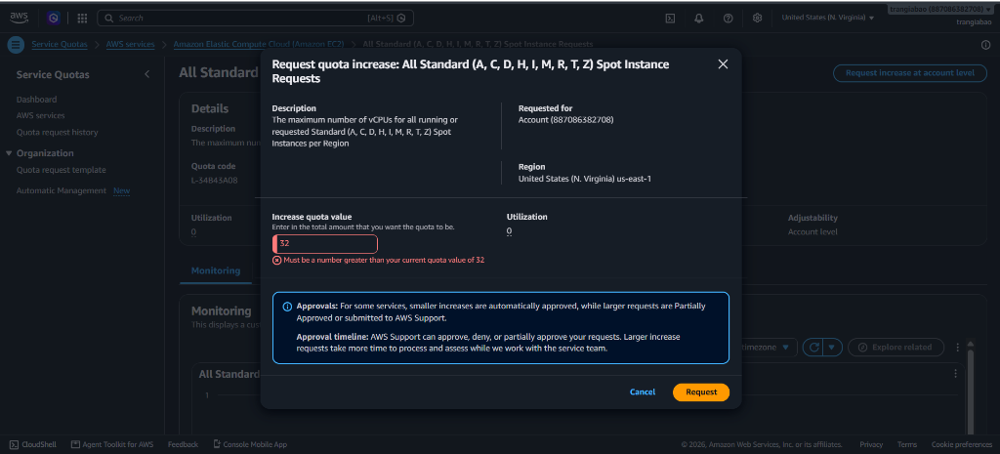
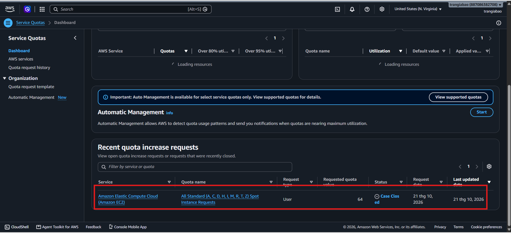
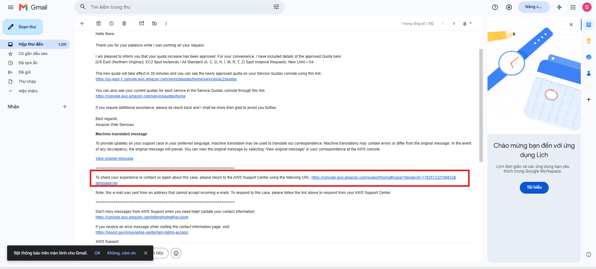
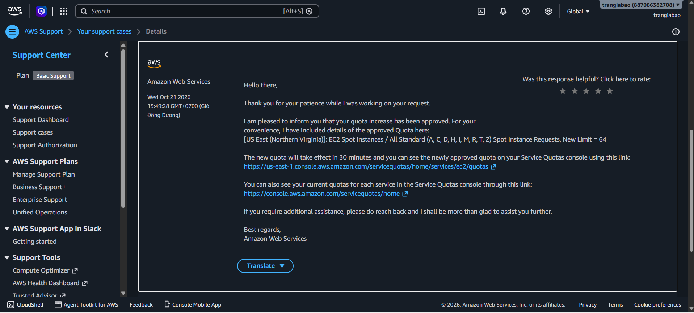

{}
The **Resource Limit Governance with AWS Service Quotas** lab was completed on **Monday (19/10/2026)** as part of **Week 6**. This page provides comprehensive documentation of reviewing default service quotas, initiating an account-level quota increase request for **EC2 Spot Instances** (`All Standard (A, C, D, H, I, M, R, T, Z) Spot Instance Requests`, Quota code `L-34B43A08`) from **32 to 64 vCPUs** in the **us-east-1** region, analyzing cloud cost implications, tracking the resolution lifecycle via **AWS Support Center** (Case ID: `179257232100832`), receiving formal confirmation emails from Amazon Web Services, and automating quota queries with the **AWS CLI**.
{}

### 🎯 Lab Objectives:
* Understand the core concept and strategic role of **AWS Service Quotas** in enterprise cloud governance, billing safeguard enforcement, and account infrastructure defense.
* Distinguish between **Soft Limits** (service limits that can be increased via request) and **Hard Limits** (immutable physical or architectural boundaries enforced by AWS).
* Master the modern Amazon EC2 quota paradigm: understanding how AWS calculates computing thresholds based on cumulative **vCPUs** rather than raw server instance counts.
* Execute a formal **Request Quota Increase** workflow, scaling compute capacity from 32 to 64 vCPUs for standard **EC2 Spot Instances** (`All Standard (A, C, D, H, I, M, R, T, Z) Spot Instance Requests`).
* Experience interactive client-side **Input Validation** on the AWS Management Console when attempting to enter invalid quota thresholds.
* Learn the inter-service communication workflow between customer accounts and the **AWS Support Center** under the **Basic Support Plan**.
* Resolve a fundamental cloud economics (**Cloud FinOps**) dilemma: *Does requesting or getting approved for a Service Quota increase incur any financial charges?*
* Leverage the **AWS CLI** (`aws service-quotas`) to automate quota discovery, query specific limits, inspect historical change requests, and script compliance validation.
* Establish **Proactive Quota Monitoring** by designing CloudWatch Alarms that notify operators when resource consumption approaches 80% and 95% of the allocated ceiling.

---

### 📊 Provisioned Resource Specifications:

| Parameter / Resource | Actual Value | Technical Significance & Role |
| :--- | :--- | :--- |
| **AWS Service** | `Amazon Elastic Compute Cloud (Amazon EC2)` | Core compute service providing scalable virtual computing capacity in the cloud |
| **Quota Name** | `All Standard (A, C, D, H, I, M, R, T, Z) Spot Instance Requests` | Cumulative vCPU threshold for standard compute-family Spot Instances |
| **Quota Code** | `L-34B43A08` | Canonical AWS identifier for standard Spot vCPU allocation |
| **Target Region** | `us-east-1` (US East - N. Virginia) | AWS geographic region where the quota applies |
| **Default Quota Value** | `32 vCPUs` | Out-of-the-box ceiling configured by AWS for the account |
| **Requested Quota Value**| `64 vCPUs` | New requested compute ceiling submitted for AWS approval |
| **Support Case ID** | `179257232100832` | Automated case tracking identifier created in AWS Support Center |
| **Account Support Plan** | `Basic Support` | Standard non-paid support tier included with all AWS accounts |
| **Resolution Status** | `Case Closed` / `Approved` | Request successfully validated and granted by AWS technical engineers |
| **Propagation Time** | Within `30 minutes` | Time required to synchronize the new quota across global distributed fleets |
| **Notification Channel** | Official email from `Amazon Web Services` | Administrator inbox receiving official approval verification |

---

### 📋 Detailed Step-by-Step Implementation Guide:

#### 🔹 Module 1: Exploring AWS Service Quotas & Inspecting EC2 Limits

##### Step 1: Navigate to the AWS Service Quotas Console
* **Action:** Sign in to the **AWS Management Console** ➔ Type `Service Quotas` into the top search bar ➔ Select **Service Quotas** from the services list.
* **Verify Region:** Confirm in the top navigation bar that the active region is **US East (N. Virginia) `us-east-1`**. Note that the vast majority of AWS infrastructure quotas are enforced independently per geographic region (**Per-Region Quotas**).
* **Objective:** The Service Quotas dashboard provides a centralized pane of glass to view default values, current applied values, and utilization percentages across over 250 AWS services.

##### Step 2: Navigate to Amazon Elastic Compute Cloud (EC2)
* **Action:** On the left navigation pane, click **AWS services** ➔ In the service filter search box, enter `EC2` or `Amazon Elastic Compute Cloud (Amazon EC2)` ➔ Click the service name to inspect its catalog of configurable quotas.
* **Observation:** EC2 manages hundreds of distinct quotas covering Elastic IPs, VPC Peering limits, Launch Templates, and vCPU quotas categorized by instance families (Standard, High Memory, Accelerated Computing) and pricing models (On-Demand vs Spot).

##### Step 3: Filter for the Standard Spot vCPU Quota
* **Action:** In the quota search box (**Filter quotas**), enter: `All Standard (A, C, D, H, I, M, R, T, Z) Spot Instance Requests`.
* **Displayed Metadata:**
  * **Quota name:** `All Standard (A, C, D, H, I, M, R, T, Z) Spot Instance Requests`
  * **Quota code:** `L-34B43A08`
  * **Default value:** `32` (vCPUs)
  * **Applied value:** `32` (vCPUs)
* **Significance:** This quota dictates that within `us-east-1`, the account can run concurrent standard Spot instances up to a collective sum of **32 vCPUs**. For example, 16 instances of `t3.medium` (2 vCPUs x 16 = 32 vCPUs) or 4 instances of `c5.2xlarge` (8 vCPUs x 4 = 32 vCPUs).

---

#### 🔹 Module 2: Submitting a Quota Increase Request

##### Step 4: Open Request Modal and Test Input Validation
* **Action:** Select the `All Standard (A, C, D, H, I, M, R, T, Z) Spot Instance Requests` entry ➔ Click the orange **Request increase at account level** button.
* **Modal Context:** The dialog displays:
  * *Description:* The maximum number of vCPUs for all running or requested Standard (A, C, D, H, I, M, R, T, Z) Spot Instances per Region.
  * *Requested for:* Account ID `887086382708`.
  * *Region:* United States (N. Virginia) `us-east-1`.
* **Testing Input Validation:**
  * In the **Increase quota value** field, enter `32` (matching the current limit).
  * **Console Feedback:** An immediate red client-side validation error is triggered:
    > ❌ **Must be a number greater than your current quota value of 32**
  * **Technical Takeaway:** AWS enforces robust UI-level validation to prevent redundant, no-op support ticket submissions.



##### Step 5: Input Target Limit of 64 vCPUs and Submit
* **Input Parameter:**
  * **Increase quota value:** Enter `64` (doubling compute capacity to support parallel distributed workloads with Spot cost savings).
* **AWS Approval Notice:**
  > ℹ️ **Approvals:** For some services, smaller increases are automatically approved, while larger requests are partially approved or routed to AWS Support for engineering review.
* **Action:** Click **Request** to transmit the formal quota increase application.

---

#### 🔹 Module 3: Tracking Approval Lifecycle and Verifying Resolution

##### Step 6: Monitor Progress via the Service Quotas Dashboard
* **Action:** Return to the primary **Service Quotas** console ➔ Navigate to **Dashboard** or **Quota request history**.
* **Review "Recent quota increase requests":**
  * **Service:** `Amazon Elastic Compute Cloud (Amazon EC2)`
  * **Quota name:** `All Standard (A, C, D, H, I, M, R, T, Z) Spot Instance Requests`
  * **Request type:** `User`
  * **Requested quota value:** `64`
  * **Status:** `Case Closed` (Support ticket reviewed and successfully completed)
  * **Request date:** `21 thg 10, 2026`
  * **Last updated date:** `21 thg 10, 2026`



##### Step 7: Receive Official Email Confirmation from AWS Support
* **Delivery Channel:** Primary administrator Gmail inbox linked to account `trangiabao`.
* **Subject:** Service Quota Increase Notification from AWS Support.
* **Email Body Content:**
  > *"Hello there,*  
  > *Thank you for your patience while I was working on your request.*  
  > *I am pleased to inform you that your quota increase has been approved. For your convenience, I have included details of the approved Quota here:*  
  > **[US East (Northern Virginia)]: EC2 Spot Instances / All Standard (A, C, D, H, I, M, R, T, Z) Spot Instance Requests, New Limit = 64**  
  > *The new quota will take effect in 30 minutes and you can see the newly approved quota on your Service Quotas console..."*



##### Step 8: Inspect Resolution in AWS Support Center
* **Action:** Click the Help icon in the top header ➔ Select **Support Center** ➔ Navigate to **Your support cases** ➔ Select the closed ticket.
* **Support Case Verification:**
  * **Plan:** `Basic Support` (Standard complimentary tier).
  * **Timestamp:** `Wed Oct 21 2026 15:49:28 GMT+0700`.
  * **Technical Outcome:** Support engineers confirmed that the **New Limit = 64** configuration has been committed to the `us-east-1` capacity allocator.
  * **Propagation Window:** A propagation window of approximately **30 minutes** is allocated for worldwide distributed control planes to complete consistency synchronization.



---

#### 🔹 Module 4: Managing Service Quotas Programmatically via AWS CLI

In addition to Console workflows, cloud infrastructure engineers automate service quota audits and limit requests using the **AWS CLI v2**.

##### Step 9: Query Service Codes for EC2
Discover canonical service identifiers:

```bash
aws service-quotas list-services \
  --query "Services[?contains(ServiceCode, 'ec2')].{Code:ServiceCode, Name:ServiceName}" \
  --output table
```

##### Step 10: Query Current Spot vCPU Limit via Quota Code `L-34B43A08`
Inspect the active value in `us-east-1`:

```bash
aws service-quotas get-service-quota \
  --service-code ec2 \
  --quota-code L-34B43A08 \
  --region us-east-1 \
  --query "Quota.{QuotaName:QuotaName, QuotaCode:QuotaCode, Value:Value, Unit:Unit, Adjustable:Adjustable}" \
  --output json
```

* **Sample JSON Response:**
```json
{
  "QuotaName": "All Standard (A, C, D, H, I, M, R, T, Z) Spot Instance Requests",
  "QuotaCode": "L-34B43A08",
  "Value": 64.0,
  "Unit": "None",
  "Adjustable": true
}
```
* **Analysis:** The `"Value": 64.0` field confirms system-wide convergence on the 64 vCPU limit, while `"Adjustable": true` confirms this is an elastic soft quota.

##### Step 11: Scripting Automated Quota Increase Requests
Submit a quota adjustment programmatically:

```bash
aws service-quotas request-service-quota-increase \
  --service-code ec2 \
  --quota-code L-34B43A08 \
  --desired-value 64 \
  --region us-east-1
```

##### Step 12: Inspecting Quota Request History via CLI
Audit the status of historical submissions:

```bash
aws service-quotas list-requested-service-quota-change-history-by-quota \
  --service-code ec2 \
  --quota-code L-34B43A08 \
  --region us-east-1 \
  --query "RequestedQuotas[*].{ID:Id, Status:Status, DesiredValue:DesiredValue, Created:Created}" \
  --output table
```

---

#### 🔹 Module 5: Proactive Limit Monitoring with CloudWatch Alarms

To safeguard auto-scaling groups and distributed jobs against unexpected throttling exceptions, production architectures pair Service Quotas with **CloudWatch Alarms**:

```bash
aws cloudwatch put-metric-alarm \
  --alarm-name "EC2-Spot-vCPU-Quota-Utilization-High" \
  --alarm-description "Trigger alarm when Spot vCPU utilization exceeds 80% of the 64 vCPU ceiling" \
  --namespace "AWS/Usage" \
  --metric-name "ResourceCount" \
  --dimensions Name=Service,Value=EC2 Name=Type,Value=Resource Name=Resource,Value=SpotInstances \
  --statistic Maximum \
  --period 300 \
  --threshold 51.2 \
  --comparison-operator GreaterThanOrEqualToThreshold \
  --evaluation-periods 1 \
  --alarm-actions arn:aws:sns:us-east-1:887086382708:aws-cli
```

---

### 💡 Troubleshooting & Real-World Lessons:

#### 1. Cloud Economics Question: Does increasing a Service Quota from 32 to 64 vCPUs incur billing charges?
* **Technical Reality:** **ABSOLUTELY NOT.**
* **AWS Billing Model:**
  * A Service Quota is purely a "safety ceiling" designed to prevent runaway costs caused by operational mistakes, runaway scripts, or security breaches.
  * Submitting an increase request and having it approved to 64 vCPUs is **100% free of charge**.
  * AWS only bills for **actual compute consumption**—measuring seconds of active instance runtime. If your account holds a limit of 64 vCPUs but runs 0 active instances, your EC2 bill remains exactly **$0.00**.

#### 2. Client-Side Input Validation ("Must be a number greater than your current quota value of 32")
* **Root Cause:** Attempting to submit a request with the value `32`, identical to the active baseline.
* **Resolution:** Submissions must specify a positive integer strictly higher than the current value (e.g., `64` or `128`). Values must be backed by architectural requirements to avoid administrative review rejections.

#### 3. Differentiating Soft Quotas vs. Hard Quotas
* **Soft Quotas:** Administrative safeguards that can be adjusted via Service Quotas or AWS Support tickets (e.g., EC2 vCPUs, Elastic IP allocations, DynamoDB provisioned capacity).
* **Hard Quotas:** Immutable architectural or protocol limits fixed by AWS service design (e.g., DynamoDB maximum item size of 400 KB, SQS payload maximum of 256 KB, maximum VPC peering connections per route table).

#### 4. Regional Scope of Quotas (Per-Region Quotas)
* **Observation:** Increasing the Spot vCPU quota to 64 in `us-east-1` (N. Virginia) leaves other regions (e.g., `ap-southeast-1` Singapore) at their default 32 vCPU limit.
* **Best Practice:** In multi-region deployments or disaster recovery configurations, quota adjustments must be initiated and tracked independently for each designated target region.

#### 5. Shift from Instance-Count Limits to vCPU-Based Quotas
* **Historical Context:** Historically, AWS throttled EC2 instances by gross instance count (e.g., 20 instances). This treated a lightweight `t3.nano` (2 vCPUs, 0.5 GB RAM) identically to a massive `c5.18xlarge` (72 vCPUs, 144 GB RAM).
* **Modern Model:** By measuring raw vCPU capacity, organizations enjoy granular elasticity to deploy diverse instance combinations up to their aggregate compute ceiling.

#### 6. Propagation Delay (~30 Minutes)
* **Behavior:** Attempting to launch instances immediately following ticket closure might briefly yield `MaxSpotInstanceCountExceeded` errors.
* **Mechanism:** AWS operates a massive global control plane. A brief 15 to 30-minute consistency window is necessary for the new capacity quota to replicate to every placement engine across Availability Zones.

#### 7. Account Justification for High-Volume Increases
* **Risk Management:** For new AWS accounts, AWS enforces conservative baseline limits to mitigate fraudulent activity, unauthorized cryptocurrency mining, or DDoS botnet creation.
* **Operational Tip:** When requesting high-magnitude quota jumps, provide clear use-case justifications in the description field (e.g., "Training deep learning models for university capstone research").

#### 8. Automated Multi-Account Quota Templates
* **Enterprise Scaling:** Organizations utilizing **AWS Organizations** can configure **Quota Request Templates**. When new member accounts are provisioned, approved quota increases are automatically requested across all member environments without manual administrative intervention.

---

### 📌 Summary & Skills Acquired:
Through the **Resource Limit Governance with AWS Service Quotas** lab, the intern has acquired:
1. Thorough comprehension of resource quota governance on the AWS cloud platform.
2. Complete practical execution of the vCPU quota increase lifecycle (`L-34B43A08`) from 32 to 64 vCPUs.
3. Cohesive integration between the **Service Quotas Console**, **AWS Support Center**, and **Email notification channels**.
4. Proficiency in programmatic quota querying and proactive threshold monitoring utilizing the **AWS CLI** and **Amazon CloudWatch**, establishing the foundation for large-scale distributed deployments in upcoming weeks.
