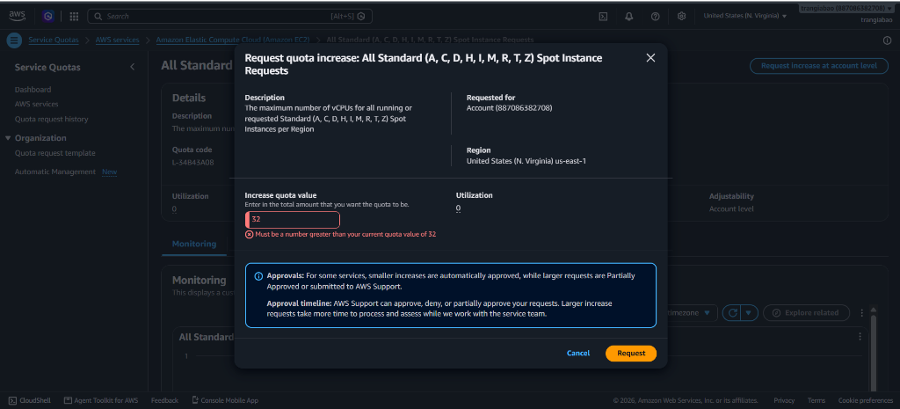
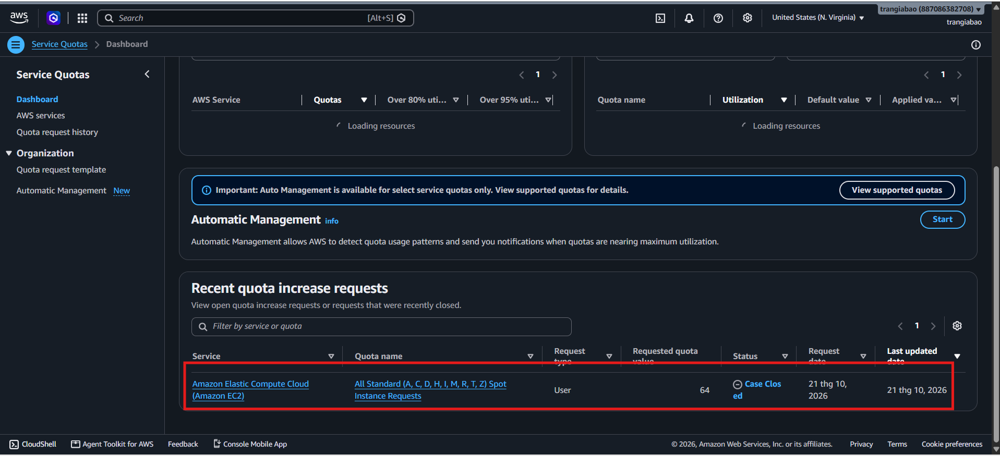
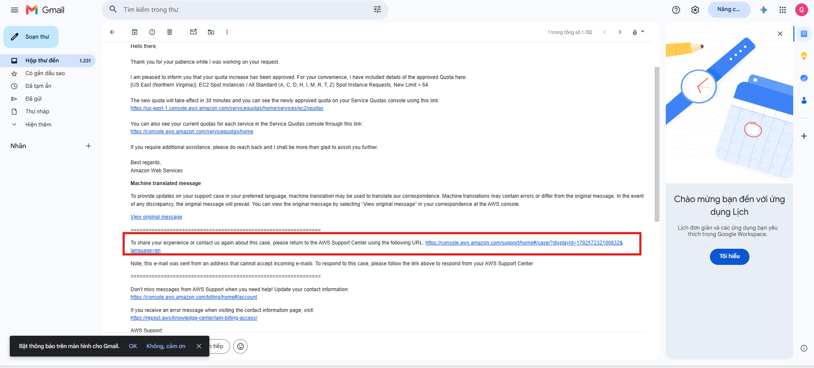
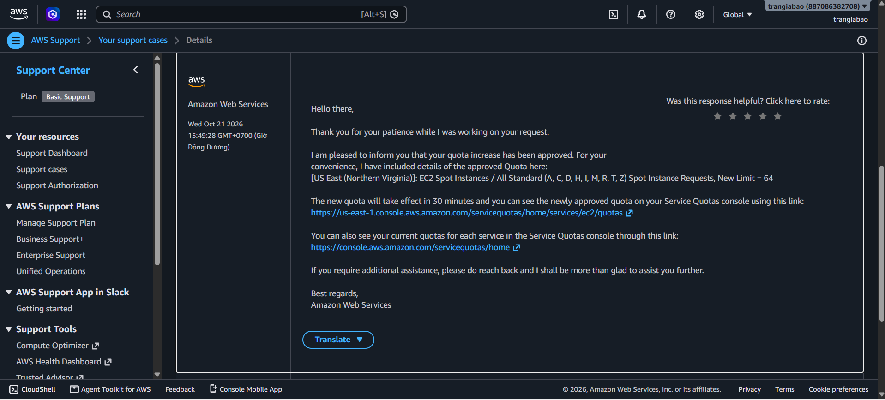

{}
Bài thực hành **Quản lý và Nâng hạn mức tài nguyên với AWS Service Quotas** được thực hiện vào **Thứ 2 (19/10/2026)** trong khuôn khổ **Tuần 6**. Trang này ghi lại toàn diện quy trình kiểm tra hạn mức mặc định, gửi yêu cầu nâng trần vCPU cho cụm máy chủ **EC2 Spot Instances** (`All Standard (A, C, D, H, I, M, R, T, Z) Spot Instance Requests`, mã Quota `L-34B43A08`) từ **32 lên 64 vCPUs** tại vùng **us-east-1**, phân tích chi phí, theo dõi quy trình phê duyệt qua **AWS Support Center** (Case ID: `179257232100832`), xác nhận qua thư điện tử chính thức từ Amazon Web Services và tự động hóa tra cứu bằng **AWS CLI**.
{}

### 🎯 Mục tiêu bài thực hành (Lab Objectives):
* Hiểu rõ khái niệm và vai trò chiến lược của **AWS Service Quotas** trong việc quản trị tài nguyên đám mây, ngăn chặn rủi ro vượt ngân sách ngoài ý muốn và bảo vệ hạ tầng tài khoản AWS.
* Phân biệt giữa **Soft Limits** (hạn mức mềm có thể yêu cầu tăng) và **Hard Limits** (hạn mức cứng cố định theo kiến trúc hệ thống AWS).
* Nắm vững cơ chế tính toán hạn mức vCPU của Amazon EC2: AWS áp dụng giới hạn dựa trên tổng số **vCPU** thay vì số lượng máy ảo (`instances`) riêng lẻ.
* Thực hiện gửi yêu cầu nâng hạn mức (**Request Quota Increase**) từ 32 lên 64 vCPUs cho dòng máy chủ **EC2 Spot Instances** tiêu chuẩn (`All Standard (A, C, D, H, I, M, R, T, Z) Spot Instance Requests`).
* Trải nghiệm thực tế cơ chế kiểm tra tính hợp lệ dữ liệu nhập (**Input Validation**) trên AWS Management Console khi nhập giá trị không hợp lệ.
* Hiểu rõ quy trình làm việc giữa khách hàng và bộ phận hỗ trợ AWS (**AWS Support Center**) ngay cả trong gói dịch vụ cơ bản (**Basic Support Plan**).
* Giải đáp chi tiết bài toán kinh tế đám mây (**Cloud FinOps**): *Việc nâng hạn mức Quota từ 32 lên 64 vCPU có bị trừ tiền hay phát sinh chi phí hay không?*
* Thực hành sử dụng bộ công cụ dòng lệnh **AWS CLI** (`aws service-quotas`) để tra cứu thông tin hạn mức, xem lịch sử thay đổi và tự động hóa kiểm tra trần tài nguyên.
* Thiết lập tư duy giám sát chủ động (**Proactive Quota Monitoring**) bằng cách tạo cảnh báo CloudWatch khi tài nguyên sử dụng tiệm cận ngưỡng 80% và 95%.

---

### 📊 Bảng tổng hợp thông số tài nguyên đã triển khai:

| Thông số / Tài nguyên | Giá trị thực tế | Ý nghĩa & Mô tả kỹ thuật |
| :--- | :--- | :--- |
| **Dịch vụ AWS** | `Amazon Elastic Compute Cloud (Amazon EC2)` | Dịch vụ điện toán đám mây cốt lõi cung cấp tài nguyên máy chủ ảo |
| **Tên hạn mức (Quota Name)** | `All Standard (A, C, D, H, I, M, R, T, Z) Spot Instance Requests` | Giới hạn tổng số vCPU tối đa cho các máy chủ Spot thuộc các dòng tiêu chuẩn |
| **Mã Quota (Quota Code)** | `L-34B43A08` | Định danh duy nhất của AWS cho hạn mức Spot vCPU tiêu chuẩn |
| **Khu vực (Region)** | `us-east-1` (US East - N. Virginia) | Vùng AWS triển khai và áp dụng hạn mức |
| **Hạn mức ban đầu (Default Limit)** | `32 vCPUs` | Giới hạn mặc định ban đầu do AWS thiết lập cho tài khoản |
| **Hạn mức yêu cầu mới (Requested)** | `64 vCPUs` | Giá trị hạn mức mới được gửi yêu cầu phê duyệt |
| **Mã hồ sơ hỗ trợ (Case ID)** | `179257232100832` | Hồ sơ yêu cầu tăng hạn mức được tự động mở trên AWS Support Center |
| **Gói hỗ trợ tài khoản (Plan)** | `Basic Support` | Gói hỗ trợ mặc định miễn phí của tài khoản AWS |
| **Trạng thái phê duyệt (Status)** | `Case Closed` / `Approved` | Yêu cầu đã được bộ phận hỗ trợ kỹ thuật AWS chấp thuận thành công |
| **Thời gian áp dụng (Effective Time)** | Trong vòng `30 phút` kể từ khi duyệt | Thời gian đồng bộ hạn mức mới trên toàn bộ hệ thống phân tán của AWS |
| **Kênh thông báo (Notification)** | Email chính thức từ `Amazon Web Services` | Hộp thư quản trị viên tiếp nhận biên bản xác nhận phê duyệt |

---

### 📋 Quy trình triển khai chi tiết từng bước (Step-by-Step):

#### 🔹 Mục 1: Khám phá AWS Service Quotas & Tra cứu hạn mức EC2

##### Bước 1: Truy cập bảng điều khiển AWS Service Quotas
* **Thao tác:** Đăng nhập vào **AWS Management Console** ➔ Tại thanh tìm kiếm trên cùng, nhập từ khóa `Service Quotas` ➔ Nhấp chọn dịch vụ **Service Quotas**.
* **Xác định Region:** Đảm bảo góc trên cùng bên phải đang ở vùng **US East (N. Virginia) `us-east-1`**. Lưu ý rằng phần lớn các hạn mức dịch vụ AWS được áp dụng riêng biệt theo từng Region (**Per-Region Quotas**).
* **Mục đích:** Bảng điều khiển Service Quotas cung cấp một giao diện tập trung duy nhất để xem toàn bộ hạn mức mặc định, hạn mức đang áp dụng và tỷ lệ sử dụng tài nguyên của hơn 250 dịch vụ AWS.

##### Bước 2: Điều hướng đến dịch vụ Amazon Elastic Compute Cloud (EC2)
* **Thao tác:** Ở thanh menu bên trái, nhấp chọn **AWS services** ➔ Trong ô tìm kiếm danh sách dịch vụ, nhập `EC2` hoặc `Amazon Elastic Compute Cloud (Amazon EC2)` ➔ Nhấp vào tên dịch vụ để mở danh mục hạn mức chi tiết.
* **Quan sát:** EC2 có hàng trăm hạn mức khác nhau, bao gồm số lượng Elastic IP, VPC Peering, Launch Templates, và đặc biệt là hạn mức vCPU được phân chia theo từng nhóm họ instance (Standard, High Memory, Accelerated Computing) và theo mô hình mua sắm (On-Demand vs Spot).

##### Bước 3: Tra cứu hạn mức vCPU cho máy chủ Spot tiêu chuẩn
* **Thao tác:** Trong ô tìm kiếm hạn mức (**Filter quotas**), nhập cụm từ: `All Standard (A, C, D, H, I, M, R, T, Z) Spot Instance Requests`.
* **Thông tin hiển thị:**
  * **Quota name:** `All Standard (A, C, D, H, I, M, R, T, Z) Spot Instance Requests`
  * **Quota code:** `L-34B43A08`
  * **Default value:** `32` (vCPUs)
  * **Applied value:** `32` (vCPUs)
* **Ý nghĩa:** Hạn mức này quy định tài khoản của bạn tại vùng `us-east-1` chỉ có thể chạy đồng thời các máy chủ Spot thuộc các dòng A, C, D, H, I, M, R, T, Z với tổng số vCPU tối đa không vượt quá **32 vCPUs**. Ví dụ: bạn có thể chạy 16 máy `t3.medium` (2 vCPU x 16 = 32 vCPU), hoặc 4 máy `c5.2xlarge` (8 vCPU x 4 = 32 vCPU).

---

#### 🔹 Mục 2: Thực hiện yêu cầu nâng hạn mức tài nguyên (Request Quota Increase)

##### Bước 4: Mở biểu mẫu yêu cầu và kiểm thử cơ chế Input Validation
* **Thao tác:** Nhấp chọn dòng hạn mức `All Standard (A, C, D, H, I, M, R, T, Z) Spot Instance Requests` ➔ Nhấp vào nút màu cam **Request increase at account level** (Yêu cầu tăng hạn mức ở cấp độ tài khoản).
* **Cửa sổ bật lên (Modal):** Hộp thoại hiển thị thông tin chi tiết:
  * *Description:* The maximum number of vCPUs for all running or requested Standard (A, C, D, H, I, M, R, T, Z) Spot Instances per Region.
  * *Requested for:* Account ID `887086382708`.
  * *Region:* United States (N. Virginia) `us-east-1`.
* **Thực nghiệm Input Validation:** 
  * Trong ô **Increase quota value**, tiến hành thử nhập giá trị: `32` (bằng với hạn mức hiện hành).
  * **Phản hồi từ Console:** Ngay lập tức, giao diện hiển thị thông báo lỗi màu đỏ nổi bật:
    > ❌ **Must be a number greater than your current quota value of 32** *(Phải là một số lớn hơn giá trị hạn mức hiện tại là 32)*.
  * **Bài học kinh nghiệm:** Cơ chế kiểm tra đầu vào (Client-side validation) của AWS ngăn chặn người dùng gửi những yêu cầu thừa thãi hoặc không làm tăng hạn mức thực tế.



##### Bước 5: Nhập giá trị hạn mức mới 64 vCPUs và xác nhận gửi yêu cầu
* **Thông số nhập liệu:**
  * **Increase quota value:** Nhập `64` (Gấp đôi hạn mức ban đầu, cho phép mở rộng quy mô chạy song song nhiều tác vụ tính toán hiệu năng cao với chi phí Spot tối ưu).
* **Lưu ý trong hộp thoại phê duyệt của AWS:**
  > ℹ️ **Approvals:** Đối với một số dịch vụ, các mức tăng nhỏ có thể được hệ thống phê duyệt tự động. Đối với các mức tăng lớn hơn, yêu cầu sẽ được chuyển tới đội ngũ **AWS Support** để thẩm định và phê duyệt thủ công.
* **Thao tác:** Nhấn nút **Request** để chính thức gửi hồ sơ.

---

#### 🔹 Mục 3: Theo dõi quy trình phê duyệt và xác nhận kết quả thành công

##### Bước 6: Theo dõi tiến độ tại Dashboard Service Quotas
* **Thao tác:** Quay trở lại bảng điều khiển chính **Service Quotas** ➔ Chọn mục **Dashboard** hoặc **Quota request history**.
* **Quan sát phần "Recent quota increase requests" (Các yêu cầu tăng hạn mức gần đây):**
  * **Service:** `Amazon Elastic Compute Cloud (Amazon EC2)`
  * **Quota name:** `All Standard (A, C, D, H, I, M, R, T, Z) Spot Instance Requests`
  * **Request type:** `User`
  * **Requested quota value:** `64`
  * **Status:** `Case Closed` (Hồ sơ hỗ trợ đã được xử lý và đóng thành công)
  * **Request date:** `21 thg 10, 2026`
  * **Last updated date:** `21 thg 10, 2026`



##### Bước 7: Tiếp nhận thư điện tử phê duyệt chính thức từ Amazon Web Services
* **Kênh nhận tin:** Hộp thư Gmail liên kết với tài khoản AWS (`trangiabao`).
* **Tiêu đề email:** Thông báo phê duyệt hồ sơ yêu cầu tăng hạn mức dịch vụ từ AWS Support.
* **Nội dung phê duyệt trích xuất từ thư AWS:**
  > *"Hello there,*  
  > *Thank you for your patience while I was working on your request.*  
  > *I am pleased to inform you that your quota increase has been approved. For your convenience, I have included details of the approved Quota here:*  
  > **[US East (Northern Virginia)]: EC2 Spot Instances / All Standard (A, C, D, H, I, M, R, T, Z) Spot Instance Requests, New Limit = 64**  
  > *The new quota will take effect in 30 minutes and you can see the newly approved quota on your Service Quotas console..."*



##### Bước 8: Kiểm tra chi tiết hồ sơ hỗ trợ trên AWS Support Center
* **Thao tác:** Trên AWS Console, nhấp vào biểu tượng dấu hỏi trợ giúp (Help) ở góc trên bên phải ➔ Chọn **Support Center** ➔ Điều hướng đến **Your support cases** ➔ Nhấp vào mã hồ sơ vừa xử lý.
* **Thông số chi tiết của Support Case:**
  * **Plan:** `Basic Support` (Gói hỗ trợ miễn phí).
  * **Thời gian xử lý:** `Wed Oct 21 2026 15:49:28 GMT+0700 (Giờ Đông Dương)`.
  * **Nội dung phản hồi:** Đội ngũ kỹ sư AWS xác nhận hạn mức mới **New Limit = 64** đã được ghi nhận vào cơ sở dữ liệu vùng `us-east-1`.
  * **Thời gian trễ kích hoạt (Propagation delay):** Hệ thống cần tối đa **30 phút** để lan tỏa cấu hình hạn mức mới đến toàn bộ cụm máy chủ và bộ điều phối EC2 Fleet tại Bắc Virginia.



---

#### 🔹 Mục 4: Quản trị hạn mức Service Quotas thông qua công cụ dòng lệnh AWS CLI

Bên cạnh thao tác trên giao diện Web Console trực quan, người quản trị hệ thống Cloud chuyên nghiệp hoàn toàn có thể tự động hóa việc tra cứu và quản lý hạn mức dịch vụ thông qua bộ công cụ **AWS CLI v2**.

##### Bước 9: Tra cứu mã định danh dịch vụ (Service Code) của EC2
Để thao tác với Service Quotas bằng CLI, trước tiên cần tra cứu chính xác mã `service-code`:

```bash
# Liệt kê các dịch vụ AWS hỗ trợ Service Quotas có chứa từ khóa ec2
aws service-quotas list-services \
  --query "Services[?contains(ServiceCode, 'ec2')].{Code:ServiceCode, Name:ServiceName}" \
  --output table
```

##### Bước 10: Lấy thông tin chi tiết hạn mức Spot vCPU qua Quota Code `L-34B43A08`
Truy vấn trực tiếp giá trị hạn mức hiện hành đang áp dụng tại vùng `us-east-1`:

```bash
aws service-quotas get-service-quota \
  --service-code ec2 \
  --quota-code L-34B43A08 \
  --region us-east-1 \
  --query "Quota.{QuotaName:QuotaName, QuotaCode:QuotaCode, Value:Value, Unit:Unit, Adjustable:Adjustable}" \
  --output json
```

* **Kết quả trả về định dạng JSON:**
```json
{
  "QuotaName": "All Standard (A, C, D, H, I, M, R, T, Z) Spot Instance Requests",
  "QuotaCode": "L-34B43A08",
  "Value": 64.0,
  "Unit": "None",
  "Adjustable": true
}
```
* **Phân tích:** Trường `"Value": 64.0` xác nhận hạn mức mới đã được hệ thống cập nhật thành công lên 64 vCPUs; trường `"Adjustable": true` cho biết đây là một Soft Limit có thể tiếp tục xin nâng khi nhu cầu mở rộng quy mô tăng lên.

##### Bước 11: Lệnh CLI gửi yêu cầu nâng hạn mức tự động
Nếu muốn thực hiện gửi yêu cầu nâng hạn mức bằng kịch bản dòng lệnh:

```bash
aws service-quotas request-service-quota-increase \
  --service-code ec2 \
  --quota-code L-34B43A08 \
  --desired-value 64 \
  --region us-east-1
```

##### Bước 12: Kiểm tra lịch sử các yêu cầu thay đổi hạn mức
Để kiểm tra trạng thái phê duyệt của các yêu cầu đã gửi:

```bash
aws service-quotas list-requested-service-quota-change-history-by-quota \
  --service-code ec2 \
  --quota-code L-34B43A08 \
  --region us-east-1 \
  --query "RequestedQuotas[*].{ID:Id, Status:Status, DesiredValue:DesiredValue, Created:Created}" \
  --output table
```

---

#### 🔹 Mục 5: Thiết lập cảnh báo chủ động tiệm cận hạn mức (Proactive Monitoring)

Để tránh tình trạng máy chủ tự động co giãn (**Auto Scaling**) hoặc tác vụ tính toán phân tán bị thất bại đột ngột do chạm trần hạn mức vCPU, mô hình chuẩn của AWS khuyến nghị thiết lập **CloudWatch Alarms** theo dõi tỷ lệ sử dụng quota:

```bash
# Tạo CloudWatch Alarm cảnh báo khi tỷ lệ sử dụng Spot vCPU vượt quá 80% hạn mức
aws cloudwatch put-metric-alarm \
  --alarm-name "EC2-Spot-vCPU-Quota-Utilization-High" \
  --alarm-description "Cảnh báo khi số lượng vCPU Spot tiêu thụ vượt quá 80% hạn mức trần 64 vCPU" \
  --namespace "AWS/Usage" \
  --metric-name "ResourceCount" \
  --dimensions Name=Service,Value=EC2 Name=Type,Value=Resource Name=Resource,Value=SpotInstances \
  --statistic Maximum \
  --period 300 \
  --threshold 51.2 \
  --comparison-operator GreaterThanOrEqualToThreshold \
  --evaluation-periods 1 \
  --alarm-actions arn:aws:sns:us-east-1:887086382708:aws-cli
```

---

### 💡 Khó khăn gặp phải & Bài học kinh nghiệm thực tế (Troubleshooting & Real-world Lessons):

#### 1. Thắc mắc kinh tế đám mây: Việc nâng hạn mức Quota từ 32 lên 64 vCPU có bị tính phí tiền không?
* **Bản chất kỹ thuật:** **HOÀN TOÀN KHÔNG MẤT PHÍ.**
* **Nguyên lý tính cước của AWS:** 
  * Hạn mức (Service Quota) chỉ là một "chiếc trần bảo vệ" (Safety Ceiling) nhằm bảo vệ bạn không vô tình tạo ra quá nhiều máy chủ gây phát sinh hóa đơn khổng lồ, đồng thời bảo vệ hạ tầng dùng chung của AWS khỏi tình trạng cạn kiệt tài nguyên cục bộ.
  * Việc gửi yêu cầu tăng hạn mức và được AWS phê duyệt lên 64 vCPUs là dịch vụ quản trị **miễn phí 100%**.
  * AWS chỉ bắt đầu tính tiền khi bạn **thực sự khởi chạy máy chủ** (Run/Launch Instances) dựa trên thời gian chạy thực tế (tính theo từng giây hoạt động của máy ảo). Nếu bạn được duyệt trần 64 vCPUs nhưng không khởi chạy máy ảo nào thì hóa đơn cuối tháng của dịch vụ EC2 vẫn là **0 USD**.

#### 2. Lỗi xác thực dữ liệu đầu vào (Input Validation Error: "Must be a number greater than your current quota value of 32")
* **Nguyên nhân:** Người dùng nhập giá trị `32` vào ô yêu cầu nâng hạn mức. Vì hạn mức hiện tại đã là 32, hệ thống từ chối xử lý một yêu cầu không có sự thay đổi giá trị.
* **Giải pháp:** Phải nhập một số nguyên dương strictly lớn hơn giá trị hiện hành (ví dụ: `64` hoặc `128`). Cần tính toán nhu cầu thực tế của dự án để đưa ra con số hợp lý, tránh nhập các số quá lớn không có lý do chính đáng dẫn đến việc bị AWS Support từ chối.

#### 3. Phân biệt Soft Quotas (Hạn mức mềm) và Hard Quotas (Hạn mức cứng)
* **Soft Quotas:** Là các giới hạn quản trị có thể nâng được bằng cách gửi yêu cầu qua Service Quotas hoặc AWS Support (ví dụ: số vCPU EC2, số lượng Elastic IP, dung lượng DynamoDB provisioned).
* **Hard Quotas:** Là các giới hạn vật lý, giao thức mạng hoặc kiến trúc cố định của nền tảng AWS mà không thể tăng lên dưới bất kỳ hình thức nào (ví dụ: kích thước tối đa của một item trong DynamoDB là 400 KB, kích thước tối đa của một thông điệp SQS là 256 KB, hoặc số lượng VPC tối đa cho mỗi peering connection).

#### 4. Tính chất cục bộ theo từng Region (Per-Region Quotas)
* **Hiện tượng:** Yêu cầu nâng hạn mức Spot vCPU lên 64 được duyệt tại vùng `us-east-1` (Bắc Virginia). Khi người dùng chuyển sang vùng Singapore (`ap-southeast-1`), hạn mức Spot vCPU vẫn giữ nguyên ở mức mặc định 32 vCPUs.
* **Bài học:** Hạn mức dịch vụ của phần lớn tài nguyên hạ tầng AWS (EC2, VPC, EBS, RDS) được áp dụng độc lập cho từng Region. Nếu dự án triển khai kiến trúc đa vùng (Multi-Region Disaster Recovery), bạn phải chủ động gửi yêu cầu nâng Service Quotas riêng rẽ cho từng Region tương ứng.

#### 5. Phân biệt hạn mức tính theo vCPU vs hạn mức tính theo số lượng máy chủ (Instance Count)
* **Kinh nghiệm lịch sử:** Trước đây, AWS quản lý hạn mức EC2 theo số lượng máy ảo (ví dụ: tối đa 20 On-Demand Instances). Tuy nhiên, cách tính này không công bằng vì một máy `t3.nano` (2 vCPU, 0.5GB RAM) bị tính ngang với một máy khủng `c5.18xlarge` (72 vCPU, 144GB RAM).
* **Quy chuẩn hiện đại:** AWS đã chuyển đổi toàn bộ sang quản lý theo **số lượng vCPU**. Do đó, khi lên kế hoạch triển khai, kỹ sư hệ thống cần quy đổi cấu hình máy ảo ra tổng số vCPU để đối chiếu với trần Service Quotas.

#### 6. Độ trễ hiệu lực sau khi phê duyệt (Quota Propagation Delay ~30 phút)
* **Hiện tượng:** Ngay sau khi nhận được thông báo "Case Closed", người dùng chạy lệnh tạo máy chủ Spot vượt quá 32 vCPU thì vẫn có thể gặp lỗi `MaxSpotInstanceCountExceeded`.
* **Nguyên nhân:** AWS là hệ thống phân tán toàn cầu khổng lồ với hàng chục ngàn cụm máy chủ vật lý. Cần một khoảng thời gian trễ nhất định (từ 15 đến 30 phút) để bản ghi hạn mức mới được đồng bộ tới toàn bộ các dịch vụ định tuyến và phân bổ tài nguyên (EC2 Capacity Placement Engine).

#### 7. Lý do AWS yêu cầu phê duyệt thủ công đối với tài khoản mới (Account Justification)
* **Cơ chế kiểm soát rủi ro của AWS:** Đối với các tài khoản AWS mới tạo (Fresh Accounts), AWS áp đặt hạn mức ban đầu khá chặt chẽ để phòng chống gian lận, đào tiền ảo trái phép (cryptocurrency mining) hoặc bị hacker chiếm quyền điều khiển để tấn công từ chối dịch vụ (DDoS). 
* **Thực hành chuẩn:** Khi yêu cầu nâng hạn mức lớn, bạn nên cung cấp mô tả ngắn gọn về nhu cầu sử dụng (Use Case) trong ô mô tả (ví dụ: "Phục vụ huấn luyện mô hình Machine Learning" hoặc "Chạy kiểm thử tải hệ thống cho bài tập lớn đại học").

#### 8. Hạn mức tự động quản trị (Automatic Management / Quota Request Template)
* **Tính năng mở rộng:** Với các doanh nghiệp sử dụng **AWS Organizations**, quản trị viên có thể sử dụng tính năng **Quota Request Template** để cấu hình một bộ quy tắc hạn mức tự động. Bất cứ khi nào một tài khoản con (Member Account) mới được tạo trong tổ chức, các hạn mức mong muốn sẽ tự động được gửi yêu cầu nâng mà không cần làm thủ công từng tài khoản.

---

### 📌 Kết luận & Đúc kết kỹ năng:
Qua bài thực hành **Quản lý và Nâng hạn mức tài nguyên với AWS Service Quotas**, sinh viên thực tập đã nắm trọn vẹn:
1. Bản chất hoạt động của hệ thống Service Quotas trên nền tảng điện toán đám mây AWS.
2. Quy trình gửi và theo dõi yêu cầu nâng trần vCPU cho cụm máy chủ Spot Instances (`L-34B43A08`) từ 32 lên 64 vCPUs.
3. Sự phối hợp mượt mà giữa các dịch vụ: **Service Quotas Console**, **AWS Support Center** và kênh thông báo **Email**.
4. Khả năng tự động hóa kiểm tra và giám sát trần tài nguyên thông qua **AWS CLI** và **Amazon CloudWatch**, sẵn sàng cho các bài thực hành triển khai cụm máy chủ phân tán quy mô lớn trong các tuần tiếp theo.
