{}
The **Optimize Amazon EC2 Costs with AWS Lambda & Slack Notifications** hands-on lab was conducted on **Tuesday (20/10/2026)** as part of **Week 6**. This document details the serverless operational automation architecture using AWS Lambda, Amazon EventBridge Scheduler, and ChatOps telemetry dispatching via Slack Incoming Webhooks.
{}

### 🎯 Lab Objectives
* **Cloud Cost Optimization:** Design and implement an automated compute scheduling architecture for Amazon EC2 instances, automatically stopping non-production development/test servers outside business hours and resuming them prior to the start of the workday, realizing up to 65 - 70% in compute cost savings.
* **Serverless Operational Automation:** Develop serverless routines using **AWS Lambda** (Python 3 Boto3 SDK) coupled with **Amazon EventBridge Scheduler** to govern the complete compute lifecycle without maintaining any dedicated management host or cron server.
* **Dynamic Resource Tagging Governance:** Apply tag-based identification strategies (`environment_auto = true`) enabling Lambda functions to dynamically query, filter, and control target instances without hardcoding instance IDs.
* **Real-Time ChatOps Telemetry via Slack:** Integrate AWS Lambda with **Slack** channels using **Incoming Webhooks**, automatically broadcasting formatted operational alerts displaying instance transition states directly into the `#notification` channel.
* **Enterprise Troubleshooting Competence:** Diagnose and resolve complex runtime exceptions, including state transition constraints (`IncorrectInstanceState`), ghost references to terminated instances, IAM policy evaluation boundaries, and resilient webhook dispatching.

---

### 📊 Provisioned Resource Specifications

| Component / Resource | Identifier (Name / ID) | Technical Specifications / Configuration | Purpose / Notes |
| :--- | :--- | :--- | :--- |
| **AWS Region** | `us-east-1` | US East (N. Virginia) | Primary operational deployment region |
| **Virtual Private Cloud** | `lambda-lab` | CIDR `10.0.0.0/16`, Public Subnet `10.0.128.0/20` (`us-east-1a`) | Isolated network perimeter for test workloads |
| **Security Group** | `lambda-lab` | Inbound: SSH (Port 22), HTTP (Port 80); Outbound: All Traffic | Network access controls for EC2 compute instances |
| **Target Workload (EC2)** | `lambda-lab-instance` / `i-003cb6dbd0f4e5b31` | `t3.micro`, Amazon Linux 2023, Tag: `environment_auto = true` | Development compute subject to scheduled power cycles |
| **IAM Execution Role** | `dc-common-lambda-role` | Trusted: `lambda.amazonaws.com`, Policies: `AmazonEC2FullAccess`, `CloudWatchFullAccessV2` | Grants Lambda full EC2 lifecycle and logging privileges |
| **Lambda Function (Stop)** | `dc-common-lambda-auto-stop` | Runtime: Python 3.14, Memory: 128 MB, Env: `environment_auto = true` | Scans and halts target instances post-workday |
| **Lambda Function (Start)** | `dc-common-lambda-auto-start`| Runtime: Python 3.14, Memory: 128 MB, Env: `environment_auto = true` | Scans and resumes target instances pre-workday |
| **EventBridge Schedule (Stop)** | `dc-common-lambda-auto-stop` | Recurring Schedule: Rate (9 hours) / Cron, Flexible Window: Off | Scheduled event trigger invoking the stop function |
| **EventBridge Schedule (Start)**| `dc-common-lambda-auto-start`| Recurring Schedule: Rate (8 hours) / Cron, Flexible Window: Off | Scheduled event trigger invoking the start function |
| **ChatOps Channel** | `aws-lambda-labs` | Slack Channel: `#notification`, App: `Lambda-Notifier` | Real-time operational alerting channel |

---

### 🛠️ Step-by-Step Practical Implementation

#### Step 1: Network Topology Provisioning & Public Subnet Configuration
1. Open the **Amazon VPC** console within the AWS Management Console.
2. Navigate to **Your VPCs** ➔ Select **Create VPC**.
3. Select the **VPC and more** workflow, set the name tag to `lambda-lab`, and keep the default standard CIDR block. Select **Create VPC**.
4. In the left navigation pane, select **Subnets**, select the newly provisioned public subnet (`lambda-lab-subnet-public...`) ➔ Select **Actions** ➔ **Edit subnet settings**.
5. Enable **Enable auto-assign public IPv4 address** to ensure newly launched EC2 compute receives a routable public IP. Select **Save**.

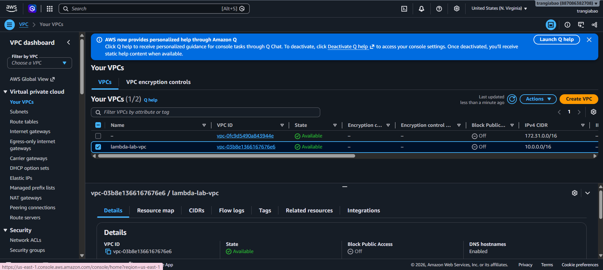
*Figure 1.1: Detailed overview of VPC lambda-lab route tables and subnets upon successful provisioning.*

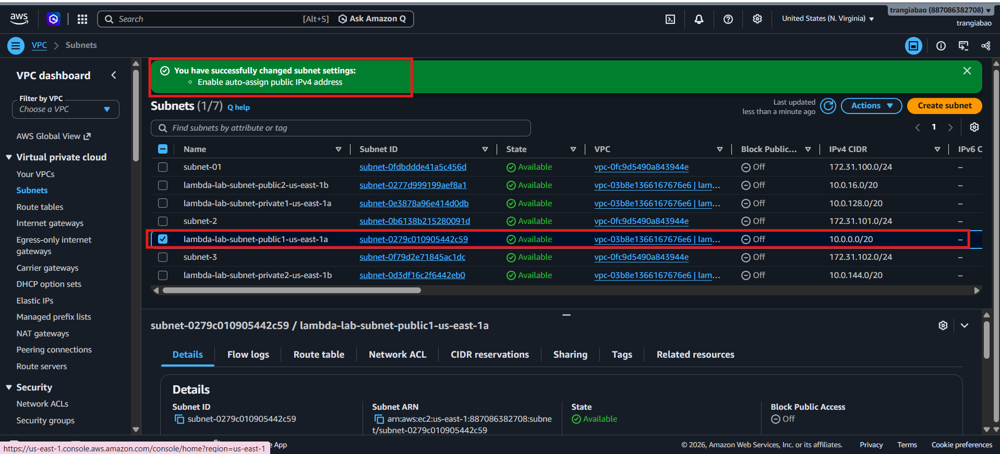
*Figure 1.2: Configuring automatic public IPv4 address assignment for resources inside the public subnet.*

---

#### Step 2: Security Group Configuration
1. Under the VPC console navigation pane, select **Security Groups** ➔ Select **Create security group**.
2. Define basic configuration details:
   * **Security group name:** `lambda-lab`
   * **Description:** `security group for lambda lab`
   * **VPC:** Ensure the newly created VPC **`lambda-lab`** is explicitly selected.
3. Establish inbound firewall rules:
   * Rule 1: Type **SSH** (Port 22), Source `0.0.0.0/0` (Anywhere-IPv4).
   * Rule 2: Type **HTTP** (Port 80), Source `0.0.0.0/0` (Anywhere-IPv4).
4. Verify Outbound rules default to `All traffic` unrestricted outbound access. Select **Create security group**.

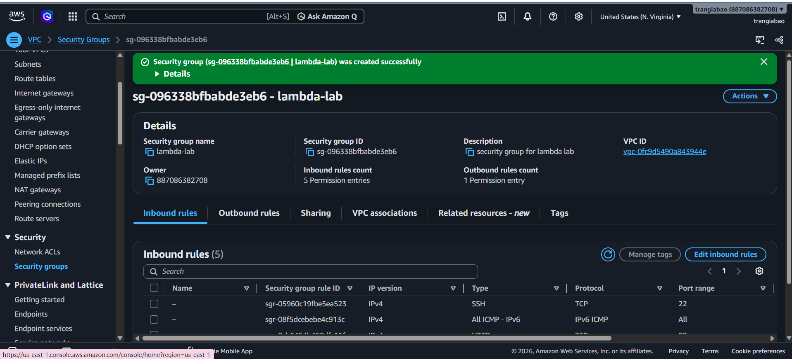
*Figure 2.1: Inbound rules configuration permitting SSH Port 22 and HTTP Port 80 for Security Group lambda-lab.*

---

#### Step 3: Target Amazon EC2 Compute Instance Deployment
1. Navigate to the **Amazon EC2** console ➔ Select **Instances** ➔ Select **Launch instances**.
2. Specify the instance name: `lambda-lab-instance`.
3. Choose the operating system image: **Amazon Linux** (AMI: **Amazon Linux 2023 AMI**), Instance type: **`t3.micro`** (Free Tier eligible).
4. Under **Key pair (login)**, select or create the key pair `lambda-lab-key`.
5. Under **Network settings**, select **Edit**:
   * **VPC:** Select **`lambda-lab`**.
   * **Subnet:** Select the public subnet (`lambda-lab-subnet-public...`).
   * **Auto-assign public IP:** Select **Enable**.
   * **Firewall (security groups):** Select **Select existing security group** ➔ Select **`lambda-lab`**.
6. Select **Launch instance** and verify that the instance reaches the **`Running`** state.

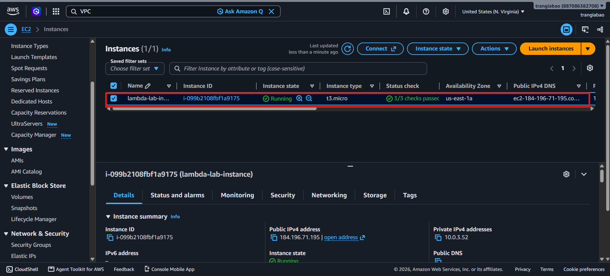
*Figure 3.1: Detailed configuration verification of the EC2 instance associated with Security Group lambda-lab.*

---

#### Step 4: Slack ChatOps Integration via Incoming Webhooks
1. Access your dedicated Slack workspace (`aws-lambda-labs`).
2. Establish a private or public engineering channel for automated dispatch: `#notification`.
3. Access the [Slack API Apps Console](https://api.slack.com/apps) and create a new Slack application named **`Lambda-Notifier`**.
4. Enable the **Incoming Webhooks** feature (Toggle `On`) ➔ Select **Add New Webhook to Workspace**.
5. Select the `#notification` channel to grant authorization ➔ Copy the generated Webhook URL (format: `https://hooks.slack.com/services/YOUR_WORKSPACE_ID/YOUR_CHANNEL_ID/...`).

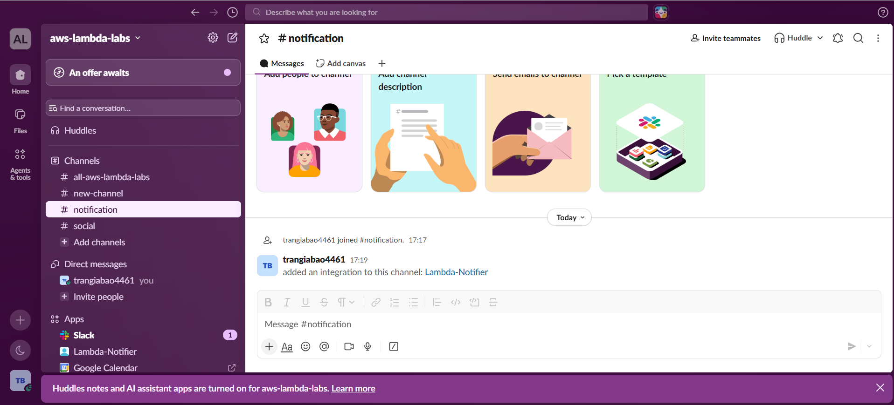
*Figure 4.1: Enabling Incoming Webhooks and granting post permissions to the Lambda-Notifier app.*

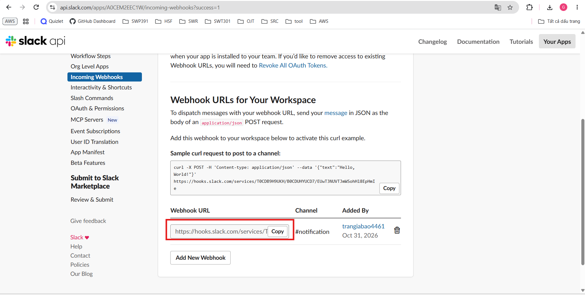
*Figure 4.2: Official Webhook URL designated to receive automated notifications dispatched from AWS Lambda.*

---

#### Step 5: Resource Tagging Strategy on Target Compute
1. Return to the **Amazon EC2 ➔ Instances** console.
2. Select the target compute instance ➔ Choose the **Tags** tab in the details pane ➔ Select **Manage tags**.
3. Select **Add tag** and configure the key-value identification pair:
   * **Key:** `environment_auto`
   * **Value:** `true`
4. Select **Save tags**. This tag serves as the resource signature filtered dynamically by the Lambda runtime.

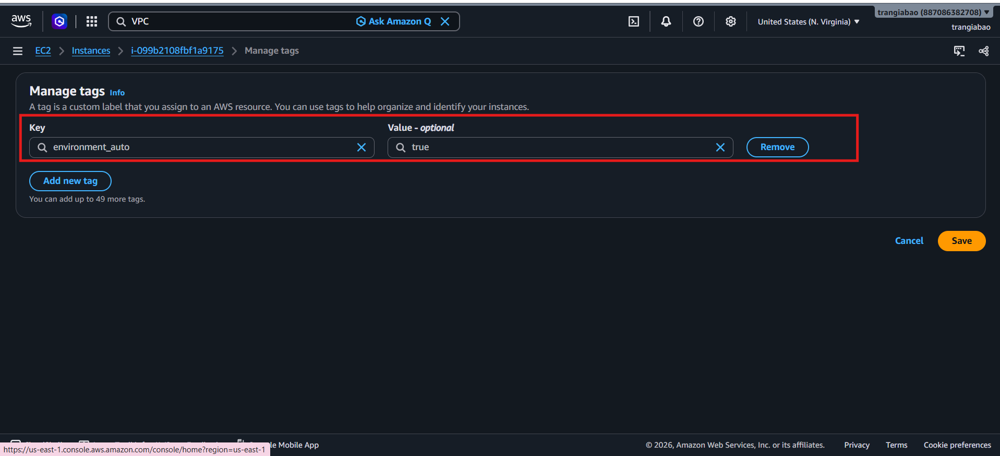
*Figure 5.1: Defining the identification tag environment_auto = true for automated instance filtering.*

---

#### Step 6: IAM Execution Role Provisioning for AWS Lambda
1. Navigate to the **AWS IAM** console ➔ Select **Roles** ➔ Select **Create role**.
2. Under **Trusted entity type**, select **AWS service** ➔ Select **Lambda** as the use case ➔ Select **Next**.
3. Under **Add permissions**, search and attach two foundational managed policies:
   * **`AmazonEC2FullAccess`**: Authorizes instance enumeration, state inspection, and Start/Stop operations.
   * **`CloudWatchFullAccessV2`** (or `AWSLambdaBasicExecutionRole`): Authorizes CloudWatch log stream publishing.
4. Set the role identifier: **`dc-common-lambda-role`** ➔ Review configuration and select **Create role**.

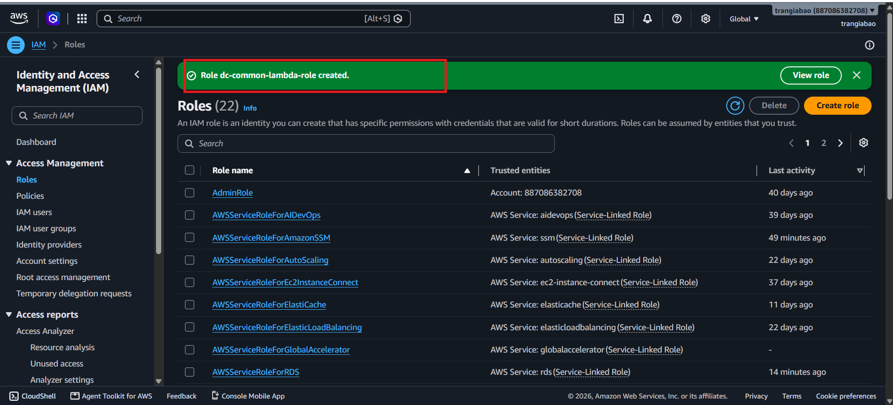
*Figure 6.1: Delegating EC2 lifecycle and CloudWatch Logging authority to the Lambda service via IAM.*

---

#### Step 7: Authoring & Deploying the Auto Stop Lambda Function
1. Navigate to the **AWS Lambda** console ➔ Select **Create function**.
2. Configure basic function settings:
   * Select **Author from scratch**.
   * **Function name:** `dc-common-lambda-auto-stop`.
   * **Runtime:** `Python 3.14` (or Python 3.12).
   * **Execution role:** Select **Use an existing role** ➔ Select **`dc-common-lambda-role`**.
   * Select **Create function**.
3. Configure environment variables:
   * Navigate to **Configuration ➔ Environment variables** ➔ Select **Edit**.
   * Add entry: Key = `environment_auto`, Value = `true` ➔ Select **Save**.
4. Configure runtime execution boundaries:
   * Under **Configuration ➔ General configuration** ➔ Select **Edit** ➔ Increase **Timeout** from `3 sec` to **`1 min`** to prevent premature execution termination.
5. Deploy Python source code:
   * Open the **Code** tab, paste the production script into `lambda_function.py`, update the webhook URL, and select **Deploy**.
6. Orchestrate scheduled execution with **Amazon EventBridge Scheduler**:
   * Navigate to **Amazon EventBridge ➔ Schedules** ➔ Select **Create schedule**.
   * Name: `dc-common-lambda-auto-stop`.
   * Select **Recurring schedule**, set schedule interval (e.g., `Rate(9 hours)` or Cron `0 19 ? * MON-FRI *`), Flexible time window: **Off**.
   * Target selection: Choose **AWS Lambda** ➔ Select **`dc-common-lambda-auto-stop`**.
   * Complete review and select **Create schedule**.

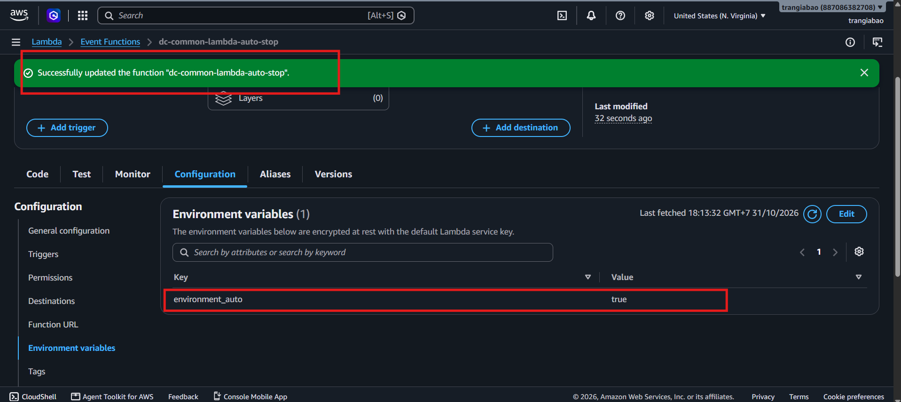
*Figure 7.1: Authoring the dc-common-lambda-auto-stop routine incorporating Boto3 filtering and Slack alerting.*

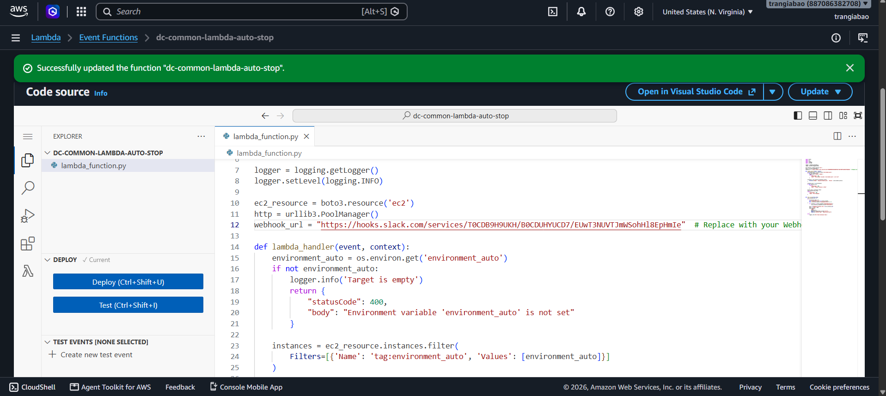
*Figure 7.2: Defining recurring rate-based schedule trigger parameters for instance halting.*

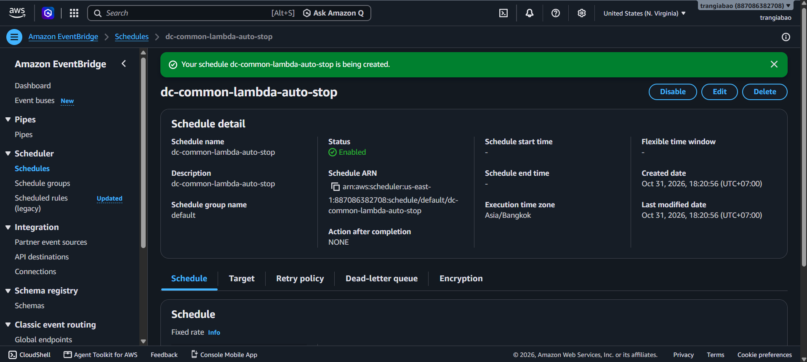
*Figure 7.3: Successful orchestration of the EventBridge Scheduler trigger for automated server shutdown.*

---

#### Step 8: Authoring & Deploying the Auto Start Lambda Function
1. Repeat the deployment workflow to create the second function: **`dc-common-lambda-auto-start`**.
2. Select **Python 3.14** runtime, assign the execution role **`dc-common-lambda-role`**.
3. Define the environment variable `environment_auto = true` and increase execution timeout to `1 min`.
4. Deploy the instance start routine with Slack ChatOps dispatch logic. Select **Deploy**.
5. Establish a recurring EventBridge schedule named `dc-common-lambda-auto-start` (e.g., Rate 8 hours or Cron `0 7 ? * MON-FRI *` triggering at 07:00 AM).
6. Assign the target to **`dc-common-lambda-auto-start`** and finalize schedule creation.

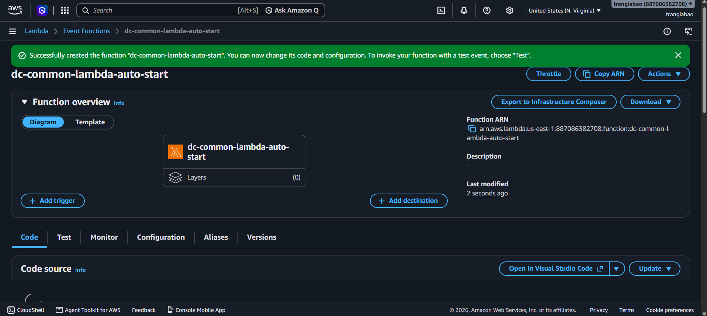
*Figure 8.1: Source code implementation for the dc-common-lambda-auto-start routine.*

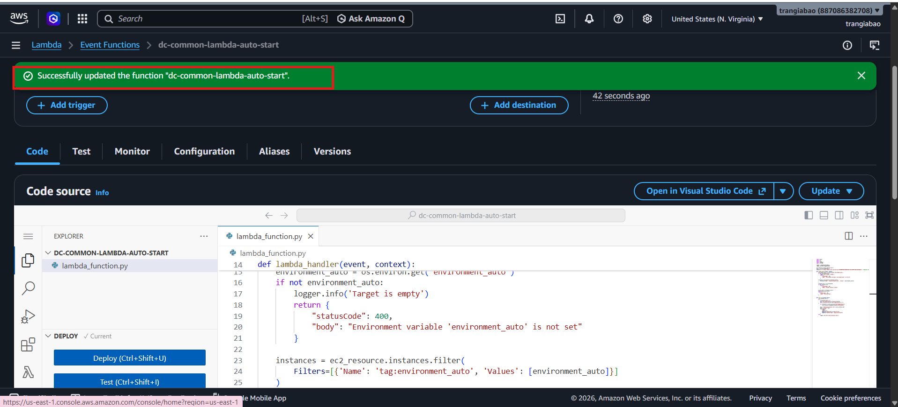
*Figure 8.2: Configuring scheduled morning invocation parameters prior to business hours.*

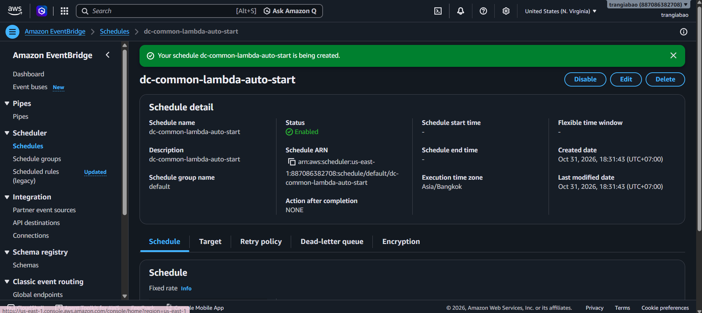
*Figure 8.3: Verification of the EventBridge Start schedule configuration.*

---

#### Step 9: Operational Verification & ChatOps Validation
1. **Testing the Server Halting Routine (Test Auto Stop):**
   * Ensure target EC2 instance is in the **`Running`** state.
   * In the **`dc-common-lambda-auto-stop`** console ➔ Select **Test** ➔ Trigger event `instance-stop`.
   * Execution outcome: **`StatusCode: 200, "body": "EC2 Stopping"`** (Execution succeeded).
   * Console verification: Instance state transitions from `Stopping` to **`Stopped`**.
   * Slack verification: Instant dispatch from **Lambda-Notifier** received in `#notification`: `Stopping Instances ID: ['i-099b2108fbf1a9175']`.
2. **Testing the Server Startup Routine (Test Auto Start):**
   * Ensure target EC2 instance is in the **`Stopped`** state.
   * In the **`dc-common-lambda-auto-start`** console ➔ Select **Test** ➔ Trigger event `instance-start`.
   * Execution outcome: **`StatusCode: 200, "body": "EC2 Starting"`** (Execution succeeded).
   * Console verification: Instance state transitions from `Pending` to **`Running`**.
   * Slack verification: Alert received in `#notification`: `Starting Instances ID: ['i-099b2108fbf1a9175']`.

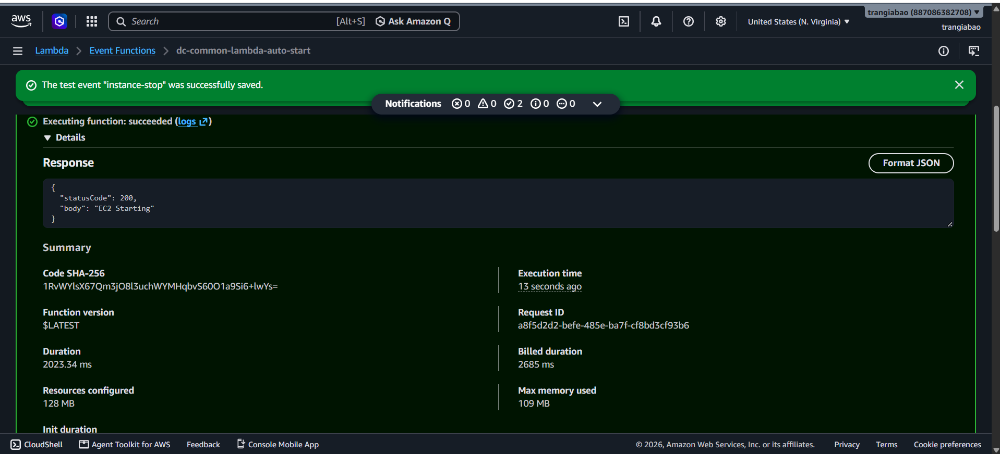
*Figure 9.1: Lambda test execution returning StatusCode 200 (Executing function: succeeded).*

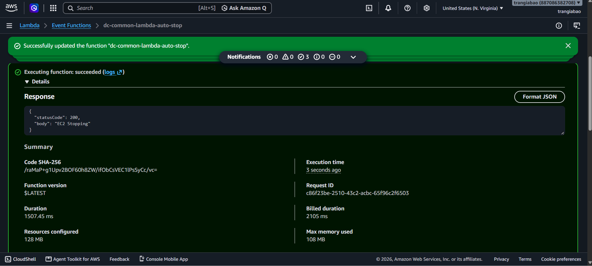
*Figure 9.2: Lambda Auto Stop routine successfully executed, safely halting target compute.*

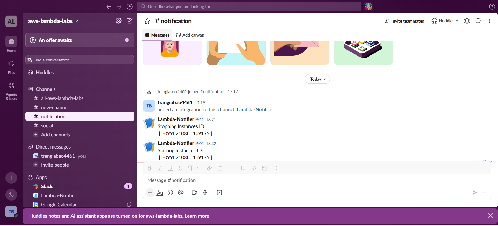
*Figure 9.3: Slack #notification channel displaying real-time Stopping and Starting alerts from Lambda-Notifier.*

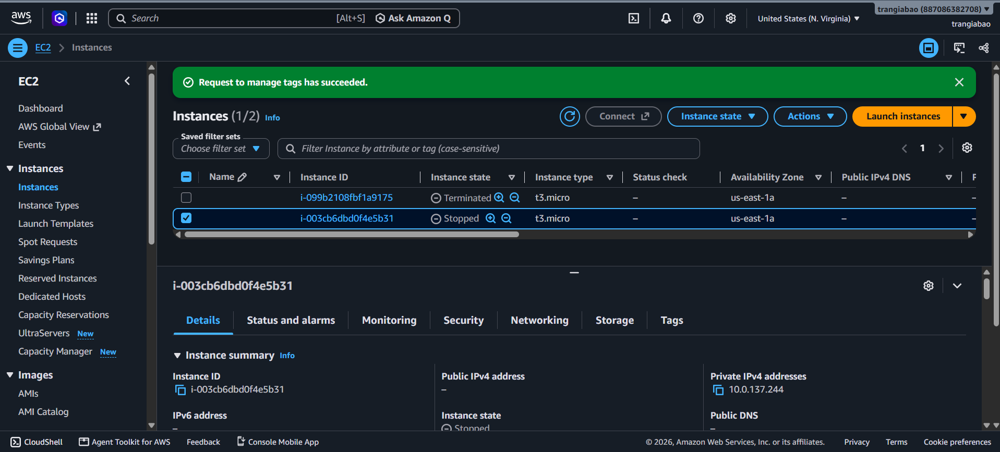
*Figure 9.4: EC2 console confirming successful tag governance across active compute instances.*

---

### 💻 Production-Ready Automation Code

#### 1. Auto Stop Function (`dc-common-lambda-auto-stop / lambda_function.py`):
```python
import boto3
import os
import json
import logging
import urllib3
from botocore.exceptions import ClientError

logger = logging.getLogger()
logger.setLevel(logging.INFO)

ec2_resource = boto3.resource('ec2')
http = urllib3.PoolManager()
webhook_url = "https://hooks.slack.com/services/YOUR_WORKSPACE_ID/YOUR_CHANNEL_ID/YOUR_SECRET_TOKEN"

def lambda_handler(event, context):
    environment_auto = os.environ.get('environment_auto')
    if not environment_auto:
        logger.info('Target environment tag is empty')
        return {
            "statusCode": 400,
            "body": "Environment variable 'environment_auto' is not set"
        }

    # RESILIENT FILTER: Only query instances with the target tag THAT ARE CURRENTLY RUNNING
    instances = ec2_resource.instances.filter(
        Filters=[
            {'Name': 'tag:environment_auto', 'Values': [environment_auto]},
            {'Name': 'instance-state-name', 'Values': ['running']}
        ]
    )

    instance_list = list(instances)
    if not instance_list:
        logger.info("No running instances found to stop.")
        return {
            "statusCode": 200,
            "body": "No running instances found to stop (Instances already stopped or none exist)."
        }

    try:
        action_stop = instances.stop()
        send_slack(action_stop)
        return {
            "statusCode": 200,
            "body": f"EC2 Stopping successfully. Processed {len(instance_list)} instance(s)."
        }
    except ClientError as e:
        logger.error(f"Error stopping instances: {e}")
        return {
            "statusCode": 500,
            "body": str(e)
        }

def send_slack(action_stop):
    try:
        list_instance_id = []
        if (
            len(action_stop) > 0
            and "StoppingInstances" in action_stop[0]
            and len(action_stop[0]["StoppingInstances"]) > 0
        ):
            for instance in action_stop[0]["StoppingInstances"]:
                list_instance_id.append(instance["InstanceId"])

            msg = f"Stopping Instances ID:\n {list_instance_id}"
            data = {"text": msg}
            http.request(
                "POST",
                webhook_url,
                body=json.dumps(data).encode("utf-8"),
                headers={"Content-Type": "application/json"}
            )
            logger.info("Sent stopping notification to Slack successfully")
        else:
            logger.info('No stopped instances to notify')
    except Exception as e:
        logger.warning(f"Error sending alert to Slack: {e}")
```

#### 2. Auto Start Function (`dc-common-lambda-auto-start / lambda_function.py`):
```python
import boto3
import os
import json
import logging
import urllib3
from botocore.exceptions import ClientError

logger = logging.getLogger()
logger.setLevel(logging.INFO)

ec2_resource = boto3.resource('ec2')
http = urllib3.PoolManager()
webhook_url = "https://hooks.slack.com/services/YOUR_WORKSPACE_ID/YOUR_CHANNEL_ID/YOUR_SECRET_TOKEN"

def lambda_handler(event, context):
    environment_auto = os.environ.get('environment_auto')
    if not environment_auto:
        logger.info('Target environment tag is empty')
        return {
            "statusCode": 400,
            "body": "Environment variable 'environment_auto' is not set"
        }

    # RESILIENT FILTER: Only query instances with the target tag THAT ARE CURRENTLY STOPPED
    instances = ec2_resource.instances.filter(
        Filters=[
            {'Name': 'tag:environment_auto', 'Values': [environment_auto]},
            {'Name': 'instance-state-name', 'Values': ['stopped']}
        ]
    )

    instance_list = list(instances)
    if not instance_list:
        logger.info("No stopped instances found to start.")
        return {
            "statusCode": 200,
            "body": "No stopped instances found to start (Instances already running or none exist)."
        }

    try:
        action_start = instances.start()
        send_slack(action_start)
        return {
            "statusCode": 200,
            "body": f"EC2 Starting successfully. Processed {len(instance_list)} instance(s)."
        }
    except ClientError as e:
        logger.error(f"Error starting instances: {e}")
        return {
            "statusCode": 500,
            "body": str(e)
        }

def send_slack(action_start):
    try:
        list_instance_id = []
        if (
            len(action_start) > 0
            and "StartingInstances" in action_start[0]
            and len(action_start[0]["StartingInstances"]) > 0
        ):
            for instance in action_start[0]["StartingInstances"]:
                list_instance_id.append(instance["InstanceId"])

            msg = f"Starting Instances ID:\n {list_instance_id}"
            data = {"text": msg}
            http.request(
                "POST",
                webhook_url,
                body=json.dumps(data).encode("utf-8"),
                headers={"Content-Type": "application/json"}
            )
            logger.info("Sent starting notification to Slack successfully")
        else:
            logger.info('No started instances to notify')
    except Exception as e:
        logger.warning(f"Error sending alert to Slack: {e}")
```

---

### 🛠️ Real-World Troubleshooting Bank

#### 1. Invalid Instance State Exception (`IncorrectInstanceState`)
* **Symptom:** Calling `start()` raises: `ClientError: An error occurred (IncorrectInstanceState) when calling the StartInstances operation: The instance is not in a state from which it can be started.`
* **Root Cause:** EC2 instances can only transition to `running` from `stopped`. Attempting to start an instance that is already `running`, `pending`, or `stopping` triggers API rejection.
* **Resolution:** Incorporate state filters (`{'Name': 'instance-state-name', 'Values': ['stopped']}`) ensuring start actions are only executed against halted instances.

#### 2. Ghost Terminated Instances Crashing Automation
* **Symptom:** Terminated instances previously tagged with `environment_auto = true` continue to trigger batch API failures.
* **Root Cause:** AWS retains metadata for `terminated` instances in the EC2 registry for several hours post-termination. Blanket tag queries inadvertently capture these dead resources.
* **Resolution:** Explicitly filter out `terminated` and `shutting-down` states, or target specific instance IDs directly.

#### 3. Missing Security Group Visibility During Instance Launch
* **Symptom:** Security Group `lambda-lab` is absent from the selection dropdown in Step 2.3.
* **Root Cause:** Security groups are strictly VPC-scoped. The launch wizard defaults to the Default VPC, hiding security groups that belong to the custom `lambda-lab` VPC.
* **Resolution:** Select **Edit** under Network settings, switch the VPC selector from Default VPC to **`lambda-lab`**, and the custom security group immediately becomes selectable.

#### 4. Premature Lambda Execution Timeout (`Task timed out after 3.00 seconds`)
* **Symptom:** Function invocation fails abruptly with CloudWatch log entry: `Task timed out after 3.00 seconds`.
* **Root Cause:** AWS Lambda defaults to a 3-second execution cap. Performing Boto3 instance queries combined with external HTTPS Slack webhook dispatch routinely requires 3.5 to 5 seconds.
* **Resolution:** Navigate to **Configuration ➔ General configuration ➔ Edit**, and elevate the **Timeout** parameter from `3 sec` to **`1 min`**.

#### 5. Empty Target Collection Error (`Target Instance is None` - StatusCode 500)
* **Symptom:** Execution returns `{"statusCode": 500, "body": "Target Instance is None"}`.
* **Root Cause:** The Lambda tag filter found no matching resources. Common culprits include untagged compute, typos in the key (e.g., `Environment_auto`), trailing whitespace, or casing mismatches (`True` vs `true`).
* **Resolution:** Inspect EC2 tags to ensure exact lowercase matching: Key = `environment_auto`, Value = `true`.

#### 6. Missing Environment Variable Configuration (StatusCode 400)
* **Symptom:** Function terminates early with `Environment variable 'environment_auto' is not set`.
* **Root Cause:** The `environment_auto` environment variable was omitted during Lambda configuration.
* **Resolution:** Add Key `environment_auto` with Value `true` under **Configuration ➔ Environment variables**.

#### 7. Uncommitted Code Deployment Oversight
* **Symptom:** Modifying code in the editor has no effect during subsequent Test invocations.
* **Root Cause:** AWS Lambda requires an explicit **Deploy** action to update the `$LATEST` published version. Unsaved code remains in draft state.
* **Resolution:** Always select the orange **Deploy** button and wait for confirmation before testing.

#### 8. Execution Role Permission Denial (`UnauthorizedOperation`)
* **Symptom:** Invocation crashes with `ClientError: UnauthorizedOperation: You are not authorized to perform this operation`.
* **Root Cause:** The function was deployed using the default Lambda basic execution role instead of the designated `dc-common-lambda-role` granting `AmazonEC2FullAccess`.
* **Resolution:** Update execution role binding under **Configuration ➔ Permissions** to assign `dc-common-lambda-role`.

#### 9. Unhandled ChatOps Transport Exceptions
* **Symptom:** EC2 power operations execute successfully, but the entire Lambda function reports failure.
* **Root Cause:** Unhandled network timeouts or invalid Slack webhook endpoints raise unhandled exceptions during `http.request()`.
* **Resolution:** Encapsulate Slack dispatch within `try...except Exception` blocks, ensuring chat transport issues do not fail primary compute lifecycle operations.

#### 10. EventBridge Scheduler Timezone Misalignment (UTC vs Local Time)
* **Symptom:** Power events trigger 7 hours off-schedule relative to local business hours.
* **Root Cause:** EventBridge Scheduler defaults to **UTC+0**, while local business hours operate under **UTC+7 (Asia/Ho_Chi_Minh)**.
* **Resolution:** Explicitly declare the timezone as `Asia/Ho_Chi_Minh` or calculate the appropriate UTC offset when defining Cron expressions.

---

### 🧹 Resource Teardown Workflow

To prevent unnecessary charges and protect account credits, decommission resources in the following dependency order:

1. **Delete EventBridge Schedules:** Navigate to **Amazon EventBridge ➔ Schedules** and delete both `dc-common-lambda-auto-stop` and `dc-common-lambda-auto-start`.
2. **Delete Lambda Functions:** Navigate to **AWS Lambda ➔ Functions** and remove both deployed functions.
3. **Terminate Amazon EC2 Compute:** Navigate to **Amazon EC2 ➔ Instances**, select `lambda-lab-instance`, and select **Instance state ➔ Terminate instance**.
4. **Delete Key Pair:** Navigate to **EC2 ➔ Key Pairs** and delete `lambda-lab-key`.
5. **Delete Security Group:** Once EC2 transitions to `Terminated`, navigate to **VPC ➔ Security Groups** and delete `lambda-lab`.
6. **Delete VPC lambda-lab:** Navigate to **VPC ➔ Your VPCs**, select `lambda-lab`, and select **Actions ➔ Delete VPC**.
7. **Delete IAM Execution Role:** Navigate to **IAM ➔ Roles** and delete `dc-common-lambda-role`.
