{}
Bài thực hành **Tối ưu hóa Chi phí Amazon EC2 với AWS Lambda & Thông báo Slack** được thực hiện vào **Thứ 3 (20/10/2026)** trong khuôn khổ **Tuần 6**. Trang này ghi lại chi tiết giải pháp tự động tắt/bật máy chủ ngoài giờ làm việc bằng serverless AWS Lambda, điều phối với EventBridge Scheduler và gửi thông báo trực tiếp về kênh chat Slack qua Incoming Webhooks.
{}

### 🎯 Mục tiêu bài thực hành (Lab Objectives)
* **Tối ưu hóa Chi phí Đám mây (Cloud Cost Optimization):** Thiết kế và triển khai giải pháp tự động hóa lịch trình vận hành máy chủ Amazon EC2, tự động tắt các máy chủ môi trường thử nghiệm (Dev/Test) ngoài giờ hành chính và bật lại vào đầu ngày làm việc, giúp tiết kiệm tới 65 - 70% chi phí tài nguyên điện toán.
* **Tự động hóa Không máy chủ (Serverless Automation):** Lập trình các hàm **AWS Lambda** (Python 3 Boto3 SDK) phối hợp cùng bộ điều phối lịch trình **Amazon EventBridge Scheduler** để kiểm soát vòng đời máy ảo hoàn toàn tự động mà không cần duy trì bất kỳ máy chủ quản trị trung gian nào.
* **Chiến lược Quản trị Tài nguyên bằng Thẻ (Resource Tagging Strategy):** Áp dụng cặp thẻ định danh `environment_auto = true` để Lambda tự động nhận diện và quét chính xác các máy chủ mục tiêu được phân quyền quản trị mà không cần cấu hình cứng Instance ID.
* **Tích hợp Giám sát Thời gian thực (ChatOps via Slack):** Kết nối AWS Lambda với dịch vụ giao tiếp nhóm **Slack** thông qua **Incoming Webhooks**, tự động gửi thông báo định dạng trực quan về trạng thái bật/tắt của từng máy chủ vào kênh `#notification`.
* **Kỹ năng Xử lý Sự cố Thực chiến (Real-World Troubleshooting):** Trực tiếp phân tích và khắc phục các sự cố kinh điển như ngoại lệ chuyển giao trạng thái máy ảo `IncorrectInstanceState`, xung đột bộ lọc máy ảo đã xóa (`Terminated`), phân quyền IAM và kết nối webhook an toàn.

---

### 📊 Bảng tổng hợp thông số tài nguyên đã triển khai (Provisioned Resource Specifications)

| Thành phần / Tài nguyên | Tên định danh (Name / ID) | Thông số kỹ thuật / Cấu hình chi tiết | Mục đích / Ghi chú |
| :--- | :--- | :--- | :--- |
| **AWS Region** | `us-east-1` | US East (N. Virginia) | Khu vực triển khai toàn bộ giải pháp |
| **Mạng VPC** | `lambda-lab` | CIDR `10.0.0.0/16`, Public Subnet `10.0.128.0/20` (`us-east-1a`) | Môi trường mạng VPC biệt lập cho bài thực hành |
| **Nhóm bảo mật (SG)** | `lambda-lab` | Inbound: SSH (Port 22), HTTP (Port 80); Outbound: All Traffic | Kiểm soát an ninh mạng cho máy chủ EC2 |
| **Máy chủ mục tiêu (EC2)**| `lambda-lab-instance` / `i-003cb6dbd0f4e5b31` | `t3.micro`, Amazon Linux 2023, Tag: `environment_auto = true` | Máy chủ môi trường phát triển cần tối ưu chi phí |
| **IAM Execution Role** | `dc-common-lambda-role` | Trusted: `lambda.amazonaws.com`, Policies: `AmazonEC2FullAccess`, `CloudWatchFullAccessV2` | Cấp quyền cho Lambda quản trị EC2 và ghi nhật ký Logs |
| **Hàm Lambda Tắt máy** | `dc-common-lambda-auto-stop` | Runtime: Python 3.14, Memory: 128 MB, Env: `environment_auto = true` | Quét và tự động dừng máy chủ EC2 ngoài giờ làm việc |
| **Hàm Lambda Bật máy** | `dc-common-lambda-auto-start`| Runtime: Python 3.14, Memory: 128 MB, Env: `environment_auto = true` | Quét và tự động khởi động máy chủ EC2 đầu ngày mới |
| **Lịch trình EventBridge (Stop)** | `dc-common-lambda-auto-stop` | Recurring Schedule: Rate (9 hours) / Cron, Flexible Window: Off | Kích hoạt hàm Stop theo chu kỳ định sẵn |
| **Lịch trình EventBridge (Start)**| `dc-common-lambda-auto-start`| Recurring Schedule: Rate (8 hours) / Cron, Flexible Window: Off | Kích hoạt hàm Start theo chu kỳ định sẵn |
| **Không gian ChatOps** | `aws-lambda-labs` | Kênh Slack `#notification`, App: `Lambda-Notifier` | Kênh tiếp nhận thông báo trạng thái vận hành tức thời |

---

### 🛠️ Các bước thực hành Step-by-Step (Hands-on Implementation)

#### Bước 1: Khởi tạo Hạ tầng Mạng VPC & Cấu hình Subnet Public
1. Truy cập giao diện điều khiển **Amazon VPC** trên AWS Management Console.
2. Điều hướng tới **Your VPCs** ➔ Chọn **Create VPC**.
3. Chọn cấu hình **VPC and more**, đặt tên định danh `lambda-lab` và giữ nguyên dải mạng CIDR tiêu chuẩn. Bấm **Create VPC**.
4. Truy cập mục **Subnets**, chọn Subnet Public vừa khởi tạo (`lambda-lab-subnet-public...`) ➔ Chọn **Actions** ➔ **Edit subnet settings**.
5. Đánh dấu tích vào tùy chọn **Enable auto-assign public IPv4 address** để máy chủ EC2 khi khởi chạy tự động nhận địa chỉ IP công cộng ➔ Bấm **Save**.

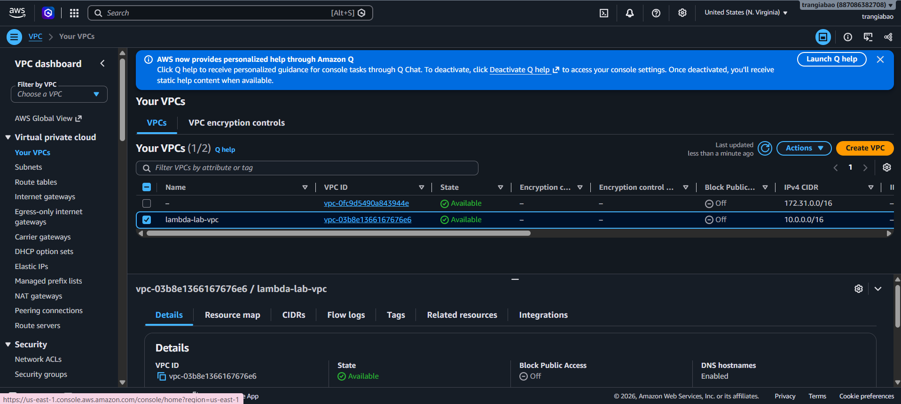
*Hình 1.1: Giao diện chi tiết VPC lambda-lab cùng cấu hình bảng định tuyến và Subnet sau khi khởi tạo thành công.*

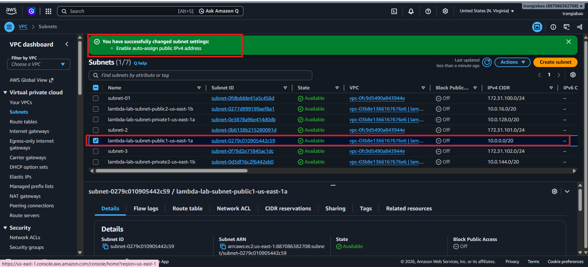
*Hình 1.2: Cấu hình tự động cấp phát Public IPv4 cho các tài nguyên trong Subnet Public.*

---

#### Bước 2: Thiết lập Security Group kiểm soát truy cập
1. Tại thanh điều hướng dịch vụ VPC, truy cập vào mục **Security Groups** ➔ Chọn **Create security group**.
2. Thiết lập các thông số định danh:
   * **Security group name:** `lambda-lab`
   * **Description:** `security group for lambda lab`
   * **VPC:** Chọn đúng VPC **`lambda-lab`** vừa khởi tạo ở Bước 1.
3. Thiết lập các quy tắc tường lửa (Inbound rules):
   * Quy tắc 1: Loại **SSH** (Cổng 22), Nguồn `0.0.0.0/0` (Anywhere-IPv4).
   * Quy tắc 2: Loại **HTTP** (Cổng 80), Nguồn `0.0.0.0/0` (Anywhere-IPv4).
4. Kiểm tra Outbound rules (Mặc định cho phép toàn bộ lưu lượng ra ngoài `All traffic`) ➔ Bấm **Create security group**.

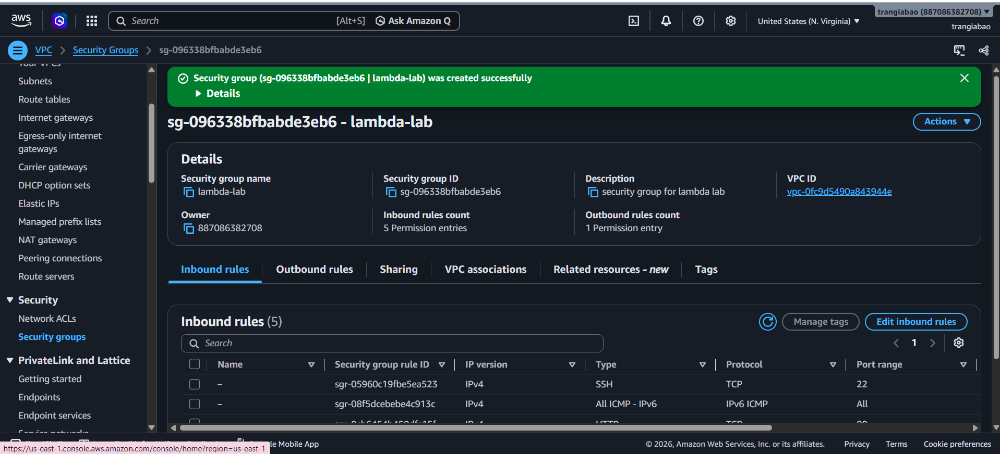
*Hình 2.1: Cấu hình Inbound Rules mở cổng 22 SSH và 80 HTTP cho Security Group lambda-lab.*

---

#### Bước 3: Khởi chạy Máy chủ Amazon EC2 thử nghiệm
1. Truy cập dịch vụ **Amazon EC2** ➔ Chọn **Instances** ➔ Bấm **Launch instances**.
2. Nhập tên máy chủ: `lambda-lab-instance`.
3. Lựa chọn hệ điều hành: **Amazon Linux** (AMI: **Amazon Linux 2023 AMI**), Loại phiên bản: **`t3.micro`** (Được miễn phí theo gói Free Tier).
4. Tại mục **Key pair (login)**, tạo mới hoặc chọn cặp khóa truy cập `lambda-lab-key`.
5. Tại mục **Network settings**, bấm **Edit**:
   * **VPC:** Chọn VPC **`lambda-lab`**.
   * **Subnet:** Chọn **Public subnet** (`lambda-lab-subnet-public...`).
   * **Auto-assign public IP:** Chọn **Enable**.
   * **Firewall (security groups):** Chọn **Select existing security group** ➔ Chọn nhóm bảo mật **`lambda-lab`**.
6. Bấm **Launch instance** và kiểm tra trạng thái máy ảo chuyển sang **`Running`**.

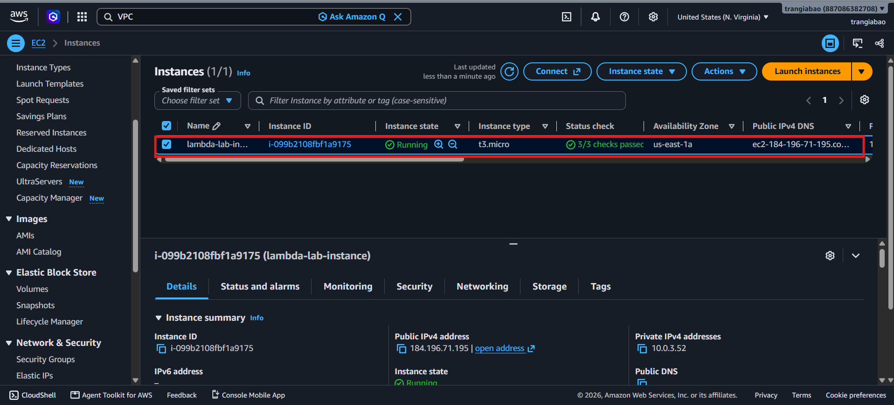
*Hình 3.1: Thông tin cấu hình chi tiết máy chủ EC2 lambda-lab-instance gắn với Security Group lambda-lab.*

---

#### Bước 4: Thiết lập Kênh ChatOps Slack qua Incoming Webhooks
1. Đăng nhập vào workspace làm việc Slack cá nhân (`aws-lambda-labs`).
2. Tạo mới một kênh thảo luận nội bộ dành riêng cho cảnh báo hệ thống: `#notification`.
3. Truy cập cổng phát triển ứng dụng Slack ([Slack API Apps](https://api.slack.com/apps)), tiến hành khởi tạo ứng dụng **`Lambda-Notifier`**.
4. Kích hoạt tính năng **Incoming Webhooks** (Bật `On`) ➔ Bấm chọn **Add New Webhook to Workspace**.
5. Phân quyền và chỉ định gửi thông báo vào kênh `#notification` ➔ Sao chép địa chỉ Webhook URL được cấp phát (dạng `https://hooks.slack.com/services/YOUR_WORKSPACE_ID/YOUR_CHANNEL_ID/...`).

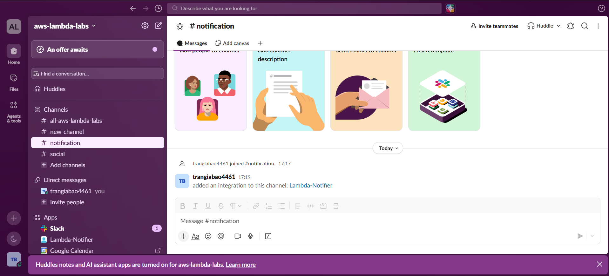
*Hình 4.1: Kích hoạt Incoming Webhooks và cấp quyền gửi tin nhắn cho ứng dụng Lambda-Notifier.*

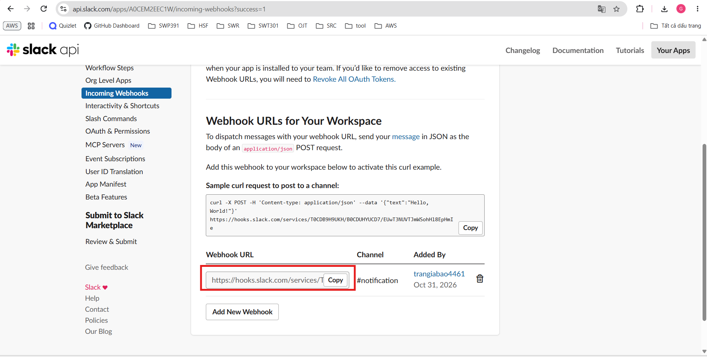
*Hình 4.2: Địa chỉ Webhook URL chính thức được liên kết để tiếp nhận thông báo tự động từ AWS Lambda.*

---

#### Bước 5: Phân loại Máy chủ Mục tiêu bằng AWS Resource Tag
1. Quay trở lại giao diện điều khiển **Amazon EC2 ➔ Instances**.
2. Tích chọn máy chủ EC2 mục tiêu ➔ Chọn tab **Tags** ở thanh chi tiết phía dưới ➔ Bấm **Manage tags**.
3. Bấm **Add tag** và thiết lập cặp giá trị điều kiện:
   * **Key:** `environment_auto`
   * **Value:** `true`
4. Bấm **Save tags**. Việc gắn nhãn này đóng vai trò là "chữ ký" để mã nguồn Lambda tự động phân loại và chỉ can thiệp vào đúng máy chủ được chỉ định.

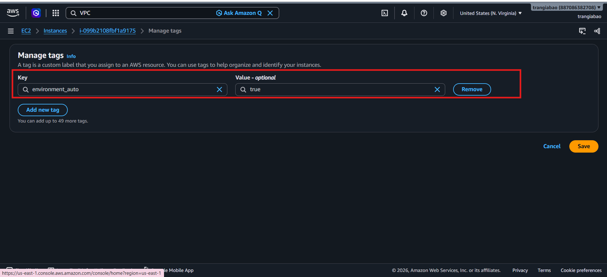
*Hình 5.1: Thiết lập thẻ định danh environment_auto = true phân loại máy chủ tự động hóa.*

---

#### Bước 6: Khởi tạo IAM Execution Role cho AWS Lambda
1. Truy cập dịch vụ **AWS IAM** ➔ Điều hướng tới **Roles** ➔ Bấm **Create role**.
2. Tại mục **Trusted entity type**, chọn **AWS service** ➔ Use case chọn **Lambda** ➔ Bấm **Next**.
3. Tại trang **Add permissions**, tìm kiếm và tích chọn 2 chính sách quyền hạn:
   * **`AmazonEC2FullAccess`**: Cấp quyền quét danh sách máy ảo, mô tả trạng thái và thực hiện lệnh Start/Stop instances.
   * **`CloudWatchFullAccessV2`** (hoặc `AWSLambdaBasicExecutionRole`): Cấp quyền ghi nhật ký thực thi vào CloudWatch Logs.
4. Đặt tên Role: **`dc-common-lambda-role`** ➔ Xem lại cấu hình và bấm **Create role**.

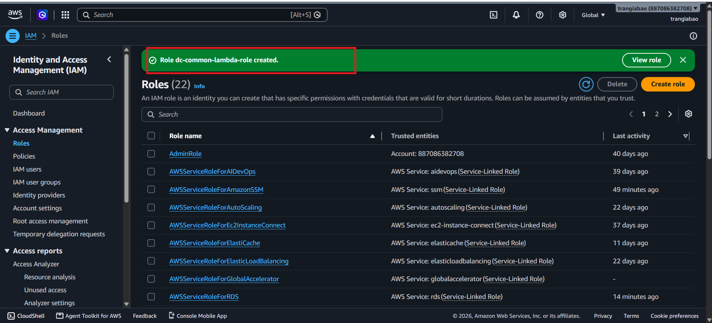
*Hình 6.1: Giao diện tạo IAM Role ủy quyền cho dịch vụ Lambda với đầy đủ quyền quản trị EC2 và CloudWatch.*

---

#### Bước 7: Xây dựng & Triển khai Hàm Lambda Tắt máy chủ (Auto Stop)
1. Truy cập dịch vụ **AWS Lambda** ➔ Bấm **Create function**.
2. Cấu hình cơ bản:
   * Chọn **Author from scratch**.
   * **Function name:** `dc-common-lambda-auto-stop`.
   * **Runtime:** `Python 3.14` (hoặc Python 3.12).
   * **Execution role:** Chọn **Use an existing role** ➔ Chọn Role **`dc-common-lambda-role`** đã tạo ở Bước 6.
   * Bấm **Create function**.
3. Cấu hình biến môi trường:
   * Chuyển sang tab **Configuration** ➔ Chọn **Environment variables** ➔ Bấm **Edit**.
   * Thêm biến: Key = `environment_auto`, Value = `true` ➔ Bấm **Save**.
4. Cấu hình thời gian chạy:
   * Tại tab **Configuration** ➔ Mục **General configuration** ➔ Bấm **Edit** ➔ Tăng **Timeout** từ `3 sec` lên **`1 min`** (tránh lỗi ngắt kết nối do quá thời gian).
5. Nạp mã nguồn Python:
   * Chuyển sang tab **Code**, mở tệp `lambda_function.py`, nạp mã nguồn xử lý và cấu hình webhook URL chính xác. Bấm **Deploy**.
6. Thiết lập Lịch trình tự động với **Amazon EventBridge Scheduler**:
   * Truy cập **Amazon EventBridge ➔ Schedules** ➔ Bấm **Create schedule**.
   * Đặt tên lịch trình: `dc-common-lambda-auto-stop`.
   * Lựa chọn **Recurring schedule**, đặt tần suất kiểm tra định kỳ (ví dụ: `Rate(9 hours)` hoặc biểu thức Cron `0 19 ? * MON-FRI *` tắt máy lúc 19:00 hàng ngày), Flexible time window: **Off**.
   * Tại bước Target: Chọn **AWS Lambda** ➔ Chỉ định hàm **`dc-common-lambda-auto-stop`**.
   * Hoàn tất các bước thiết lập và bấm **Create schedule**.

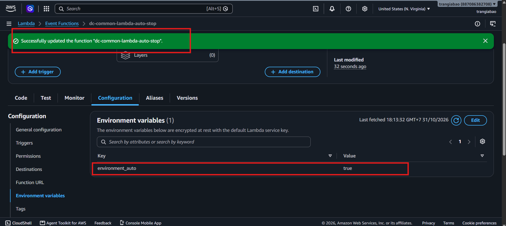
*Hình 7.1: Trình soạn thảo mã nguồn hàm dc-common-lambda-auto-stop tích hợp thư viện Boto3 và xử lý Slack Webhook.*

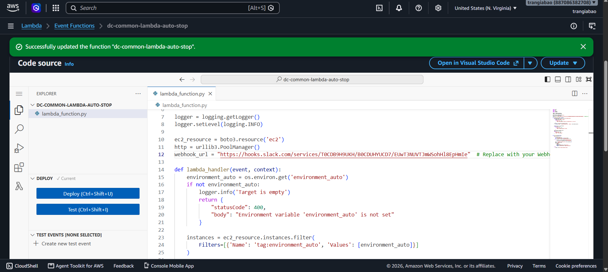
*Hình 7.2: Định nghĩa quy tắc lịch trình lặp lại (Recurring Rate Schedule) cho sự kiện tự động dừng máy chủ.*

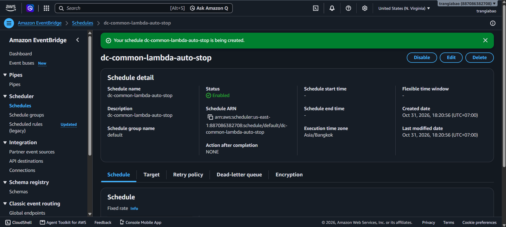
*Hình 7.3: Xác nhận khởi tạo thành công lịch trình EventBridge Scheduler điều phối tác vụ dừng máy ảo.*

---

#### Bước 8: Xây dựng & Triển khai Hàm Lambda Bật máy chủ (Auto Start)
1. Tương tự như Bước 7, tiến hành khởi tạo hàm Lambda thứ hai mang tên **`dc-common-lambda-auto-start`**.
2. Chọn Runtime **Python 3.14**, gắn Execution Role **`dc-common-lambda-role`**.
3. Cấu hình biến môi trường: `environment_auto = true` và tăng Timeout lên `1 min`.
4. Nạp mã nguồn xử lý Start instances và tích hợp gửi tin nhắn thông báo Slack. Bấm **Deploy**.
5. Khởi tạo lịch trình **Amazon EventBridge Scheduler** mang tên `dc-common-lambda-auto-start` với tần suất định kỳ (Rate 8 hours hoặc Cron `0 7 ? * MON-FRI *` bật máy vào lúc 07:00 sáng mỗi ngày làm việc).
6. Chỉ định đích đến (Target) là hàm Lambda **`dc-common-lambda-auto-start`** và hoàn tất tạo lịch.

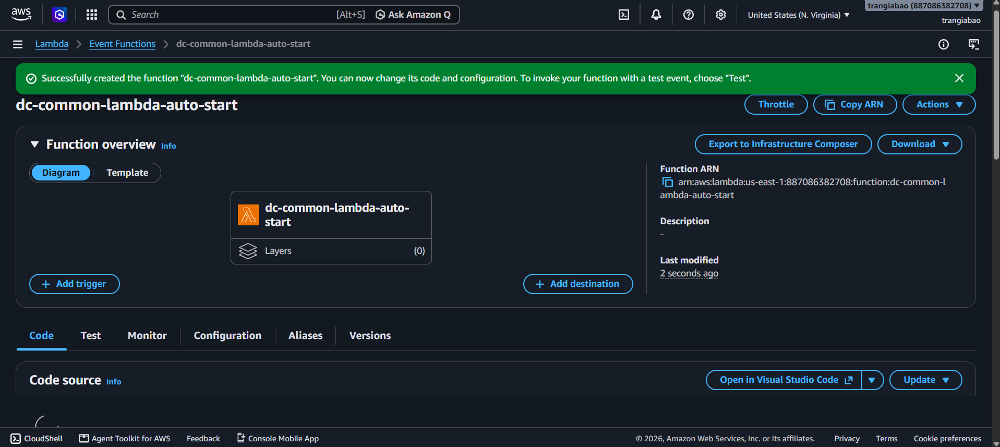
*Hình 8.1: Soạn thảo và nạp mã nguồn logic khởi động máy ảo EC2 cho hàm dc-common-lambda-auto-start.*

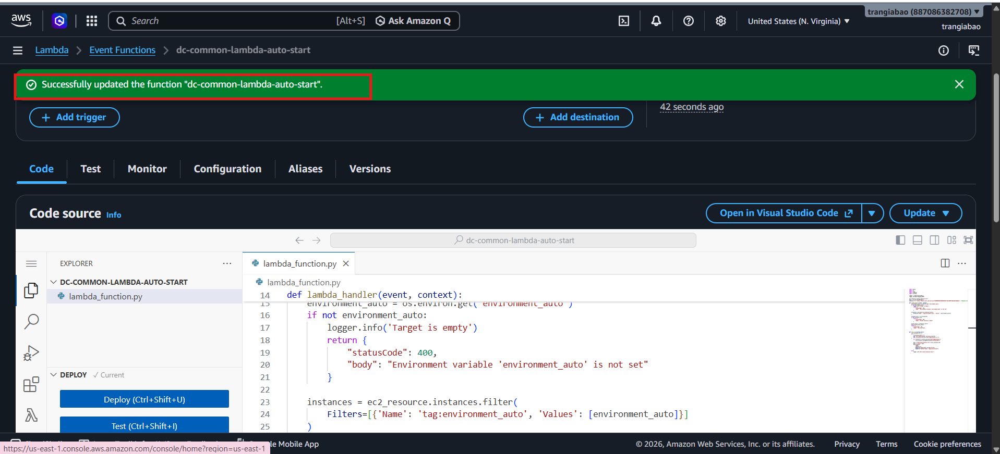
*Hình 8.2: Thiết lập thời điểm kích hoạt tự động bật máy trước khi bắt đầu ngày làm việc.*

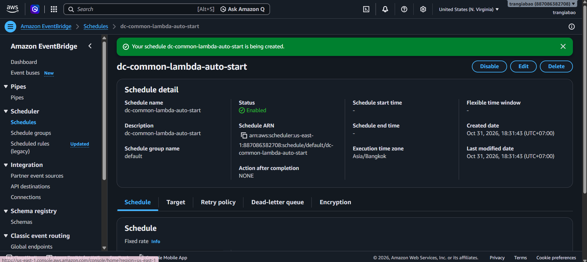
*Hình 8.3: Hoàn tất khởi tạo lịch trình EventBridge kích hoạt hàm khởi động máy chủ.*

---

#### Bước 9: Kiểm thử Thực tế & Xác minh Cảnh báo ChatOps trên Slack
1. **Kiểm thử tác vụ Tắt máy chủ (Test Auto Stop):**
   * Đảm bảo máy chủ EC2 mục tiêu đang ở trạng thái **`Running`**.
   * Truy cập hàm **`dc-common-lambda-auto-stop`** ➔ Chọn tab **Test** ➔ Tạo sự kiện test `instance-stop` ➔ Bấm **Test**.
   * Kết quả phản hồi thành công: **`StatusCode: 200, "body": "EC2 Stopping"`** (Execution succeeded).
   * Kiểm tra giao diện EC2 Console: Trạng thái máy chủ chuyển sang **`Stopping`** và sau đó về **`Stopped`**.
   * Kiểm tra kênh Slack `#notification`: Nhận ngay tin nhắn tức thời từ bot **Lambda-Notifier** thông báo danh sách ID máy vừa dừng: `Stopping Instances ID: ['i-099b2108fbf1a9175']`.
2. **Kiểm thử tác vụ Bật máy chủ (Test Auto Start):**
   * Khi máy chủ EC2 đang ở trạng thái **`Stopped`**.
   * Truy cập hàm **`dc-common-lambda-auto-start`** ➔ Chọn tab **Test** ➔ Tạo sự kiện test `instance-start` ➔ Bấm **Test**.
   * Kết quả phản hồi thành công: **`StatusCode: 200, "body": "EC2 Starting"`** (Execution succeeded).
   * Kiểm tra giao diện EC2 Console: Trạng thái máy chủ chuyển từ `Pending` sang **`Running`** màu xanh.
   * Kiểm tra kênh Slack `#notification`: Nhận ngay thông báo bắt đầu hoạt động: `Starting Instances ID: ['i-099b2108fbf1a9175']`.

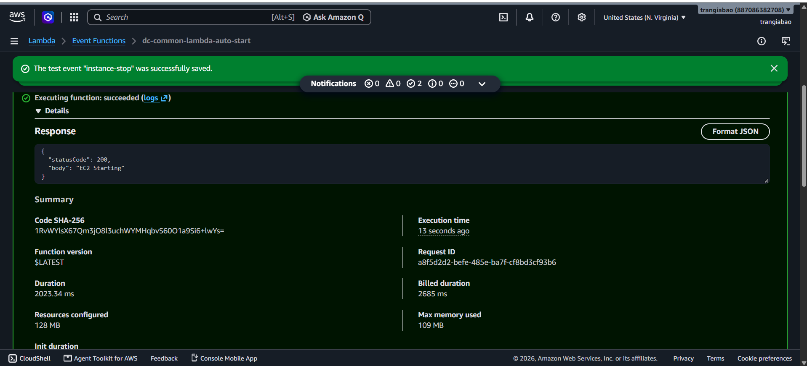
*Hình 9.1: Kết quả kiểm thử hàm dc-common-lambda-auto-start thành công tuyệt đối (Executing function: succeeded) trả về StatusCode 200.*

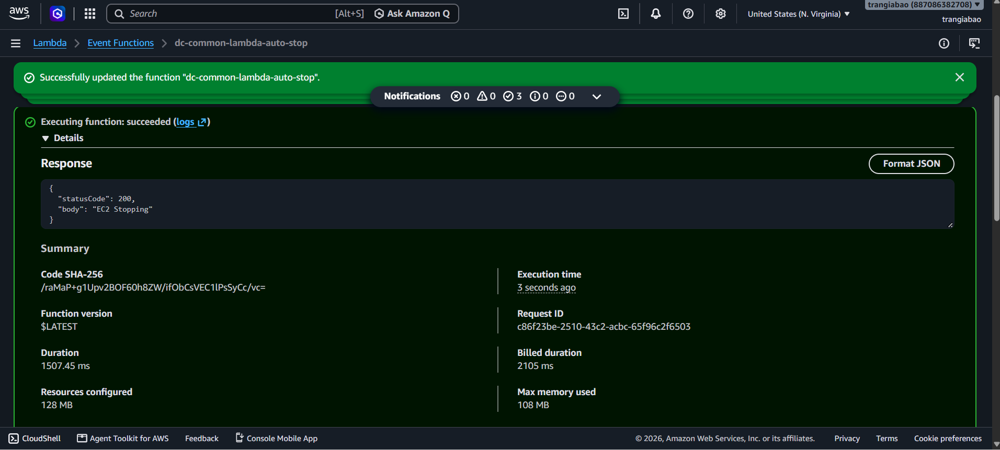
*Hình 9.2: Kết quả kiểm thử hàm dc-common-lambda-auto-stop thực thi thành công, dừng máy chủ an toàn.*

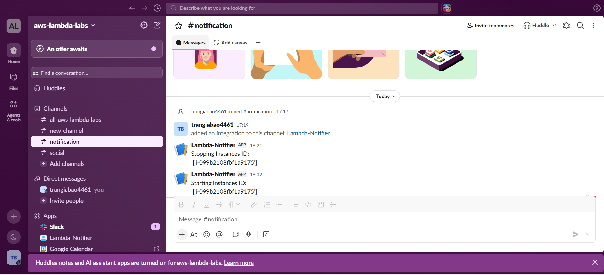
*Hình 9.3: Kênh Slack #notification nhận đầy đủ 2 thông báo Starting và Stopping instances từ bot Lambda-Notifier.*

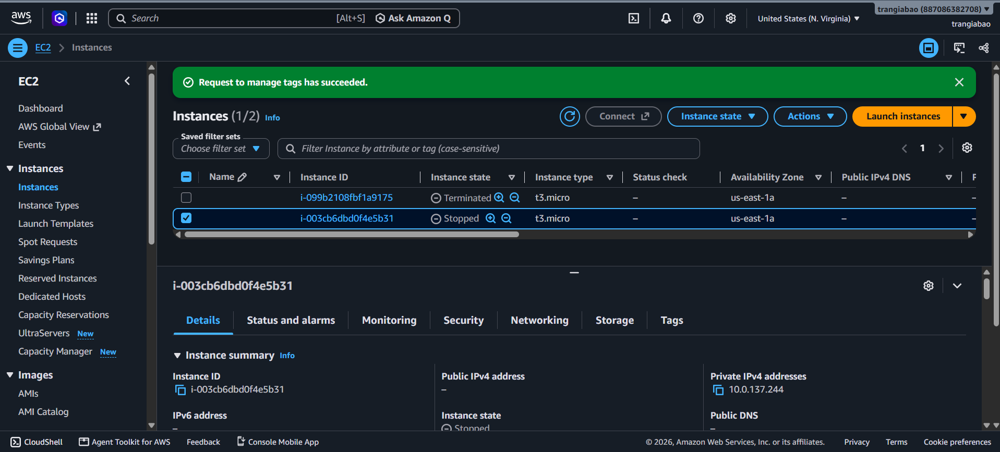
*Hình 9.4: Bảng điều khiển EC2 Instances xác nhận quản lý thẻ tag thành công (Request to manage tags has succeeded).*

---

### 💻 Mã nguồn Toàn diện Tối ưu hóa cho Production (Optimized Source Code)

#### 1. Kịch bản Tắt máy chủ (`dc-common-lambda-auto-stop / lambda_function.py`):
```python
import boto3
import os
import json
import logging
import urllib3
from botocore.exceptions import ClientError

logger = logging.getLogger()
logger.setLevel(logging.INFO)

ec2_resource = boto3.resource('ec2')
http = urllib3.PoolManager()
webhook_url = "https://hooks.slack.com/services/YOUR_WORKSPACE_ID/YOUR_CHANNEL_ID/YOUR_SECRET_TOKEN"

def lambda_handler(event, context):
    environment_auto = os.environ.get('environment_auto')
    if not environment_auto:
        logger.info('Target environment tag is empty')
        return {
            "statusCode": 400,
            "body": "Environment variable 'environment_auto' is not set"
        }

    # BỘ LỌC AN TOÀN: Chỉ quét máy chủ có Tag đúng VÀ ĐANG Ở TRẠNG THÁI RUNNING
    instances = ec2_resource.instances.filter(
        Filters=[
            {'Name': 'tag:environment_auto', 'Values': [environment_auto]},
            {'Name': 'instance-state-name', 'Values': ['running']}
        ]
    )

    instance_list = list(instances)
    if not instance_list:
        logger.info("No running instances found to stop.")
        return {
            "statusCode": 200,
            "body": "No running instances found to stop (Instances already stopped or none exist)."
        }

    try:
        action_stop = instances.stop()
        send_slack(action_stop)
        return {
            "statusCode": 200,
            "body": f"EC2 Stopping successfully. Processed {len(instance_list)} instance(s)."
        }
    except ClientError as e:
        logger.error(f"Error stopping instances: {e}")
        return {
            "statusCode": 500,
            "body": str(e)
        }

def send_slack(action_stop):
    try:
        list_instance_id = []
        if (
            len(action_stop) > 0
            and "StoppingInstances" in action_stop[0]
            and len(action_stop[0]["StoppingInstances"]) > 0
        ):
            for instance in action_stop[0]["StoppingInstances"]:
                list_instance_id.append(instance["InstanceId"])

            msg = f"Stopping Instances ID:\n {list_instance_id}"
            data = {"text": msg}
            http.request(
                "POST",
                webhook_url,
                body=json.dumps(data).encode("utf-8"),
                headers={"Content-Type": "application/json"}
            )
            logger.info("Sent stopping notification to Slack successfully")
        else:
            logger.info('No stopped instances to notify')
    except Exception as e:
        logger.warning(f"Error sending alert to Slack: {e}")
```

#### 2. Kịch bản Bật máy chủ (`dc-common-lambda-auto-start / lambda_function.py`):
```python
import boto3
import os
import json
import logging
import urllib3
from botocore.exceptions import ClientError

logger = logging.getLogger()
logger.setLevel(logging.INFO)

ec2_resource = boto3.resource('ec2')
http = urllib3.PoolManager()
webhook_url = "https://hooks.slack.com/services/YOUR_WORKSPACE_ID/YOUR_CHANNEL_ID/YOUR_SECRET_TOKEN"

def lambda_handler(event, context):
    environment_auto = os.environ.get('environment_auto')
    if not environment_auto:
        logger.info('Target environment tag is empty')
        return {
            "statusCode": 400,
            "body": "Environment variable 'environment_auto' is not set"
        }

    # BỘ LỌC AN TOÀN: Chỉ quét máy chủ có Tag đúng VÀ ĐANG Ở TRẠNG THÁI STOPPED
    instances = ec2_resource.instances.filter(
        Filters=[
            {'Name': 'tag:environment_auto', 'Values': [environment_auto]},
            {'Name': 'instance-state-name', 'Values': ['stopped']}
        ]
    )

    instance_list = list(instances)
    if not instance_list:
        logger.info("No stopped instances found to start.")
        return {
            "statusCode": 200,
            "body": "No stopped instances found to start (Instances already running or none exist)."
        }

    try:
        action_start = instances.start()
        send_slack(action_start)
        return {
            "statusCode": 200,
            "body": f"EC2 Starting successfully. Processed {len(instance_list)} instance(s)."
        }
    except ClientError as e:
        logger.error(f"Error starting instances: {e}")
        return {
            "statusCode": 500,
            "body": str(e)
        }

def send_slack(action_start):
    try:
        list_instance_id = []
        if (
            len(action_start) > 0
            and "StartingInstances" in action_start[0]
            and len(action_start[0]["StartingInstances"]) > 0
        ):
            for instance in action_start[0]["StartingInstances"]:
                list_instance_id.append(instance["InstanceId"])

            msg = f"Starting Instances ID:\n {list_instance_id}"
            data = {"text": msg}
            http.request(
                "POST",
                webhook_url,
                body=json.dumps(data).encode("utf-8"),
                headers={"Content-Type": "application/json"}
            )
            logger.info("Sent starting notification to Slack successfully")
        else:
            logger.info('No started instances to notify')
    except Exception as e:
        logger.warning(f"Error sending alert to Slack: {e}")
```

---

### 🛠️ Ngân hàng Sự cố Kỹ thuật Thực tế & Cách xử lý Triệt để (Troubleshooting Bank)

#### 1. Sự cố Ngoại lệ Chuyển giao Trạng thái Máy ảo (`IncorrectInstanceState`)
* **Hiện tượng:** Khi chạy hàm `Auto Start`, Lambda quăng ngoại lệ:  
  `An error occurred (IncorrectInstanceState) when calling the StartInstances operation: The instance 'i-099b2108fbf1a9175' is not in a state from which it can be started.`
* **Nguyên nhân cốt lõi:** Một máy ảo EC2 chỉ có thể gọi `start()` khi đang ở trạng thái `stopped`. Nếu máy đang ở trạng thái `running` (đang bật sẵn) hoặc `pending`, AWS EC2 API sẽ từ chối và ném ngoại lệ.
* **Giải pháp khắc phục:** 
  1. Kiểm tra trạng thái máy trên EC2 Console trước khi chạy thử.
  2. Bổ sung bộ lọc điều kiện `{'Name': 'instance-state-name', 'Values': ['stopped']}` vào hàm Start và `['running']` vào hàm Stop để chỉ thao tác trên các máy đủ điều kiện hợp lệ.

#### 2. Sự cố "Hồn ma Máy ảo đã Xóa" làm Sập Hàm Lambda
* **Hiện tượng:** Khi người dùng vô tình xóa (`Terminate`) một máy ảo EC2 cũ nhưng tạo máy mới, hàm Lambda vẫn liên tục cố gắng thao tác lên máy ảo cũ và báo lỗi sập hàm.
* **Nguyên nhân cốt lõi:** AWS vẫn lưu lại thông tin của các máy ảo đã `Terminated` trong danh sách khoảng vài giờ trước khi xóa hoàn toàn. Các máy ảo này vẫn còn lưu thẻ tag `environment_auto = true`, khiến lệnh lọc chung của Lambda gom cả các máy đã chết vào danh sách thao tác.
* **Giải pháp khắc phục:** Thêm bộ lọc loại bỏ các trạng thái `terminated` và `shutting-down` hoặc chỉ định đích danh Instance ID / lọc theo trạng thái `running`/`stopped`.

#### 3. Sự cố Không tìm thấy Security Group khi Tạo Máy chủ EC2
* **Hiện tượng:** Ở Bước 2.3 khi tạo EC2, tại mục Network Settings chọn `Select existing security group` nhưng danh sách hoàn toàn không hiển thị nhóm `lambda-lab` vừa tạo.
* **Nguyên nhân cốt lõi:** Trong AWS, Security Group gắn liền chặt chẽ với từng VPC. Mặc định trang Launch Instance sẽ chọn `Default VPC`. Vì Security Group `lambda-lab` được tạo trong VPC `lambda-lab`, nó sẽ bị ẩn hoàn toàn nếu EC2 chưa chuyển sang đúng VPC `lambda-lab`.
* **Giải pháp khắc phục:** Bấm nút **Edit** ở mục **Network settings**, chuyển trường VPC từ `Default VPC` sang **`lambda-lab`**, sau đó danh sách Security Group sẽ hiển thị đầy đủ.

#### 4. Lỗi Hết Thời gian Chạy Hàm Lambda (`Task timed out after 3.00 seconds`)
* **Hiện tượng:** Hàm Lambda thực thi thất bại, CloudWatch Log báo lỗi `Task timed out after 3.00 seconds`.
* **Nguyên nhân cốt lõi:** Mặc định AWS Lambda thiết lập thời gian timeout là 3 giây. Việc kết nối mạng bên ngoài để gửi Webhook tới Slack và gọi AWS Boto3 SDK quét tài nguyên thường tiêu tốn từ 3.5 đến 5 giây.
* **Giải pháp khắc phục:** Vào tab **Configuration ➔ General configuration ➔ Edit**, nâng giá trị **Timeout** từ `3 sec` lên **`1 min`** (hoặc 30 giây).

#### 5. Sự cố Trả về `Target Instance is None` (StatusCode 500)
* **Hiện tượng:** Khung Execution Result trả về `{"statusCode": 500, "body": "Target Instance is None"}`.
* **Nguyên nhân cốt lõi:** Lambda không tìm thấy bất kỳ máy ảo nào thỏa mãn điều kiện lọc. Thường do người dùng quên gắn thẻ Tag trên máy ảo EC2 hoặc nhập sai chính tả (viết hoa `Environment_auto`, có dấu cách thừa hoặc giá trị không khớp `true`).
* **Giải pháp khắc phục:** Vào EC2 ➔ Manage Tags, kiểm tra kỹ lưỡng cặp thẻ: Key = `environment_auto` (chữ thường), Value = `true` (chữ thường).

#### 6. Sự cố Thiếu Biến Môi trường (`Environment variable not set` - StatusCode 400)
* **Hiện tượng:** Lambda trả về mã lỗi 400 và không thực hiện bất kỳ hành động nào.
* **Nguyên nhân cốt lõi:** Trong tab Configuration của Lambda chưa khai báo biến môi trường `environment_auto`.
* **Giải pháp khắc phục:** Vào tab **Configuration ➔ Environment variables ➔ Edit ➔ Add environment variable**, khai báo Key `environment_auto` với giá trị `true`.

#### 7. Sự cố Quên Bấm Deploy sau khi Sửa Mã Nguồn Python
* **Hiện tượng:** Người dùng đã sửa mã nguồn trong tab Code nhưng khi bấm Test thì Lambda vẫn chạy mã nguồn cũ hoặc tiếp tục báo lỗi cũ.
* **Nguyên nhân cốt lõi:** AWS Lambda yêu cầu người dùng phải bấm nút **Deploy** để đóng gói và triển khai phiên bản mới (`$LATEST`). Nếu chỉ sửa code mà không Deploy thì bản chạy thực tế vẫn là bản cũ.
* **Giải pháp khắc phục:** Luôn quan sát thanh công cụ và bấm nút màu cam **Deploy**, đợi thông báo *Successfully updated the function* màu xanh xuất hiện trước khi bấm Test.

#### 8. Lỗi Mất Quyền Hạn Thực thi IAM (`UnauthorizedOperation` / `AccessDenied`)
* **Hiện tượng:** Boto3 ném ngoại lệ `ClientError (UnauthorizedOperation): You are not authorized to perform this operation`.
* **Nguyên nhân cốt lõi:** Khi khởi tạo hàm Lambda, người dùng để tùy chọn mặc định tạo Basic Role thay vì chọn Role `dc-common-lambda-role` có quyền `AmazonEC2FullAccess`.
* **Giải pháp khắc phục:** Vào tab **Configuration ➔ Permissions ➔ Edit Execution role**, đổi sang **Use an existing role** và chọn đúng `dc-common-lambda-role`.

#### 9. Lỗi Đường truyền Slack Webhook làm Chết Toàn bộ Luồng Lambda
* **Hiện tượng:** Thao tác bật/tắt máy EC2 đã thành công trên AWS nhưng hàm Lambda vẫn báo lỗi đỏ sập hàm (Failed).
* **Nguyên nhân cốt lõi:** Lệnh gọi `http.request()` gửi gói tin sang Slack bị lỗi mạng hoặc Webhook URL hết hạn, và lệnh này không được bao bọc trong khối `try...except`, khiến lỗi của tầng ChatOps làm hỏng toàn bộ kết quả của tầng Compute.
* **Giải pháp khắc phục:** Bao bọc toàn bộ logic `send_slack()` trong khối `try...except Exception`, ghi log cảnh báo (`logger.warning`) khi gửi tin thất bại để không làm ảnh hưởng đến mã trả về `StatusCode: 200` của hàm chính.

#### 10. Sự cố Lệch Múi giờ Lịch trình EventBridge (Timezone Offset UTC vs ICT)
* **Hiện tượng:** Lịch trình EventBridge kích hoạt sớm hoặc trễ 7 tiếng so với giờ làm việc thực tế tại Việt Nam.
* **Nguyên nhân cốt lõi:** Mặc định AWS EventBridge Scheduler sử dụng múi giờ chuẩn quốc tế **UTC+0**, trong khi giờ hành chính Việt Nam là **UTC+7 (Asia/Ho_Chi_Minh)**.
* **Giải pháp khắc phục:** Khi cấu hình Cron biểu thức trên EventBridge Scheduler, lựa chọn mục **Timezone** là `Asia/Ho_Chi_Minh` hoặc chủ động cộng/trừ 7 tiếng khi viết biểu thức Cron theo chuẩn UTC.

---

### 🧹 Hướng dẫn Dọn dẹp Tài nguyên (Resource Cleanup)

Để tránh phát sinh chi phí điện toán ngoài ý muốn và bảo toàn số dư Credit tài khoản AWS, thực hiện dọn dẹp các tài nguyên theo thứ tự phụ thuộc sau:

1. **Xóa Lịch trình EventBridge Scheduler:**
   * Truy cập **Amazon EventBridge ➔ Schedules**.
   * Chọn 2 lịch trình: `dc-common-lambda-auto-stop` và `dc-common-lambda-auto-start` ➔ Bấm **Delete**.
2. **Xóa Các Hàm AWS Lambda:**
   * Truy cập **AWS Lambda ➔ Functions**.
   * Chọn `dc-common-lambda-auto-stop` và `dc-common-lambda-auto-start` ➔ Chọn **Actions ➔ Delete**.
3. **Hủy Máy chủ Amazon EC2:**
   * Truy cập **Amazon EC2 ➔ Instances**.
   * Tích chọn máy ảo `lambda-lab-instance` ➔ Menu **Instance state ➔ Terminate instance** (Xác nhận xóa vĩnh viễn).
4. **Xóa Cặp Khóa Key Pair:**
   * Truy cập **EC2 ➔ Key Pairs** ➔ Chọn `lambda-lab-key` ➔ Chọn **Actions ➔ Delete**.
5. **Xóa Nhóm Bảo mật Security Group:**
   * Chờ máy chủ EC2 chuyển sang trạng thái `Terminated`.
   * Truy cập **VPC ➔ Security Groups** ➔ Chọn nhóm `lambda-lab` ➔ Chọn **Actions ➔ Delete security group**.
6. **Xóa Mạng VPC lambda-lab:**
   * Truy cập **VPC ➔ Your VPCs** ➔ Chọn `lambda-lab` ➔ Chọn **Actions ➔ Delete VPC** (AWS sẽ tự động dọn dẹp Subnet, Internet Gateway và bảng định tuyến liên kết).
7. **Xóa IAM Role:**
   * Truy cập **IAM ➔ Roles** ➔ Tìm kiếm và xóa vai trò `dc-common-lambda-role`.
