{}
The **AWS Tags and Resource Groups Management** hands-on lab was conducted on **Wednesday (21/10/2026)** as part of **Week 6**. This document provides an exhaustive step-by-step implementation guide for metadata categorization using AWS Tags, command-line automation via the AWS CLI, and centralized infrastructure governance using AWS Resource Groups.
{}

### 🎯 Lab Objectives:
* Understand the strategic importance of **AWS Tags** in cloud governance, operational automation, cost allocation tracking, and **Attribute-Based Access Control (ABAC)**.
* Practice manual tag assignment and tag lifecycle management through the **Amazon EC2 Management Console** across multiple instances.
* Master command-line tag administration via the **AWS CLI**: generate dedicated IAM credentials, configure local profiles, execute atomic `create-tags` operations, and construct complex query expressions using `describe-instances --filters`.
* Architect and provision **AWS Resource Groups**: create a tag-based group named `EnvTest` to automatically aggregate compute instances sharing common environmental metadata.
* Analyze real-world troubleshooting scenarios: tag key case-sensitivity, tag volume limits, CLI parameter escaping in PowerShell, and regional boundaries of resource groups.

---

### 📊 Provisioned Resource Specifications:

| Component / Resource | Identifier (Name / ID) | Configuration & Assigned Tags | Region | Operational Purpose |
| :--- | :--- | :--- | :--- | :--- |
| **EC2 Instance 1** | `ec2-instance-1` (`i-02b440e03f77f9942`) | `Environment: Test`<br>`Service: YourService`<br>`Owner: YourName`<br>`OS: Amazon Linux` | `us-east-1a` | Test Instance 1, managed via Web Console |
| **EC2 Instance 2** | `ec2-instance-2` (`i-0abb0b1178954e0a4`) | `Project: AWS`<br>`Env: Test` | `us-east-1a` | Test Instance 2, tagged programmatically via AWS CLI |
| **EC2 Instance 3** | `ec2-instance-3` (`i-00ecbe56e33f40770`) | `Environment: Test`<br>`Name: ec2-instance-3` | `us-east-1a` | Launched and labeled via AWS CLI |
| **IAM Access Key** | `AKIA_DEMO_SAMPLE_KEY_ID` | Programmatic credentials for user `trangiabao` | Global | Secure authentication for AWS CLI workstation |
| **AWS Resource Group** | `EnvTest` | Group Type: `Tag based`<br>Query: `AWS::EC2::Instance` with tag `Environment: Test` | `us-east-1` | Centralized group view for test environment instances |

---

### 🚀 Step-by-Step Implementation & Verification:

#### Section 1: Tag Administration via AWS Management Console

##### Step 1: Launch EC2 Instances and Verify Initial State
* **Action:** Sign in to the AWS Management Console in the **us-east-1** (N. Virginia) region ➔ Open **Amazon EC2** ➔ Navigate to **Instances**.
* **Procedure:** Launch two standard `t3.micro` instances named `ec2-instance-1` and `ec2-instance-2`. Observe the status transitioning from `Initializing` to `Running`.

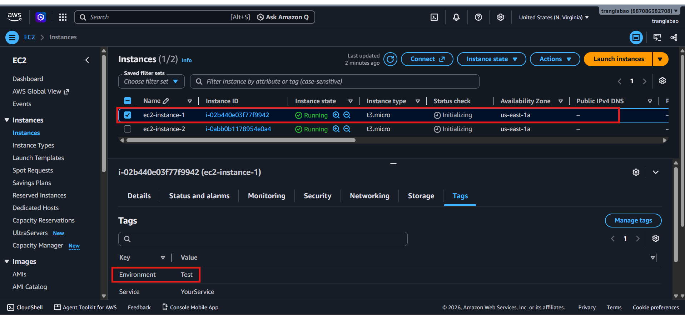

##### Step 2: Inspect Default Instance Metadata Tags
* **Action:** Select `ec2-instance-1` (`i-02b440e03f77f9942`) ➔ In the details pane below, switch to the **Tags** tab to audit active tags.

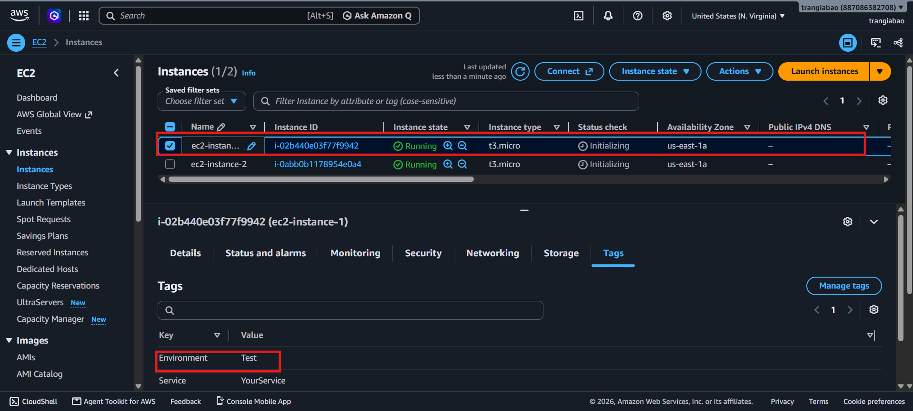

##### Step 3: Configure Custom Metadata Tags via Manage Tags
* **Action:** In the **Tags** tab, click **Manage tags** ➔ Click **Add new tag** to establish standard key-value pairs:
  * Key: `Environment` | Value: `Test`
  * Key: `Service` | Value: `YourService`
  * Key: `Name` | Value: `ec2-instance-1`
  * Key: `Owner` | Value: `YourName`
  * Key: `OS` | Value: `Amazon Linux`
* Click **Save** to persist the configuration.

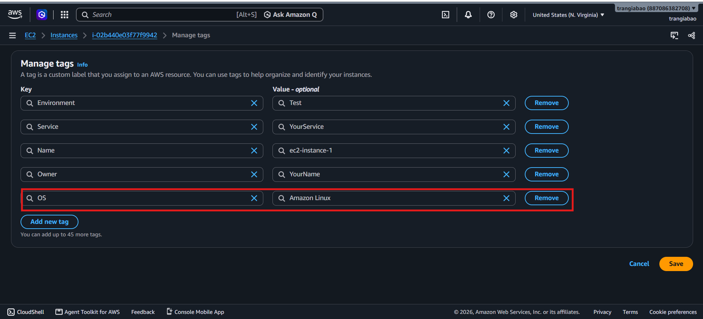

##### Step 4: Filter Instances by Tag in the Management Console
* **Action:** In the EC2 Instances search bar, enter `Owner =` ➔ The console dynamically displays available values (`YourName`, `Not tagged`, `All values`). Select `Owner = YourName` to isolate workloads belonging to that owner.

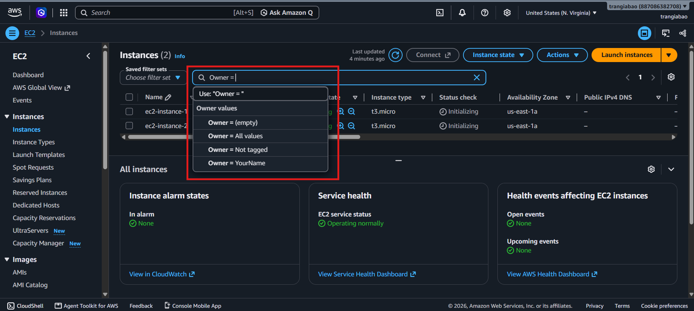

---

#### Section 2: Command-Line Tag Automation via AWS CLI

##### Step 5: Provision IAM Access Key for CLI Authentication
* **Action:** Open the **IAM** service ➔ Navigate to **Security credentials** under user `trangiabao` ➔ Click **Create access key** ➔ Select **Command Line Interface (CLI)**.
* **Result:** Save the `.csv` file containing the `Access Key ID` (`AKIA_DEMO_SAMPLE_KEY_ID`) and `Secret access key`.

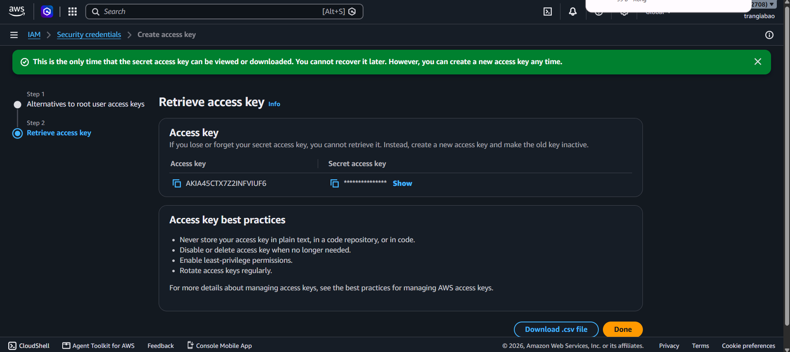

##### Step 6: Configure Local Workstation Environment Profile
* **Action:** Open **Windows PowerShell** ➔ Execute the configuration routine:
  ```powershell
  aws configure
  ```
* **Parameters Entered:**
  * **AWS Access Key ID:** `AKIA_DEMO_SAMPLE_KEY_ID`
  * **AWS Secret Access Key:** `DEMO_SECRET_KEY_SAMPLE_TEST_12345`
  * **Default region name:** `us-east-1`
  * **Default output format:** `json`

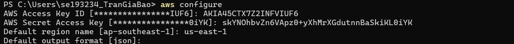

##### Step 7: Apply Tags Programmatically via CLI
* **Action:** Execute the `aws ec2 create-tags` command to attach `Project: AWS` to `ec2-instance-2`:
  ```powershell
  aws ec2 create-tags --resources i-0abb0b1178954e0a4 --tags Key=Project,Value=AWS
  ```

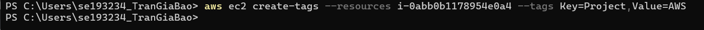

##### Step 8: Validate Tag Injection on the Management Console
* **Action:** Return to the web console and apply the filter `Project = AWS`. The interface displays `ec2-instance-2` (`i-0abb0b1178954e0a4`), confirming programmatic tag assignment.

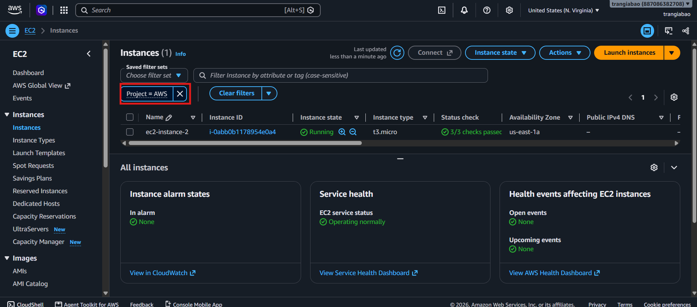

##### Step 9: Multi-Tag Injection in a Single Command Invocation
* **Action:** Apply both `Env: Test` and `Project: AWS` tags in a single atomic command:
  ```powershell
  aws ec2 create-tags --resources i-0abb0b1178954e0a4 --tags Key=Env,Value=Test Key=Project,Value=AWS
  ```

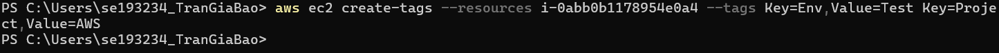

##### Step 10: Provision Third Instance and Validate Fleet Status
* **Action:** Provision instance `ec2-instance-3` (`i-00ecbe56e33f40770`) with tag `Environment: Test` via CLI.

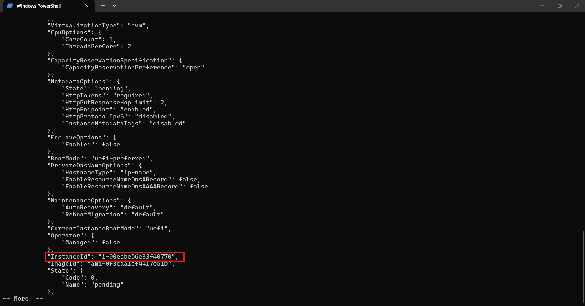

* **Verification:** Confirm all three instances (`ec2-instance-1`, `ec2-instance-2`, `ec2-instance-3`) are operating in `Running` status in `us-east-1a`.

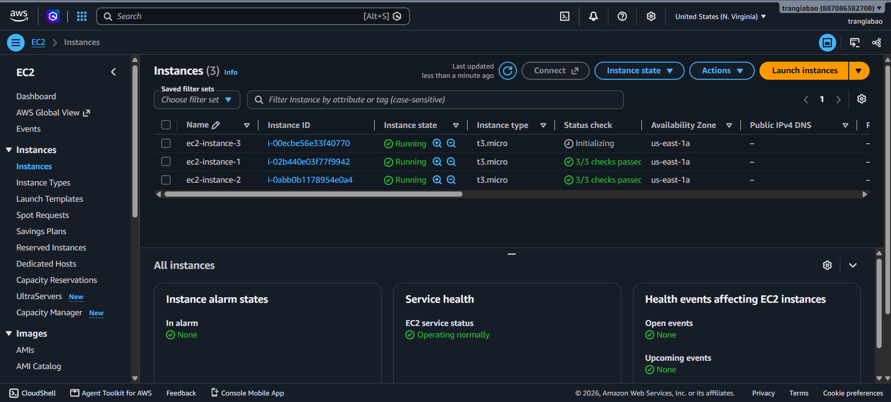

##### Step 11: Advanced Tag Querying using CLI Filter Flags
* **Action:** Execute an instance descriptor query filtering on instances tagged `Environment: Test`:
  ```powershell
  aws ec2 describe-instances --filters Name=tag:Environment,Values=Test
  ```
* **Result:** CLI outputs formatted JSON metadata covering instance configurations, security groups, and network interfaces for matched workloads.

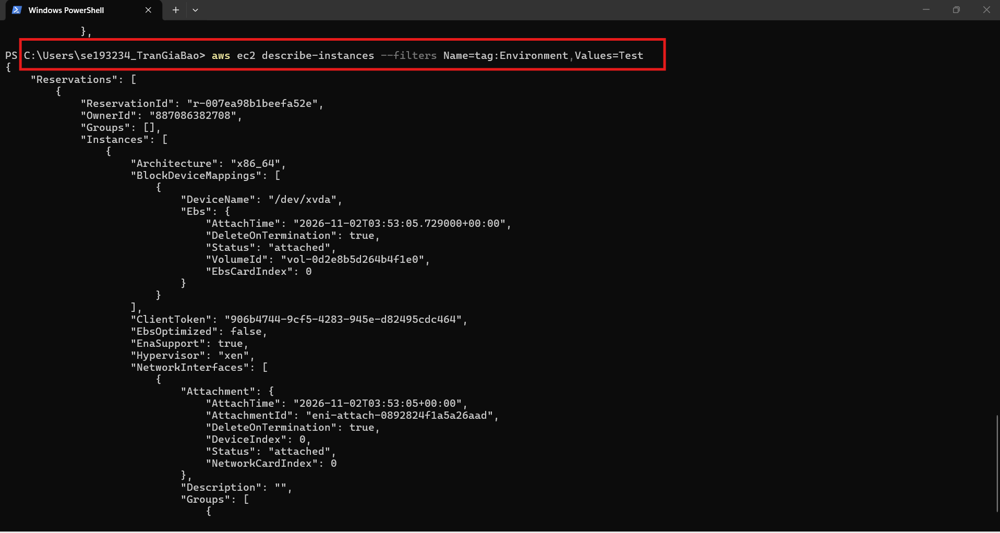

---

#### Section 3: Centralized Governance with AWS Resource Groups

##### Step 12: Configure a Tag-Based Resource Group
* **Action:** Open the **AWS Resource Groups** console ➔ Click **Create Resource Group**.
* **Group Parameters:**
  * **Group type:** `Tag based`
  * **Resource types:** `AWS::EC2::Instance`
  * **Tags filter:** Key: `Environment` | Value: `Test`
* **Preview Group:** Click **Preview group resources**. The query dynamically resolves the two target workloads: `ec2-instance-1` (`i-02b440e03f77f9942`) and `ec2-instance-3` (`i-00ecbe56e33f40770`).

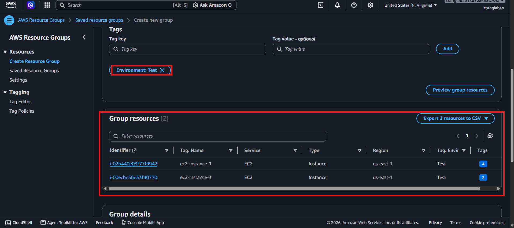

##### Step 13: Provision the Resource Group `EnvTest`
* **Action:** Set **Group name:** `EnvTest` ➔ Click **Create group**.
* **Result:** The console reports: `The resource group "EnvTest" has been successfully created in the current region (us-east-1)`. The group is now ready for unified patch management, observability dashboards, and automation execution.

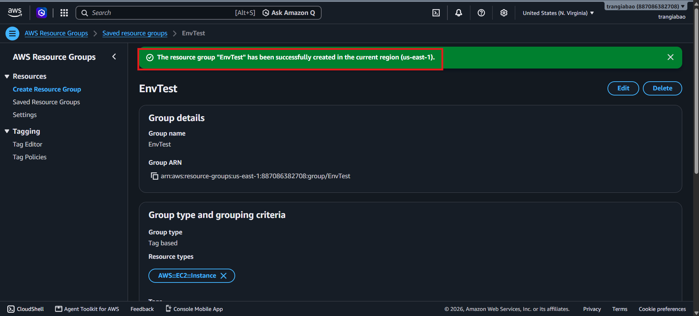

---

### 🛠️ Real-World Troubleshooting & Operational Insights:

| # | Technical Symptom | Root Cause | Solution & Best Practice |
| :---: | :--- | :--- | :--- |
| **1** | **Tag Case-Sensitivity Mismatch:** Filtering by `tag:environment` returns empty results even though instances possess the tag. | AWS Tags are strictly case-sensitive. `Environment` and `environment` represent distinct keys. | Standardize organizational casing rules (e.g., PascalCase like `Environment`, `Owner`). Ensure CLI query strings exactly match stored metadata keys. |
| **2** | **PowerShell Parameter Parsing Failure:** CLI throws an `Unknown options` error when parsing complex filter arguments. | PowerShell splits unquoted string parameters containing colons and equals signs incorrectly. | Format filter parameters without internal spaces: `Name=tag:KeyName,Values=ValueName` or wrap arguments in single quotes `'...'`. |
| **3** | **Tag Quota Limit Exception:** Receiving `TagLimitExceeded` when appending additional tags. | AWS enforces a maximum ceiling of 50 user-defined tags per resource. | Implement lean tagging schemas. Periodically audit and remove obsolete temporary tags using the **AWS Tag Editor**. |
| **4** | **Resource Group Regional Boundaries:** A resource group in `us-east-1` does not enumerate instances running in `ap-southeast-1`. | Standard Resource Groups operate strictly within regional boundaries (Regional Scope). | Create dedicated resource groups per target region or aggregate cross-region inventory using AWS Systems Manager Explorer. |
| **5** | **IAM Permission Denied on Tagging:** Receiving `AccessDenied` when executing `aws ec2 create-tags`. | The IAM policy grants `ec2:RunInstances` but omits the `ec2:CreateTags` permission. | Update the policy statement to explicitly allow `ec2:CreateTags` on `arn:aws:ec2:*:*:instance/*`. |

---

### 🧹 Resource Cleanup:
1. **Delete Resource Group:** Open **AWS Resource Groups** ➔ Select `EnvTest` ➔ Click **Delete** (Deleting a group does not affect underlying EC2 instances).
2. **Terminate EC2 Instances:** Open **Amazon EC2** ➔ Select all 3 instances (`ec2-instance-1`, `ec2-instance-2`, `ec2-instance-3`) ➔ **Instance state** ➔ **Terminate instance**.
3. **Deactivate CLI Credentials:** Navigate to **IAM** ➔ User `trangiabao` ➔ **Security credentials** ➔ Deactivate or Delete the test Access Key.
