{}
Bài thực hành **Quản trị Thẻ định danh và Nhóm tài nguyên AWS (Tags & Resource Groups)** được thực hiện vào **Thứ 4 (21/10/2026)** trong khuôn khổ **Tuần 6**. Trang này ghi lại chi tiết toàn bộ quy trình cấu hình phân loại tài nguyên thông qua gắn nhãn (Tags), điều khiển và truy vấn qua giao diện dòng lệnh AWS CLI, và tổ chức quản trị tập trung với AWS Resource Groups.
{}

### 🎯 Mục tiêu bài thực hành (Lab Objectives):
* Hiểu sâu về vai trò chiến lược của **AWS Tags** (Thẻ định danh) trong việc quản lý, phân loại môi trường, tối ưu hóa chi phí (Cost Allocation Tags) và áp dụng kiểm soát truy cập dựa trên thuộc tính (**Attribute-Based Access Control - ABAC**).
* Thực hành gắn thẻ thủ công và quản lý vòng đời thẻ trên giao diện web **Amazon EC2 Console** cho nhiều máy chủ ảo.
* Làm chủ kỹ năng quản trị thẻ qua giao diện dòng lệnh **AWS CLI**: tạo Access Key an toàn, cấu hình profile, thực thi lệnh `create-tags` gán đồng thời nhiều cặp khóa-giá trị, và sử dụng lệnh `describe-instances --filters` để lọc tài nguyên theo điều kiện thẻ.
* Xây dựng và cấu hình **AWS Resource Groups**: tạo nhóm tài nguyên `EnvTest` dựa trên truy vấn thẻ (Tag-based query) gom nhóm tự động các máy ảo thuộc cùng môi trường thử nghiệm.
* Đúc kết kinh nghiệm xử lý các sự cố thực tế: phân biệt chữ hoa/chữ thường (Case-sensitivity), giới hạn số lượng thẻ, cú pháp lọc tham số CLI và phạm vi vùng của Resource Groups.

---

### 📊 Bảng tổng hợp thông số tài nguyên đã triển khai:

| Thành phần / Tài nguyên | Tên định danh (Name / ID) | Thông số cấu hình & Cặp thẻ (Tags) | Vùng (Region) | Mục đích sử dụng |
| :--- | :--- | :--- | :--- | :--- |
| **EC2 Instance 1** | `ec2-instance-1` (`i-02b440e03f77f9942`) | `Environment: Test`<br>`Service: YourService`<br>`Owner: YourName`<br>`OS: Amazon Linux` | `us-east-1a` | Máy chủ thử nghiệm 1, cấu hình qua Web Console |
| **EC2 Instance 2** | `ec2-instance-2` (`i-0abb0b1178954e0a4`) | `Project: AWS`<br>`Env: Test` | `us-east-1a` | Máy chủ thử nghiệm 2, thao tác gán thẻ bằng AWS CLI |
| **EC2 Instance 3** | `ec2-instance-3` (`i-00ecbe56e33f40770`) | `Environment: Test`<br>`Name: ec2-instance-3` | `us-east-1a` | Khởi chạy qua CLI và gán thẻ theo dõi môi trường |
| **IAM Access Key** | `AKIA_DEMO_SAMPLE_KEY_ID` | Programmatic Access Key cho User `trangiabao` | Global | Xác thực an toàn cho công cụ dòng lệnh AWS CLI |
| **AWS Resource Group** | `EnvTest` | Group Type: `Tag based`<br>Query: `AWS::EC2::Instance` có tag `Environment: Test` | `us-east-1` | Gom nhóm quản trị tập trung các máy chủ cùng môi trường |

---

### 🚀 Chi tiết các bước thực hiện & Hình ảnh minh chứng:

#### Phần 1: Quản trị Tags qua giao diện AWS Management Console

##### Bước 1: Khởi tạo máy chủ EC2 và kiểm tra danh sách tài nguyên
* **Thao tác:** Đăng nhập vào AWS Management Console tại vùng **us-east-1** (N. Virginia) ➔ Mở dịch vụ **Amazon EC2** ➔ Vào mục **Instances**.
* **Thực hiện:** Khởi chạy 2 máy chủ ảo tiêu chuẩn `t3.micro` với tên `ec2-instance-1` và `ec2-instance-2`. Theo dõi trạng thái khởi tạo `Initializing` và chuyển sang `Running`.

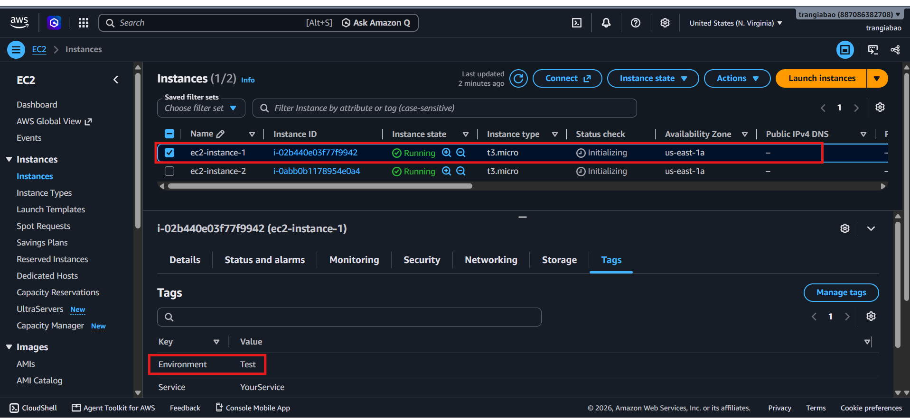

##### Bước 2: Xem các thẻ định danh mặc định của máy chủ
* **Thao tác:** Tích chọn máy chủ `ec2-instance-1` (`i-02b440e03f77f9942`) ➔ Chọn tab **Tags** ở khung chi tiết phía dưới để kiểm tra các thẻ hiện có.

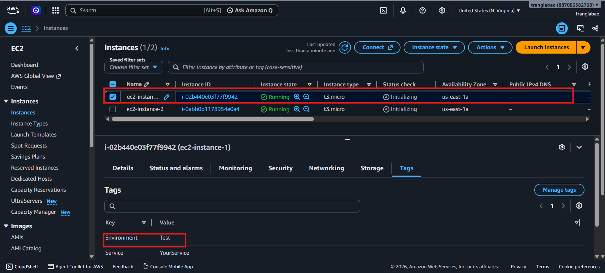

##### Bước 3: Thêm và chỉnh sửa các cặp thẻ định danh (Manage Tags)
* **Thao tác:** Tại tab **Tags**, nhấn nút **Manage tags** ➔ Nhấn **Add new tag** để bổ sung các cặp Key-Value chuẩn hóa:
  * Key: `Environment` | Value: `Test`
  * Key: `Service` | Value: `YourService`
  * Key: `Name` | Value: `ec2-instance-1`
  * Key: `Owner` | Value: `YourName`
  * Key: `OS` | Value: `Amazon Linux`
* Nhấn **Save** để áp dụng thay đổi.

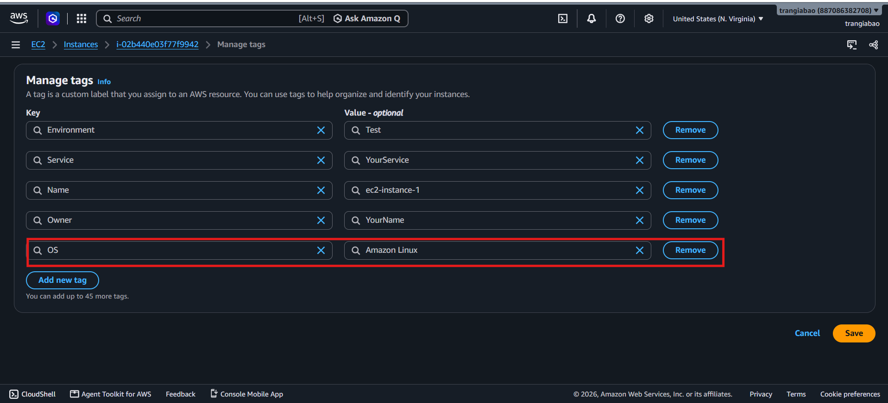

##### Bước 4: Lọc máy chủ ảo theo thẻ trên thanh tìm kiếm Console
* **Thao tác:** Trên ô tìm kiếm của danh sách Instances, gõ `Owner =` ➔ Hệ thống gợi ý các giá trị thẻ hiện có (`YourName`, `Not tagged`, `All values`). Chọn `Owner = YourName` để lọc nhanh máy chủ thuộc quyền quản lý của người phụ trách.

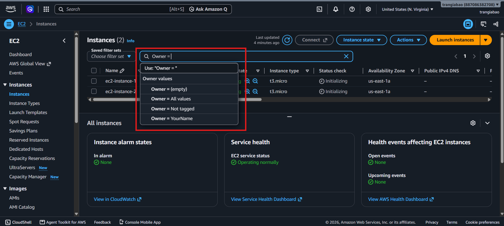

---

#### Phần 2: Tự động hóa Quản trị Tags qua giao diện dòng lệnh AWS CLI

##### Bước 5: Khởi tạo IAM Access Key cho tài khoản quản trị
* **Thao tác:** Mở dịch vụ **IAM** ➔ Vào mục **Users** hoặc **Security credentials** của tài khoản `trangiabao` ➔ Nhấn **Create access key** ➔ Chọn mục đích sử dụng **Command Line Interface (CLI)**.
* **Ghi nhận:** Tải file `.csv` lưu trữ `Access Key ID` (`AKIA_DEMO_SAMPLE_KEY_ID`) và mã bí mật `Secret access key`.

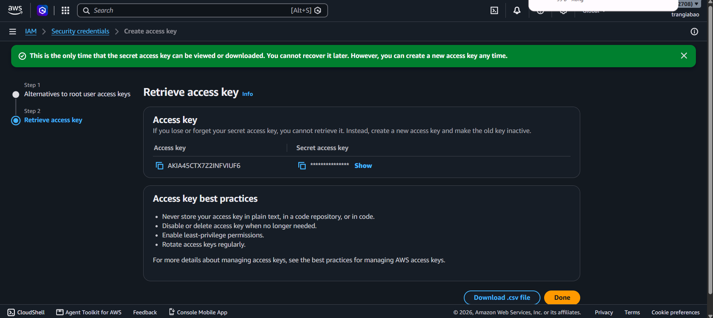

##### Bước 6: Cấu hình phiên làm việc AWS CLI trên Windows PowerShell
* **Thao tác:** Mở cửa sổ **Windows PowerShell** trên máy trạm ➔ Thực thi lệnh cấu hình định danh:
  ```powershell
  aws configure
  ```
* **Thông số nhập liệu:**
  * **AWS Access Key ID:** `AKIA_DEMO_SAMPLE_KEY_ID`
  * **AWS Secret Access Key:** `DEMO_SECRET_KEY_SAMPLE_TEST_12345`
  * **Default region name:** `us-east-1`
  * **Default output format:** `json`

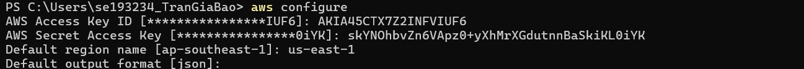

##### Bước 7: Thực thi lệnh gắn thẻ đơn lẻ bằng CLI
* **Thao tác:** Sử dụng lệnh `aws ec2 create-tags` gán nhãn `Project: AWS` cho máy ảo `ec2-instance-2`:
  ```powershell
  aws ec2 create-tags --resources i-0abb0b1178954e0a4 --tags Key=Project,Value=AWS
  ```

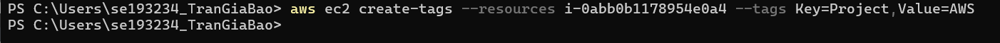

##### Bước 8: Kiểm tra kết quả gắn thẻ trên EC2 Web Console
* **Thao tác:** Quay lại Web Console, nhập bộ lọc `Project = AWS` trên danh sách Instances. Hệ thống lọc chính xác máy chủ `ec2-instance-2` (`i-0abb0b1178954e0a4`) vừa được gán thẻ từ dòng lệnh.

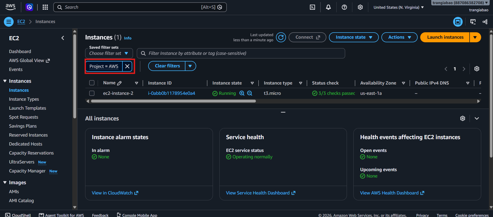

##### Bước 9: Gán đồng thời nhiều cặp thẻ trong một câu lệnh CLI
* **Thao tác:** Bổ sung thêm thẻ `Env: Test` cùng với `Project: AWS` bằng một lệnh duy nhất:
  ```powershell
  aws ec2 create-tags --resources i-0abb0b1178954e0a4 --tags Key=Env,Value=Test Key=Project,Value=AWS
  ```

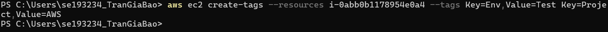

##### Bước 10: Khởi tạo máy chủ thứ 3 qua CLI và xác nhận danh sách
* **Thao tác:** Thực thi lệnh `aws ec2 run-instances` tạo máy chủ `ec2-instance-3` (`i-00ecbe56e33f40770`) với thẻ `Environment: Test`.

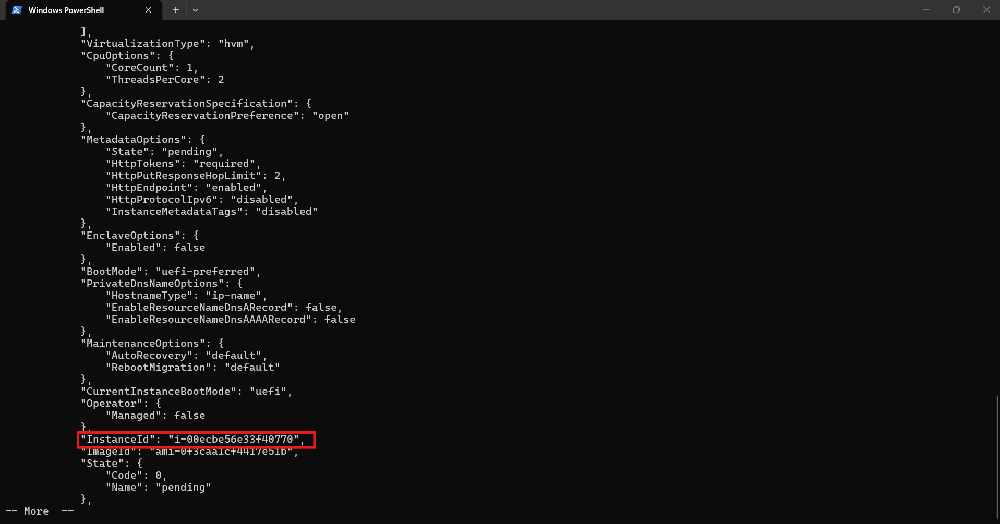

* **Xác nhận trên Web Console:** Cả 3 máy ảo (`ec2-instance-1`, `ec2-instance-2`, `ec2-instance-3`) đều đang hoạt động an toàn ở trạng thái `Running` tại vùng `us-east-1a`.

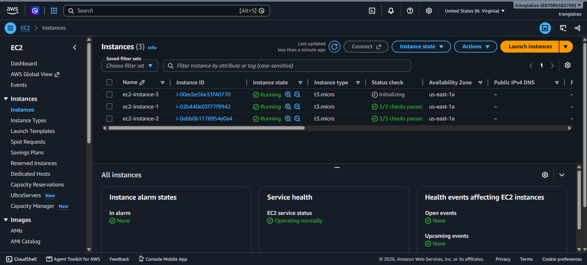

##### Bước 11: Lọc dữ liệu tài nguyên nâng cao với cờ `--filters` trên CLI
* **Thao tác:** Thực hiện truy vấn danh sách máy ảo có nhãn `Environment` mang giá trị `Test`:
  ```powershell
  aws ec2 describe-instances --filters Name=tag:Environment,Values=Test
  ```
* **Kết quả:** CLI trả về cấu trúc JSON chứa đầy đủ thông tin chi tiết (InstanceId, ReservationId, NetworkInterfaces, BlockDeviceMappings) của các máy ảo thỏa điều kiện.

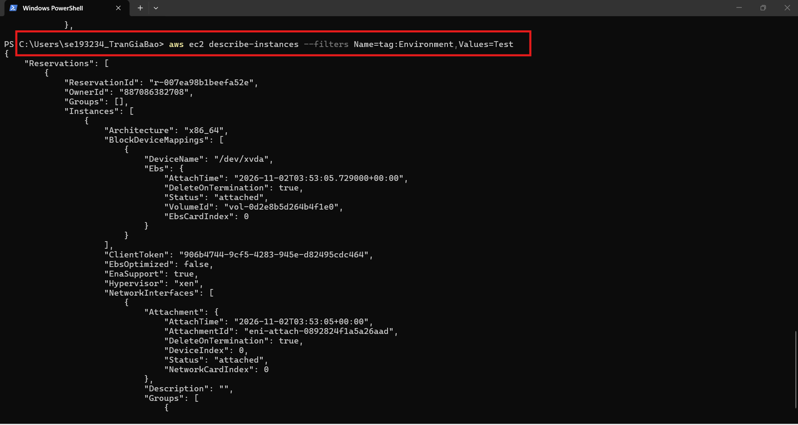

---

#### Phần 3: Quản trị Tập trung với AWS Resource Groups

##### Bước 12: Thiết lập nhóm tài nguyên theo thẻ (Tag-based Resource Group)
* **Thao tác:** Tìm kiếm và mở dịch vụ **AWS Resource Groups** ➔ Chọn **Create Resource Group**.
* **Cấu hình nhóm:**
  * **Group type:** `Tag based`
  * **Resource types:** `AWS::EC2::Instance`
  * **Tags filter:** Key: `Environment` | Value: `Test`
* **Kiểm tra kết quả xem trước:** Nhấn **Preview group resources**, hệ thống tự động nhận diện chính xác 2 tài nguyên: `ec2-instance-1` (`i-02b440e03f77f9942`) và `ec2-instance-3` (`i-00ecbe56e33f40770`).

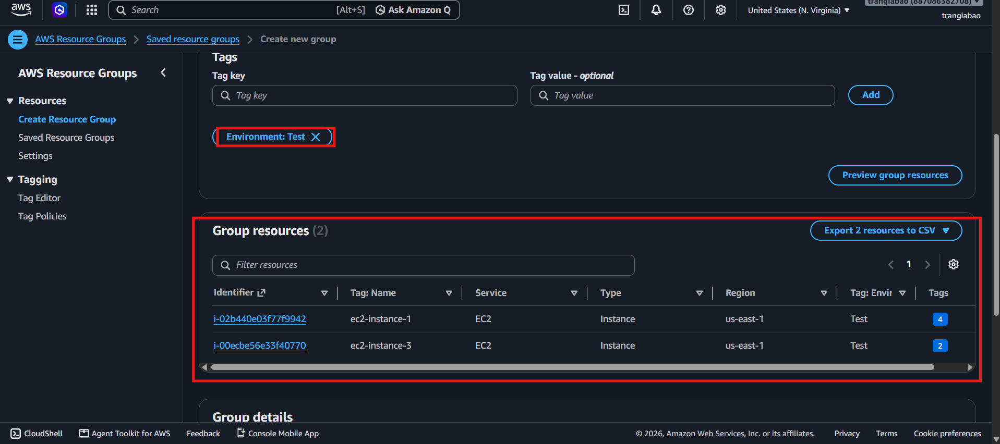

##### Bước 13: Hoàn tất khởi tạo Resource Group `EnvTest`
* **Thao tác:** Đặt tên nhóm tài nguyên **Group name:** `EnvTest` ➔ Nhấn **Create group**.
* **Kết quả:** Thông báo xác nhận thành công hiển thị: `The resource group "EnvTest" has been successfully created in the current region (us-east-1)`. Nhóm tài nguyên sẵn sàng phục vụ các tác vụ quản trị tự động hóa, giám sát chỉ số và cấu hình chính sách tập trung.

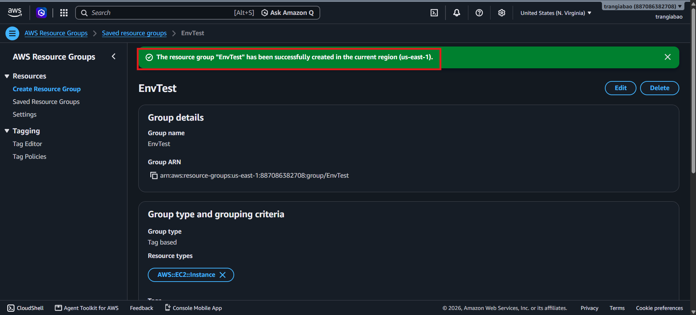

---

### 🛠️ Ngân hàng Sự cố Kỹ thuật Thực tế & Cách Khắc phục Triệt để:

| STT | Hiện tượng sự cố (Symptom) | Nguyên nhân cốt lõi (Root Cause) | Giải pháp & Kinh nghiệm xử lý (Solution) |
| :---: | :--- | :--- | :--- |
| **1** | **Phân biệt chữ hoa / chữ thường trong thẻ (Case Sensitivity):** Lọc `tag:environment` không ra kết quả dù máy đã gắn `Environment`. | AWS Tags có tính chất phân biệt hoa thường tuyệt đối (Case-sensitive). `Environment` và `environment` được hiểu là hai khóa hoàn toàn khác nhau. | Luôn thống nhất quy chuẩn đặt tên thẻ trong tổ chức (ví dụ: chuẩn PascalCase như `Environment`, `Owner`, `Project`). Khi gõ lệnh CLI bắt buộc gõ chính xác hoa thường. |
| **2** | **Lỗi cú pháp `--filters` trên PowerShell:** Câu lệnh CLI báo lỗi `Unknown options` khi lọc thẻ có khoảng trắng hoặc ký tự đặc biệt. | PowerShell tự phân tách tham số nếu không bao bọc chuỗi chứa dấu hai chấm hoặc dấu bằng cẩn thận. | Sử dụng định dạng chuẩn `Name=tag:KeyName,Values=ValueName` không chèn khoảng trắng giữa các dấu phẩy hoặc bọc toàn bộ chuỗi trong dấu nháy đơn `'...'`. |
| **3** | **Quá hạn mức số lượng thẻ (Tag Quota Limit):** Nhận lỗi `TagLimitExceeded` khi cố gắng gắn thêm thẻ cho tài nguyên. | AWS áp dụng giới hạn tối đa 50 thẻ do người dùng tạo (user-defined tags) trên mỗi tài nguyên. | Lên chiến lược phân bổ thẻ tinh gọn, định kỳ sử dụng **Tag Editor** để rà soát, gỡ bỏ các thẻ tạm thời không còn sử dụng. |
| **4** | **Phạm vi vùng của Resource Groups:** Resource Group tạo tại `us-east-1` không thấy các máy ảo tại `ap-southeast-1`. | Resource Groups cơ bản hoạt động theo phạm vi từng Region cụ thể (Regional Scope), không tự động gom tài nguyên xuyên vùng. | Nếu cần quản trị đa vùng, cần chuyển đúng Region trên Console để tạo Resource Group tương ứng hoặc sử dụng AWS Systems Manager Explorer. |
| **5** | **Xung đột phân quyền IAM khi gán thẻ:** Nhận lỗi `AccessDenied` khi chạy lệnh `aws ec2 create-tags`. | IAM Policy của người dùng chỉ có quyền `ec2:RunInstances` mà thiếu action `ec2:CreateTags`. | Cập nhật IAM Policy cấp quyền bổ sung `ec2:CreateTags` trên tài nguyên `arn:aws:ec2:*:*:instance/*` để cho phép gắn nhãn. |

---

### 🧹 Dọn dẹp tài nguyên (Resource Cleanup):
1. **Xóa Resource Group:** Mở **AWS Resource Groups** ➔ Chọn nhóm `EnvTest` ➔ Nhấn **Delete** (Xóa Resource Group không làm ảnh hưởng đến các máy ảo EC2 bên trong).
2. **Hủy máy ảo EC2:** Mở **Amazon EC2** ➔ Chọn cả 3 máy ảo (`ec2-instance-1`, `ec2-instance-2`, `ec2-instance-3`) ➔ **Instance state** ➔ Chọn **Terminate instance** để tránh phát sinh chi phí duy trì.
3. **Vô hiệu hóa Access Key:** Vào **IAM** ➔ User `trangiabao` ➔ Tab **Security credentials** ➔ Chuyển Access Key sang trạng thái **Deactivate** hoặc **Delete**.
