{}
This hands-on lab on **Infrastructure Observability with Grafana & Amazon CloudWatch (Getting started with Grafana basic - Workshop 000029)** was conducted on **Thursday (22/10/2026)** as part of **Week 6**. This document provides a complete, end-to-end operational guide for provisioning a Grafana monitoring host on Amazon Linux 2023, configuring secure IAM permissions, integrating Amazon CloudWatch data sources, and building customized telemetry dashboards.
{}

### 🎯 Lab Objectives:
* Understand the hybrid monitoring architecture combining the world-leading open-source visualization suite **Grafana** with **Amazon CloudWatch** as the primary metrics repository.
* Master security best practices following AWS Well-Architected Framework: implement an **IAM Role** attached directly to the EC2 Instance Profile so Grafana retrieves ephemeral credentials automatically instead of hard-coding static Access Keys.
* Execute foundational network and security provisioning: verify **VPC** configuration, enable automatic public IPv4 addressing on the **Public Subnet**, and configure **Security Groups** allowing access to port 3000 (Grafana Web UI) and port 22 (SSH).
* Configure the official Grafana RPM repository, install the software packages, and run the `grafana-server` background daemon managed by `systemd` on modern **Amazon Linux 2023 (AL2023)**.
* Establish a **CloudWatch Data Source** connection, validate API reachability (`CloudWatch Metrics API` and `CloudWatch Logs API`), design interactive Dashboards displaying `CPUUtilization`, and explore multi-dimensional metrics using Bar charts and Time series panels.

---

### 📊 Summary of Deployed Infrastructure & Parameters:

| Component / Resource | Logical Name / Identifier | Technical Specifications | Region / AZ | Operational Purpose |
| :--- | :--- | :--- | :--- | :--- |
| **VPC** | `Grafana-ASG-vpc` (`vpc-02b25cbbec17b38ca`) | CIDR: `10.0.0.0/16`, DNS hostnames: Enabled | `us-east-1` | Dedicated network perimeter for observability stack |
| **Public Subnet** | `Grafana-ASG-subnet-public1-us-east-1a` (`subnet-0fe0631efc71d460b`) | CIDR: `10.0.0.0/20`, Auto-assign Public IPv4: `Yes` | `us-east-1a` | Public subnet for inbound web access |
| **Security Group** | `SG-PUB-Grafana-ASG` (`sg-0b5bc8236a3cadcd8`) | Inbound: TCP `3000` (Grafana), TCP `22` (SSH), All ICMP | `us-east-1` | Stateful firewall securing the monitoring host |
| **EC2 Instance** | `Grafana-Server` (`i-082d165f34a40407f`) | Type: `t3.micro`, AMI: Amazon Linux 2023, Public IP: `44.203.10.190` | `us-east-1a` | Host instance executing the Grafana service |
| **IAM Policy** | `GrafanaAccessPolicy` | CloudWatch Metrics & Logs Read-Only permissions | Global | Least-privilege authorization policy |
| **IAM Role** | `GrafanaAccessRole` | Service: `ec2.amazonaws.com`, Attached: `GrafanaAccessPolicy` | Global | Instance profile granting temporary AWS credentials |
| **Grafana Server** | `Grafana v13.3.0` | Port `3000`, Auth: Admin Console, Service: `active (running)` | Host EC2 | Data visualization and alerting engine |
| **Data Source** | `CloudWatch` | Region: `ap-southeast-1` / `us-east-1`, Namespace: `AWS/EC2` | Grafana Plugin | Native connector querying telemetry APIs |

---

### 🚀 Step-by-Step Implementation & Screenshot Evidence:

#### Part 1: Network & Security Configuration

##### Step 1: Verify Virtual Private Cloud (VPC) Setup
* **Action:** Sign in to the AWS Management Console in the **us-east-1** (N. Virginia) region ➔ Open **Amazon VPC** ➔ Select **Your VPCs**.
* **Execution:** Confirm that the VPC named `Grafana-ASG-vpc` (`vpc-02b25cbbec17b38ca`) is in an `Available` state with DNS Hostnames and DNS Resolution fully enabled.

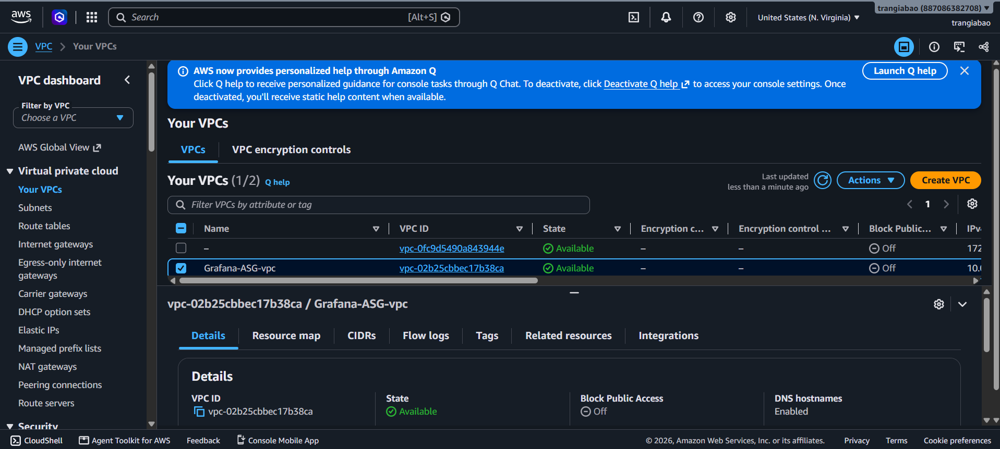

##### Step 2: Enable Auto-assign Public IPv4 Address on Subnet
* **Action:** Navigate to **Subnets** in the left sidebar ➔ Select subnet `Grafana-ASG-subnet-public1-us-east-1a` (`subnet-0fe0631efc71d460b`).
* **Execution:** Click **Actions** ➔ Select **Edit subnet settings** ➔ Check **Enable auto-assign public IPv4 address** ➔ Click **Save**. A green confirmation banner confirms that instances launched into this subnet will receive routable public IPs automatically.

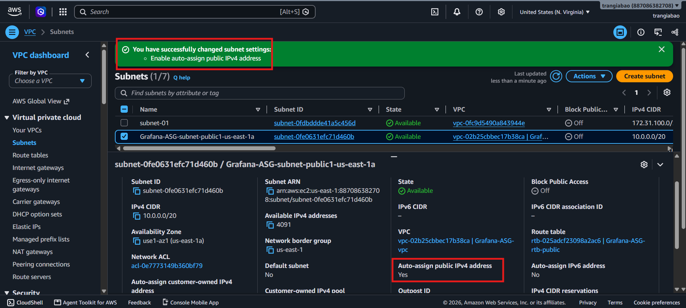

##### Step 3: Configure Security Group Inbound Rules
* **Action:** Open **Security Groups** ➔ Create a new security group named `SG-PUB-Grafana-ASG` (`sg-0b5bc8236a3cadcd8`) associated with `Grafana-ASG-vpc`.
* **Inbound Rules Configuration:**
  1. **Custom TCP - Port 3000:** Permit inbound HTTP traffic to the Grafana Web UI.
  2. **SSH - Port 22:** Permit inbound SSH administration from authorized administrator IPs.
  3. **All ICMP - IPv4:** Permit ICMP diagnostic and ping connectivity checks.

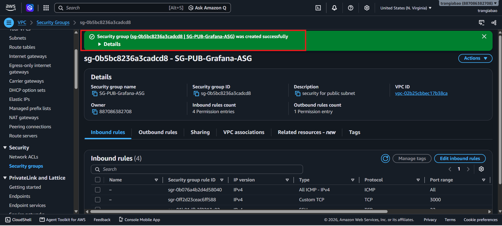

---

#### Part 2: EC2 Instance Provisioning & IAM Security Setup

##### Step 4: Launch EC2 Instance Grafana-Server
* **Action:** Navigate to **Amazon EC2** ➔ Click **Launch instances**.
* **Instance Specification:**
  * **Instance Name:** `Grafana-Server`.
  * **OS Image (AMI):** Amazon Linux 2023 (AL2023) 64-bit (x86_64).
  * **Instance Type:** `t3.micro` (Free Tier eligible).
  * **Network Settings:** Attach to `Grafana-ASG-vpc`, subnet `Grafana-ASG-subnet-public1-us-east-1a`, and assign `SG-PUB-Grafana-ASG`.
  * Instance successfully initializes with ID `i-082d165f34a40407f`, Public IPv4 `44.203.10.190`, and Private IP `10.0.4.227`.

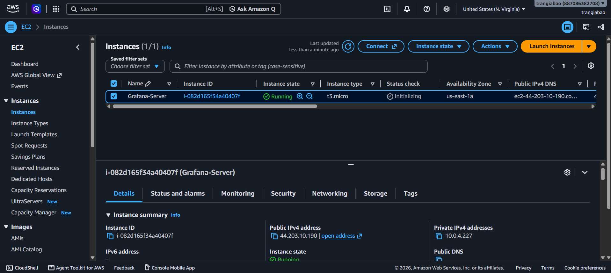

##### Step 5: Create IAM User & Issue Access Keys (Programmatic / Backup Option)
* **Action:** Navigate to **IAM** ➔ Select **Users** ➔ Click **Create user** with username `Grafana-user`.
* **Execution:** Finalize user permissions and proceed to **Create access key** to obtain programmatic credentials (`AKIA_DEMO_SAMPLE_KEY_ID`) for command-line verification and fallback access.

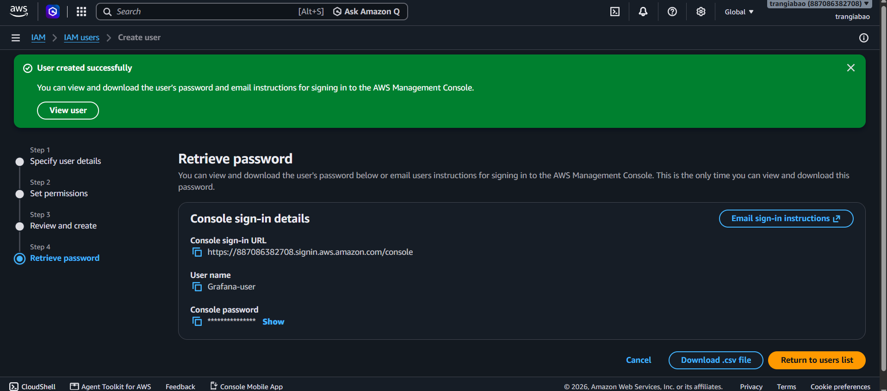

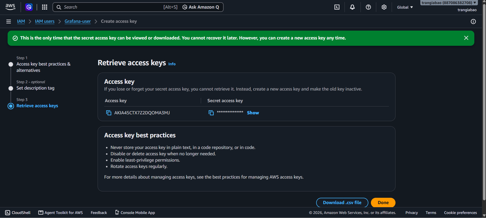

##### Step 6: Create IAM Policy `GrafanaAccessPolicy`
* **Action:** In IAM, navigate to **Policies** ➔ Click **Create policy**.
* **Execution:** Define read-only JSON permissions targeting CloudWatch metrics and logs (`cloudwatch:Describe*`, `cloudwatch:Get*`, `cloudwatch:List*`, `logs:DescribeLogGroups`, `logs:FilterLogEvents`). Name the policy `GrafanaAccessPolicy` and create it.

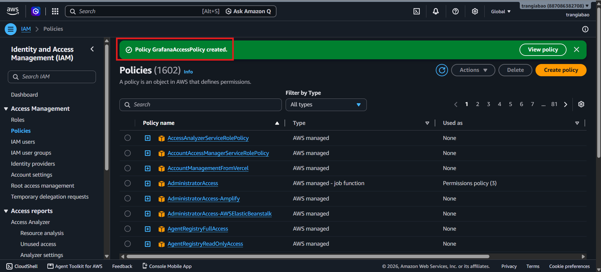

##### Step 7: Create IAM Role & Attach to EC2 Instance Profile
* **Action:** Select **Roles** ➔ Click **Create role** ➔ Choose **AWS service** (`EC2`) as the trusted entity ➔ Attach `GrafanaAccessPolicy` ➔ Name the role `GrafanaAccessRole`.
* **Instance Profile Attachment:** Return to EC2 ➔ Select `Grafana-Server` (`i-082d165f34a40407f`) ➔ Click **Actions** ➔ **Security** ➔ **Modify IAM role** ➔ Select `GrafanaAccessRole` ➔ Click **Update IAM role**. A green banner confirms successful attachment.

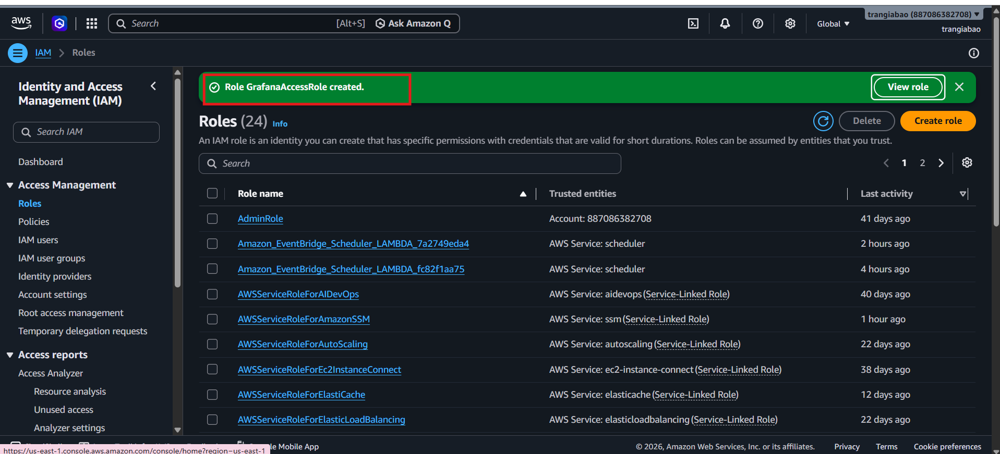

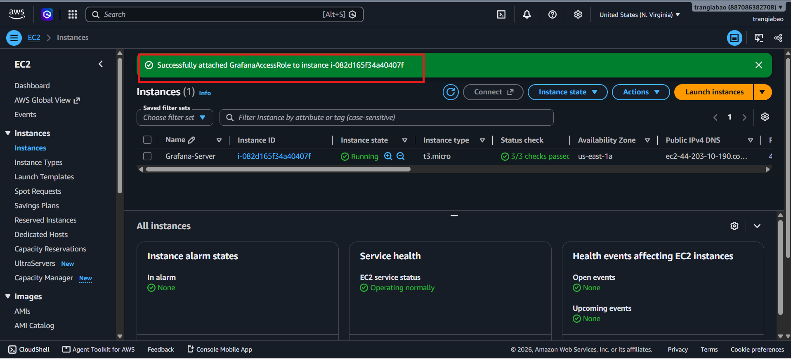

---

#### Part 3: Grafana Installation & Daemon Operations on AL2023

##### Step 8: SSH Connection & YUM Repository Setup
* **Action:** Connect via SSH to `44.203.10.190` as `ec2-user`.
* **System Update & Repository Configuration:**
  ```bash
  sudo yum update -y
  sudo nano /etc/yum.repos.d/grafana.repo
  ```
* **Repository Configuration Content:**
  ```ini
  [grafana]
  name=grafana
  baseurl=https://rpm.grafana.com
  repo_gpgcheck=1
  enabled=1
  gpgcheck=1
  gpgkey=https://rpm.grafana.com/gpg.key
  sslverify=1
  sslcacert=/etc/pki/tls/certs/ca-bundle.crt
  ```

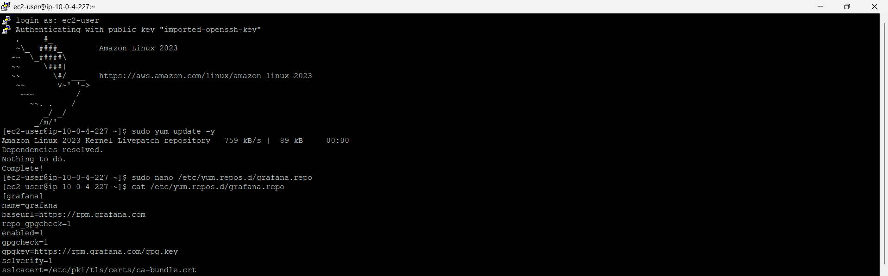

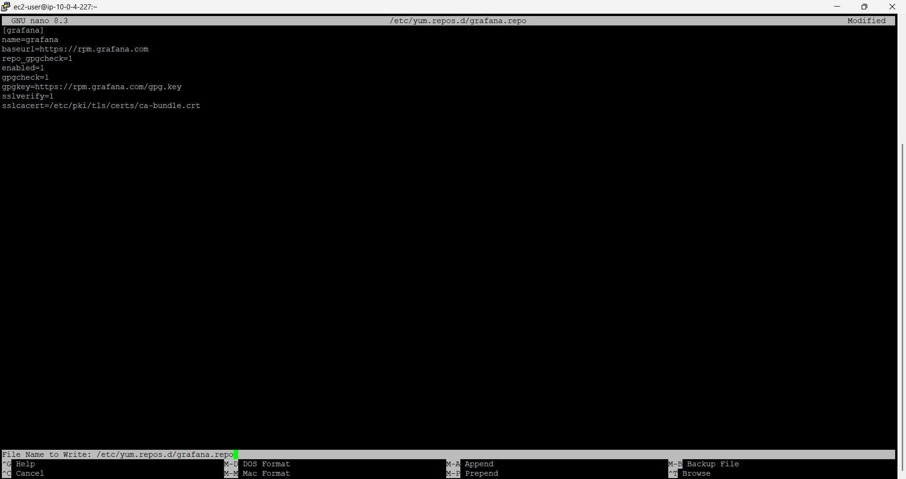

##### Step 9: Install Grafana Application Package
* **Action:** Run the automated package installer:
  ```bash
  sudo yum install grafana -y
  ```
* **Result:** The system imports Grafana Labs GPG keys (`engineering@grafana.com`), resolves dependencies, and installs `grafana-13.3.0-1.x86_64` (installed size: ~1.3 GB).

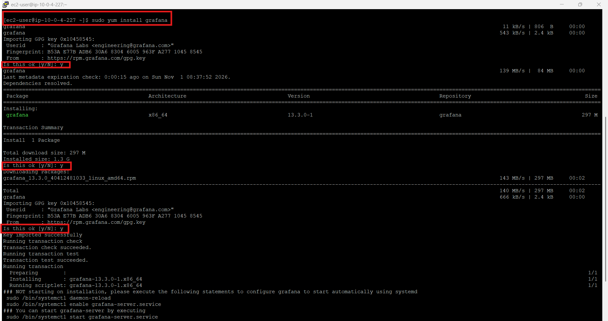

##### Step 10: Start grafana-server Daemon & Verify Service State
* **Action:** Reload systemd configuration, enable automatic boot startup, and launch the service:
  ```bash
  sudo systemctl daemon-reload
  sudo systemctl enable grafana-server.service
  sudo systemctl start grafana-server.service
  sudo systemctl status grafana-server.service
  ```
* **Verification:** The daemon reports `active (running)` status, binding to local ports and serving HTTP requests.

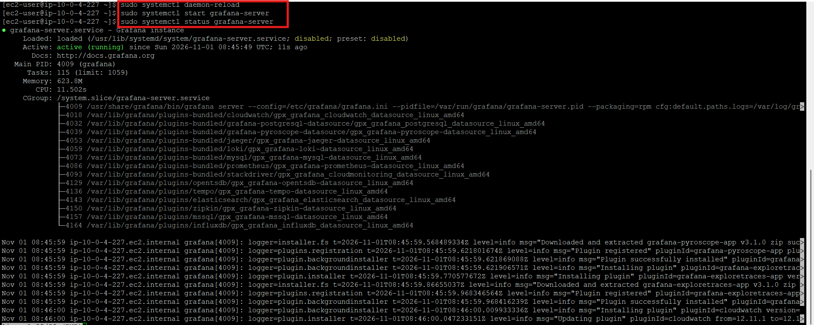

##### Step 11: Access Grafana Web UI & Update Admin Password
* **Action:** Open a web browser and navigate to `http://44.203.10.190:3000`.
* **Initial Authentication:** Authenticate with initial credentials `admin` / `admin`.
* **Password Rotation:** The portal immediately prompts to update default credentials to eliminate security risks (enter new password `giabao2005` and submit).

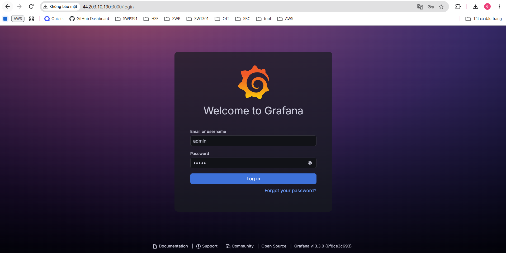

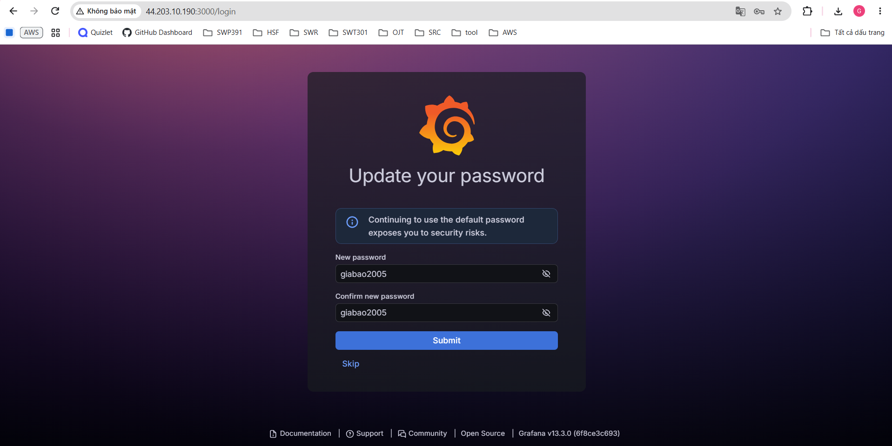

---

#### Part 4: CloudWatch Data Source & Dashboard Visualization

##### Step 12: Add CloudWatch Data Source & Validate API Connectivity
* **Action:** In Grafana's left navigation bar, choose **Connections** ➔ **Data sources** ➔ Click **Add new data source** ➔ Select **CloudWatch**.
* **Configuration:**
  * **Authentication Provider:** Select `AWS SDK Default` (leveraging the attached EC2 instance role without static credentials).
  * **Default Region:** Set to `us-east-1` (or target workload region).
* **Connection Test:** Click **Save & test**. The green notification confirms:
  * `1. Successfully queried the CloudWatch metrics API.`
  * `2. Successfully queried the CloudWatch logs API.`

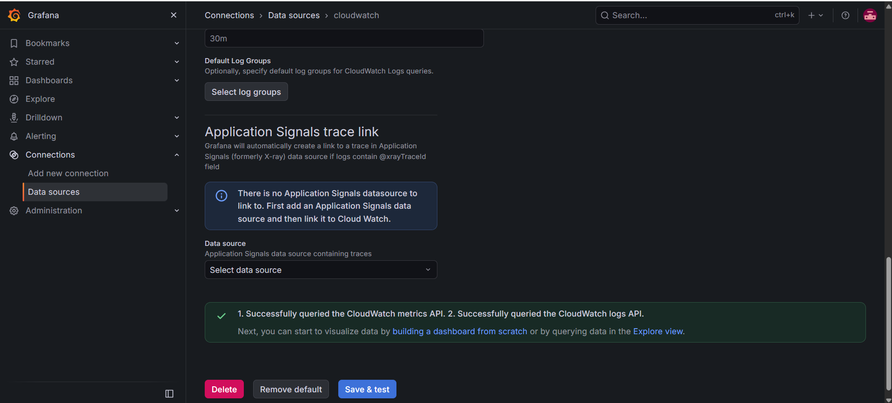

##### Step 13: Build Time-Series Monitoring Dashboard for CPU Utilization
* **Action:** Navigate to **Dashboards** ➔ Click **New dashboard** ➔ Select **Add visualization** ➔ Choose `cloudwatch`.
* **Query Builder Parameters:**
  * **Namespace:** `AWS/EC2`.
  * **Metric name:** `CPUUtilization`.
  * **Statistic:** `Average`.
  * **Dimensions:** Filter by `InstanceId` = `i-082d165f34a40407f`.
* **Result:** A live Time-Series graph updates in real time displaying host CPU workload patterns.

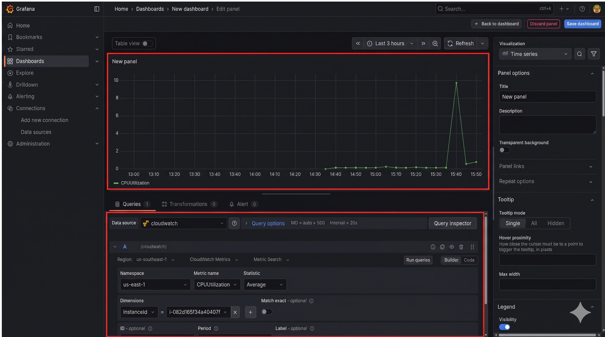

##### Step 14: Advanced Metric Exploration with Explore Tool
* **Action:** In the main menu, click **Explore** ➔ Select `cloudwatch` data source.
* **Ad-hoc Query:**
  * Target region: `ap-southeast-1`.
  * Metric: `CPUUtilization`, Dimension: `InstanceId` = `i-0ba9a1a9ccab2d73f`.
  * Switch visualization mode to **Bars** to highlight workload spikes with distinct clarity.

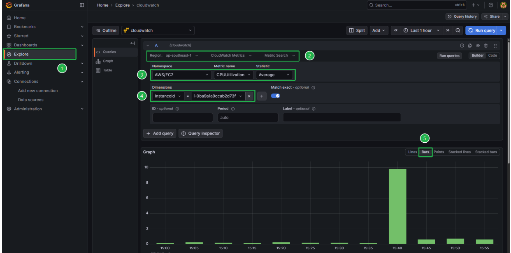

---

### 💡 Lessons Learned & Troubleshooting Bank:

{}
Below are 5 practical troubleshooting scenarios encountered during Grafana and CloudWatch deployment, accompanied by verified root causes and solutions:
{}

#### 1. Inability to Access Grafana Web UI on Port 3000 (Connection Timed Out)
* **Root Cause:** The EC2 Security Group lacked an Inbound rule permitting TCP traffic on port 3000 from client IP ranges, or the instance was provisioned in an isolated subnet lacking an Internet Gateway route.
* **Remediation:** Inspect `SG-PUB-Grafana-ASG` Inbound rules and verify that Custom TCP on port `3000` is open. Confirm the subnet route table points `0.0.0.0/0` to an Internet Gateway (`igw-xxxx`).

#### 2. CloudWatch Data Source Authorization Error (AccessDeniedException / HTTP 403)
* **Root Cause:** The IAM Role attached to the EC2 instance lacked permissions required to invoke CloudWatch or CloudWatch Logs metric queries.
* **Remediation:** Ensure `GrafanaAccessPolicy` includes complete read-only actions:
  ```json
  {
    "Version": "2012-10-17",
    "Statement": [
      {
        "Sid": "AllowGrafanaCloudWatchAccess",
        "Effect": "Allow",
        "Action": [
          "cloudwatch:DescribeAlarmsForMetric",
          "cloudwatch:DescribeAlarmHistory",
          "cloudwatch:DescribeAlarms",
          "cloudwatch:ListMetrics",
          "cloudwatch:GetMetricStatistics",
          "cloudwatch:GetMetricData",
          "logs:DescribeLogGroups",
          "logs:GetLogGroupFields",
          "logs:StartQuery",
          "logs:StopQuery",
          "logs:GetQueryResults",
          "logs:GetLogEvents",
          "ec2:DescribeTags",
          "ec2:DescribeInstances",
          "ec2:DescribeRegions"
        ],
        "Resource": "*"
      }
    ]
  }
  ```

#### 3. Best Practice: EC2 IAM Instance Profile vs Static Access Keys
* **Analysis:** Hard-coding IAM user Access Key ID and Secret Access Key into web application configuration violates the principle of least privilege and introduces credential exposure risks.
* **Architectural Guidance:** Always use **AWS SDK Default** authentication on AWS-hosted Grafana instances. Grafana retrieves rotating, temporary tokens via the Instance Metadata Service (IMDSv2) automatically.

#### 4. grafana-server Service Fails to Start Automatically on Instance Reboot
* **Root Cause:** Administrator manually executed `systemctl start grafana-server` without enabling the systemd service unit.
* **Remediation:** Always run `sudo systemctl enable grafana-server`. Confirm configuration via `systemctl is-enabled grafana-server` (expected output: `enabled`).

#### 5. Clean-Up Lifecycle to Prevent Cloud Charges (Resource Cleanup)
* **Decommissioning Steps:**
  1. Terminate the EC2 host `Grafana-Server` (`i-082d165f34a40407f`).
  2. Detach and delete `GrafanaAccessRole` and `GrafanaAccessPolicy`.
  3. Delete security group `SG-PUB-Grafana-ASG`.
  4. Delete the custom VPC `Grafana-ASG-vpc` to release associated subnets and Internet Gateway resources.
