{}
Bài thực hành **Giám sát hệ thống với Grafana & Amazon CloudWatch (Getting started with Grafana basic - Workshop 000029)** được triển khai vào **Thứ 5 (22/10/2026)** trong khuôn khổ **Tuần 6**. Trang này ghi lại đầy đủ toàn bộ quá trình dựng máy chủ giám sát Grafana trên Amazon Linux 2023, phân quyền IAM bảo mật, tích hợp nguồn dữ liệu Amazon CloudWatch và xây dựng các biểu đồ quan sát thời gian thực.
{}

### 🎯 Mục tiêu bài thực hành (Lab Objectives):
* Hiểu rõ kiến trúc kết hợp giữa nền tảng trực quan hóa mã nguồn mở hàng đầu thế giới **Grafana** và kho lưu trữ chỉ số đo lường đám mây **Amazon CloudWatch**.
* Nắm vững kỹ thuật cấp quyền bảo mật theo khuyến nghị kiến trúc AWS: sử dụng **IAM Role** gắn trực tiếp vào máy chủ EC2 (Instance Profile) để Grafana tự động nhận thông tin xác thực tạm thời thay vì nhúng cứng (hard-code) Access Key/Secret Key.
* Thành thạo các bước triển khai hạ tầng: cấu hình **VPC**, **Public Subnet** tự động cấp phát IPv4, và **Security Group** mở các cổng điều khiển cần thiết (cổng 3000 cho Grafana Web UI, cổng 22 cho SSH).
* Cài đặt, cấu hình kho lưu trữ YUM (RPM repository), kích hoạt dịch vụ nền `grafana-server` thông qua `systemd` trên hệ điều hành thế hệ mới **Amazon Linux 2023 (AL2023)**.
* Thiết lập kết nối **CloudWatch Data Source**, kiểm tra thông tuyến API đo lường (`CloudWatch Metrics API` và `CloudWatch Logs API`), thiết kế Dashboard trực quan hóa chỉ số `CPUUtilization`, và sử dụng công cụ **Explore** để phân tích hiệu năng theo dạng biểu đồ cột (Bars) và chuỗi thời gian (Time series).

---

### 📊 Bảng tổng hợp thông số tài nguyên đã triển khai:

| Thành phần / Tài nguyên | Tên định danh (Name / ID) | Thông số kỹ thuật chi tiết | Vùng (Region) | Mục đích sử dụng |
| :--- | :--- | :--- | :--- | :--- |
| **VPC** | `Grafana-ASG-vpc` (`vpc-02b25cbbec17b38ca`) | CIDR: `10.0.0.0/16`, DNS hostnames: Enabled | `us-east-1` | Hạ tầng mạng độc lập cho cụm giám sát |
| **Public Subnet** | `Grafana-ASG-subnet-public1-us-east-1a` (`subnet-0fe0631efc71d460b`) | CIDR: `10.0.0.0/20`, Auto-assign Public IPv4: `Yes` | `us-east-1a` | Mạng con công khai để truy cập Web UI Grafana |
| **Security Group** | `SG-PUB-Grafana-ASG` (`sg-0b5bc8236a3cadcd8`) | Inbound: TCP `3000` (Grafana), TCP `22` (SSH), All ICMP | `us-east-1` | Tường lửa bảo vệ máy chủ giám sát |
| **EC2 Instance** | `Grafana-Server` (`i-082d165f34a40407f`) | Type: `t3.micro`, AMI: Amazon Linux 2023, Public IP: `44.203.10.190` | `us-east-1a` | Máy chủ lưu trữ và vận hành Grafana Server |
| **IAM Policy** | `GrafanaAccessPolicy` | Quyền truy vấn CloudWatch Metrics & Logs Read-Only | Global | Chính sách phân quyền tối thiểu (Least Privilege) |
| **IAM Role** | `GrafanaAccessRole` | Service: `ec2.amazonaws.com`, Policy: `GrafanaAccessPolicy` | Global | Gắn vào EC2 Instance Profile để tự động xác thực |
| **Grafana Server** | `Grafana v13.3.0` | Port `3000`, Auth: Admin Console, Service: `active (running)` | Host EC2 | Nền tảng trực quan hóa và cảnh báo giám sát |
| **Data Source** | `CloudWatch` | Region: `ap-southeast-1` / `us-east-1`, Namespace: `AWS/EC2` | Grafana Plugin | Kết nối trực tiếp lấy telemetry từ AWS |

---

### 🚀 Chi tiết các bước thực hiện & Hình ảnh minh chứng:

#### Phần 1: Chuẩn bị Hạ tầng Mạng và Bảo mật (Network & Security Configuration)

##### Bước 1: Kiểm tra cấu hình Virtual Private Cloud (VPC)
* **Thao tác:** Đăng nhập vào AWS Management Console tại vùng **us-east-1** (N. Virginia) ➔ Mở dịch vụ **Amazon VPC** ➔ Chọn mục **Your VPCs**.
* **Thực hiện:** Xác nhận VPC mang tên `Grafana-ASG-vpc` (`vpc-02b25cbbec17b38ca`) đang ở trạng thái `Available`, được kích hoạt đầy đủ tính năng DNS Hostnames và phân dải tên miền nội bộ.

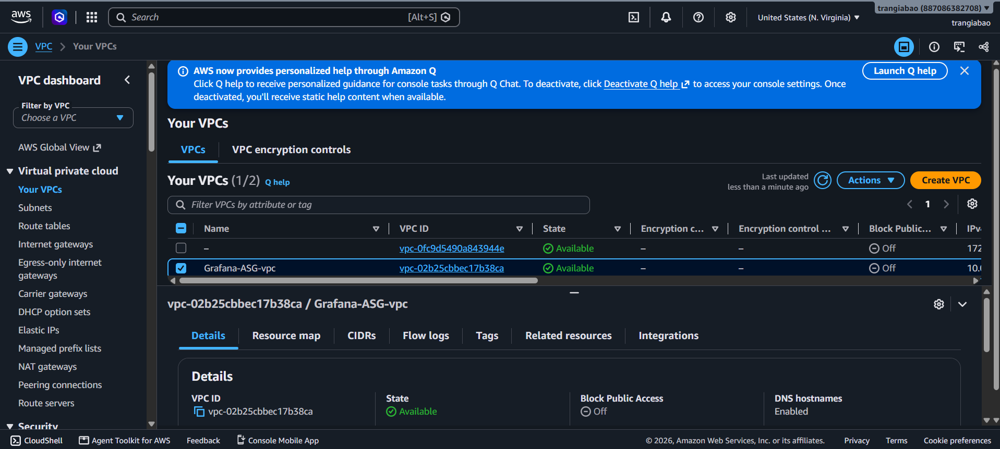

##### Bước 2: Kích hoạt cấp phát địa chỉ Public IPv4 tự động trên Subnet
* **Thao tác:** Tại menu bên trái VPC, chọn **Subnets** ➔ Tích chọn subnet `Grafana-ASG-subnet-public1-us-east-1a` (`subnet-0fe0631efc71d460b`).
* **Thực hiện:** Nhấn nút **Actions** ➔ Chọn **Edit subnet settings** ➔ Đánh dấu tích vào tùy chọn **Enable auto-assign public IPv4 address** ➔ Nhấn **Save**. Thông báo màu xanh hiển thị xác nhận cấu hình thành công, bảo đảm máy chủ EC2 khi khởi chạy vào Subnet này sẽ tự động nhận địa chỉ IP công khai.

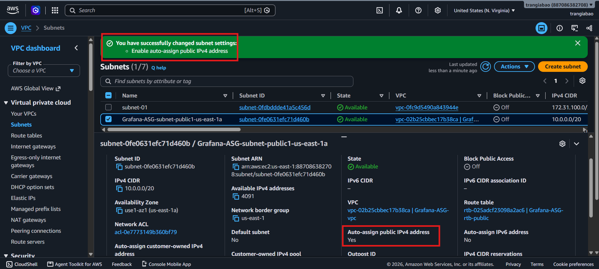

##### Bước 3: Cấu hình Security Group mở cổng dịch vụ Grafana và SSH
* **Thao tác:** Điều hướng đến mục **Security Groups** ➔ Khởi tạo Security Group mới với tên `SG-PUB-Grafana-ASG` (`sg-0b5bc8236a3cadcd8`) liên kết với VPC `Grafana-ASG-vpc`.
* **Thực hiện cấu hình Inbound Rules:**
  1. **Custom TCP - Cổng 3000:** Mở cho phép truy cập giao diện đồ họa Grafana Web UI từ trình duyệt.
  2. **SSH - Cổng 22:** Mở để kỹ sư kết nối dòng lệnh quản trị máy chủ qua giao thức Secure Shell.
  3. **All ICMP - IPv4:** Mở để kiểm tra kết nối mạng (Ping) và chẩn đoán độ trễ gói tin.

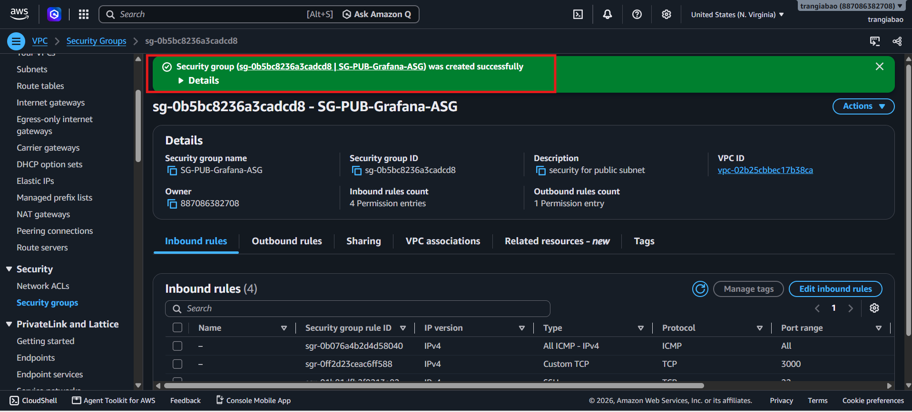

---

#### Phần 2: Khởi tạo Máy chủ EC2 và Thiết lập Phân quyền IAM (EC2 & IAM Security Setup)

##### Bước 4: Khởi chạy máy chủ EC2 Grafana-Server
* **Thao tác:** Mở dịch vụ **Amazon EC2** ➔ Chọn **Launch instances**.
* **Thực hiện cấu hình chi tiết:**
  * **Tên máy chủ:** `Grafana-Server`.
  * **Hệ điều hành (AMI):** Amazon Linux 2023 (AL2023) 64-bit (x86_64).
  * **Instance Type:** `t3.micro` (tối ưu hóa chi phí Free Tier).
  * **Mạng (Network Settings):** Chọn VPC `Grafana-ASG-vpc`, Subnet `Grafana-ASG-subnet-public1-us-east-1a`, gắn Security Group `SG-PUB-Grafana-ASG`.
  * Máy chủ khởi tạo thành công với mã Instance ID: `i-082d165f34a40407f`, địa chỉ Public IPv4: `44.203.10.190` và Private IP: `10.0.4.227`.

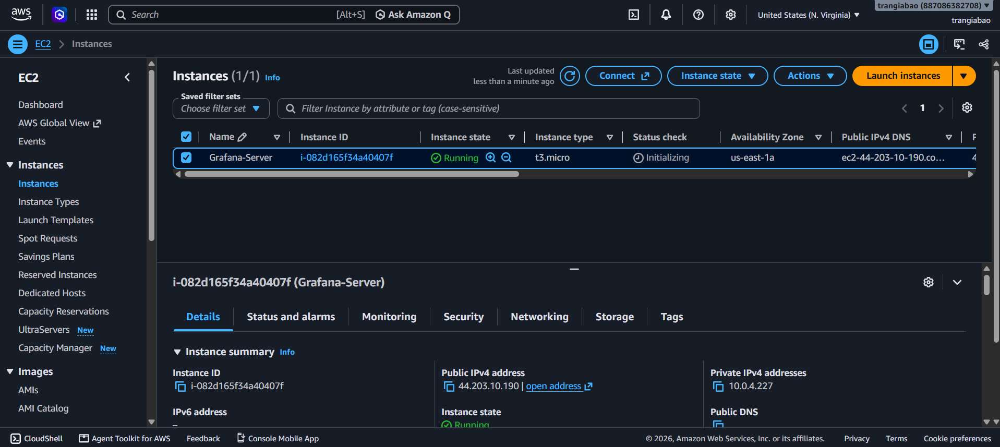

##### Bước 5: Khởi tạo người dùng IAM và cấp phát Access Key (Tùy chọn CLI / Data Source)
* **Thao tác:** Mở dịch vụ **IAM** ➔ Vào mục **Users** ➔ Chọn **Create user** ➔ Nhập tên người dùng `Grafana-user`.
* **Thực hiện:** Thiết lập quyền truy cập cho người dùng và hoàn tất bước khởi tạo. Sau đó chuyển sang mục **Create access key** để tạo mã Access Key ID (`AKIA_DEMO_SAMPLE_KEY_ID`) phục vụ xác thực dự phòng hoặc thao tác qua công cụ lập trình.

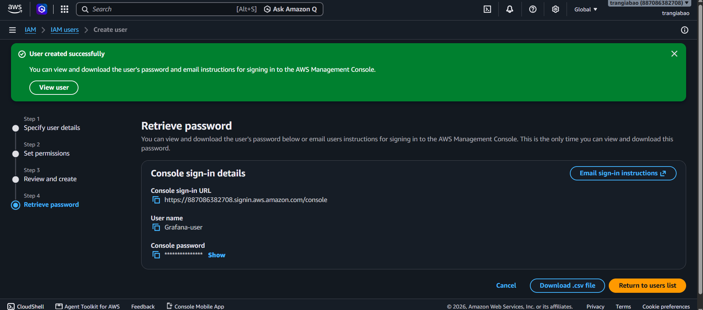

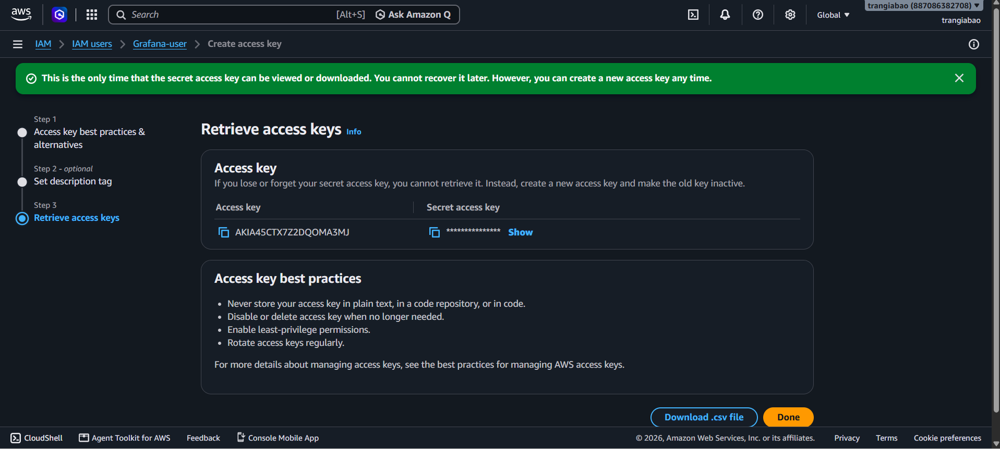

##### Bước 6: Khởi tạo IAM Policy `GrafanaAccessPolicy`
* **Thao tác:** Tại menu IAM, chọn **Policies** ➔ Nhấn **Create policy**.
* **Thực hiện:** Cấu hình chính sách JSON cấp quyền chỉ đọc (Read-Only) đối với dịch vụ CloudWatch và CloudWatch Logs (`cloudwatch:Describe*`, `cloudwatch:Get*`, `cloudwatch:List*`, `logs:DescribeLogGroups`, `logs:FilterLogEvents`). Đặt tên chính sách là `GrafanaAccessPolicy` và nhấn hoàn tất.

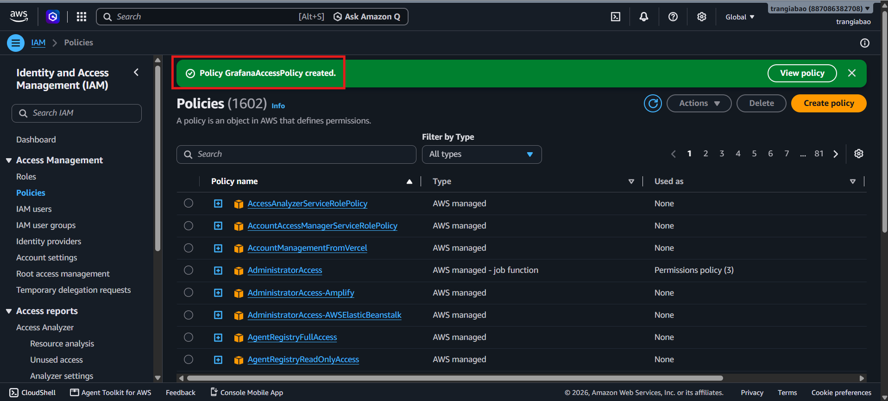

##### Bước 7: Khởi tạo IAM Role và gắn trực tiếp vào máy chủ EC2
* **Thao tác:** Chọn mục **Roles** ➔ Nhấn **Create role** ➔ Trusted entity type chọn **AWS service** (dịch vụ `EC2`) ➔ Gắn chính sách `GrafanaAccessPolicy` vừa tạo ➔ Đặt tên Role là `GrafanaAccessRole`.
* **Gắn Role vào máy chủ:** Quay lại bảng điều khiển EC2 ➔ Chọn máy chủ `Grafana-Server` (`i-082d165f34a40407f`) ➔ Chọn **Actions** ➔ **Security** ➔ **Modify IAM role** ➔ Chọn `GrafanaAccessRole` ➔ Nhấn **Update IAM role**. Màn hình thông báo màu xanh xác nhận đã liên kết Role thành công vào Instance Profile.

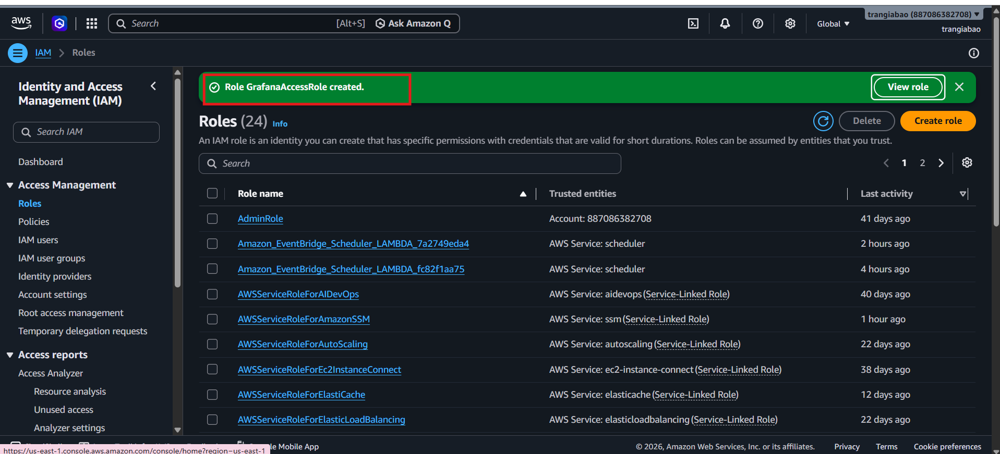

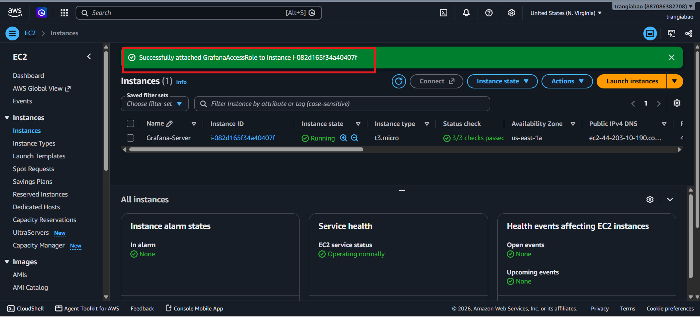

---

#### Phần 3: Cài đặt và Vận hành Dịch vụ Grafana trên Amazon Linux 2023 (Grafana Deployment)

##### Bước 8: Kết nối SSH và thiết lập kho lưu trữ YUM (Grafana Repository)
* **Thao tác:** Sử dụng PuTTY hoặc Terminal SSH kết nối vào máy chủ với tài khoản mặc định `ec2-user` và địa chỉ IP `44.203.10.190`.
* **Thực hiện cập nhật hệ thống và tạo file repo:**
  ```bash
  sudo yum update -y
  sudo nano /etc/yum.repos.d/grafana.repo
  ```
* **Nội dung cấu hình kho lưu trữ chính thức:**
  ```ini
  [grafana]
  name=grafana
  baseurl=https://rpm.grafana.com
  repo_gpgcheck=1
  enabled=1
  gpgcheck=1
  gpgkey=https://rpm.grafana.com/gpg.key
  sslverify=1
  sslcacert=/etc/pki/tls/certs/ca-bundle.crt
  ```

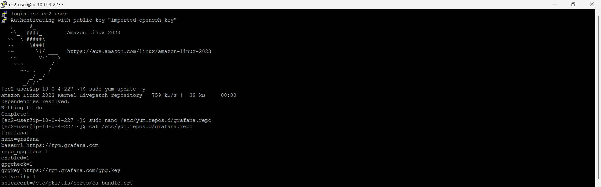

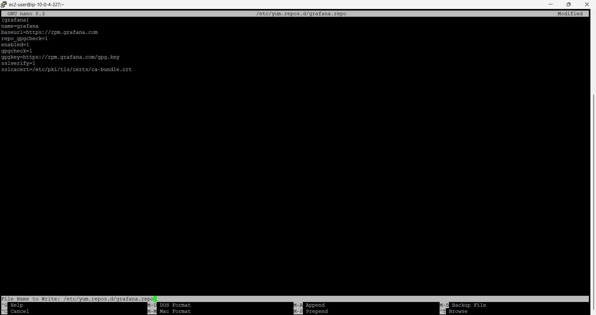

##### Bước 9: Cài đặt gói ứng dụng Grafana
* **Thao tác:** Chạy câu lệnh cài đặt tự động qua trình quản lý gói YUM:
  ```bash
  sudo yum install grafana -y
  ```
* **Kết quả:** Hệ thống tự động nạp khóa GPG của Grafana Labs (`engineering@grafana.com`), giải quyết các gói phụ thuộc và cài đặt hoàn tất phiên bản `grafana-13.3.0-1.x86_64` (kích thước sau giải nén khoảng 1.3 GB).

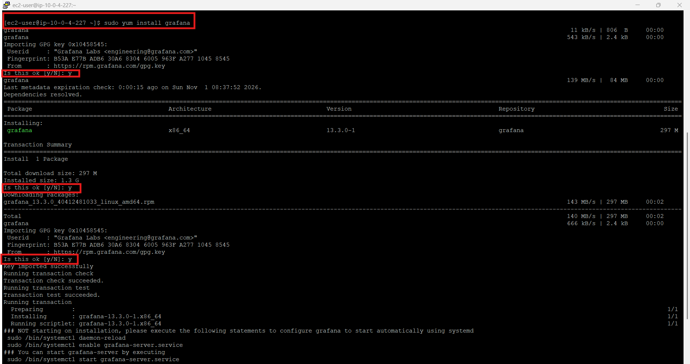

##### Bước 10: Khởi động dịch vụ grafana-server và xác nhận trạng thái
* **Thao tác:** Thực thi các lệnh nạp lại cấu hình dịch vụ, bật tự động khởi động cùng hệ thống và khởi chạy dịch vụ Grafana:
  ```bash
  sudo systemctl daemon-reload
  sudo systemctl enable grafana-server.service
  sudo systemctl start grafana-server.service
  sudo systemctl status grafana-server.service
  ```
* **Kết quả kiểm tra:** Dịch vụ chuyển sang trạng thái xanh `active (running)`, tiến trình chính lắng nghe cổng nội bộ và sẵn sàng phục vụ các yêu cầu qua giao thức HTTP.

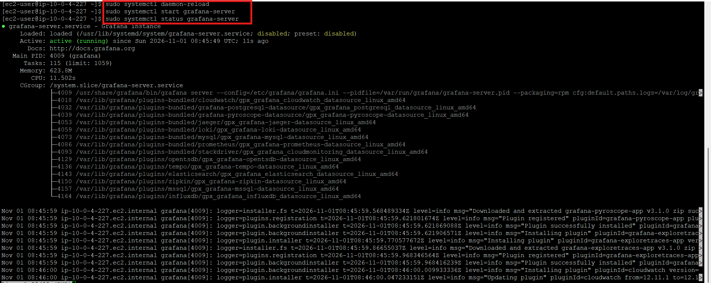

##### Bước 11: Đăng nhập giao diện Web Grafana và đổi mật khẩu quản trị
* **Thao tác:** Mở trình duyệt web và truy cập theo đường dẫn: `http://44.203.10.190:3000`.
* **Đăng nhập lần đầu:** Nhập thông tin mặc định của hệ thống với tài khoản `admin` và mật khẩu `admin`.
* **Đổi mật khẩu:** Ngay sau khi đăng nhập, giao diện yêu cầu thiết lập mật khẩu quản trị viên mới để bảo đảm an toàn thông tin (nhập mật khẩu mới `giabao2005` và xác nhận).

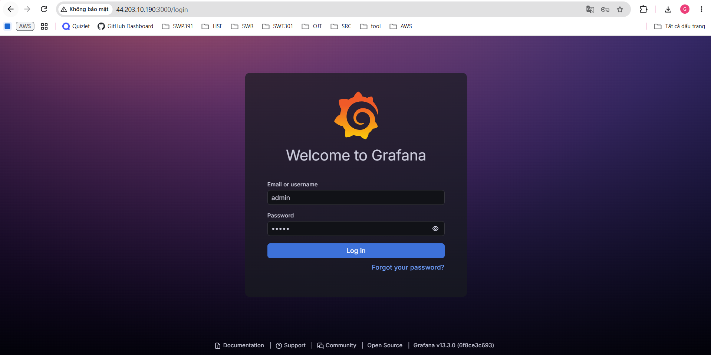

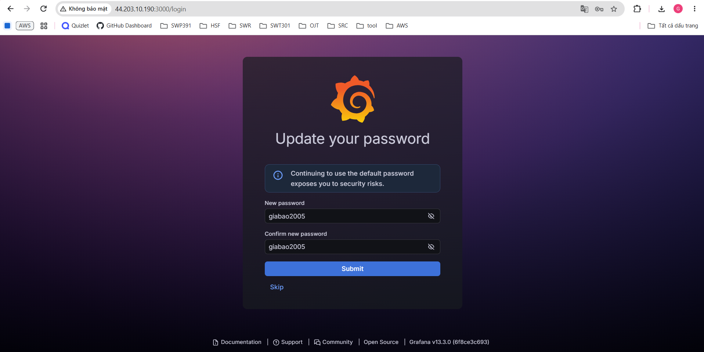

---

#### Phần 4: Kết nối Nguồn dữ liệu CloudWatch & Xây dựng Dashboard Giám sát (Observability Dashboards)

##### Bước 12: Thêm CloudWatch Data Source và kiểm tra kết nối API thành công
* **Thao tác:** Tại menu điều hướng bên trái Grafana, chọn mục **Connections** ➔ **Data sources** ➔ Chọn **Add new data source** ➔ Tìm kiếm và chọn dịch vụ **CloudWatch**.
* **Thực hiện cấu hình:**
  * **Authentication Provider:** Chọn `AWS SDK Default` (Grafana tự động tận dụng IAM Role `GrafanaAccessRole` đã gắn vào máy chủ EC2 mà không cần điền Access Key thủ công).
  * **Default Region:** Chọn `us-east-1` (hoặc vùng triển khai tài nguyên cần giám sát).
* **Kiểm tra kết nối:** Cuộn xuống cuối trang và nhấn nút **Save & test**. Hệ thống hiển thị thông báo trạng thái màu xanh xác nhận kết nối thành công:
  * `1. Successfully queried the CloudWatch metrics API.`
  * `2. Successfully queried the CloudWatch logs API.`

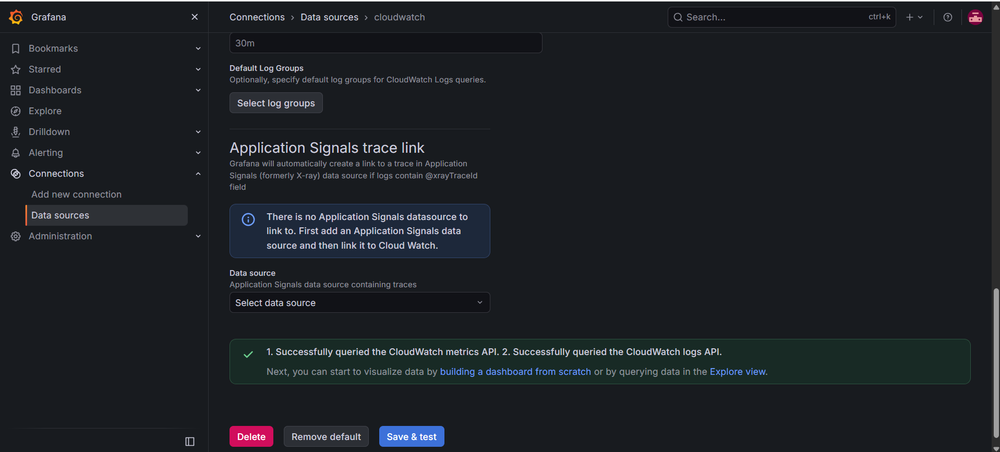

##### Bước 13: Xây dựng Dashboard giám sát chỉ số CPU Utilization
* **Thao tác:** Vào mục **Dashboards** ➔ Chọn **New dashboard** ➔ Nhấn **Add visualization** ➔ Chọn Data source vừa tạo là `cloudwatch`.
* **Cấu hình câu truy vấn chỉ số (Query Editor):**
  * **Namespace:** `AWS/EC2`.
  * **Metric name:** `CPUUtilization`.
  * **Statistic:** `Average`.
  * **Dimensions:** Chọn `InstanceId` = `i-082d165f34a40407f`.
* **Kết quả:** Biểu đồ đường dạng chuỗi thời gian (Time series) phản ánh trung thực mức độ tải CPU theo thời gian thực của máy chủ.

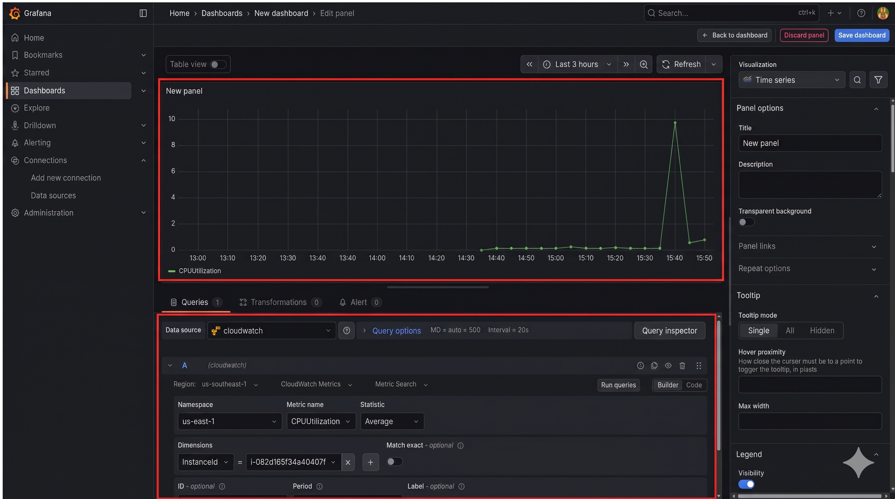

##### Bước 14: Khám phá truy vấn nâng cao với công cụ Explore
* **Thao tác:** Tại menu chính, chọn tính năng **Explore** ➔ Chọn nguồn dữ liệu `cloudwatch`.
* **Thực hiện truy vấn linh hoạt:**
  * Lựa chọn vùng khảo sát: `ap-southeast-1` (hoặc vùng mong muốn).
  * Metric: `CPUUtilization`, Dimension: `InstanceId` = `i-0ba9a1a9ccab2d73f`.
  * Chuyển đổi định dạng biểu diễn sang dạng cột đứng (**Bars**) để trực quan hóa các đợt tải đột biến (Spike) một cách rõ nét và trực quan hơn.

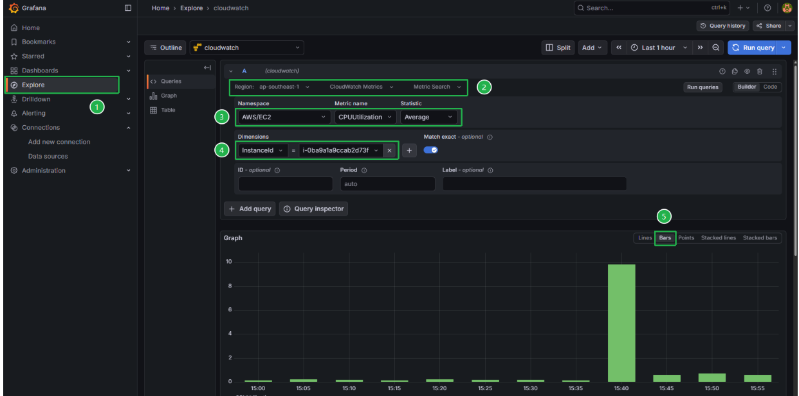

---

### 💡 Bài học kinh nghiệm & Ngân hàng khắc phục sự cố (Troubleshooting Bank):

{}
Dưới đây là 5 tình huống sự cố thực tế thường gặp trong quá trình cài đặt Grafana và tích hợp CloudWatch cùng các giải pháp xử lý triệt để:
{}

#### 1. Sự cố không thể truy cập giao diện Grafana qua cổng 3000 (Connection Timed Out)
* **Nguyên nhân:** Security Group của máy chủ EC2 chưa cho phép luồng dữ liệu Inbound trên cổng 3000 từ địa chỉ IP của kỹ sư, hoặc máy chủ EC2 nằm trong Private Subnet không có Internet Gateway.
* **Cách xử lý:** Kiểm tra bảng quy tắc Inbound Rules của Security Group `SG-PUB-Grafana-ASG`, bổ sung quy tắc cho phép Custom TCP cổng `3000` với nguồn `0.0.0.0/0` (hoặc `My IP`). Đồng thời xác nhận Subnet đã được gắn Route Table trỏ dải `0.0.0.0/0` về Internet Gateway (`igw-xxxx`).

#### 2. Lỗi phân quyền CloudWatch Data Source (AccessDeniedException / HTTP 403)
* **Nguyên nhân:** IAM Role gắn vào EC2 thiếu các chính sách hành động đọc telemetry cần thiết từ dịch vụ CloudWatch và CloudWatch Logs.
* **Cách xử lý:** Đảm bảo chính sách `GrafanaAccessPolicy` có đầy đủ các quyền:
  ```json
  {
    "Version": "2012-10-17",
    "Statement": [
      {
        "Sid": "AllowGrafanaCloudWatchAccess",
        "Effect": "Allow",
        "Action": [
          "cloudwatch:DescribeAlarmsForMetric",
          "cloudwatch:DescribeAlarmHistory",
          "cloudwatch:DescribeAlarms",
          "cloudwatch:ListMetrics",
          "cloudwatch:GetMetricStatistics",
          "cloudwatch:GetMetricData",
          "logs:DescribeLogGroups",
          "logs:GetLogGroupFields",
          "logs:StartQuery",
          "logs:StopQuery",
          "logs:GetQueryResults",
          "logs:GetLogEvents",
          "ec2:DescribeTags",
          "ec2:DescribeInstances",
          "ec2:DescribeRegions"
        ],
        "Resource": "*"
      }
    ]
  }
  ```

#### 3. Best Practice: Sử dụng EC2 IAM Role thay thế hoàn toàn Access Key/Secret Key
* **Phân tích:** Việc nhập cứng Access Key ID và Secret Access Key vào cấu hình Data Source của Grafana tiềm ẩn nguy cơ rò rỉ thông tin bảo mật và khó khăn trong việc xoay vòng khóa (Key Rotation).
* **Khuyến nghị kiến trúc:** Khi cài đặt Grafana trên EC2, cấu hình Authentication Provider dạng **AWS SDK Default**. Ứng dụng sẽ tự động gọi dịch vụ Instance Metadata Service (IMDSv2) để lấy Token xác thực ngắn hạn từ `GrafanaAccessRole`, bảo đảm tuân thủ nguyên tắc an toàn Zero-Trust.

#### 4. Dịch vụ grafana-server không tự khởi động khi máy chủ EC2 Reboot
* **Nguyên nhân:** Quản trị viên chỉ thực hiện `systemctl start grafana-server` mà quên kích hoạt cờ tự khởi động cùng hệ điều hành.
* **Cách xử lý:** Luôn thực thi lệnh `sudo systemctl enable grafana-server` sau khi cài đặt. Kiểm tra trạng thái bằng lệnh `systemctl is-enabled grafana-server` (kết quả trả về `enabled`).

#### 5. Quy trình dọn dẹp tài nguyên để tối ưu hóa chi phí (Resource Cleanup)
* **Thao tác dọn dẹp sau bài thực hành:**
  1. Hủy (Terminate) máy chủ EC2 `Grafana-Server` (`i-082d165f34a40407f`).
  2. Gỡ bỏ và xóa IAM Role `GrafanaAccessRole` cùng Policy `GrafanaAccessPolicy`.
  3. Xóa Security Group `SG-PUB-Grafana-ASG`.
  4. Nếu sử dụng VPC thử nghiệm riêng biệt, tiến hành xóa VPC `Grafana-ASG-vpc` để giải phóng Subnets và Internet Gateway, ngăn ngừa phát sinh chi phí ngoài ý muốn.
