---
title: "Week 6"
date: 2026-10-19
weight: 6
chapter: false
pre: " <b> 1.6. </b> "
---


### Objectives for Week 6:

* Master account ceiling governance and compute vCPU thresholds via **AWS Service Quotas** and collaborate with the **AWS Support Center**.
* Design and implement a serverless cost optimization architecture for EC2 instances utilizing **AWS Lambda**, **Amazon EventBridge Scheduler**, and ChatOps integration through **Slack Incoming Webhooks**.
* Standardize resource tagging strategies and centralized management utilizing **AWS Tags** (console-based & automated via AWS CLI) and **AWS Resource Groups**.
* Deploy advanced visualization and infrastructure observability using **Grafana** integrated with **Amazon CloudWatch** data sources (Workshop 000029 - Getting started with Grafana basic).
* Consolidate Week 6 learnings, finalize comprehensive Worklog entries, and advance the internship capstone project (**Project Proposal**).

---

### Tasks to be implemented this week:

| Day | Task | Start Date | Completion Date | Reference Material |
| :--- | :--- | :--- | :--- | :--- |
| **Monday** | **Resource Limit Governance with AWS Service Quotas:** <br>- Explore the Service Quotas system & audit EC2 Spot vCPU limits. <br>- Test interactive console input validation rules. <br>- Submit request increasing Spot vCPU ceiling from 32 to 64 (`L-34B43A08`). <br>- Monitor and verify AWS Support approval (Case ID: `179257232100832`). <br>- Automate quota queries via AWS CLI & configure CloudWatch alarms. | 19/10/2026 | 19/10/2026 | [AWS Service Quotas](https://docs.aws.amazon.com/servicequotas/) |
| **Tuesday** | **Optimize Amazon EC2 Costs with AWS Lambda & Slack Notifications:** <br>- Tag target EC2 instances with `environment_auto: true` for automated governance. <br>- Establish ChatOps incoming webhook integration with Slack. <br>- Configure IAM Execution Role granting EC2 lifecycle management privileges. <br>- Develop and deploy automated stop/start functions (`dc-common-lambda-auto-stop`, `dc-common-lambda-auto-start`). <br>- Configure recurring EventBridge schedules aligned with business operating hours. <br>- Execute real-time verification tests and receive instantaneous Slack notifications. | 20/10/2026 | 20/10/2026 | [Optimize EC2 Cost with Lambda](https://000022.awsfcaj.com/) |
| **Wednesday** | **Resource Governance with AWS Tags & Resource Groups:** <br>- Launch test EC2 instances and manage resource tags via the AWS Management Console. <br>- Create IAM Access Keys and automate tagging with the AWS CLI (`create-tags`). <br>- Perform multi-attribute resource queries using advanced CLI filters (`describe-instances --filters`). <br>- Create an AWS Resource Group (`EnvTest`) to automatically aggregate resources matching environment tags. <br>- Document troubleshooting lessons on case-sensitivity, tag limits, and regional scope constraints. | 21/10/2026 | 21/10/2026 | [AWS Tagging & Resource Groups](https://docs.aws.amazon.com/ARG/latest/userguide/welcome.html) |
| **Thursday** | **Infrastructure Observability with Grafana & CloudWatch (Workshop 000029):** <br>- Provision VPC, public subnet with auto-assign public IPv4, and security group for port 3000 & 22. <br>- Launch an Amazon Linux 2023 EC2 host and configure an IAM Role granting CloudWatch read access. <br>- Install and enable the `grafana-server` background daemon using YUM repository and systemd. <br>- Connect CloudWatch Data Source and validate telemetry APIs (Metrics and Logs). <br>- Construct time-series dashboards for CPUUtilization and perform ad-hoc exploration with Bar charts. | 22/10/2026 | 22/10/2026 | [Getting started with Grafana basic](https://000029.awsfcaj.com/) |
| **Friday** | **Week 6 Review, Worklog & Project:** <br>- Synthesize concepts across Service Quotas, Lambda FinOps, AWS Tagging & Grafana CloudWatch. <br>- Finalize technical details and evidence screenshots for Worklogs 1.6.1 through 1.6.4. <br>- Dedicate time to AWS architecture research and develop the internship Project Proposal. | 23/10/2026 | 23/10/2026 | [Internal Review & Project Documentation](/2-proposal/) |

---

### Achievements for Week 6:

#### 📌 Results for Monday (19/10/2026) - Resource Limit Governance with AWS Service Quotas:

{}
The **Resource Limit Governance with AWS Service Quotas** lab was completed on **Monday (19/10/2026)** as part of **Week 6**. This page provides comprehensive documentation of reviewing default service quotas, initiating an account-level quota increase request for **EC2 Spot Instances** (`All Standard (A, C, D, H, I, M, R, T, Z) Spot Instance Requests`, Quota code `L-34B43A08`) from **32 to 64 vCPUs** in the **us-east-1** region, analyzing cloud cost implications, tracking the resolution lifecycle via **AWS Support Center** (Case ID: `179257232100832`), receiving formal confirmation emails from Amazon Web Services, and automating quota queries with the **AWS CLI**.
{}

### 🎯 Lab Objectives:
* Understand the core concept and strategic role of **AWS Service Quotas** in enterprise cloud governance, billing safeguard enforcement, and account infrastructure defense.
* Distinguish between **Soft Limits** (service limits that can be increased via request) and **Hard Limits** (immutable physical or architectural boundaries enforced by AWS).
* Master the modern Amazon EC2 quota paradigm: understanding how AWS calculates computing thresholds based on cumulative **vCPUs** rather than raw server instance counts.
* Execute a formal **Request Quota Increase** workflow, scaling compute capacity from 32 to 64 vCPUs for standard **EC2 Spot Instances** (`All Standard (A, C, D, H, I, M, R, T, Z) Spot Instance Requests`).
* Experience interactive client-side **Input Validation** on the AWS Management Console when attempting to enter invalid quota thresholds.
* Learn the inter-service communication workflow between customer accounts and the **AWS Support Center** under the **Basic Support Plan**.
* Resolve a fundamental cloud economics (**Cloud FinOps**) dilemma: *Does requesting or getting approved for a Service Quota increase incur any financial charges?*
* Leverage the **AWS CLI** (`aws service-quotas`) to automate quota discovery, query specific limits, inspect historical change requests, and script compliance validation.
* Establish **Proactive Quota Monitoring** by designing CloudWatch Alarms that notify operators when resource consumption approaches 80% and 95% of the allocated ceiling.

---

### 📊 Provisioned Resource Specifications:

| Parameter / Resource | Actual Value | Technical Significance & Role |
| :--- | :--- | :--- |
| **AWS Service** | `Amazon Elastic Compute Cloud (Amazon EC2)` | Core compute service providing scalable virtual computing capacity in the cloud |
| **Quota Name** | `All Standard (A, C, D, H, I, M, R, T, Z) Spot Instance Requests` | Cumulative vCPU threshold for standard compute-family Spot Instances |
| **Quota Code** | `L-34B43A08` | Canonical AWS identifier for standard Spot vCPU allocation |
| **Target Region** | `us-east-1` (US East - N. Virginia) | AWS geographic region where the quota applies |
| **Default Quota Value** | `32 vCPUs` | Out-of-the-box ceiling configured by AWS for the account |
| **Requested Quota Value**| `64 vCPUs` | New requested compute ceiling submitted for AWS approval |
| **Support Case ID** | `179257232100832` | Automated case tracking identifier created in AWS Support Center |
| **Account Support Plan** | `Basic Support` | Standard non-paid support tier included with all AWS accounts |
| **Resolution Status** | `Case Closed` / `Approved` | Request successfully validated and granted by AWS technical engineers |
| **Propagation Time** | Within `30 minutes` | Time required to synchronize the new quota across global distributed fleets |
| **Notification Channel** | Official email from `Amazon Web Services` | Administrator inbox receiving official approval verification |

---

### 📋 Detailed Step-by-Step Implementation Guide:

#### 🔹 Module 1: Exploring AWS Service Quotas & Inspecting EC2 Limits

##### Step 1: Navigate to the AWS Service Quotas Console
* **Action:** Sign in to the **AWS Management Console** ➔ Type `Service Quotas` into the top search bar ➔ Select **Service Quotas** from the services list.
* **Verify Region:** Confirm in the top navigation bar that the active region is **US East (N. Virginia) `us-east-1`**. Note that the vast majority of AWS infrastructure quotas are enforced independently per geographic region (**Per-Region Quotas**).
* **Objective:** The Service Quotas dashboard provides a centralized pane of glass to view default values, current applied values, and utilization percentages across over 250 AWS services.

##### Step 2: Navigate to Amazon Elastic Compute Cloud (EC2)
* **Action:** On the left navigation pane, click **AWS services** ➔ In the service filter search box, enter `EC2` or `Amazon Elastic Compute Cloud (Amazon EC2)` ➔ Click the service name to inspect its catalog of configurable quotas.
* **Observation:** EC2 manages hundreds of distinct quotas covering Elastic IPs, VPC Peering limits, Launch Templates, and vCPU quotas categorized by instance families (Standard, High Memory, Accelerated Computing) and pricing models (On-Demand vs Spot).

##### Step 3: Filter for the Standard Spot vCPU Quota
* **Action:** In the quota search box (**Filter quotas**), enter: `All Standard (A, C, D, H, I, M, R, T, Z) Spot Instance Requests`.
* **Displayed Metadata:**
  * **Quota name:** `All Standard (A, C, D, H, I, M, R, T, Z) Spot Instance Requests`
  * **Quota code:** `L-34B43A08`
  * **Default value:** `32` (vCPUs)
  * **Applied value:** `32` (vCPUs)
* **Significance:** This quota dictates that within `us-east-1`, the account can run concurrent standard Spot instances up to a collective sum of **32 vCPUs**. For example, 16 instances of `t3.medium` (2 vCPUs x 16 = 32 vCPUs) or 4 instances of `c5.2xlarge` (8 vCPUs x 4 = 32 vCPUs).

---

#### 🔹 Module 2: Submitting a Quota Increase Request

##### Step 4: Open Request Modal and Test Input Validation
* **Action:** Select the `All Standard (A, C, D, H, I, M, R, T, Z) Spot Instance Requests` entry ➔ Click the orange **Request increase at account level** button.
* **Modal Context:** The dialog displays:
  * *Description:* The maximum number of vCPUs for all running or requested Standard (A, C, D, H, I, M, R, T, Z) Spot Instances per Region.
  * *Requested for:* Account ID `887086382708`.
  * *Region:* United States (N. Virginia) `us-east-1`.
* **Testing Input Validation:**
  * In the **Increase quota value** field, enter `32` (matching the current limit).
  * **Console Feedback:** An immediate red client-side validation error is triggered:
    > ❌ **Must be a number greater than your current quota value of 32**
  * **Technical Takeaway:** AWS enforces robust UI-level validation to prevent redundant, no-op support ticket submissions.

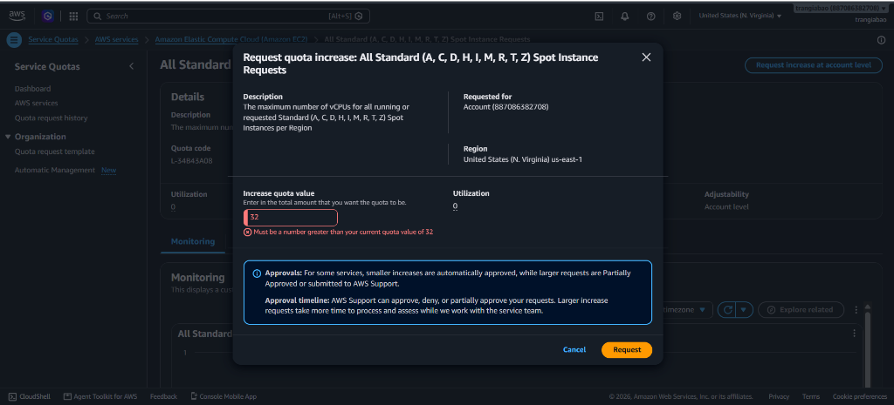

##### Step 5: Input Target Limit of 64 vCPUs and Submit
* **Input Parameter:**
  * **Increase quota value:** Enter `64` (doubling compute capacity to support parallel distributed workloads with Spot cost savings).
* **AWS Approval Notice:**
  > ℹ️ **Approvals:** For some services, smaller increases are automatically approved, while larger requests are partially approved or routed to AWS Support for engineering review.
* **Action:** Click **Request** to transmit the formal quota increase application.

---

#### 🔹 Module 3: Tracking Approval Lifecycle and Verifying Resolution

##### Step 6: Monitor Progress via the Service Quotas Dashboard
* **Action:** Return to the primary **Service Quotas** console ➔ Navigate to **Dashboard** or **Quota request history**.
* **Review "Recent quota increase requests":**
  * **Service:** `Amazon Elastic Compute Cloud (Amazon EC2)`
  * **Quota name:** `All Standard (A, C, D, H, I, M, R, T, Z) Spot Instance Requests`
  * **Request type:** `User`
  * **Requested quota value:** `64`
  * **Status:** `Case Closed` (Support ticket reviewed and successfully completed)
  * **Request date:** `21 thg 10, 2026`
  * **Last updated date:** `21 thg 10, 2026`

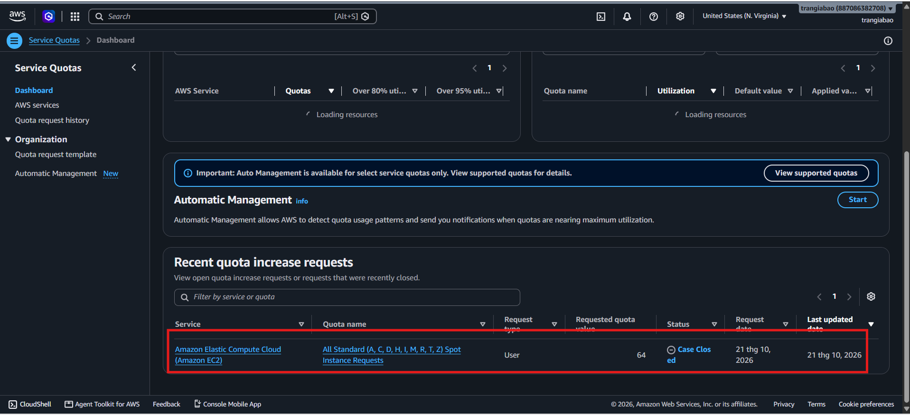

##### Step 7: Receive Official Email Confirmation from AWS Support
* **Delivery Channel:** Primary administrator Gmail inbox linked to account `trangiabao`.
* **Subject:** Service Quota Increase Notification from AWS Support.
* **Email Body Content:**
  > *"Hello there,*  
  > *Thank you for your patience while I was working on your request.*  
  > *I am pleased to inform you that your quota increase has been approved. For your convenience, I have included details of the approved Quota here:*  
  > **[US East (Northern Virginia)]: EC2 Spot Instances / All Standard (A, C, D, H, I, M, R, T, Z) Spot Instance Requests, New Limit = 64**  
  > *The new quota will take effect in 30 minutes and you can see the newly approved quota on your Service Quotas console..."*

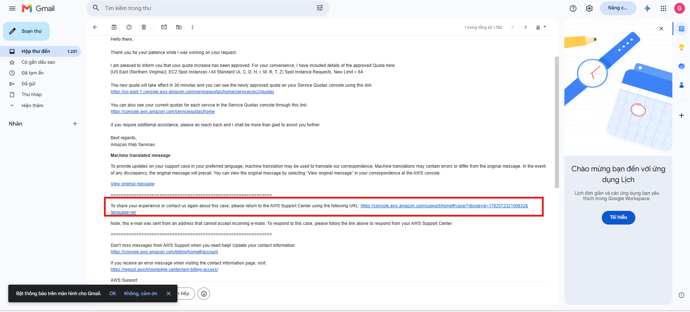

##### Step 8: Inspect Resolution in AWS Support Center
* **Action:** Click the Help icon in the top header ➔ Select **Support Center** ➔ Navigate to **Your support cases** ➔ Select the closed ticket.
* **Support Case Verification:**
  * **Plan:** `Basic Support` (Standard complimentary tier).
  * **Timestamp:** `Wed Oct 21 2026 15:49:28 GMT+0700`.
  * **Technical Outcome:** Support engineers confirmed that the **New Limit = 64** configuration has been committed to the `us-east-1` capacity allocator.
  * **Propagation Window:** A propagation window of approximately **30 minutes** is allocated for worldwide distributed control planes to complete consistency synchronization.

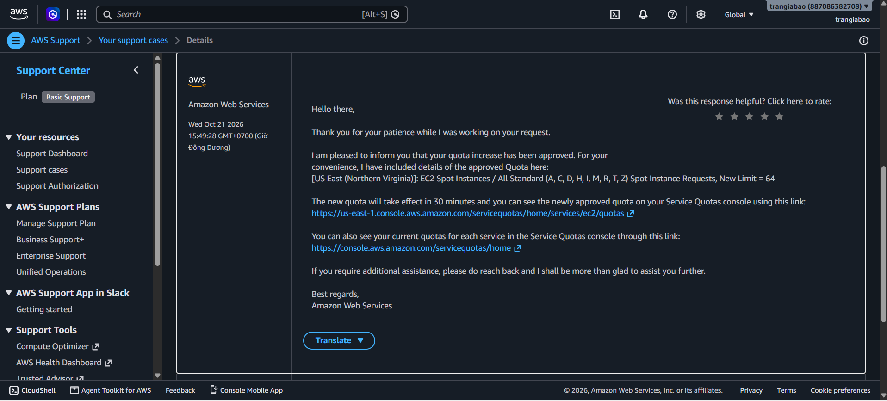

---

#### 🔹 Module 4: Managing Service Quotas Programmatically via AWS CLI

In addition to Console workflows, cloud infrastructure engineers automate service quota audits and limit requests using the **AWS CLI v2**.

##### Step 9: Query Service Codes for EC2
Discover canonical service identifiers:

```bash
aws service-quotas list-services \
  --query "Services[?contains(ServiceCode, 'ec2')].{Code:ServiceCode, Name:ServiceName}" \
  --output table
```

##### Step 10: Query Current Spot vCPU Limit via Quota Code `L-34B43A08`
Inspect the active value in `us-east-1`:

```bash
aws service-quotas get-service-quota \
  --service-code ec2 \
  --quota-code L-34B43A08 \
  --region us-east-1 \
  --query "Quota.{QuotaName:QuotaName, QuotaCode:QuotaCode, Value:Value, Unit:Unit, Adjustable:Adjustable}" \
  --output json
```

* **Sample JSON Response:**
```json
{
  "QuotaName": "All Standard (A, C, D, H, I, M, R, T, Z) Spot Instance Requests",
  "QuotaCode": "L-34B43A08",
  "Value": 64.0,
  "Unit": "None",
  "Adjustable": true
}
```
* **Analysis:** The `"Value": 64.0` field confirms system-wide convergence on the 64 vCPU limit, while `"Adjustable": true` confirms this is an elastic soft quota.

##### Step 11: Scripting Automated Quota Increase Requests
Submit a quota adjustment programmatically:

```bash
aws service-quotas request-service-quota-increase \
  --service-code ec2 \
  --quota-code L-34B43A08 \
  --desired-value 64 \
  --region us-east-1
```

##### Step 12: Inspecting Quota Request History via CLI
Audit the status of historical submissions:

```bash
aws service-quotas list-requested-service-quota-change-history-by-quota \
  --service-code ec2 \
  --quota-code L-34B43A08 \
  --region us-east-1 \
  --query "RequestedQuotas[*].{ID:Id, Status:Status, DesiredValue:DesiredValue, Created:Created}" \
  --output table
```

---

#### 🔹 Module 5: Proactive Limit Monitoring with CloudWatch Alarms

To safeguard auto-scaling groups and distributed jobs against unexpected throttling exceptions, production architectures pair Service Quotas with **CloudWatch Alarms**:

```bash
aws cloudwatch put-metric-alarm \
  --alarm-name "EC2-Spot-vCPU-Quota-Utilization-High" \
  --alarm-description "Trigger alarm when Spot vCPU utilization exceeds 80% of the 64 vCPU ceiling" \
  --namespace "AWS/Usage" \
  --metric-name "ResourceCount" \
  --dimensions Name=Service,Value=EC2 Name=Type,Value=Resource Name=Resource,Value=SpotInstances \
  --statistic Maximum \
  --period 300 \
  --threshold 51.2 \
  --comparison-operator GreaterThanOrEqualToThreshold \
  --evaluation-periods 1 \
  --alarm-actions arn:aws:sns:us-east-1:887086382708:aws-cli
```

---

### 💡 Troubleshooting & Real-World Lessons:

#### 1. Cloud Economics Question: Does increasing a Service Quota from 32 to 64 vCPUs incur billing charges?
* **Technical Reality:** **ABSOLUTELY NOT.**
* **AWS Billing Model:**
  * A Service Quota is purely a "safety ceiling" designed to prevent runaway costs caused by operational mistakes, runaway scripts, or security breaches.
  * Submitting an increase request and having it approved to 64 vCPUs is **100% free of charge**.
  * AWS only bills for **actual compute consumption**—measuring seconds of active instance runtime. If your account holds a limit of 64 vCPUs but runs 0 active instances, your EC2 bill remains exactly **$0.00**.

#### 2. Client-Side Input Validation ("Must be a number greater than your current quota value of 32")
* **Root Cause:** Attempting to submit a request with the value `32`, identical to the active baseline.
* **Resolution:** Submissions must specify a positive integer strictly higher than the current value (e.g., `64` or `128`). Values must be backed by architectural requirements to avoid administrative review rejections.

#### 3. Differentiating Soft Quotas vs. Hard Quotas
* **Soft Quotas:** Administrative safeguards that can be adjusted via Service Quotas or AWS Support tickets (e.g., EC2 vCPUs, Elastic IP allocations, DynamoDB provisioned capacity).
* **Hard Quotas:** Immutable architectural or protocol limits fixed by AWS service design (e.g., DynamoDB maximum item size of 400 KB, SQS payload maximum of 256 KB, maximum VPC peering connections per route table).

#### 4. Regional Scope of Quotas (Per-Region Quotas)
* **Observation:** Increasing the Spot vCPU quota to 64 in `us-east-1` (N. Virginia) leaves other regions (e.g., `ap-southeast-1` Singapore) at their default 32 vCPU limit.
* **Best Practice:** In multi-region deployments or disaster recovery configurations, quota adjustments must be initiated and tracked independently for each designated target region.

#### 5. Shift from Instance-Count Limits to vCPU-Based Quotas
* **Historical Context:** Historically, AWS throttled EC2 instances by gross instance count (e.g., 20 instances). This treated a lightweight `t3.nano` (2 vCPUs, 0.5 GB RAM) identically to a massive `c5.18xlarge` (72 vCPUs, 144 GB RAM).
* **Modern Model:** By measuring raw vCPU capacity, organizations enjoy granular elasticity to deploy diverse instance combinations up to their aggregate compute ceiling.

#### 6. Propagation Delay (~30 Minutes)
* **Behavior:** Attempting to launch instances immediately following ticket closure might briefly yield `MaxSpotInstanceCountExceeded` errors.
* **Mechanism:** AWS operates a massive global control plane. A brief 15 to 30-minute consistency window is necessary for the new capacity quota to replicate to every placement engine across Availability Zones.

#### 7. Account Justification for High-Volume Increases
* **Risk Management:** For new AWS accounts, AWS enforces conservative baseline limits to mitigate fraudulent activity, unauthorized cryptocurrency mining, or DDoS botnet creation.
* **Operational Tip:** When requesting high-magnitude quota jumps, provide clear use-case justifications in the description field (e.g., "Training deep learning models for university capstone research").

#### 8. Automated Multi-Account Quota Templates
* **Enterprise Scaling:** Organizations utilizing **AWS Organizations** can configure **Quota Request Templates**. When new member accounts are provisioned, approved quota increases are automatically requested across all member environments without manual administrative intervention.

---

### 📌 Summary & Skills Acquired:
Through the **Resource Limit Governance with AWS Service Quotas** lab, the intern has acquired:
1. Thorough comprehension of resource quota governance on the AWS cloud platform.
2. Complete practical execution of the vCPU quota increase lifecycle (`L-34B43A08`) from 32 to 64 vCPUs.
3. Cohesive integration between the **Service Quotas Console**, **AWS Support Center**, and **Email notification channels**.
4. Proficiency in programmatic quota querying and proactive threshold monitoring utilizing the **AWS CLI** and **Amazon CloudWatch**, establishing the foundation for large-scale distributed deployments in upcoming weeks.

- **Resource Ceiling Governance (Service Quotas):** Understood how AWS safeguards accounts against accidental budget overruns, misconfigurations, and credential compromise.
- **Hands-On Limit Increase Lifecycles:** Gained real-world experience doubling compute capacity from 32 to 64 vCPUs for standard Spot instances via the AWS Management Console while adhering to input validation rules.
- **Technical Support Case Integration (AWS Support Center):** Experienced case management lifecycle, support notifications, and official email confirmations under the Basic Support tier.
- **CLI Automation & Proactive Monitoring:** Practiced command-line quota auditing and planned CloudWatch alarm thresholds to prevent compute exhaustion before reaching capacity limits.

---

#### 📌 Results for Tuesday (20/10/2026) - Optimize Amazon EC2 Costs with AWS Lambda & Slack Notifications:

{}
The **Optimize Amazon EC2 Costs with AWS Lambda & Slack Notifications** hands-on lab was conducted on **Tuesday (20/10/2026)** as part of **Week 6**. This document details the serverless operational automation architecture using AWS Lambda, Amazon EventBridge Scheduler, and ChatOps telemetry dispatching via Slack Incoming Webhooks.
{}

### 🎯 Lab Objectives
* **Cloud Cost Optimization:** Design and implement an automated compute scheduling architecture for Amazon EC2 instances, automatically stopping non-production development/test servers outside business hours and resuming them prior to the start of the workday, realizing up to 65 - 70% in compute cost savings.
* **Serverless Operational Automation:** Develop serverless routines using **AWS Lambda** (Python 3 Boto3 SDK) coupled with **Amazon EventBridge Scheduler** to govern the complete compute lifecycle without maintaining any dedicated management host or cron server.
* **Dynamic Resource Tagging Governance:** Apply tag-based identification strategies (`environment_auto = true`) enabling Lambda functions to dynamically query, filter, and control target instances without hardcoding instance IDs.
* **Real-Time ChatOps Telemetry via Slack:** Integrate AWS Lambda with **Slack** channels using **Incoming Webhooks**, automatically broadcasting formatted operational alerts displaying instance transition states directly into the `#notification` channel.
* **Enterprise Troubleshooting Competence:** Diagnose and resolve complex runtime exceptions, including state transition constraints (`IncorrectInstanceState`), ghost references to terminated instances, IAM policy evaluation boundaries, and resilient webhook dispatching.

---

### 📊 Provisioned Resource Specifications

| Component / Resource | Identifier (Name / ID) | Technical Specifications / Configuration | Purpose / Notes |
| :--- | :--- | :--- | :--- |
| **AWS Region** | `us-east-1` | US East (N. Virginia) | Primary operational deployment region |
| **Virtual Private Cloud** | `lambda-lab` | CIDR `10.0.0.0/16`, Public Subnet `10.0.128.0/20` (`us-east-1a`) | Isolated network perimeter for test workloads |
| **Security Group** | `lambda-lab` | Inbound: SSH (Port 22), HTTP (Port 80); Outbound: All Traffic | Network access controls for EC2 compute instances |
| **Target Workload (EC2)** | `lambda-lab-instance` / `i-003cb6dbd0f4e5b31` | `t3.micro`, Amazon Linux 2023, Tag: `environment_auto = true` | Development compute subject to scheduled power cycles |
| **IAM Execution Role** | `dc-common-lambda-role` | Trusted: `lambda.amazonaws.com`, Policies: `AmazonEC2FullAccess`, `CloudWatchFullAccessV2` | Grants Lambda full EC2 lifecycle and logging privileges |
| **Lambda Function (Stop)** | `dc-common-lambda-auto-stop` | Runtime: Python 3.14, Memory: 128 MB, Env: `environment_auto = true` | Scans and halts target instances post-workday |
| **Lambda Function (Start)** | `dc-common-lambda-auto-start`| Runtime: Python 3.14, Memory: 128 MB, Env: `environment_auto = true` | Scans and resumes target instances pre-workday |
| **EventBridge Schedule (Stop)** | `dc-common-lambda-auto-stop` | Recurring Schedule: Rate (9 hours) / Cron, Flexible Window: Off | Scheduled event trigger invoking the stop function |
| **EventBridge Schedule (Start)**| `dc-common-lambda-auto-start`| Recurring Schedule: Rate (8 hours) / Cron, Flexible Window: Off | Scheduled event trigger invoking the start function |
| **ChatOps Channel** | `aws-lambda-labs` | Slack Channel: `#notification`, App: `Lambda-Notifier` | Real-time operational alerting channel |

---

### 🛠️ Step-by-Step Practical Implementation

#### Step 1: Network Topology Provisioning & Public Subnet Configuration
1. Open the **Amazon VPC** console within the AWS Management Console.
2. Navigate to **Your VPCs** ➔ Select **Create VPC**.
3. Select the **VPC and more** workflow, set the name tag to `lambda-lab`, and keep the default standard CIDR block. Select **Create VPC**.
4. In the left navigation pane, select **Subnets**, select the newly provisioned public subnet (`lambda-lab-subnet-public...`) ➔ Select **Actions** ➔ **Edit subnet settings**.
5. Enable **Enable auto-assign public IPv4 address** to ensure newly launched EC2 compute receives a routable public IP. Select **Save**.

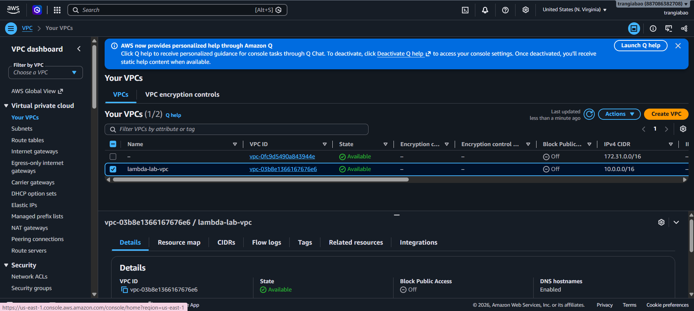
*Figure 1.1: Detailed overview of VPC lambda-lab route tables and subnets upon successful provisioning.*

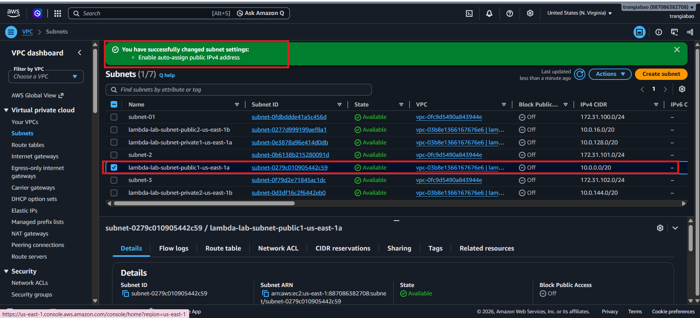
*Figure 1.2: Configuring automatic public IPv4 address assignment for resources inside the public subnet.*

---

#### Step 2: Security Group Configuration
1. Under the VPC console navigation pane, select **Security Groups** ➔ Select **Create security group**.
2. Define basic configuration details:
   * **Security group name:** `lambda-lab`
   * **Description:** `security group for lambda lab`
   * **VPC:** Ensure the newly created VPC **`lambda-lab`** is explicitly selected.
3. Establish inbound firewall rules:
   * Rule 1: Type **SSH** (Port 22), Source `0.0.0.0/0` (Anywhere-IPv4).
   * Rule 2: Type **HTTP** (Port 80), Source `0.0.0.0/0` (Anywhere-IPv4).
4. Verify Outbound rules default to `All traffic` unrestricted outbound access. Select **Create security group**.

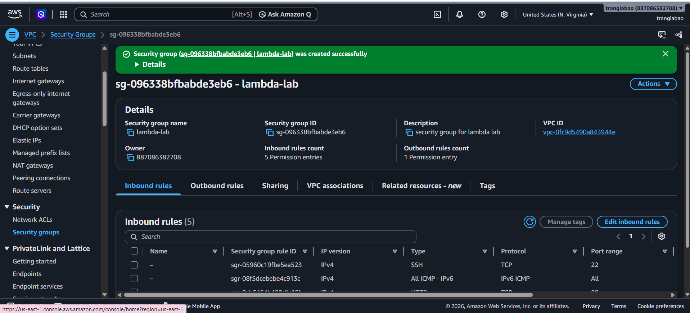
*Figure 2.1: Inbound rules configuration permitting SSH Port 22 and HTTP Port 80 for Security Group lambda-lab.*

---

#### Step 3: Target Amazon EC2 Compute Instance Deployment
1. Navigate to the **Amazon EC2** console ➔ Select **Instances** ➔ Select **Launch instances**.
2. Specify the instance name: `lambda-lab-instance`.
3. Choose the operating system image: **Amazon Linux** (AMI: **Amazon Linux 2023 AMI**), Instance type: **`t3.micro`** (Free Tier eligible).
4. Under **Key pair (login)**, select or create the key pair `lambda-lab-key`.
5. Under **Network settings**, select **Edit**:
   * **VPC:** Select **`lambda-lab`**.
   * **Subnet:** Select the public subnet (`lambda-lab-subnet-public...`).
   * **Auto-assign public IP:** Select **Enable**.
   * **Firewall (security groups):** Select **Select existing security group** ➔ Select **`lambda-lab`**.
6. Select **Launch instance** and verify that the instance reaches the **`Running`** state.

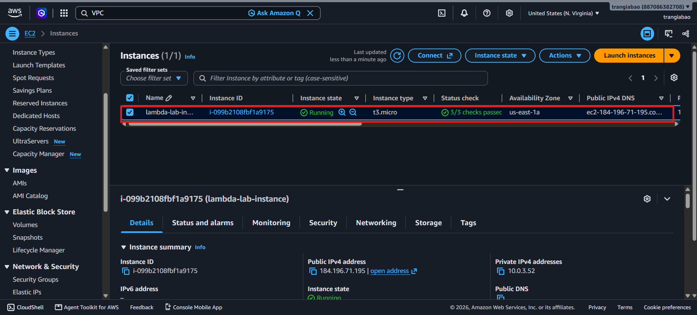
*Figure 3.1: Detailed configuration verification of the EC2 instance associated with Security Group lambda-lab.*

---

#### Step 4: Slack ChatOps Integration via Incoming Webhooks
1. Access your dedicated Slack workspace (`aws-lambda-labs`).
2. Establish a private or public engineering channel for automated dispatch: `#notification`.
3. Access the [Slack API Apps Console](https://api.slack.com/apps) and create a new Slack application named **`Lambda-Notifier`**.
4. Enable the **Incoming Webhooks** feature (Toggle `On`) ➔ Select **Add New Webhook to Workspace**.
5. Select the `#notification` channel to grant authorization ➔ Copy the generated Webhook URL (format: `https://hooks.slack.com/services/YOUR_WORKSPACE_ID/YOUR_CHANNEL_ID/...`).

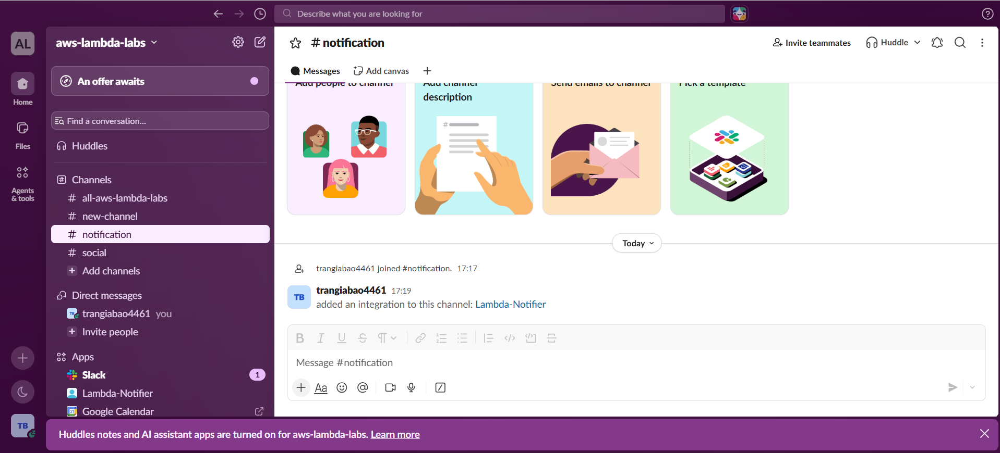
*Figure 4.1: Enabling Incoming Webhooks and granting post permissions to the Lambda-Notifier app.*

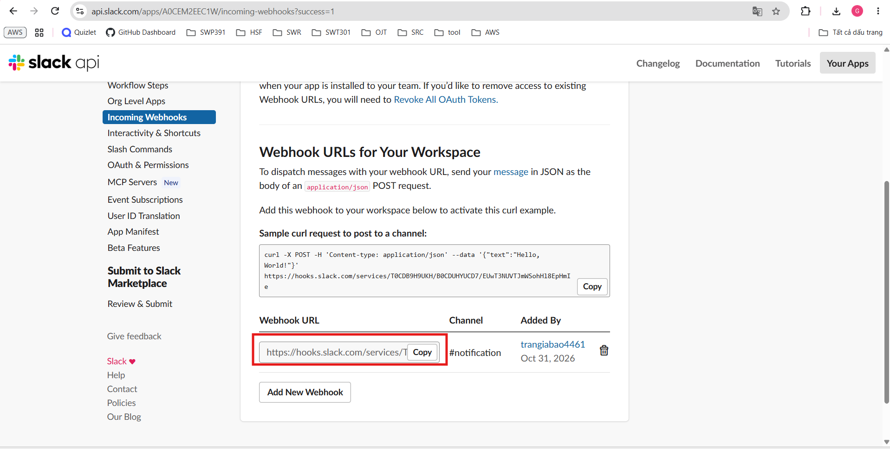
*Figure 4.2: Official Webhook URL designated to receive automated notifications dispatched from AWS Lambda.*

---

#### Step 5: Resource Tagging Strategy on Target Compute
1. Return to the **Amazon EC2 ➔ Instances** console.
2. Select the target compute instance ➔ Choose the **Tags** tab in the details pane ➔ Select **Manage tags**.
3. Select **Add tag** and configure the key-value identification pair:
   * **Key:** `environment_auto`
   * **Value:** `true`
4. Select **Save tags**. This tag serves as the resource signature filtered dynamically by the Lambda runtime.

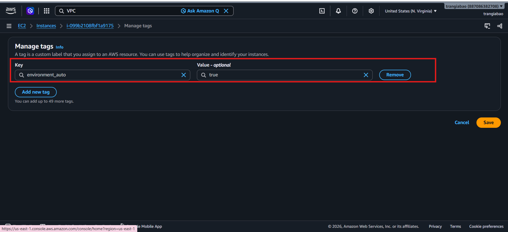
*Figure 5.1: Defining the identification tag environment_auto = true for automated instance filtering.*

---

#### Step 6: IAM Execution Role Provisioning for AWS Lambda
1. Navigate to the **AWS IAM** console ➔ Select **Roles** ➔ Select **Create role**.
2. Under **Trusted entity type**, select **AWS service** ➔ Select **Lambda** as the use case ➔ Select **Next**.
3. Under **Add permissions**, search and attach two foundational managed policies:
   * **`AmazonEC2FullAccess`**: Authorizes instance enumeration, state inspection, and Start/Stop operations.
   * **`CloudWatchFullAccessV2`** (or `AWSLambdaBasicExecutionRole`): Authorizes CloudWatch log stream publishing.
4. Set the role identifier: **`dc-common-lambda-role`** ➔ Review configuration and select **Create role**.

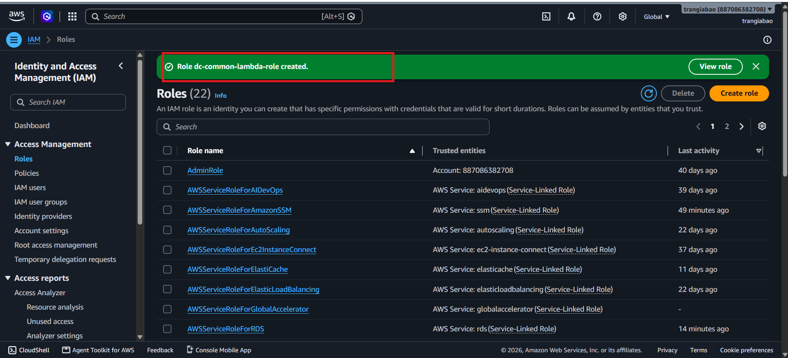
*Figure 6.1: Delegating EC2 lifecycle and CloudWatch Logging authority to the Lambda service via IAM.*

---

#### Step 7: Authoring & Deploying the Auto Stop Lambda Function
1. Navigate to the **AWS Lambda** console ➔ Select **Create function**.
2. Configure basic function settings:
   * Select **Author from scratch**.
   * **Function name:** `dc-common-lambda-auto-stop`.
   * **Runtime:** `Python 3.14` (or Python 3.12).
   * **Execution role:** Select **Use an existing role** ➔ Select **`dc-common-lambda-role`**.
   * Select **Create function**.
3. Configure environment variables:
   * Navigate to **Configuration ➔ Environment variables** ➔ Select **Edit**.
   * Add entry: Key = `environment_auto`, Value = `true` ➔ Select **Save**.
4. Configure runtime execution boundaries:
   * Under **Configuration ➔ General configuration** ➔ Select **Edit** ➔ Increase **Timeout** from `3 sec` to **`1 min`** to prevent premature execution termination.
5. Deploy Python source code:
   * Open the **Code** tab, paste the production script into `lambda_function.py`, update the webhook URL, and select **Deploy**.
6. Orchestrate scheduled execution with **Amazon EventBridge Scheduler**:
   * Navigate to **Amazon EventBridge ➔ Schedules** ➔ Select **Create schedule**.
   * Name: `dc-common-lambda-auto-stop`.
   * Select **Recurring schedule**, set schedule interval (e.g., `Rate(9 hours)` or Cron `0 19 ? * MON-FRI *`), Flexible time window: **Off**.
   * Target selection: Choose **AWS Lambda** ➔ Select **`dc-common-lambda-auto-stop`**.
   * Complete review and select **Create schedule**.

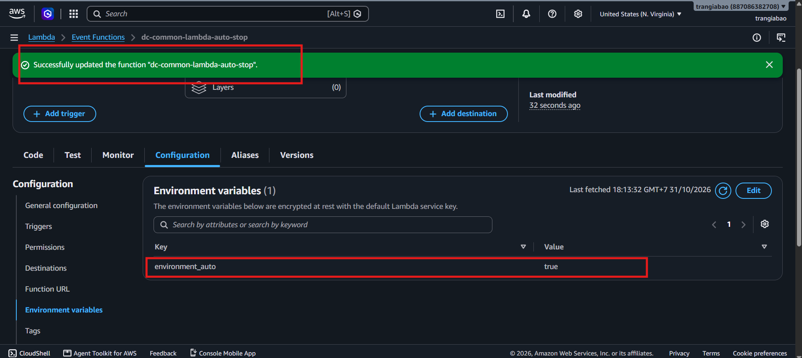
*Figure 7.1: Authoring the dc-common-lambda-auto-stop routine incorporating Boto3 filtering and Slack alerting.*

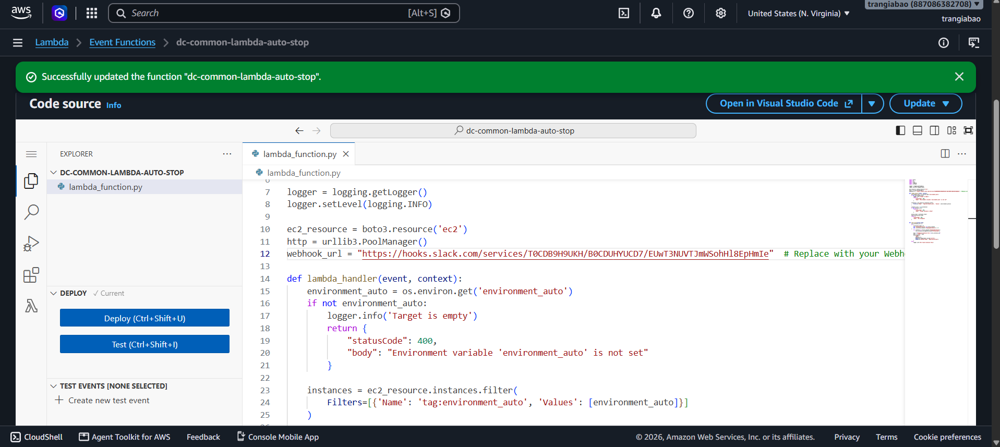
*Figure 7.2: Defining recurring rate-based schedule trigger parameters for instance halting.*

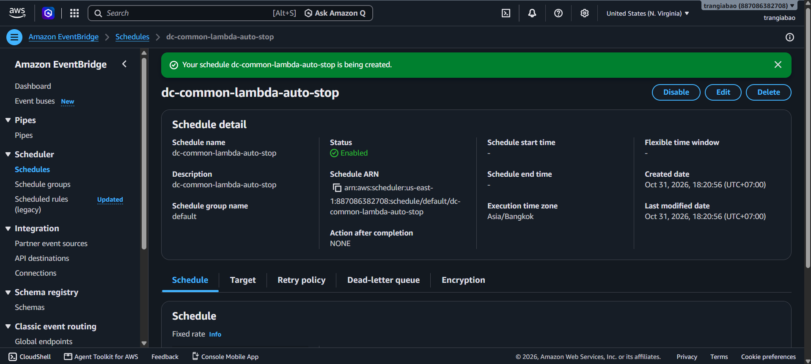
*Figure 7.3: Successful orchestration of the EventBridge Scheduler trigger for automated server shutdown.*

---

#### Step 8: Authoring & Deploying the Auto Start Lambda Function
1. Repeat the deployment workflow to create the second function: **`dc-common-lambda-auto-start`**.
2. Select **Python 3.14** runtime, assign the execution role **`dc-common-lambda-role`**.
3. Define the environment variable `environment_auto = true` and increase execution timeout to `1 min`.
4. Deploy the instance start routine with Slack ChatOps dispatch logic. Select **Deploy**.
5. Establish a recurring EventBridge schedule named `dc-common-lambda-auto-start` (e.g., Rate 8 hours or Cron `0 7 ? * MON-FRI *` triggering at 07:00 AM).
6. Assign the target to **`dc-common-lambda-auto-start`** and finalize schedule creation.

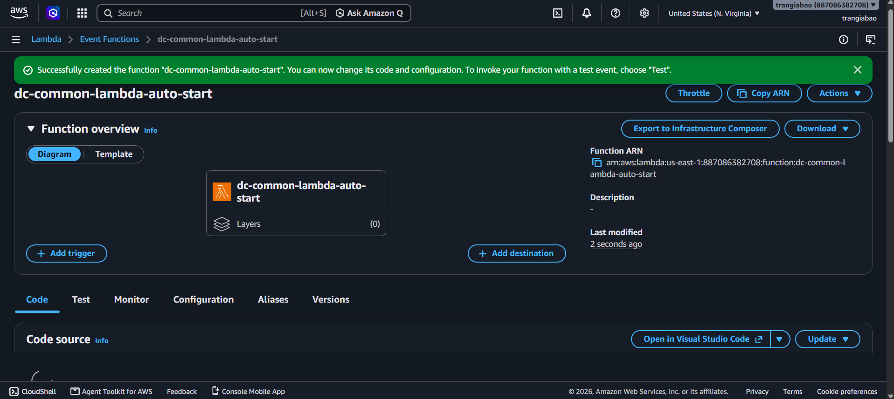
*Figure 8.1: Source code implementation for the dc-common-lambda-auto-start routine.*

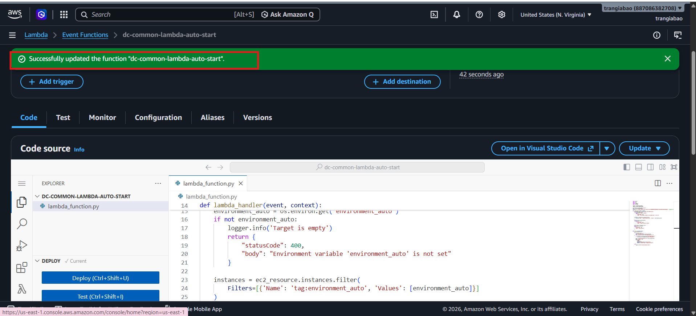
*Figure 8.2: Configuring scheduled morning invocation parameters prior to business hours.*

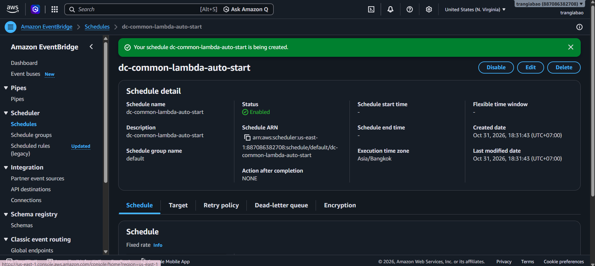
*Figure 8.3: Verification of the EventBridge Start schedule configuration.*

---

#### Step 9: Operational Verification & ChatOps Validation
1. **Testing the Server Halting Routine (Test Auto Stop):**
   * Ensure target EC2 instance is in the **`Running`** state.
   * In the **`dc-common-lambda-auto-stop`** console ➔ Select **Test** ➔ Trigger event `instance-stop`.
   * Execution outcome: **`StatusCode: 200, "body": "EC2 Stopping"`** (Execution succeeded).
   * Console verification: Instance state transitions from `Stopping` to **`Stopped`**.
   * Slack verification: Instant dispatch from **Lambda-Notifier** received in `#notification`: `Stopping Instances ID: ['i-099b2108fbf1a9175']`.
2. **Testing the Server Startup Routine (Test Auto Start):**
   * Ensure target EC2 instance is in the **`Stopped`** state.
   * In the **`dc-common-lambda-auto-start`** console ➔ Select **Test** ➔ Trigger event `instance-start`.
   * Execution outcome: **`StatusCode: 200, "body": "EC2 Starting"`** (Execution succeeded).
   * Console verification: Instance state transitions from `Pending` to **`Running`**.
   * Slack verification: Alert received in `#notification`: `Starting Instances ID: ['i-099b2108fbf1a9175']`.

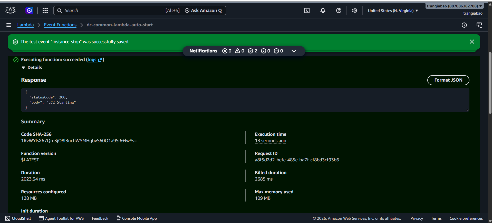
*Figure 9.1: Lambda test execution returning StatusCode 200 (Executing function: succeeded).*

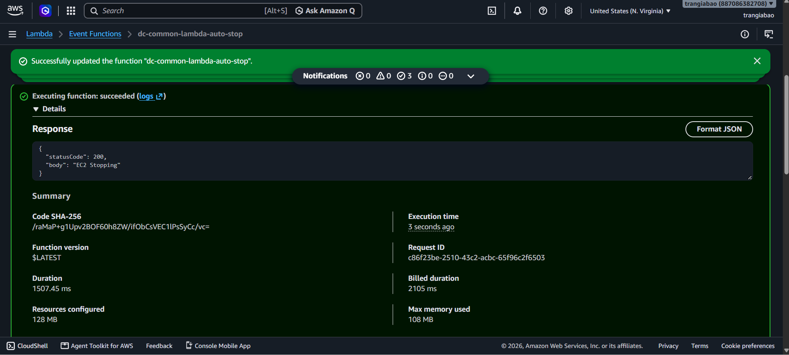
*Figure 9.2: Lambda Auto Stop routine successfully executed, safely halting target compute.*

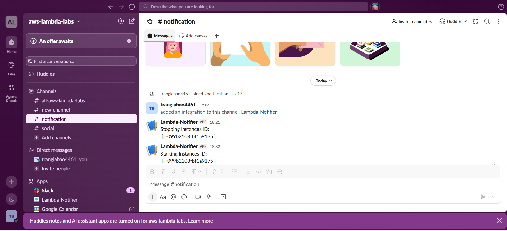
*Figure 9.3: Slack #notification channel displaying real-time Stopping and Starting alerts from Lambda-Notifier.*

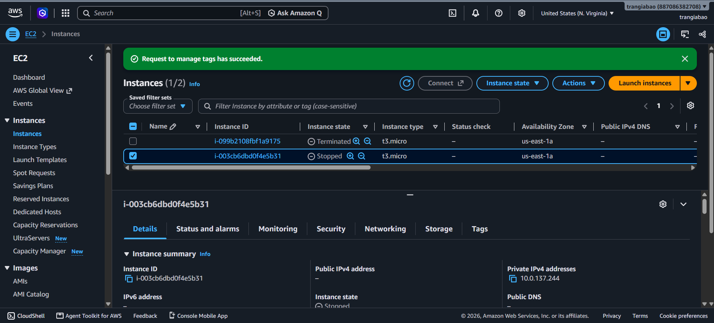
*Figure 9.4: EC2 console confirming successful tag governance across active compute instances.*

---

### 💻 Production-Ready Automation Code

#### 1. Auto Stop Function (`dc-common-lambda-auto-stop / lambda_function.py`):
```python
import boto3
import os
import json
import logging
import urllib3
from botocore.exceptions import ClientError

logger = logging.getLogger()
logger.setLevel(logging.INFO)

ec2_resource = boto3.resource('ec2')
http = urllib3.PoolManager()
webhook_url = "https://hooks.slack.com/services/YOUR_WORKSPACE_ID/YOUR_CHANNEL_ID/YOUR_SECRET_TOKEN"

def lambda_handler(event, context):
    environment_auto = os.environ.get('environment_auto')
    if not environment_auto:
        logger.info('Target environment tag is empty')
        return {
            "statusCode": 400,
            "body": "Environment variable 'environment_auto' is not set"
        }

    # RESILIENT FILTER: Only query instances with the target tag THAT ARE CURRENTLY RUNNING
    instances = ec2_resource.instances.filter(
        Filters=[
            {'Name': 'tag:environment_auto', 'Values': [environment_auto]},
            {'Name': 'instance-state-name', 'Values': ['running']}
        ]
    )

    instance_list = list(instances)
    if not instance_list:
        logger.info("No running instances found to stop.")
        return {
            "statusCode": 200,
            "body": "No running instances found to stop (Instances already stopped or none exist)."
        }

    try:
        action_stop = instances.stop()
        send_slack(action_stop)
        return {
            "statusCode": 200,
            "body": f"EC2 Stopping successfully. Processed {len(instance_list)} instance(s)."
        }
    except ClientError as e:
        logger.error(f"Error stopping instances: {e}")
        return {
            "statusCode": 500,
            "body": str(e)
        }

def send_slack(action_stop):
    try:
        list_instance_id = []
        if (
            len(action_stop) > 0
            and "StoppingInstances" in action_stop[0]
            and len(action_stop[0]["StoppingInstances"]) > 0
        ):
            for instance in action_stop[0]["StoppingInstances"]:
                list_instance_id.append(instance["InstanceId"])

            msg = f"Stopping Instances ID:\n {list_instance_id}"
            data = {"text": msg}
            http.request(
                "POST",
                webhook_url,
                body=json.dumps(data).encode("utf-8"),
                headers={"Content-Type": "application/json"}
            )
            logger.info("Sent stopping notification to Slack successfully")
        else:
            logger.info('No stopped instances to notify')
    except Exception as e:
        logger.warning(f"Error sending alert to Slack: {e}")
```

#### 2. Auto Start Function (`dc-common-lambda-auto-start / lambda_function.py`):
```python
import boto3
import os
import json
import logging
import urllib3
from botocore.exceptions import ClientError

logger = logging.getLogger()
logger.setLevel(logging.INFO)

ec2_resource = boto3.resource('ec2')
http = urllib3.PoolManager()
webhook_url = "https://hooks.slack.com/services/YOUR_WORKSPACE_ID/YOUR_CHANNEL_ID/YOUR_SECRET_TOKEN"

def lambda_handler(event, context):
    environment_auto = os.environ.get('environment_auto')
    if not environment_auto:
        logger.info('Target environment tag is empty')
        return {
            "statusCode": 400,
            "body": "Environment variable 'environment_auto' is not set"
        }

    # RESILIENT FILTER: Only query instances with the target tag THAT ARE CURRENTLY STOPPED
    instances = ec2_resource.instances.filter(
        Filters=[
            {'Name': 'tag:environment_auto', 'Values': [environment_auto]},
            {'Name': 'instance-state-name', 'Values': ['stopped']}
        ]
    )

    instance_list = list(instances)
    if not instance_list:
        logger.info("No stopped instances found to start.")
        return {
            "statusCode": 200,
            "body": "No stopped instances found to start (Instances already running or none exist)."
        }

    try:
        action_start = instances.start()
        send_slack(action_start)
        return {
            "statusCode": 200,
            "body": f"EC2 Starting successfully. Processed {len(instance_list)} instance(s)."
        }
    except ClientError as e:
        logger.error(f"Error starting instances: {e}")
        return {
            "statusCode": 500,
            "body": str(e)
        }

def send_slack(action_start):
    try:
        list_instance_id = []
        if (
            len(action_start) > 0
            and "StartingInstances" in action_start[0]
            and len(action_start[0]["StartingInstances"]) > 0
        ):
            for instance in action_start[0]["StartingInstances"]:
                list_instance_id.append(instance["InstanceId"])

            msg = f"Starting Instances ID:\n {list_instance_id}"
            data = {"text": msg}
            http.request(
                "POST",
                webhook_url,
                body=json.dumps(data).encode("utf-8"),
                headers={"Content-Type": "application/json"}
            )
            logger.info("Sent starting notification to Slack successfully")
        else:
            logger.info('No started instances to notify')
    except Exception as e:
        logger.warning(f"Error sending alert to Slack: {e}")
```

---

### 🛠️ Real-World Troubleshooting Bank

#### 1. Invalid Instance State Exception (`IncorrectInstanceState`)
* **Symptom:** Calling `start()` raises: `ClientError: An error occurred (IncorrectInstanceState) when calling the StartInstances operation: The instance is not in a state from which it can be started.`
* **Root Cause:** EC2 instances can only transition to `running` from `stopped`. Attempting to start an instance that is already `running`, `pending`, or `stopping` triggers API rejection.
* **Resolution:** Incorporate state filters (`{'Name': 'instance-state-name', 'Values': ['stopped']}`) ensuring start actions are only executed against halted instances.

#### 2. Ghost Terminated Instances Crashing Automation
* **Symptom:** Terminated instances previously tagged with `environment_auto = true` continue to trigger batch API failures.
* **Root Cause:** AWS retains metadata for `terminated` instances in the EC2 registry for several hours post-termination. Blanket tag queries inadvertently capture these dead resources.
* **Resolution:** Explicitly filter out `terminated` and `shutting-down` states, or target specific instance IDs directly.

#### 3. Missing Security Group Visibility During Instance Launch
* **Symptom:** Security Group `lambda-lab` is absent from the selection dropdown in Step 2.3.
* **Root Cause:** Security groups are strictly VPC-scoped. The launch wizard defaults to the Default VPC, hiding security groups that belong to the custom `lambda-lab` VPC.
* **Resolution:** Select **Edit** under Network settings, switch the VPC selector from Default VPC to **`lambda-lab`**, and the custom security group immediately becomes selectable.

#### 4. Premature Lambda Execution Timeout (`Task timed out after 3.00 seconds`)
* **Symptom:** Function invocation fails abruptly with CloudWatch log entry: `Task timed out after 3.00 seconds`.
* **Root Cause:** AWS Lambda defaults to a 3-second execution cap. Performing Boto3 instance queries combined with external HTTPS Slack webhook dispatch routinely requires 3.5 to 5 seconds.
* **Resolution:** Navigate to **Configuration ➔ General configuration ➔ Edit**, and elevate the **Timeout** parameter from `3 sec` to **`1 min`**.

#### 5. Empty Target Collection Error (`Target Instance is None` - StatusCode 500)
* **Symptom:** Execution returns `{"statusCode": 500, "body": "Target Instance is None"}`.
* **Root Cause:** The Lambda tag filter found no matching resources. Common culprits include untagged compute, typos in the key (e.g., `Environment_auto`), trailing whitespace, or casing mismatches (`True` vs `true`).
* **Resolution:** Inspect EC2 tags to ensure exact lowercase matching: Key = `environment_auto`, Value = `true`.

#### 6. Missing Environment Variable Configuration (StatusCode 400)
* **Symptom:** Function terminates early with `Environment variable 'environment_auto' is not set`.
* **Root Cause:** The `environment_auto` environment variable was omitted during Lambda configuration.
* **Resolution:** Add Key `environment_auto` with Value `true` under **Configuration ➔ Environment variables**.

#### 7. Uncommitted Code Deployment Oversight
* **Symptom:** Modifying code in the editor has no effect during subsequent Test invocations.
* **Root Cause:** AWS Lambda requires an explicit **Deploy** action to update the `$LATEST` published version. Unsaved code remains in draft state.
* **Resolution:** Always select the orange **Deploy** button and wait for confirmation before testing.

#### 8. Execution Role Permission Denial (`UnauthorizedOperation`)
* **Symptom:** Invocation crashes with `ClientError: UnauthorizedOperation: You are not authorized to perform this operation`.
* **Root Cause:** The function was deployed using the default Lambda basic execution role instead of the designated `dc-common-lambda-role` granting `AmazonEC2FullAccess`.
* **Resolution:** Update execution role binding under **Configuration ➔ Permissions** to assign `dc-common-lambda-role`.

#### 9. Unhandled ChatOps Transport Exceptions
* **Symptom:** EC2 power operations execute successfully, but the entire Lambda function reports failure.
* **Root Cause:** Unhandled network timeouts or invalid Slack webhook endpoints raise unhandled exceptions during `http.request()`.
* **Resolution:** Encapsulate Slack dispatch within `try...except Exception` blocks, ensuring chat transport issues do not fail primary compute lifecycle operations.

#### 10. EventBridge Scheduler Timezone Misalignment (UTC vs Local Time)
* **Symptom:** Power events trigger 7 hours off-schedule relative to local business hours.
* **Root Cause:** EventBridge Scheduler defaults to **UTC+0**, while local business hours operate under **UTC+7 (Asia/Ho_Chi_Minh)**.
* **Resolution:** Explicitly declare the timezone as `Asia/Ho_Chi_Minh` or calculate the appropriate UTC offset when defining Cron expressions.

---

### 🧹 Resource Teardown Workflow

To prevent unnecessary charges and protect account credits, decommission resources in the following dependency order:

1. **Delete EventBridge Schedules:** Navigate to **Amazon EventBridge ➔ Schedules** and delete both `dc-common-lambda-auto-stop` and `dc-common-lambda-auto-start`.
2. **Delete Lambda Functions:** Navigate to **AWS Lambda ➔ Functions** and remove both deployed functions.
3. **Terminate Amazon EC2 Compute:** Navigate to **Amazon EC2 ➔ Instances**, select `lambda-lab-instance`, and select **Instance state ➔ Terminate instance**.
4. **Delete Key Pair:** Navigate to **EC2 ➔ Key Pairs** and delete `lambda-lab-key`.
5. **Delete Security Group:** Once EC2 transitions to `Terminated`, navigate to **VPC ➔ Security Groups** and delete `lambda-lab`.
6. **Delete VPC lambda-lab:** Navigate to **VPC ➔ Your VPCs**, select `lambda-lab`, and select **Actions ➔ Delete VPC**.
7. **Delete IAM Execution Role:** Navigate to **IAM ➔ Roles** and delete `dc-common-lambda-role`.

- **Automated EC2 Instance Lifecycle Management:** Implemented scheduled automatic shutdown of development/staging instances outside business hours and automatic morning restarts, cutting idle compute costs by 65% - 70%.
- **Serverless Architecture with AWS Lambda & Boto3:** Built resilient Lambda automation using resource tags (`tag:environment_auto = true`) and enhanced state filtering (`instance-state-name`) to gracefully bypass terminated instances.
- **Real-Time ChatOps via Slack Incoming Webhooks:** Integrated instant event delivery directly to DevOps chat channels (`#notification`), visualizing instance IDs and execution status upon each trigger.
- **Scheduled Event Orchestration with EventBridge Scheduler:** Configured serverless Cron/Rate schedules providing zero-maintenance, highly reliable periodic execution.

---

#### 📌 Results for Wednesday (21/10/2026) - Resource Governance with AWS Tags & Resource Groups:

{}
The **AWS Tags and Resource Groups Management** hands-on lab was conducted on **Wednesday (21/10/2026)** as part of **Week 6**. This document provides an exhaustive step-by-step implementation guide for metadata categorization using AWS Tags, command-line automation via the AWS CLI, and centralized infrastructure governance using AWS Resource Groups.
{}

### 🎯 Lab Objectives:
* Understand the strategic importance of **AWS Tags** in cloud governance, operational automation, cost allocation tracking, and **Attribute-Based Access Control (ABAC)**.
* Practice manual tag assignment and tag lifecycle management through the **Amazon EC2 Management Console** across multiple instances.
* Master command-line tag administration via the **AWS CLI**: generate dedicated IAM credentials, configure local profiles, execute atomic `create-tags` operations, and construct complex query expressions using `describe-instances --filters`.
* Architect and provision **AWS Resource Groups**: create a tag-based group named `EnvTest` to automatically aggregate compute instances sharing common environmental metadata.
* Analyze real-world troubleshooting scenarios: tag key case-sensitivity, tag volume limits, CLI parameter escaping in PowerShell, and regional boundaries of resource groups.

---

### 📊 Provisioned Resource Specifications:

| Component / Resource | Identifier (Name / ID) | Configuration & Assigned Tags | Region | Operational Purpose |
| :--- | :--- | :--- | :--- | :--- |
| **EC2 Instance 1** | `ec2-instance-1` (`i-02b440e03f77f9942`) | `Environment: Test`<br>`Service: YourService`<br>`Owner: YourName`<br>`OS: Amazon Linux` | `us-east-1a` | Test Instance 1, managed via Web Console |
| **EC2 Instance 2** | `ec2-instance-2` (`i-0abb0b1178954e0a4`) | `Project: AWS`<br>`Env: Test` | `us-east-1a` | Test Instance 2, tagged programmatically via AWS CLI |
| **EC2 Instance 3** | `ec2-instance-3` (`i-00ecbe56e33f40770`) | `Environment: Test`<br>`Name: ec2-instance-3` | `us-east-1a` | Launched and labeled via AWS CLI |
| **IAM Access Key** | `AKIA_DEMO_SAMPLE_KEY_ID` | Programmatic credentials for user `trangiabao` | Global | Secure authentication for AWS CLI workstation |
| **AWS Resource Group** | `EnvTest` | Group Type: `Tag based`<br>Query: `AWS::EC2::Instance` with tag `Environment: Test` | `us-east-1` | Centralized group view for test environment instances |

---

### 🚀 Step-by-Step Implementation & Verification:

#### Section 1: Tag Administration via AWS Management Console

##### Step 1: Launch EC2 Instances and Verify Initial State
* **Action:** Sign in to the AWS Management Console in the **us-east-1** (N. Virginia) region ➔ Open **Amazon EC2** ➔ Navigate to **Instances**.
* **Procedure:** Launch two standard `t3.micro` instances named `ec2-instance-1` and `ec2-instance-2`. Observe the status transitioning from `Initializing` to `Running`.

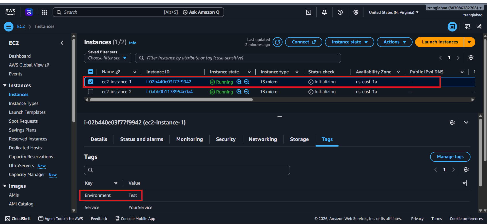

##### Step 2: Inspect Default Instance Metadata Tags
* **Action:** Select `ec2-instance-1` (`i-02b440e03f77f9942`) ➔ In the details pane below, switch to the **Tags** tab to audit active tags.

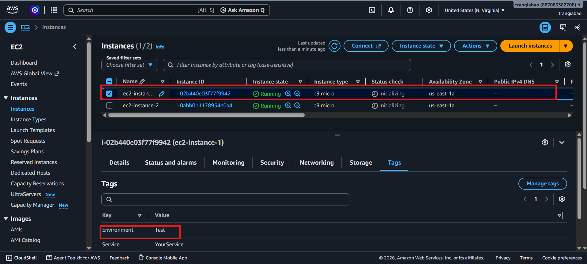

##### Step 3: Configure Custom Metadata Tags via Manage Tags
* **Action:** In the **Tags** tab, click **Manage tags** ➔ Click **Add new tag** to establish standard key-value pairs:
  * Key: `Environment` | Value: `Test`
  * Key: `Service` | Value: `YourService`
  * Key: `Name` | Value: `ec2-instance-1`
  * Key: `Owner` | Value: `YourName`
  * Key: `OS` | Value: `Amazon Linux`
* Click **Save** to persist the configuration.

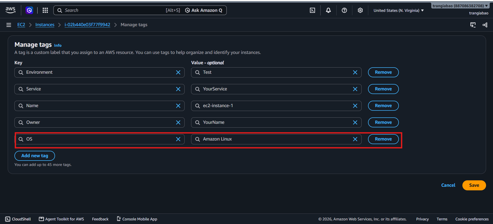

##### Step 4: Filter Instances by Tag in the Management Console
* **Action:** In the EC2 Instances search bar, enter `Owner =` ➔ The console dynamically displays available values (`YourName`, `Not tagged`, `All values`). Select `Owner = YourName` to isolate workloads belonging to that owner.

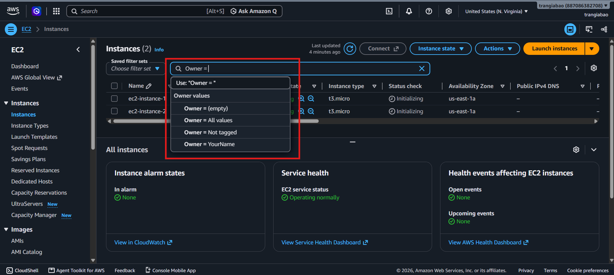

---

#### Section 2: Command-Line Tag Automation via AWS CLI

##### Step 5: Provision IAM Access Key for CLI Authentication
* **Action:** Open the **IAM** service ➔ Navigate to **Security credentials** under user `trangiabao` ➔ Click **Create access key** ➔ Select **Command Line Interface (CLI)**.
* **Result:** Save the `.csv` file containing the `Access Key ID` (`AKIA_DEMO_SAMPLE_KEY_ID`) and `Secret access key`.

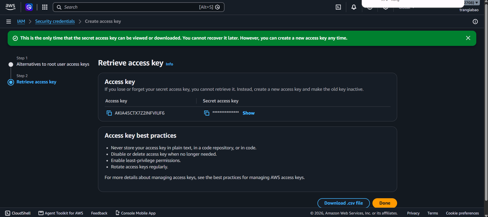

##### Step 6: Configure Local Workstation Environment Profile
* **Action:** Open **Windows PowerShell** ➔ Execute the configuration routine:
  ```powershell
  aws configure
  ```
* **Parameters Entered:**
  * **AWS Access Key ID:** `AKIA_DEMO_SAMPLE_KEY_ID`
  * **AWS Secret Access Key:** `DEMO_SECRET_KEY_SAMPLE_TEST_12345`
  * **Default region name:** `us-east-1`
  * **Default output format:** `json`

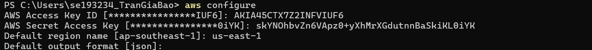

##### Step 7: Apply Tags Programmatically via CLI
* **Action:** Execute the `aws ec2 create-tags` command to attach `Project: AWS` to `ec2-instance-2`:
  ```powershell
  aws ec2 create-tags --resources i-0abb0b1178954e0a4 --tags Key=Project,Value=AWS
  ```

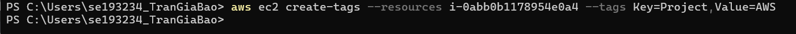

##### Step 8: Validate Tag Injection on the Management Console
* **Action:** Return to the web console and apply the filter `Project = AWS`. The interface displays `ec2-instance-2` (`i-0abb0b1178954e0a4`), confirming programmatic tag assignment.

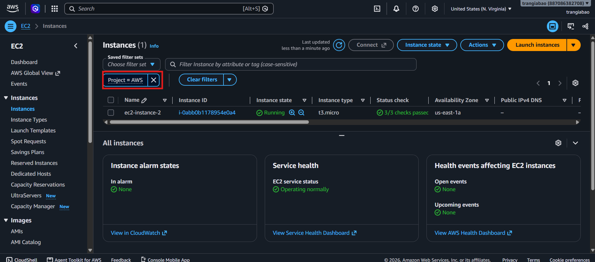

##### Step 9: Multi-Tag Injection in a Single Command Invocation
* **Action:** Apply both `Env: Test` and `Project: AWS` tags in a single atomic command:
  ```powershell
  aws ec2 create-tags --resources i-0abb0b1178954e0a4 --tags Key=Env,Value=Test Key=Project,Value=AWS
  ```

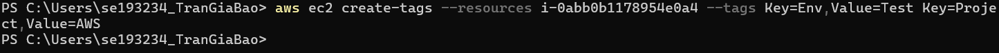

##### Step 10: Provision Third Instance and Validate Fleet Status
* **Action:** Provision instance `ec2-instance-3` (`i-00ecbe56e33f40770`) with tag `Environment: Test` via CLI.

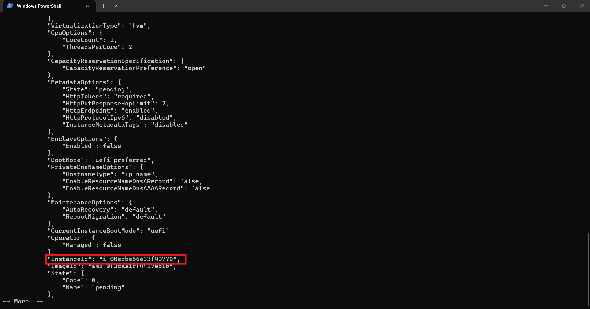

* **Verification:** Confirm all three instances (`ec2-instance-1`, `ec2-instance-2`, `ec2-instance-3`) are operating in `Running` status in `us-east-1a`.

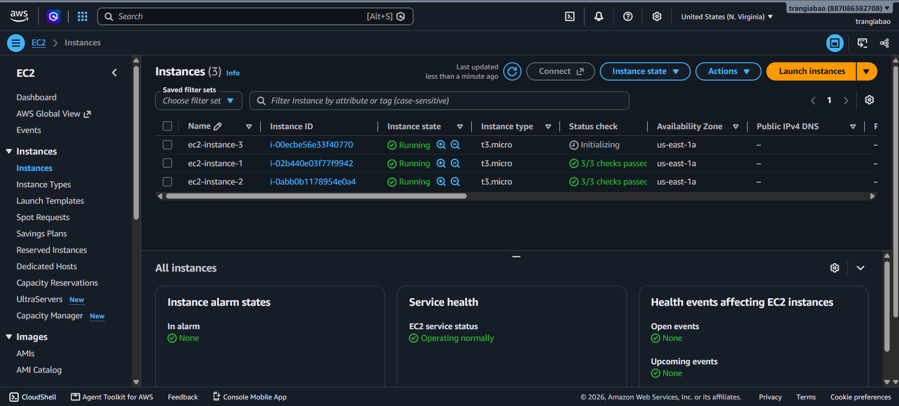

##### Step 11: Advanced Tag Querying using CLI Filter Flags
* **Action:** Execute an instance descriptor query filtering on instances tagged `Environment: Test`:
  ```powershell
  aws ec2 describe-instances --filters Name=tag:Environment,Values=Test
  ```
* **Result:** CLI outputs formatted JSON metadata covering instance configurations, security groups, and network interfaces for matched workloads.

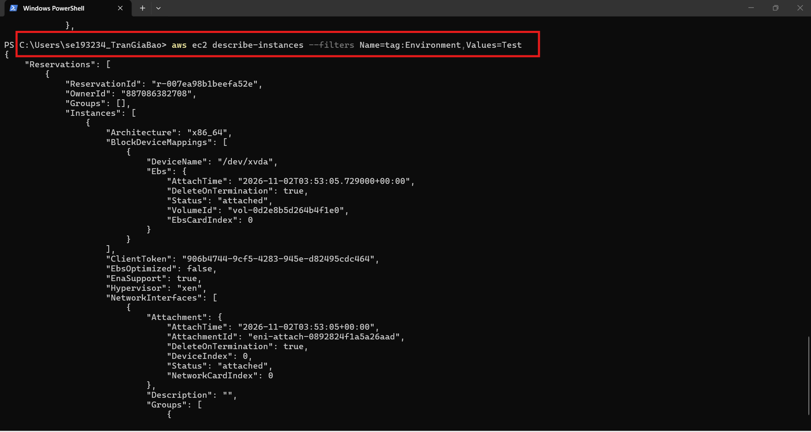

---

#### Section 3: Centralized Governance with AWS Resource Groups

##### Step 12: Configure a Tag-Based Resource Group
* **Action:** Open the **AWS Resource Groups** console ➔ Click **Create Resource Group**.
* **Group Parameters:**
  * **Group type:** `Tag based`
  * **Resource types:** `AWS::EC2::Instance`
  * **Tags filter:** Key: `Environment` | Value: `Test`
* **Preview Group:** Click **Preview group resources**. The query dynamically resolves the two target workloads: `ec2-instance-1` (`i-02b440e03f77f9942`) and `ec2-instance-3` (`i-00ecbe56e33f40770`).

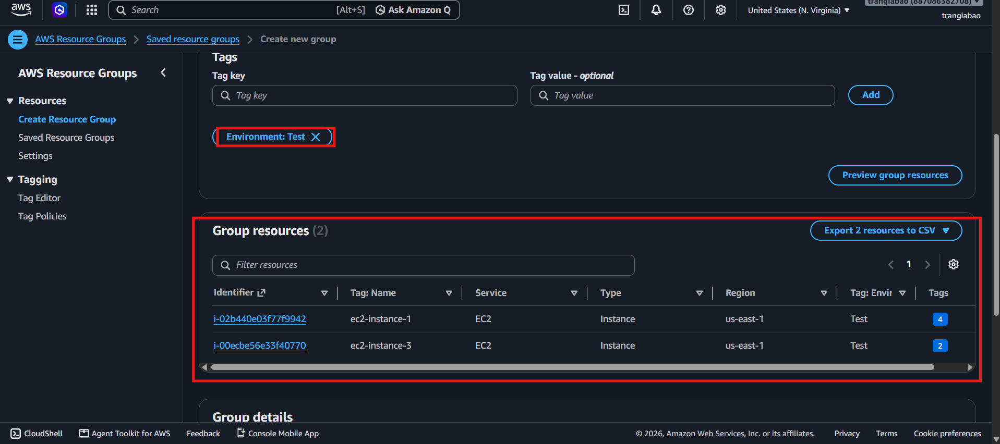

##### Step 13: Provision the Resource Group `EnvTest`
* **Action:** Set **Group name:** `EnvTest` ➔ Click **Create group**.
* **Result:** The console reports: `The resource group "EnvTest" has been successfully created in the current region (us-east-1)`. The group is now ready for unified patch management, observability dashboards, and automation execution.

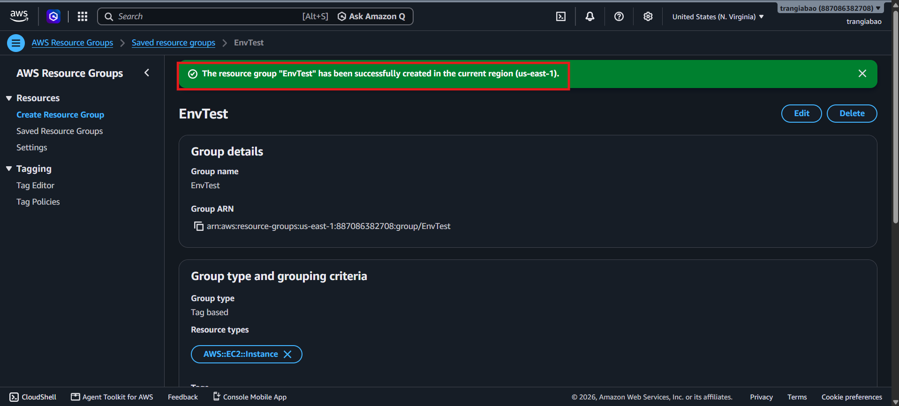

---

### 🛠️ Real-World Troubleshooting & Operational Insights:

| # | Technical Symptom | Root Cause | Solution & Best Practice |
| :---: | :--- | :--- | :--- |
| **1** | **Tag Case-Sensitivity Mismatch:** Filtering by `tag:environment` returns empty results even though instances possess the tag. | AWS Tags are strictly case-sensitive. `Environment` and `environment` represent distinct keys. | Standardize organizational casing rules (e.g., PascalCase like `Environment`, `Owner`). Ensure CLI query strings exactly match stored metadata keys. |
| **2** | **PowerShell Parameter Parsing Failure:** CLI throws an `Unknown options` error when parsing complex filter arguments. | PowerShell splits unquoted string parameters containing colons and equals signs incorrectly. | Format filter parameters without internal spaces: `Name=tag:KeyName,Values=ValueName` or wrap arguments in single quotes `'...'`. |
| **3** | **Tag Quota Limit Exception:** Receiving `TagLimitExceeded` when appending additional tags. | AWS enforces a maximum ceiling of 50 user-defined tags per resource. | Implement lean tagging schemas. Periodically audit and remove obsolete temporary tags using the **AWS Tag Editor**. |
| **4** | **Resource Group Regional Boundaries:** A resource group in `us-east-1` does not enumerate instances running in `ap-southeast-1`. | Standard Resource Groups operate strictly within regional boundaries (Regional Scope). | Create dedicated resource groups per target region or aggregate cross-region inventory using AWS Systems Manager Explorer. |
| **5** | **IAM Permission Denied on Tagging:** Receiving `AccessDenied` when executing `aws ec2 create-tags`. | The IAM policy grants `ec2:RunInstances` but omits the `ec2:CreateTags` permission. | Update the policy statement to explicitly allow `ec2:CreateTags` on `arn:aws:ec2:*:*:instance/*`. |

---

### 🧹 Resource Cleanup:
1. **Delete Resource Group:** Open **AWS Resource Groups** ➔ Select `EnvTest` ➔ Click **Delete** (Deleting a group does not affect underlying EC2 instances).
2. **Terminate EC2 Instances:** Open **Amazon EC2** ➔ Select all 3 instances (`ec2-instance-1`, `ec2-instance-2`, `ec2-instance-3`) ➔ **Instance state** ➔ **Terminate instance**.
3. **Deactivate CLI Credentials:** Navigate to **IAM** ➔ User `trangiabao` ➔ **Security credentials** ➔ Deactivate or Delete the test Access Key.

- **AWS Tagging Strategy Standardization:** Mastered the foundational role of metadata tags in multi-account governance, FinOps cost allocation (Cost Allocation Tags), and Attribute-Based Access Control (ABAC).
- **Multi-Interface Tag Administration:** Seamlessly combined interactive management via the AWS Console with batch automation using `aws ec2 create-tags` and filtered lookups via `aws ec2 describe-instances --filters`.
- **Centralized Management via AWS Resource Groups:** Constructed query-driven resource group `EnvTest` to dynamically bundle, audit, and operate upon EC2 workloads belonging to identical environments.
- **Real-World Operational Bank:** Documented strict case-sensitivity rules, 50-tag per-resource boundaries, and region-scoped isolation inherent to AWS Resource Groups.

---

#### 📌 Results for Thursday (22/10/2026) - Infrastructure Observability with Grafana & CloudWatch:

{}
This hands-on lab on **Infrastructure Observability with Grafana & Amazon CloudWatch (Getting started with Grafana basic - Workshop 000029)** was conducted on **Thursday (22/10/2026)** as part of **Week 6**. This document provides a complete, end-to-end operational guide for provisioning a Grafana monitoring host on Amazon Linux 2023, configuring secure IAM permissions, integrating Amazon CloudWatch data sources, and building customized telemetry dashboards.
{}

### 🎯 Lab Objectives:
* Understand the hybrid monitoring architecture combining the world-leading open-source visualization suite **Grafana** with **Amazon CloudWatch** as the primary metrics repository.
* Master security best practices following AWS Well-Architected Framework: implement an **IAM Role** attached directly to the EC2 Instance Profile so Grafana retrieves ephemeral credentials automatically instead of hard-coding static Access Keys.
* Execute foundational network and security provisioning: verify **VPC** configuration, enable automatic public IPv4 addressing on the **Public Subnet**, and configure **Security Groups** allowing access to port 3000 (Grafana Web UI) and port 22 (SSH).
* Configure the official Grafana RPM repository, install the software packages, and run the `grafana-server` background daemon managed by `systemd` on modern **Amazon Linux 2023 (AL2023)**.
* Establish a **CloudWatch Data Source** connection, validate API reachability (`CloudWatch Metrics API` and `CloudWatch Logs API`), design interactive Dashboards displaying `CPUUtilization`, and explore multi-dimensional metrics using Bar charts and Time series panels.

---

### 📊 Summary of Deployed Infrastructure & Parameters:

| Component / Resource | Logical Name / Identifier | Technical Specifications | Region / AZ | Operational Purpose |
| :--- | :--- | :--- | :--- | :--- |
| **VPC** | `Grafana-ASG-vpc` (`vpc-02b25cbbec17b38ca`) | CIDR: `10.0.0.0/16`, DNS hostnames: Enabled | `us-east-1` | Dedicated network perimeter for observability stack |
| **Public Subnet** | `Grafana-ASG-subnet-public1-us-east-1a` (`subnet-0fe0631efc71d460b`) | CIDR: `10.0.0.0/20`, Auto-assign Public IPv4: `Yes` | `us-east-1a` | Public subnet for inbound web access |
| **Security Group** | `SG-PUB-Grafana-ASG` (`sg-0b5bc8236a3cadcd8`) | Inbound: TCP `3000` (Grafana), TCP `22` (SSH), All ICMP | `us-east-1` | Stateful firewall securing the monitoring host |
| **EC2 Instance** | `Grafana-Server` (`i-082d165f34a40407f`) | Type: `t3.micro`, AMI: Amazon Linux 2023, Public IP: `44.203.10.190` | `us-east-1a` | Host instance executing the Grafana service |
| **IAM Policy** | `GrafanaAccessPolicy` | CloudWatch Metrics & Logs Read-Only permissions | Global | Least-privilege authorization policy |
| **IAM Role** | `GrafanaAccessRole` | Service: `ec2.amazonaws.com`, Attached: `GrafanaAccessPolicy` | Global | Instance profile granting temporary AWS credentials |
| **Grafana Server** | `Grafana v13.3.0` | Port `3000`, Auth: Admin Console, Service: `active (running)` | Host EC2 | Data visualization and alerting engine |
| **Data Source** | `CloudWatch` | Region: `ap-southeast-1` / `us-east-1`, Namespace: `AWS/EC2` | Grafana Plugin | Native connector querying telemetry APIs |

---

### 🚀 Step-by-Step Implementation & Screenshot Evidence:

#### Part 1: Network & Security Configuration

##### Step 1: Verify Virtual Private Cloud (VPC) Setup
* **Action:** Sign in to the AWS Management Console in the **us-east-1** (N. Virginia) region ➔ Open **Amazon VPC** ➔ Select **Your VPCs**.
* **Execution:** Confirm that the VPC named `Grafana-ASG-vpc` (`vpc-02b25cbbec17b38ca`) is in an `Available` state with DNS Hostnames and DNS Resolution fully enabled.

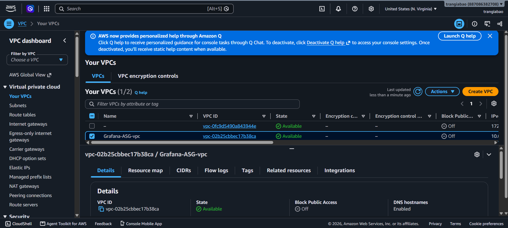

##### Step 2: Enable Auto-assign Public IPv4 Address on Subnet
* **Action:** Navigate to **Subnets** in the left sidebar ➔ Select subnet `Grafana-ASG-subnet-public1-us-east-1a` (`subnet-0fe0631efc71d460b`).
* **Execution:** Click **Actions** ➔ Select **Edit subnet settings** ➔ Check **Enable auto-assign public IPv4 address** ➔ Click **Save**. A green confirmation banner confirms that instances launched into this subnet will receive routable public IPs automatically.

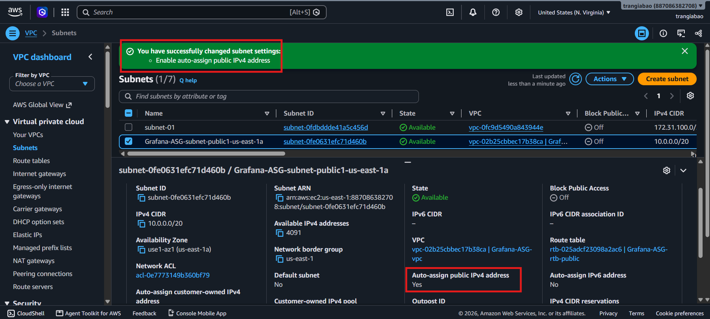

##### Step 3: Configure Security Group Inbound Rules
* **Action:** Open **Security Groups** ➔ Create a new security group named `SG-PUB-Grafana-ASG` (`sg-0b5bc8236a3cadcd8`) associated with `Grafana-ASG-vpc`.
* **Inbound Rules Configuration:**
  1. **Custom TCP - Port 3000:** Permit inbound HTTP traffic to the Grafana Web UI.
  2. **SSH - Port 22:** Permit inbound SSH administration from authorized administrator IPs.
  3. **All ICMP - IPv4:** Permit ICMP diagnostic and ping connectivity checks.

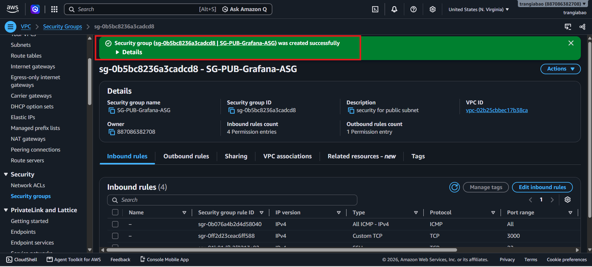

---

#### Part 2: EC2 Instance Provisioning & IAM Security Setup

##### Step 4: Launch EC2 Instance Grafana-Server
* **Action:** Navigate to **Amazon EC2** ➔ Click **Launch instances**.
* **Instance Specification:**
  * **Instance Name:** `Grafana-Server`.
  * **OS Image (AMI):** Amazon Linux 2023 (AL2023) 64-bit (x86_64).
  * **Instance Type:** `t3.micro` (Free Tier eligible).
  * **Network Settings:** Attach to `Grafana-ASG-vpc`, subnet `Grafana-ASG-subnet-public1-us-east-1a`, and assign `SG-PUB-Grafana-ASG`.
  * Instance successfully initializes with ID `i-082d165f34a40407f`, Public IPv4 `44.203.10.190`, and Private IP `10.0.4.227`.

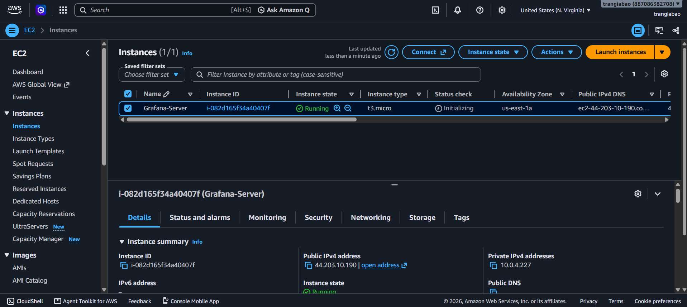

##### Step 5: Create IAM User & Issue Access Keys (Programmatic / Backup Option)
* **Action:** Navigate to **IAM** ➔ Select **Users** ➔ Click **Create user** with username `Grafana-user`.
* **Execution:** Finalize user permissions and proceed to **Create access key** to obtain programmatic credentials (`AKIA_DEMO_SAMPLE_KEY_ID`) for command-line verification and fallback access.

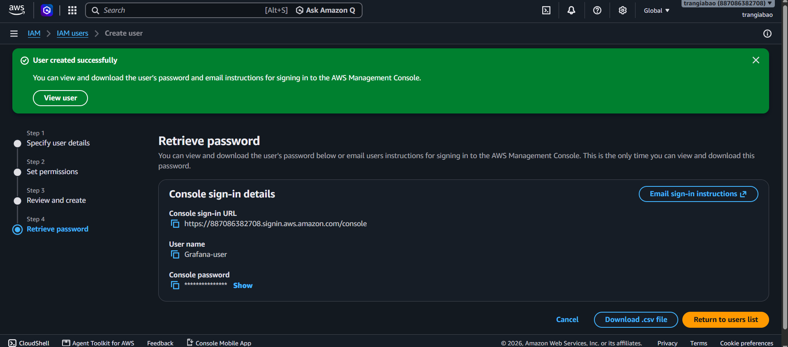

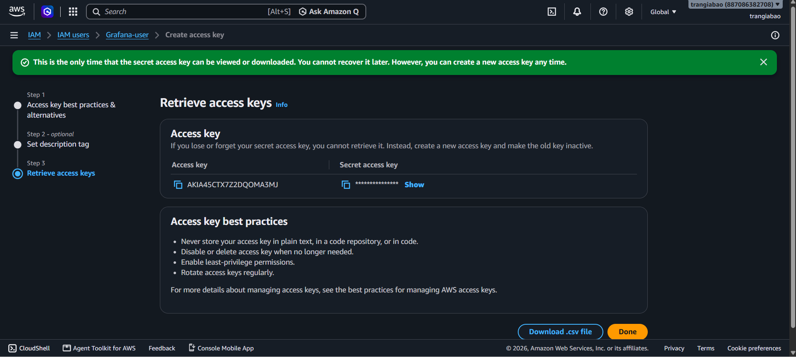

##### Step 6: Create IAM Policy `GrafanaAccessPolicy`
* **Action:** In IAM, navigate to **Policies** ➔ Click **Create policy**.
* **Execution:** Define read-only JSON permissions targeting CloudWatch metrics and logs (`cloudwatch:Describe*`, `cloudwatch:Get*`, `cloudwatch:List*`, `logs:DescribeLogGroups`, `logs:FilterLogEvents`). Name the policy `GrafanaAccessPolicy` and create it.

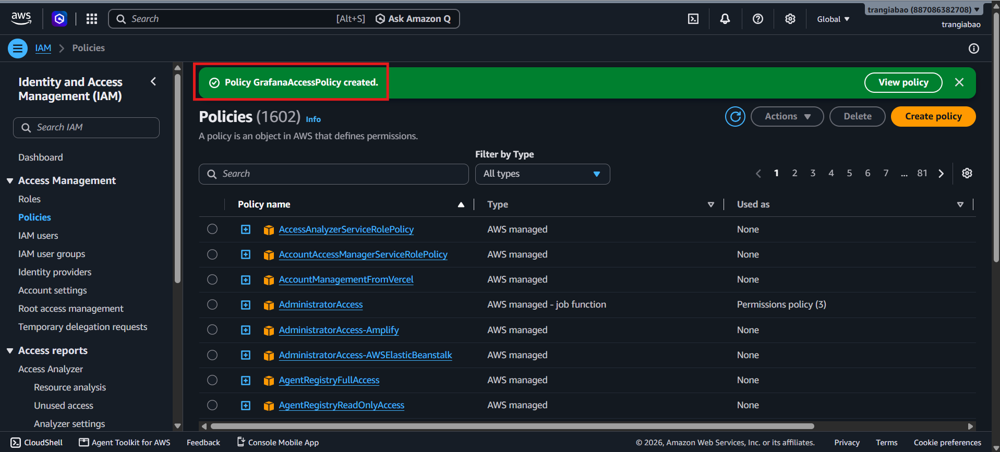

##### Step 7: Create IAM Role & Attach to EC2 Instance Profile
* **Action:** Select **Roles** ➔ Click **Create role** ➔ Choose **AWS service** (`EC2`) as the trusted entity ➔ Attach `GrafanaAccessPolicy` ➔ Name the role `GrafanaAccessRole`.
* **Instance Profile Attachment:** Return to EC2 ➔ Select `Grafana-Server` (`i-082d165f34a40407f`) ➔ Click **Actions** ➔ **Security** ➔ **Modify IAM role** ➔ Select `GrafanaAccessRole` ➔ Click **Update IAM role**. A green banner confirms successful attachment.

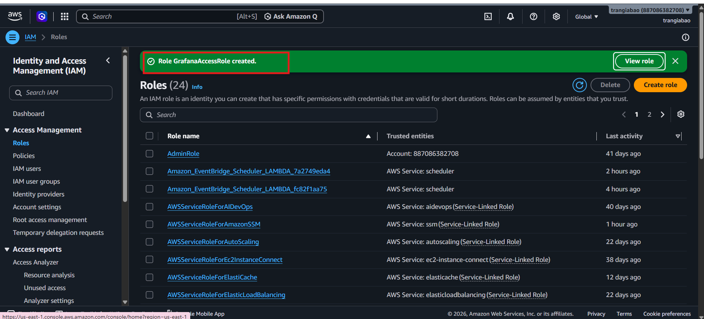

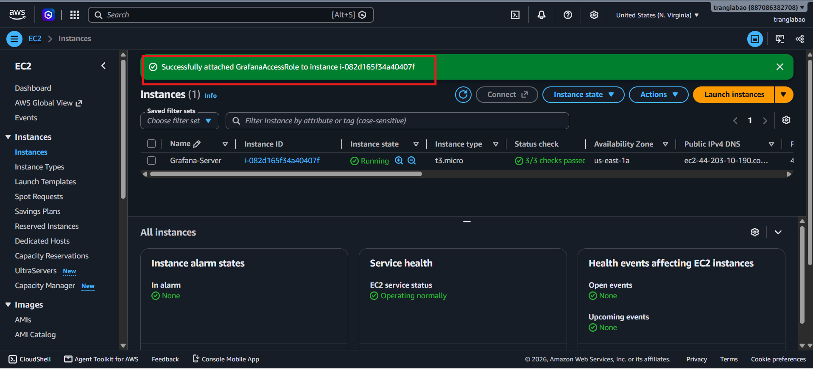

---

#### Part 3: Grafana Installation & Daemon Operations on AL2023

##### Step 8: SSH Connection & YUM Repository Setup
* **Action:** Connect via SSH to `44.203.10.190` as `ec2-user`.
* **System Update & Repository Configuration:**
  ```bash
  sudo yum update -y
  sudo nano /etc/yum.repos.d/grafana.repo
  ```
* **Repository Configuration Content:**
  ```ini
  [grafana]
  name=grafana
  baseurl=https://rpm.grafana.com
  repo_gpgcheck=1
  enabled=1
  gpgcheck=1
  gpgkey=https://rpm.grafana.com/gpg.key
  sslverify=1
  sslcacert=/etc/pki/tls/certs/ca-bundle.crt
  ```

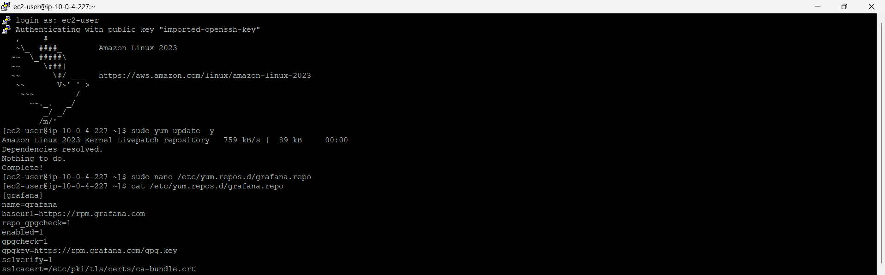

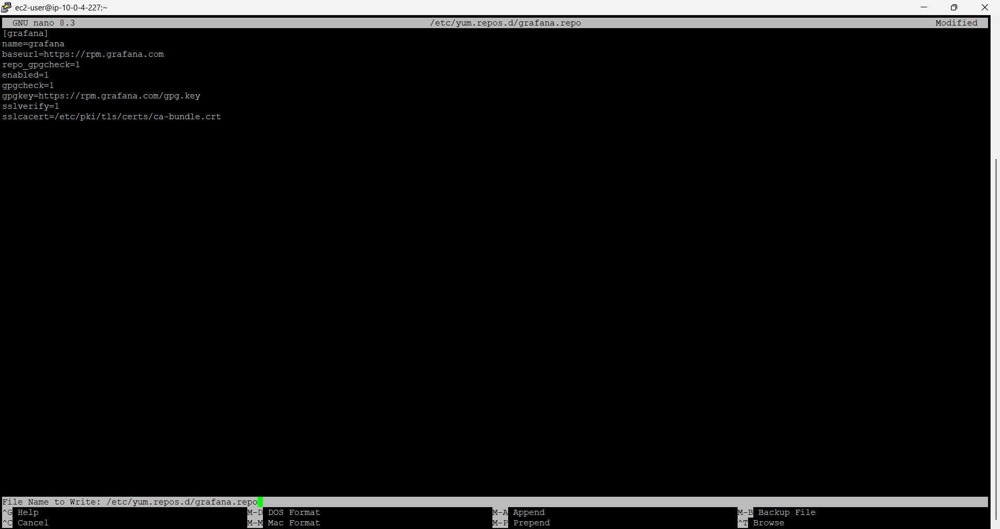

##### Step 9: Install Grafana Application Package
* **Action:** Run the automated package installer:
  ```bash
  sudo yum install grafana -y
  ```
* **Result:** The system imports Grafana Labs GPG keys (`engineering@grafana.com`), resolves dependencies, and installs `grafana-13.3.0-1.x86_64` (installed size: ~1.3 GB).

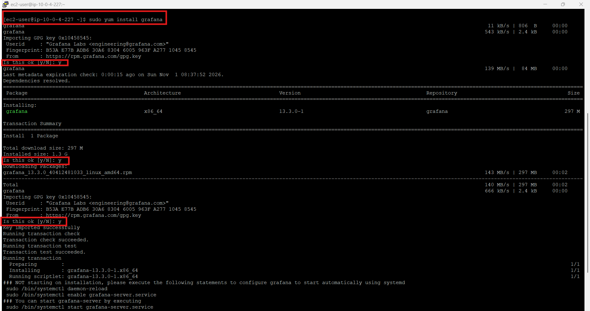

##### Step 10: Start grafana-server Daemon & Verify Service State
* **Action:** Reload systemd configuration, enable automatic boot startup, and launch the service:
  ```bash
  sudo systemctl daemon-reload
  sudo systemctl enable grafana-server.service
  sudo systemctl start grafana-server.service
  sudo systemctl status grafana-server.service
  ```
* **Verification:** The daemon reports `active (running)` status, binding to local ports and serving HTTP requests.

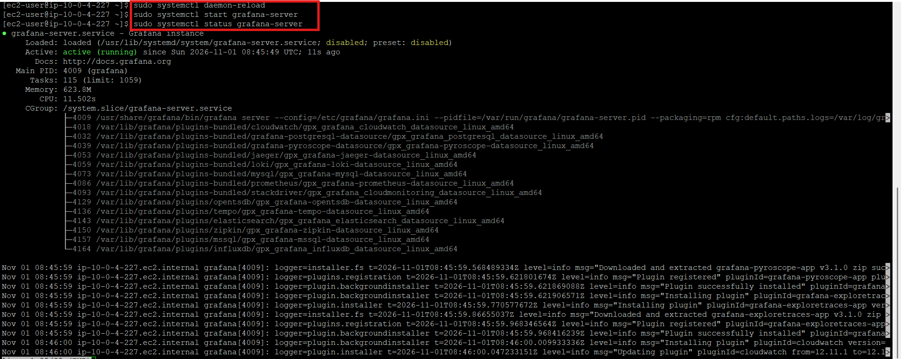

##### Step 11: Access Grafana Web UI & Update Admin Password
* **Action:** Open a web browser and navigate to `http://44.203.10.190:3000`.
* **Initial Authentication:** Authenticate with initial credentials `admin` / `admin`.
* **Password Rotation:** The portal immediately prompts to update default credentials to eliminate security risks (enter new password `giabao2005` and submit).

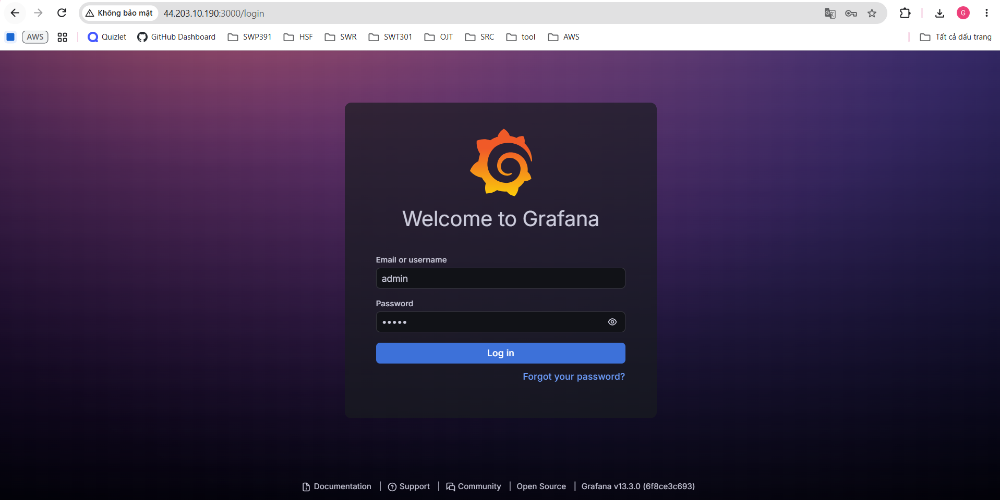


---

#### Part 4: CloudWatch Data Source & Dashboard Visualization

##### Step 12: Add CloudWatch Data Source & Validate API Connectivity
* **Action:** In Grafana's left navigation bar, choose **Connections** ➔ **Data sources** ➔ Click **Add new data source** ➔ Select **CloudWatch**.
* **Configuration:**
  * **Authentication Provider:** Select `AWS SDK Default` (leveraging the attached EC2 instance role without static credentials).
  * **Default Region:** Set to `us-east-1` (or target workload region).
* **Connection Test:** Click **Save & test**. The green notification confirms:
  * `1. Successfully queried the CloudWatch metrics API.`
  * `2. Successfully queried the CloudWatch logs API.`


##### Step 13: Build Time-Series Monitoring Dashboard for CPU Utilization
* **Action:** Navigate to **Dashboards** ➔ Click **New dashboard** ➔ Select **Add visualization** ➔ Choose `cloudwatch`.
* **Query Builder Parameters:**
  * **Namespace:** `AWS/EC2`.
  * **Metric name:** `CPUUtilization`.
  * **Statistic:** `Average`.
  * **Dimensions:** Filter by `InstanceId` = `i-082d165f34a40407f`.
* **Result:** A live Time-Series graph updates in real time displaying host CPU workload patterns.


##### Step 14: Advanced Metric Exploration with Explore Tool
* **Action:** In the main menu, click **Explore** ➔ Select `cloudwatch` data source.
* **Ad-hoc Query:**
  * Target region: `ap-southeast-1`.
  * Metric: `CPUUtilization`, Dimension: `InstanceId` = `i-0ba9a1a9ccab2d73f`.
  * Switch visualization mode to **Bars** to highlight workload spikes with distinct clarity.


---

### 💡 Lessons Learned & Troubleshooting Bank:

{}
Below are 5 practical troubleshooting scenarios encountered during Grafana and CloudWatch deployment, accompanied by verified root causes and solutions:
{}

#### 1. Inability to Access Grafana Web UI on Port 3000 (Connection Timed Out)
* **Root Cause:** The EC2 Security Group lacked an Inbound rule permitting TCP traffic on port 3000 from client IP ranges, or the instance was provisioned in an isolated subnet lacking an Internet Gateway route.
* **Remediation:** Inspect `SG-PUB-Grafana-ASG` Inbound rules and verify that Custom TCP on port `3000` is open. Confirm the subnet route table points `0.0.0.0/0` to an Internet Gateway (`igw-xxxx`).

#### 2. CloudWatch Data Source Authorization Error (AccessDeniedException / HTTP 403)
* **Root Cause:** The IAM Role attached to the EC2 instance lacked permissions required to invoke CloudWatch or CloudWatch Logs metric queries.
* **Remediation:** Ensure `GrafanaAccessPolicy` includes complete read-only actions:
  ```json
  {
    "Version": "2012-10-17",
    "Statement": [
      {
        "Sid": "AllowGrafanaCloudWatchAccess",
        "Effect": "Allow",
        "Action": [
          "cloudwatch:DescribeAlarmsForMetric",
          "cloudwatch:DescribeAlarmHistory",
          "cloudwatch:DescribeAlarms",
          "cloudwatch:ListMetrics",
          "cloudwatch:GetMetricStatistics",
          "cloudwatch:GetMetricData",
          "logs:DescribeLogGroups",
          "logs:GetLogGroupFields",
          "logs:StartQuery",
          "logs:StopQuery",
          "logs:GetQueryResults",
          "logs:GetLogEvents",
          "ec2:DescribeTags",
          "ec2:DescribeInstances",
          "ec2:DescribeRegions"
        ],
        "Resource": "*"
      }
    ]
  }
  ```

#### 3. Best Practice: EC2 IAM Instance Profile vs Static Access Keys
* **Analysis:** Hard-coding IAM user Access Key ID and Secret Access Key into web application configuration violates the principle of least privilege and introduces credential exposure risks.
* **Architectural Guidance:** Always use **AWS SDK Default** authentication on AWS-hosted Grafana instances. Grafana retrieves rotating, temporary tokens via the Instance Metadata Service (IMDSv2) automatically.

#### 4. grafana-server Service Fails to Start Automatically on Instance Reboot
* **Root Cause:** Administrator manually executed `systemctl start grafana-server` without enabling the systemd service unit.
* **Remediation:** Always run `sudo systemctl enable grafana-server`. Confirm configuration via `systemctl is-enabled grafana-server` (expected output: `enabled`).

#### 5. Clean-Up Lifecycle to Prevent Cloud Charges (Resource Cleanup)
* **Decommissioning Steps:**
  1. Terminate the EC2 host `Grafana-Server` (`i-082d165f34a40407f`).
  2. Detach and delete `GrafanaAccessRole` and `GrafanaAccessPolicy`.
  3. Delete security group `SG-PUB-Grafana-ASG`.
  4. Delete the custom VPC `Grafana-ASG-vpc` to release associated subnets and Internet Gateway resources.

- **Grafana Server Deployment on AL2023:** Provisioned open-source Grafana v13.3.0 on Amazon Linux 2023, configuring official RPM repositories and managing services with systemd.
- **Credential-less CloudWatch Integration:** Utilized EC2 Instance Profile (`GrafanaAccessRole`) adhering to AWS Zero-Trust guidelines without embedding static API keys.
- **Interactive Dashboards & Multi-Dimensional Telemetry:** Designed real-time Time Series panels tracking `CPUUtilization` and leveraged the Explore tool for bar-chart anomaly investigation.
- **Troubleshooting Bank:** Documented security group port 3000 rules, IAM 403 authorization remedies, and complete resource cleanup procedures.

---

#### 📌 Results for Friday (23/10/2026) - Week 6 Review, Worklog & Project:

{}
👉 **Friday Milestone Focus:** Every Friday is systematically dedicated to three pillars: (1) Synthesizing hands-on technical skills; (2) Perfecting worklog entries with evidence screenshots; (3) Researching and advancing the internship capstone (**[Project Proposal](/2-proposal/)**).
{}

* **1. Weekly Knowledge Synthesis:**
  * Consolidated operational understanding of **AWS Service Quotas** limit management and AWS Support collaboration.
  * Mastered FinOps automated cost-control architecture using **AWS Lambda**, **EventBridge Scheduler**, and **Slack ChatOps**.
  * Solidified best practices for metadata tagging and centralized management with **AWS Tags** and **AWS Resource Groups**.
  * Solidified skills in modern centralized observability combining the metrics backbone of **CloudWatch** with the powerful visualization of **Grafana**.
* **2. Worklog Documentation & Quality Audit:**
  * Rigorously reviewed and polished lab documentation across **1.6.1 to 1.6.4**, incorporating complete parameter specifications and evidence screenshots.
  * Maintained strict bilingual parity (Vietnamese and English), correct markdown standards, and unbroken internal cross-references.
* **3. Project Proposal Research & Design:**
  * Incorporated Grafana/CloudWatch telemetry monitoring, resource tagging conventions, and serverless cost optimization patterns into the internship capstone (**[Project Proposal](/2-proposal/)**).
  * Refined system architecture diagrams and detailed cost projections for the final proposal presentation.

---

### Next Week's Objectives (Week 7):

* **Advanced Observability with CloudWatch Advanced Workshop:**
  * Master advanced telemetry queries, Metric Math, dynamic search expressions, and dimension properties.
  * Construct multi-channel alerting workflows and analyze complex infrastructure workloads.
* **Technology Community Event & Deep-Dive Technical Blog:**
  * Attend the **First Cloud AI Journey Meetup** (24/10/2026) at the AWS Vietnam Office (Bitexco Level 26).
  * Research and publish Deep-Dive Technical **Blog 1** covering **AWS Continuum for Code Vulnerabilities** on the AWS Study Group - First Cloud Journey community.
* **Week 7 Review, Worklog & Project:** Consolidate advanced observability workflows, polish worklogs, and advance internship project deliverables.


