---
title: "Tuần 6"
date: 2026-10-19
weight: 6
chapter: false
pre: " <b> 1.6. </b> "
---


### Mục tiêu tuần 6:

* Quản trị trần giới hạn tài nguyên và hạn mức vCPU của hệ thống máy chủ với **AWS Service Quotas** và làm việc với **AWS Support Center**.
* Xây dựng giải pháp tự động hóa tối ưu chi phí hạ tầng máy chủ EC2 với kiến trúc không máy chủ **AWS Lambda**, **Amazon EventBridge Scheduler** và tích hợp ChatOps qua **Slack Incoming Webhooks**.
* Chuẩn hóa chiến lược phân loại và gom nhóm quản trị tài nguyên thông qua **AWS Tags** (gắn thẻ thủ công và tự động hóa với AWS CLI) cùng **AWS Resource Groups**.
* Triển khai hệ thống giám sát và trực quan hóa hiệu năng nâng cao bằng bảng điều khiển **Grafana** tích hợp nguồn dữ liệu **Amazon CloudWatch** (Workshop 000029 - Getting started with Grafana basic).
* Tổng kết toàn bộ kiến thức tuần 6, hoàn thiện hệ thống Worklog và dành thời gian nghiên cứu triển khai đồ án thực tập (**Project Proposal**).

---

### Các công việc cần triển khai trong tuần này:

| Thứ | Công việc | Ngày bắt đầu | Ngày hoàn thành | Nguồn tài liệu |
| :--- | :--- | :--- | :--- | :--- |
| **Thứ 2** | **Quản trị giới hạn tài nguyên với AWS Service Quotas:** <br>- Khám phá hệ thống Service Quotas & tra cứu hạn mức EC2 Spot vCPU. <br>- Kiểm thử cơ chế xác thực dữ liệu đầu vào (Input Validation). <br>- Gửi yêu cầu nâng hạn mức vCPU từ 32 lên 64 cho Spot Instances (`L-34B43A08`). <br>- Theo dõi và nhận phê duyệt từ AWS Support Center (Case ID: `179257232100832`). <br>- Tự động hóa tra cứu bằng AWS CLI & thiết lập giám sát CloudWatch. | 19/10/2026 | 19/10/2026 | [AWS Service Quotas](https://docs.aws.amazon.com/servicequotas/) |
| **Thứ 3** | **Tối ưu hóa Chi phí Amazon EC2 với AWS Lambda & Thông báo Slack:** <br>- Gắn nhãn tự động hóa `environment_auto: true` cho máy chủ EC2 cần tối ưu chi phí. <br>- Thiết lập kênh ChatOps gửi thông báo trạng thái qua Slack Incoming Webhooks. <br>- Cấu hình IAM Execution Role cấp quyền kiểm soát vòng đời máy chủ EC2. <br>- Lập trình và triển khai hàm Lambda tự động dừng/bật máy chủ (`dc-common-lambda-auto-stop`, `dc-common-lambda-auto-start`). <br>- Thiết lập lịch kích hoạt tự động theo khung giờ làm việc với Amazon EventBridge Scheduler. <br>- Kiểm thử thực tế bật/tắt máy ảo tự động và nhận thông báo Slack tức thời. | 20/10/2026 | 20/10/2026 | [Optimize EC2 Cost with Lambda](https://000022.awsfcaj.com/) |
| **Thứ 4** | **Quản trị Thẻ định danh và Nhóm tài nguyên AWS (Tags & Resource Groups):** <br>- Khởi chạy máy chủ EC2 và thực hành quản trị thẻ thủ công trên AWS Console. <br>- Tạo IAM Access Key và cấu hình AWS CLI để tự động hóa gán thẻ (`create-tags`). <br>- Truy vấn và lọc danh sách tài nguyên máy chủ theo điều kiện thẻ phức tạp (`describe-instances --filters`). <br>- Khởi tạo nhóm tài nguyên AWS Resource Groups (`EnvTest`) tự động gom nhóm máy ảo theo thẻ môi trường. <br>- Đúc kết kinh nghiệm xử lý giới hạn thẻ, phân biệt hoa thường và phạm vi vùng của Resource Groups. | 21/10/2026 | 21/10/2026 | [AWS Tagging & Resource Groups](https://docs.aws.amazon.com/ARG/latest/userguide/welcome.html) |
| **Thứ 5** | **Giám sát với Grafana & CloudWatch (Workshop 000029):** <br>- Cấu hình VPC, Public Subnet tự động cấp Public IP và Security Group mở cổng 3000 & 22. <br>- Khởi chạy máy chủ EC2 chạy Amazon Linux 2023 và thiết lập IAM Role cấp quyền CloudWatch an toàn. <br>- Cài đặt và kích hoạt dịch vụ nền `grafana-server` qua YUM repository và systemd. <br>- Kết nối nguồn dữ liệu CloudWatch Data Source và xác thực thành công các API đo lường. <br>- Xây dựng bảng điều khiển Time Series và trực quan hóa chuyên sâu chỉ số CPUUtilization với Explore (Bars). | 22/10/2026 | 22/10/2026 | [Getting started with Grafana basic](https://000029.awsfcaj.com/) |
| **Thứ 6** | **Tổng kết Tuần 6, Viết Worklog & Làm Project:** <br>- Tổng kết và hệ thống hóa kiến thức Service Quotas, Lambda FinOps, Tagging & Grafana CloudWatch. <br>- Hoàn thiện chi tiết nội dung và hình ảnh cho các trang Worklog từ 1.6.1 đến 1.6.4. <br>- Dành thời gian nghiên cứu tài liệu kiến trúc và xây dựng báo cáo Đồ án thực tập (Project Proposal). | 23/10/2026 | 23/10/2026 | [Internal Review & Project Documentation](/vi/2-proposal/) |

---

### Kết quả đạt được tuần 6:

#### 📌 Kết quả Thứ 2 (19/10/2026) - Quản lý giới hạn tài nguyên với AWS Service Quotas:

{}
Bài thực hành **Quản lý và Nâng hạn mức tài nguyên với AWS Service Quotas** được thực hiện vào **Thứ 2 (19/10/2026)** trong khuôn khổ **Tuần 6**. Trang này ghi lại toàn diện quy trình kiểm tra hạn mức mặc định, gửi yêu cầu nâng trần vCPU cho cụm máy chủ **EC2 Spot Instances** (`All Standard (A, C, D, H, I, M, R, T, Z) Spot Instance Requests`, mã Quota `L-34B43A08`) từ **32 lên 64 vCPUs** tại vùng **us-east-1**, phân tích chi phí, theo dõi quy trình phê duyệt qua **AWS Support Center** (Case ID: `179257232100832`), xác nhận qua thư điện tử chính thức từ Amazon Web Services và tự động hóa tra cứu bằng **AWS CLI**.
{}

### 🎯 Mục tiêu bài thực hành (Lab Objectives):
* Hiểu rõ khái niệm và vai trò chiến lược của **AWS Service Quotas** trong việc quản trị tài nguyên đám mây, ngăn chặn rủi ro vượt ngân sách ngoài ý muốn và bảo vệ hạ tầng tài khoản AWS.
* Phân biệt giữa **Soft Limits** (hạn mức mềm có thể yêu cầu tăng) và **Hard Limits** (hạn mức cứng cố định theo kiến trúc hệ thống AWS).
* Nắm vững cơ chế tính toán hạn mức vCPU của Amazon EC2: AWS áp dụng giới hạn dựa trên tổng số **vCPU** thay vì số lượng máy ảo (`instances`) riêng lẻ.
* Thực hiện gửi yêu cầu nâng hạn mức (**Request Quota Increase**) từ 32 lên 64 vCPUs cho dòng máy chủ **EC2 Spot Instances** tiêu chuẩn (`All Standard (A, C, D, H, I, M, R, T, Z) Spot Instance Requests`).
* Trải nghiệm thực tế cơ chế kiểm tra tính hợp lệ dữ liệu nhập (**Input Validation**) trên AWS Management Console khi nhập giá trị không hợp lệ.
* Hiểu rõ quy trình làm việc giữa khách hàng và bộ phận hỗ trợ AWS (**AWS Support Center**) ngay cả trong gói dịch vụ cơ bản (**Basic Support Plan**).
* Giải đáp chi tiết bài toán kinh tế đám mây (**Cloud FinOps**): *Việc nâng hạn mức Quota từ 32 lên 64 vCPU có bị trừ tiền hay phát sinh chi phí hay không?*
* Thực hành sử dụng bộ công cụ dòng lệnh **AWS CLI** (`aws service-quotas`) để tra cứu thông tin hạn mức, xem lịch sử thay đổi và tự động hóa kiểm tra trần tài nguyên.
* Thiết lập tư duy giám sát chủ động (**Proactive Quota Monitoring**) bằng cách tạo cảnh báo CloudWatch khi tài nguyên sử dụng tiệm cận ngưỡng 80% và 95%.

---

### 📊 Bảng tổng hợp thông số tài nguyên đã triển khai:

| Thông số / Tài nguyên | Giá trị thực tế | Ý nghĩa & Mô tả kỹ thuật |
| :--- | :--- | :--- |
| **Dịch vụ AWS** | `Amazon Elastic Compute Cloud (Amazon EC2)` | Dịch vụ điện toán đám mây cốt lõi cung cấp tài nguyên máy chủ ảo |
| **Tên hạn mức (Quota Name)** | `All Standard (A, C, D, H, I, M, R, T, Z) Spot Instance Requests` | Giới hạn tổng số vCPU tối đa cho các máy chủ Spot thuộc các dòng tiêu chuẩn |
| **Mã Quota (Quota Code)** | `L-34B43A08` | Định danh duy nhất của AWS cho hạn mức Spot vCPU tiêu chuẩn |
| **Khu vực (Region)** | `us-east-1` (US East - N. Virginia) | Vùng AWS triển khai và áp dụng hạn mức |
| **Hạn mức ban đầu (Default Limit)** | `32 vCPUs` | Giới hạn mặc định ban đầu do AWS thiết lập cho tài khoản |
| **Hạn mức yêu cầu mới (Requested)** | `64 vCPUs` | Giá trị hạn mức mới được gửi yêu cầu phê duyệt |
| **Mã hồ sơ hỗ trợ (Case ID)** | `179257232100832` | Hồ sơ yêu cầu tăng hạn mức được tự động mở trên AWS Support Center |
| **Gói hỗ trợ tài khoản (Plan)** | `Basic Support` | Gói hỗ trợ mặc định miễn phí của tài khoản AWS |
| **Trạng thái phê duyệt (Status)** | `Case Closed` / `Approved` | Yêu cầu đã được bộ phận hỗ trợ kỹ thuật AWS chấp thuận thành công |
| **Thời gian áp dụng (Effective Time)** | Trong vòng `30 phút` kể từ khi duyệt | Thời gian đồng bộ hạn mức mới trên toàn bộ hệ thống phân tán của AWS |
| **Kênh thông báo (Notification)** | Email chính thức từ `Amazon Web Services` | Hộp thư quản trị viên tiếp nhận biên bản xác nhận phê duyệt |

---

### 📋 Quy trình triển khai chi tiết từng bước (Step-by-Step):

#### 🔹 Mục 1: Khám phá AWS Service Quotas & Tra cứu hạn mức EC2

##### Bước 1: Truy cập bảng điều khiển AWS Service Quotas
* **Thao tác:** Đăng nhập vào **AWS Management Console** ➔ Tại thanh tìm kiếm trên cùng, nhập từ khóa `Service Quotas` ➔ Nhấp chọn dịch vụ **Service Quotas**.
* **Xác định Region:** Đảm bảo góc trên cùng bên phải đang ở vùng **US East (N. Virginia) `us-east-1`**. Lưu ý rằng phần lớn các hạn mức dịch vụ AWS được áp dụng riêng biệt theo từng Region (**Per-Region Quotas**).
* **Mục đích:** Bảng điều khiển Service Quotas cung cấp một giao diện tập trung duy nhất để xem toàn bộ hạn mức mặc định, hạn mức đang áp dụng và tỷ lệ sử dụng tài nguyên của hơn 250 dịch vụ AWS.

##### Bước 2: Điều hướng đến dịch vụ Amazon Elastic Compute Cloud (EC2)
* **Thao tác:** Ở thanh menu bên trái, nhấp chọn **AWS services** ➔ Trong ô tìm kiếm danh sách dịch vụ, nhập `EC2` hoặc `Amazon Elastic Compute Cloud (Amazon EC2)` ➔ Nhấp vào tên dịch vụ để mở danh mục hạn mức chi tiết.
* **Quan sát:** EC2 có hàng trăm hạn mức khác nhau, bao gồm số lượng Elastic IP, VPC Peering, Launch Templates, và đặc biệt là hạn mức vCPU được phân chia theo từng nhóm họ instance (Standard, High Memory, Accelerated Computing) và theo mô hình mua sắm (On-Demand vs Spot).

##### Bước 3: Tra cứu hạn mức vCPU cho máy chủ Spot tiêu chuẩn
* **Thao tác:** Trong ô tìm kiếm hạn mức (**Filter quotas**), nhập cụm từ: `All Standard (A, C, D, H, I, M, R, T, Z) Spot Instance Requests`.
* **Thông tin hiển thị:**
  * **Quota name:** `All Standard (A, C, D, H, I, M, R, T, Z) Spot Instance Requests`
  * **Quota code:** `L-34B43A08`
  * **Default value:** `32` (vCPUs)
  * **Applied value:** `32` (vCPUs)
* **Ý nghĩa:** Hạn mức này quy định tài khoản của bạn tại vùng `us-east-1` chỉ có thể chạy đồng thời các máy chủ Spot thuộc các dòng A, C, D, H, I, M, R, T, Z với tổng số vCPU tối đa không vượt quá **32 vCPUs**. Ví dụ: bạn có thể chạy 16 máy `t3.medium` (2 vCPU x 16 = 32 vCPU), hoặc 4 máy `c5.2xlarge` (8 vCPU x 4 = 32 vCPU).

---

#### 🔹 Mục 2: Thực hiện yêu cầu nâng hạn mức tài nguyên (Request Quota Increase)

##### Bước 4: Mở biểu mẫu yêu cầu và kiểm thử cơ chế Input Validation
* **Thao tác:** Nhấp chọn dòng hạn mức `All Standard (A, C, D, H, I, M, R, T, Z) Spot Instance Requests` ➔ Nhấp vào nút màu cam **Request increase at account level** (Yêu cầu tăng hạn mức ở cấp độ tài khoản).
* **Cửa sổ bật lên (Modal):** Hộp thoại hiển thị thông tin chi tiết:
  * *Description:* The maximum number of vCPUs for all running or requested Standard (A, C, D, H, I, M, R, T, Z) Spot Instances per Region.
  * *Requested for:* Account ID `887086382708`.
  * *Region:* United States (N. Virginia) `us-east-1`.
* **Thực nghiệm Input Validation:** 
  * Trong ô **Increase quota value**, tiến hành thử nhập giá trị: `32` (bằng với hạn mức hiện hành).
  * **Phản hồi từ Console:** Ngay lập tức, giao diện hiển thị thông báo lỗi màu đỏ nổi bật:
    > ❌ **Must be a number greater than your current quota value of 32** *(Phải là một số lớn hơn giá trị hạn mức hiện tại là 32)*.
  * **Bài học kinh nghiệm:** Cơ chế kiểm tra đầu vào (Client-side validation) của AWS ngăn chặn người dùng gửi những yêu cầu thừa thãi hoặc không làm tăng hạn mức thực tế.

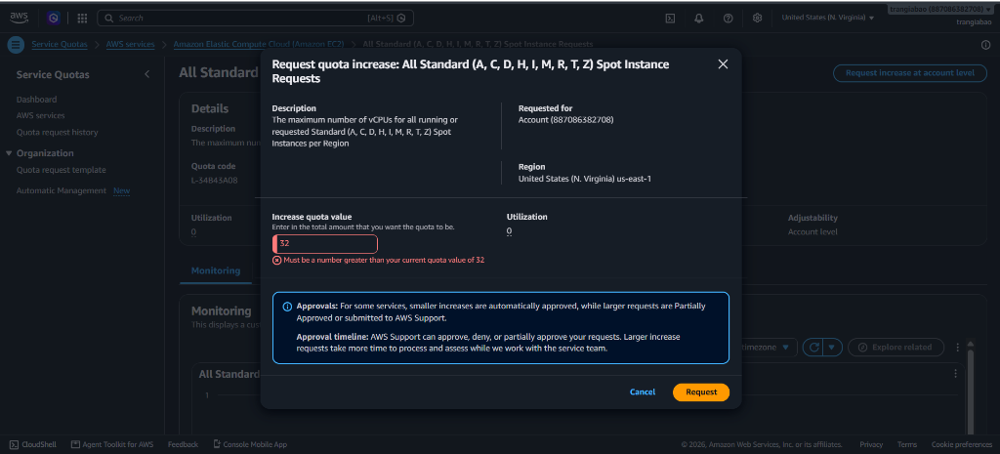

##### Bước 5: Nhập giá trị hạn mức mới 64 vCPUs và xác nhận gửi yêu cầu
* **Thông số nhập liệu:**
  * **Increase quota value:** Nhập `64` (Gấp đôi hạn mức ban đầu, cho phép mở rộng quy mô chạy song song nhiều tác vụ tính toán hiệu năng cao với chi phí Spot tối ưu).
* **Lưu ý trong hộp thoại phê duyệt của AWS:**
  > ℹ️ **Approvals:** Đối với một số dịch vụ, các mức tăng nhỏ có thể được hệ thống phê duyệt tự động. Đối với các mức tăng lớn hơn, yêu cầu sẽ được chuyển tới đội ngũ **AWS Support** để thẩm định và phê duyệt thủ công.
* **Thao tác:** Nhấn nút **Request** để chính thức gửi hồ sơ.

---

#### 🔹 Mục 3: Theo dõi quy trình phê duyệt và xác nhận kết quả thành công

##### Bước 6: Theo dõi tiến độ tại Dashboard Service Quotas
* **Thao tác:** Quay trở lại bảng điều khiển chính **Service Quotas** ➔ Chọn mục **Dashboard** hoặc **Quota request history**.
* **Quan sát phần "Recent quota increase requests" (Các yêu cầu tăng hạn mức gần đây):**
  * **Service:** `Amazon Elastic Compute Cloud (Amazon EC2)`
  * **Quota name:** `All Standard (A, C, D, H, I, M, R, T, Z) Spot Instance Requests`
  * **Request type:** `User`
  * **Requested quota value:** `64`
  * **Status:** `Case Closed` (Hồ sơ hỗ trợ đã được xử lý và đóng thành công)
  * **Request date:** `21 thg 10, 2026`
  * **Last updated date:** `21 thg 10, 2026`

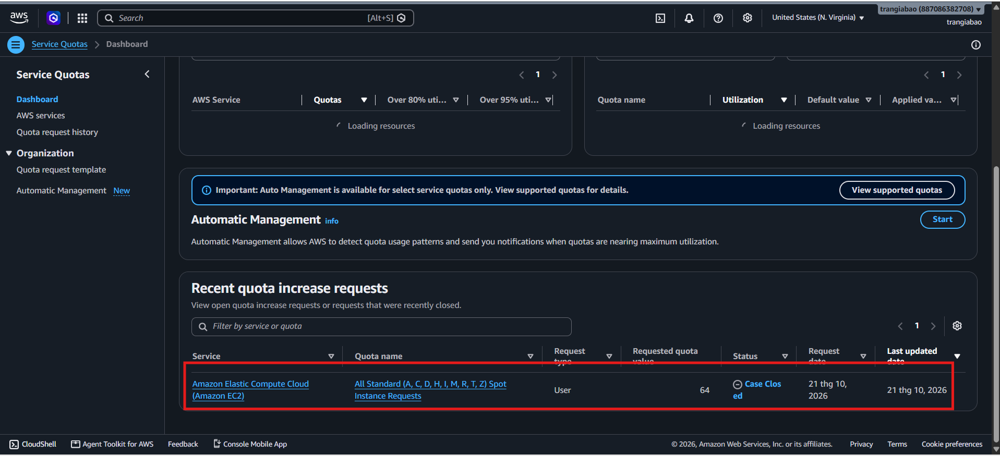

##### Bước 7: Tiếp nhận thư điện tử phê duyệt chính thức từ Amazon Web Services
* **Kênh nhận tin:** Hộp thư Gmail liên kết với tài khoản AWS (`trangiabao`).
* **Tiêu đề email:** Thông báo phê duyệt hồ sơ yêu cầu tăng hạn mức dịch vụ từ AWS Support.
* **Nội dung phê duyệt trích xuất từ thư AWS:**
  > *"Hello there,*  
  > *Thank you for your patience while I was working on your request.*  
  > *I am pleased to inform you that your quota increase has been approved. For your convenience, I have included details of the approved Quota here:*  
  > **[US East (Northern Virginia)]: EC2 Spot Instances / All Standard (A, C, D, H, I, M, R, T, Z) Spot Instance Requests, New Limit = 64**  
  > *The new quota will take effect in 30 minutes and you can see the newly approved quota on your Service Quotas console..."*

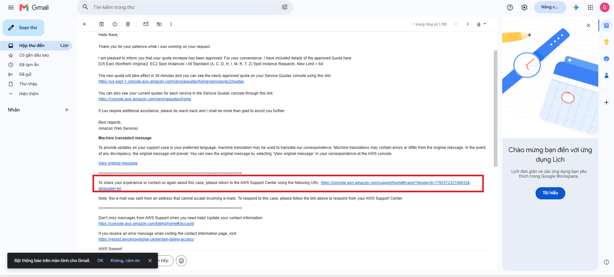

##### Bước 8: Kiểm tra chi tiết hồ sơ hỗ trợ trên AWS Support Center
* **Thao tác:** Trên AWS Console, nhấp vào biểu tượng dấu hỏi trợ giúp (Help) ở góc trên bên phải ➔ Chọn **Support Center** ➔ Điều hướng đến **Your support cases** ➔ Nhấp vào mã hồ sơ vừa xử lý.
* **Thông số chi tiết của Support Case:**
  * **Plan:** `Basic Support` (Gói hỗ trợ miễn phí).
  * **Thời gian xử lý:** `Wed Oct 21 2026 15:49:28 GMT+0700 (Giờ Đông Dương)`.
  * **Nội dung phản hồi:** Đội ngũ kỹ sư AWS xác nhận hạn mức mới **New Limit = 64** đã được ghi nhận vào cơ sở dữ liệu vùng `us-east-1`.
  * **Thời gian trễ kích hoạt (Propagation delay):** Hệ thống cần tối đa **30 phút** để lan tỏa cấu hình hạn mức mới đến toàn bộ cụm máy chủ và bộ điều phối EC2 Fleet tại Bắc Virginia.

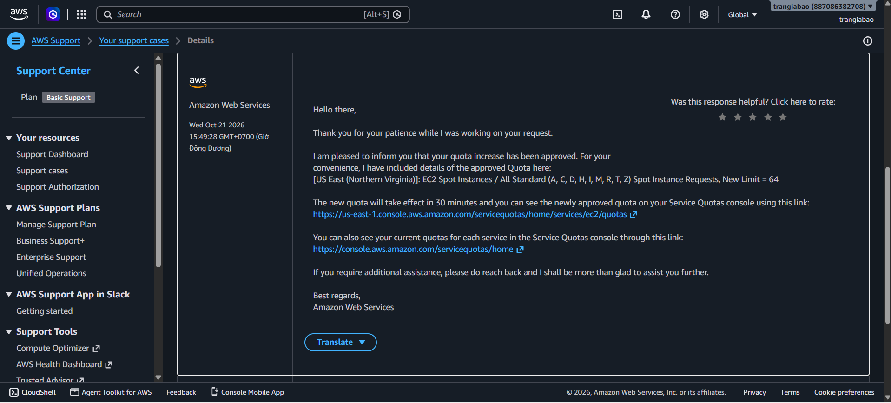

---

#### 🔹 Mục 4: Quản trị hạn mức Service Quotas thông qua công cụ dòng lệnh AWS CLI

Bên cạnh thao tác trên giao diện Web Console trực quan, người quản trị hệ thống Cloud chuyên nghiệp hoàn toàn có thể tự động hóa việc tra cứu và quản lý hạn mức dịch vụ thông qua bộ công cụ **AWS CLI v2**.

##### Bước 9: Tra cứu mã định danh dịch vụ (Service Code) của EC2
Để thao tác với Service Quotas bằng CLI, trước tiên cần tra cứu chính xác mã `service-code`:

```bash
# Liệt kê các dịch vụ AWS hỗ trợ Service Quotas có chứa từ khóa ec2
aws service-quotas list-services \
  --query "Services[?contains(ServiceCode, 'ec2')].{Code:ServiceCode, Name:ServiceName}" \
  --output table
```

##### Bước 10: Lấy thông tin chi tiết hạn mức Spot vCPU qua Quota Code `L-34B43A08`
Truy vấn trực tiếp giá trị hạn mức hiện hành đang áp dụng tại vùng `us-east-1`:

```bash
aws service-quotas get-service-quota \
  --service-code ec2 \
  --quota-code L-34B43A08 \
  --region us-east-1 \
  --query "Quota.{QuotaName:QuotaName, QuotaCode:QuotaCode, Value:Value, Unit:Unit, Adjustable:Adjustable}" \
  --output json
```

* **Kết quả trả về định dạng JSON:**
```json
{
  "QuotaName": "All Standard (A, C, D, H, I, M, R, T, Z) Spot Instance Requests",
  "QuotaCode": "L-34B43A08",
  "Value": 64.0,
  "Unit": "None",
  "Adjustable": true
}
```
* **Phân tích:** Trường `"Value": 64.0` xác nhận hạn mức mới đã được hệ thống cập nhật thành công lên 64 vCPUs; trường `"Adjustable": true` cho biết đây là một Soft Limit có thể tiếp tục xin nâng khi nhu cầu mở rộng quy mô tăng lên.

##### Bước 11: Lệnh CLI gửi yêu cầu nâng hạn mức tự động
Nếu muốn thực hiện gửi yêu cầu nâng hạn mức bằng kịch bản dòng lệnh:

```bash
aws service-quotas request-service-quota-increase \
  --service-code ec2 \
  --quota-code L-34B43A08 \
  --desired-value 64 \
  --region us-east-1
```

##### Bước 12: Kiểm tra lịch sử các yêu cầu thay đổi hạn mức
Để kiểm tra trạng thái phê duyệt của các yêu cầu đã gửi:

```bash
aws service-quotas list-requested-service-quota-change-history-by-quota \
  --service-code ec2 \
  --quota-code L-34B43A08 \
  --region us-east-1 \
  --query "RequestedQuotas[*].{ID:Id, Status:Status, DesiredValue:DesiredValue, Created:Created}" \
  --output table
```

---

#### 🔹 Mục 5: Thiết lập cảnh báo chủ động tiệm cận hạn mức (Proactive Monitoring)

Để tránh tình trạng máy chủ tự động co giãn (**Auto Scaling**) hoặc tác vụ tính toán phân tán bị thất bại đột ngột do chạm trần hạn mức vCPU, mô hình chuẩn của AWS khuyến nghị thiết lập **CloudWatch Alarms** theo dõi tỷ lệ sử dụng quota:

```bash
# Tạo CloudWatch Alarm cảnh báo khi tỷ lệ sử dụng Spot vCPU vượt quá 80% hạn mức
aws cloudwatch put-metric-alarm \
  --alarm-name "EC2-Spot-vCPU-Quota-Utilization-High" \
  --alarm-description "Cảnh báo khi số lượng vCPU Spot tiêu thụ vượt quá 80% hạn mức trần 64 vCPU" \
  --namespace "AWS/Usage" \
  --metric-name "ResourceCount" \
  --dimensions Name=Service,Value=EC2 Name=Type,Value=Resource Name=Resource,Value=SpotInstances \
  --statistic Maximum \
  --period 300 \
  --threshold 51.2 \
  --comparison-operator GreaterThanOrEqualToThreshold \
  --evaluation-periods 1 \
  --alarm-actions arn:aws:sns:us-east-1:887086382708:aws-cli
```

---

### 💡 Khó khăn gặp phải & Bài học kinh nghiệm thực tế (Troubleshooting & Real-world Lessons):

#### 1. Thắc mắc kinh tế đám mây: Việc nâng hạn mức Quota từ 32 lên 64 vCPU có bị tính phí tiền không?
* **Bản chất kỹ thuật:** **HOÀN TOÀN KHÔNG MẤT PHÍ.**
* **Nguyên lý tính cước của AWS:** 
  * Hạn mức (Service Quota) chỉ là một "chiếc trần bảo vệ" (Safety Ceiling) nhằm bảo vệ bạn không vô tình tạo ra quá nhiều máy chủ gây phát sinh hóa đơn khổng lồ, đồng thời bảo vệ hạ tầng dùng chung của AWS khỏi tình trạng cạn kiệt tài nguyên cục bộ.
  * Việc gửi yêu cầu tăng hạn mức và được AWS phê duyệt lên 64 vCPUs là dịch vụ quản trị **miễn phí 100%**.
  * AWS chỉ bắt đầu tính tiền khi bạn **thực sự khởi chạy máy chủ** (Run/Launch Instances) dựa trên thời gian chạy thực tế (tính theo từng giây hoạt động của máy ảo). Nếu bạn được duyệt trần 64 vCPUs nhưng không khởi chạy máy ảo nào thì hóa đơn cuối tháng của dịch vụ EC2 vẫn là **0 USD**.

#### 2. Lỗi xác thực dữ liệu đầu vào (Input Validation Error: "Must be a number greater than your current quota value of 32")
* **Nguyên nhân:** Người dùng nhập giá trị `32` vào ô yêu cầu nâng hạn mức. Vì hạn mức hiện tại đã là 32, hệ thống từ chối xử lý một yêu cầu không có sự thay đổi giá trị.
* **Giải pháp:** Phải nhập một số nguyên dương strictly lớn hơn giá trị hiện hành (ví dụ: `64` hoặc `128`). Cần tính toán nhu cầu thực tế của dự án để đưa ra con số hợp lý, tránh nhập các số quá lớn không có lý do chính đáng dẫn đến việc bị AWS Support từ chối.

#### 3. Phân biệt Soft Quotas (Hạn mức mềm) và Hard Quotas (Hạn mức cứng)
* **Soft Quotas:** Là các giới hạn quản trị có thể nâng được bằng cách gửi yêu cầu qua Service Quotas hoặc AWS Support (ví dụ: số vCPU EC2, số lượng Elastic IP, dung lượng DynamoDB provisioned).
* **Hard Quotas:** Là các giới hạn vật lý, giao thức mạng hoặc kiến trúc cố định của nền tảng AWS mà không thể tăng lên dưới bất kỳ hình thức nào (ví dụ: kích thước tối đa của một item trong DynamoDB là 400 KB, kích thước tối đa của một thông điệp SQS là 256 KB, hoặc số lượng VPC tối đa cho mỗi peering connection).

#### 4. Tính chất cục bộ theo từng Region (Per-Region Quotas)
* **Hiện tượng:** Yêu cầu nâng hạn mức Spot vCPU lên 64 được duyệt tại vùng `us-east-1` (Bắc Virginia). Khi người dùng chuyển sang vùng Singapore (`ap-southeast-1`), hạn mức Spot vCPU vẫn giữ nguyên ở mức mặc định 32 vCPUs.
* **Bài học:** Hạn mức dịch vụ của phần lớn tài nguyên hạ tầng AWS (EC2, VPC, EBS, RDS) được áp dụng độc lập cho từng Region. Nếu dự án triển khai kiến trúc đa vùng (Multi-Region Disaster Recovery), bạn phải chủ động gửi yêu cầu nâng Service Quotas riêng rẽ cho từng Region tương ứng.

#### 5. Phân biệt hạn mức tính theo vCPU vs hạn mức tính theo số lượng máy chủ (Instance Count)
* **Kinh nghiệm lịch sử:** Trước đây, AWS quản lý hạn mức EC2 theo số lượng máy ảo (ví dụ: tối đa 20 On-Demand Instances). Tuy nhiên, cách tính này không công bằng vì một máy `t3.nano` (2 vCPU, 0.5GB RAM) bị tính ngang với một máy khủng `c5.18xlarge` (72 vCPU, 144GB RAM).
* **Quy chuẩn hiện đại:** AWS đã chuyển đổi toàn bộ sang quản lý theo **số lượng vCPU**. Do đó, khi lên kế hoạch triển khai, kỹ sư hệ thống cần quy đổi cấu hình máy ảo ra tổng số vCPU để đối chiếu với trần Service Quotas.

#### 6. Độ trễ hiệu lực sau khi phê duyệt (Quota Propagation Delay ~30 phút)
* **Hiện tượng:** Ngay sau khi nhận được thông báo "Case Closed", người dùng chạy lệnh tạo máy chủ Spot vượt quá 32 vCPU thì vẫn có thể gặp lỗi `MaxSpotInstanceCountExceeded`.
* **Nguyên nhân:** AWS là hệ thống phân tán toàn cầu khổng lồ với hàng chục ngàn cụm máy chủ vật lý. Cần một khoảng thời gian trễ nhất định (từ 15 đến 30 phút) để bản ghi hạn mức mới được đồng bộ tới toàn bộ các dịch vụ định tuyến và phân bổ tài nguyên (EC2 Capacity Placement Engine).

#### 7. Lý do AWS yêu cầu phê duyệt thủ công đối với tài khoản mới (Account Justification)
* **Cơ chế kiểm soát rủi ro của AWS:** Đối với các tài khoản AWS mới tạo (Fresh Accounts), AWS áp đặt hạn mức ban đầu khá chặt chẽ để phòng chống gian lận, đào tiền ảo trái phép (cryptocurrency mining) hoặc bị hacker chiếm quyền điều khiển để tấn công từ chối dịch vụ (DDoS). 
* **Thực hành chuẩn:** Khi yêu cầu nâng hạn mức lớn, bạn nên cung cấp mô tả ngắn gọn về nhu cầu sử dụng (Use Case) trong ô mô tả (ví dụ: "Phục vụ huấn luyện mô hình Machine Learning" hoặc "Chạy kiểm thử tải hệ thống cho bài tập lớn đại học").

#### 8. Hạn mức tự động quản trị (Automatic Management / Quota Request Template)
* **Tính năng mở rộng:** Với các doanh nghiệp sử dụng **AWS Organizations**, quản trị viên có thể sử dụng tính năng **Quota Request Template** để cấu hình một bộ quy tắc hạn mức tự động. Bất cứ khi nào một tài khoản con (Member Account) mới được tạo trong tổ chức, các hạn mức mong muốn sẽ tự động được gửi yêu cầu nâng mà không cần làm thủ công từng tài khoản.

---

### 📌 Kết luận & Đúc kết kỹ năng:
Qua bài thực hành **Quản lý và Nâng hạn mức tài nguyên với AWS Service Quotas**, sinh viên thực tập đã nắm trọn vẹn:
1. Bản chất hoạt động của hệ thống Service Quotas trên nền tảng điện toán đám mây AWS.
2. Quy trình gửi và theo dõi yêu cầu nâng trần vCPU cho cụm máy chủ Spot Instances (`L-34B43A08`) từ 32 lên 64 vCPUs.
3. Sự phối hợp mượt mà giữa các dịch vụ: **Service Quotas Console**, **AWS Support Center** và kênh thông báo **Email**.
4. Khả năng tự động hóa kiểm tra và giám sát trần tài nguyên thông qua **AWS CLI** và **Amazon CloudWatch**, sẵn sàng cho các bài thực hành triển khai cụm máy chủ phân tán quy mô lớn trong các tuần tiếp theo.

- **Vai trò quản trị trần tài nguyên (Service Quotas):** Hiểu rõ cơ chế hạn mức của AWS nhằm bảo vệ an toàn cho tài khoản, ngăn chặn các sự cố chi phí bất thường do cấu hình nhầm hoặc rò rỉ mã bảo mật.
- **Quy trình gửi yêu cầu nâng hạn mức thực chiến:** Trải nghiệm thực tế quá trình gửi yêu cầu tăng gấp đôi trần vCPU cho cụm máy chủ Spot Instances (từ 32 lên 64 vCPUs) trên AWS Management Console và vượt qua các ràng buộc xác thực dữ liệu đầu vào.
- **Làm việc với hệ thống hỗ trợ kỹ thuật (AWS Support Center):** Nắm bắt quy trình phối hợp và nhận thông báo phê duyệt hồ sơ hỗ trợ (Support Case) qua thư điện tử chính thức từ Amazon Web Services ngay trên gói dịch vụ cơ bản (Basic Support).
- **Tự động hóa và giám sát chủ động:** Thực hành sử dụng câu lệnh AWS CLI để tra cứu mã hạn mức, lịch sử thay đổi và lên phương án thiết lập cảnh báo CloudWatch trước khi tài nguyên chạm ngưỡng tới hạn.

---

#### 📌 Kết quả Thứ 3 (20/10/2026) - Tối ưu hóa Chi phí Amazon EC2 với AWS Lambda & Thông báo Slack:

{}
Bài thực hành **Tối ưu hóa Chi phí Amazon EC2 với AWS Lambda & Thông báo Slack** được thực hiện vào **Thứ 3 (20/10/2026)** trong khuôn khổ **Tuần 6**. Trang này ghi lại chi tiết giải pháp tự động tắt/bật máy chủ ngoài giờ làm việc bằng serverless AWS Lambda, điều phối với EventBridge Scheduler và gửi thông báo trực tiếp về kênh chat Slack qua Incoming Webhooks.
{}

### 🎯 Mục tiêu bài thực hành (Lab Objectives)
* **Tối ưu hóa Chi phí Đám mây (Cloud Cost Optimization):** Thiết kế và triển khai giải pháp tự động hóa lịch trình vận hành máy chủ Amazon EC2, tự động tắt các máy chủ môi trường thử nghiệm (Dev/Test) ngoài giờ hành chính và bật lại vào đầu ngày làm việc, giúp tiết kiệm tới 65 - 70% chi phí tài nguyên điện toán.
* **Tự động hóa Không máy chủ (Serverless Automation):** Lập trình các hàm **AWS Lambda** (Python 3 Boto3 SDK) phối hợp cùng bộ điều phối lịch trình **Amazon EventBridge Scheduler** để kiểm soát vòng đời máy ảo hoàn toàn tự động mà không cần duy trì bất kỳ máy chủ quản trị trung gian nào.
* **Chiến lược Quản trị Tài nguyên bằng Thẻ (Resource Tagging Strategy):** Áp dụng cặp thẻ định danh `environment_auto = true` để Lambda tự động nhận diện và quét chính xác các máy chủ mục tiêu được phân quyền quản trị mà không cần cấu hình cứng Instance ID.
* **Tích hợp Giám sát Thời gian thực (ChatOps via Slack):** Kết nối AWS Lambda với dịch vụ giao tiếp nhóm **Slack** thông qua **Incoming Webhooks**, tự động gửi thông báo định dạng trực quan về trạng thái bật/tắt của từng máy chủ vào kênh `#notification`.
* **Kỹ năng Xử lý Sự cố Thực chiến (Real-World Troubleshooting):** Trực tiếp phân tích và khắc phục các sự cố kinh điển như ngoại lệ chuyển giao trạng thái máy ảo `IncorrectInstanceState`, xung đột bộ lọc máy ảo đã xóa (`Terminated`), phân quyền IAM và kết nối webhook an toàn.

---

### 📊 Bảng tổng hợp thông số tài nguyên đã triển khai (Provisioned Resource Specifications)

| Thành phần / Tài nguyên | Tên định danh (Name / ID) | Thông số kỹ thuật / Cấu hình chi tiết | Mục đích / Ghi chú |
| :--- | :--- | :--- | :--- |
| **AWS Region** | `us-east-1` | US East (N. Virginia) | Khu vực triển khai toàn bộ giải pháp |
| **Mạng VPC** | `lambda-lab` | CIDR `10.0.0.0/16`, Public Subnet `10.0.128.0/20` (`us-east-1a`) | Môi trường mạng VPC biệt lập cho bài thực hành |
| **Nhóm bảo mật (SG)** | `lambda-lab` | Inbound: SSH (Port 22), HTTP (Port 80); Outbound: All Traffic | Kiểm soát an ninh mạng cho máy chủ EC2 |
| **Máy chủ mục tiêu (EC2)**| `lambda-lab-instance` / `i-003cb6dbd0f4e5b31` | `t3.micro`, Amazon Linux 2023, Tag: `environment_auto = true` | Máy chủ môi trường phát triển cần tối ưu chi phí |
| **IAM Execution Role** | `dc-common-lambda-role` | Trusted: `lambda.amazonaws.com`, Policies: `AmazonEC2FullAccess`, `CloudWatchFullAccessV2` | Cấp quyền cho Lambda quản trị EC2 và ghi nhật ký Logs |
| **Hàm Lambda Tắt máy** | `dc-common-lambda-auto-stop` | Runtime: Python 3.14, Memory: 128 MB, Env: `environment_auto = true` | Quét và tự động dừng máy chủ EC2 ngoài giờ làm việc |
| **Hàm Lambda Bật máy** | `dc-common-lambda-auto-start`| Runtime: Python 3.14, Memory: 128 MB, Env: `environment_auto = true` | Quét và tự động khởi động máy chủ EC2 đầu ngày mới |
| **Lịch trình EventBridge (Stop)** | `dc-common-lambda-auto-stop` | Recurring Schedule: Rate (9 hours) / Cron, Flexible Window: Off | Kích hoạt hàm Stop theo chu kỳ định sẵn |
| **Lịch trình EventBridge (Start)**| `dc-common-lambda-auto-start`| Recurring Schedule: Rate (8 hours) / Cron, Flexible Window: Off | Kích hoạt hàm Start theo chu kỳ định sẵn |
| **Không gian ChatOps** | `aws-lambda-labs` | Kênh Slack `#notification`, App: `Lambda-Notifier` | Kênh tiếp nhận thông báo trạng thái vận hành tức thời |

---

### 🛠️ Các bước thực hành Step-by-Step (Hands-on Implementation)

#### Bước 1: Khởi tạo Hạ tầng Mạng VPC & Cấu hình Subnet Public
1. Truy cập giao diện điều khiển **Amazon VPC** trên AWS Management Console.
2. Điều hướng tới **Your VPCs** ➔ Chọn **Create VPC**.
3. Chọn cấu hình **VPC and more**, đặt tên định danh `lambda-lab` và giữ nguyên dải mạng CIDR tiêu chuẩn. Bấm **Create VPC**.
4. Truy cập mục **Subnets**, chọn Subnet Public vừa khởi tạo (`lambda-lab-subnet-public...`) ➔ Chọn **Actions** ➔ **Edit subnet settings**.
5. Đánh dấu tích vào tùy chọn **Enable auto-assign public IPv4 address** để máy chủ EC2 khi khởi chạy tự động nhận địa chỉ IP công cộng ➔ Bấm **Save**.

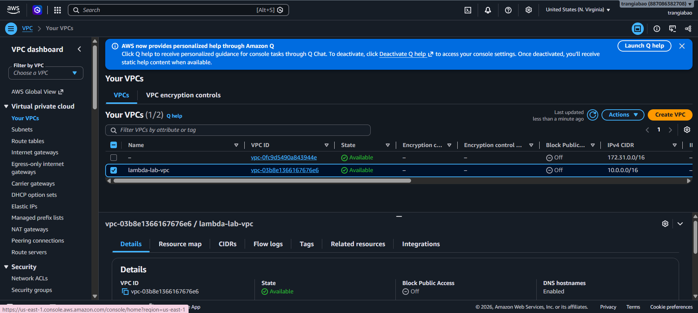
*Hình 1.1: Giao diện chi tiết VPC lambda-lab cùng cấu hình bảng định tuyến và Subnet sau khi khởi tạo thành công.*

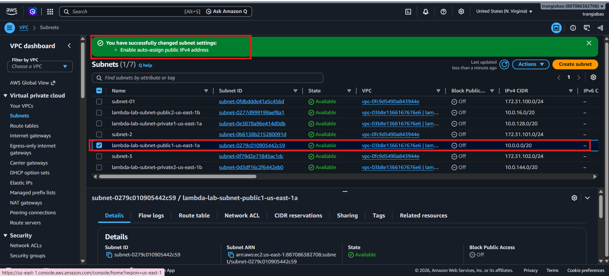
*Hình 1.2: Cấu hình tự động cấp phát Public IPv4 cho các tài nguyên trong Subnet Public.*

---

#### Bước 2: Thiết lập Security Group kiểm soát truy cập
1. Tại thanh điều hướng dịch vụ VPC, truy cập vào mục **Security Groups** ➔ Chọn **Create security group**.
2. Thiết lập các thông số định danh:
   * **Security group name:** `lambda-lab`
   * **Description:** `security group for lambda lab`
   * **VPC:** Chọn đúng VPC **`lambda-lab`** vừa khởi tạo ở Bước 1.
3. Thiết lập các quy tắc tường lửa (Inbound rules):
   * Quy tắc 1: Loại **SSH** (Cổng 22), Nguồn `0.0.0.0/0` (Anywhere-IPv4).
   * Quy tắc 2: Loại **HTTP** (Cổng 80), Nguồn `0.0.0.0/0` (Anywhere-IPv4).
4. Kiểm tra Outbound rules (Mặc định cho phép toàn bộ lưu lượng ra ngoài `All traffic`) ➔ Bấm **Create security group**.

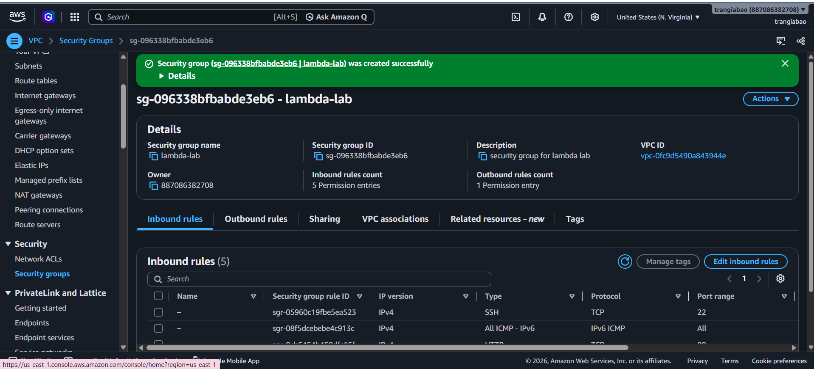
*Hình 2.1: Cấu hình Inbound Rules mở cổng 22 SSH và 80 HTTP cho Security Group lambda-lab.*

---

#### Bước 3: Khởi chạy Máy chủ Amazon EC2 thử nghiệm
1. Truy cập dịch vụ **Amazon EC2** ➔ Chọn **Instances** ➔ Bấm **Launch instances**.
2. Nhập tên máy chủ: `lambda-lab-instance`.
3. Lựa chọn hệ điều hành: **Amazon Linux** (AMI: **Amazon Linux 2023 AMI**), Loại phiên bản: **`t3.micro`** (Được miễn phí theo gói Free Tier).
4. Tại mục **Key pair (login)**, tạo mới hoặc chọn cặp khóa truy cập `lambda-lab-key`.
5. Tại mục **Network settings**, bấm **Edit**:
   * **VPC:** Chọn VPC **`lambda-lab`**.
   * **Subnet:** Chọn **Public subnet** (`lambda-lab-subnet-public...`).
   * **Auto-assign public IP:** Chọn **Enable**.
   * **Firewall (security groups):** Chọn **Select existing security group** ➔ Chọn nhóm bảo mật **`lambda-lab`**.
6. Bấm **Launch instance** và kiểm tra trạng thái máy ảo chuyển sang **`Running`**.

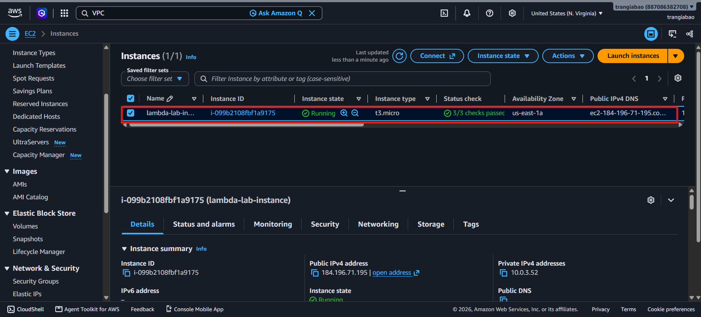
*Hình 3.1: Thông tin cấu hình chi tiết máy chủ EC2 lambda-lab-instance gắn với Security Group lambda-lab.*

---

#### Bước 4: Thiết lập Kênh ChatOps Slack qua Incoming Webhooks
1. Đăng nhập vào workspace làm việc Slack cá nhân (`aws-lambda-labs`).
2. Tạo mới một kênh thảo luận nội bộ dành riêng cho cảnh báo hệ thống: `#notification`.
3. Truy cập cổng phát triển ứng dụng Slack ([Slack API Apps](https://api.slack.com/apps)), tiến hành khởi tạo ứng dụng **`Lambda-Notifier`**.
4. Kích hoạt tính năng **Incoming Webhooks** (Bật `On`) ➔ Bấm chọn **Add New Webhook to Workspace**.
5. Phân quyền và chỉ định gửi thông báo vào kênh `#notification` ➔ Sao chép địa chỉ Webhook URL được cấp phát (dạng `https://hooks.slack.com/services/YOUR_WORKSPACE_ID/YOUR_CHANNEL_ID/...`).

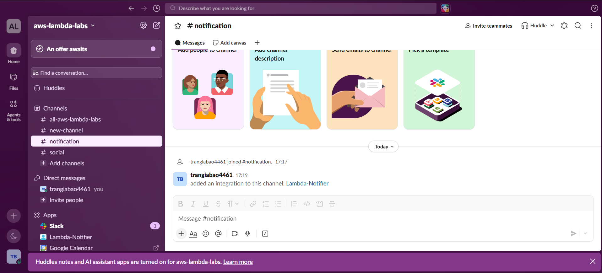
*Hình 4.1: Kích hoạt Incoming Webhooks và cấp quyền gửi tin nhắn cho ứng dụng Lambda-Notifier.*

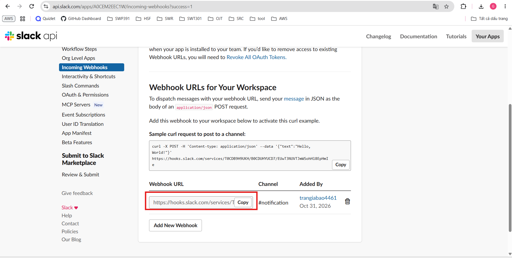
*Hình 4.2: Địa chỉ Webhook URL chính thức được liên kết để tiếp nhận thông báo tự động từ AWS Lambda.*

---

#### Bước 5: Phân loại Máy chủ Mục tiêu bằng AWS Resource Tag
1. Quay trở lại giao diện điều khiển **Amazon EC2 ➔ Instances**.
2. Tích chọn máy chủ EC2 mục tiêu ➔ Chọn tab **Tags** ở thanh chi tiết phía dưới ➔ Bấm **Manage tags**.
3. Bấm **Add tag** và thiết lập cặp giá trị điều kiện:
   * **Key:** `environment_auto`
   * **Value:** `true`
4. Bấm **Save tags**. Việc gắn nhãn này đóng vai trò là "chữ ký" để mã nguồn Lambda tự động phân loại và chỉ can thiệp vào đúng máy chủ được chỉ định.

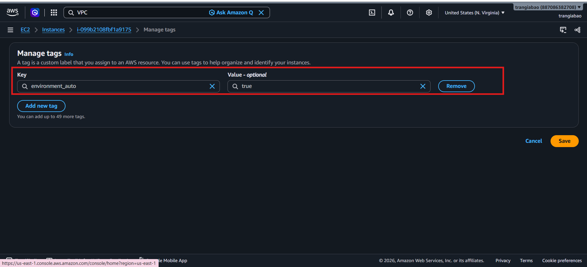
*Hình 5.1: Thiết lập thẻ định danh environment_auto = true phân loại máy chủ tự động hóa.*

---

#### Bước 6: Khởi tạo IAM Execution Role cho AWS Lambda
1. Truy cập dịch vụ **AWS IAM** ➔ Điều hướng tới **Roles** ➔ Bấm **Create role**.
2. Tại mục **Trusted entity type**, chọn **AWS service** ➔ Use case chọn **Lambda** ➔ Bấm **Next**.
3. Tại trang **Add permissions**, tìm kiếm và tích chọn 2 chính sách quyền hạn:
   * **`AmazonEC2FullAccess`**: Cấp quyền quét danh sách máy ảo, mô tả trạng thái và thực hiện lệnh Start/Stop instances.
   * **`CloudWatchFullAccessV2`** (hoặc `AWSLambdaBasicExecutionRole`): Cấp quyền ghi nhật ký thực thi vào CloudWatch Logs.
4. Đặt tên Role: **`dc-common-lambda-role`** ➔ Xem lại cấu hình và bấm **Create role**.

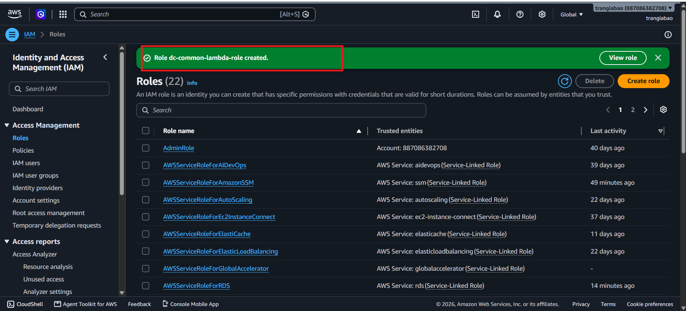
*Hình 6.1: Giao diện tạo IAM Role ủy quyền cho dịch vụ Lambda với đầy đủ quyền quản trị EC2 và CloudWatch.*

---

#### Bước 7: Xây dựng & Triển khai Hàm Lambda Tắt máy chủ (Auto Stop)
1. Truy cập dịch vụ **AWS Lambda** ➔ Bấm **Create function**.
2. Cấu hình cơ bản:
   * Chọn **Author from scratch**.
   * **Function name:** `dc-common-lambda-auto-stop`.
   * **Runtime:** `Python 3.14` (hoặc Python 3.12).
   * **Execution role:** Chọn **Use an existing role** ➔ Chọn Role **`dc-common-lambda-role`** đã tạo ở Bước 6.
   * Bấm **Create function**.
3. Cấu hình biến môi trường:
   * Chuyển sang tab **Configuration** ➔ Chọn **Environment variables** ➔ Bấm **Edit**.
   * Thêm biến: Key = `environment_auto`, Value = `true` ➔ Bấm **Save**.
4. Cấu hình thời gian chạy:
   * Tại tab **Configuration** ➔ Mục **General configuration** ➔ Bấm **Edit** ➔ Tăng **Timeout** từ `3 sec` lên **`1 min`** (tránh lỗi ngắt kết nối do quá thời gian).
5. Nạp mã nguồn Python:
   * Chuyển sang tab **Code**, mở tệp `lambda_function.py`, nạp mã nguồn xử lý và cấu hình webhook URL chính xác. Bấm **Deploy**.
6. Thiết lập Lịch trình tự động với **Amazon EventBridge Scheduler**:
   * Truy cập **Amazon EventBridge ➔ Schedules** ➔ Bấm **Create schedule**.
   * Đặt tên lịch trình: `dc-common-lambda-auto-stop`.
   * Lựa chọn **Recurring schedule**, đặt tần suất kiểm tra định kỳ (ví dụ: `Rate(9 hours)` hoặc biểu thức Cron `0 19 ? * MON-FRI *` tắt máy lúc 19:00 hàng ngày), Flexible time window: **Off**.
   * Tại bước Target: Chọn **AWS Lambda** ➔ Chỉ định hàm **`dc-common-lambda-auto-stop`**.
   * Hoàn tất các bước thiết lập và bấm **Create schedule**.

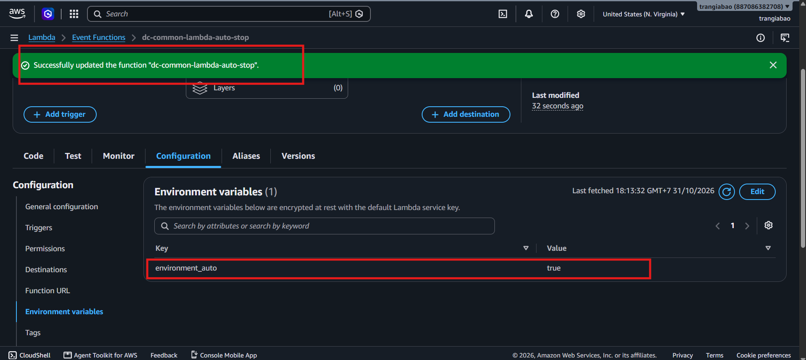
*Hình 7.1: Trình soạn thảo mã nguồn hàm dc-common-lambda-auto-stop tích hợp thư viện Boto3 và xử lý Slack Webhook.*

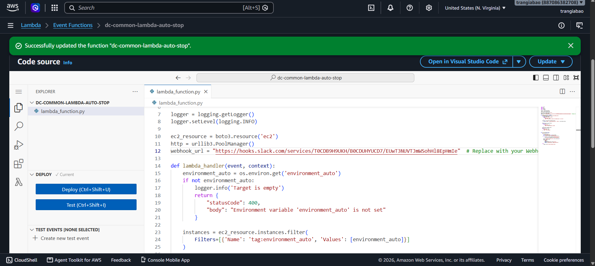
*Hình 7.2: Định nghĩa quy tắc lịch trình lặp lại (Recurring Rate Schedule) cho sự kiện tự động dừng máy chủ.*

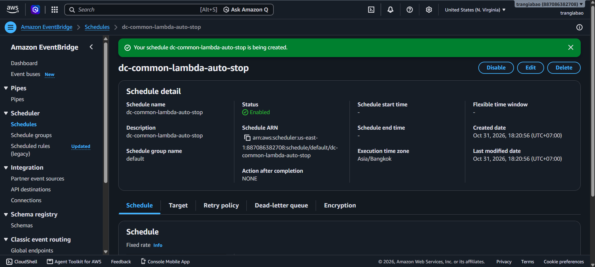
*Hình 7.3: Xác nhận khởi tạo thành công lịch trình EventBridge Scheduler điều phối tác vụ dừng máy ảo.*

---

#### Bước 8: Xây dựng & Triển khai Hàm Lambda Bật máy chủ (Auto Start)
1. Tương tự như Bước 7, tiến hành khởi tạo hàm Lambda thứ hai mang tên **`dc-common-lambda-auto-start`**.
2. Chọn Runtime **Python 3.14**, gắn Execution Role **`dc-common-lambda-role`**.
3. Cấu hình biến môi trường: `environment_auto = true` và tăng Timeout lên `1 min`.
4. Nạp mã nguồn xử lý Start instances và tích hợp gửi tin nhắn thông báo Slack. Bấm **Deploy**.
5. Khởi tạo lịch trình **Amazon EventBridge Scheduler** mang tên `dc-common-lambda-auto-start` với tần suất định kỳ (Rate 8 hours hoặc Cron `0 7 ? * MON-FRI *` bật máy vào lúc 07:00 sáng mỗi ngày làm việc).
6. Chỉ định đích đến (Target) là hàm Lambda **`dc-common-lambda-auto-start`** và hoàn tất tạo lịch.

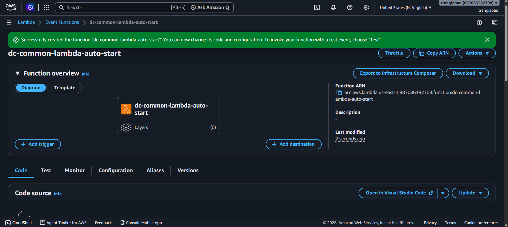
*Hình 8.1: Soạn thảo và nạp mã nguồn logic khởi động máy ảo EC2 cho hàm dc-common-lambda-auto-start.*

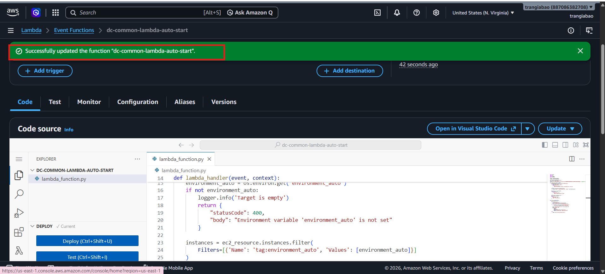
*Hình 8.2: Thiết lập thời điểm kích hoạt tự động bật máy trước khi bắt đầu ngày làm việc.*

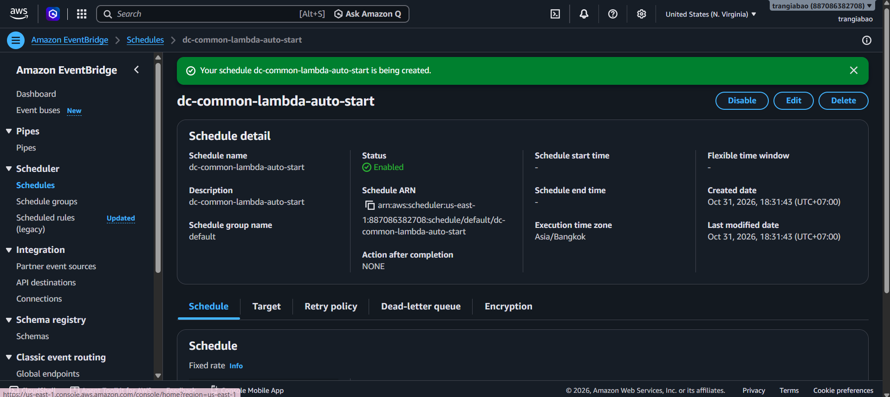
*Hình 8.3: Hoàn tất khởi tạo lịch trình EventBridge kích hoạt hàm khởi động máy chủ.*

---

#### Bước 9: Kiểm thử Thực tế & Xác minh Cảnh báo ChatOps trên Slack
1. **Kiểm thử tác vụ Tắt máy chủ (Test Auto Stop):**
   * Đảm bảo máy chủ EC2 mục tiêu đang ở trạng thái **`Running`**.
   * Truy cập hàm **`dc-common-lambda-auto-stop`** ➔ Chọn tab **Test** ➔ Tạo sự kiện test `instance-stop` ➔ Bấm **Test**.
   * Kết quả phản hồi thành công: **`StatusCode: 200, "body": "EC2 Stopping"`** (Execution succeeded).
   * Kiểm tra giao diện EC2 Console: Trạng thái máy chủ chuyển sang **`Stopping`** và sau đó về **`Stopped`**.
   * Kiểm tra kênh Slack `#notification`: Nhận ngay tin nhắn tức thời từ bot **Lambda-Notifier** thông báo danh sách ID máy vừa dừng: `Stopping Instances ID: ['i-099b2108fbf1a9175']`.
2. **Kiểm thử tác vụ Bật máy chủ (Test Auto Start):**
   * Khi máy chủ EC2 đang ở trạng thái **`Stopped`**.
   * Truy cập hàm **`dc-common-lambda-auto-start`** ➔ Chọn tab **Test** ➔ Tạo sự kiện test `instance-start` ➔ Bấm **Test**.
   * Kết quả phản hồi thành công: **`StatusCode: 200, "body": "EC2 Starting"`** (Execution succeeded).
   * Kiểm tra giao diện EC2 Console: Trạng thái máy chủ chuyển từ `Pending` sang **`Running`** màu xanh.
   * Kiểm tra kênh Slack `#notification`: Nhận ngay thông báo bắt đầu hoạt động: `Starting Instances ID: ['i-099b2108fbf1a9175']`.

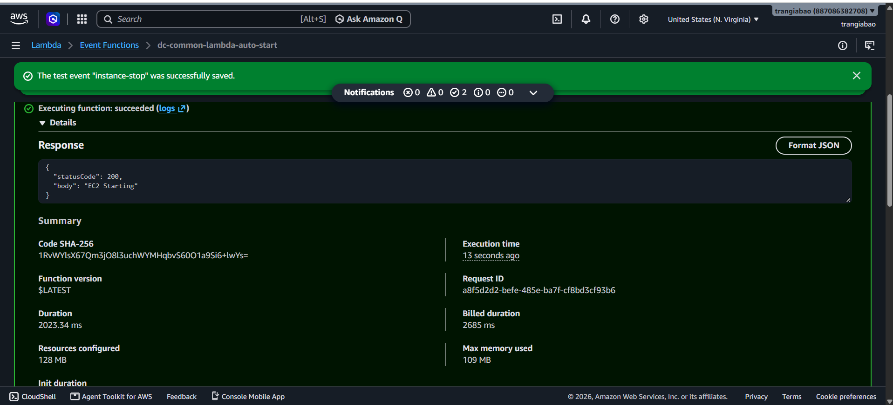
*Hình 9.1: Kết quả kiểm thử hàm dc-common-lambda-auto-start thành công tuyệt đối (Executing function: succeeded) trả về StatusCode 200.*

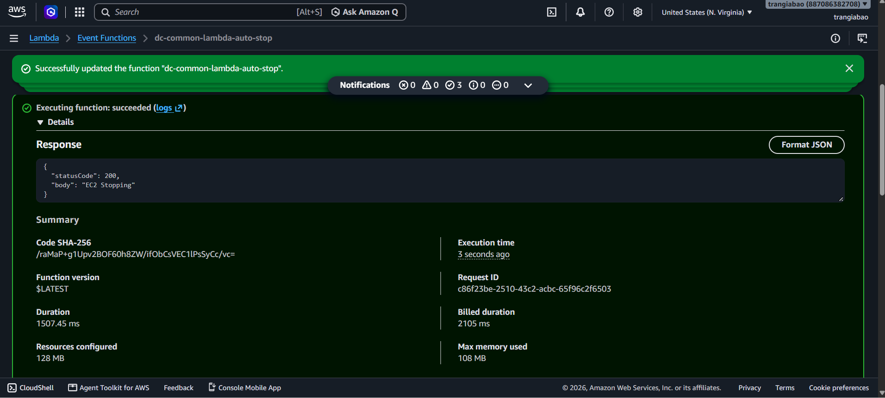
*Hình 9.2: Kết quả kiểm thử hàm dc-common-lambda-auto-stop thực thi thành công, dừng máy chủ an toàn.*

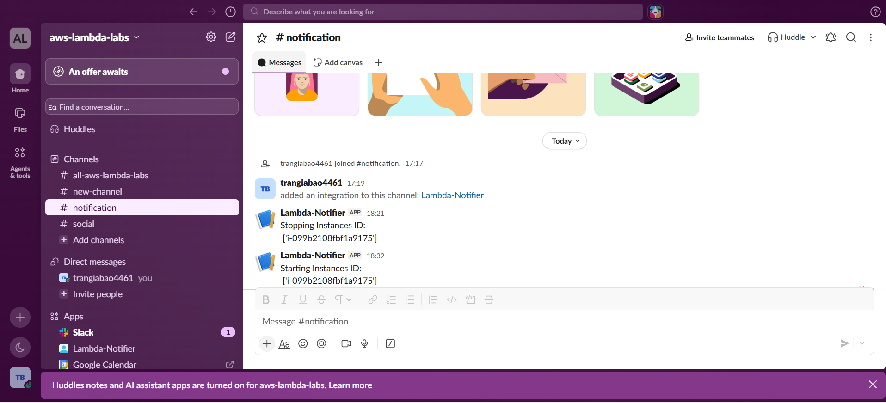
*Hình 9.3: Kênh Slack #notification nhận đầy đủ 2 thông báo Starting và Stopping instances từ bot Lambda-Notifier.*

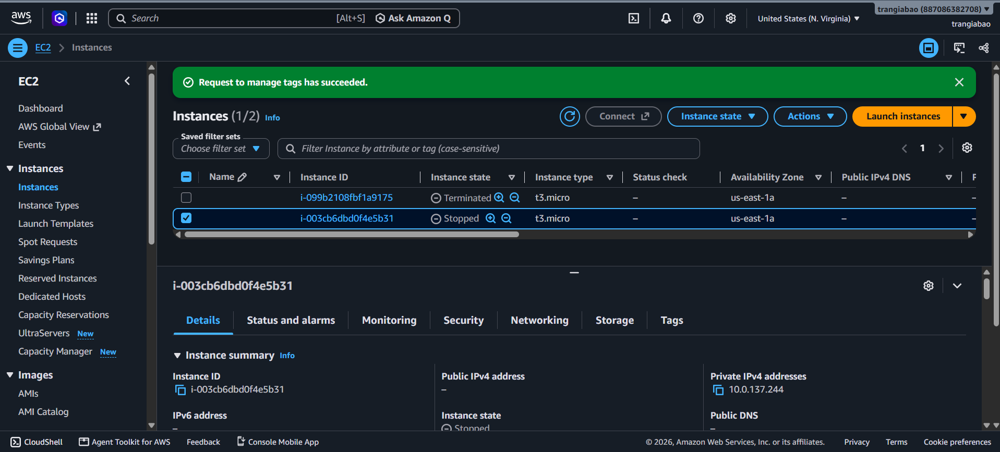
*Hình 9.4: Bảng điều khiển EC2 Instances xác nhận quản lý thẻ tag thành công (Request to manage tags has succeeded).*

---

### 💻 Mã nguồn Toàn diện Tối ưu hóa cho Production (Optimized Source Code)

#### 1. Kịch bản Tắt máy chủ (`dc-common-lambda-auto-stop / lambda_function.py`):
```python
import boto3
import os
import json
import logging
import urllib3
from botocore.exceptions import ClientError

logger = logging.getLogger()
logger.setLevel(logging.INFO)

ec2_resource = boto3.resource('ec2')
http = urllib3.PoolManager()
webhook_url = "https://hooks.slack.com/services/YOUR_WORKSPACE_ID/YOUR_CHANNEL_ID/YOUR_SECRET_TOKEN"

def lambda_handler(event, context):
    environment_auto = os.environ.get('environment_auto')
    if not environment_auto:
        logger.info('Target environment tag is empty')
        return {
            "statusCode": 400,
            "body": "Environment variable 'environment_auto' is not set"
        }

    # BỘ LỌC AN TOÀN: Chỉ quét máy chủ có Tag đúng VÀ ĐANG Ở TRẠNG THÁI RUNNING
    instances = ec2_resource.instances.filter(
        Filters=[
            {'Name': 'tag:environment_auto', 'Values': [environment_auto]},
            {'Name': 'instance-state-name', 'Values': ['running']}
        ]
    )

    instance_list = list(instances)
    if not instance_list:
        logger.info("No running instances found to stop.")
        return {
            "statusCode": 200,
            "body": "No running instances found to stop (Instances already stopped or none exist)."
        }

    try:
        action_stop = instances.stop()
        send_slack(action_stop)
        return {
            "statusCode": 200,
            "body": f"EC2 Stopping successfully. Processed {len(instance_list)} instance(s)."
        }
    except ClientError as e:
        logger.error(f"Error stopping instances: {e}")
        return {
            "statusCode": 500,
            "body": str(e)
        }

def send_slack(action_stop):
    try:
        list_instance_id = []
        if (
            len(action_stop) > 0
            and "StoppingInstances" in action_stop[0]
            and len(action_stop[0]["StoppingInstances"]) > 0
        ):
            for instance in action_stop[0]["StoppingInstances"]:
                list_instance_id.append(instance["InstanceId"])

            msg = f"Stopping Instances ID:\n {list_instance_id}"
            data = {"text": msg}
            http.request(
                "POST",
                webhook_url,
                body=json.dumps(data).encode("utf-8"),
                headers={"Content-Type": "application/json"}
            )
            logger.info("Sent stopping notification to Slack successfully")
        else:
            logger.info('No stopped instances to notify')
    except Exception as e:
        logger.warning(f"Error sending alert to Slack: {e}")
```

#### 2. Kịch bản Bật máy chủ (`dc-common-lambda-auto-start / lambda_function.py`):
```python
import boto3
import os
import json
import logging
import urllib3
from botocore.exceptions import ClientError

logger = logging.getLogger()
logger.setLevel(logging.INFO)

ec2_resource = boto3.resource('ec2')
http = urllib3.PoolManager()
webhook_url = "https://hooks.slack.com/services/YOUR_WORKSPACE_ID/YOUR_CHANNEL_ID/YOUR_SECRET_TOKEN"

def lambda_handler(event, context):
    environment_auto = os.environ.get('environment_auto')
    if not environment_auto:
        logger.info('Target environment tag is empty')
        return {
            "statusCode": 400,
            "body": "Environment variable 'environment_auto' is not set"
        }

    # BỘ LỌC AN TOÀN: Chỉ quét máy chủ có Tag đúng VÀ ĐANG Ở TRẠNG THÁI STOPPED
    instances = ec2_resource.instances.filter(
        Filters=[
            {'Name': 'tag:environment_auto', 'Values': [environment_auto]},
            {'Name': 'instance-state-name', 'Values': ['stopped']}
        ]
    )

    instance_list = list(instances)
    if not instance_list:
        logger.info("No stopped instances found to start.")
        return {
            "statusCode": 200,
            "body": "No stopped instances found to start (Instances already running or none exist)."
        }

    try:
        action_start = instances.start()
        send_slack(action_start)
        return {
            "statusCode": 200,
            "body": f"EC2 Starting successfully. Processed {len(instance_list)} instance(s)."
        }
    except ClientError as e:
        logger.error(f"Error starting instances: {e}")
        return {
            "statusCode": 500,
            "body": str(e)
        }

def send_slack(action_start):
    try:
        list_instance_id = []
        if (
            len(action_start) > 0
            and "StartingInstances" in action_start[0]
            and len(action_start[0]["StartingInstances"]) > 0
        ):
            for instance in action_start[0]["StartingInstances"]:
                list_instance_id.append(instance["InstanceId"])

            msg = f"Starting Instances ID:\n {list_instance_id}"
            data = {"text": msg}
            http.request(
                "POST",
                webhook_url,
                body=json.dumps(data).encode("utf-8"),
                headers={"Content-Type": "application/json"}
            )
            logger.info("Sent starting notification to Slack successfully")
        else:
            logger.info('No started instances to notify')
    except Exception as e:
        logger.warning(f"Error sending alert to Slack: {e}")
```

---

### 🛠️ Ngân hàng Sự cố Kỹ thuật Thực tế & Cách xử lý Triệt để (Troubleshooting Bank)

#### 1. Sự cố Ngoại lệ Chuyển giao Trạng thái Máy ảo (`IncorrectInstanceState`)
* **Hiện tượng:** Khi chạy hàm `Auto Start`, Lambda quăng ngoại lệ:  
  `An error occurred (IncorrectInstanceState) when calling the StartInstances operation: The instance 'i-099b2108fbf1a9175' is not in a state from which it can be started.`
* **Nguyên nhân cốt lõi:** Một máy ảo EC2 chỉ có thể gọi `start()` khi đang ở trạng thái `stopped`. Nếu máy đang ở trạng thái `running` (đang bật sẵn) hoặc `pending`, AWS EC2 API sẽ từ chối và ném ngoại lệ.
* **Giải pháp khắc phục:** 
  1. Kiểm tra trạng thái máy trên EC2 Console trước khi chạy thử.
  2. Bổ sung bộ lọc điều kiện `{'Name': 'instance-state-name', 'Values': ['stopped']}` vào hàm Start và `['running']` vào hàm Stop để chỉ thao tác trên các máy đủ điều kiện hợp lệ.

#### 2. Sự cố "Hồn ma Máy ảo đã Xóa" làm Sập Hàm Lambda
* **Hiện tượng:** Khi người dùng vô tình xóa (`Terminate`) một máy ảo EC2 cũ nhưng tạo máy mới, hàm Lambda vẫn liên tục cố gắng thao tác lên máy ảo cũ và báo lỗi sập hàm.
* **Nguyên nhân cốt lõi:** AWS vẫn lưu lại thông tin của các máy ảo đã `Terminated` trong danh sách khoảng vài giờ trước khi xóa hoàn toàn. Các máy ảo này vẫn còn lưu thẻ tag `environment_auto = true`, khiến lệnh lọc chung của Lambda gom cả các máy đã chết vào danh sách thao tác.
* **Giải pháp khắc phục:** Thêm bộ lọc loại bỏ các trạng thái `terminated` và `shutting-down` hoặc chỉ định đích danh Instance ID / lọc theo trạng thái `running`/`stopped`.

#### 3. Sự cố Không tìm thấy Security Group khi Tạo Máy chủ EC2
* **Hiện tượng:** Ở Bước 2.3 khi tạo EC2, tại mục Network Settings chọn `Select existing security group` nhưng danh sách hoàn toàn không hiển thị nhóm `lambda-lab` vừa tạo.
* **Nguyên nhân cốt lõi:** Trong AWS, Security Group gắn liền chặt chẽ với từng VPC. Mặc định trang Launch Instance sẽ chọn `Default VPC`. Vì Security Group `lambda-lab` được tạo trong VPC `lambda-lab`, nó sẽ bị ẩn hoàn toàn nếu EC2 chưa chuyển sang đúng VPC `lambda-lab`.
* **Giải pháp khắc phục:** Bấm nút **Edit** ở mục **Network settings**, chuyển trường VPC từ `Default VPC` sang **`lambda-lab`**, sau đó danh sách Security Group sẽ hiển thị đầy đủ.

#### 4. Lỗi Hết Thời gian Chạy Hàm Lambda (`Task timed out after 3.00 seconds`)
* **Hiện tượng:** Hàm Lambda thực thi thất bại, CloudWatch Log báo lỗi `Task timed out after 3.00 seconds`.
* **Nguyên nhân cốt lõi:** Mặc định AWS Lambda thiết lập thời gian timeout là 3 giây. Việc kết nối mạng bên ngoài để gửi Webhook tới Slack và gọi AWS Boto3 SDK quét tài nguyên thường tiêu tốn từ 3.5 đến 5 giây.
* **Giải pháp khắc phục:** Vào tab **Configuration ➔ General configuration ➔ Edit**, nâng giá trị **Timeout** từ `3 sec` lên **`1 min`** (hoặc 30 giây).

#### 5. Sự cố Trả về `Target Instance is None` (StatusCode 500)
* **Hiện tượng:** Khung Execution Result trả về `{"statusCode": 500, "body": "Target Instance is None"}`.
* **Nguyên nhân cốt lõi:** Lambda không tìm thấy bất kỳ máy ảo nào thỏa mãn điều kiện lọc. Thường do người dùng quên gắn thẻ Tag trên máy ảo EC2 hoặc nhập sai chính tả (viết hoa `Environment_auto`, có dấu cách thừa hoặc giá trị không khớp `true`).
* **Giải pháp khắc phục:** Vào EC2 ➔ Manage Tags, kiểm tra kỹ lưỡng cặp thẻ: Key = `environment_auto` (chữ thường), Value = `true` (chữ thường).

#### 6. Sự cố Thiếu Biến Môi trường (`Environment variable not set` - StatusCode 400)
* **Hiện tượng:** Lambda trả về mã lỗi 400 và không thực hiện bất kỳ hành động nào.
* **Nguyên nhân cốt lõi:** Trong tab Configuration của Lambda chưa khai báo biến môi trường `environment_auto`.
* **Giải pháp khắc phục:** Vào tab **Configuration ➔ Environment variables ➔ Edit ➔ Add environment variable**, khai báo Key `environment_auto` với giá trị `true`.

#### 7. Sự cố Quên Bấm Deploy sau khi Sửa Mã Nguồn Python
* **Hiện tượng:** Người dùng đã sửa mã nguồn trong tab Code nhưng khi bấm Test thì Lambda vẫn chạy mã nguồn cũ hoặc tiếp tục báo lỗi cũ.
* **Nguyên nhân cốt lõi:** AWS Lambda yêu cầu người dùng phải bấm nút **Deploy** để đóng gói và triển khai phiên bản mới (`$LATEST`). Nếu chỉ sửa code mà không Deploy thì bản chạy thực tế vẫn là bản cũ.
* **Giải pháp khắc phục:** Luôn quan sát thanh công cụ và bấm nút màu cam **Deploy**, đợi thông báo *Successfully updated the function* màu xanh xuất hiện trước khi bấm Test.

#### 8. Lỗi Mất Quyền Hạn Thực thi IAM (`UnauthorizedOperation` / `AccessDenied`)
* **Hiện tượng:** Boto3 ném ngoại lệ `ClientError (UnauthorizedOperation): You are not authorized to perform this operation`.
* **Nguyên nhân cốt lõi:** Khi khởi tạo hàm Lambda, người dùng để tùy chọn mặc định tạo Basic Role thay vì chọn Role `dc-common-lambda-role` có quyền `AmazonEC2FullAccess`.
* **Giải pháp khắc phục:** Vào tab **Configuration ➔ Permissions ➔ Edit Execution role**, đổi sang **Use an existing role** và chọn đúng `dc-common-lambda-role`.

#### 9. Lỗi Đường truyền Slack Webhook làm Chết Toàn bộ Luồng Lambda
* **Hiện tượng:** Thao tác bật/tắt máy EC2 đã thành công trên AWS nhưng hàm Lambda vẫn báo lỗi đỏ sập hàm (Failed).
* **Nguyên nhân cốt lõi:** Lệnh gọi `http.request()` gửi gói tin sang Slack bị lỗi mạng hoặc Webhook URL hết hạn, và lệnh này không được bao bọc trong khối `try...except`, khiến lỗi của tầng ChatOps làm hỏng toàn bộ kết quả của tầng Compute.
* **Giải pháp khắc phục:** Bao bọc toàn bộ logic `send_slack()` trong khối `try...except Exception`, ghi log cảnh báo (`logger.warning`) khi gửi tin thất bại để không làm ảnh hưởng đến mã trả về `StatusCode: 200` của hàm chính.

#### 10. Sự cố Lệch Múi giờ Lịch trình EventBridge (Timezone Offset UTC vs ICT)
* **Hiện tượng:** Lịch trình EventBridge kích hoạt sớm hoặc trễ 7 tiếng so với giờ làm việc thực tế tại Việt Nam.
* **Nguyên nhân cốt lõi:** Mặc định AWS EventBridge Scheduler sử dụng múi giờ chuẩn quốc tế **UTC+0**, trong khi giờ hành chính Việt Nam là **UTC+7 (Asia/Ho_Chi_Minh)**.
* **Giải pháp khắc phục:** Khi cấu hình Cron biểu thức trên EventBridge Scheduler, lựa chọn mục **Timezone** là `Asia/Ho_Chi_Minh` hoặc chủ động cộng/trừ 7 tiếng khi viết biểu thức Cron theo chuẩn UTC.

---

### 🧹 Hướng dẫn Dọn dẹp Tài nguyên (Resource Cleanup)

Để tránh phát sinh chi phí điện toán ngoài ý muốn và bảo toàn số dư Credit tài khoản AWS, thực hiện dọn dẹp các tài nguyên theo thứ tự phụ thuộc sau:

1. **Xóa Lịch trình EventBridge Scheduler:**
   * Truy cập **Amazon EventBridge ➔ Schedules**.
   * Chọn 2 lịch trình: `dc-common-lambda-auto-stop` và `dc-common-lambda-auto-start` ➔ Bấm **Delete**.
2. **Xóa Các Hàm AWS Lambda:**
   * Truy cập **AWS Lambda ➔ Functions**.
   * Chọn `dc-common-lambda-auto-stop` và `dc-common-lambda-auto-start` ➔ Chọn **Actions ➔ Delete**.
3. **Hủy Máy chủ Amazon EC2:**
   * Truy cập **Amazon EC2 ➔ Instances**.
   * Tích chọn máy ảo `lambda-lab-instance` ➔ Menu **Instance state ➔ Terminate instance** (Xác nhận xóa vĩnh viễn).
4. **Xóa Cặp Khóa Key Pair:**
   * Truy cập **EC2 ➔ Key Pairs** ➔ Chọn `lambda-lab-key` ➔ Chọn **Actions ➔ Delete**.
5. **Xóa Nhóm Bảo mật Security Group:**
   * Chờ máy chủ EC2 chuyển sang trạng thái `Terminated`.
   * Truy cập **VPC ➔ Security Groups** ➔ Chọn nhóm `lambda-lab` ➔ Chọn **Actions ➔ Delete security group**.
6. **Xóa Mạng VPC lambda-lab:**
   * Truy cập **VPC ➔ Your VPCs** ➔ Chọn `lambda-lab` ➔ Chọn **Actions ➔ Delete VPC** (AWS sẽ tự động dọn dẹp Subnet, Internet Gateway và bảng định tuyến liên kết).
7. **Xóa IAM Role:**
   * Truy cập **IAM ➔ Roles** ➔ Tìm kiếm và xóa vai trò `dc-common-lambda-role`.

- **Tự động hóa quản trị vòng đời máy chủ EC2:** Xây dựng quy trình tự động dừng các máy chủ môi trường phát triển/thử nghiệm ngoài giờ hành chính và tự động bật lại vào đầu giờ làm việc, giúp tiết kiệm tới 65% - 70% chi phí chạy máy ảo.
- **Lập trình Serverless với AWS Lambda & Boto3:** Viết hàm Lambda xử lý linh hoạt dựa trên tài nguyên gán nhãn (`tag:environment_auto = true`), đồng thời tối ưu hóa logic lọc theo trạng thái máy (`instance-state-name`) để loại trừ các máy đã hủy (`terminated`).
- **Tích hợp ChatOps với Slack Incoming Webhooks:** Kết nối thông báo thời gian thực về kênh chat của đội ngũ vận hành (`#notification`), hiển thị trực quan danh sách Instance ID và trạng thái thao tác.
- **Điều phối tác vụ định kỳ với Amazon EventBridge Scheduler:** Cấu hình lịch kích hoạt định kỳ (Cron / Rate expression) hoàn toàn không máy chủ, độc lập và độ tin cậy cao.

---

#### 📌 Kết quả Thứ 4 (21/10/2026) - Quản trị Thẻ định danh và Nhóm tài nguyên AWS (Tags & Resource Groups):

{}
Bài thực hành **Quản trị Thẻ định danh và Nhóm tài nguyên AWS (Tags & Resource Groups)** được thực hiện vào **Thứ 4 (21/10/2026)** trong khuôn khổ **Tuần 6**. Trang này ghi lại chi tiết toàn bộ quy trình cấu hình phân loại tài nguyên thông qua gắn nhãn (Tags), điều khiển và truy vấn qua giao diện dòng lệnh AWS CLI, và tổ chức quản trị tập trung với AWS Resource Groups.
{}

### 🎯 Mục tiêu bài thực hành (Lab Objectives):
* Hiểu sâu về vai trò chiến lược của **AWS Tags** (Thẻ định danh) trong việc quản lý, phân loại môi trường, tối ưu hóa chi phí (Cost Allocation Tags) và áp dụng kiểm soát truy cập dựa trên thuộc tính (**Attribute-Based Access Control - ABAC**).
* Thực hành gắn thẻ thủ công và quản lý vòng đời thẻ trên giao diện web **Amazon EC2 Console** cho nhiều máy chủ ảo.
* Làm chủ kỹ năng quản trị thẻ qua giao diện dòng lệnh **AWS CLI**: tạo Access Key an toàn, cấu hình profile, thực thi lệnh `create-tags` gán đồng thời nhiều cặp khóa-giá trị, và sử dụng lệnh `describe-instances --filters` để lọc tài nguyên theo điều kiện thẻ.
* Xây dựng và cấu hình **AWS Resource Groups**: tạo nhóm tài nguyên `EnvTest` dựa trên truy vấn thẻ (Tag-based query) gom nhóm tự động các máy ảo thuộc cùng môi trường thử nghiệm.
* Đúc kết kinh nghiệm xử lý các sự cố thực tế: phân biệt chữ hoa/chữ thường (Case-sensitivity), giới hạn số lượng thẻ, cú pháp lọc tham số CLI và phạm vi vùng của Resource Groups.

---

### 📊 Bảng tổng hợp thông số tài nguyên đã triển khai:

| Thành phần / Tài nguyên | Tên định danh (Name / ID) | Thông số cấu hình & Cặp thẻ (Tags) | Vùng (Region) | Mục đích sử dụng |
| :--- | :--- | :--- | :--- | :--- |
| **EC2 Instance 1** | `ec2-instance-1` (`i-02b440e03f77f9942`) | `Environment: Test`<br>`Service: YourService`<br>`Owner: YourName`<br>`OS: Amazon Linux` | `us-east-1a` | Máy chủ thử nghiệm 1, cấu hình qua Web Console |
| **EC2 Instance 2** | `ec2-instance-2` (`i-0abb0b1178954e0a4`) | `Project: AWS`<br>`Env: Test` | `us-east-1a` | Máy chủ thử nghiệm 2, thao tác gán thẻ bằng AWS CLI |
| **EC2 Instance 3** | `ec2-instance-3` (`i-00ecbe56e33f40770`) | `Environment: Test`<br>`Name: ec2-instance-3` | `us-east-1a` | Khởi chạy qua CLI và gán thẻ theo dõi môi trường |
| **IAM Access Key** | `AKIA_DEMO_SAMPLE_KEY_ID` | Programmatic Access Key cho User `trangiabao` | Global | Xác thực an toàn cho công cụ dòng lệnh AWS CLI |
| **AWS Resource Group** | `EnvTest` | Group Type: `Tag based`<br>Query: `AWS::EC2::Instance` có tag `Environment: Test` | `us-east-1` | Gom nhóm quản trị tập trung các máy chủ cùng môi trường |

---

### 🚀 Chi tiết các bước thực hiện & Hình ảnh minh chứng:

#### Phần 1: Quản trị Tags qua giao diện AWS Management Console

##### Bước 1: Khởi tạo máy chủ EC2 và kiểm tra danh sách tài nguyên
* **Thao tác:** Đăng nhập vào AWS Management Console tại vùng **us-east-1** (N. Virginia) ➔ Mở dịch vụ **Amazon EC2** ➔ Vào mục **Instances**.
* **Thực hiện:** Khởi chạy 2 máy chủ ảo tiêu chuẩn `t3.micro` với tên `ec2-instance-1` và `ec2-instance-2`. Theo dõi trạng thái khởi tạo `Initializing` và chuyển sang `Running`.

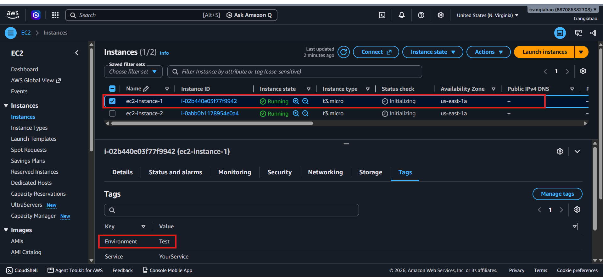

##### Bước 2: Xem các thẻ định danh mặc định của máy chủ
* **Thao tác:** Tích chọn máy chủ `ec2-instance-1` (`i-02b440e03f77f9942`) ➔ Chọn tab **Tags** ở khung chi tiết phía dưới để kiểm tra các thẻ hiện có.

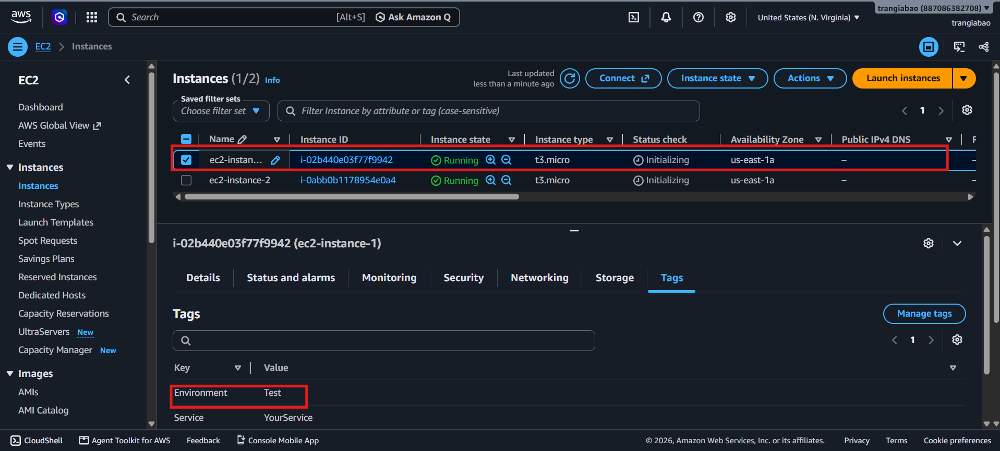

##### Bước 3: Thêm và chỉnh sửa các cặp thẻ định danh (Manage Tags)
* **Thao tác:** Tại tab **Tags**, nhấn nút **Manage tags** ➔ Nhấn **Add new tag** để bổ sung các cặp Key-Value chuẩn hóa:
  * Key: `Environment` | Value: `Test`
  * Key: `Service` | Value: `YourService`
  * Key: `Name` | Value: `ec2-instance-1`
  * Key: `Owner` | Value: `YourName`
  * Key: `OS` | Value: `Amazon Linux`
* Nhấn **Save** để áp dụng thay đổi.

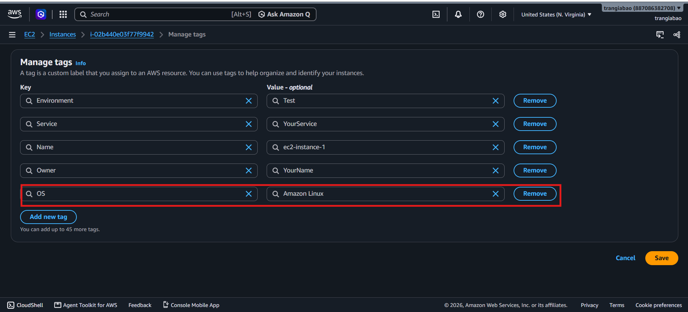

##### Bước 4: Lọc máy chủ ảo theo thẻ trên thanh tìm kiếm Console
* **Thao tác:** Trên ô tìm kiếm của danh sách Instances, gõ `Owner =` ➔ Hệ thống gợi ý các giá trị thẻ hiện có (`YourName`, `Not tagged`, `All values`). Chọn `Owner = YourName` để lọc nhanh máy chủ thuộc quyền quản lý của người phụ trách.

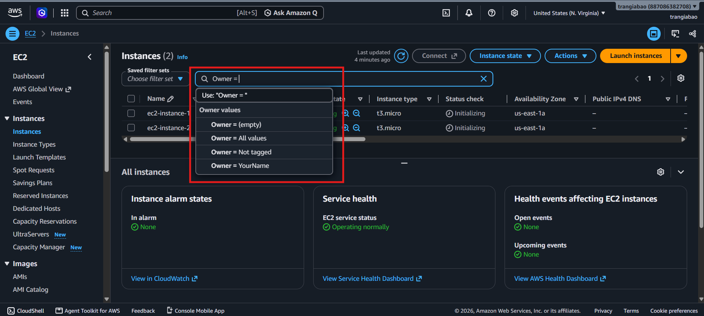

---

#### Phần 2: Tự động hóa Quản trị Tags qua giao diện dòng lệnh AWS CLI

##### Bước 5: Khởi tạo IAM Access Key cho tài khoản quản trị
* **Thao tác:** Mở dịch vụ **IAM** ➔ Vào mục **Users** hoặc **Security credentials** của tài khoản `trangiabao` ➔ Nhấn **Create access key** ➔ Chọn mục đích sử dụng **Command Line Interface (CLI)**.
* **Ghi nhận:** Tải file `.csv` lưu trữ `Access Key ID` (`AKIA_DEMO_SAMPLE_KEY_ID`) và mã bí mật `Secret access key`.

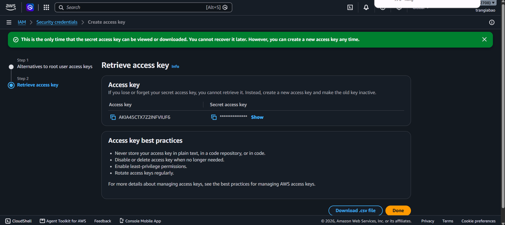

##### Bước 6: Cấu hình phiên làm việc AWS CLI trên Windows PowerShell
* **Thao tác:** Mở cửa sổ **Windows PowerShell** trên máy trạm ➔ Thực thi lệnh cấu hình định danh:
  ```powershell
  aws configure
  ```
* **Thông số nhập liệu:**
  * **AWS Access Key ID:** `AKIA_DEMO_SAMPLE_KEY_ID`
  * **AWS Secret Access Key:** `DEMO_SECRET_KEY_SAMPLE_TEST_12345`
  * **Default region name:** `us-east-1`
  * **Default output format:** `json`

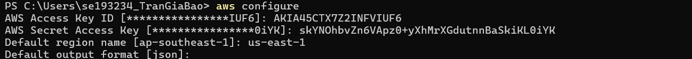

##### Bước 7: Thực thi lệnh gắn thẻ đơn lẻ bằng CLI
* **Thao tác:** Sử dụng lệnh `aws ec2 create-tags` gán nhãn `Project: AWS` cho máy ảo `ec2-instance-2`:
  ```powershell
  aws ec2 create-tags --resources i-0abb0b1178954e0a4 --tags Key=Project,Value=AWS
  ```

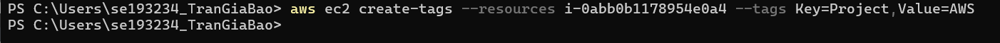

##### Bước 8: Kiểm tra kết quả gắn thẻ trên EC2 Web Console
* **Thao tác:** Quay lại Web Console, nhập bộ lọc `Project = AWS` trên danh sách Instances. Hệ thống lọc chính xác máy chủ `ec2-instance-2` (`i-0abb0b1178954e0a4`) vừa được gán thẻ từ dòng lệnh.

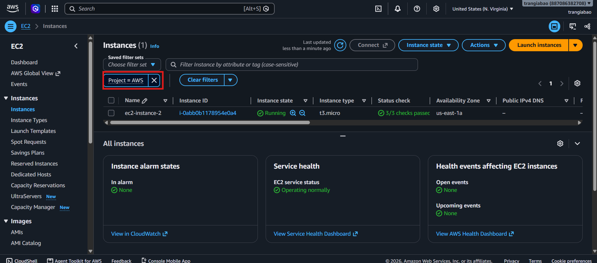

##### Bước 9: Gán đồng thời nhiều cặp thẻ trong một câu lệnh CLI
* **Thao tác:** Bổ sung thêm thẻ `Env: Test` cùng với `Project: AWS` bằng một lệnh duy nhất:
  ```powershell
  aws ec2 create-tags --resources i-0abb0b1178954e0a4 --tags Key=Env,Value=Test Key=Project,Value=AWS
  ```

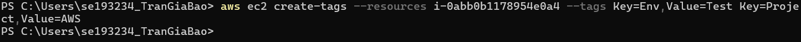

##### Bước 10: Khởi tạo máy chủ thứ 3 qua CLI và xác nhận danh sách
* **Thao tác:** Thực thi lệnh `aws ec2 run-instances` tạo máy chủ `ec2-instance-3` (`i-00ecbe56e33f40770`) với thẻ `Environment: Test`.

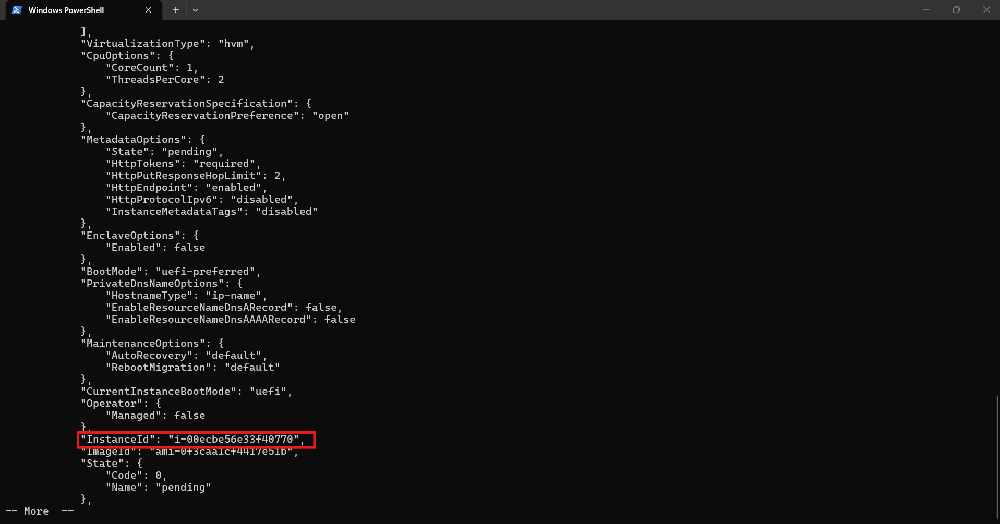

* **Xác nhận trên Web Console:** Cả 3 máy ảo (`ec2-instance-1`, `ec2-instance-2`, `ec2-instance-3`) đều đang hoạt động an toàn ở trạng thái `Running` tại vùng `us-east-1a`.

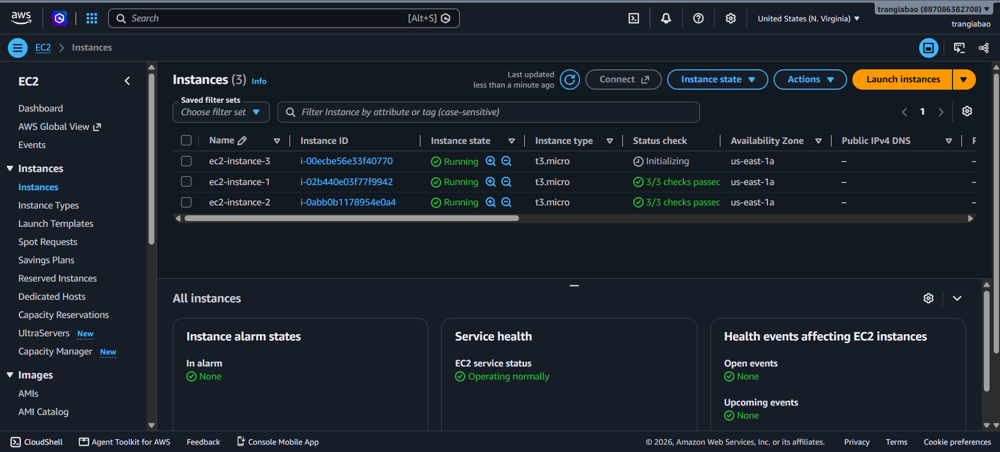

##### Bước 11: Lọc dữ liệu tài nguyên nâng cao với cờ `--filters` trên CLI
* **Thao tác:** Thực hiện truy vấn danh sách máy ảo có nhãn `Environment` mang giá trị `Test`:
  ```powershell
  aws ec2 describe-instances --filters Name=tag:Environment,Values=Test
  ```
* **Kết quả:** CLI trả về cấu trúc JSON chứa đầy đủ thông tin chi tiết (InstanceId, ReservationId, NetworkInterfaces, BlockDeviceMappings) của các máy ảo thỏa điều kiện.

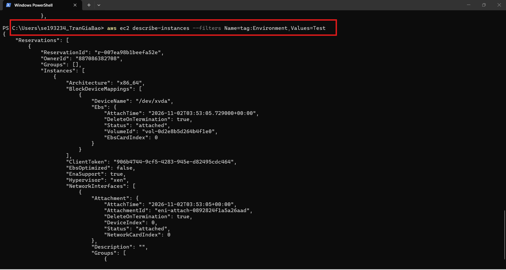

---

#### Phần 3: Quản trị Tập trung với AWS Resource Groups

##### Bước 12: Thiết lập nhóm tài nguyên theo thẻ (Tag-based Resource Group)
* **Thao tác:** Tìm kiếm và mở dịch vụ **AWS Resource Groups** ➔ Chọn **Create Resource Group**.
* **Cấu hình nhóm:**
  * **Group type:** `Tag based`
  * **Resource types:** `AWS::EC2::Instance`
  * **Tags filter:** Key: `Environment` | Value: `Test`
* **Kiểm tra kết quả xem trước:** Nhấn **Preview group resources**, hệ thống tự động nhận diện chính xác 2 tài nguyên: `ec2-instance-1` (`i-02b440e03f77f9942`) và `ec2-instance-3` (`i-00ecbe56e33f40770`).

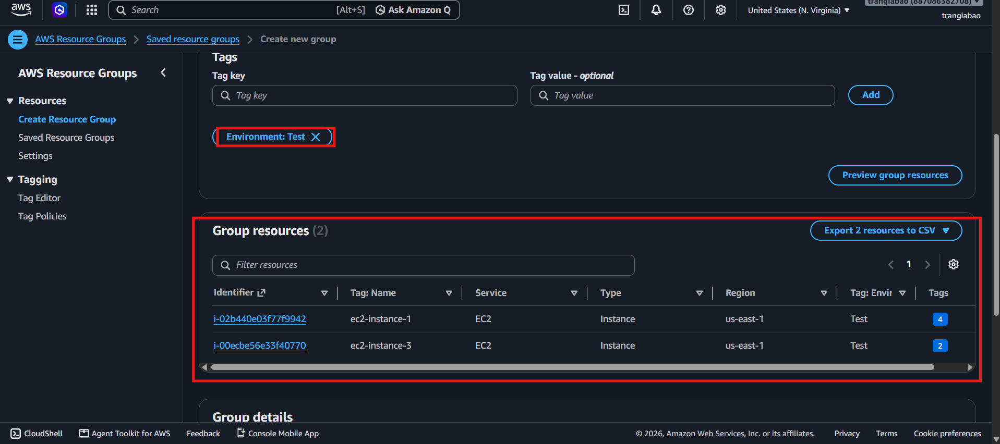

##### Bước 13: Hoàn tất khởi tạo Resource Group `EnvTest`
* **Thao tác:** Đặt tên nhóm tài nguyên **Group name:** `EnvTest` ➔ Nhấn **Create group**.
* **Kết quả:** Thông báo xác nhận thành công hiển thị: `The resource group "EnvTest" has been successfully created in the current region (us-east-1)`. Nhóm tài nguyên sẵn sàng phục vụ các tác vụ quản trị tự động hóa, giám sát chỉ số và cấu hình chính sách tập trung.

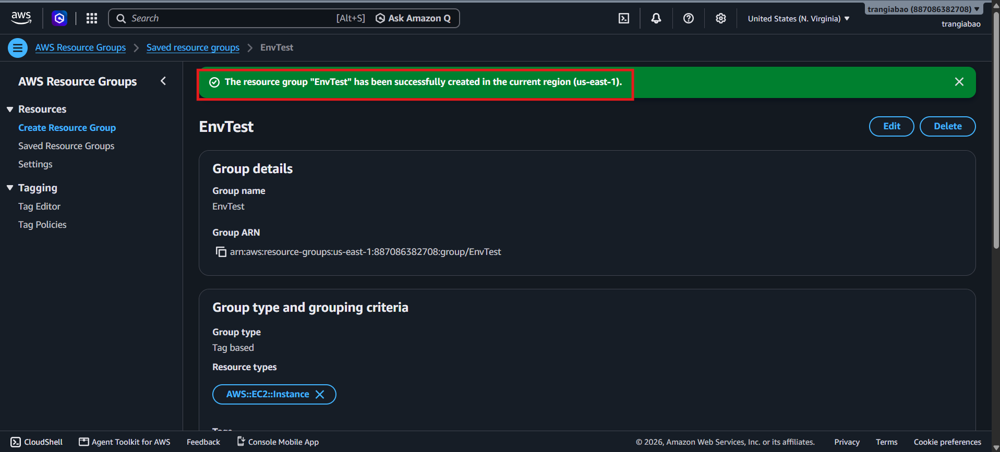

---

### 🛠️ Ngân hàng Sự cố Kỹ thuật Thực tế & Cách Khắc phục Triệt để:

| STT | Hiện tượng sự cố (Symptom) | Nguyên nhân cốt lõi (Root Cause) | Giải pháp & Kinh nghiệm xử lý (Solution) |
| :---: | :--- | :--- | :--- |
| **1** | **Phân biệt chữ hoa / chữ thường trong thẻ (Case Sensitivity):** Lọc `tag:environment` không ra kết quả dù máy đã gắn `Environment`. | AWS Tags có tính chất phân biệt hoa thường tuyệt đối (Case-sensitive). `Environment` và `environment` được hiểu là hai khóa hoàn toàn khác nhau. | Luôn thống nhất quy chuẩn đặt tên thẻ trong tổ chức (ví dụ: chuẩn PascalCase như `Environment`, `Owner`, `Project`). Khi gõ lệnh CLI bắt buộc gõ chính xác hoa thường. |
| **2** | **Lỗi cú pháp `--filters` trên PowerShell:** Câu lệnh CLI báo lỗi `Unknown options` khi lọc thẻ có khoảng trắng hoặc ký tự đặc biệt. | PowerShell tự phân tách tham số nếu không bao bọc chuỗi chứa dấu hai chấm hoặc dấu bằng cẩn thận. | Sử dụng định dạng chuẩn `Name=tag:KeyName,Values=ValueName` không chèn khoảng trắng giữa các dấu phẩy hoặc bọc toàn bộ chuỗi trong dấu nháy đơn `'...'`. |
| **3** | **Quá hạn mức số lượng thẻ (Tag Quota Limit):** Nhận lỗi `TagLimitExceeded` khi cố gắng gắn thêm thẻ cho tài nguyên. | AWS áp dụng giới hạn tối đa 50 thẻ do người dùng tạo (user-defined tags) trên mỗi tài nguyên. | Lên chiến lược phân bổ thẻ tinh gọn, định kỳ sử dụng **Tag Editor** để rà soát, gỡ bỏ các thẻ tạm thời không còn sử dụng. |
| **4** | **Phạm vi vùng của Resource Groups:** Resource Group tạo tại `us-east-1` không thấy các máy ảo tại `ap-southeast-1`. | Resource Groups cơ bản hoạt động theo phạm vi từng Region cụ thể (Regional Scope), không tự động gom tài nguyên xuyên vùng. | Nếu cần quản trị đa vùng, cần chuyển đúng Region trên Console để tạo Resource Group tương ứng hoặc sử dụng AWS Systems Manager Explorer. |
| **5** | **Xung đột phân quyền IAM khi gán thẻ:** Nhận lỗi `AccessDenied` khi chạy lệnh `aws ec2 create-tags`. | IAM Policy của người dùng chỉ có quyền `ec2:RunInstances` mà thiếu action `ec2:CreateTags`. | Cập nhật IAM Policy cấp quyền bổ sung `ec2:CreateTags` trên tài nguyên `arn:aws:ec2:*:*:instance/*` để cho phép gắn nhãn. |

---

### 🧹 Dọn dẹp tài nguyên (Resource Cleanup):
1. **Xóa Resource Group:** Mở **AWS Resource Groups** ➔ Chọn nhóm `EnvTest` ➔ Nhấn **Delete** (Xóa Resource Group không làm ảnh hưởng đến các máy ảo EC2 bên trong).
2. **Hủy máy ảo EC2:** Mở **Amazon EC2** ➔ Chọn cả 3 máy ảo (`ec2-instance-1`, `ec2-instance-2`, `ec2-instance-3`) ➔ **Instance state** ➔ Chọn **Terminate instance** để tránh phát sinh chi phí duy trì.
3. **Vô hiệu hóa Access Key:** Vào **IAM** ➔ User `trangiabao` ➔ Tab **Security credentials** ➔ Chuyển Access Key sang trạng thái **Deactivate** hoặc **Delete**.

- **Chuẩn hóa chiến lược gắn thẻ (AWS Tagging Strategy):** Hiểu rõ tầm quan trọng của thẻ định danh trong quản trị môi trường đa tài khoản, phân bổ chi phí (Cost Allocation Tags) và kiểm soát truy cập dựa trên thuộc tính (ABAC).
- **Thực hành quản trị thẻ đa nền tảng:** Kết hợp nhuần nhuyễn giữa thao tác trực quan trên AWS Management Console và tự động hóa hàng loạt với các câu lệnh `aws ec2 create-tags` và `aws ec2 describe-instances --filters`.
- **Tổ chức quản trị tập trung với AWS Resource Groups:** Thiết lập nhóm tài nguyên `EnvTest` theo truy vấn thẻ giúp quản trị viên gom nhóm, theo dõi và thao tác đồng thời trên toàn bộ các tài nguyên cùng thuộc một môi trường thử nghiệm.
- **Kinh nghiệm xử lý sự cố thực tế:** Nắm vững quy tắc phân biệt chữ hoa/chữ thường (Case-sensitive) của Tag Key/Value, giới hạn 50 thẻ trên mỗi tài nguyên và cơ chế phạm vi theo vùng (Region-scoped) của Resource Groups.

---

#### 📌 Kết quả Thứ 5 (22/10/2026) - Giám sát hệ thống với Grafana & Amazon CloudWatch:

{}
Bài thực hành **Giám sát hệ thống với Grafana & Amazon CloudWatch (Getting started with Grafana basic - Workshop 000029)** được triển khai vào **Thứ 5 (22/10/2026)** trong khuôn khổ **Tuần 6**. Trang này ghi lại đầy đủ toàn bộ quá trình dựng máy chủ giám sát Grafana trên Amazon Linux 2023, phân quyền IAM bảo mật, tích hợp nguồn dữ liệu Amazon CloudWatch và xây dựng các biểu đồ quan sát thời gian thực.
{}

### 🎯 Mục tiêu bài thực hành (Lab Objectives):
* Hiểu rõ kiến trúc kết hợp giữa nền tảng trực quan hóa mã nguồn mở hàng đầu thế giới **Grafana** và kho lưu trữ chỉ số đo lường đám mây **Amazon CloudWatch**.
* Nắm vững kỹ thuật cấp quyền bảo mật theo khuyến nghị kiến trúc AWS: sử dụng **IAM Role** gắn trực tiếp vào máy chủ EC2 (Instance Profile) để Grafana tự động nhận thông tin xác thực tạm thời thay vì nhúng cứng (hard-code) Access Key/Secret Key.
* Thành thạo các bước triển khai hạ tầng: cấu hình **VPC**, **Public Subnet** tự động cấp phát IPv4, và **Security Group** mở các cổng điều khiển cần thiết (cổng 3000 cho Grafana Web UI, cổng 22 cho SSH).
* Cài đặt, cấu hình kho lưu trữ YUM (RPM repository), kích hoạt dịch vụ nền `grafana-server` thông qua `systemd` trên hệ điều hành thế hệ mới **Amazon Linux 2023 (AL2023)**.
* Thiết lập kết nối **CloudWatch Data Source**, kiểm tra thông tuyến API đo lường (`CloudWatch Metrics API` và `CloudWatch Logs API`), thiết kế Dashboard trực quan hóa chỉ số `CPUUtilization`, và sử dụng công cụ **Explore** để phân tích hiệu năng theo dạng biểu đồ cột (Bars) và chuỗi thời gian (Time series).

---

### 📊 Bảng tổng hợp thông số tài nguyên đã triển khai:

| Thành phần / Tài nguyên | Tên định danh (Name / ID) | Thông số kỹ thuật chi tiết | Vùng (Region) | Mục đích sử dụng |
| :--- | :--- | :--- | :--- | :--- |
| **VPC** | `Grafana-ASG-vpc` (`vpc-02b25cbbec17b38ca`) | CIDR: `10.0.0.0/16`, DNS hostnames: Enabled | `us-east-1` | Hạ tầng mạng độc lập cho cụm giám sát |
| **Public Subnet** | `Grafana-ASG-subnet-public1-us-east-1a` (`subnet-0fe0631efc71d460b`) | CIDR: `10.0.0.0/20`, Auto-assign Public IPv4: `Yes` | `us-east-1a` | Mạng con công khai để truy cập Web UI Grafana |
| **Security Group** | `SG-PUB-Grafana-ASG` (`sg-0b5bc8236a3cadcd8`) | Inbound: TCP `3000` (Grafana), TCP `22` (SSH), All ICMP | `us-east-1` | Tường lửa bảo vệ máy chủ giám sát |
| **EC2 Instance** | `Grafana-Server` (`i-082d165f34a40407f`) | Type: `t3.micro`, AMI: Amazon Linux 2023, Public IP: `44.203.10.190` | `us-east-1a` | Máy chủ lưu trữ và vận hành Grafana Server |
| **IAM Policy** | `GrafanaAccessPolicy` | Quyền truy vấn CloudWatch Metrics & Logs Read-Only | Global | Chính sách phân quyền tối thiểu (Least Privilege) |
| **IAM Role** | `GrafanaAccessRole` | Service: `ec2.amazonaws.com`, Policy: `GrafanaAccessPolicy` | Global | Gắn vào EC2 Instance Profile để tự động xác thực |
| **Grafana Server** | `Grafana v13.3.0` | Port `3000`, Auth: Admin Console, Service: `active (running)` | Host EC2 | Nền tảng trực quan hóa và cảnh báo giám sát |
| **Data Source** | `CloudWatch` | Region: `ap-southeast-1` / `us-east-1`, Namespace: `AWS/EC2` | Grafana Plugin | Kết nối trực tiếp lấy telemetry từ AWS |

---

### 🚀 Chi tiết các bước thực hiện & Hình ảnh minh chứng:

#### Phần 1: Chuẩn bị Hạ tầng Mạng và Bảo mật (Network & Security Configuration)

##### Bước 1: Kiểm tra cấu hình Virtual Private Cloud (VPC)
* **Thao tác:** Đăng nhập vào AWS Management Console tại vùng **us-east-1** (N. Virginia) ➔ Mở dịch vụ **Amazon VPC** ➔ Chọn mục **Your VPCs**.
* **Thực hiện:** Xác nhận VPC mang tên `Grafana-ASG-vpc` (`vpc-02b25cbbec17b38ca`) đang ở trạng thái `Available`, được kích hoạt đầy đủ tính năng DNS Hostnames và phân dải tên miền nội bộ.

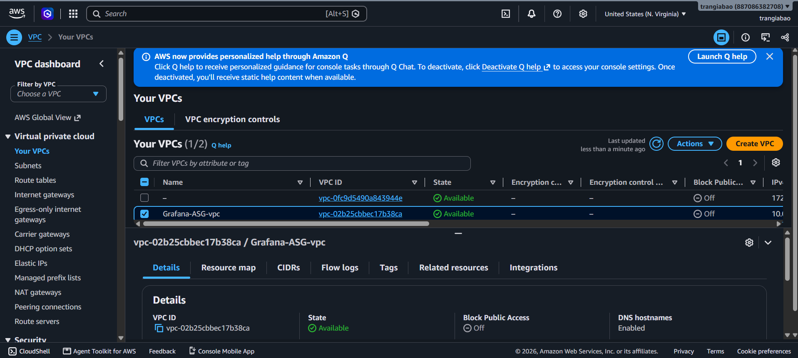

##### Bước 2: Kích hoạt cấp phát địa chỉ Public IPv4 tự động trên Subnet
* **Thao tác:** Tại menu bên trái VPC, chọn **Subnets** ➔ Tích chọn subnet `Grafana-ASG-subnet-public1-us-east-1a` (`subnet-0fe0631efc71d460b`).
* **Thực hiện:** Nhấn nút **Actions** ➔ Chọn **Edit subnet settings** ➔ Đánh dấu tích vào tùy chọn **Enable auto-assign public IPv4 address** ➔ Nhấn **Save**. Thông báo màu xanh hiển thị xác nhận cấu hình thành công, bảo đảm máy chủ EC2 khi khởi chạy vào Subnet này sẽ tự động nhận địa chỉ IP công khai.

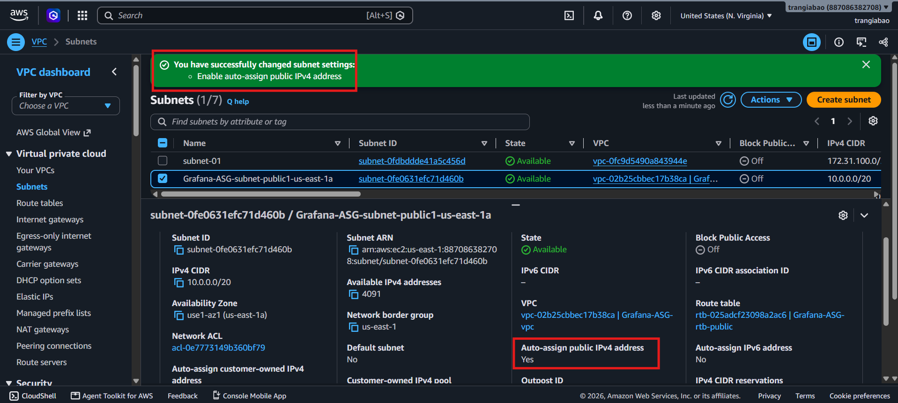

##### Bước 3: Cấu hình Security Group mở cổng dịch vụ Grafana và SSH
* **Thao tác:** Điều hướng đến mục **Security Groups** ➔ Khởi tạo Security Group mới với tên `SG-PUB-Grafana-ASG` (`sg-0b5bc8236a3cadcd8`) liên kết với VPC `Grafana-ASG-vpc`.
* **Thực hiện cấu hình Inbound Rules:**
  1. **Custom TCP - Cổng 3000:** Mở cho phép truy cập giao diện đồ họa Grafana Web UI từ trình duyệt.
  2. **SSH - Cổng 22:** Mở để kỹ sư kết nối dòng lệnh quản trị máy chủ qua giao thức Secure Shell.
  3. **All ICMP - IPv4:** Mở để kiểm tra kết nối mạng (Ping) và chẩn đoán độ trễ gói tin.

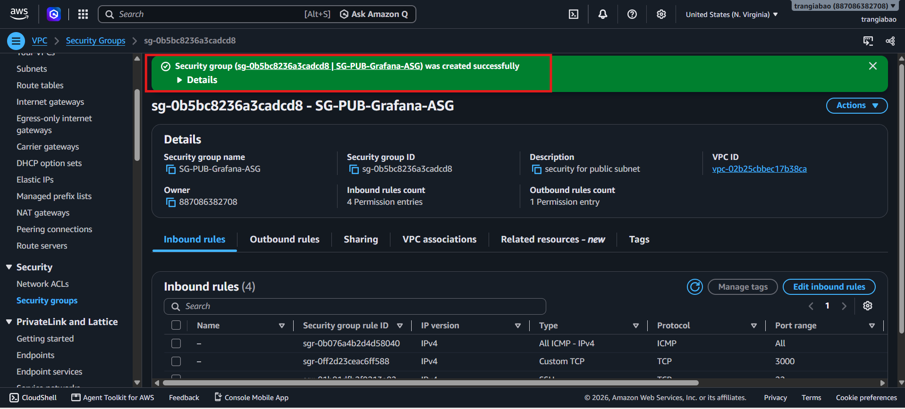

---

#### Phần 2: Khởi tạo Máy chủ EC2 và Thiết lập Phân quyền IAM (EC2 & IAM Security Setup)

##### Bước 4: Khởi chạy máy chủ EC2 Grafana-Server
* **Thao tác:** Mở dịch vụ **Amazon EC2** ➔ Chọn **Launch instances**.
* **Thực hiện cấu hình chi tiết:**
  * **Tên máy chủ:** `Grafana-Server`.
  * **Hệ điều hành (AMI):** Amazon Linux 2023 (AL2023) 64-bit (x86_64).
  * **Instance Type:** `t3.micro` (tối ưu hóa chi phí Free Tier).
  * **Mạng (Network Settings):** Chọn VPC `Grafana-ASG-vpc`, Subnet `Grafana-ASG-subnet-public1-us-east-1a`, gắn Security Group `SG-PUB-Grafana-ASG`.
  * Máy chủ khởi tạo thành công với mã Instance ID: `i-082d165f34a40407f`, địa chỉ Public IPv4: `44.203.10.190` và Private IP: `10.0.4.227`.

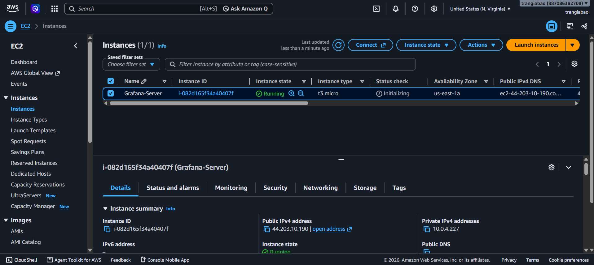

##### Bước 5: Khởi tạo người dùng IAM và cấp phát Access Key (Tùy chọn CLI / Data Source)
* **Thao tác:** Mở dịch vụ **IAM** ➔ Vào mục **Users** ➔ Chọn **Create user** ➔ Nhập tên người dùng `Grafana-user`.
* **Thực hiện:** Thiết lập quyền truy cập cho người dùng và hoàn tất bước khởi tạo. Sau đó chuyển sang mục **Create access key** để tạo mã Access Key ID (`AKIA_DEMO_SAMPLE_KEY_ID`) phục vụ xác thực dự phòng hoặc thao tác qua công cụ lập trình.

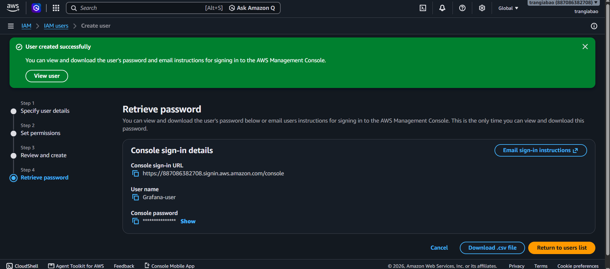

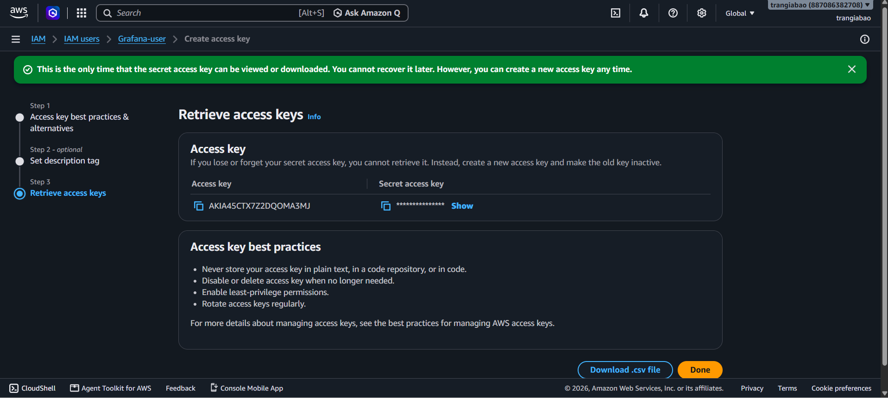

##### Bước 6: Khởi tạo IAM Policy `GrafanaAccessPolicy`
* **Thao tác:** Tại menu IAM, chọn **Policies** ➔ Nhấn **Create policy**.
* **Thực hiện:** Cấu hình chính sách JSON cấp quyền chỉ đọc (Read-Only) đối với dịch vụ CloudWatch và CloudWatch Logs (`cloudwatch:Describe*`, `cloudwatch:Get*`, `cloudwatch:List*`, `logs:DescribeLogGroups`, `logs:FilterLogEvents`). Đặt tên chính sách là `GrafanaAccessPolicy` và nhấn hoàn tất.

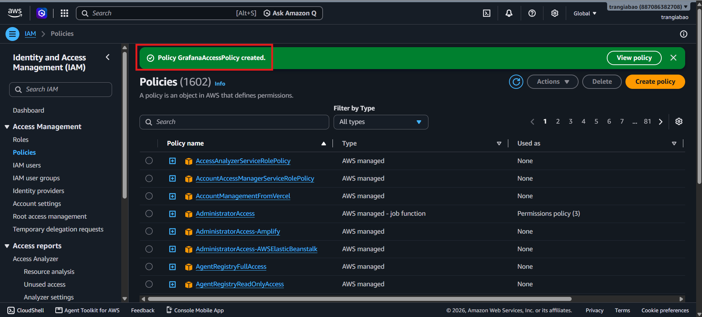

##### Bước 7: Khởi tạo IAM Role và gắn trực tiếp vào máy chủ EC2
* **Thao tác:** Chọn mục **Roles** ➔ Nhấn **Create role** ➔ Trusted entity type chọn **AWS service** (dịch vụ `EC2`) ➔ Gắn chính sách `GrafanaAccessPolicy` vừa tạo ➔ Đặt tên Role là `GrafanaAccessRole`.
* **Gắn Role vào máy chủ:** Quay lại bảng điều khiển EC2 ➔ Chọn máy chủ `Grafana-Server` (`i-082d165f34a40407f`) ➔ Chọn **Actions** ➔ **Security** ➔ **Modify IAM role** ➔ Chọn `GrafanaAccessRole` ➔ Nhấn **Update IAM role**. Màn hình thông báo màu xanh xác nhận đã liên kết Role thành công vào Instance Profile.

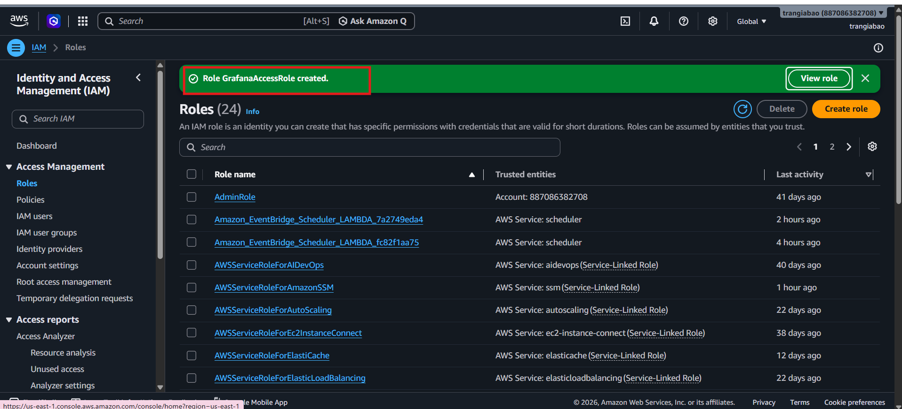

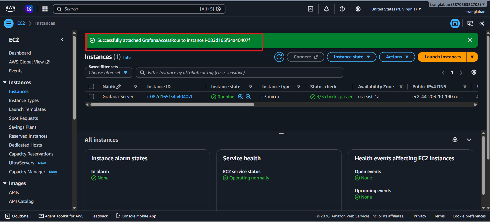

---

#### Phần 3: Cài đặt và Vận hành Dịch vụ Grafana trên Amazon Linux 2023 (Grafana Deployment)

##### Bước 8: Kết nối SSH và thiết lập kho lưu trữ YUM (Grafana Repository)
* **Thao tác:** Sử dụng PuTTY hoặc Terminal SSH kết nối vào máy chủ với tài khoản mặc định `ec2-user` và địa chỉ IP `44.203.10.190`.
* **Thực hiện cập nhật hệ thống và tạo file repo:**
  ```bash
  sudo yum update -y
  sudo nano /etc/yum.repos.d/grafana.repo
  ```
* **Nội dung cấu hình kho lưu trữ chính thức:**
  ```ini
  [grafana]
  name=grafana
  baseurl=https://rpm.grafana.com
  repo_gpgcheck=1
  enabled=1
  gpgcheck=1
  gpgkey=https://rpm.grafana.com/gpg.key
  sslverify=1
  sslcacert=/etc/pki/tls/certs/ca-bundle.crt
  ```

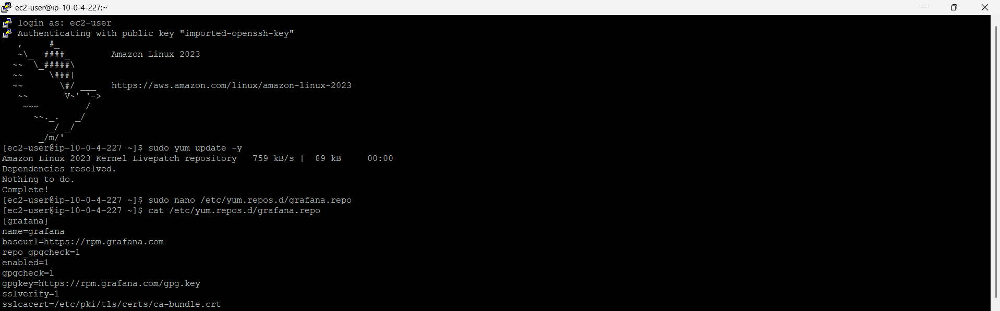

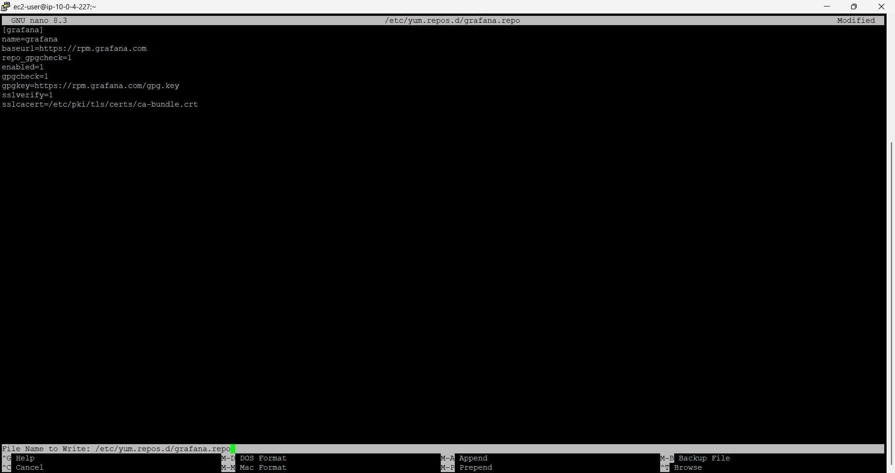

##### Bước 9: Cài đặt gói ứng dụng Grafana
* **Thao tác:** Chạy câu lệnh cài đặt tự động qua trình quản lý gói YUM:
  ```bash
  sudo yum install grafana -y
  ```
* **Kết quả:** Hệ thống tự động nạp khóa GPG của Grafana Labs (`engineering@grafana.com`), giải quyết các gói phụ thuộc và cài đặt hoàn tất phiên bản `grafana-13.3.0-1.x86_64` (kích thước sau giải nén khoảng 1.3 GB).

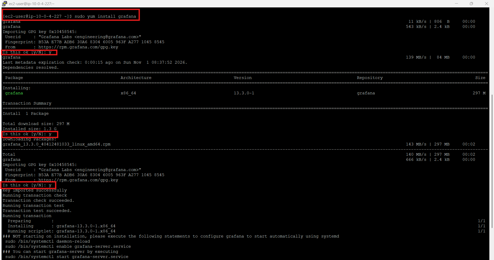

##### Bước 10: Khởi động dịch vụ grafana-server và xác nhận trạng thái
* **Thao tác:** Thực thi các lệnh nạp lại cấu hình dịch vụ, bật tự động khởi động cùng hệ thống và khởi chạy dịch vụ Grafana:
  ```bash
  sudo systemctl daemon-reload
  sudo systemctl enable grafana-server.service
  sudo systemctl start grafana-server.service
  sudo systemctl status grafana-server.service
  ```
* **Kết quả kiểm tra:** Dịch vụ chuyển sang trạng thái xanh `active (running)`, tiến trình chính lắng nghe cổng nội bộ và sẵn sàng phục vụ các yêu cầu qua giao thức HTTP.

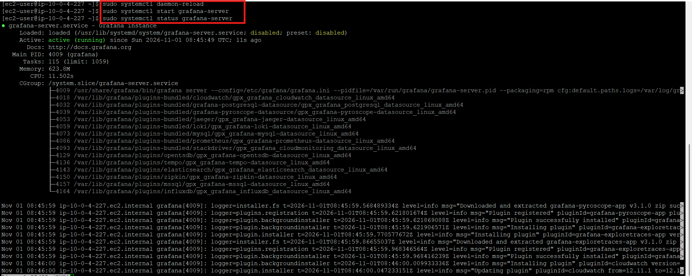

##### Bước 11: Đăng nhập giao diện Web Grafana và đổi mật khẩu quản trị
* **Thao tác:** Mở trình duyệt web và truy cập theo đường dẫn: `http://44.203.10.190:3000`.
* **Đăng nhập lần đầu:** Nhập thông tin mặc định của hệ thống với tài khoản `admin` và mật khẩu `admin`.
* **Đổi mật khẩu:** Ngay sau khi đăng nhập, giao diện yêu cầu thiết lập mật khẩu quản trị viên mới để bảo đảm an toàn thông tin (nhập mật khẩu mới `giabao2005` và xác nhận).

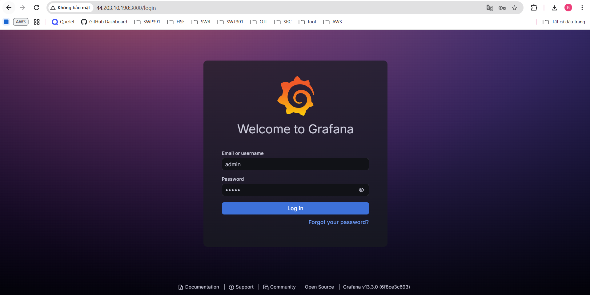


---

#### Phần 4: Kết nối Nguồn dữ liệu CloudWatch & Xây dựng Dashboard Giám sát (Observability Dashboards)

##### Bước 12: Thêm CloudWatch Data Source và kiểm tra kết nối API thành công
* **Thao tác:** Tại menu điều hướng bên trái Grafana, chọn mục **Connections** ➔ **Data sources** ➔ Chọn **Add new data source** ➔ Tìm kiếm và chọn dịch vụ **CloudWatch**.
* **Thực hiện cấu hình:**
  * **Authentication Provider:** Chọn `AWS SDK Default` (Grafana tự động tận dụng IAM Role `GrafanaAccessRole` đã gắn vào máy chủ EC2 mà không cần điền Access Key thủ công).
  * **Default Region:** Chọn `us-east-1` (hoặc vùng triển khai tài nguyên cần giám sát).
* **Kiểm tra kết nối:** Cuộn xuống cuối trang và nhấn nút **Save & test**. Hệ thống hiển thị thông báo trạng thái màu xanh xác nhận kết nối thành công:
  * `1. Successfully queried the CloudWatch metrics API.`
  * `2. Successfully queried the CloudWatch logs API.`


##### Bước 13: Xây dựng Dashboard giám sát chỉ số CPU Utilization
* **Thao tác:** Vào mục **Dashboards** ➔ Chọn **New dashboard** ➔ Nhấn **Add visualization** ➔ Chọn Data source vừa tạo là `cloudwatch`.
* **Cấu hình câu truy vấn chỉ số (Query Editor):**
  * **Namespace:** `AWS/EC2`.
  * **Metric name:** `CPUUtilization`.
  * **Statistic:** `Average`.
  * **Dimensions:** Chọn `InstanceId` = `i-082d165f34a40407f`.
* **Kết quả:** Biểu đồ đường dạng chuỗi thời gian (Time series) phản ánh trung thực mức độ tải CPU theo thời gian thực của máy chủ.


##### Bước 14: Khám phá truy vấn nâng cao với công cụ Explore
* **Thao tác:** Tại menu chính, chọn tính năng **Explore** ➔ Chọn nguồn dữ liệu `cloudwatch`.
* **Thực hiện truy vấn linh hoạt:**
  * Lựa chọn vùng khảo sát: `ap-southeast-1` (hoặc vùng mong muốn).
  * Metric: `CPUUtilization`, Dimension: `InstanceId` = `i-0ba9a1a9ccab2d73f`.
  * Chuyển đổi định dạng biểu diễn sang dạng cột đứng (**Bars**) để trực quan hóa các đợt tải đột biến (Spike) một cách rõ nét và trực quan hơn.


---

### 💡 Bài học kinh nghiệm & Ngân hàng khắc phục sự cố (Troubleshooting Bank):

{}
Dưới đây là 5 tình huống sự cố thực tế thường gặp trong quá trình cài đặt Grafana và tích hợp CloudWatch cùng các giải pháp xử lý triệt để:
{}

#### 1. Sự cố không thể truy cập giao diện Grafana qua cổng 3000 (Connection Timed Out)
* **Nguyên nhân:** Security Group của máy chủ EC2 chưa cho phép luồng dữ liệu Inbound trên cổng 3000 từ địa chỉ IP của kỹ sư, hoặc máy chủ EC2 nằm trong Private Subnet không có Internet Gateway.
* **Cách xử lý:** Kiểm tra bảng quy tắc Inbound Rules của Security Group `SG-PUB-Grafana-ASG`, bổ sung quy tắc cho phép Custom TCP cổng `3000` với nguồn `0.0.0.0/0` (hoặc `My IP`). Đồng thời xác nhận Subnet đã được gắn Route Table trỏ dải `0.0.0.0/0` về Internet Gateway (`igw-xxxx`).

#### 2. Lỗi phân quyền CloudWatch Data Source (AccessDeniedException / HTTP 403)
* **Nguyên nhân:** IAM Role gắn vào EC2 thiếu các chính sách hành động đọc telemetry cần thiết từ dịch vụ CloudWatch và CloudWatch Logs.
* **Cách xử lý:** Đảm bảo chính sách `GrafanaAccessPolicy` có đầy đủ các quyền:
  ```json
  {
    "Version": "2012-10-17",
    "Statement": [
      {
        "Sid": "AllowGrafanaCloudWatchAccess",
        "Effect": "Allow",
        "Action": [
          "cloudwatch:DescribeAlarmsForMetric",
          "cloudwatch:DescribeAlarmHistory",
          "cloudwatch:DescribeAlarms",
          "cloudwatch:ListMetrics",
          "cloudwatch:GetMetricStatistics",
          "cloudwatch:GetMetricData",
          "logs:DescribeLogGroups",
          "logs:GetLogGroupFields",
          "logs:StartQuery",
          "logs:StopQuery",
          "logs:GetQueryResults",
          "logs:GetLogEvents",
          "ec2:DescribeTags",
          "ec2:DescribeInstances",
          "ec2:DescribeRegions"
        ],
        "Resource": "*"
      }
    ]
  }
  ```

#### 3. Best Practice: Sử dụng EC2 IAM Role thay thế hoàn toàn Access Key/Secret Key
* **Phân tích:** Việc nhập cứng Access Key ID và Secret Access Key vào cấu hình Data Source của Grafana tiềm ẩn nguy cơ rò rỉ thông tin bảo mật và khó khăn trong việc xoay vòng khóa (Key Rotation).
* **Khuyến nghị kiến trúc:** Khi cài đặt Grafana trên EC2, cấu hình Authentication Provider dạng **AWS SDK Default**. Ứng dụng sẽ tự động gọi dịch vụ Instance Metadata Service (IMDSv2) để lấy Token xác thực ngắn hạn từ `GrafanaAccessRole`, bảo đảm tuân thủ nguyên tắc an toàn Zero-Trust.

#### 4. Dịch vụ grafana-server không tự khởi động khi máy chủ EC2 Reboot
* **Nguyên nhân:** Quản trị viên chỉ thực hiện `systemctl start grafana-server` mà quên kích hoạt cờ tự khởi động cùng hệ điều hành.
* **Cách xử lý:** Luôn thực thi lệnh `sudo systemctl enable grafana-server` sau khi cài đặt. Kiểm tra trạng thái bằng lệnh `systemctl is-enabled grafana-server` (kết quả trả về `enabled`).

#### 5. Quy trình dọn dẹp tài nguyên để tối ưu hóa chi phí (Resource Cleanup)
* **Thao tác dọn dẹp sau bài thực hành:**
  1. Hủy (Terminate) máy chủ EC2 `Grafana-Server` (`i-082d165f34a40407f`).
  2. Gỡ bỏ và xóa IAM Role `GrafanaAccessRole` cùng Policy `GrafanaAccessPolicy`.
  3. Xóa Security Group `SG-PUB-Grafana-ASG`.
  4. Nếu sử dụng VPC thử nghiệm riêng biệt, tiến hành xóa VPC `Grafana-ASG-vpc` để giải phóng Subnets và Internet Gateway, ngăn ngừa phát sinh chi phí ngoài ý muốn.

- **Triển khai máy chủ giám sát Grafana trên AL2023:** Khởi tạo môi trường hiển thị trực quan dữ liệu mã nguồn mở Grafana v13.3.0, cấu hình kho lưu trữ YUM chính thức và quản lý tiến trình nền bằng systemd.
- **Tích hợp nguồn dữ liệu CloudWatch không cần Access Key:** Thiết lập phân quyền IAM Role (`GrafanaAccessRole`) gắn trực tiếp vào EC2 Instance Profile, giúp Grafana tự động xác thực an toàn theo nguyên tắc Zero-Trust.
- **Xây dựng Dashboard & Khám phá dữ liệu đa chiều:** Thiết kế các bảng đồ thị chuỗi thời gian (Time Series) theo dõi chỉ số `CPUUtilization` theo thời gian thực và sử dụng công cụ Explore trực quan hóa dạng cột (Bars).
- **Ngân hàng xử lý sự cố giám sát:** Đúc kết giải pháp mở cổng 3000 trên Security Group, xử lý lỗi phân quyền CloudWatch 403 Access Denied và quy trình dọn dẹp tài nguyên tránh phát sinh chi phí.

---

#### 📌 Kết quả Thứ 6 (23/10/2026) - Tổng kết Tuần 6, Viết Worklog & Làm Project:

{}
👉 **Kế hoạch định kỳ Thứ 6:** Dành trọn vẹn ngày Thứ 6 cho 3 trọng tâm chính: (1) Tổng kết kiến thức đã tích lũy trong tuần; (2) Hoàn thiện hệ thống Worklog và minh chứng thực hành; (3) Nghiên cứu và triển khai Đồ án thực tập (**[Project Proposal](/vi/2-proposal/)**).
{}

* **1. Tổng kết kiến thức tuần 6:**
  * Hệ thống hóa toàn diện các kiến thức về quản trị hạn mức tài nguyên **AWS Service Quotas** và quy trình làm việc với AWS Support.
  * Làm chủ kiến trúc FinOps tự động hóa kiểm soát chi phí điện toán bằng **AWS Lambda**, **EventBridge Scheduler** và **Slack ChatOps**.
  * Chuẩn hóa quy trình gắn nhãn và quản trị tài nguyên tập trung với **AWS Tags** và **AWS Resource Groups**.
  * Nắm vững kỹ thuật xây dựng hệ thống giám sát tập trung hiện đại kết hợp sức mạnh đo lường của **CloudWatch** và tính trực quan đa dạng của **Grafana**.
* **2. Hoàn thiện hệ thống Worklog:**
  * Soát lỗi toàn bộ các bài thực hành trong tuần từ **1.6.1 đến 1.6.4**, bổ sung đầy đủ các bảng thông số kỹ thuật và hình ảnh thực tế.
  * Đảm bảo tính nhất quán song ngữ (Tiếng Việt và Tiếng Anh), định dạng chuẩn Markdown và kiểm tra đường dẫn liên kết nội bộ.
* **3. Nghiên cứu & Triển khai Project (Proposal):**
  * Tích hợp các giải pháp giám sát Grafana/CloudWatch, phân loại nhãn Tags và tối ưu chi phí tự động vào kiến trúc của Đồ án thực tập (**[Project Proposal](/vi/2-proposal/)**).
  * Chuẩn bị các sơ đồ kiến trúc và phân tích chi phí chi tiết cho báo cáo đề xuất dự án.

---

### Mục tiêu cho tuần sau (Tuần 7):

* **Giám sát chuyên sâu với CloudWatch Advanced Workshop:**
  * Thực hành các kỹ thuật giám sát nâng cao, cấu hình Metric Math, Search Expressions và thuộc tính động (PROP DimName).
  * Xây dựng hệ thống cảnh báo đa kênh và phân tích tải hệ thống phức tạp.
* **Tham gia Sự kiện Công nghệ & Đóng góp Bài viết Chuyên môn:**
  * Tham gia sự kiện cộng đồng **First Cloud AI Journey Meetup** (24/10/2026) tại Văn phòng AWS Việt Nam (Bitexco Lầu 26).
  * Nghiên cứu và xuất bản bài viết chuyên sâu **Blog 1** về **AWS Continuum for Code Vulnerabilities** trên nhóm Facebook AWS Study Group - First Cloud Journey.
* **Tổng kết Tuần 7, Viết Worklog & Làm Project:** Hệ thống hóa toàn bộ kiến thức, hoàn thiện bài viết và tiếp tục đẩy mạnh đề xuất đồ án.


