{}
Bài thực hành **Giám sát chuyên sâu với Amazon CloudWatch (CloudWatch Advanced Workshop)** được thực hiện vào **Thứ 2 (26/10/2026)** trong khuôn khổ **Tuần 7**. Trang này ghi lại chi tiết toàn bộ quá trình triển khai hạ tầng kiểm thử qua AWS CloudFormation, ứng dụng các kỹ thuật tính toán chỉ số nâng cao (Metric Math, Search Expressions, Dynamic Labels), phân tích nhật ký chuyên sâu với CloudWatch Logs Insights, trích xuất chỉ số từ log qua Metric Filters, và thiết lập cảnh báo đa kênh qua Amazon SNS gắn vào bảng điều khiển tập trung.
{}

### 🎯 Mục tiêu bài thực hành (Lab Objectives):
* Tự động hóa khởi tạo cụm hạ tầng kiểm thử đa máy chủ (Instance-A đến Instance-E) bằng mẫu mẫu template **AWS CloudFormation** (`AwsWorkshopStack`).
* Làm chủ kỹ thuật tính toán chỉ số động với **Metric Math** và hàm tìm kiếm tự động **Search Expressions** (`SEARCH('used', 'Average', 300)` và `SEARCH('disk_used_percent', 'Average')`) giúp biểu đồ tự động cập nhật khi có máy chủ mới mà không cần sửa cấu hình bằng tay.
* Chuẩn hóa nhãn đồ thị động thông qua thuộc tính **Dynamic Labels** `${PROP('Dim.DimName')}` hoặc `${PROP('Dim.InstanceId')}` giúp giao diện trực quan hóa chuyên nghiệp và dễ nhận diện.
* Kết nối an toàn vào máy chủ EC2 không cần mở cổng 22 SSH bằng **AWS Systems Manager Session Manager (SSM)**, lập trình tập lệnh phát sinh dữ liệu log mô phỏng (`logger.py`) để ghi nhật ký vào `/var/log/messages`.
* Khai phá sức mạnh của **CloudWatch Logs Insights**: viết các câu truy vấn lọc lỗi regex (`like /ERROR/`, `like /WARN/`), tổng hợp tần suất theo luồng log (`stats count(*) by @logStream`), và phân bố tần suất lỗi theo khung thời gian (`stats count(*) by bin(5m)`).
* Trích xuất chỉ số định lượng từ nhật ký dạng văn bản bằng **CloudWatch Metric Filter** (`PythonAppErrors`), kích hoạt cảnh báo **CloudWatch Alarm** (`PythonApplicationErrorAlarm1`) liên kết với thông báo email qua **Amazon SNS Topic**, và xây dựng Dashboard điều hành tập trung `ssmDashboard`.

---

### 📊 Bảng tổng hợp thông số tài nguyên đã triển khai:

| Thành phần / Tài nguyên | Tên định danh (Name / ID) | Cấu hình & Chi tiết kỹ thuật | Vùng (Region) | Mục đích sử dụng |
| :--- | :--- | :--- | :--- | :--- |
| **CloudFormation Stack** | `AwsWorkshopStack` | Trạng thái: `CREATE_COMPLETE`, tạo hạ tầng lab mẫu | `us-east-1` | Tự động hóa dựng cụm máy chủ và mạng kiểm thử |
| **EC2 Test Instance A** | `ssmStack/Instance-A/test-instance` (`i-01438dfe66b5e77ce`) | Type: `t4g.micro`, Arch: Graviton (arm64), Zone: `us-east-1a` | `us-east-1a` | Máy chủ phát sinh log lỗi và đo kiểm hiệu năng |
| **EC2 Cluster (B-E)** | `InstanceBtestinstance` ... `InstanceEtestinstance` | Multi-instance cluster cho Metric Search Expressions | `us-east-1` | Cụm máy chủ mục tiêu cho biểu đồ giám sát động |
| **SSM Session** | Session ID: `root-dda2vkhqgo5f56rohzj7ipgiva` | Kết nối an toàn không cần SSH key hay mở Inbound port | Host EC2 | Truy cập terminal điều khiển và cài đặt script |
| **Log Group** | `/ec2/linux/var/log/messages` | Stream ID: `i-0e4862b2e5b03d06a` / `i-01438dfe66b5e77ce` | `us-east-1` | Thu thập toàn bộ log hệ thống và ứng dụng |
| **Metric Filter** | `PythonAppErrors` | Pattern: `[..., appId="logger.runJob:", message="ERROR*"]` | Log Group | Đếm số lượng log ERROR phát sinh theo thời gian |
| **SNS Alarm Topic** | `Default_CloudWatch_Alarms_Topic` | ARN: `arn:aws:sns:us-east-1:887086382708:...` | `us-east-1` | Gửi cảnh báo sự cố tức thời đến hộp thư kỹ sư |
| **CloudWatch Alarm** | `PythonApplicationErrorAlarm1` | Ngưỡng: `ERROR > 10 for 1 datapoints within 5 mins` | Metric Filter | Kích hoạt cảnh báo khi lỗi ứng dụng tăng cao |
| **Custom Dashboard** | `ssmDashboard-1dDcqviqU6D2` | Widgets: Commands, Success/Fail sum, Error Alarm | `us-east-1` | Bảng điều khiển tập trung theo dõi toàn diện hệ thống |

---

### 🚀 Chi tiết các bước thực hiện & Hình ảnh minh chứng:

#### Phần 1: Khởi tạo Hạ tầng Tự động bằng AWS CloudFormation

##### Bước 1: Triển khai CloudFormation Stack AwsWorkshopStack
* **Thao tác:** Đăng nhập vào AWS Console tại vùng **us-east-1** (N. Virginia) ➔ Mở dịch vụ **AWS CloudFormation** ➔ Chọn **Create stack** ➔ Tải lên bản mẫu hạ tầng giám sát thực hành.
* **Thực hiện:** Theo dõi tiến trình tạo các tài nguyên (VPC, Subnets, IAM Roles, EC2 Instances từ A đến E). Quá trình hoàn tất với trạng thái `CREATE_COMPLETE` cho toàn bộ tài nguyên bao gồm `InstanceAtestinstance`, `InstanceBtestinstance`, `InstanceCtestinstance`, `InstanceDtestinstance`, `InstanceEtestinstance`.

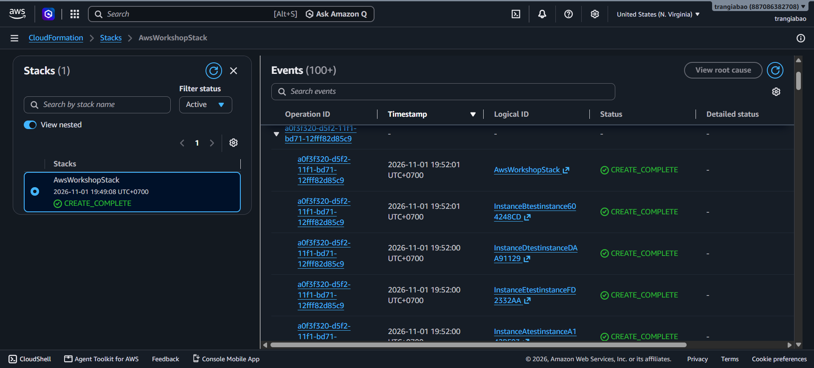

---

#### Phần 2: Khám phá Metric Math, Search Expressions & Dynamic Labels

##### Bước 2: Ứng dụng hàm tìm kiếm động Search Expressions
* **Thao tác:** Mở dịch vụ **Amazon CloudWatch** ➔ Vào mục **Metrics** ➔ Chọn **Classic metrics** ➔ Chuyển sang tab **Graphed metrics** ➔ Chọn **Add math** ➔ **Search expression**.
* **Thực hiện cấu hình câu truy vấn động:**
  * Biểu thức 1: `SEARCH("disk_used_percent", 'Average', 300)`
  * Biểu thức 2: `SEARCH('used', 'Average', 300)`
* **Ưu điểm:** Khi có bất kỳ máy chủ mới nào được thêm vào cụm hoặc gắn nhãn tương ứng, CloudWatch sẽ tự động đưa chỉ số của máy chủ đó vào đồ thị mà kỹ sư không cần cấu hình thủ công.

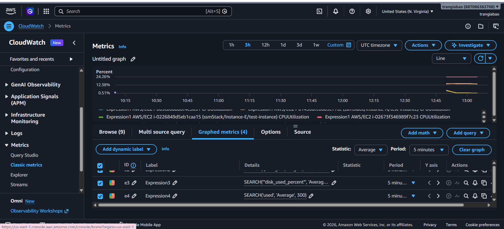

##### Bước 3: Tối ưu hóa biểu thức tính toán Metric Math
* **Thao tác:** Sử dụng cú pháp toán học Metric Math kết hợp nhiều nguồn chỉ số, tính toán tỷ lệ phần trăm sử dụng bộ nhớ và ổ đĩa theo thời gian thực.

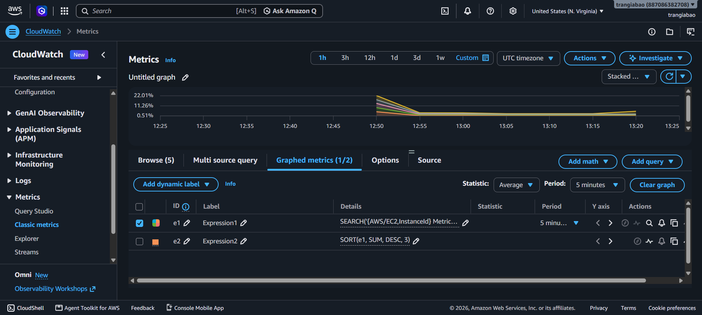

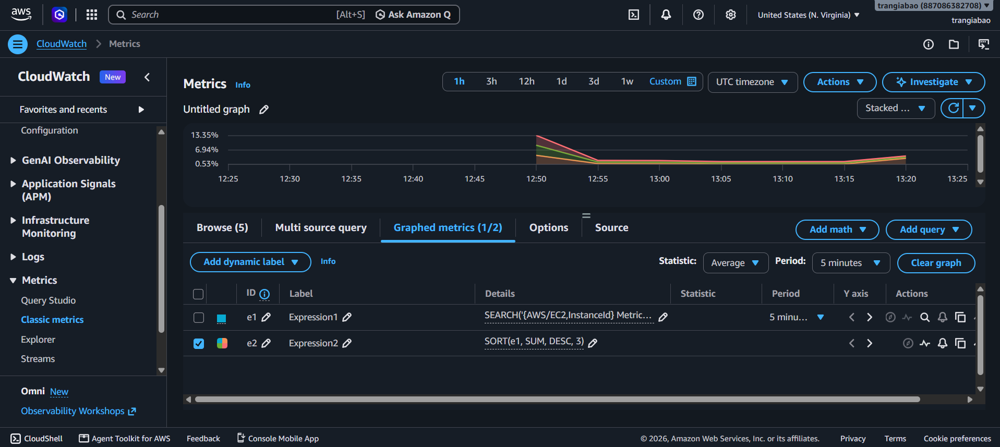

##### Bước 4: Chuẩn hóa nhãn đồ thị với Dynamic Labels
* **Thao tác:** Tại cột **Label** của biểu thức tìm kiếm, nhập cú pháp trích xuất thuộc tính động:
  ```
  ${PROP('Dim.DimName')}
  ```
  hoặc trích xuất định danh máy chủ: `${PROP('Dim.InstanceId')}`.
* **Kết quả:** Thay vì hiển thị chuỗi định danh kỹ thuật dài và phức tạp, nhãn đồ thị tự động chuyển đổi thành tên định danh trực quan của từng máy chủ, giúp kỹ sư vận hành nhanh chóng nhận biết nguồn gốc tải bất thường.

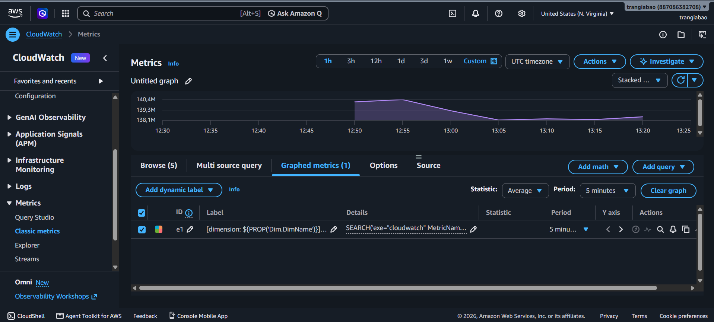

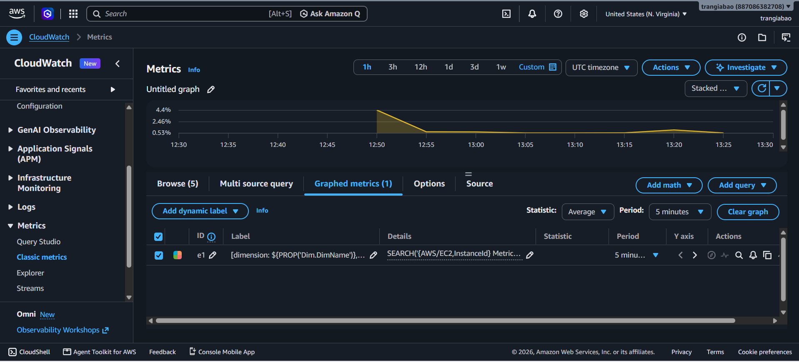

---

#### Phần 3: Kết nối Máy chủ qua AWS Systems Manager & Phát sinh Log Mô phỏng

##### Bước 5: Kiểm tra trạng thái máy chủ Instance-A
* **Thao tác:** Vào dịch vụ **Amazon EC2** ➔ Lọc danh sách máy chủ với từ khóa `test-instance` ➔ Chọn máy chủ `ssmStack/Instance-A/test-instance` (`i-01438dfe66b5e77ce`).
* **Đặc điểm:** Máy chủ sử dụng kiến trúc chip ARM Graviton thế hệ mới `t4g.micro`, trạng thái kiểm tra hệ thống đạt `3/3 checks passed`.

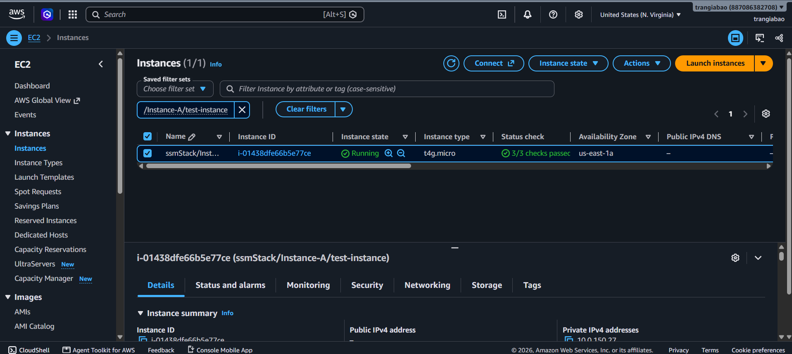

##### Bước 6: Mở phiên điều khiển an toàn qua SSM Session Manager và chạy tập lệnh logger
* **Thao tác:** Nhấn nút **Connect** ➔ Chọn **Session Manager** ➔ Nhấn **Connect** để mở terminal trực tiếp trên trình duyệt mà không cần mở cổng 22 SSH.
* **Thực hiện tạo script mô phỏng lỗi:**
  ```bash
  cd /tmp
  nano logger.py
  sudo chmod +x logger.py
  python3 logger.py &
  ps -aux | grep logger
  ```
* Script định kỳ ghi liên tục các dòng log phân cấp `INFO`, `WARN`, `ERROR` vào tệp tin nhật ký hệ điều hành `/var/log/messages`.

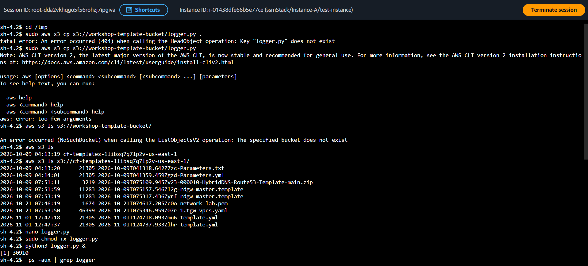

##### Bước 7: Xác nhận dữ liệu log phát sinh thực tế
* **Thao tác:** Chạy câu lệnh theo dõi log thời gian thực:
  ```bash
  sudo tail -f /var/log/messages
  ```
* **Kết quả:** Các dòng log mẫu có tiền tố `logger.py: AWS-Workshop-Test: This is a dummy ERROR message for CloudWatch Logs Insights lab` xuất hiện liên tục và được CloudWatch Agent đẩy về AWS.

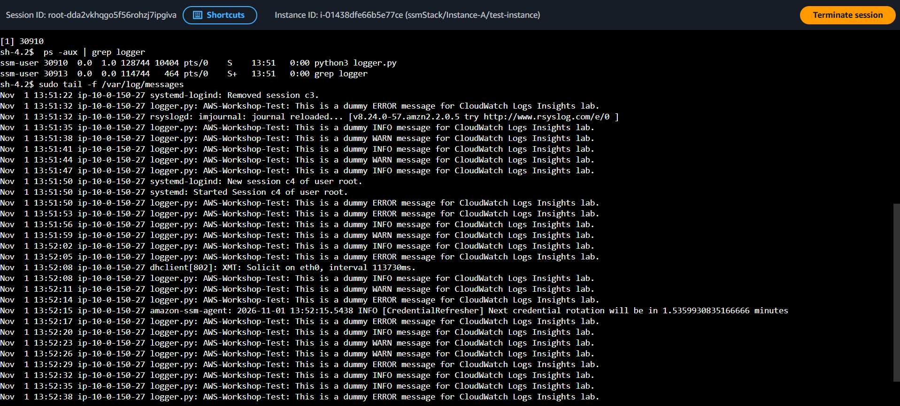

---

#### Phần 4: Phân tích Nhật ký Chuyên sâu với CloudWatch Logs Insights

##### Bước 8: Kiểm tra Log Group và Log Stream của máy chủ
* **Thao tác:** Vào dịch vụ **CloudWatch** ➔ **Logs** ➔ **Log management** ➔ Chọn Log Group `/ec2/linux/var/log/messages`.
* **Thực hiện:** Chọn luồng log `i-0e4862b2e5b03d06a` và xác nhận các bản ghi log từ máy chủ EC2 đã được đẩy lên dịch vụ đám mây thành công.

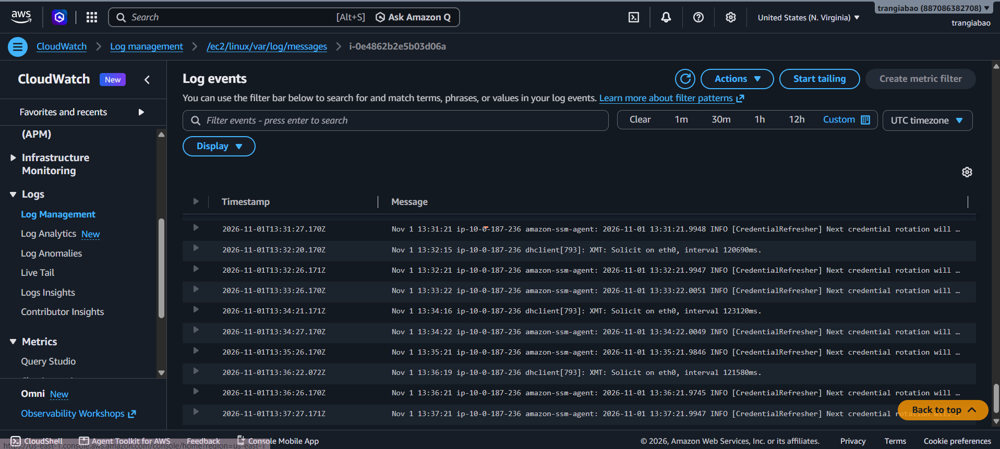

##### Bước 9: Thực thi truy vấn cơ bản trong Logs Insights
* **Thao tác:** Tại menu Logs, chọn **Logs Insights** ➔ Chọn Log group `/ec2/linux/var/log/messages` ➔ Chọn khung thời gian 1 giờ (`1h`).
* **Câu lệnh truy vấn ban đầu:**
  ```sql
  fields @timestamp, @message
  | sort @timestamp desc
  | limit 20
  ```
* Nhấn **Run query** và kiểm tra 20 bản ghi mới nhất hiển thị trên màn hình.

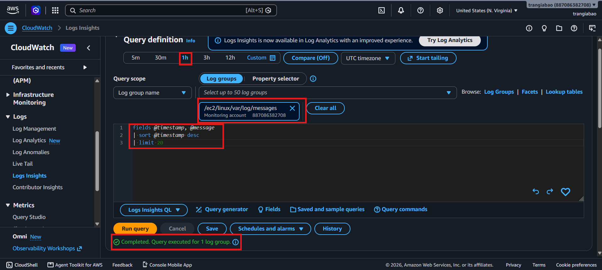

##### Bước 10: Lọc nâng cao các bản ghi sự cố ERROR và WARN
* **Truy vấn lọc log ERROR:**
  ```sql
  fields @timestamp, @message
  | filter @message like /ERROR/
  | sort @timestamp desc
  | limit 20
  ```
  Hệ thống lọc chính xác các bản ghi lỗi nghiêm trọng để phân tích nguyên nhân gốc rễ (RCA).

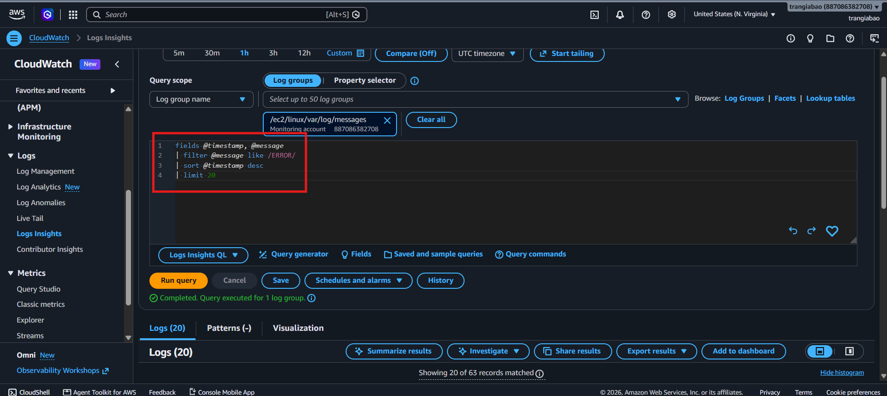

* **Truy vấn lọc cảnh báo WARN:**
  ```sql
  fields @timestamp, @message
  | filter @message like /WARN/
  | sort @timestamp desc
  | limit 20
  ```

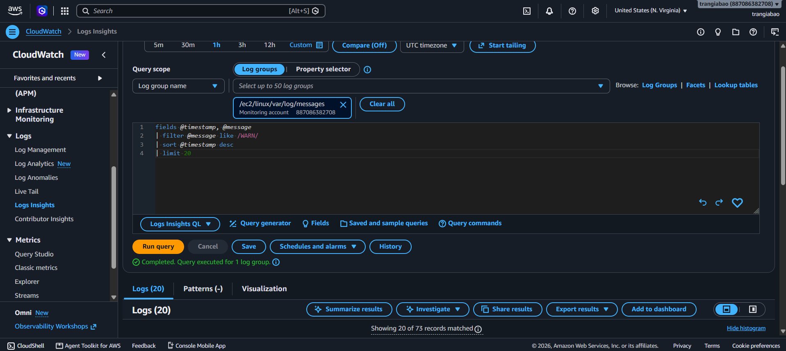

##### Bước 11: Tổng hợp thống kê và vẽ biểu đồ tần suất lỗi
* **Thống kê số lượng lỗi theo từng luồng log:**
  ```sql
  fields @timestamp, @message
  | filter @message like /ERROR/
  | sort @timestamp desc
  | stats count(*) by @logStream
  ```
  Cho phép xác định máy chủ nào trong cụm phát sinh nhiều lỗi nhất.

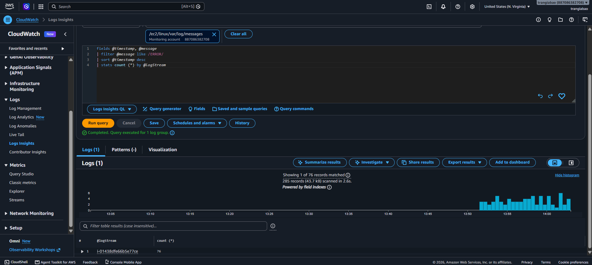

* **Phân bố lỗi theo chuỗi thời gian dạng đồ thị đường (Line chart):**
  ```sql
  fields @timestamp, @message
  | filter @message like /eth0/
  | sort @timestamp desc
  | stats count(*) by bin(5m)
  ```
  Biểu đồ đường trực quan hóa rõ ràng xu hướng tăng giảm của các sự kiện mạng theo từng khoảng thời gian 5 phút.

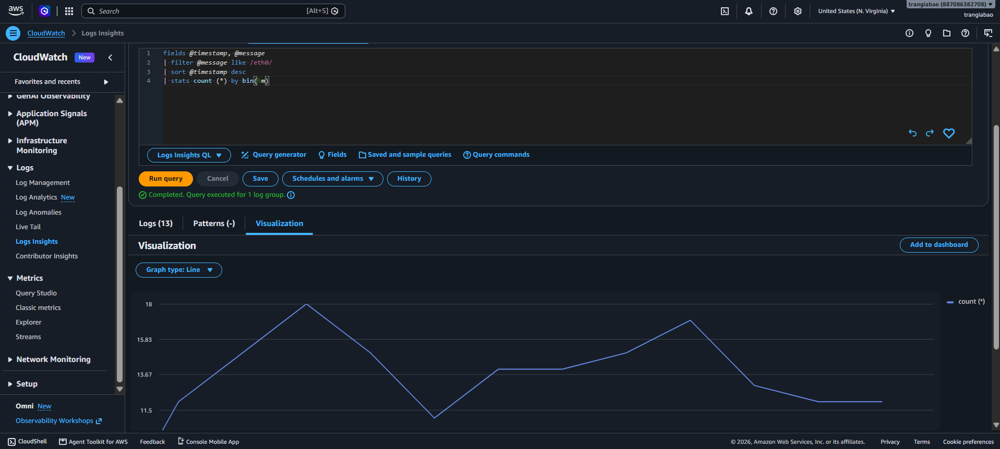

##### Bước 12: Lưu trữ câu truy vấn mẫu (Saved Query)
* **Thao tác:** Nhấn nút **Save** ➔ Đặt tên câu truy vấn là `cloudwatch-workshop/ERROR` để tái sử dụng trong các ca trực vận hành tiếp theo.

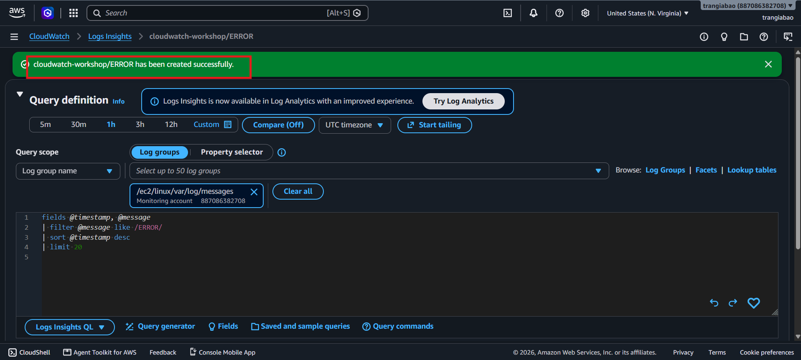

---

#### Phần 5: Cấu hình Metric Filter, Cảnh báo SNS & Bảng điều khiển Tổng hợp

##### Bước 13: Tạo Metric Filter trích xuất chỉ số lỗi từ Log
* **Thao tác:** Quay lại Log Group `/ec2/linux/var/log/messages` ➔ Chọn tab **Metric filters** ➔ Nhấn **Create metric filter**.
* **Thực hiện cấu hình:**
  * **Filter Pattern:** `[month, day, timestamp, host, appId="logger.runJob:", message="ERROR*"]`
  * Nhấn **Test pattern** để xác nhận mẫu khớp chính xác với dòng log mẫu.
  * Đặt tên bộ lọc là `PythonAppErrors`, Metric Namespace là `CustomAppMetrics` và Metric Value là `1`.

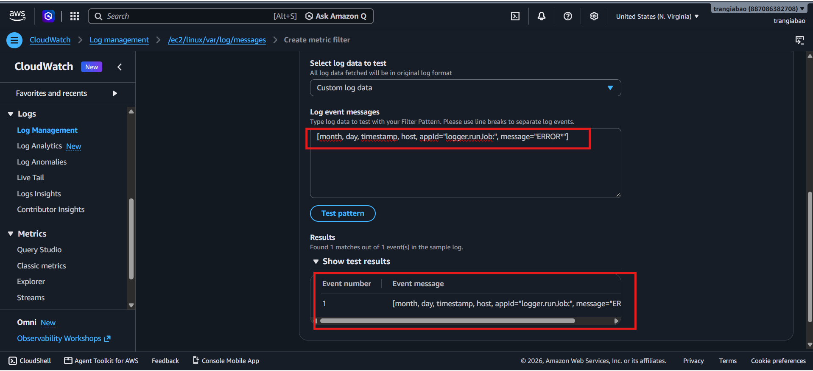

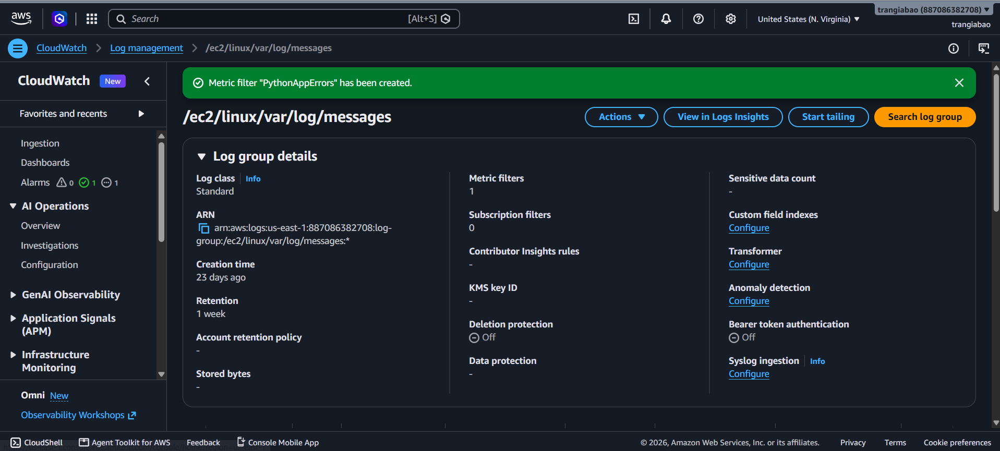

##### Bước 14: Xác nhận đăng ký kênh thông báo Amazon SNS
* **Thao tác:** Mở dịch vụ **Amazon Simple Notification Service (SNS)** ➔ Tạo Topic `Default_CloudWatch_Alarms_Topic` ➔ Đăng ký Subscription qua giao thức Email.
* **Xác nhận:** Mở email nhận được từ AWS và nhấn đường dẫn xác nhận. Màn hình xác thực màu xanh thông báo **Subscription confirmed!** chính thức kích hoạt luồng cảnh báo.

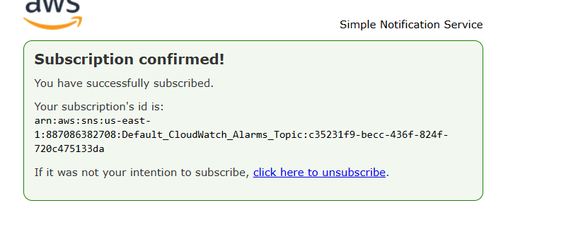

##### Bước 15: Tạo CloudWatch Alarm và hoàn thiện Bảng điều khiển ssmDashboard
* **Thao tác:** Tạo cảnh báo `PythonApplicationErrorAlarm1` trên chỉ số `PythonAppErrors` với điều kiện lỗi phát sinh vượt quá 10 lần trong chu kỳ 5 phút (`ERROR > 10 for 1 datapoints`). Gán hành động gửi thông báo đến SNS Topic vừa cấu hình.
* **Xây dựng Dashboard tập trung:** Truy cập **Dashboards** ➔ Tạo bảng điều khiển `ssmDashboard-1dDcqviqU6D2` gom nhóm các widget quan sát trạng thái lệnh thực thi của Systems Manager (`CommandsDeliveryTimedOut`, `CommandsFailed`, `CommandsSucceeded`) và gắn trực tiếp widget theo dõi trạng thái xanh `In OK` của cảnh báo `PythonApplicationErrorAlarm1`.

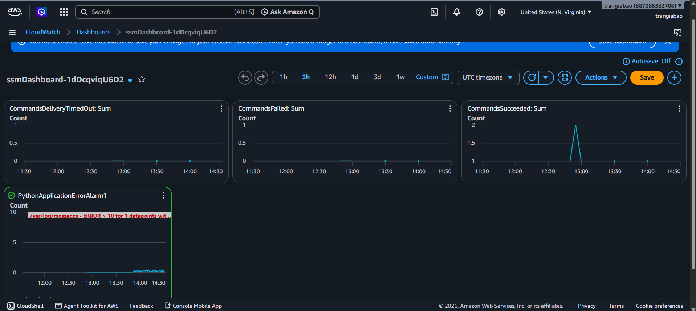

---

### 💡 Bài học kinh nghiệm & Ngân hàng khắc phục sự cố (Troubleshooting Bank):

{}
Dưới đây là 5 bài học thực chiến quan trọng trong quá trình triển khai hệ thống giám sát nâng cao với CloudWatch:
{}

#### 1. Sự khác biệt giữa Metric Math thông thường và Search Expressions
* **Vấn đề:** Khi sử dụng Metric Math thông thường, kỹ sư phải chọn từng Instance ID cụ thể. Khi hệ thống Auto Scaling tạo thêm máy ảo mới, biểu đồ giám sát sẽ bỏ sót các máy ảo này.
* **Giải pháp:** Sử dụng hàm `SEARCH()` giúp biểu đồ tự động mở rộng theo thời gian thực dựa trên thẻ tag hoặc namespace mà không cần bất kỳ sự can thiệp thủ công nào.

#### 2. Cú pháp bộ lọc nhật ký (Log Filter Pattern Syntax) cần chính xác tuyệt đối
* **Lưu ý:** Bộ lọc dạng mảng trường `[month, day, timestamp, host, appId, message]` đòi hỏi số lượng trường trong biểu thức phải khớp với cấu trúc log dòng. Nếu log sử dụng định dạng JSON, nên chuyển sang cú pháp truy vấn `{ $.message = "*ERROR*" }` để tăng độ linh hoạt.

#### 3. Sử dụng SSM Session Manager thay vì SSH truyền thống
* **Lợi ích an toàn thông tin:** Truy cập máy ảo qua Systems Manager Session Manager cho phép loại bỏ hoàn toàn việc mở cổng 22 SSH trên Security Group, không cần quản lý Key Pair cá nhân và toàn bộ lịch sử thao tác dòng lệnh đều được kiểm toán đầy đủ trong CloudTrail và S3/CloudWatch Logs.

#### 4. Phân tích chi phí CloudWatch Logs Insights
* **Tối ưu chi phí:** CloudWatch tính phí dựa trên dung lượng dữ liệu quét (Scan) trong mỗi câu truy vấn. Do đó, kỹ sư luôn nên giới hạn phạm vi thời gian tìm kiếm ngắn nhất có thể (`1h`, `3h`) thay vì quét toàn bộ lịch sử nhiều ngày.

#### 5. Quy trình giải phóng hạ tầng bài thực hành (Clean-Up)
* **Thao tác:** 
  1. Hủy stack `AwsWorkshopStack` trên AWS CloudFormation để tự động xóa toàn bộ các máy chủ EC2, mạng VPC và IAM Role liên quan.
  2. Xóa các Alarm `PythonApplicationErrorAlarm1` và SNS Topic `Default_CloudWatch_Alarms_Topic`.
  3. Xóa Dashboard `ssmDashboard-1dDcqviqU6D2` và Log Group `/ec2/linux/var/log/messages` để tối ưu chi phí lưu trữ.
