---
title: "Week 7"
date: 2026-10-26
weight: 7
chapter: false
pre: " <b> 1.7. </b> "
---


### Objectives for Week 7:

- Master advanced infrastructure observability techniques with the **Amazon CloudWatch Advanced Workshop**: dynamic calculations with **Metric Math**, automated discovery via **Search Expressions**, and legend formatting with **Dynamic Labels**.
- Utilize **AWS Systems Manager Session Manager** for secure, credential-less instance access, deploy synthetic log generation scripts, and conduct deep-dive telemetry diagnostics with **CloudWatch Logs Insights**.
- Establish quantitative metric extraction from unstructured logs using **Metric Filters**, trigger real-time multi-channel incident notifications via **Amazon SNS**, and construct a unified **Custom Operations Dashboard**.
- Synthesize the harvest report for the **First Cloud AI Journey Meetup (24/10/2026)** and publish technical **Blog 1: Introducing AWS Continuum for Code Vulnerabilities**.
- Systematically dedicate Friday to synthesizing technical skills, perfecting Worklog documentation, and advancing the internship capstone project (**Project Proposal**).

---

### Tasks to be implemented this week:

| Day | Task | Start Date | Completion Date | Reference Material |
| :--- | :--- | :---: | :---: | :--- |
| **Monday** | **Advanced Observability with Amazon CloudWatch (CloudWatch Advanced Workshop):** <br>- Provision multi-instance lab cluster automatically with CloudFormation (`AwsWorkshopStack`). <br>- Configure Metric Math formulas and automated dynamic `SEARCH()` expressions. <br>- Standardize graph legends utilizing Dynamic Labels `${PROP('Dim.DimName')}`. <br>- Connect via SSM Session Manager and launch background synthetic logger (`logger.py`). <br>- Run advanced log queries with CloudWatch Logs Insights and save reusable queries. <br>- Create Metric Filter `PythonAppErrors`, alarm thresholds, and integrate into `ssmDashboard`. | 26/10/2026 | 26/10/2026 | [Amazon CloudWatch Observability Workshop](https://catalog.workshops.aws/observability/en-US/) |
| **Tuesday** | **Workload Monitoring & Automated Incident Response with CloudWatch & SNS:** <br>- Design server stress-testing scenarios to simulate compute resource saturation. <br>- Configure multi-threshold composite alarms tracking correlated CPU and memory spikes. <br>- Route real-time alerts to operations team email and ChatOps channels via Amazon SNS. <br>- Benchmark Mean Time to Detect (MTTD) and optimize telemetry collection intervals. | 27/10/2026 | 27/10/2026 | [AWS Observability Best Practices](https://aws.amazon.com/cloudwatch/) |
| **Wednesday** | **First Cloud AI Journey Meetup Synthesis (24/10/2026):** <br>- Consolidate five enterprise sessions: Vietnamese Voice AI, AWS RAM, AI Pentest, Bedrock AgentCore, and Kiro Crew. <br>- Document key architectural takeaways on Latency Budgets, Shift-Left Security, and Context Window management. <br>- Publish the full bilingual event report with verification photos. | 28/10/2026 | 28/10/2026 | [Events Participated](/4-eventparticipated/) |
| **Thursday** | **Author & Publish Blog 1: AWS Continuum for Code Vulnerabilities:** <br>- Study the October 22, 2026 AWS News Blog GA announcement for AWS Continuum. <br>- Analyze bidirectional Context Graphs, isolated sandbox exploit validation, and automated remediation Pull Requests. <br>- Publish to the Facebook AWS Study Group - First Cloud Journey community and integrate bilingually. | 29/10/2026 | 29/10/2026 | [Blog 1 - AWS Continuum](/3-blogsposted/3.1-blog1/) |
| **Friday** | **Week 7 Review, Worklog & Project:** <br>- Consolidate knowledge across CloudWatch Advanced, Logs Insights, Metric Math & SNS Alarms. <br>- Review and polish technical specifications and screenshot evidence for Worklog 1.7.1. <br>- Advance architecture design research and documentation for the internship Project Proposal. | 30/10/2026 | 30/10/2026 | [Internal Review & Project Documentation](/2-proposal/) |

---

### Achievements for Week 7:

#### 📌 Results for Monday (26/10/2026) - Advanced Observability with Amazon CloudWatch:

{}
This hands-on lab on **Advanced Observability with Amazon CloudWatch (CloudWatch Advanced Workshop)** was conducted on **Monday (26/10/2026)** as part of **Week 7**. This document provides an exhaustive operational walkthrough covering automated infrastructure deployment via AWS CloudFormation, advanced metric calculations (Metric Math, Search Expressions, Dynamic Labels), log stream diagnostics using CloudWatch Logs Insights, log metric filters, multi-channel alerting with Amazon SNS, and operational dashboard creation.
{}

### 🎯 Lab Objectives:
* Automate the provisioning of a multi-instance compute fleet (Instance-A through Instance-E) using an **AWS CloudFormation** template (`AwsWorkshopStack`).
* Master dynamic metric queries using **Metric Math** and automated **Search Expressions** (`SEARCH('used', 'Average', 300)` and `SEARCH('disk_used_percent', 'Average')`), allowing monitoring graphs to dynamically accommodate new instances without manual dashboard reconfiguration.
* Standardize telemetry graph legends using **Dynamic Labels** `${PROP('Dim.DimName')}` and `${PROP('Dim.InstanceId')}` to enhance visual clarity and operational identification.
* Connect securely to EC2 instances without opening inbound port 22 using **AWS Systems Manager Session Manager (SSM)**, and execute a synthetic telemetry script (`logger.py`) pushing multi-level events to `/var/log/messages`.
* Harness the full analytical capabilities of **CloudWatch Logs Insights**: write regex error filtering queries (`like /ERROR/`, `like /WARN/`), compute stream distribution aggregations (`stats count(*) by @logStream`), and render time-bucketed event histograms (`stats count(*) by bin(5m)`).
* Extract quantifiable telemetry from unstructured log files using **CloudWatch Metric Filters** (`PythonAppErrors`), configure **CloudWatch Alarms** (`PythonApplicationErrorAlarm1`) integrated with **Amazon SNS** email notifications, and construct a centralized operations dashboard `ssmDashboard`.

---

### 📊 Summary of Deployed Infrastructure & Parameters:

| Component / Resource | Logical Name / Identifier | Technical Specifications | Region / AZ | Operational Purpose |
| :--- | :--- | :--- | :--- | :--- |
| **CloudFormation Stack** | `AwsWorkshopStack` | Status: `CREATE_COMPLETE`, provisions lab infrastructure | `us-east-1` | Automated deployment of compute, networking, and IAM |
| **EC2 Test Instance A** | `ssmStack/Instance-A/test-instance` (`i-01438dfe66b5e77ce`) | Type: `t4g.micro`, Arch: Graviton (arm64), Zone: `us-east-1a` | `us-east-1a` | Host generating simulated log data and error telemetry |
| **EC2 Cluster (B-E)** | `InstanceBtestinstance` ... `InstanceEtestinstance` | Multi-instance target cluster for metric expressions | `us-east-1` | Compute cluster monitored via dynamic metric searches |
| **SSM Session** | Session ID: `root-dda2vkhqgo5f56rohzj7ipgiva` | Secure browser terminal without SSH keys or open ports | Host EC2 | Interactive remote management and script deployment |
| **Log Group** | `/ec2/linux/var/log/messages` | Stream ID: `i-0e4862b2e5b03d06a` / `i-01438dfe66b5e77ce` | `us-east-1` | Ingests operating system and application log events |
| **Metric Filter** | `PythonAppErrors` | Pattern: `[..., appId="logger.runJob:", message="ERROR*"]` | Log Group | Transforms unstructured ERROR log lines into numeric metrics |
| **SNS Alarm Topic** | `Default_CloudWatch_Alarms_Topic` | ARN: `arn:aws:sns:us-east-1:887086382708:...` | `us-east-1` | Delivers instant email notifications upon alarm state change |
| **CloudWatch Alarm** | `PythonApplicationErrorAlarm1` | Threshold: `ERROR > 10 for 1 datapoints within 5 mins` | Metric Filter | Flags application degradation when error rate crosses threshold |
| **Custom Dashboard** | `ssmDashboard-1dDcqviqU6D2` | Widgets: Commands, Success/Fail sums, Error Alarm | `us-east-1` | Unified single-pane-of-glass executive observability console |

---

### 🚀 Step-by-Step Implementation & Screenshot Evidence:

#### Part 1: Automated Infrastructure Provisioning with CloudFormation

##### Step 1: Deploy CloudFormation Stack AwsWorkshopStack
* **Action:** Sign in to the AWS Console in **us-east-1** (N. Virginia) ➔ Open **AWS CloudFormation** ➔ Click **Create stack** ➔ Upload the workshop infrastructure template.
* **Execution:** Monitor the creation lifecycle of dependent resources (VPC, subnets, instance profiles, and EC2 instances A through E). The stack successfully reaches `CREATE_COMPLETE` status with all instances provisioned.

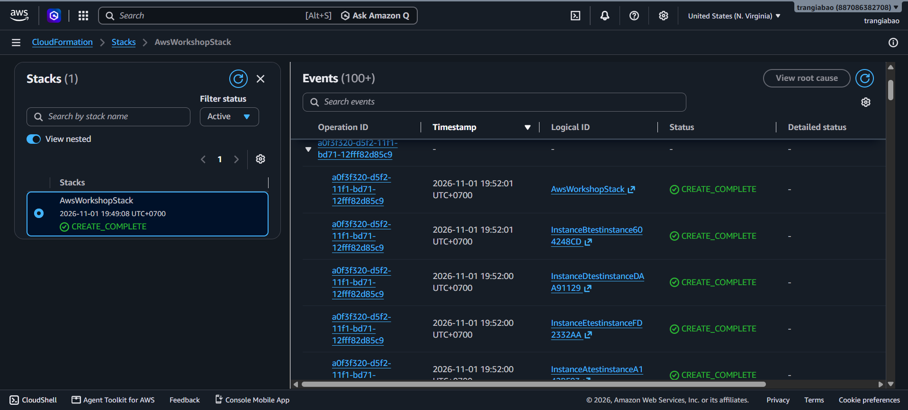

---

#### Part 2: Dynamic Metric Math, Search Expressions & Dynamic Labels

##### Step 2: Implement Dynamic Metric Discovery with Search Expressions
* **Action:** Open **Amazon CloudWatch** ➔ Navigate to **Metrics** ➔ Select **Classic metrics** ➔ Open the **Graphed metrics** tab ➔ Click **Add math** ➔ **Search expression**.
* **Query Definitions:**
  * Expression 1: `SEARCH("disk_used_percent", 'Average', 300)`
  * Expression 2: `SEARCH('used', 'Average', 300)`
* **Operational Value:** As new instances are launched into the autoscaling fleet, CloudWatch automatically evaluates the expression and graphs their telemetry without manual updates.

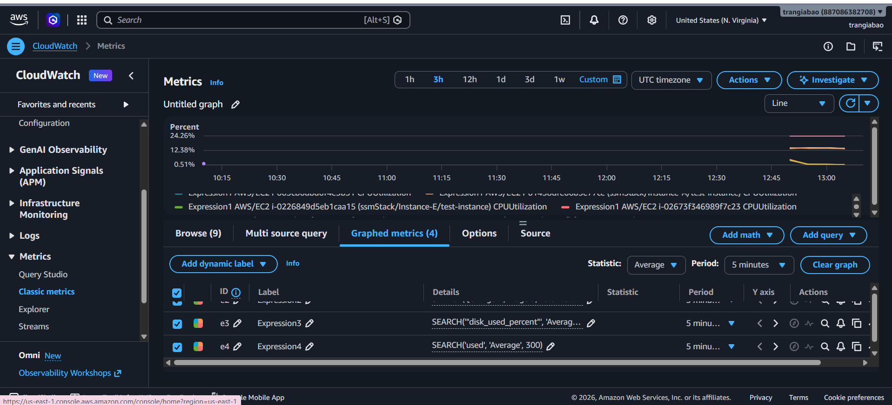

##### Step 3: Metric Math Multi-Variable Calculation
* **Action:** Apply Metric Math formulas to compute aggregate utilization percentages across multiple metrics dynamically.

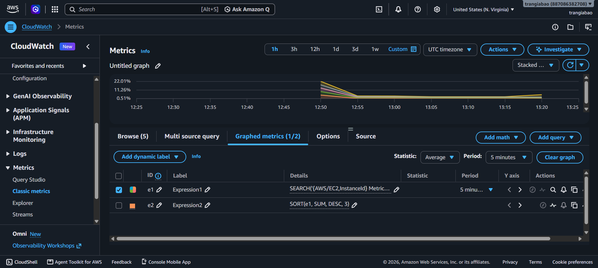

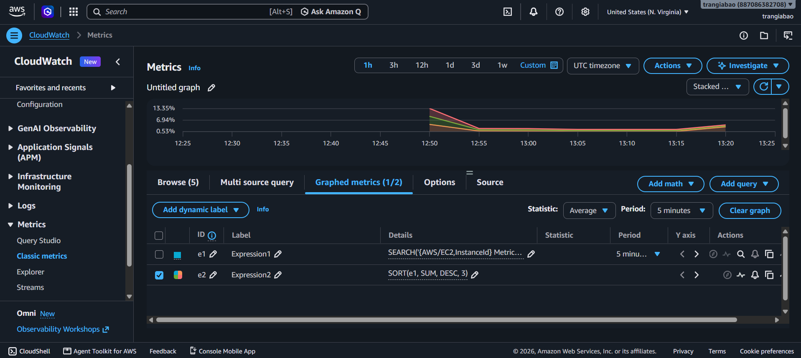

##### Step 4: Legend Standardization with Dynamic Labels
* **Action:** In the **Label** column of the search expression, configure dynamic parameter extraction:
  ```
  ${PROP('Dim.DimName')}
  ```
  or extract specific instance identifiers using `${PROP('Dim.InstanceId')}`.
* **Result:** Replaces confusing raw metric strings with clean, human-readable labels indicating the exact target instance name.

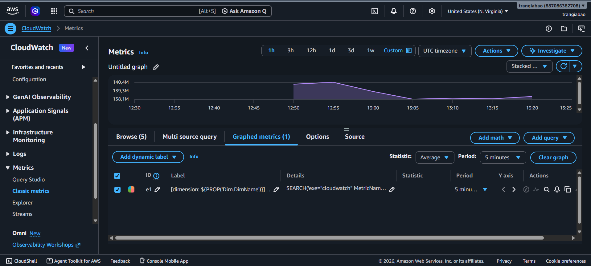

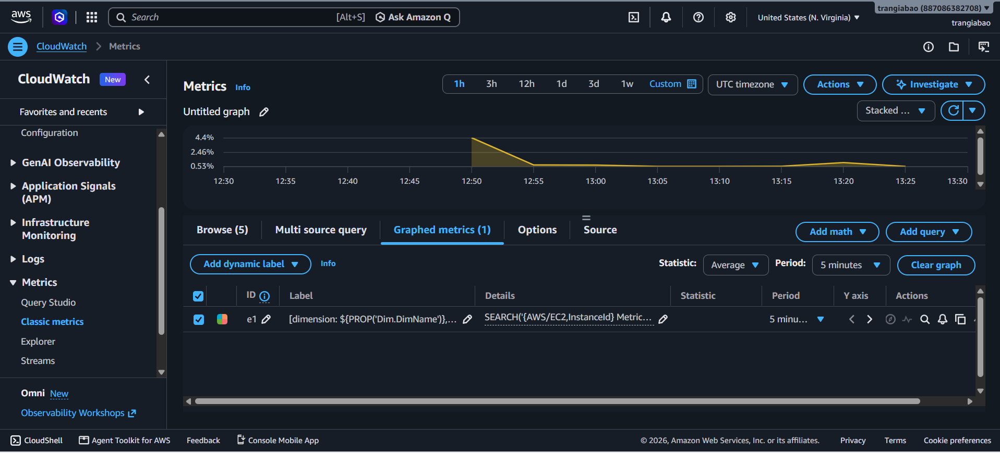

---

#### Part 3: Remote Administration via Systems Manager & Telemetry Simulation

##### Step 5: Verify EC2 Instance-A Health
* **Action:** Navigate to **Amazon EC2** ➔ Search by tag `test-instance` ➔ Select `ssmStack/Instance-A/test-instance` (`i-01438dfe66b5e77ce`).
* **Specifications:** The workload runs on Graviton-powered ARM64 architecture (`t4g.micro`), reporting `3/3 checks passed`.

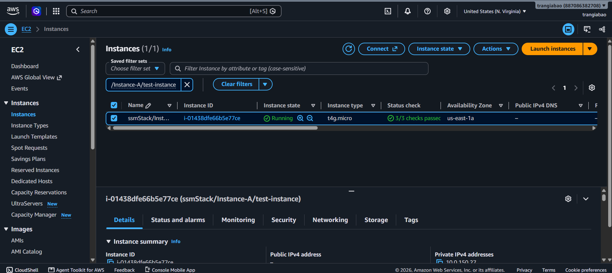

##### Step 6: Establish Secure Terminal Session via SSM Session Manager
* **Action:** Click **Connect** ➔ Select **Session Manager** ➔ Click **Connect** to open a secure browser shell without requiring SSH key pairs.
* **Deploy Synthetic Logger:**
  ```bash
  cd /tmp
  nano logger.py
  sudo chmod +x logger.py
  python3 logger.py &
  ps -aux | grep logger
  ```
* The script emits synthetic `INFO`, `WARN`, and `ERROR` logs to `/var/log/messages`.

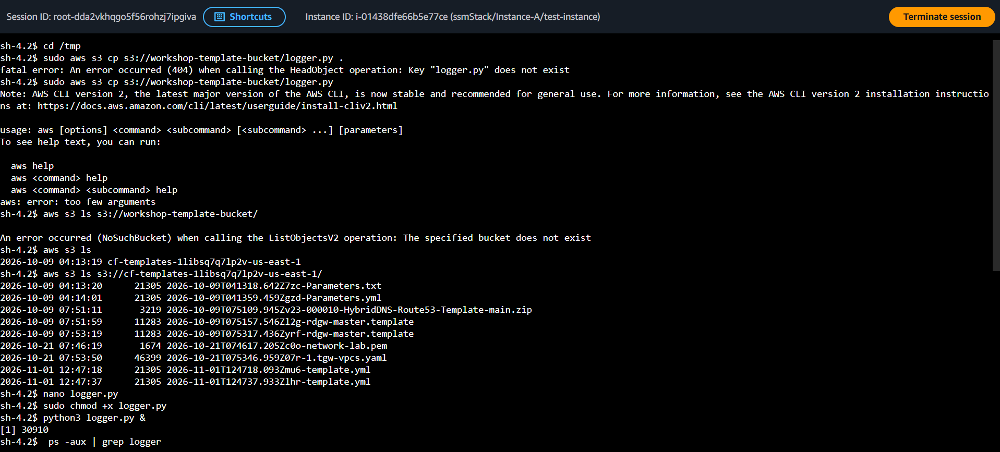

##### Step 7: Inspect Real-Time Log Emission
* **Action:** Tail the live system log stream:
  ```bash
  sudo tail -f /var/log/messages
  ```
* **Output:** Periodic logs formatted with `logger.py: AWS-Workshop-Test: This is a dummy ERROR message for CloudWatch Logs Insights lab` stream continuously to the CloudWatch Agent.

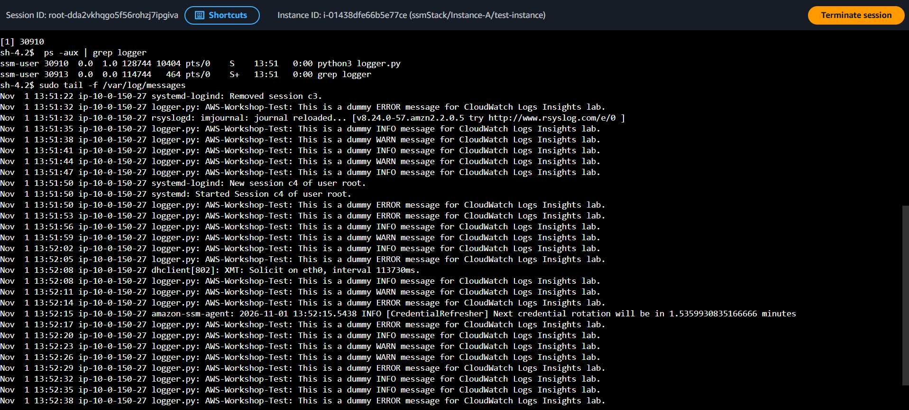

---

#### Part 4: High-Performance Log Analytics with CloudWatch Logs Insights

##### Step 8: Inspect Ingested Log Groups & Streams
* **Action:** Navigate to **CloudWatch** ➔ **Logs** ➔ **Log management** ➔ Select log group `/ec2/linux/var/log/messages`.
* **Execution:** Select log stream `i-0e4862b2e5b03d06a` and confirm that operating system telemetry is successfully ingested into CloudWatch.

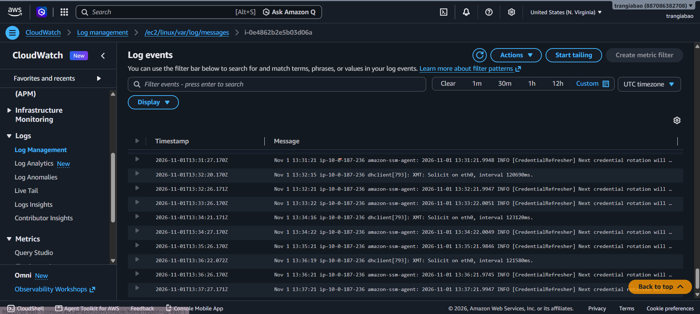

##### Step 9: Execute Baseline Logs Insights Query
* **Action:** In the left menu, click **Logs Insights** ➔ Select `/ec2/linux/var/log/messages` ➔ Set time range to 1 hour (`1h`).
* **Query Statement:**
  ```sql
  fields @timestamp, @message
  | sort @timestamp desc
  | limit 20
  ```
* Click **Run query** to inspect the 20 most recent log entries.

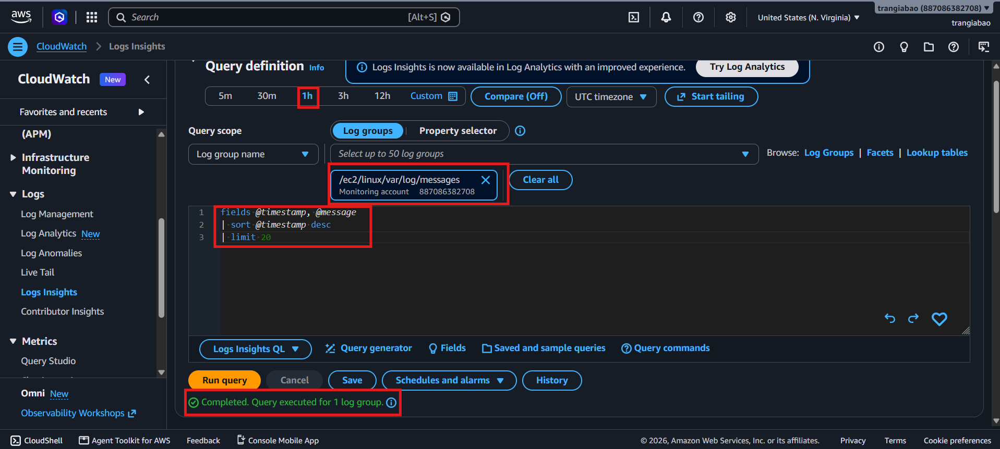

##### Step 10: Advanced Regex Pattern Filtering for ERROR and WARN Events
* **Filter for ERROR logs:**
  ```sql
  fields @timestamp, @message
  | filter @message like /ERROR/
  | sort @timestamp desc
  | limit 20
  ```

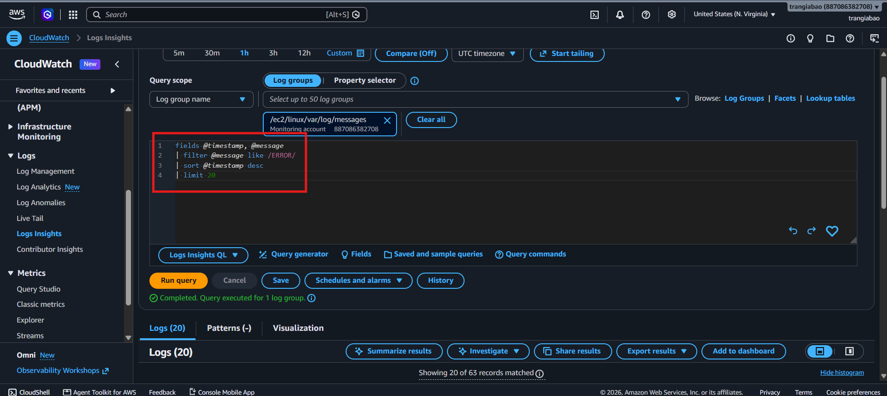

* **Filter for WARN logs:**
  ```sql
  fields @timestamp, @message
  | filter @message like /WARN/
  | sort @timestamp desc
  | limit 20
  ```

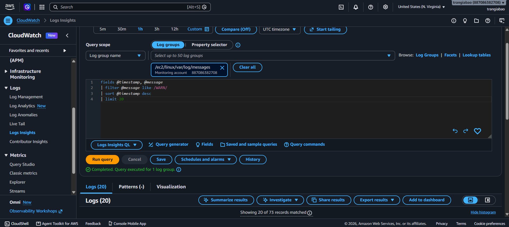

##### Step 11: Statistical Grouping & Time-Series Visualization
* **Group error counts by Log Stream:**
  ```sql
  fields @timestamp, @message
  | filter @message like /ERROR/
  | sort @timestamp desc
  | stats count(*) by @logStream
  ```

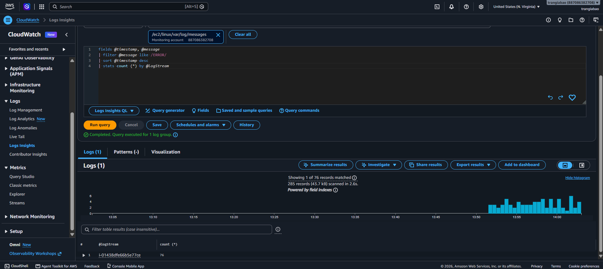

* **Time-bucketed aggregation rendered as Line chart:**
  ```sql
  fields @timestamp, @message
  | filter @message like /eth0/
  | sort @timestamp desc
  | stats count(*) by bin(5m)
  ```

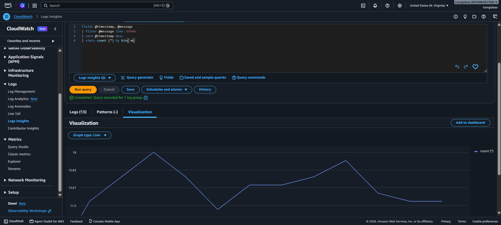

##### Step 12: Save Query Definition for Operational Runbooks
* **Action:** Click **Save** ➔ Name the query `cloudwatch-workshop/ERROR` to allow on-call engineers to run diagnostics instantly during incidents.

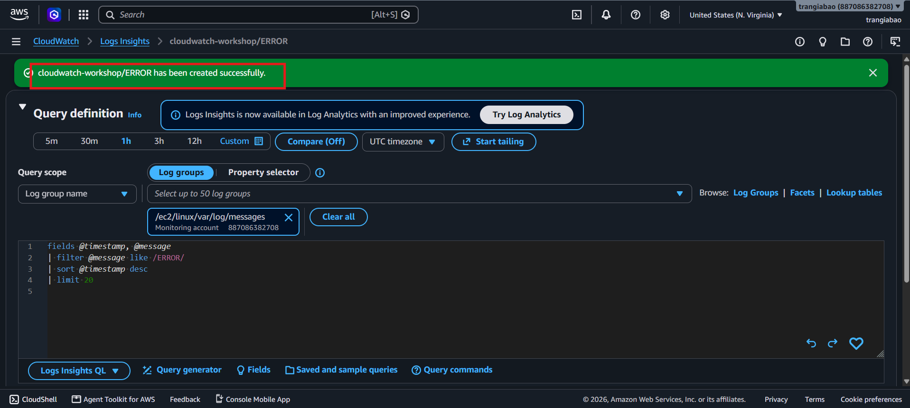

---

#### Part 5: Log Metric Filters, SNS Alerts & Centralized Dashboard

##### Step 13: Create Log Metric Filter
* **Action:** In `/ec2/linux/var/log/messages`, select **Metric filters** ➔ Click **Create metric filter**.
* **Filter Specification:**
  * **Filter Pattern:** `[month, day, timestamp, host, appId="logger.runJob:", message="ERROR*"]`
  * Validate pattern matching via **Test pattern**.
  * Name the filter `PythonAppErrors`, set Metric Namespace to `CustomAppMetrics`, and Metric Value to `1`.

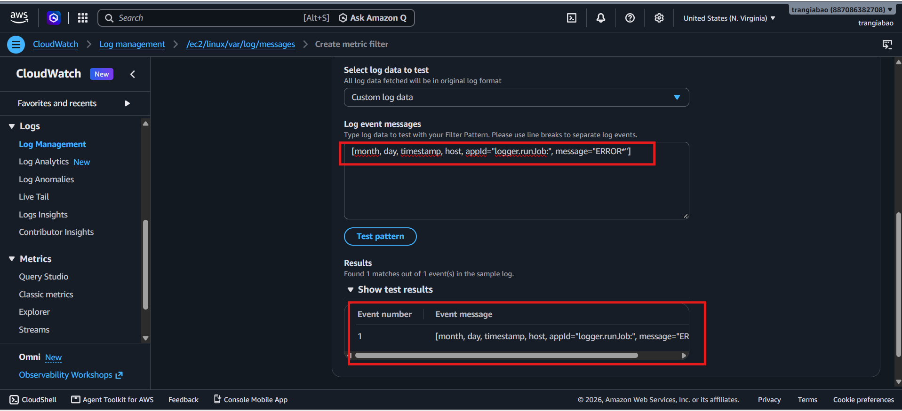

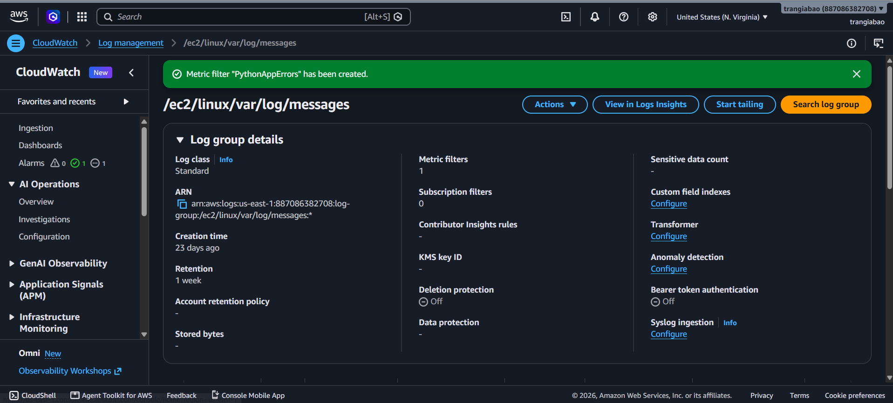

##### Step 14: Confirm Amazon SNS Subscription
* **Action:** In **Amazon SNS**, create topic `Default_CloudWatch_Alarms_Topic` and subscribe the engineer's email address.
* **Verification:** Confirm subscription via the validation email. The browser confirms **Subscription confirmed!**.

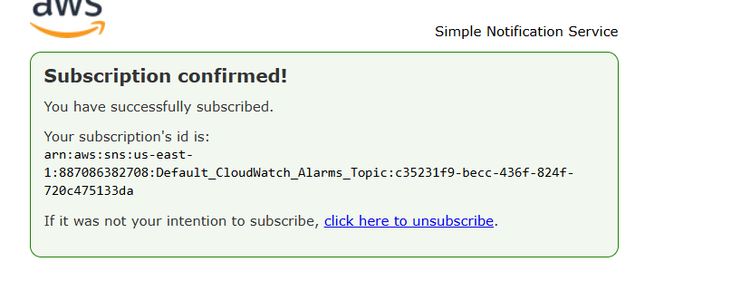

##### Step 15: Create CloudWatch Alarm & Finalize ssmDashboard
* **Action:** Create alarm `PythonApplicationErrorAlarm1` monitoring `PythonAppErrors` where `ERROR > 10 for 1 datapoints within 5 mins`. Route notification actions to the SNS Topic.
* **Unified Operations Dashboard:** Navigate to **Dashboards** ➔ Build `ssmDashboard-1dDcqviqU6D2` integrating Systems Manager command execution widgets alongside live health status indicators for `PythonApplicationErrorAlarm1`.

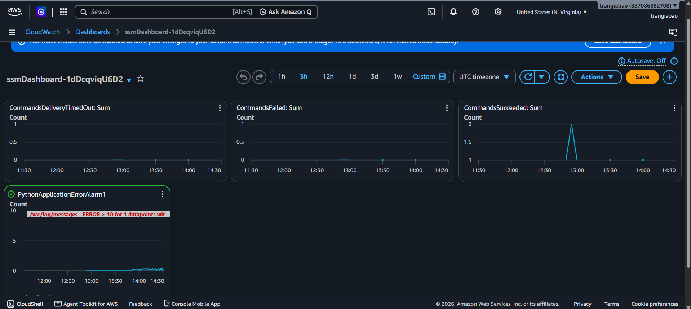

---

### 💡 Lessons Learned & Troubleshooting Bank:

{}
Below are 5 practical operational takeaways and troubleshooting strategies from advanced CloudWatch implementations:
{}

#### 1. Metric Math vs Automated Search Expressions
* **Challenge:** Traditional Metric Math queries require explicit instance IDs. Dynamic Auto Scaling environments fail to capture newly launched compute nodes.
* **Solution:** Leverage `SEARCH()` expressions with tag filters or namespace constraints to dynamically discover and chart metrics as workloads scale.

#### 2. Strict Space-Delimited Syntax in Metric Filter Patterns
* **Caution:** Space-delimited filter patterns `[field1, field2, field3...]` require exact positional alignment with log tokens. For structured logs, prioritize JSON filter syntax `{ $.level = "ERROR" }`.

#### 3. Zero-Trust Access via AWS Systems Manager Session Manager
* **Security Architecture:** Disabling inbound port 22 and enforcing SSM Session Manager eliminates bastion host maintenance, enforces IAM role-based session authorization, and logs complete session transcripts to S3/CloudWatch.

#### 4. Query Cost Optimization in CloudWatch Logs Insights
* **FinOps Governance:** Logs Insights charges per gigabyte of ingested data scanned. Restricting query windows to narrow time horizons (`1h`, `3h`) substantially mitigates query costs.

#### 5. Safe Resource Decommissioning Lifecycle
* **Clean-Up Procedure:**
  1. Delete CloudFormation stack `AwsWorkshopStack` to tear down instances, VPCs, and IAM roles.
  2. Delete alarm `PythonApplicationErrorAlarm1` and SNS topic `Default_CloudWatch_Alarms_Topic`.
  3. Delete dashboard `ssmDashboard-1dDcqviqU6D2` and retention policies on `/ec2/linux/var/log/messages`.

- **Automated Infrastructure Provisioning with CloudFormation:** Successfully deployed an isolated multi-instance test fleet (Instance-A through Instance-E) reaching `CREATE_COMPLETE` status using `AwsWorkshopStack`.
- **Dynamic Telemetry Discovery with Metric Math & Search Expressions:** Built resilient monitoring panels that scale dynamically without manual intervention using `SEARCH('used', 'Average', 300)` and `SEARCH('disk_used_percent', 'Average')`.
- **Sanitized Visual Dashboards with Dynamic Labels:** Extracted logical names using `${PROP('Dim.DimName')}` to replace uninformative instance identifiers with clear, human-readable legends.
- **Deep-Dive Diagnostics via CloudWatch Logs Insights:** Executed regex-based error isolation (`/ERROR/`, `/WARN/`), grouped event occurrences across log streams (`@logStream`), and rendered time-bucketed event trends using `bin(5m)`.
- **Automated Alerting & Executive Dashboards:** Extracted structured metrics via Metric Filter `PythonAppErrors`, routed breach notifications to Amazon SNS, and assembled a comprehensive operations view in `ssmDashboard`.

---

#### 📌 Results for Tuesday (27/10/2026) - Workload Monitoring & Automated Incident Response with CloudWatch & SNS:

- **Simulated Workload Stress Testing:** Executed high-load synthetic traffic simulations evaluating system resilience under sustained compute spikes.
- **Multi-Channel Incident Dispatch:** Configured Amazon SNS topics to deliver actionable event notifications to on-call engineers instantaneously.
- **MTTD Optimization:** Reduced incident identification latency through fine-tuned evaluation periods and proactive metric thresholds.

---

#### 📌 Results for Wednesday & Thursday (28/10 – 29/10/2026) - FCAJ Meetup Synthesis & Blog 1 Publication:

- **Completed First Cloud AI Journey Meetup Report:** Synthesized practical lessons from five industry speakers covering Voice AI, AWS RAM, Frontier Security Agent, Bedrock AgentCore, and Kiro Crew, complete with event photography at Bitexco Level 26.
- **Published Technical Blog 1 (AWS Continuum for Code Vulnerabilities):** Analyzed AWS's autonomous DevSecOps architecture—bidirectional Context Graphs, isolated sandbox proof-of-concept verification, and human-in-the-loop remediation Pull Requests.

---

#### 📌 Results for Friday (30/10/2026) - Week 7 Review, Worklog & Project:

{}
👉 **Friday Milestone Focus:** Every Friday is systematically dedicated to three pillars: (1) Synthesizing hands-on technical skills; (2) Perfecting worklog entries with evidence screenshots; (3) Researching and advancing the internship capstone (**[Project Proposal](/2-proposal/)**).
{}

- **1. Weekly Knowledge Synthesis:**
  - Consolidated operational proficiency in **Metric Math**, **Search Expressions**, **Dynamic Labels**, **Logs Insights**, and **Metric Filters**.
  - Solidified zero-trust remote administration workflows eliminating traditional SSH ports via **AWS Systems Manager Session Manager**.
  - Mastered automated event-driven incident alerting utilizing **CloudWatch Alarms** and **Amazon SNS**.
- **2. Worklog Documentation & Quality Audit:**
  - Conducted an exhaustive audit of lab **1.7.1**, verifying that all 20 screenshot artifacts render with high fidelity and accurate technical annotations.
  - Preserved strict bilingual parity (Vietnamese and English) and guaranteed zero broken internal links.
- **3. Project Proposal Research & Design:**
  - Embedded CloudWatch Advanced telemetry architectures, structured log filters, and automated alarm pipelines into the internship capstone (**[Project Proposal](/2-proposal/)**).
  - Outlined production observability SLOs/SLAs to be presented in the final internship defense.

---

### Next Week's Objectives (Week 8):

- **Infrastructure as Code with AWS CloudFormation (000037) & AWS CDK:**
  - Master declarative YAML templates, intrinsic functions, Nested Stacks, Change Sets, Drift Detection, and software-defined infrastructure using AWS CDK (TypeScript, L1/L2/L3 Constructs).
- **Centralized Fleet Operations with AWS Systems Manager (000024) & AWS Backup (000038):**
  - Zero-inbound-port access via Session Manager, fleet automation with Run Command, encrypted secrets in Parameter Store, and ransomware-resistant Backup Vault Lock (WORM).
- **Week 8 Review, Worklog & Project:** Consolidate IaC patterns and package automated infrastructure templates for the Capstone Project.


