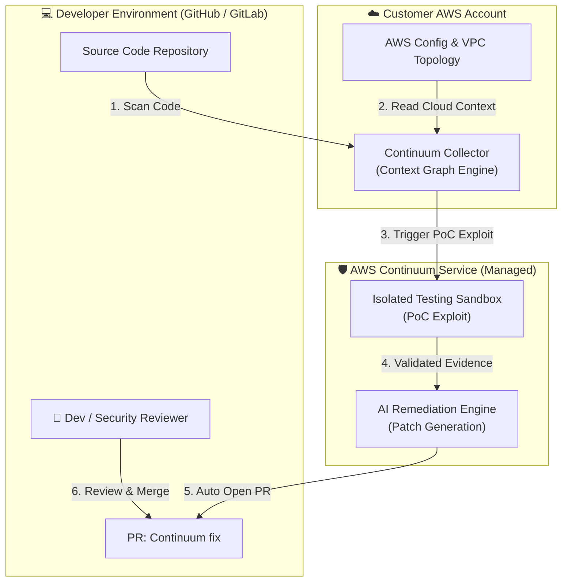

{}
**Original Article Information from AWS News Blog:**
* **Original Title:** [AWS Continuum for code vulnerabilities is now generally available](https://aws.amazon.com/blogs/aws/aws-continuum-for-code-vulnerabilities-is-now-generally-available/)
* **Author:** Esra Kayabali (Principal Solutions Architect at AWS).
* **General Availability (GA) Date:** October 22, 2026.
* **Category:** Announcements, Launch, News, Security, Identity, & Compliance.
* **Reviewer & Synthesis:** Cloud Intern Builder.
{}

# Introducing AWS Continuum for Code Vulnerabilities: A Paradigm Shift in Cloud Security with Autonomous AI Agents Proving Exploits and Delivering Automated PR Fixes


---

### 📢 Community Sharing & Verification

{}
**Technical Sharing Post on AWS Study Group - First Cloud Journey:**
* **Facebook Post Link:** [Updating post URL](https://www.facebook.com/groups/awsstudygroupfcj) *(Please paste your Facebook permalink after admin approval)*
* **Community Group:** [AWS Study Group - First Cloud Journey](https://www.facebook.com/groups/awsstudygroupfcj)
* **Campaign Hashtags:** `#FirstCloudJourney #FCJ #AWSStudyGroup #AWSUserGroupVietnam #AWS #AWSContinuum #DevSecOps #CloudSecurity #GenerativeAI`
{}

#### Verification Screenshot from Facebook Group:

```text
+-----------------------------------------------------------------------------------+
|  [PROOF PLACEHOLDER: SCREENSHOT OF YOUR FACEBOOK POST IN AWS STUDY GROUP]          |
|                                                                                   |
|  After the post is approved on Facebook:                                         |
|  1. Take a screenshot showing your author name, post body, and reactions.         |
|  2. Save it to: static/images/3-BlogsPosted/3.1-Blog1/facebook-post-proof.png     |
|  3. Link the image here to complete your official workshop submission proof.      |
+-----------------------------------------------------------------------------------+
```

---

### 📌 1. Background & The DevSecOps Triage Bottleneck

In modern cloud-native development, AI-assisted coding tools have dramatically accelerated development velocity. However, this velocity also causes the volume of reported security vulnerabilities to scale exponentially.

Traditional static application security testing (SAST) and software composition analysis (SCA) tools typically generate **thousands of raw findings daily**, triggering severe operational bottlenecks:
* **False Positive Fatigue:** Conventional scanners inspect code in isolation without understanding cloud infrastructure topology. A `Critical` severity finding on an internal offline developer utility receives the same alarm priority as a `Medium` flaw exposed on a public checkout API sitting directly in front of a payments database.
* **Costly Manual Investigations:** Security teams expend days coordinating across application and infrastructure engineers just to answer a basic question: *"Is this vulnerability truly reachable and exploitable in our live production environment?"*
* **Remediation Friction & Blast Radius Uncertainty:** Crafting and shipping code patches often stalls because engineering teams lack the business context to safely evaluate the blast radius of proposed changes.

To resolve these chronic challenges, on **October 22, 2026**, AWS announced the **General Availability (GA)** of **AWS Continuum for code vulnerabilities** — an autonomous security service powered by frontier AI models that validates exploitable flaws and delivers remediations directly as reviewed pull requests in your repositories.

---

### 🎯 2. Architectural Breakthrough: How AWS Continuum Operates

Unlike traditional alerting scanners, AWS Continuum establishes a closed-loop, six-stage autonomous remediation lifecycle:



#### The Four Core Pillars of AWS Continuum:

1. **Bidirectional Context Graph:**
   - Continuum merges intelligence from two primary sources: your source code repositories (GitHub/S3) and the **AWS Continuum Collector** deployed within your AWS account.
   - The collector aggregates environmental metadata from **AWS Config, VPC routing tables, security group rules, and IAM policies**.
   - With this holistic visibility, Continuum identifies business-critical assets (customer data stores, payment pipelines) and prioritizes vulnerabilities based on realistic attack paths rather than generic vulnerability scores.

2. **Isolated Exploit Validation in Sandboxes:**
   - For suspected high-risk vulnerabilities, Continuum reproduces the exploit inside an isolated, AWS-managed sandbox environment.
   - It issues rigorous verdicts backed by evidence (e.g., `Static proven` via source path analysis or `Exploit verified` via dynamic execution) and attaches reproduction steps, attack paths, and blast radius assessments.

3. **Automated Pull Request Generation:**
   - For each verified issue, the **AI Remediation Engine** automatically synthesizes a code patch, dependency upgrade, or configuration modification.
   - It opens a native Pull Request titled **`Continuum fix`** directly in your GitHub or GitLab repository, complete with comprehensive evidence summaries in the description.

4. **Human-in-the-Loop Governance:**
   - Continuum strictly adheres to human approval standards. It never modifies production environments autonomously without developer sign-off.
   - Final deployment authority remains with your development team: engineers review the diff, run internal CI/CD pipelines, and merge the PR.

---

### 🖥️ 3. Hands-On Tour: AWS Console & GitHub Integration

The AWS Continuum developer experience spans the AWS Console and GitHub:

#### 1. Unified Environment Overview:
Continuum centralizes code integrations, target environments, and AWS resource collectors in a single dashboard:


#### 2. Prioritized Validated Issues:
Instead of raw scanner output, Continuum presents verified, actionable issues ranked by genuine business impact:


#### 3. Granular Risk Assessment & Proof:
Each finding details exploitability (`Exploitable`), evidence level (`Static proven`), likelihood (`High`), impact (`Moderate`), and provides exact source line analysis:


#### 4. Automated Pull Request on GitHub (`Continuum fix`):
Continuum automatically created a GitHub Pull Request altering 4 files across the cart service (50 lines added, 24 removed), allowing developers to review and merge within seconds:


---

### 🚀 4. Key Takeaways for Cloud Engineers & DevSecOps Teams

The release of **AWS Continuum for code vulnerabilities** represents a defining milestone in AI-powered cloud security:

1. **From Passive Alerting to Active Remediation:**
   - Moves the industry beyond noisy security dashboards to actionable, tested code patches integrated seamlessly into daily git workflows.
2. **Eliminating Dev-Sec Friction:**
   - Provides incontrovertible proof-of-concept evidence so security and development teams can collaborate on verified risks rather than debating theoretical scores.
3. **Pioneering Controlled Frontier AI:**
   - Demonstrates a safe, production-ready blueprint for deploying autonomous AI agents in mission-critical environments with mandatory human verification.

---

> **Reference Source:** [AWS Continuum for code vulnerabilities is now generally available](https://aws.amazon.com/blogs/aws/aws-continuum-for-code-vulnerabilities-is-now-generally-available/) on AWS News Blog by Esra Kayabali (October 22, 2026).
