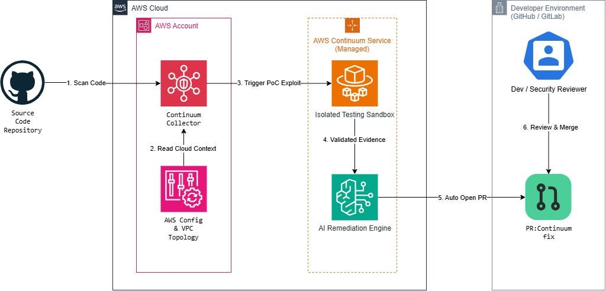
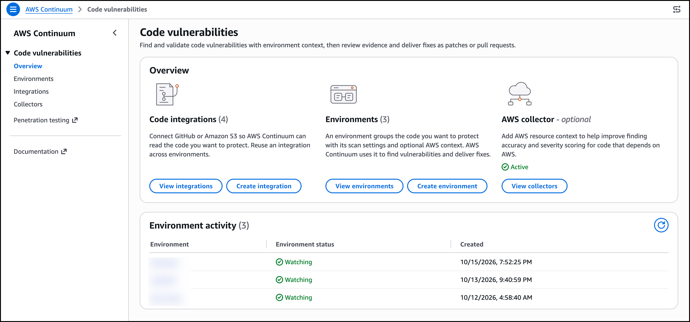
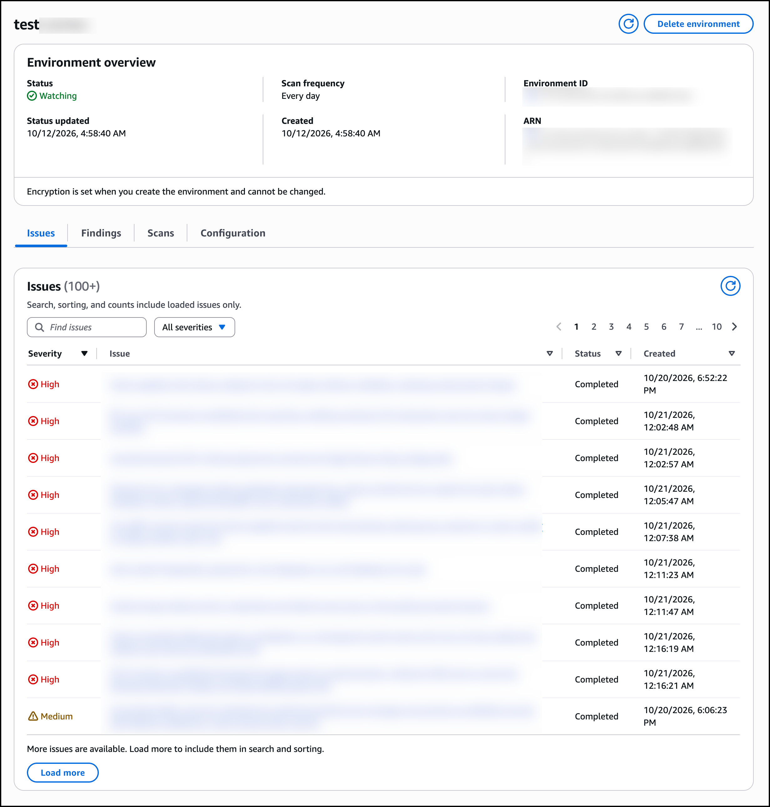
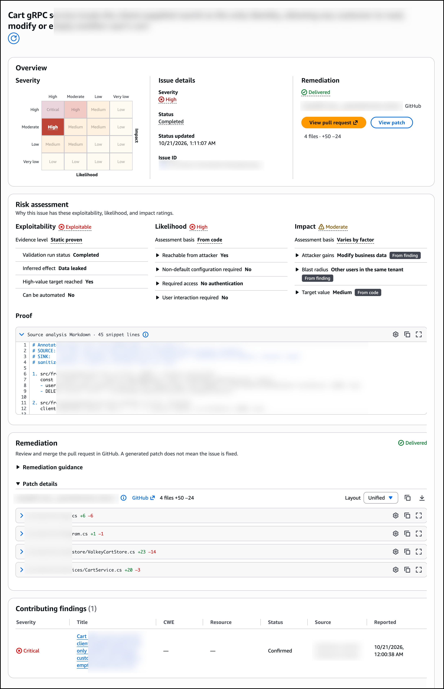
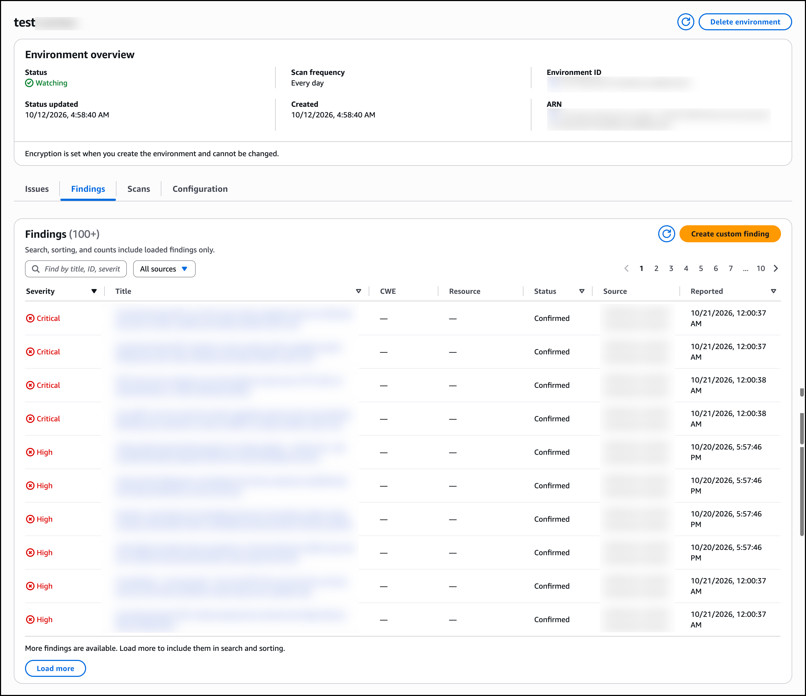

{}
* **Link to Author's Published Community Post:** [View post on Facebook AWS Study Group - First Cloud Journey](https://www.facebook.com/groups/awsstudygroupfcj/posts/2319591015472524/)
* **Original Article Reference:** [AWS Continuum for code vulnerabilities is now generally available](https://aws.amazon.com/blogs/aws/aws-continuum-for-code-vulnerabilities-is-now-generally-available/) (AWS News Blog — Author: Esra Kayabali, GA: October 22, 2026).
{}

### 1. Background & The DevSecOps Triage Bottleneck

In modern cloud-native development, AI-assisted coding tools have dramatically accelerated development velocity. However, this velocity also causes the volume of reported security vulnerabilities to scale exponentially.

Traditional static application security testing (SAST) and software composition analysis (SCA) tools typically generate thousands of raw findings daily, triggering severe operational fatigue. Conventional scanners inspect source code in isolation without understanding cloud infrastructure topology. As a result, a `Critical` severity finding on an internal offline developer utility receives the same alarm priority as a `Medium` flaw exposed on a public checkout API sitting directly in front of a payments database. Security teams expend days coordinating across application and infrastructure engineers just to answer a basic question: is this vulnerability truly reachable and exploitable in our live production environment? Crafting and shipping code patches often stalls because engineering teams lack the business context to safely evaluate the blast radius of proposed changes.

To resolve these chronic challenges, on October 22, 2026, AWS announced the General Availability (GA) of **AWS Continuum for code vulnerabilities** — an autonomous security service powered by frontier AI models that validates exploitable flaws and delivers remediations directly as reviewed pull requests in your repositories.

### 2. Architectural Breakthrough: How AWS Continuum Operates

Unlike traditional alerting scanners, AWS Continuum establishes a closed-loop, automated remediation lifecycle connecting repository source code with live AWS infrastructure topology:

Continuum's operational model is built on four core technological pillars:

* **Bidirectional Context Graph:** Continuum correlates signals across repository source code and live AWS environments via the AWS Continuum Collector agent. The collector extracts telemetry from AWS Config, VPC routing, security groups, and IAM policies to determine whether vulnerable components are exposed to untrusted networks or handle sensitive data, prioritizing alerts based on actual business risk.
* **Isolated Exploit Validation:** For plausible vulnerabilities, Continuum spins up isolated managed sandboxes to execute reproducible proof-of-concept exploits. Findings receive explicit validation tiers (`Static proven`, `Exploit verified`), along with full attack path documentation and blast radius assessments.
* **Automated Remediation Pull Requests:** Once an exploit is verified, the AI Remediation Engine synthesizes a high-fidelity code fix (patching source logic, upgrading dependencies, or correcting resource policies). Continuum automatically opens a Pull Request named `Continuum fix` directly on GitHub/GitLab, complete with risk explanations and test evidence.
* **Human-in-the-Loop Governance:** Continuum never mutates source code or modifies production infrastructure autonomously. Every remediation is delivered as a standard pull request for engineer and tech lead review and approval prior to merging.

### 3. Hands-On Tour: AWS Console & GitHub Integration

Within the AWS Management Console, the Continuum Overview dashboard provides centralized visibility across connected repositories, runtime environments, and collector health:

Instead of unprioritized alert backlogs, Continuum displays only issues proven to be exploitable, organized by operational severity and remediation readiness:

Each finding features a comprehensive risk report detailing validation proof (`Static proven`), reachability (`Exploitable`), potential tenant impact, and the exact lines of offending source code:

Most importantly, Continuum generates production-grade Pull Requests on GitHub with precise diffs and clear change rationales, enabling engineers to inspect, test, and merge remedies efficiently:

### 4. Key Takeaways for Cloud Engineers & DevSecOps Teams

The release of AWS Continuum for code vulnerabilities represents a pivotal transition in cloud security:

1. **From Passive Detection to Autonomous Remediation:** Rather than merely routing defect tickets to developers, Continuum actively participates in the development lifecycle by authoring validated, production-ready code patches.
2. **Eliminating Dev-Sec Friction:** Security teams receive verifiable proof of exploitability, while developers save hours of manual triage, sustaining feature velocity without compromising posture.
3. **Controlled Frontier AI Adoption:** Continuum demonstrates how agentic AI can automate complex security engineering tasks while maintaining strict human approval boundaries.
