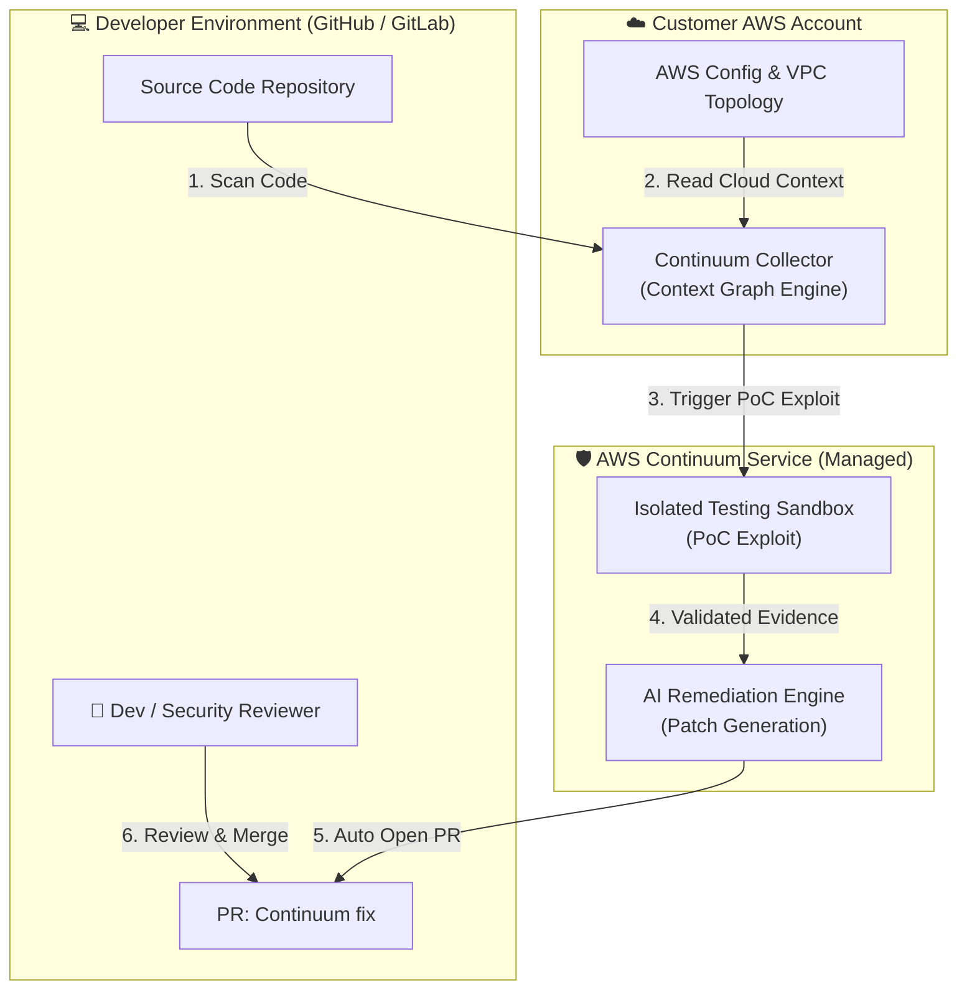
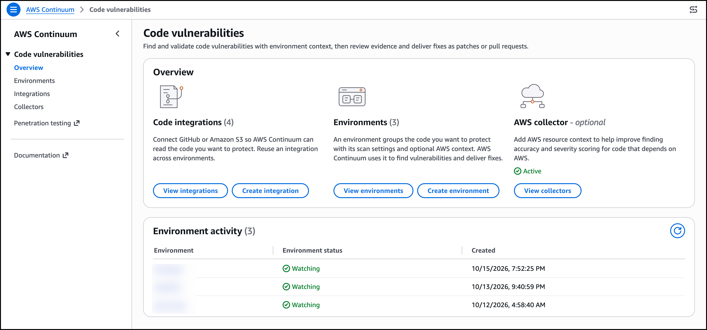

{}
**Thông tin bài viết gốc từ AWS News Blog:**
* **Tiêu đề gốc:** [AWS Continuum for code vulnerabilities is now generally available](https://aws.amazon.com/blogs/aws/aws-continuum-for-code-vulnerabilities-is-now-generally-available/)
* **Tác giả:** Esra Kayabali (Principal Solutions Architect tại AWS).
* **Ngày phát hành chính thức (GA):** 22/10/2026.
* **Chuyên mục:** Announcements, Launch, News, Security, Identity, & Compliance.
* **Người tổng hợp & Đánh giá chuyên môn:** Kỹ sư thực tập Điện toán đám mây (Cloud Intern Builder).
{}

# Giới Thiệu AWS Continuum for Code Vulnerabilities: Bước Ngoặt Tự Động Hóa An Ninh Mạng Với AI Agent Săn Lỗ Hổng và Mở PR Vá Code Tự Động

---

### 📢 Minh Chứng Bài Viết Đã Đăng Trên Cộng Đồng

{}
**Bài viết chia sẻ kỹ thuật trên cộng đồng AWS Study Group - First Cloud Journey:**
* **Đường dẫn bài đăng Facebook:** [Xem bài viết trên AWS Study Group](https://www.facebook.com/groups/awsstudygroupfcj/posts/2319591015472524/)
* **Nhóm đăng:** [AWS Study Group - First Cloud Journey](https://www.facebook.com/groups/awsstudygroupfcj)
* **Hashtag chiến dịch:** `#FirstCloudJourney #FCJ #AWSStudyGroup #AWSUserGroupVietnam #AWS #AWSContinuum #DevSecOps #CloudSecurity #GenerativeAI`
{}

#### Hình ảnh minh chứng bài đăng trên nhóm Facebook:

---

### 📌 1. Bối Cảnh Thực Tế & "Nút Thắt Cổ Chai" Của DevSecOps

Trong kỷ nguyên phát triển phần mềm hiện đại và sự trỗi dậy của các công cụ sinh mã nguồn bằng AI, tốc độ viết code của các kỹ sư tăng lên chóng mặt, nhưng đồng thời số lượng lỗ hổng bảo mật cũng bùng nổ theo cấp số nhân.

Các công cụ quét mã nguồn tĩnh (SAST) hay quét phụ thuộc (SCA) truyền thống thường xả ra **hàng nghìn cảnh báo mỗi ngày**, tạo ra một gánh nặng khổng lồ:
* **Hội chứng "báo động giả" (False Positive Fatigue):** Các công cụ quét chỉ nhìn vào dòng code tĩnh mà không hiểu ngữ cảnh hạ tầng thực tế. Một cảnh báo gán nhãn `Critical` trên một tiện ích nội bộ (không ai từ Internet truy cập được) lại bị đối xử khẩn cấp y hệt một lỗ hổng `Medium` nằm ngay trên API thanh toán kết nối trực tiếp với cơ sở dữ liệu khách hàng.
* **Thời gian điều tra thủ công kéo dài:** Đội ngũ bảo mật phải mất hàng chục giờ để lần theo từng đoạn code, đối chiếu cấu hình mạng VPC, Security Groups nhằm trả lời câu hỏi: *"Lỗ hổng này hacker có thực sự chạm tới và tấn công được trên hệ thống thực tế không?"*.
* **Áp lực vá lỗi đè nặng lên lập trình viên:** Sau khi xác định lỗi, việc phối hợp giữa Security, Infrastructure và Application Team để viết code sửa lỗi, kiểm thử và đảm bảo bản vá không làm sập các tính năng khác (Blast Radius) thường tiêu tốn nhiều ngày, thậm chí nhiều tuần.

Vào ngày **22/10/2026**, AWS đã chính thức phát hành rộng rãi (**General Availability - GA**) dịch vụ **AWS Continuum for code vulnerabilities** – một giải pháp bảo mật tự chủ (Autonomous Security Service) kết hợp sức mạnh của Frontier AI models để không chỉ phát hiện lỗi, mà còn **chứng minh khả năng khai thác thực tế và tự động viết code mở Pull Request (PR) vá lỗi**.

---

### 🎯 2. Đột Phá Kiến Trúc: Cơ Chế Vận Hành Của AWS Continuum

Khác biệt hoàn toàn với các scanner thông thường, AWS Continuum vận hành theo mô hình vòng lặp 6 bước khép kín và thông minh:

#### 4 Cột Trụ Công Nghệ Đột Phá Của AWS Continuum:

1. **Xây dựng Đồ thị Ngữ cảnh 2 chiều (Context Graph):**
   - Continuum thu thập dữ liệu đồng thời từ 2 nguồn: Mã nguồn dự án (GitHub/S3) và bộ thu thập **AWS Continuum Collector** đặt trong tài khoản AWS của bạn.
   - Collector trích xuất thông tin tài nguyên từ **AWS Config, VPC routing, Security Groups, IAM Policies** để hiểu rõ: Dịch vụ nào là trọng yếu (Critical Assets), dữ liệu nào nhạy cảm, và kẻ tấn công có thể thâm nhập qua những đường nào trên mạng.
   - Nhờ đó, Continuum xếp hạng ưu tiên cảnh báo dựa trên **mức độ ảnh hưởng thực tế tới hoạt động kinh doanh** thay vì điểm số rủi ro lý thuyết.

2. **Thẩm định bằng chứng trong Sandbox cô lập (Isolated Exploit Validation):**
   - Đối với các phát hiện nghi ngờ, Continuum tự động kích hoạt môi trường **Sandbox biệt lập** do AWS quản lý và chạy thử mã khai thác thực tế (Proof-of-Concept).
   - Continuum phân loại mức độ bằng chứng rõ ràng (ví dụ: `Static proven` - kiểm chứng qua phân tích tĩnh đường đi của code; `Exploit verified` - chạy tấn công thử nghiệm thành công), cung cấp đường dẫn tấn công (Attack Path) và đánh giá phạm vi ảnh hưởng (Blast Radius).

3. **Tự động sinh mã vá lỗi & Mở Pull Request (Automated Remediation PR):**
   - Với mỗi lỗ hổng đã được chứng minh, **AI Remediation Engine** tự động phân tích và sinh mã khắc phục (sửa logic mã nguồn, nâng cấp version thư viện, hoặc cập nhật cấu hình bảo mật).
   - Continuum tự động mở một Pull Request trên GitHub của dự án mang tên **`Continuum fix`** chứa toàn bộ code đã sửa, kèm bản giải trình chi tiết về rủi ro, bằng chứng khai thác và lý do thay đổi.

4. **Nguyên tắc "Con người kiểm duyệt tối cao" (Human-in-the-Loop):**
   - Continuum tuyệt đối không tự ý đè mã nguồn hay thay đổi môi trường production.
   - Bản vá được chuyển giao minh bạch qua Pull Request, chờ kỹ sư bảo mật hoặc Tech Lead vào kiểm tra, xác nhận và bấm nút **"Merge"**.

---

### 🖥️ 3. Trải Nghiệm Thực Tế Trên AWS Console & GitHub

Dưới đây là các giao diện vận hành thực tế được ghi nhận khi kích hoạt AWS Continuum:

#### 1. Bảng điều khiển tổng quan (Overview):
Continuum tổng hợp toàn bộ các kết nối mã nguồn (Code integrations), các môi trường kiểm thử (Environments) và trạng thái các bộ thu thập AWS Collector:

#### 2. Danh sách các lỗ hổng đã được thẩm định (Validated Issues):
Thay vì danh sách hàng nghìn dòng rác, Continuum chỉ hiển thị các vấn đề đã được kiểm chứng tính khả thi khai thác, xếp hạng theo mức độ nghiêm trọng và trạng thái vá lỗi:

#### 3. Báo cáo đánh giá rủi ro & Bằng chứng xác thực (Risk Assessment & Proof):
Mỗi lỗ hổng được phân tích chi tiết: Khả năng khai thác (`Exploitable`), Mức độ bằng chứng (`Static proven`), Xác suất (`High` - do dịch vụ mở mạng không cần đăng nhập), Mức độ ảnh hưởng (`Moderate` - khả năng sửa đổi dữ liệu người dùng cùng tenant), và trích xuất rõ ràng mã nguồn gây lỗi:

#### 4. Pull Request tự động mở trên GitHub (`Continuum fix`):
Continuum tự động tạo PR trên GitHub với 50 dòng thêm mới và 24 dòng loại bỏ trên 4 file mã nguồn của dịch vụ giỏ hàng (`cart service`). Mô tả PR chứa đầy đủ bằng chứng và tóm tắt rủi ro giúp lập trình viên review nhanh chóng:

---

### 🚀 4. Đúc Kết & Giá Trị Thực Tiễn Cho Kỹ Sư Cloud & DevSecOps

Sự ra đời của **AWS Continuum for code vulnerabilities** (GA ngày 22/10/2026) đánh dấu một bước chuyển dịch mang tính thời đại trong lĩnh vực an ninh mạng đám mây:

1. **Chuyển từ "Phát hiện thụ động" sang "Tự động hóa khắc phục":**
   - Không còn dừng lại ở việc quẳng báo cáo lỗi cho lập trình viên tự xoay xở, Continuum trực tiếp tham gia vào vòng đời phát triển phần mềm (SDLC) bằng cách viết sẵn bản vá chuẩn mực.
2. **Loại bỏ triệt để xung đột giữa Security Team và Developer:**
   - Security Team có trong tay bằng chứng khai thác không thể chối cãi (Proof-of-Concept) để giải thích cho Dev.
   - Developer không mất công viết code vá từ đầu mà chỉ cần kiểm tra PR được tạo sẵn, giúp tốc độ phát hành tính năng (Deployment Velocity) vẫn được duy trì mượt mà.
3. **Tiên phong ứng dụng Frontier AI có kiểm soát:**
   - Continuum là minh chứng xuất sắc cho việc ứng dụng AI tự chủ (Agentic AI) vào các bài toán nhạy cảm, vừa tận dụng tốc độ của máy tính, vừa bảo đảm an toàn với quyền phê duyệt tối thượng thuộc về con người (Human approval).

---

> **Nguồn bài viết tham khảo:** [AWS Continuum for code vulnerabilities is now generally available](https://aws.amazon.com/blogs/aws/aws-continuum-for-code-vulnerabilities-is-now-generally-available/) trên AWS News Blog bởi Esra Kayabali (22/10/2026).
