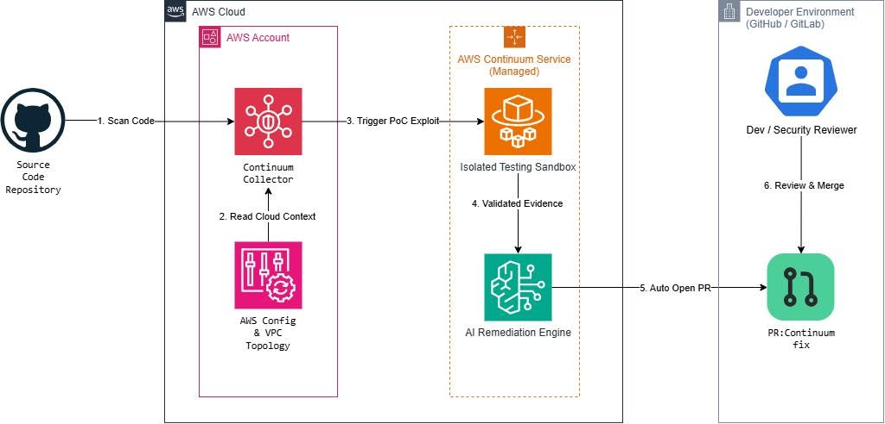
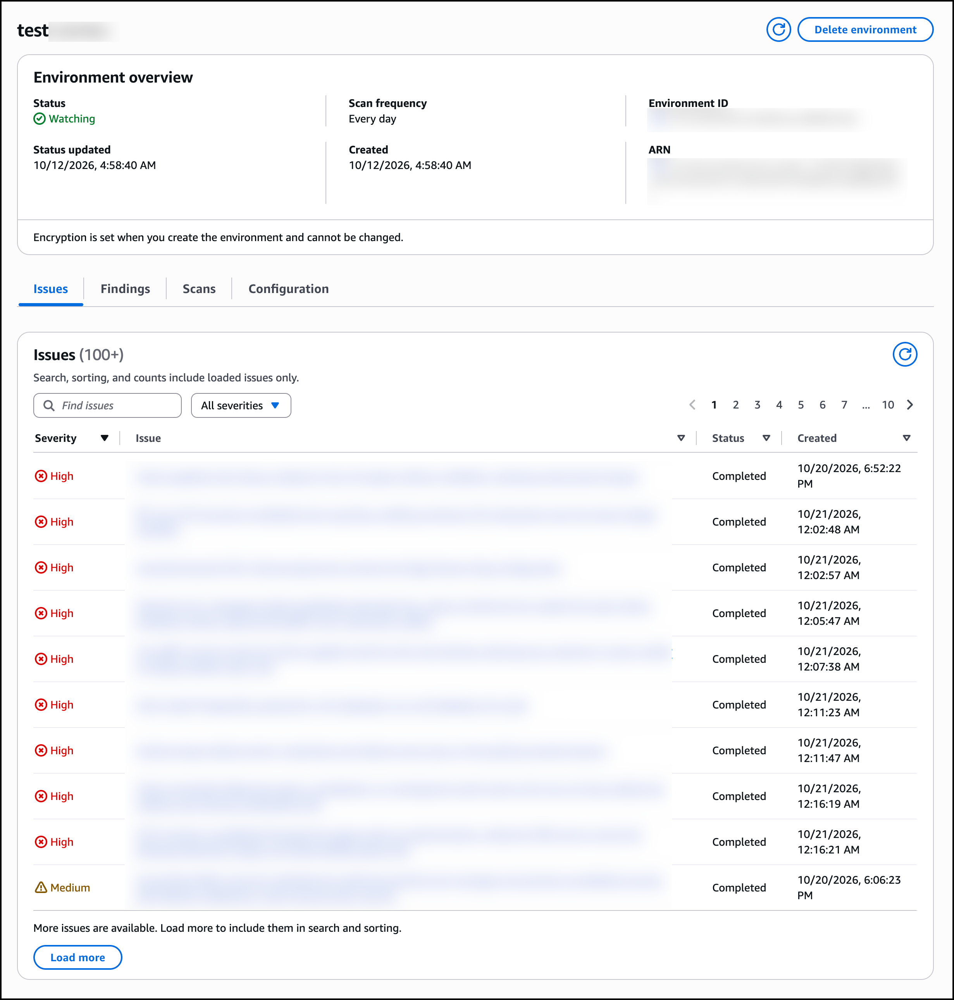
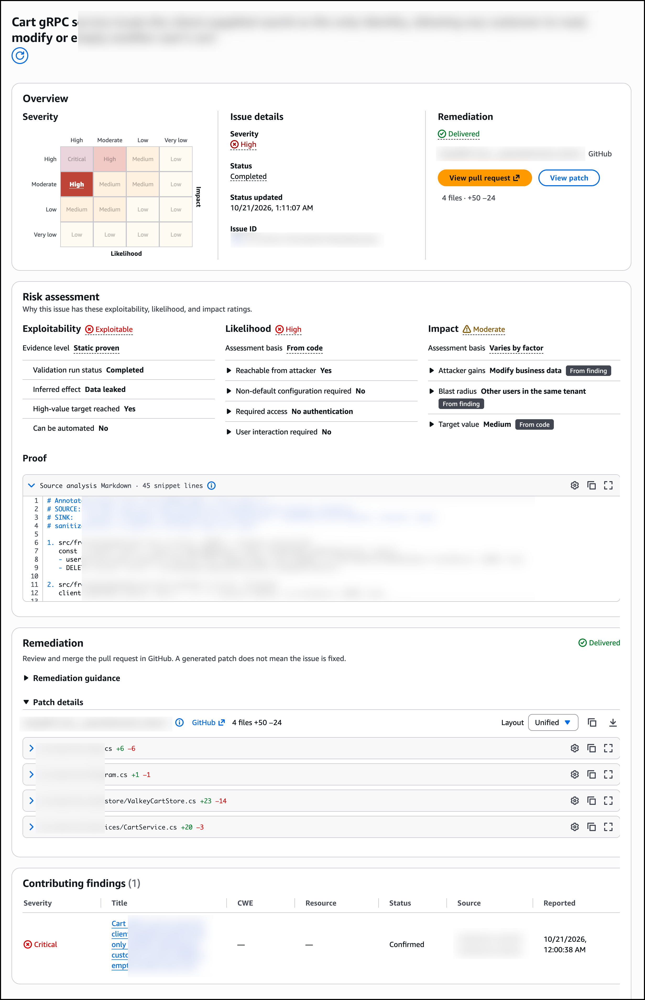
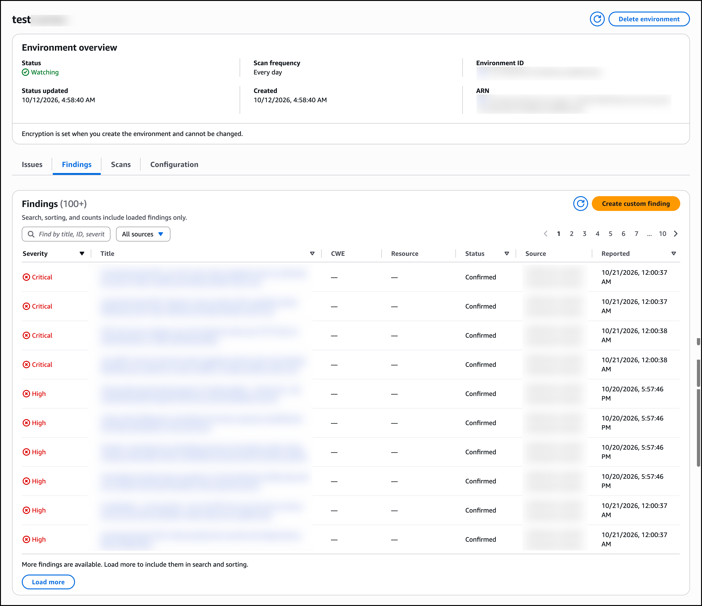

{}
* **Link bài post tác giả đã đăng:** [Xem bài viết trên nhóm Facebook AWS Study Group - First Cloud Journey](https://www.facebook.com/groups/awsstudygroupfcj/posts/2319591015472524/)
* **Nguồn tham khảo bài viết gốc:** [AWS Continuum for code vulnerabilities is now generally available](https://aws.amazon.com/blogs/aws/aws-continuum-for-code-vulnerabilities-is-now-generally-available/) (AWS News Blog — Tác giả: Esra Kayabali, GA: 22/10/2026).
{}

### 1. Bối cảnh và thách thức trong quy trình DevSecOps

Trong kỷ nguyên phát triển phần mềm hiện đại và sự phổ biến của các công cụ sinh mã nguồn bằng AI, tốc độ viết code của các kỹ sư tăng lên nhanh chóng kéo theo số lượng lỗ hổng bảo mật cũng bùng nổ theo cấp số nhân.

Các công cụ quét mã nguồn tĩnh (SAST) hay quét phần mềm phụ thuộc (SCA) truyền thống thường tạo ra hàng nghìn cảnh báo mỗi ngày, dẫn tới hiện tượng "quá tải báo động giả" (False Positive Fatigue). Các công cụ này chỉ đánh giá dòng code tĩnh mà không nắm được ngữ cảnh hạ tầng thực tế. Đội ngũ bảo mật phải mất hàng chục giờ đối chiếu cấu hình mạng VPC, Security Groups để trả lời câu hỏi: liệu lỗ hổng này hacker có thực sự chạm tới và tấn công được trên hệ thống đang chạy hay không. Tiếp đó, việc phối hợp giữa Security và Developer để viết mã vá lỗi, kiểm thử phạm vi ảnh hưởng (Blast Radius) thường tiêu tốn nhiều ngày, làm chậm tiến độ phát hành phần mềm.

Để giải quyết nút thắt này, ngày 22/10/2026, AWS đã chính thức phát hành rộng rãi (General Availability - GA) dịch vụ **AWS Continuum for code vulnerabilities** – giải pháp an ninh mạng tự chủ (Autonomous Security Service) kết hợp sức mạnh của Frontier AI models để không chỉ phát hiện lỗi, mà còn chứng minh khả năng khai thác thực tế và tự động mở Pull Request (PR) vá code.

### 2. Kiến trúc và cơ chế vận hành của AWS Continuum

Khác biệt với các công cụ quét cảnh báo thụ động, AWS Continuum vận hành theo mô hình vòng lặp tự động khép kín kết hợp giữa mã nguồn kho lưu trữ và ngữ cảnh hạ tầng AWS thực tế:

Kiến trúc của Continuum được xây dựng trên 4 nguyên lý công nghệ cốt lõi:

* **Đồ thị ngữ cảnh 2 chiều (Context Graph):** Continuum thu thập dữ liệu đồng thời từ mã nguồn dự án và bộ thu thập AWS Continuum Collector đặt trong tài khoản AWS. Collector trích xuất thông tin tài nguyên từ AWS Config, VPC routing, Security Groups, IAM Policies để hiểu rõ dịch vụ trọng yếu, dữ liệu nhạy cảm và các đường dẫn mạng có thể tiếp cận từ Internet, từ đó phân loại độ ưu tiên theo rủi ro kinh doanh thực tế thay vì điểm số lý thuyết.
* **Thẩm định bằng chứng trong Sandbox biệt lập:** Đối với các phát hiện nghi ngờ, Continuum tự động kích hoạt môi trường sandbox cô lập do AWS quản lý để chạy thử kịch bản khai thác thực tế (Proof-of-Concept). Dịch vụ phân loại mức độ bằng chứng rõ ràng (`Static proven`, `Exploit verified`), cung cấp đường dẫn tấn công (Attack Path) và đánh giá phạm vi ảnh hưởng (Blast Radius).
* **Tự động sinh mã vá lỗi và mở Pull Request:** Khi lỗ hổng được chứng minh, AI Remediation Engine phân tích và sinh mã khắc phục (sửa logic code, nâng cấp thư viện hoặc chỉnh cấu hình). Continuum tự động tạo Pull Request mang tên `Continuum fix` trực tiếp trên GitHub/GitLab của dự án kèm bản giải trình chi tiết.
* **Con người kiểm duyệt tối cao (Human-in-the-Loop):** Hệ thống không tự ý đè mã nguồn hay thay đổi môi trường production. Bản vá được chuyển giao minh bạch qua Pull Request để kỹ sư và Tech Lead xem xét, kiểm thử và phê duyệt trước khi merge.

### 3. Trải nghiệm thực tế trên AWS Management Console và GitHub

Trên giao diện điều khiển AWS Continuum, bảng điều khiển tổng quan cung cấp cái nhìn toàn diện về các kho mã nguồn được kết nối, môi trường kiểm thử và trạng thái của các bộ thu thập AWS Collector:

Thay vì hàng nghìn dòng cảnh báo chưa phân loại, Continuum chỉ hiển thị các vấn đề đã được kiểm chứng tính khả thi khai thác, phân cấp theo mức độ nghiêm trọng và trạng thái vá lỗi:

Mỗi lỗ hổng đều có báo cáo đánh giá rủi ro chuyên sâu, thể hiện rõ mức độ bằng chứng (`Static proven`), khả năng khai thác (`Exploitable`), xác suất tác động tới dữ liệu người dùng và trích xuất chính xác đoạn mã gây lỗi:

Đột phá lớn nhất là việc Continuum tự động mở Pull Request `Continuum fix` trên GitHub với các thay đổi mã nguồn chuẩn mực, kèm theo bản tóm tắt rủi ro giúp lập trình viên review và hợp nhất nhanh chóng:

### 4. Đúc kết và giá trị thực tiễn cho kỹ sư Cloud & DevSecOps

Sự ra đời của AWS Continuum for code vulnerabilities đánh dấu bước chuyển dịch quan trọng trong an ninh mạng đám mây:

1. **Chuyển từ phát hiện thụ động sang tự động hóa khắc phục:** Không chỉ dừng lại ở việc báo lỗi, Continuum trực tiếp hỗ trợ kỹ sư viết sẵn bản vá chuẩn mực.
2. **Loại bỏ xung đột giữa Security Team và Developer:** Security Team có bằng chứng khai thác cụ thể (PoC), còn Developer tiết kiệm thời gian sửa lỗi, giúp tốc độ phát hành phần mềm được duy trì liên tục.
3. **Ứng dụng Frontier AI an toàn và có kiểm soát:** Continuum tận dụng tốc độ và khả năng suy luận của AI tự chủ (Agentic AI) nhưng vẫn duy trì quyền kiểm soát cao nhất thuộc về con người.
