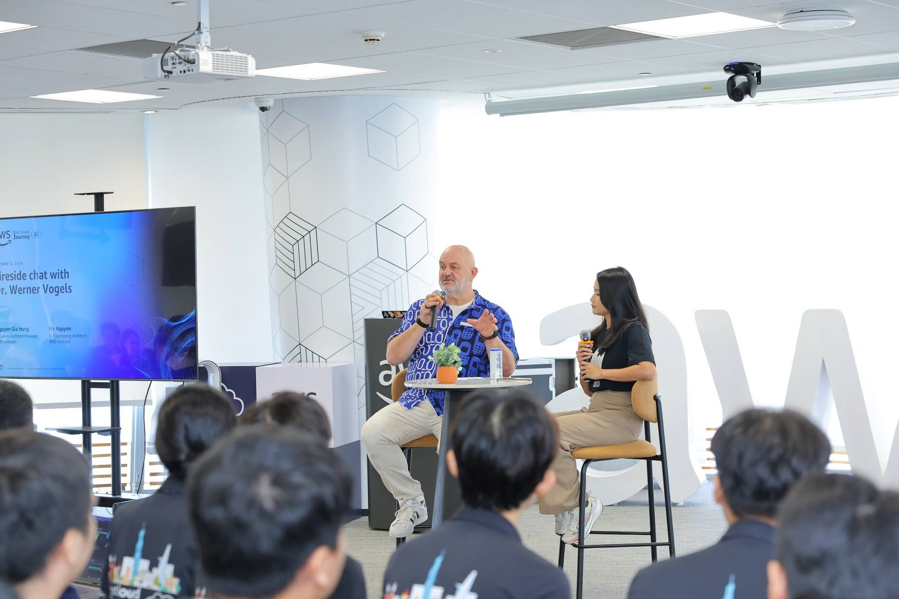
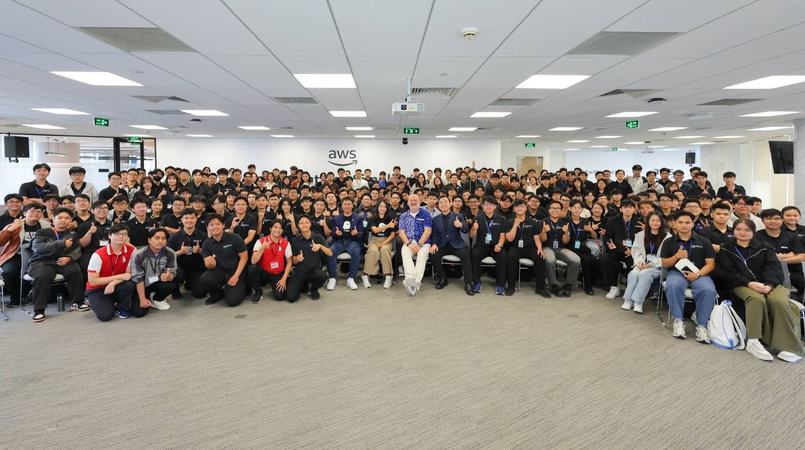
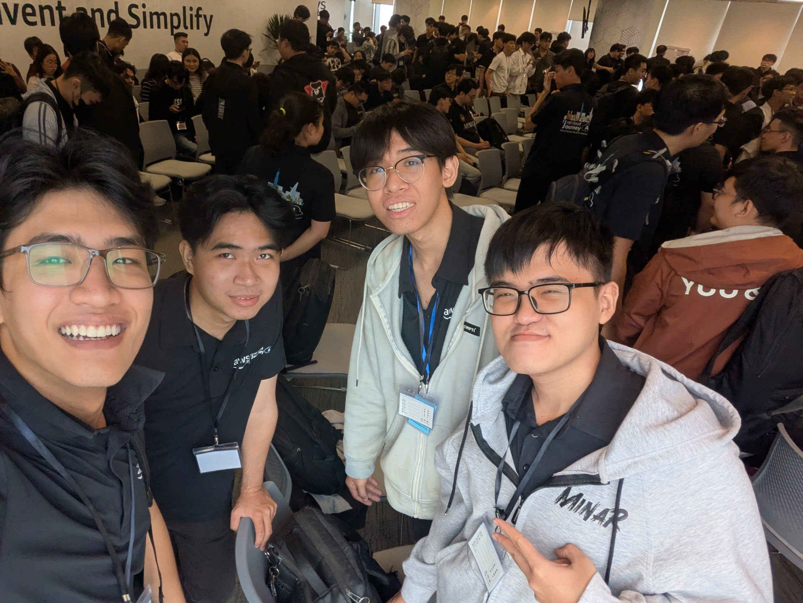

{}
Bài thu hoạch ghi lại nội dung buổi gặp gỡ, tọa đàm chuyên sâu (**Fireside Chat**) trực tiếp giữa **Dr. Werner Vogels** (Phó Chủ tịch kiêm Giám đốc Công nghệ toàn cầu của Amazon.com) cùng cộng đồng **AWS Community & Builders** tại Việt Nam vào ngày **02/10/2026**. Bài viết tổng hợp các bài học lịch sử đắt giá về quy mô phân tán, sự ra đời của DynamoDB, văn hóa GameDays, triết lý "The Renaissance Developer" và tương lai kỹ thuật phần mềm trong kỷ nguyên Trí tuệ nhân tạo.
{}

# Bài thu hoạch: "The Renaissance Developer & Building for People" – Đối thoại cùng Dr. Werner Vogels (CTO Amazon)

---

### 📌 Thông Tin Chung Về Sự Kiện

* **Tên sự kiện:** Fireside Chat with Dr. Werner Vogels: The Renaissance Developer & Building at Scale.
* **Thời gian tổ chức:** 09:00 - 10:30, Ngày 02/10/2026.
* **Địa điểm:** Tầng 26, Tòa nhà Bitexco Financial Tower, số 02 Hải Triều, Phường Bến Nghé, Quận 1, TP. Hồ Chí Minh.
* **Diễn giả chính:** **Dr. Werner Vogels** – Vice President & Chief Technology Officer (CTO) tại Amazon.com.
* **Người điều phối (Host):** Đại diện AWS Community & AWS Heroes / Community Builders tại Việt Nam.
* **Thành phần tham dự:** Các chuyên gia AWS Community Builders, AWS Heroes, các kỹ sư đám mây và sinh viên thực tập Cloud.
* **Vai trò tham dự:** Người tham dự (Attendee) / Kỹ sư thực tập (Intern Builder).

---

### 🎯 Mục Đích & Bối Cảnh Sự Kiện

1. **Lắng nghe trực tiếp từ nhà kiến trúc trưởng của Amazon & AWS:** Tiếp cận những câu chuyện lịch sử chân thực, chưa từng công bố trên sách báo về quá trình Amazon chuyển dịch từ kiến trúc nguyên khối sang điện toán phân tán quy mô toàn cầu.
2. **Hiểu rõ triết lý kiến tạo sản phẩm tại Amazon:** Phương pháp tư duy ngược từ khách hàng (**Working Backwards**), cách quản trị độ trễ nghiêm ngặt ở phân vị **P99.9**, và văn hóa diễn tập thảm họa (**GameDays / Chaos Engineering**).
3. **Định hình chân dung "Nhà phát triển thời Phục hưng" (The Renaissance Developer):** Nhận diện các kỹ năng sống còn giúp kỹ sư phần mềm không bị tụt hậu hay thay thế trước làn sóng AI tạo sinh (Generative AI).
4. **Giao lưu văn hóa công nghệ Việt Nam - Toàn cầu:** Tôn vinh tinh thần người kiến tạo (*"A nation of builders, and a nation of coffee"*), trao đổi cởi mở về văn hóa cà phê phin Việt Nam và ngọn lửa đam mê công nghệ của thế hệ trẻ.

---

### 💡 Nội Dung Nổi Bật Trích Xuất Từ Bản Ghi Âm Tọa Đàm

#### 1. Lịch sử ra đời của Amazon DynamoDB: Thức tỉnh từ sự cố sập hệ thống ngày Giáng sinh

* **Bối cảnh lịch sử:** Vào những năm đầu 2000, Amazon triển khai chương trình *"Miễn phí vận chuyển cho đơn hàng trên $25"* (giao hàng trong 2 tuần). Ngày 12 tháng 12 là ngày hạn chót đặt hàng để kịp nhận quà trước lễ Giáng sinh – ngày có lưu lượng mua sắm khủng khiếp nhất trong năm.
* **Thảm họa sụp đổ:** Hệ thống cơ sở dữ liệu quan hệ thương mại (Commercial RDBMS chạy cụm RAC với ổ đĩa dùng chung) lưu trữ toàn bộ thông tin khách hàng gặp lỗi phần mềm nghiêm trọng và tê liệt hoàn toàn trong suốt ngày hôm đó. Amazon thiệt hại hàng triệu USD doanh thu.
* **Bài học cay đắng:** Đội ngũ lãnh đạo nhà cung cấp CSDL khi họp kiểm điểm đã nói với Werner: *"Đáng lẽ các bạn phải kiểm thử kỹ hơn!"*. Câu nói này dù gây khó chịu nhưng hoàn toàn đúng: Amazon khi đó đang ép một phần mềm thương mại chạy vượt xa giới hạn quy mô mà nó được thiết kế.
* **Nghiên cứu mang tính bước ngoặt:** Werner cử **Swami Sivasubramanian** (khi đó là một thực tập sinh tại Amazon, hiện là Phó Chủ tịch phụ trách AI tại AWS) nghiên cứu lại toàn bộ hành vi truy vấn thực tế. Kết quả bất ngờ:
  * **70% truy vấn:** Hoàn toàn chỉ là tra cứu dạng **Key-Value** đơn giản (ví dụ: giỏ hàng Shopping Cart chỉ cần `CustomerID` để lấy ra danh sách món hàng, không ai cần truy vấn phức tạp như *"tìm tất cả giỏ hàng có chứa cuốn sách Harry Potter"*).
  * **20%:** Là dữ liệu phi quan hệ lưu trên một bảng đơn lẻ (Single-table).
  * **Chỉ 10%:** Thực sự cần đến các tính năng quan hệ (Relational Joins).
* **Kết luận mang tính cách mạng:** Việc dùng một "chiếc búa tạ" RDBMS đắt đỏ cho các tác vụ chỉ cần Key-Value là sự lãng phí và sai lầm về mặt kiến trúc. Amazon quyết định tự xây dựng cơ sở dữ liệu phân tán của riêng mình mang tên **Dynamo** (bài báo khoa học kinh điển năm 2007) và sau này phát triển thành dịch vụ được quản lý toàn diện **Amazon DynamoDB**.

---

#### 2. Văn hóa vận hành xuất sắc (Operational Excellence) & Sự thật về độ trễ phân vị

* **Độ trễ trung vị (Median Latency) là một chiếc bẫy:**
  * Werner nhấn mạnh: Nếu bạn đo thời gian phản hồi của trang web và thấy thời gian trung vị là 1.5 giây, con số này **hoàn toàn vô nghĩa**. Nó đồng nghĩa với việc **50% khách hàng của bạn đang phải chịu trải nghiệm tồi tệ hơn mức đó**!
  * Tiêu chuẩn của Amazon là phải đo lường ở phân vị cao nhất: **P99.9 (99.9th Percentile)**. Một kỹ sư giỏi là người biết cách tối ưu để kéo toàn bộ đường cong độ trễ xuống, đảm bảo ngay cả 0.1% khách hàng chịu thiệt thòi nhất vẫn có trải nghiệm mượt mà.
* **Văn hóa GameDays (Diễn tập thảm họa chủ động):**
  * Hệ thống tại Amazon được thiết kế theo quy tắc: **Phải chịu được việc mất hoàn toàn 1 hoặc thậm chí 2 Data Centers (Availability Zones)** mà khách hàng vẫn mua sắm bình thường.
  * Amazon khởi xướng các ngày hội **GameDay**: Chủ động ngắt kết nối mạng hoặc tắt ngấm một trung tâm dữ liệu mà không báo trước để xem hệ thống ứng phó ra sao.
* **Bài học bất ngờ về việc "Đưa hệ thống quay trở lại" (Reconciliation):**
  * Đội ngũ kỹ sư làm rất tốt việc chuyển đổi dự phòng (Failover) sang 2 Data Center còn lại. Tuy nhiên, khi trung tâm dữ liệu bị ngắt kết nối được bật online trở lại, hệ thống lúng túng vì không có quy trình đồng bộ dữ liệu cập nhật mới ngược trở lại Data Center cũ!
  * *Bài học:* Thiết kế cho sự cố (*Design for Failure*) không chỉ là biết cách sống sót khi sập, mà còn phải có kế hoạch hoàn chỉnh để khôi phục và đồng bộ khi tài nguyên phục hồi.

---

#### 3. Cuộc cách mạng lật đổ mô hình kinh tế phần mềm (Cloud Economics)

* **Nỗi ám ảnh về hợp đồng phần cứng 5-10 năm:** Werner chia sẻ điều ông ghét nhất trong vai trò CTO thời kỳ đầu là phải tiếp các nhà cung cấp giải pháp (Vendors). Để được giảm giá, khách hàng bị ép ký hợp đồng dài hạn 5 đến 10 năm và ký những tấm séc hàng triệu USD trả trước khi chưa biết mình có dùng hết hay không. Sau khi nhận tiền, các vendor này gần như không quan tâm đến sự thành công của khách hàng.
* **Mô hình "Nhà hàng không tiền cọc":**
  * Werner ví von: Bạn không bao giờ bước vào một quán ăn tại Việt Nam mà phải đặt cọc trước 500.000 VNĐ trước khi biết mình ăn món gì.
  * AWS ra đời đã đảo lộn hoàn toàn mô hình kinh tế IT: **Pay-as-you-go** (chỉ trả tiền cho những gì thực sự sử dụng), không ràng buộc hợp đồng. Khách hàng có quyền ngừng sử dụng bất cứ lúc nào, buộc AWS phải luôn nỗ lực hết mình mỗi ngày để cung cấp dịch vụ tốt nhất.
* **Khởi đầu của S3:** Khi ra mắt Amazon S3 năm 2006, khẩu hiệu ban đầu chỉ đơn giản là *"Storage for the Internet"* – lưu trữ dành cho những doanh nghiệp trẻ khởi nghiệp trên Internet, chứ không phải giải pháp phức tạp cho khối doanh nghiệp lớn.

---

#### 4. Chân dung "Nhà phát triển thời Phục hưng" (The Renaissance Developer)

Xuất phát từ bài phát biểu Keynote chấn động tại AWS re:Invent, Werner giải thích 5 phẩm chất giúp kỹ sư phần mềm làm chủ kỷ nguyên mới:

1. **Tính tò mò & Tinh thần học tập suốt đời (Curiosity & Lifelong Learning):**
   * Werner kể lại hành trình từ lúc học Pascal, COBOL, Assembly cho đến C, C++, Java, Python, và hiện nay là **Rust**. Công nghệ luôn biến đổi không ngừng; là kỹ sư, bạn sẽ phải học tập cho đến ngày nghỉ hưu.
   * Dẫn lời nữ đô đốc Grace Hopper: *"Câu nói nguy hiểm nhất trong ngôn ngữ loài người là: 'Trước giờ chúng tôi vẫn luôn làm như vậy'"*. Đừng tự giới hạn mình là "Java shop" hay "Python shop".
2. **Tư duy hệ thống (System Thinking):**
   * Nhìn vào bức tranh toàn cảnh (Big Picture), hiểu các dịch vụ tương tác với nhau thế nào thay vì chỉ chăm chú vào một vi dịch vụ hay một đoạn mã của riêng mình.
3. **Kỹ năng giao tiếp (Communicator) – Kỹ năng bị xem nhẹ nhất:**
   * Phá vỡ hình tượng sai lầm trên phim ảnh về lập trình viên: người ngồi góc tối gõ code, không giao tiếp.
   * Kỹ sư phần mềm giỏi phải là người biết lắng nghe và giao tiếp với khách hàng/business. Khi khách hàng nói: *"Chúng tôi muốn dùng AI để làm điều này"*, kỹ sư phải biết đào sâu để hiểu: **Đâu là vấn đề thực sự cần giải quyết?** Liệu có cần dùng mô hình AI đắt đỏ hay chỉ cần một công cụ xử lý ảnh đơn giản như Amazon Rekognition là đủ?
4. **Tinh thần làm chủ cao độ (Ownership):**
   * Triết lý cốt lõi: *"You own what you build"*.
   * Khi bạn dùng công cụ AI (Copilot, Claude, Cursor) để sinh mã nguồn, nếu đoạn mã đó gây ra lỗi hoặc tạo lỗ hổng bảo mật, **đó là lỗi của bạn**, bạn không thể đổ thừa cho AI trước ban lãnh đạo hay cơ quan quản lý.
5. **Kỹ sư hình chữ T (Polymath / T-shaped):**
   * Đi thật sâu vào một lĩnh vực chuyên môn (ví dụ: Database Specialist), nhưng phải mở rộng kiến thức đủ rộng để hiểu UI/UX, Middleware và nghiệp vụ, từ đó hỗ trợ đồng nghiệp trong nhóm.

---

#### 5. Trí tuệ nhân tạo (AI): Công cụ khuếch đại năng lực con người

* **Bản chất của AI:** AI đã có lịch sử 70 năm (khởi xướng từ năm 1956 bởi John McCarthy và Marvin Minsky). Theo McCarthy: *"Ngay khi một công nghệ AI bắt đầu hoạt động hiệu quả, người ta sẽ không gọi nó là AI nữa"* (nó trở thành tính năng tìm kiếm, nhận dạng giọng nói, gợi ý sản phẩm thông thường).
* **AI giống như một Trình biên dịch (Compiler) thế hệ mới:**
  * Trình biên dịch truyền thống: Nhận input là ngôn ngữ lập trình có cấu trúc chặt chẽ ➔ Sinh ra mã máy (Machine Code) mà con người không cần đọc.
  * Công cụ GenAI hiện đại: Nhận input là ngôn ngữ tự nhiên không hoàn hảo (Natural Language) ➔ Sinh ra mã nguồn có cấu trúc.
  * Vì input tự nhiên luôn có sai số, máy móc không biết nói "Tôi không biết" mà sẽ tự bịa ra thông tin. Do đó, **con người bắt buộc phải kiểm duyệt, đánh giá rủi ro và review mã nguồn cẩn thận**.
* **Quy trình "Working Backwards" tại Amazon:**
  * Trước khi viết một dòng code, đội ngũ phải viết **Thông cáo báo chí (Press Release)** và **Bộ câu hỏi thường gặp (FAQ)** giả định sản phẩm đã ra mắt.
  * Với sự hỗ trợ của AI, việc tạo mẫu thử nghiệm (**Prototyping**) diễn ra trong vài giờ thay vì nhiều tuần.
* **Triết lý nhân văn tối thượng:**
  > *"Chúng ta xây dựng công nghệ vì con người, không phải vì bản thân công nghệ"* (We build technology for people, not for technology's sake).
  * Công nghệ cuối cùng cũng chỉ là công cụ. Giá trị cốt lõi làm nên sự vĩ đại của người kỹ sư nằm ở những phẩm chất chỉ con người mới có: **Óc phán đoán (Judgment), Sự thấu cảm (Empathy), Trực giác sâu sắc (Insight), và Lòng tự hào về sản phẩm mình tạo ra (Professional Pride)**.

---

### 🎁 Khoảnh Khắc Văn Hóa Ý Nghĩa Cuối Buổi Giao Lưu

* Đại diện cộng đồng AWS Builders Việt Nam đã trao tặng Dr. Werner Vogels món quà đặc trưng mang đậm bản sắc văn hóa Việt: **Bộ phin pha cà phê truyền thống** kèm gói cà phê đặc sản Việt Nam.
* Werner hào hứng chia sẻ tình yêu với món **"Cà phê sữa đá"** và đánh giá rất cao sự hiếu khách, năng động và tinh thần nhiệt huyết của cộng đồng kỹ sư công nghệ tại Việt Nam.
* Thông điệp gửi gắm tới cộng đồng: Hãy tự hào về vai trò của mình trong cộng đồng, cùng nhau chia sẻ kiến thức để tất cả mọi người cùng vươn tới thành công.

---

### 🚀 Ứng Dụng Thực Tế Vào Quá Trình Thực Tập & Dự Án AWS

1. **Áp dụng nguyên tắc P99.9 vào thiết kế hệ thống:** Không chỉ kiểm thử xem ứng dụng có chạy được hay không, mà phải đo lường độ trễ ở các mức tải cao bằng CloudWatch Metrics và áp dụng Auto Scaling hợp lý.
2. **Xây dựng kiến trúc chịu lỗi đa vùng (Multi-AZ):** Thực hành nghiêm túc việc cấu hình Multi-AZ cho CSDL Amazon RDS và ElastiCache; lên kịch bản khôi phục và đồng bộ dữ liệu sau sự cố đúng như bài học GameDays của Werner.
3. **Thái độ trách nhiệm với AI-assisted coding:** Tận dụng tối đa các trợ lý AI để đẩy nhanh tiến độ làm việc, nhưng luôn kiểm tra cặn kẽ từng dòng lệnh, hiểu rõ cơ chế hoạt động và chịu trách nhiệm 100% cho sản phẩm mình làm ra.
4. **Rèn luyện kỹ năng viết tài liệu và giao tiếp:** Trình bày các báo cáo thực tập (Worklog, Architecture Diagrams) một cách rõ ràng, mạch lạc, dễ hiểu đối với cả người làm kỹ thuật lẫn người làm kinh doanh.

---

### 📸 Hình ảnh lưu niệm & Minh chứng tham gia sự kiện

Dưới đây là một số hình ảnh thực tế tại sự kiện Fireside Chat cùng Dr. Werner Vogels tại Tầng 26, Tòa nhà Bitexco:

#### 1. Dr. Werner Vogels chia sẻ trên sân khấu Fireside Chat

*Hình 1: Dr. Werner Vogels (VP & CTO Amazon.com) đối thoại trực tiếp cùng anh Nguyễn Gia Hưng (Solutions Architect Manager) và chị My Nguyễn (Sr Prototyping Architect, AWS Vietnam) tại Tầng 26 Bitexco.*

#### 2. Ảnh lưu niệm tập thể cùng Dr. Werner Vogels và cộng đồng AWS Builders

*Hình 2: Khoảnh khắc chụp ảnh lưu niệm tập thể của toàn bộ cộng đồng AWS Heroes, AWS Community Builders và các bạn thực tập sinh First Cloud Journey cùng Dr. Werner Vogels.*

#### 3. Nhóm thực tập sinh tham dự sự kiện

*Hình 3: Nhóm thực tập sinh First Cloud Journey check-in tại văn phòng AWS tầng 26 Bitexco trước khẩu hiệu Amazon Leadership Principle "Invent and Simplify".*

---

> **Đúc kết:** Buổi gặp gỡ và đối thoại cùng Dr. Werner Vogels không đơn thuần là một buổi nghe thuyết trình kỹ thuật, mà là một trải nghiệm truyền cảm hứng sâu sắc, giúp sinh viên thực tập củng cố tư duy kỹ sư trưởng thành, thấu hiểu giá trị của sự học hỏi không ngừng và nuôi dưỡng lòng tự hào nghề nghiệp trên con đường chinh phục Điện toán đám mây.
