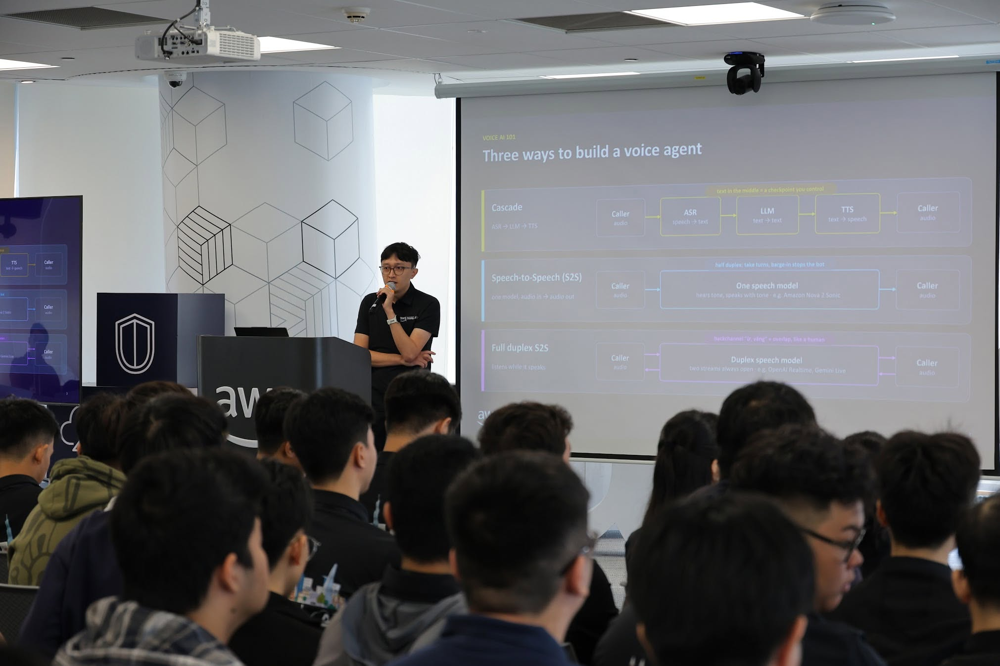
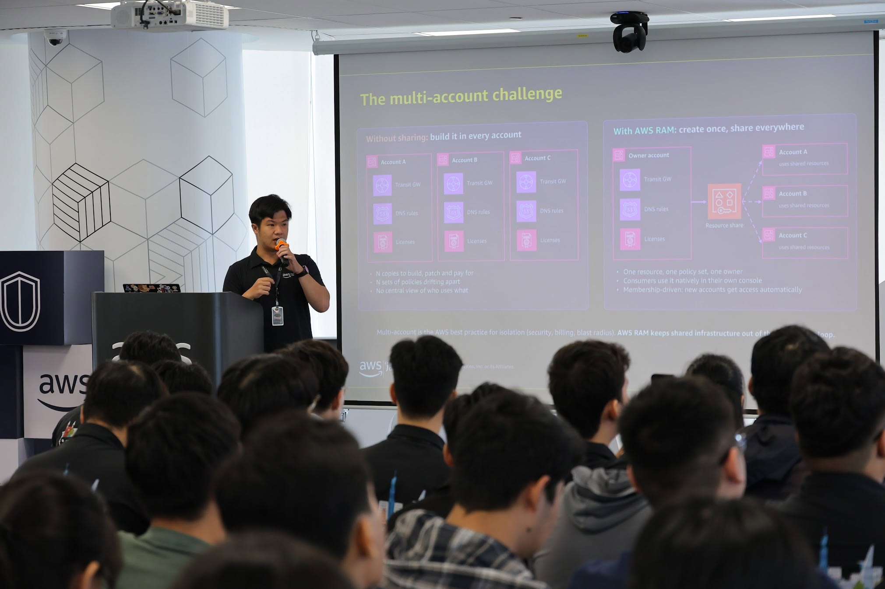
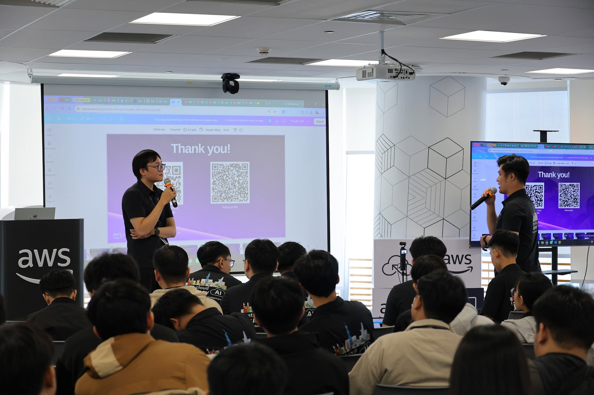
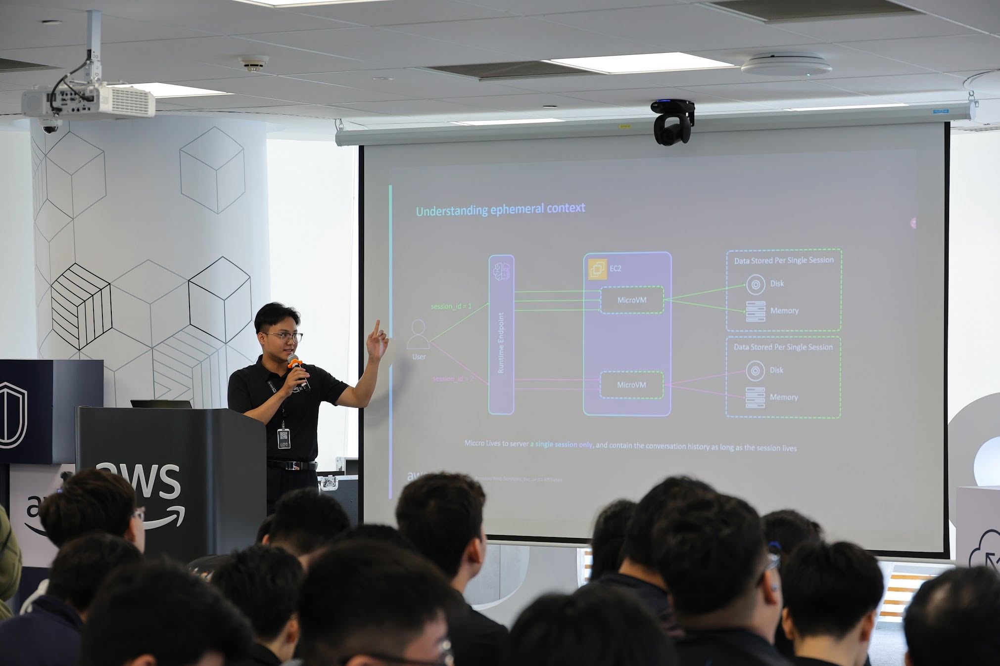
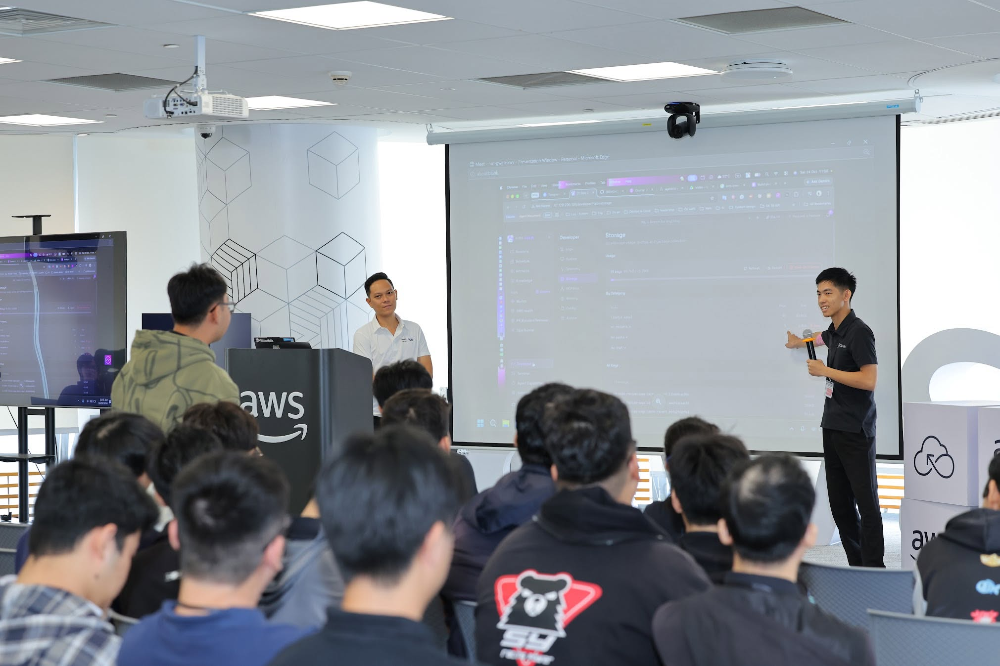
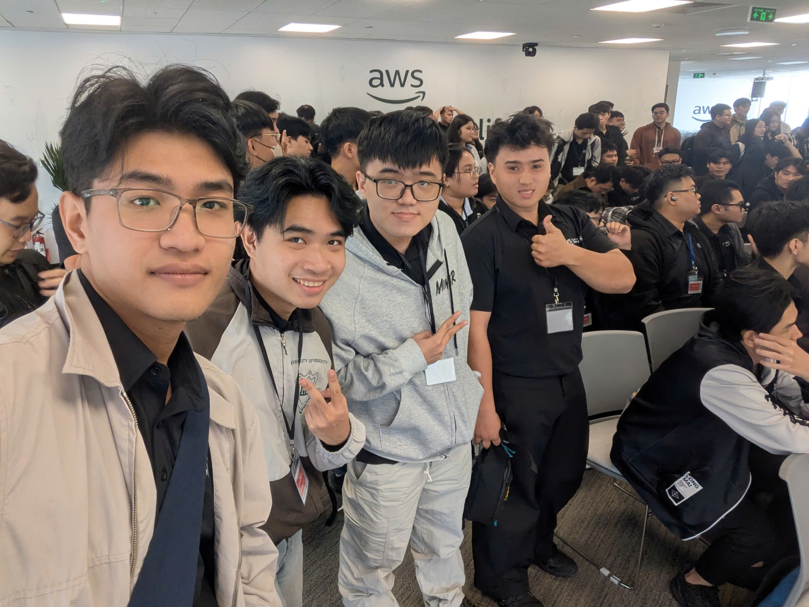
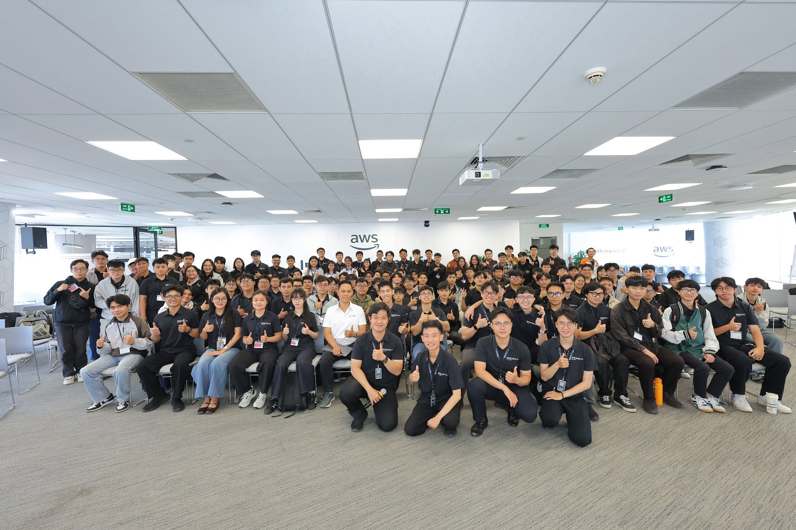
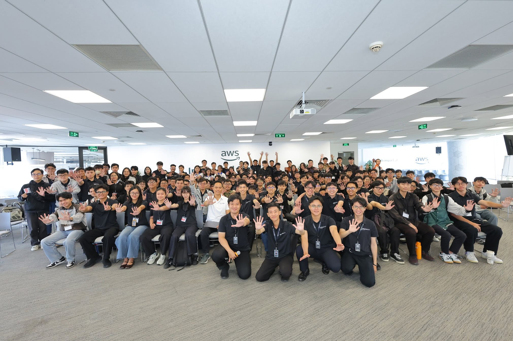

# Harvest Report: "First Cloud AI Journey" Meetup (October 24, 2026)

### 📌 Event Overview

* **Event Name:** First Cloud AI Journey Meetup: Trends & Real-world Practices in Cloud & AI Agent Deployment
* **Date & Time:** 09:00 – 12:00, Saturday Morning, October 24, 2026
* **Location:** AWS Vietnam Office, 26th Floor, Bitexco Financial Tower, 02 Hai Trieu Street, Ben Nghe Ward, District 1, Ho Chi Minh City
* **Organizers:** First Cloud Journey (FCJ) in collaboration with AWS Community Builders and AWS Student Builder Groups
* **Role:** Attendee & First Cloud Journey Intern
* **Audience:** Over 100 technology engineers, including Tech Leads, Cloud Solutions Architects, DevOps/Security Engineers from enterprises, AWS Community Builders, alongside passionate students and interns eager to master Cloud Computing and Generative AI Agents.
* **Event Community Post:** [Facebook AWS Study Group](https://www.facebook.com/groups/awsstudygroupfcj/permalink/2315876889177270/)

---

### 🎯 Objectives & Expectations

1. **Explore Production-grade AI Agent Architectures:** Gain deep insights into how industry practitioners combine core AWS cloud infrastructure with modern Generative AI to deploy autonomous agents in production environments.
2. **Learn Enterprise-level Technical Solutions:** Grasp real-world challenges and concrete technical remedies: optimizing latency for Vietnamese Voice AI, centralized multi-account networking with AWS RAM, automated shift-left security testing with AI Pentesting agents, and context window/memory management.
3. **Expand Professional Community Networking:** Directly connect and engage with Tech Leads, AWS Community Builders, and senior enterprise engineers to glean career advice and cultivate a mature engineering mindset.

---

### 🎤 In-Depth Technical Sessions Breakdown

The meetup delivered condensed, highly actionable technical insights through five curated sessions:

#### 1. Session 1: Hear, Think, Speak - Building a Vietnamese Voice-AI Contact Center on AWS

*Mr. Kiet Tran (Founder & AI Engineer at Revve AI) detailing the architectural nuances between Cascade, Speech-to-Speech (S2S), and Full-duplex S2S voice systems.*

* **Speaker:** **Mr. Kiet Tran** – Founder & AI Engineer at Revve AI.
* **Core Technical Insights:**
  * **Three Architectural Paradigms for Voice Agents:**
    1. *Cascade Pipeline:* Serial chaining of ASR (Speech-to-Text) ➔ LLM (Text-to-Text) ➔ TTS (Text-to-Speech). Key advantage: an explicit text checkpoint in the middle enabling strict guardrail enforcement and auditability.
    2. *Speech-to-Speech (S2S):* A unified speech model (e.g., Amazon Nova 2 Sonic) ingesting raw audio and outputting direct speech. Operates in half-duplex mode: user barge-in immediately interrupts and halts bot audio playback.
    3. *Full-duplex S2S:* Continuous bidirectional audio streaming (e.g., OpenAI Realtime, Gemini Live), empowering the bot to respond naturally with backchannel interjections ("yes", "uh-huh") and seamless vocal overlap just like human conversation.
  * **Four Practical Lessons Paid in Production:**
    * *Vietnamese Tone & Turn Detection Accuracy (79% vs 94%):* Vietnamese acoustic intonation and tone diacritics cause high false cut-off rates under English-centric algorithms ➔ Mandatory requirement to benchmark directly on native Vietnamese audio datasets.
    * *Raw Number Pronunciation Quirks ("500K" read as abbreviation instead of "five hundred thousand"):* Untreated text fed to TTS engines leads to mispronunciations ➔ Requires a dedicated Text Normalization layer prior to speech synthesis.
    * *Sentence-level Guardrails (Guard per Sentence):* Streaming output without fine-grained checkpoints risks playing inappropriate opening words to callers (5 out of 6 leak cases). Enforcing an intermediate Small Judge Model to evaluate each sentence before TTS reduced violations to 0 out of 6.
    * *Latency Budget Management:* Strict constraint to cap total round-trip latency under ~1.8s for smooth conversational flow, mandating a median LLM latency budget between 0.24s and 1.15s (e.g., self-hosted Gemma models).
* **Live Demo:** Live automated phone call interview screening a candidate for a Cloud Engineer position in natural Vietnamese, demonstrating fluid turn-taking, prompt understanding, and context-aware responses.

#### 2. Session 2: AWS Resource Access Manager (RAM) - Create Once, Share Everywhere

*Mr. Long Huynh (Solutions Engineer at Styl Solution) addressing multi-account infrastructure fragmentation and demonstrating how AWS RAM enables centralized, cost-effective resource sharing.*

* **Speaker:** **Mr. Long Huynh** – Solutions Engineer at Styl Solution.
* **Core Technical Insights:**
  * **The Multi-Account Challenge:**
    * In enterprise environments spanning multiple AWS accounts (for different departments, business units, or SDLC stages like Dev, Staging, and Production), duplicating shared network infrastructure (Transit Gateways, VPC Subnets, Route 53 Resolver Rules, License Manager) incurs 3x cost inflation, configuration drift, and decentralized governance.
  * **The AWS RAM Paradigm:**
    * Implements the core principle: *"Create once, share securely across the entire organization (AWS Organizations)"*.
    * Infrastructure is provisioned once within an authoritative Owner Account and shared seamlessly via Resource Shares to Member Accounts.
    * Consumer Accounts consume these shared assets natively within their own AWS Console interfaces without administrative overhead.
  * **Dual-layer Governance (IAM Policies combined with SCPs):**
    * Combines granular IAM Resource-based Policies with organization-wide Service Control Policies (SCPs) to establish immutable permission guardrails, preventing member accounts from altering or bypassing shared network topologies.

#### 3. Session 3: AWS Pentest with AWS Continuum / Security Agent

*Mr. Nguyen Tuan Thinh (Security Engineer at Styl Solution) engaging with audience inquiries regarding autonomous security agents and automated CI/CD pentesting on SIT/UAT.*

* **Speaker:** **Mr. Nguyen Tuan Thinh** – Security Engineer at Styl Solution.
* **Core Technical Insights:**
  * **The Shift-Left Security Philosophy:**
    * Embedding security verification into the earliest phases of the software development lifecycle (SDLC) rather than treating it as an afterthought before release.
  * **Automated Infrastructure-as-Code (IaC) Auditing:**
    * Integrating automated security bots into GitHub and GitLab Pull Request (PR) pipelines.
    * Performing Static Code Analysis on Terraform scripts to detect vulnerabilities such as unrestricted `0.0.0.0/0` ingress rules, unencrypted EBS volumes/S3 buckets, or overprivileged wildcard IAM policies (`*`) before code is merged.
  * **Frontier Security Agent:**
    * Powered by Amazon Bedrock foundation models with autonomous reasoning capabilities to plan and execute comprehensive security evaluations without human intervention.
    * Acts as an active simulated adversary (Attacker) performing penetration testing against SIT and UAT staging environments to uncover business logic flaws and configuration oversights before production deployment.

#### 4. Session 4: Amazon Bedrock AgentCore - Production Architecture & Dual Memory System

*Mr. Xuan An (Leader of AWS Student Builder Group HCMUTE) explaining single-session ephemeral MicroVMs on EC2 Spot instances for cost-optimized agent runtimes.*

* **Speaker:** **Mr. Xuan An** – Leader of AWS Student Builder Group HCMUTE.
* **Core Technical Insights:**
  * **Agent Ecosystem Architecture:** A modular framework harmonizing Application Layer ➔ Agent Runtime (framework, instructions, local tools, context) ➔ Foundation Models.
  * **Cost-effective Agent Runtime on EC2 Spot Instances:**
    * Instead of maintaining expensive, long-running servers, the runtime orchestrates lightweight MicroVMs dynamically provisioned on **Amazon EC2 Spot Instances**.
    * Ephemeral Context Principle: *"Micro lives to serve a single session only"* – Each MicroVM encapsulates session data (Disk and Memory) exclusively for the duration of one user dialogue. Upon session completion, the instance is promptly recycled, slashing operational compute expenses by 70% to 90%.
  * **Dual-tier Memory System:**
    * *Short-term Memory:* Synchronous in-session state retention to maintain immediate conversational context.
    * *Long-term Memory:* Asynchronous post-session extraction of user preferences, core facts, and critical historical decisions into Vector Databases (OpenSearch / Amazon Bedrock Knowledge Bases) to ensure persistent personalization across subsequent interactions.

#### 5. Session 5: Kiro Crew - All-In-One AI Companion for Engineers

*Mr. Danh Hoang Hieu Nghi (AWS Community Builder) and Mr. Kieu Nguyen Dang Khoa (Tech Lead ACB) demonstrating live developer storage inspection and token breakdown.*

* **Speakers:** **Mr. Kieu Nguyen Dang Khoa** (Technical Lead – Digital Transformation at ACB Bank) & **Mr. Danh Hoang Hieu Nghi** (AWS Community Builder).
* **Core Technical Insights & Live Demonstrations:**
  * **24/7 Engineer Companion:** Platform architecture designed to continuously assist software engineers with code reviews, architectural compliance checks, and infrastructure health monitoring.
  * **Automated Visual UI Artifacts Generation:**
    * Demonstrating an end-to-end workflow where the agent autonomously crawls real-world tech job market listings, synthesizes key data points, and renders interactive UI chart artifacts directly inside the chat interface.
  * **Context Window Management Strategies:**
    * *Auto Compact Mechanism:* Automatically triggered when conversation context reaches 70% – 90% of model token limits, intelligently summarizing earlier dialogue turns to liberate token capacity without dropping conversational coherence.
    * *Context Breakdown Inspector:* Enables engineers to dissect token consumption across System Prompts, Tool/Function Schemas, Memory, and User Messages, facilitating cost and performance tuning.
  * **Developer Storage Management & Security Guardrails:**
    * Selective memory cleanup algorithms targeting stale or unneeded storage keys to avoid database bloat.
    * Robust Guardrails: Enforcing strict execution policies that prohibit destructive commands (such as terminating core instances or dropping database schemas) and sanitize model responses to prevent secret/credential leakage (`AWS_SECRET_ACCESS_KEY`, API tokens).

---

### 💡 Key Takeaways & Lessons Learned

1. **FinOps & Latency Budget Trade-offs:**
   * In Voice AI and real-time agent workflows, every millisecond counts. Model selection (Cascade vs S2S, Cloud APIs vs Self-hosted Open Source) must be strictly governed by latency thresholds and cost-efficiency rather than chasing parameter size blindly.
2. **Centralized Multi-Account Governance with AWS RAM:**
   * Enterprise architectures demand centralized resource ownership combined with seamless distributed consumption. Combining AWS RAM with SCPs provides a battle-tested blueprint for scalable multi-account organizations.
3. **Empowering Security via Autonomous Shift-Left Agents:**
   * Security testing is evolving from manual periodic audits into automated, agentic CI/CD verifications, identifying infrastructure vulnerabilities before code reaches production environments.
4. **Mastering Agent Context and Memory Hygiene:**
   * Implementing dynamic context compaction (Auto Compact) alongside dual-tier memory structures (Short-term vs Long-term) is crucial for delivering highly capable, cost-efficient, and reliable AI systems.

---

### 🚀 Practical Application to FCJ Internship & Cloud Projects

* **Implement Safety Guardrails in Automated Scripts:** Always incorporate pre-flight validation checks and safety boundaries into automated infrastructure scripts to prevent unintended modifications or deletions.
* **Architect Scalable and Secure Cloud Networking:** Apply learnings regarding VPC Subnet grouping, Route Table isolation, and AWS RAM multi-account sharing to future multi-tier architecture labs in Weeks 6 through 12.
* **Embrace the Renaissance Developer Mindset:** Actively participate in AWS Community meetups to broaden technical perspectives, bridge the gap between cloud infrastructure and emerging AI agent paradigms, and foster continuous learning.

---

### 📸 Event Photo Gallery & Proof of Attendance

#### 1. Proof of Attendance & Check-in at AWS Vietnam

*Figure 1: Author and fellow First Cloud Journey interns checking in with event badges at the AWS Vietnam Office, 26th Floor, Bitexco Financial Tower.*

#### 2. Group Photos & Event Atmosphere

*Figure 2: Memorable group photo capturing over 100 participants, including speakers, organizers, AWS Community Builders, and enthusiastic interns.*

*Figure 3: All attendees waving to commemorate an inspiring, high-energy Saturday morning meetup.*

---

> **Conclusion:** The *"First Cloud AI Journey"* Meetup was an extraordinarily enriching experience. Bridging foundational cloud infrastructure with the forefront of generative AI agent development, the event instilled valuable practical knowledge and immense inspiration for aspiring cloud engineers. It reinforced the determination to remain proactive, continuously learn, and confidently progress on the journey to mastering the cloud.
